# Hands-on 7.1. Первая база данных в RDS

В разделе «RDS в VPC» мы говорили, что базу приложения размещают в приватных подсетях, не дают ей публичного адреса, а доступ к ней открывают Security Group только для серверов приложения. В этом занятии вы соберёте такую схему сами: подготовите сеть, создадите группу подсетей и экземпляр PostgreSQL, а затем подключитесь к базе изнутри VPC и выполните первые SQL-запросы.

Форма создания базы в RDS длинная, и почти у каждого поля есть значение по умолчанию. Можно пройти её, не читая, и база всё равно создастся. Цель занятия в другом: понять, за что отвечает каждый параметр и почему для учебной базы мы выбираем одно значение, а для рабочей выбрали бы другое. Поэтому после каждого блока настроек идёт объяснение.

## Что получится в конце

- VPC `shop-vpc` с двумя публичными и двумя приватными подсетями в двух зонах доступности, без NAT Gateway.
- Две Security Group: `app-sg` для клиентов базы и `db-sg`, которая пускает к PostgreSQL только участников `app-sg`.
- Группа подсетей `shop-db-subnets` из двух приватных подсетей.
- Экземпляр `shop-db` с PostgreSQL в одной зоне доступности, без публичного доступа.
- Среда CloudShell внутри VPC, из которой вы подключитесь к базе через `psql`, создадите таблицу и запишете в неё строки.

Итоговое размещение ресурсов по подсетям:

| Зона доступности | Публичная подсеть | Приватная подсеть                                          |
| ---------------- | ----------------- | ---------------------------------------------------------- |
| `eu-central-1a`  | Пусто             | Экземпляр `shop-db` и VPC-среда CloudShell                 |
| `eu-central-1b`  | Пусто             | Пусто, но подсеть входит в группу подсетей базы            |

Публичные подсети в этом занятии не используются. В настоящем проекте в них работали бы балансировщик нагрузки и серверы приложения, а база оставалась бы в приватных подсетях. Зона, в которой RDS запустит экземпляр, у вас может оказаться другой.

## Перед началом

- Вы прошли Hands-on 5.1: умеете создавать Security Group и помните, чем публичная подсеть отличается от приватной. Создание Security Group в этом занятии описано кратко.
- Вы работаете в регионе `Europe (Frankfurt)`.
- Закладывайте на занятие около часа. Создание экземпляра занимает несколько минут, за это время вы подготовите среду для подключения.

> [!WARNING]
> Экземпляр RDS оплачивается почасово, пока существует, даже если к нему никто не подключается (раздел «Стоимость RDS»). Отдельно оплачивается выделенное хранилище. Часть 5 с удалением ресурсов обязательна.

## Часть 1. Сеть для базы данных

### Шаг 1. Создайте VPC с подсетями

В Hands-on 5.1 вы собирали VPC по одному компоненту: подсети, Internet Gateway, таблицы маршрутов. Теперь, когда понятно, из чего она состоит и как компоненты связаны, можно воспользоваться мастером, который создаст всё сразу.

Откройте сервис `VPC` и нажмите `Create VPC`. Заполните форму:

1. В разделе `Resources to create` выберите `VPC and more` (_1_).
2. В поле `Name tag auto-generation` введите `shop` (_2_). Мастер добавит это слово к именам всех ресурсов: VPC получит имя `shop-vpc`, подсети `shop-subnet-public1-eu-central-1a` и так далее.
3. Оставьте диапазон `10.0.0.0/16` (_3_).

Справа мастер показывает схему будущей сети (_4_). Это удобная проверка: прежде чем нажать кнопку, вы видите, какие подсети, таблицы маршрутов и шлюзы появятся и как они связаны между собой.

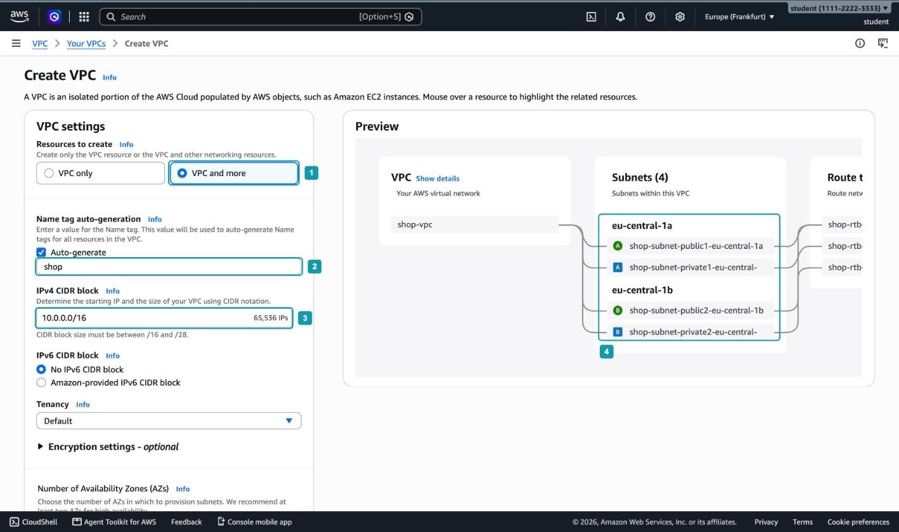

_7.1.1. Мастер создания VPC_

Прокрутите форму ниже и проверьте остальные параметры:

1. `Number of Availability Zones (AZs)` равно `2` (_5_).
2. `Number of public subnets` равно `2` (_6_).
3. `Number of private subnets` равно `2` (_7_).
4. В поле `NAT gateways` выберите `None` (_8_).
5. В поле `VPC endpoints` выберите `None` (_9_).

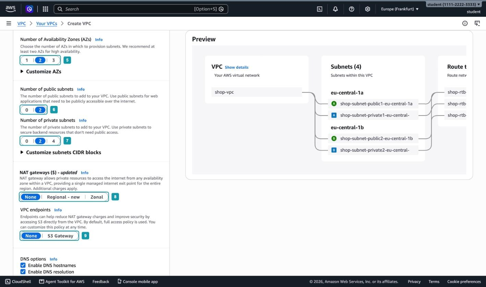

_7.1.2. Зоны, подсети и NAT Gateway в мастере_

Почему именно так:

- *Две зоны доступности*. RDS не даст создать базу, если её подсети находятся в одной зоне. Подробнее об этом в части 2.
- *Без NAT Gateway*. NAT Gateway нужен, когда сервер в приватной подсети сам обращается в интернет, например скачивает обновления. Экземпляру RDS это не нужно: обновлениями СУБД занимается AWS. А NAT Gateway оплачивается почасово, даже если через него не идёт трафик.
- *Без VPC endpoints*. Endpoint дал бы приватным подсетям доступ к сервисам AWS, например к S3, без выхода в интернет. В этом занятии он не нужен.

Нажмите `Create VPC` и дождитесь, пока мастер создаст все ресурсы.

### Шаг 2. Проверьте таблицы маршрутов

Мастер сам разделил диапазон `10.0.0.0/16` на подсети размером `/20`, это 4096 адресов в каждой. Публичные подсети получили `10.0.0.0/20` и `10.0.16.0/20`, приватные `10.0.128.0/20` и `10.0.144.0/20`.

Слова `public` и `private` в именах подсетей ничего не гарантируют, это только названия. Подсеть делает публичной или приватной её таблица маршрутов. Мастеру мы доверяем, но проверить стоит.

Откройте `Route tables` и введите `shop` в строку поиска. В списке четыре таблицы (_10_): для публичных подсетей мастер создал одну общую таблицу `shop-rtb-public`, для каждой приватной подсети отдельную таблицу, а таблица без имени это главная таблица VPC, к которой не привязана ни одна подсеть.

Выберите таблицу `shop-rtb-private1-eu-central-1a` и откройте вкладку `Routes`. В ней единственный маршрут `10.0.0.0/16` с целью `local` (_11_).

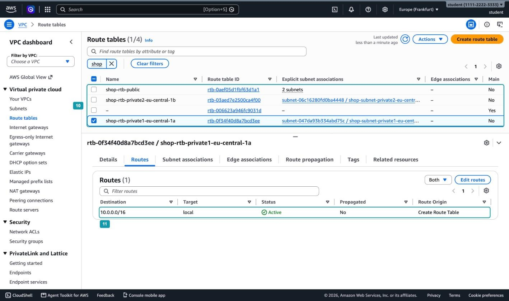

_7.1.3. Таблица маршрутов приватной подсети_

Маршрут `local` есть в каждой таблице VPC, и удалить его нельзя. Он означает, что любой адрес внутри VPC доступен напрямую, поэтому ресурсы из разных подсетей и разных зон могут обращаться друг к другу. Маршрута `0.0.0.0/0` в таблице нет, значит, пакету, адресованному за пределы VPC, некуда идти. Из такой подсети нельзя выйти в интернет, и из интернета в неё попасть тоже нельзя.

Для сравнения откройте `shop-rtb-public`: в ней есть ещё маршрут `0.0.0.0/0` в Internet Gateway. Только этим публичная подсеть и отличается от приватной.

### Шаг 3. Создайте две Security Group

Маршруты определяют, *куда* пакет может дойти. Security Group определяют, *кого* пустят к конкретному ресурсу. Для базы нужны две группы. Откройте `Security Groups` и создайте их в `shop-vpc` так же, как в Hands-on 5.1:

| Имя      | Входящие правила                                       | Назначение                                       |
| -------- | ------------------------------------------------------ | ------------------------------------------------ |
| `app-sg` | Нет                                                    | Группа для всего, что должно подключаться к базе |
| `db-sg`  | `PostgreSQL`, TCP `5432`, источник `Custom` = `app-sg` | Группа экземпляра базы данных                    |

Исходящие правила в обеих группах оставьте по умолчанию: они разрешают любой исходящий трафик.

Разберём, как эти группы работают вместе:

- *Порт `5432`*. Это стандартный порт PostgreSQL. Тип правила `PostgreSQL` консоль сама превращает в TCP `5432`.
- *Источник `app-sg`, а не диапазон адресов*. Правило пускает к базе любой ресурс, которому назначена группа `app-sg`, независимо от его IP-адреса и подсети. Серверы приложения появляются и исчезают, например при автоматическом масштабировании, и их адреса заранее неизвестны. Правило с группой-источником не придётся менять при каждом новом сервере: достаточно назначить серверу `app-sg`.
- *Группа `app-sg` без входящих правил*. Она нужна как метка «этому ресурсу можно к базе». Ответы базы клиенту всё равно дойдут: Security Group запоминает соединения (stateful), и ответ на разрешённый исходящий запрос проходит без отдельного входящего правила.

Это тот же приём, что и с `web-sg` и `db-sg` в Hands-on 5.1, только без доступа по SSH: на сервер базы в RDS зайти нельзя, поэтому и правило для SSH не нужно.

## Часть 2. Группа подсетей

### Зачем RDS группа подсетей

Когда вы запускаете экземпляр EC2, вы сами указываете одну подсеть, и экземпляр живёт в ней, пока вы его не удалите. С RDS так не получится, потому что базой управляете не вы, а AWS. Сервису самому приходится решать, где запустить экземпляр, и иногда переносить его:

- При создании базы RDS выбирает зону и подсеть, если вы не указали зону явно.
- В режиме Multi-AZ RDS создаёт резервный экземпляр в другой зоне, и ему нужна подсеть в этой зоне.
- При отказе оборудования или зоны RDS переключается на резервный экземпляр или поднимает экземпляр заново.
- При восстановлении из резервной копии RDS создаёт новый экземпляр, и для него тоже нужна подсеть.

Поэтому вместо одной подсети RDS получает список подсетей, в которых ему разрешено размещать экземпляры вашей базы. Этот список и называется группой подсетей базы данных (DB subnet group). Можно думать о нём как о договоре с сервисом: «запускай базу где удобно, но только в этих подсетях».

Из этого следуют два правила составления группы:

1. *Только приватные подсети*. RDS может выбрать любую подсеть группы. Если в группу попадёт публичная подсеть, база однажды может оказаться в ней. Пока параметр `Public access` выключен, публичного адреса у неё не будет, но защита держится только на одном флажке. Если же все подсети группы приватные, то даже ошибочно включённый `Public access` ничего не откроет: публичный адрес бесполезен без маршрута в Internet Gateway. Получаются два независимых барьера вместо одного.
2. *Подсети минимум в двух зонах*. AWS требует этого даже для базы в одной зоне. Тогда базу можно в любой момент перевести в режим Multi-AZ, не перестраивая сеть: подсеть для резервного экземпляра уже есть.

В каждой зоне достаточно одной подсети. Несколько подсетей в одной зоне добавляют, когда в подсети заканчиваются свободные адреса.

### Шаг 4. Создайте группу подсетей

Откройте сервис `Aurora and RDS`, в меню слева выберите `Subnet groups` и нажмите `Create DB subnet group`. Заполните форму:

1. В поле `Name` введите `shop-db-subnets` (_12_). Имя потом изменить нельзя, об этом предупреждает подсказка над полем. В поле `Description` кратко опишите назначение группы, например `Private subnets for the shop database`: через полгода в аккаунте с десятком групп описание сэкономит время.
2. В поле `VPC` выберите `shop-vpc` (_13_). Под именем консоль показывает, сколько в VPC подсетей и зон: `4 Subnets, 2 Availability Zones`. Группа подсетей всегда принадлежит одной VPC, и сменить VPC после создания тоже нельзя.
3. В поле `Availability Zones` выберите `eu-central-1a` и `eu-central-1b` (_14_). Это фильтр: ниже консоль покажет только подсети выбранных зон.
4. В поле `Subnets` выберите две приватные подсети (_15_): `shop-subnet-private1-eu-central-1a` с диапазоном `10.0.128.0/20` и `shop-subnet-private2-eu-central-1b` с диапазоном `10.0.144.0/20`. Публичные подсети в списке тоже есть, отличить их можно по имени и по диапазону.

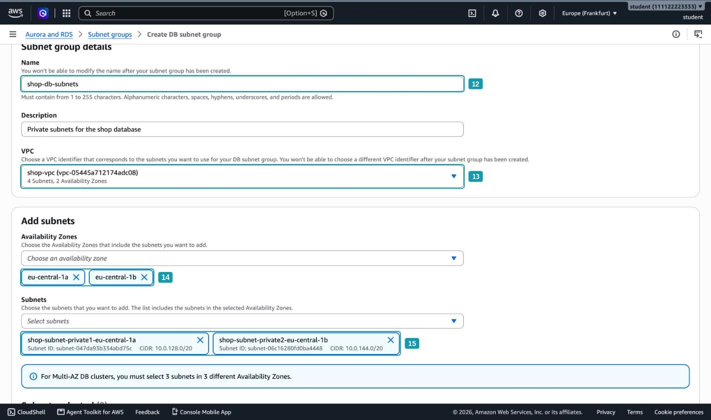

_7.1.4. Группа подсетей shop-db-subnets_

Синяя плашка под подсетями напоминает, что для Multi-AZ DB cluster нужны подсети в трёх зонах. Это режим с тремя экземплярами, при котором два резервных экземпляра ещё и обслуживают чтение. Мы его в главе не рассматривали. Для одного экземпляра и для Multi-AZ DB instance хватает двух зон.

Нажмите `Create`. Группа появится в списке. Откройте её и посмотрите на таблицу подсетей внизу: две подсети в двух зонах. Это все места, где RDS сможет запустить вашу базу.

> [!NOTE]
> Если бы вы выбрали подсети только одной зоны, консоль не дала бы сохранить группу. Это хороший пример того, как AWS закладывает требования надёжности прямо в интерфейс: базу в одной зоне создать можно, а сеть, из которой её нельзя вывести в Multi-AZ, нельзя.

## Часть 3. Экземпляр базы данных

Откройте `Databases` и нажмите `Create database`. Форму разберём по блокам, от выбора СУБД до резервных копий.

### Шаг 5. Выберите СУБД и шаблон

1. В разделе `Engine options` выберите `PostgreSQL` (_16_).
2. В разделе `Choose a database creation method` выберите `Full configuration` (_17_).
3. В разделе `Templates` выберите `Sandbox` (_18_).

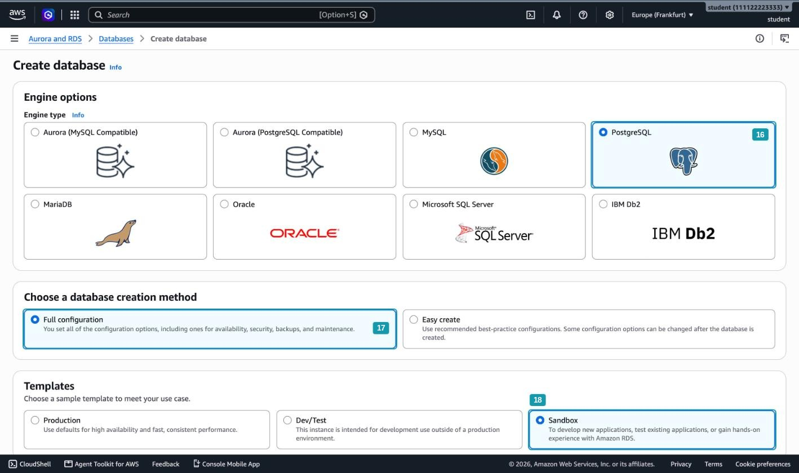

_7.1.5. Выбор СУБД и шаблона_

В списке СУБД шесть обычных движков и два варианта Aurora. MySQL, MariaDB и PostgreSQL распространяются свободно, а за Oracle, SQL Server и Db2 в цену экземпляра входит лицензия, поэтому для учебной базы они не подходят. Aurora это собственная СУБД AWS, совместимая с MySQL или PostgreSQL, её мы обсуждали в разделе «Amazon Aurora».

Вариант `Easy create` заполнил бы большинство параметров сам и показал бы только несколько полей. Для работы это удобно, но нам нужно увидеть каждый параметр, поэтому выбираем `Full configuration`.

Шаблон только предзаполняет форму значениями по умолчанию, и любое значение можно поменять вручную. `Production` настраивает форму на надёжность: включает Multi-AZ и предлагает более мощные классы экземпляров. `Sandbox` настраивает её на минимальную стоимость и делает недоступными дорогие варианты, чтобы их нельзя было выбрать случайно.

### Шаг 6. Посмотрите на режимы доступности

В разделе `Availability and durability` консоль показывает три режима развёртывания, и для каждого рисует схему. Два из них в шаблоне `Sandbox` недоступны, но описания стоит прочитать.

`Multi-AZ DB instance deployment` (_19_) это режим Multi-AZ из главы. На схеме основной экземпляр в зоне `AZ 1` и резервный в зоне `AZ 2`. Обратите внимание на подпись `Standby (no endpoint)`: у резервного экземпляра нет адреса для подключения, он не обслуживает запросы и только ждёт отказа основного.

Выбран режим `Single-AZ DB instance deployment` (_20_): один экземпляр в одной зоне. Консоль прямо пишет его слабое место, `No data redundancy`: копии данных в другой зоне нет, и ожидаемая доступность у этого режима ниже, чем у Multi-AZ.

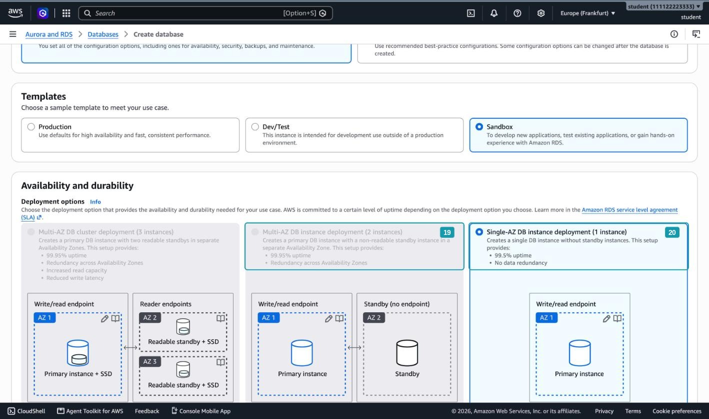

_7.1.6. Режимы доступности_

Для учебной базы такой компромисс приемлем: если зона откажет, мы подождём. Для рабочей базы магазина нет: пока зона недоступна, магазин не принимает заказы. Но Multi-AZ удваивает часы работы экземпляров в счёте, поэтому решение принимают, сравнивая цену простоя с ценой резервного экземпляра.

### Шаг 7. Задайте имя экземпляра и учётные данные

1. В поле `Engine version` оставьте версию, предложенную по умолчанию (_21_). На рисунках это `PostgreSQL 18.3-R2`, у вас версия может быть новее.
2. В поле `DB instance identifier` введите `shop-db` (_22_).
3. В поле `Master username` оставьте `postgres` (_23_).
4. В поле `Credentials management` выберите `Self managed` (_24_).
5. Придумайте пароль и введите его в поля `Master password` (_25_) и `Confirm master password`. Пароль должен содержать не меньше 8 символов и не должен включать символы `/`, `'`, `"` и `@`. Запишите его: посмотреть пароль потом нельзя, его можно только заменить на новый.

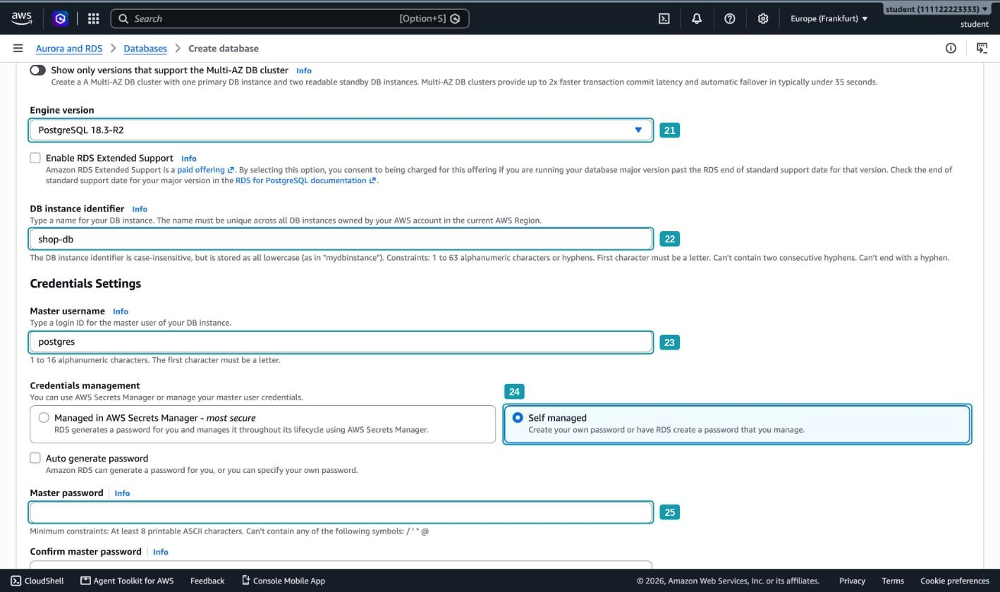

_7.1.7. Имя экземпляра и учётные данные_

В этом и следующих шагах встретятся три разных имени, и их легко перепутать:

| Имя                   | Где задаётся                        | Что это                                               | Где понадобится                    |
| --------------------- | ----------------------------------- | ----------------------------------------------------- | ---------------------------------- |
| `shop-db`             | `DB instance identifier`            | Имя ресурса в AWS, то есть экземпляра с СУБД          | В консоли и в начале endpoint      |
| `postgres`            | `Master username`                   | Главный пользователь PostgreSQL с правами на управление базой | В параметре `-U` команды `psql`    |
| `shop`                | `Initial database name`, шаг 11     | База данных внутри PostgreSQL                         | В параметре `-d` команды `psql`    |

Экземпляр это сервер СУБД. Внутри одного экземпляра PostgreSQL может быть несколько баз, а в каждой свои таблицы. Поэтому имя экземпляра и имя базы задаются отдельно.

> [!NOTE]
> Вариант `Managed in AWS Secrets Manager` консоль называет самым безопасным: RDS сам создаст пароль, сохранит его в отдельном сервисе для секретов и будет периодически менять. Приложение тогда получает пароль из Secrets Manager при запуске, а не хранит его в своих настройках. В учебном занятии удобнее знать пароль самому.

### Шаг 8. Выберите класс экземпляра

1. В разделе `Database authentication` оставьте `Password authentication` (_26_).
2. В разделе `Instance configuration` выбраны `Burstable classes (includes t classes)` (_27_). Классы `Standard` и `Memory optimized` в шаблоне `Sandbox` недоступны.
3. В списке классов выберите `db.t4g.micro` (_28_): 2 vCPU и 1 ГиБ памяти.

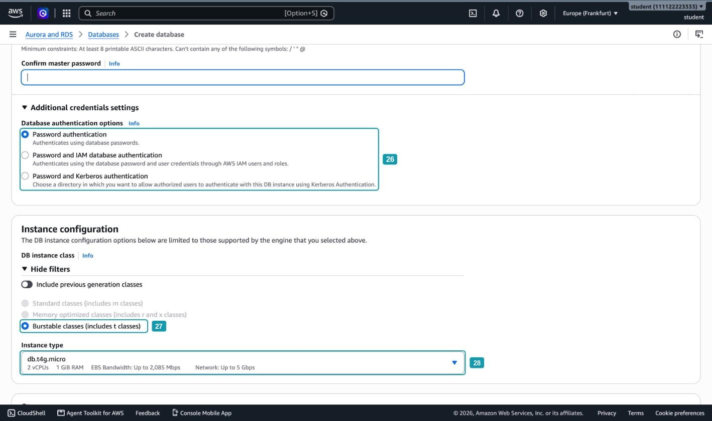

_7.1.8. Аутентификация и класс экземпляра_

Способ аутентификации определяет, как пользователи доказывают базе, кто они. Мы подключимся по имени пользователя и паролю. Другие варианты позволяют входить по временным токенам IAM или через Kerberos, это нужно в компаниях с централизованным управлением доступом.

Имя класса читается так же, как тип экземпляра EC2 в главе 4: `t` это семейство, `4` поколение, `g` процессор AWS Graviton на архитектуре ARM, `micro` размер. Классы семейства `t` называют burstable, «с запасом на всплески». Пока нагрузка низкая, экземпляр копит кредиты процессора, а при всплеске тратит их и работает на полную мощность. Для учебной базы и небольших сайтов, где процессор почти всё время простаивает, это дешёвый вариант. Для базы с постоянно высокой нагрузкой выбирают классы `m` (Standard) или `r` (Memory optimized): в RDS классы `t` по умолчанию работают в режиме Unlimited, и долгая высокая нагрузка оплачивается сверх цены экземпляра.

### Шаг 9. Настройте хранилище

1. В поле `Storage type` выберите `General Purpose SSD (gp3)` (_29_).
2. В поле `Allocated storage` оставьте `20` ГиБ (_30_). Это минимальный объём.
3. Ниже консоль поясняет, что для томов меньше 400 ГиБ базовая производительность `gp3` фиксирована (_31_): 3000 IOPS и 125 МиБ/с.
4. Оставьте включённым `Enable storage autoscaling` и в поле `Maximum storage threshold` введите `30` (_32_).

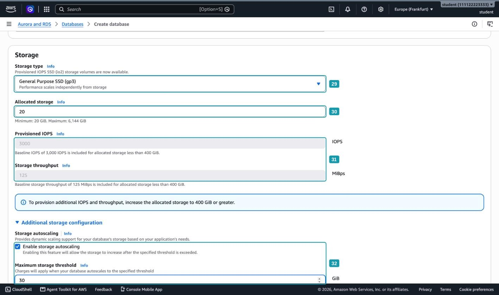

_7.1.9. Хранилище экземпляра_

Шаблон `Sandbox` по умолчанию выбирает `gp2`, предыдущее поколение томов. У `gp2` производительность зависит от объёма: 3 IOPS на каждый ГиБ, то есть для тома 20 ГиБ всего 100 IOPS, а больше только во время коротких всплесков. У `gp3` базовые 3000 IOPS есть у тома любого размера. Поэтому `gp3` выбирают почти всегда.

Порог автоматического увеличения ограничивает, до какого объёма RDS может сам расширить том. По умолчанию он равен 1000 ГиБ. Если приложение из-за ошибки начнёт в цикле писать в базу мусор, RDS будет послушно увеличивать том до этого значения, а платить придётся за выделенный объём. Вернуть объём назад нельзя: в RDS выделенное хранилище можно только увеличивать. Поэтому порог задают близким к реальной потребности.

### Шаг 10. Задайте сетевые параметры

В начале раздела `Connectivity` выберите:

- В поле `Compute resource` вариант `Don't connect to an EC2 compute resource`. Вариант с подключением к EC2 сам создал бы Security Group и правила между базой и указанным сервером. Мы уже создали свои группы и понимаем, что в них.
- В поле `Virtual private cloud (VPC)` сеть `shop-vpc`. Консоль предупреждает, что после создания базы VPC изменить нельзя.

Ниже проверьте остальные параметры:

1. В поле `DB subnet group` консоль сама подставила `shop-db-subnets` (_33_): это единственная группа подсетей в `shop-vpc`. Подпись `2 Subnets, 2 Availability Zones` подтверждает, что группа годится для Multi-AZ.
2. В поле `Public access` выберите `No` (_34_).
3. В поле `Existing VPC security groups` удалите группу `default` и выберите `db-sg` (_35_).
4. В поле `Availability Zone` оставьте `No preference` (_36_).

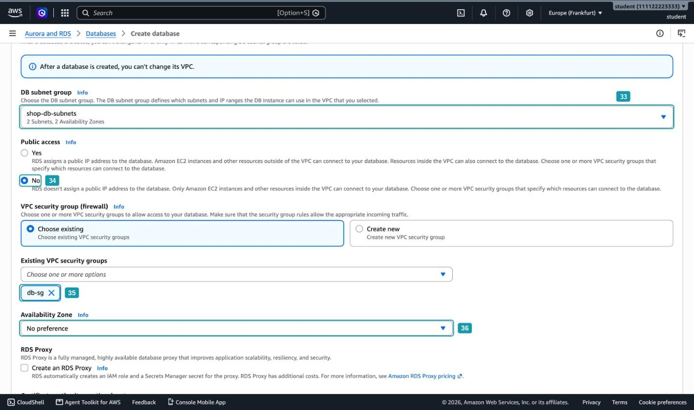

_7.1.10. Сетевые параметры экземпляра_

Здесь сходится всё, что мы подготовили в частях 1 и 2:

- *`Public access`*. Параметр решает, получит ли экземпляр публичный IP-адрес. Описание варианта `No` прямо говорит, что подключиться смогут только ресурсы внутри VPC. Как мы обсуждали в части 2, это первый барьер, а приватные подсети группы второй.
- *Группа `db-sg` вместо `default`*. Группа `default` пускает к ресурсу всё, что входит в ту же группу `default`. В неё по умолчанию попадает многое, что создаётся в VPC без явного выбора группы, поэтому оставлять её на базе опасно. Третий барьер это правило `db-sg`, которое пускает к порту `5432` только участников `app-sg`.
- *`No preference`*. RDS сам выберет одну из двух подсетей группы, а значит, и зону. Указывать зону явно имеет смысл, когда сервер приложения работает в конкретной зоне и хочется, чтобы трафик к базе не выходил за её пределы.

### Шаг 11. Задайте имя базы и резервное копирование

Раскройте раздел `Additional configuration` внизу формы.

1. В поле `Initial database name` введите `shop` (_37_). Если оставить поле пустым, RDS не создаст базу внутри экземпляра, и её придётся создавать самому командой `CREATE DATABASE`.
2. Оставьте включённым `Enable encryption` (_38_).

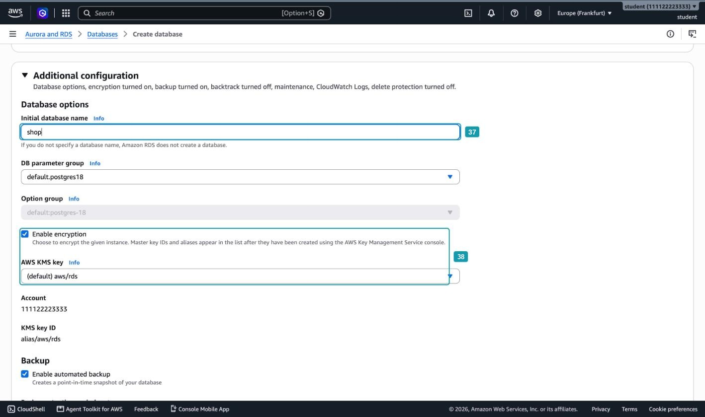

_7.1.11. Имя базы и шифрование_

Между этими полями находится `DB parameter group` со значением вроде `default.postgres18`. Группа параметров заменяет файл настроек СУБД. В обычном PostgreSQL вы бы правили `postgresql.conf` на сервере, но доступа к серверу в RDS нет, поэтому параметры СУБД меняют через группу параметров. Группу по умолчанию изменить нельзя, для своих настроек создают новую.

Шифрование защищает данные на томе и в резервных копиях ключом `aws/rds`, который AWS создаёт в аккаунте автоматически. Для приложения это ничего не меняет, СУБД работает с данными как обычно. Включать шифрование стоит сразу: зашифровать уже созданный незашифрованный экземпляр нельзя, только восстановить зашифрованную копию из снимка.

В разделе `Backup` проверьте параметры резервного копирования:

1. `Enable automated backups` включено (_39_).
2. В поле `Backup retention period` выберите `1` день (_40_). Допустимы значения от 1 до 35 дней.
3. В поле `Backup window` оставьте `No preference` (_41_).
4. Флажок `Enable replication in another AWS Region` оставьте выключенным (_42_).

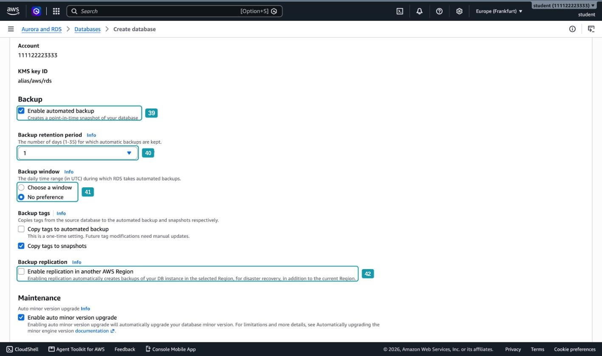

_7.1.12. Резервное копирование_

Срок хранения определяет, насколько далеко назад можно вернуться при восстановлении на момент времени (раздел «Резервные копии и восстановление»). Для учебной базы хватит одного дня, для рабочей обычно ставят одну-две недели. Окно резервного копирования это ежедневный промежуток времени, в который RDS делает снимок. Для рабочей базы его выбирают на часы минимальной нагрузки, нам подойдёт любое время. Копирование резервных копий в другой регион защищает от отказа целого региона, но добавляет плату за хранение второй копии и передачу данных между регионами.

Ниже в разделе `Maintenance` включено автоматическое обновление младших версий СУБД. Это одна из обязанностей, которую RDS берёт на себя: исправления безопасности PostgreSQL установятся без вашего участия в окно обслуживания.

Остальные параметры оставьте по умолчанию и нажмите `Create database` внизу страницы.

### Шаг 12. Дождитесь создания экземпляра

В списке баз появится `shop-db` (_43_) в состоянии `Creating` (_44_). За несколько минут RDS выбирает подсеть из группы, запускает экземпляр, создаёт и шифрует том, устанавливает PostgreSQL, создаёт базу `shop` и делает первую резервную копию. Всё это вы сделали бы сами, если бы ставили PostgreSQL на EC2. Не ждите, переходите к части 4.

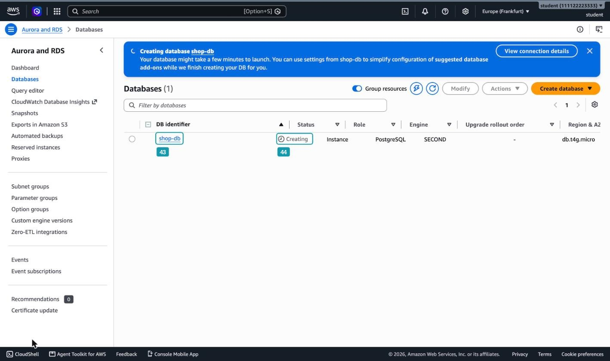

_7.1.13. Экземпляр создаётся_

## Часть 4. Подключение к базе

Мы закрыли базу тремя барьерами: приватная подсеть, отсутствие публичного адреса и Security Group. Чтобы подключиться, клиент должен пройти все три: находиться внутри `shop-vpc` и входить в группу `app-sg`. С вашего ноутбука это невозможно, и так и задумано.

В Hands-on 5.1 таким клиентом был сервер в той же VPC, к которому вы подключались по SSH. Здесь обойдёмся без отдельного сервера и ключей.

**VPC-среда CloudShell (CloudShell VPC environment)** - среда CloudShell, которая запускается в выбранной подсети вашей VPC и получает выбранные Security Group. Терминал работает в браузере так же, как обычный CloudShell, но сетевые подключения из него идут изнутри VPC.

Для базы такая среда выглядит как любой другой ресурс в приватной подсети с группой `app-sg`, то есть как будущий сервер приложения.

### Шаг 13. Создайте VPC-среду CloudShell

Откройте CloudShell. Нажмите `Actions` (_45_) и выберите `Create VPC environment` (_46_).

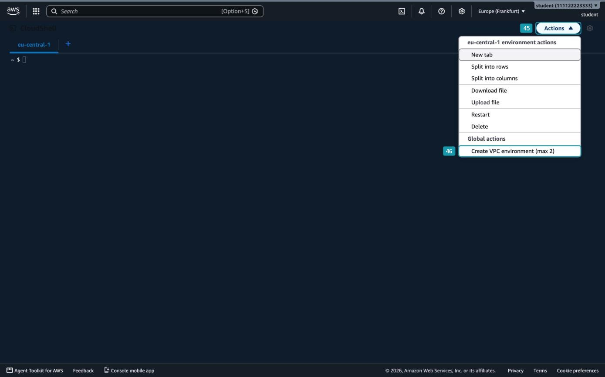

_7.1.14. Меню действий CloudShell_

Заполните форму:

1. В поле `Name` введите `shop-vpc-shell` (_47_).
2. В поле `Virtual private cloud (VPC)` выберите `shop-vpc` (_48_).
3. В поле `Subnet` выберите `shop-subnet-private1-eu-central-1a` (_49_).
4. В поле `Security group` выберите `app-sg` (_50_).

В выпадающих списках рядом с идентификаторами показаны имена VPC, подсетей и групп, но после выбора в поле остаётся только идентификатор. Нажмите `Create`. В CloudShell откроется новая вкладка `shop-vpc-shell`.

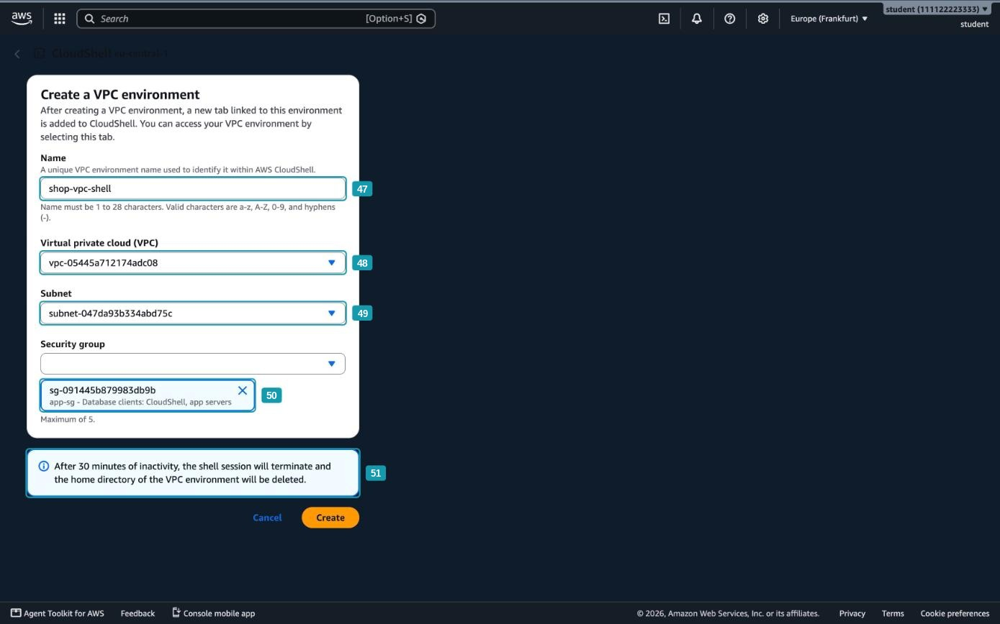

_7.1.15. Создание VPC-среды CloudShell_

Подсеть подойдёт любая из приватных: благодаря маршруту `local` из шага 2 подсети внутри VPC видят друг друга, даже если находятся в разных зонах. Мы берём ту же подсеть, где обычно работают серверы приложения, то есть приватную. Решающий параметр здесь группа: именно `app-sg` даст среде право подключаться к порту `5432`. Попробуйте ответить, что произойдёт, если выбрать группу `default`, это вопрос 4 для самопроверки.

> [!NOTE]
> Внизу формы сказано, что после 30 минут бездействия сессия VPC-среды завершается, а её домашняя папка удаляется (_51_). Файлы, созданные в этой среде, не сохраняются, поэтому всё нужное держите в командах, а не в файлах.

### Шаг 14. Найдите endpoint экземпляра

Вернитесь в `Aurora and RDS` и откройте `shop-db`. Когда экземпляр будет готов, в поле `Status` появится `Available` (_52_). В поле `Region & AZ` видно, в какой зоне RDS запустил экземпляр (_53_). Это одна из двух зон группы подсетей, у вас она может быть другой.

На вкладке `Connectivity & security` выберите способ подключения `Endpoints` (_54_). Ниже собраны имя базы `shop`, главный пользователь `postgres` и порт `5432` (_55_). Это три из четырёх значений, которые нужны для подключения.

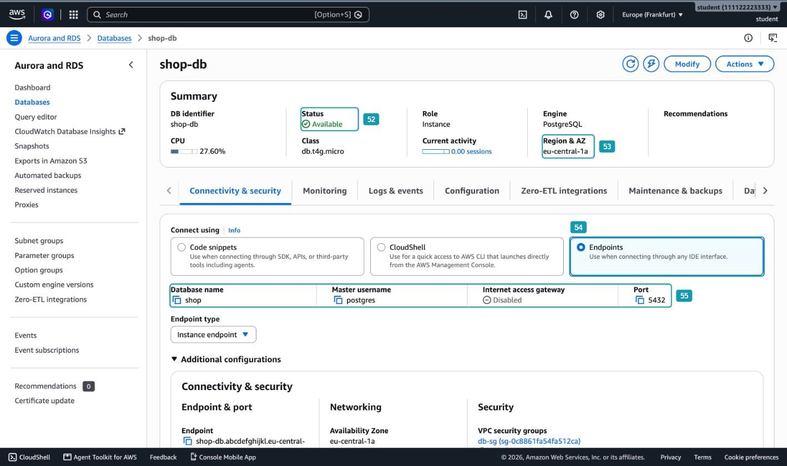

_7.1.16. Экземпляр готов к работе_

Четвёртое значение, адрес сервера, находится ниже. Раскройте `Additional configurations`. В блоке `Endpoint & port` находится endpoint экземпляра (_56_), скопируйте его значком рядом с именем. Endpoint начинается с идентификатора `shop-db`, затем идёт уникальная для аккаунта часть, регион и домен RDS.

Рядом удобно проверить итог сетевой настройки. В блоке `Networking` видны VPC, группа подсетей и обе её подсети (_57_), а в блоке `Security` группа `db-sg` в состоянии `Active` и `Publicly accessible: No` (_58_).

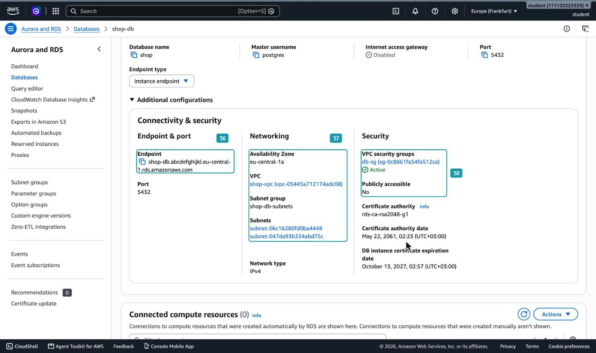

_7.1.17. Endpoint и сетевые параметры экземпляра_

### Шаг 15. Подключитесь через psql

Перейдите во вкладку `shop-vpc-shell` в CloudShell. Сохраните endpoint в переменную окружения, чтобы не вставлять его в каждую команду, и посмотрите, в какой адрес он разрешается:

```bash
export DB_HOST=shop-db.abcdefghijkl.eu-central-1.rds.amazonaws.com
getent hosts $DB_HOST
```

Подставьте свой endpoint. Команда `getent hosts` спрашивает у DNS адрес имени и выводит его. Вы увидите адрес из диапазона `10.0.0.0/16`, на рисунках это `10.0.139.247`. Он попадает в диапазон `10.0.128.0/20`, то есть экземпляр работает в подсети `private1`.

Почему приложение подключается по имени, а не по этому адресу? Адрес принадлежит конкретному экземпляру и может измениться: при замене экземпляра, при восстановлении из копии, а в режиме Multi-AZ при переключении на резервный экземпляр. RDS в таких случаях обновляет DNS-запись, и endpoint начинает указывать на новый адрес. Приложение, которое подключается по имени, ничего менять не придётся.

Клиент `psql` в CloudShell уже установлен. Подключитесь к базе:

```bash
psql -h $DB_HOST -U postgres -d shop
```

Параметры команды соответствуют значениям из шага 14: `-h` адрес сервера, `-U` пользователь, `-d` база. Порт `5432` стандартный, поэтому его можно не указывать.

`psql` спросит пароль. Введите пароль из шага 7, символы при вводе не отображаются. Приглашение `shop=>` означает, что вы подключены к базе `shop`.

Пока вводите пароль, проследите путь подключения. Среда отправляет пакет на адрес `10.0.139.247`, порт `5432`. Маршрут `local` доставляет его внутри VPC. Группа `db-sg` проверяет источник: у среды группа `app-sg`, правило совпадает, пакет проходит. Ответ возвращается без отдельного правила, потому что Security Group stateful.

Выполните запросы:

```sql
SELECT version();

CREATE TABLE products (
    id SERIAL PRIMARY KEY,
    name TEXT NOT NULL,
    price NUMERIC(10, 2)
);

INSERT INTO products (name, price) VALUES ('Laptop', 15000), ('Mouse', 250);

SELECT * FROM products;
```

`SELECT version()` показывает версию PostgreSQL и архитектуру `aarch64` (_59_): это 64-битный ARM, процессор Graviton из класса `db.t4g`. `CREATE TABLE` создаёт таблицу (_60_), `INSERT` добавляет две строки, а `SELECT` их возвращает (_61_). Столбец `id` заполнился сам: тип `SERIAL` берёт следующее значение из счётчика.

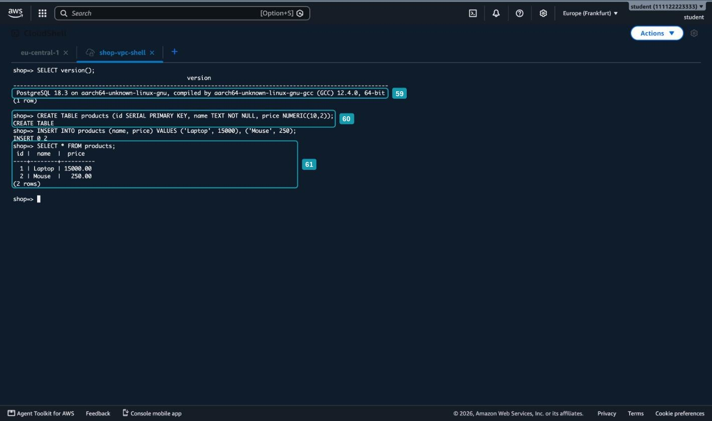

_7.1.18. Первые запросы к базе shop_

Это обычный PostgreSQL. Всё, что вы знаете о SQL, здесь работает без изменений: RDS берёт на себя сервер, установку, резервные копии и обновления, но не меняет саму СУБД. Приложение на Node.js или PHP подключилось бы к этой базе тем же драйвером, что и к PostgreSQL на вашем компьютере, указав endpoint вместо `localhost`. Выйдите из `psql` командой `\q`.

Напоследок проверьте, что среда действительно находится в приватной подсети:

```bash
curl -m 5 https://checkip.amazonaws.com
```

Параметр `-m 5` ограничивает ожидание пятью секундами. В Hands-on 5.1 сервер базы получал ответ от этого адреса через NAT Gateway, а здесь `curl` завершится с ошибкой тайм-аута: в таблице маршрутов подсети нет пути в интернет, как вы видели в шаге 2. По этой же причине в VPC-среде без NAT Gateway не работают команды AWS CLI: им нужен доступ к API AWS, а он находится за пределами VPC.

## Часть 5. Удаление ресурсов

Ресурсы зависят друг от друга, поэтому удалять их нужно в обратном порядке: сначала то, что работает внутри сети, потом саму сеть. Группу подсетей нельзя удалить, пока в ней есть экземпляр, а VPC нельзя удалить, пока в её подсетях работают экземпляр базы и VPC-среда CloudShell.

### Шаг 16. Удалите экземпляр

Откройте `Databases`, выберите `shop-db`, нажмите `Actions`, затем `Delete`. В окне подтверждения:

1. Снимите флажок `Create final snapshot` (_62_).
2. Снимите флажок `Retain automated backups` (_63_).
3. Отметьте флажок подтверждения (_64_).
4. Введите `delete me` в поле подтверждения (_65_) и нажмите `Delete`.

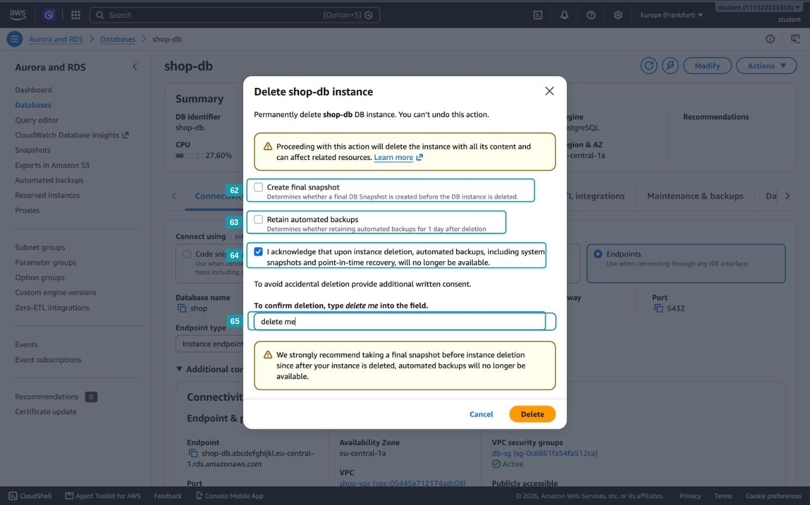

_7.1.19. Удаление экземпляра_

Окно удаления устроено так, чтобы потерять данные случайно было трудно, и каждый флажок здесь отдельное решение:

- *Финальный снимок*. Это ручной снимок, который RDS сделает перед удалением. Он хранится, пока вы его не удалите, и из него можно восстановить базу. Хранение снимка оплачивается, а данные учебной базы нам не нужны.
- *Сохранение автоматических резервных копий*. Если флажок оставить, ежедневные копии продолжат храниться до конца срока хранения даже после удаления экземпляра.
- *Подтверждение*. Без снимка и сохранённых копий восстановление на момент времени станет невозможным, и консоль просит явно согласиться с этим.

Экземпляр перейдёт в состояние `Deleting` и через несколько минут исчезнет из списка.

> [!IMPORTANT]
> Для рабочей базы флажок `Create final snapshot` снимать нельзя. Без снимка и без сохранённых резервных копий удалённую базу восстановить невозможно.

### Шаг 17. Удалите VPC-среду CloudShell

Откройте CloudShell и перейдите во вкладку `shop-vpc-shell`. Нажмите `Actions` и выберите `Delete`, затем подтвердите удаление.

### Шаг 18. Удалите группу подсетей и VPC

1. Когда `shop-db` исчезнет из списка баз, откройте `Subnet groups`, выберите `shop-db-subnets` и нажмите `Delete`.
2. Откройте сервис `VPC`, затем `Your VPCs`. Выберите `shop-vpc`, нажмите `Actions`, затем `Delete VPC`. Консоль покажет компоненты, которые удалятся вместе с VPC: подсети, таблицы маршрутов, Internet Gateway, группы `app-sg` и `db-sg`. Введите `delete` и подтвердите.

Если консоль сообщает, что VPC удалить нельзя из-за сетевых интерфейсов, подождите несколько минут. И экземпляр RDS, и VPC-среда подключались к подсетям через сетевые интерфейсы, а AWS освобождает их не сразу после удаления ресурса.

Проверьте, что ничего не осталось:

- В `Databases` нет экземпляров.
- В `Snapshots` на вкладке `Manual` нет снимков.
- В `Subnet groups` нет `shop-db-subnets`.
- В `Your VPCs` осталась только default VPC.

## Вопросы для самопроверки

1. Почему RDS просит не одну подсеть, как EC2, а группу подсетей? Назовите две ситуации, в которых RDS может понадобиться другая подсеть.
2. Почему подсети группы должны находиться минимум в двух зонах доступности, даже если экземпляр работает в одной зоне?
3. Что изменится, если в группу подсетей добавить публичную подсеть, а параметр `Public access` оставить выключенным? А если его потом включить?
4. Что произойдёт с подключением из VPC-среды CloudShell, если при её создании выбрать группу `default` вместо `app-sg`? Какой из трёх барьеров не пропустит подключение?
5. Почему в `db-sg` источником правила указана группа `app-sg`, а не диапазон адресов подсети?
6. Чем отличаются `shop-db`, `postgres` и `shop`? Где каждое из этих имён используется при подключении?
7. Почему приложению лучше подключаться по endpoint, а не по IP-адресу, который вернула команда `getent hosts`?
8. Какие параметры формы вы бы изменили, если бы создавали базу для рабочего интернет-магазина, а не для учебного занятия? Объясните каждое изменение.
