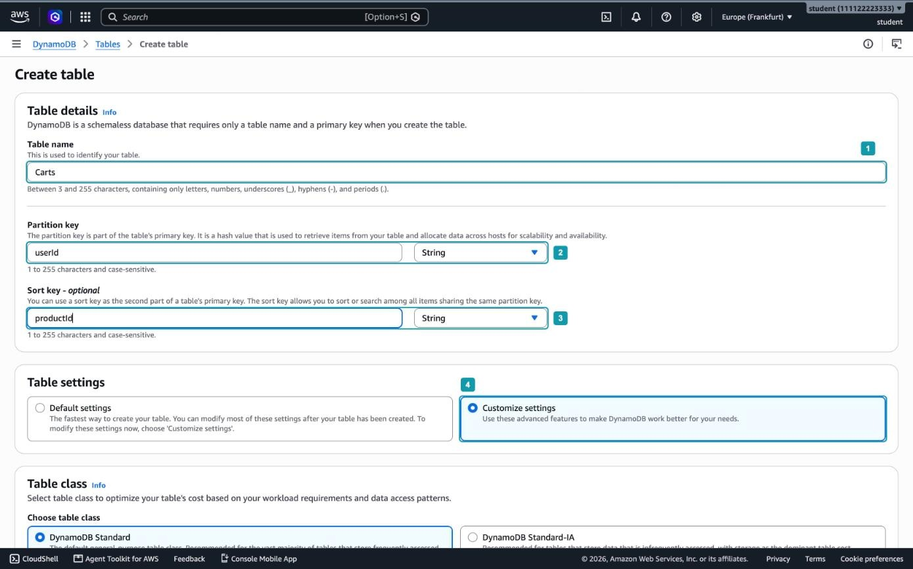
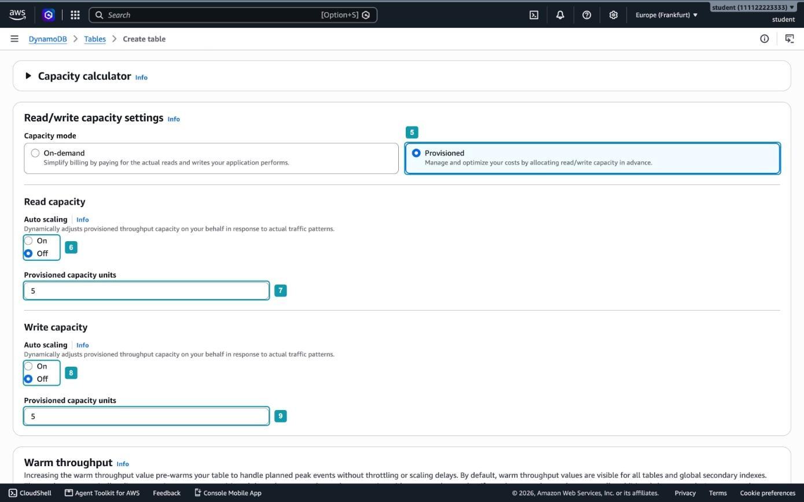
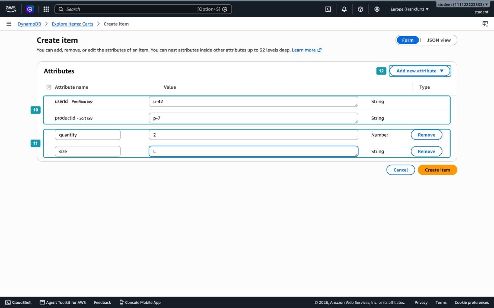
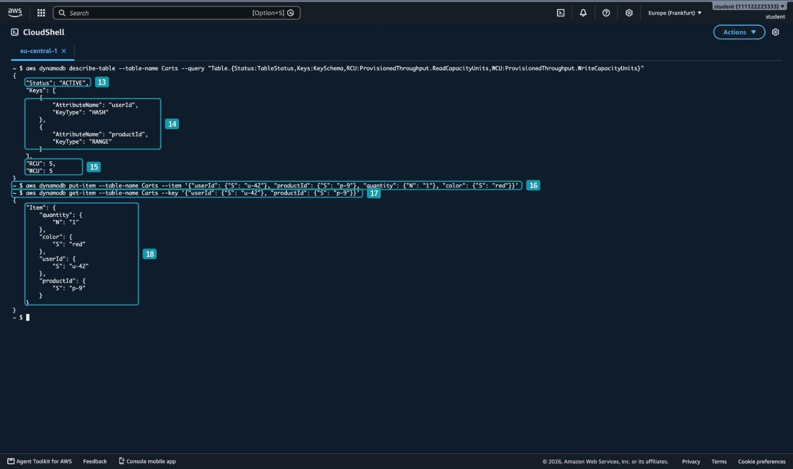
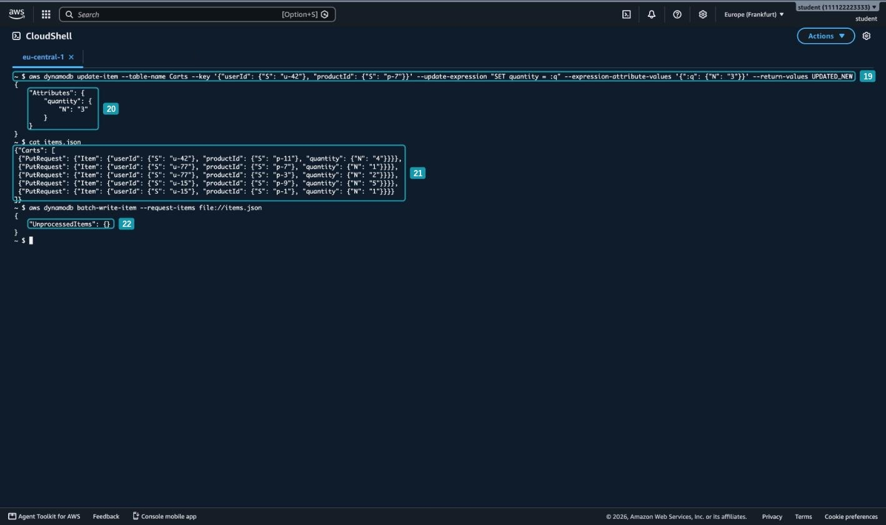
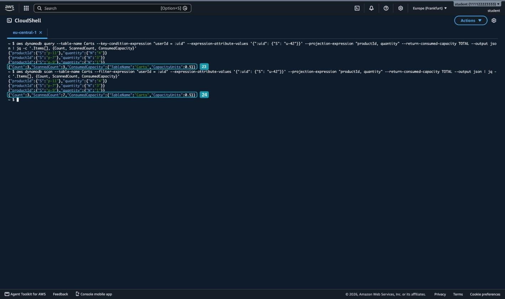
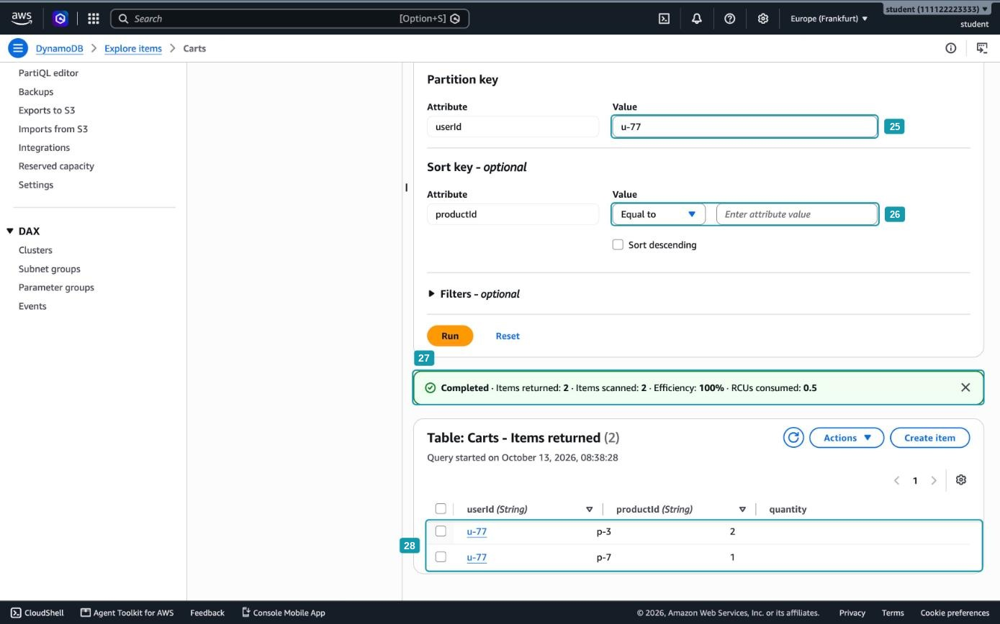

# Hands-on 7.2. Таблица DynamoDB

В главе мы спроектировали таблицу корзин `Carts` для интернет-магазина: ключ раздела `userId`, ключ сортировки `productId`, а корзину покупателя читает один Query. В этом занятии вы создадите эту таблицу, запишете в неё элементы через консоль и AWS CLI и сравните на практике Query и Scan: обе операции вернут одинаковые элементы, но прочитают разный объём данных.

После Hands-on 7.1 это занятие покажется непривычно коротким по настройке, и это само по себе важный результат. Для RDS мы готовили VPC, подсети, группу подсетей и Security Group, выбирали класс экземпляра и объём диска, а потом несколько минут ждали запуска сервера. У DynamoDB нет ни серверов, ни подсетей, ни паролей: таблица создаётся за секунды, работа с ней идёт через API AWS, а доступ определяют права вашего пользователя IAM. Цена этой простоты в том, что быстро выполняются только запросы по ключу, и это вы тоже увидите в конце занятия.

## Что получится в конце

- Таблица `Carts` в режиме заданной ёмкости с составным первичным ключом `userId` + `productId`.
- Элементы корзин трёх покупателей, записанные через консоль, командами `put-item` и `update-item` и пакетом через `batch-write-item`.
- Сравнение Query и Scan по полям `Count`, `ScannedCount` и `ConsumedCapacity`.
- Тот же Query, выполненный в консоли.

К концу части 4 в таблице будет 7 элементов:

| `userId` (ключ раздела) | `productId` (ключ сортировки) | Остальные атрибуты      | Откуда взялся                |
| ----------------------- | ----------------------------- | ----------------------- | ---------------------------- |
| `u-42`                  | `p-7`                         | `quantity`, `size`      | Консоль, шаг 3               |
| `u-42`                  | `p-9`                         | `quantity`, `color`     | `put-item`, шаг 4            |
| `u-42`                  | `p-11`                        | `quantity`              | `batch-write-item`, шаг 6    |
| `u-77`                  | `p-7`, `p-3`                  | `quantity`              | `batch-write-item`, шаг 6    |
| `u-15`                  | `p-9`, `p-1`                  | `quantity`              | `batch-write-item`, шаг 6    |

## Перед началом

- Вы работаете в регионе `Europe (Frankfurt)`.
- Команды выполняются в обычном CloudShell, а не в VPC-среде из Hands-on 7.1. Команды AWS CLI обращаются к API DynamoDB, который находится за пределами VPC, а у VPC-среды без NAT Gateway выхода туда нет.
- Закладывайте на занятие около 40 минут.

## Часть 1. Создание таблицы

### Шаг 1. Задайте имя и ключи таблицы

Откройте сервис `DynamoDB`, в меню слева выберите `Tables` и нажмите `Create table`. Заполните форму:

1. В поле `Table name` введите `Carts` (_1_).
2. В поле `Partition key` введите `userId` и оставьте тип `String` (_2_).
3. В поле `Sort key` введите `productId` и оставьте тип `String` (_3_).
4. В разделе `Table settings` выберите `Customize settings` (_4_).



_7.2.1. Имя и первичный ключ таблицы_

Это самый важный шаг занятия, потому что первичный ключ таблицы после создания изменить нельзя. Если ключ выбран неудачно, остаётся только создать новую таблицу и перенести в неё данные. Поэтому ключ выбирают от запросов приложения, как мы делали в главе:

- *Ключ раздела `userId`*. Почти все обращения к корзине идут от имени конкретного покупателя: показать корзину, добавить товар, изменить количество. Покупателей много, поэтому запросы распределяются по разделам равномерно.
- *Ключ сортировки `productId`*. Он отличает товары одной корзины друг от друга. Пара `userId` + `productId` уникальна: один товар лежит в корзине одного покупателя одним элементом, а количество хранится в атрибуте.
- *Тип `String`*. Идентификаторы вида `u-42` и `p-7` содержат буквы, поэтому выбираем строку. Как тип ключа влияет на порядок элементов, вы увидите в шаге 7.

Имена таблиц и атрибутов чувствительны к регистру: `carts` была бы другой таблицей, а `userid` другим атрибутом. В командах CLI имена нужно писать точно так же, как при создании.

Кроме ключей, никаких столбцов задавать не нужно, и консоль их не спрашивает. Схема таблицы DynamoDB состоит только из первичного ключа, остальные атрибуты у каждого элемента свои.

`Customize settings` выбираем потому, что с настройками по умолчанию (`Default settings`) таблица создалась бы в режиме по запросам, а мы хотим режим заданной ёмкости и хотим увидеть, как он настраивается.

### Шаг 2. Настройте ёмкость

Ниже в форме в поле `Table class` оставьте `DynamoDB Standard`. Второй класс, `Standard-IA` (Infrequent Access), устроен так же, как классы хранения S3 из главы 6: хранение дешевле, а запросы дороже. Он выгоден для таблиц, которые много хранят и редко читают, например для архива старых заказов. Корзины читают постоянно, поэтому нам нужен `Standard`.

Затем в разделе `Read/write capacity settings`:

1. В поле `Capacity mode` выберите `Provisioned` (_5_).
2. Для чтения переключите `Auto scaling` в `Off` (_6_) и в поле `Provisioned capacity units` введите `5` (_7_).
3. Для записи так же выключите `Auto scaling` (_8_) и введите `5` (_9_).



_7.2.2. Режим заданной ёмкости_

В режиме заданной ёмкости вы заранее говорите DynamoDB, сколько чтений и записей в секунду должна выдерживать таблица, и платите за эту пропускную способность, даже если она простаивает. Измеряют её в единицах:

- *Единица ёмкости чтения (read capacity unit, RCU)*. Одно строго согласованное чтение элемента размером до 4 КБ в секунду или два чтения в конечном счёте согласованных.
- *Единица ёмкости записи (write capacity unit, WCU)*. Одна запись элемента размером до 1 КБ в секунду.

Пять единиц чтения и пять единиц записи означают, что таблица выдержит до пяти строго согласованных чтений небольших элементов и до пяти записей в секунду. Для учебной таблицы этого более чем достаточно, а такая небольшая заданная ёмкость входит в бесплатный уровень (раздел «Стоимость DynamoDB»).

Если приложение превысит заданную ёмкость, DynamoDB начнёт отклонять часть запросов. Это то же отклонение запросов (throttling), что и при неудачном ключе раздела в главе: SDK повторит такой запрос с задержкой, но пользователь заметит замедление.

Автоматическое масштабирование ёмкости как раз защищает от этого: оно само увеличивает и уменьшает число единиц вслед за нагрузкой в заданных вами пределах. Мы его выключили, чтобы ёмкость, а с ней и счёт, точно не выросли сверх выбранного.

Остальные параметры оставьте по умолчанию: вторичные индексы не нужны, а шифрование данных включено всегда, по умолчанию ключом, которым управляет сам DynamoDB. Нажмите `Create table`. Таблица появится в списке в состоянии `Creating` и через несколько секунд перейдёт в `Active`. Сравните с несколькими минутами ожидания экземпляра RDS: DynamoDB не запускает для вашей таблицы отдельный сервер, а размещает её разделы на своей уже работающей инфраструктуре.

## Часть 2. Элементы в консоли

### Шаг 3. Создайте первый элемент

В меню слева выберите `Explore items`, затем таблицу `Carts`, и нажмите `Create item`. Консоль откроет форму в режиме `Form`.

1. Форма уже содержит оба ключевых атрибута (_10_). Введите `u-42` в `userId` и `p-7` в `productId`.
2. Добавьте два обычных атрибута (_11_): `quantity` типа `Number` со значением `2` и `size` типа `String` со значением `L`.
3. Новые атрибуты добавляются через меню `Add new attribute` (_12_), в нём для каждого атрибута сразу выбирается тип.



_7.2.3. Создание элемента в консоли_

Нажмите `Create item`. Элемент появится в списке под формой поиска.

Обратите внимание на разницу между строками формы. У ключевых атрибутов нет кнопки `Remove`, и тип у них уже задан: эти атрибуты обязательны в каждом элементе и должны иметь тот тип, который вы указали при создании таблицы. Элемент без полного первичного ключа записать нельзя. У атрибутов `quantity` и `size` кнопка `Remove` есть: их можно добавлять и убирать, и у соседних элементов их может не быть совсем.

В меню `Add new attribute` перечислены все типы атрибутов из таблицы типов в главе: строка, число, логическое значение, двоичные данные, `Null`, три вида множеств, список и вложенный объект. Количество мы записали числом, а не строкой не случайно: с числом DynamoDB умеет выполнять арифметику, например увеличить количество на единицу прямо в запросе на изменение.

> [!TIP]
> Переключатель `JSON view` показывает тот же элемент в формате, который используется в AWS CLI: каждое значение записано вместе с типом, например `{"N": "2"}`. Удобно один раз заполнить форму и посмотреть, как выглядит JSON, прежде чем писать команды.

## Часть 3. Работа через AWS CLI

Консоль удобна, чтобы посмотреть на данные, но приложение работает с DynamoDB через API. Команды `aws dynamodb` вызывают те же операции API, что и SDK в коде на Node.js из главы, поэтому на них хорошо видно, что именно приложение отправляет в таблицу.

### Шаг 4. Проверьте таблицу и запишите элемент

Откройте CloudShell. Сначала выведите основные параметры таблицы:

```bash
aws dynamodb describe-table --table-name Carts \
  --query "Table.{Status:TableStatus,Keys:KeySchema,RCU:ProvisionedThroughput.ReadCapacityUnits,WCU:ProvisionedThroughput.WriteCapacityUnits}"
```

Ответ `describe-table` занимает несколько экранов. Параметр `--query` есть у любой команды AWS CLI: он отбирает из ответа нужные поля уже на вашей стороне, после того как ответ получен. Здесь мы собираем из ответа объект из четырёх полей и даём им короткие имена.

Таблица в состоянии `ACTIVE` (_13_). В `Keys` атрибут `userId` имеет тип ключа `HASH`, а `productId` тип `RANGE` (_14_): так в API называются ключ раздела и ключ сортировки. Название `HASH` напоминает, что по хешу ключа раздела DynamoDB выбирает раздел, а `RANGE`, что по ключу сортировки можно выбирать диапазоны. Ёмкость чтения и записи равна 5 (_15_).

Запишите второй товар в корзину того же покупателя и сразу прочитайте его:

```bash
aws dynamodb put-item --table-name Carts \
  --item '{"userId": {"S": "u-42"}, "productId": {"S": "p-9"}, "quantity": {"N": "1"}, "color": {"S": "red"}}'

aws dynamodb get-item --table-name Carts \
  --key '{"userId": {"S": "u-42"}, "productId": {"S": "p-9"}}'
```

При успехе `put-item` ничего не выводит (_16_). `get-item` получает полный первичный ключ (_17_) и возвращает элемент (_18_). Порядок атрибутов в ответе может отличаться от порядка при записи: элемент DynamoDB это набор атрибутов, а не упорядоченная строка таблицы.



_7.2.4. Параметры таблицы, запись и чтение элемента_

Почему каждое значение записано вместе с типом? У таблицы нет схемы, и DynamoDB неоткуда узнать, что `quantity` число, кроме как из самого значения. Числа при этом передаются строкой, `{"N": "1"}`, чтобы большие и дробные числа не потеряли точность при разборе JSON в разных языках программирования. Пакет `@aws-sdk/lib-dynamodb` из главы скрывает эти типы и позволяет писать обычные объекты JavaScript, а в CLI и низкоуровневом API их пишут явно.

У этого элемента есть атрибут `color`, но нет `size`, а у элемента из шага 3 наоборот. Для DynamoDB это нормально: обязательны только ключевые атрибуты.

> [!WARNING]
> `put-item` с уже существующим ключом не выдаёт ошибку, а молча заменяет элемент целиком. Если бы вы выполнили `put-item` для `u-42` и `p-7` только с атрибутом `quantity`, атрибут `size` из шага 3 исчез бы. Чтобы изменить отдельные атрибуты, используют `update-item`.

### Шаг 5. Измените количество товара

Покупатель положил в корзину ещё одну футболку `p-7`. Увеличим количество до 3:

```bash
aws dynamodb update-item --table-name Carts \
  --key '{"userId": {"S": "u-42"}, "productId": {"S": "p-7"}}' \
  --update-expression "SET quantity = :q" \
  --expression-attribute-values '{":q": {"N": "3"}}' \
  --return-values UPDATED_NEW
```

Команда состоит из трёх частей: какой элемент менять (`--key`), что с ним сделать (`--update-expression`) и какие значения подставить (`--expression-attribute-values`). Значение не пишут прямо в выражение, потому что у него должен быть тип, а в строке выражения его не указать. Поэтому в выражении стоит заполнитель `:q`, а значение с типом передаётся отдельно.

По умолчанию `update-item` тоже ничего не выводит. Параметр `--return-values UPDATED_NEW` просит вернуть новые значения изменённых атрибутов (_19_), и в ответе видно `quantity` со значением 3 (_20_). Атрибут `size` остался на месте: в отличие от `put-item`, `update-item` меняет только перечисленные атрибуты.

> [!NOTE]
> Для имён атрибутов тоже есть заполнители, они начинаются с `#` и передаются в `--expression-attribute-names`. Они нужны, когда имя атрибута совпадает с зарезервированным словом DynamoDB. Наш атрибут `size` как раз такой случай: `size` это имя функции в выражениях, поэтому изменить его можно только через заполнитель, например `SET #s = :s` с `--expression-attribute-names '{"#s": "size"}'`.

## Часть 4. Пакетная запись

### Шаг 6. Запишите несколько элементов одним запросом

Когда нужно записать много элементов, отправлять по одному запросу на каждый долго: каждый запрос это отдельное обращение по сети. Операция `batch-write-item` записывает или удаляет до 25 элементов за один запрос.

Добавим ещё один товар покупателю `u-42` и корзины двух других покупателей. Создайте файл `items.json`:

```bash
cat > items.json <<'EOF'
{"Carts": [
 {"PutRequest": {"Item": {"userId": {"S": "u-42"}, "productId": {"S": "p-11"}, "quantity": {"N": "4"}}}},
 {"PutRequest": {"Item": {"userId": {"S": "u-77"}, "productId": {"S": "p-7"}, "quantity": {"N": "1"}}}},
 {"PutRequest": {"Item": {"userId": {"S": "u-77"}, "productId": {"S": "p-3"}, "quantity": {"N": "2"}}}},
 {"PutRequest": {"Item": {"userId": {"S": "u-15"}, "productId": {"S": "p-9"}, "quantity": {"N": "5"}}}},
 {"PutRequest": {"Item": {"userId": {"S": "u-15"}, "productId": {"S": "p-1"}, "quantity": {"N": "1"}}}}
]}
EOF
```

Конструкция `cat > items.json <<'EOF' ... EOF` записывает в файл всё, что находится между первой и последней строкой. Длинный JSON удобнее держать в файле, чем в кавычках прямо в команде.

Ключ верхнего уровня `Carts` это имя таблицы: один запрос `batch-write-item` может писать сразу в несколько таблиц. Каждый элемент списка описывает одну операцию, здесь это пять операций `PutRequest`. Вместо `PutRequest` можно было бы указать `DeleteRequest` с ключом элемента, и тогда элемент был бы удалён.

Проверьте содержимое файла командой `cat items.json` (_21_) и отправьте пакет. Префикс `file://` говорит AWS CLI, что значение параметра нужно прочитать из файла:

```bash
aws dynamodb batch-write-item --request-items file://items.json
```

Ответ содержит пустой объект `UnprocessedItems` (_22_): все пять элементов записаны.



_7.2.5. Изменение элемента и пакетная запись_

> [!IMPORTANT]
> Пакетная запись не является транзакцией. Каждая операция в пакете выполняется независимо, и часть из них может не выполниться, например из-за нехватки ёмкости. Такие операции DynamoDB вернёт в `UnprocessedItems`, и приложение должно отправить их повторно. Ошибкой всего запроса это не считается, поэтому `UnprocessedItems` нужно проверять после каждого вызова.

Теперь в таблице 7 элементов: три в корзине `u-42` и по два в корзинах `u-77` и `u-15`. Откройте `Explore items` в консоли и убедитесь в этом сами.

## Часть 5. Query и Scan

### Шаг 7. Сравните Query и Scan в CLI

Получим корзину покупателя `u-42` двумя способами. Сначала через Query:

```bash
aws dynamodb query --table-name Carts \
  --key-condition-expression "userId = :uid" \
  --expression-attribute-values '{":uid": {"S": "u-42"}}' \
  --projection-expression "productId, quantity" \
  --return-consumed-capacity TOTAL \
  --output json | jq -c '.Items[], {Count, ScannedCount, ConsumedCapacity}'
```

Затем через Scan с фильтром по тому же условию:

```bash
aws dynamodb scan --table-name Carts \
  --filter-expression "userId = :uid" \
  --expression-attribute-values '{":uid": {"S": "u-42"}}' \
  --projection-expression "productId, quantity" \
  --return-consumed-capacity TOTAL \
  --output json | jq -c '.Items[], {Count, ScannedCount, ConsumedCapacity}'
```

Команды почти одинаковые, отличаются они одним параметром, и в этом отличии весь смысл:

- *`--key-condition-expression` у Query*. Условие на ключ. По нему DynamoDB вычисляет хеш `u-42`, находит нужный раздел и читает только элементы этого покупателя.
- *`--filter-expression` у Scan*. Условие фильтра. DynamoDB читает элементы подряд и уже прочитанные проверяет на условие.

Остальные параметры общие:

- `--projection-expression` оставляет в ответе только перечисленные атрибуты. Прочитанный объём от этого не уменьшается, DynamoDB просто не передаёт лишнее.
- `--return-consumed-capacity TOTAL` добавляет в ответ число израсходованных единиц ёмкости.
- Утилита `jq`, которая уже установлена в CloudShell, печатает каждый элемент в одну строку, а затем три служебных поля ответа.



_7.2.6. Query и Scan по одной корзине_

Обе команды вернули одни и те же три товара. Разница в служебных полях:

| Поле                             | Query | Scan | Что означает                                      |
| -------------------------------- | ----- | ---- | ------------------------------------------------- |
| `Count`                          | 3     | 3    | Сколько элементов попало в ответ                  |
| `ScannedCount`                   | 3     | 7    | Сколько элементов DynamoDB прочитала              |
| `ConsumedCapacity.CapacityUnits` | 0.5   | 0.5  | Сколько единиц ёмкости чтения израсходовал запрос |

Query прочитал только раздел покупателя `u-42` (_23_). Scan прочитал все 7 элементов таблицы и лишь потом отбросил четыре чужих (_24_): фильтр применяется после чтения, поэтому платить приходится за всё прочитанное, а не за возвращённое.

Почему тогда ёмкость одинаковая? Query и Scan складывают размеры всех прочитанных элементов и округляют сумму вверх до 4 КБ. Вся наша таблица весит меньше 4 КБ, поэтому оба запроса уложились в один блок. По умолчанию они используют чтение в конечном счёте согласованное, которое стоит половину единицы за блок, отсюда 0.5.

Если бы в таблице были корзины миллиона покупателей, Query по-прежнему прочитал бы три элемента и израсходовал бы 0.5 единицы. Scan прочитал бы всю таблицу, причём, как мы говорили в главе, не одним запросом, а длинной серией запросов по 1 МБ, и `ScannedCount` с израсходованной ёмкостью выросли бы пропорционально размеру таблицы. Именно поэтому таблицу проектируют под Query.

> [!TIP]
> Добавьте к команде Query параметр `--consistent-read` и выполните её ещё раз. Израсходованная ёмкость станет равна 1: строго согласованное чтение гарантирует, что вы увидите последнюю запись, но стоит вдвое дороже. В главе такое чтение использовал код на Node.js, потому что корзину читают сразу после записи.

> [!NOTE]
> Посмотрите на порядок товаров: `p-11`, `p-7`, `p-9`. Внутри раздела элементы отсортированы по ключу сортировки, но ключ имеет тип `String`, поэтому строки сравниваются посимвольно, как слова в словаре. Второй символ после `p-` у `p-11` это `1`, а у `p-7` это `7`, поэтому `p-11` оказывается раньше. Если нужен числовой порядок, ключ делают числом или дополняют номер нулями до одинаковой длины: `p-007`, `p-011`.

### Шаг 8. Выполните Query в консоли

Откройте `Explore items` и выберите таблицу `Carts`. Над списком элементов переключите режим с `Scan` на `Query`. По умолчанию консоль открывается в режиме Scan: для небольшой таблицы это удобно, чтобы увидеть все элементы, но на большой таблице так делать не стоит.

1. В поле `userId` введите `u-77` (_25_). Поле ключа раздела в режиме Query обязательное: без него DynamoDB не знает, какой раздел читать.
2. Поле ключа сортировки `productId` оставьте пустым (_26_). Пустое поле означает «все элементы раздела». Здесь же можно выбрать условие на ключ сортировки, например `Begins with`, и включить обратный порядок флажком `Sort descending`.
3. Нажмите `Run`. Консоль показывает итог запроса (_27_): сколько элементов возвращено и прочитано, эффективность запроса и израсходованные единицы ёмкости. Это те же `Count`, `ScannedCount` и `ConsumedCapacity`, что и в CLI.
4. В таблице результатов два товара покупателя `u-77` (_28_).



_7.2.7. Query в консоли_

Поле `Efficiency` это отношение возвращённых элементов к прочитанным. Оно равно 100%, потому что все прочитанные элементы попали в результат. Переключитесь в режим `Scan`, добавьте фильтр `userId` = `u-77` и выполните запрос: прочитано будет 7 элементов, возвращено 2, и эффективность упадёт. На рабочей таблице низкая эффективность это прямой сигнал, что запрос стоит переделать в Query или добавить для него индекс.

## Часть 6. Удаление таблицы

### Шаг 9. Удалите таблицу

Откройте `Tables`, отметьте `Carts` и нажмите `Delete`. В окне подтверждения введите `confirm` и нажмите `Delete table`. Таблица удаляется вместе со всеми элементами, восстановить её без заранее сделанной резервной копии нельзя.

Удалите и файл `items.json` в CloudShell:

```bash
rm items.json
```

Проверьте, что список `Tables` пуст. Других ресурсов это занятие не создавало: ни сети, ни серверов у DynamoDB нет.

## Вопросы для самопроверки

1. Почему ключ раздела и ключ сортировки выбирают до создания таблицы и что придётся сделать, если ключ окажется неудачным?
2. Какие атрибуты таблицы `Carts` вы задали при её создании, а какие появились только при записи элементов? Почему DynamoDB это допускает?
3. Что произойдёт, если приложение будет выполнять больше чтений в секунду, чем позволяет заданная ёмкость таблицы?
4. Чем отличается результат `put-item` и `update-item`, если элемент с таким ключом уже существует?
5. Почему после `batch-write-item` нужно проверять поле `UnprocessedItems`, хотя команда завершилась без ошибки?
6. Query и Scan вернули одинаковые элементы и израсходовали одинаковую ёмкость. Почему тогда Scan с фильтром считается плохим способом получить корзину? Как изменятся результаты на таблице с миллионом покупателей?
7. Почему товар `p-11` в корзине оказался раньше `p-7` и как изменить ключ, чтобы получить числовой порядок?
8. Какой запрос к таблице `Carts` нельзя выполнить через Query и что нужно добавить в таблицу, чтобы он стал возможен?
