# Облачные базы данных и согласованность данных. Amazon RDS, DynamoDB

## Вопросы для самопроверки

1. Чем база данных отличается от хранилища файлов, и почему заказы интернет-магазина неудобно хранить в виде объектов S3?
2. Чем реляционные базы данных отличаются от нереляционных, и в каких задачах выбирают каждую из них?
3. Чем синхронная репликация отличается от асинхронной, и какой компромисс стоит за выбором между ними?
4. Зачем нужны реплики для чтения, и почему пользователь может не увидеть на реплике только что сохранённые данные?
5. Что такое шардирование, и почему от выбора ключа шарда зависит, будет ли нагрузка распределена равномерно?
6. Чем развёртывание Multi-AZ в Amazon RDS отличается от реплики для чтения?
7. Чем устройство Amazon Aurora отличается от обычного экземпляра Amazon RDS?
8. Как в Amazon DynamoDB ключ раздела определяет, где хранится элемент, и почему Query предпочтительнее Scan?
9. Чем OLTP отличается от OLAP, и почему отчёты по продажам неудобно строить на основной базе магазина?

## Ретроспектива

Эта глава опирается на три предыдущие главы:

- _Четвёртая глава_. Собирая первую архитектуру, мы отметили её слабое место: если база данных работает на том же экземпляре, что и приложение, её судьба привязана к судьбе машины.
- _Пятая глава_. Базу данных мы перенесли в приватную подсеть и открыли порт 5432 только для Security Group веб-серверов. В плане адресов VPC подсеть `private-b` во второй зоне доступности осталась в резерве "для реплики базы данных".
- _Шестая глава_. Файлы пользователей переехали в Amazon S3, а сервер приложения стал сервером без состояния. Там же мы определили репликацию, резервную копию, RPO и RTO.

Теперь на отдельном сервере остались только данные приложения: пользователи, заказы, товары. Этот сервер мы по-прежнему обслуживаем сами, и он один. Из этого вытекают вопросы, на которые отвечает глава:

- Кто будет делать копии базы и устанавливать обновления?
- Что произойдёт при отказе зоны доступности?
- Что делать, когда один сервер перестанет справляться с нагрузкой?

## Хранилище и база данных

В _шестой главе_ мы рассмотрели возможность хранить файлы в S3, включая фотографии товаров и документы пользователей. Но хранить там же структурированные данные приложения, такие как заказы и пользователи, неудобно по двум причинам:

- _Поиск по содержимому_. Приложение получает объект S3 по ключу, но не может искать внутри объектов. Например, если хранить заказы в S3 в формате JSON, то для поиска заказов клиента 42 за октябрь приложению придётся скачать и проверить все файлы с заказами.
- _Одновременные изменения_. По умолчанию объект перезаписывается целиком. Например, если два покупателя одновременно закажут последний товар, оба запроса могут прочитать остаток «1» и записать «0». В результате один товар будет продан дважды.

Вышеописанные проблемы решают базы данных.

**База данных (database)** - это структурированный набор данных, оптимизированный для эффективного поиска, анализа и манипулирования информацией. База данных включает в себя функциональность запросов через специальные языки (например, SQL), контроль доступа, транзакции и аналитические возможности, которых нет у простого хранилища.

**СУБД (система управления базами данных, database management system, DBMS)** - программа, которая хранит базу данных и выполняет запросы к ней, например PostgreSQL или MySQL.

Проведем сравнение объектов хранилища и баз данных.

| Свойство                | Объектное хранилище (Amazon S3)               | База данных                                     |
| ----------------------- | --------------------------------------------- | ----------------------------------------------- |
| Как находят данные      | По имени файла или ключу объекта              | По содержимому: любому полю или их сочетанию    |
| Изменение               | Объект перезаписывается целиком               | Изменяется отдельное поле отдельной записи      |
| Одновременные изменения | По умолчанию побеждает последняя запись       | СУБД согласует их и не даёт потерять ни одно    |
| Типичные данные         | Фотографии, документы, видео, резервные копии | Пользователи, заказы, остатки на складе, сессии |

База данных не заменяет хранилище, а работает вместе с ним:

- _Фотография товара_ лежит в S3,
- _Запись о товаре_ с его названием, ценой и ключом этой фотографии в бакете хранится в базе данных.

## Типы баз данных

### Реляционные базы данных (RDBMS)

#### Определение реляционной базы данных

Базы данных бывают разных типов, и самый распространённый из них появился задолго до облаков.

**Реляционная база данных (relational database)** - база данных, в которой данные хранятся в таблицах из строк и столбцов, а связи между таблицами задаются через значения ключей[^1]. Структура базы данных определяется схемой.

**Схема (schema) базы данных** - описание её структуры: таблиц, столбцов, типов данных и ограничений, которые действуют для них.

Связи между таблицами создаются с помощью двух видов ключей:

- _Первичный ключ (primary key)_. Столбец, который однозначно определяет каждую строку таблицы. Например, `customer_id` в таблице клиентов.
- _Внешний ключ (foreign key)_. Столбец, который ссылается на ключ другой таблицы и связывает данные между таблицами[^1].

На рисунке 7.1 показаны три таблицы учебного интернет-магазина:

- клиенты,
- товары,
- заказы.

В таблице `orders` столбцы `customer_id` и `product_id` являются внешними ключами: они указывают, какой клиент сделал заказ и какой товар он купил.

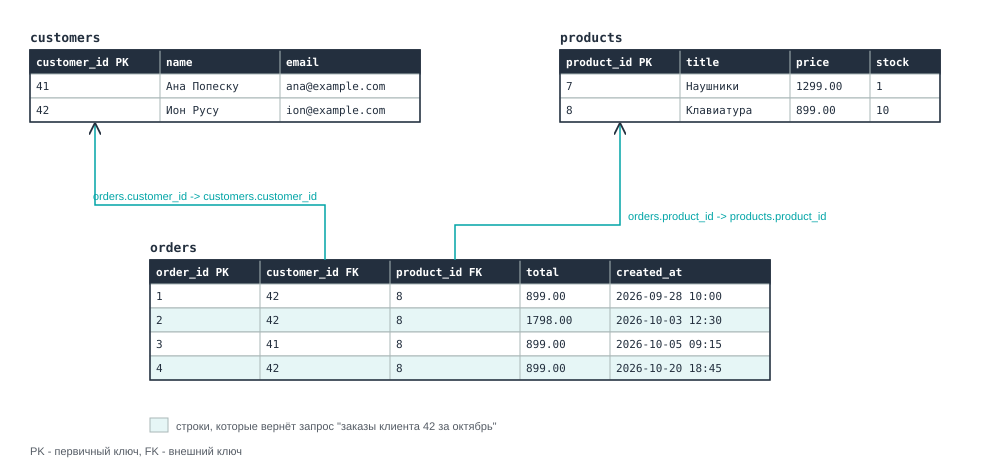

_7.1. Таблицы клиентов, товаров и заказов учебного интернет-магазина_

С реляционной базой работают на языке SQL (Structured Query Language), который вы уже встречали в курсе по базам данных.

#### Транзакции

**Одновременные изменения** возникают, когда несколько запросов одновременно обращаются к одним и тем же данным. _Например_, два покупателя могут одновременно купить последний товар, из-за чего он будет продан дважды.

Для решения таких проблем реляционные СУБД используют _транзакции_.

**Транзакция (transaction)** - группа операций с базой данных, которые СУБД выполняет как одно целое: _либо все операции применяются, либо ни одна_[^2].

Например, оформление заказа включает две операции:

- создание заказа,
- уменьшение остатка на складе.

Обе операции должны выполняться в одной транзакции.

Если два покупателя одновременно закажут последний товар, СУБД может заблокировать строку с остатком. Вторая транзакция дождётся завершения первой, после чего сможет проверить обновлённый остаток "0". Это позволит избежать повторной продажи товара.

#### Свойства ACID

Реляционные СУБД обеспечивают свойства **ACID**, которые гарантируют корректность и надёжность транзакций.

| Буква | Свойство                      | Описание                                                                       | Пример для заказа                                                                                  |
| ----- | ----------------------------- | ------------------------------------------------------------------------------ | -------------------------------------------------------------------------------------------------- |
| A     | Атомарность (atomicity)       | Все операции транзакции выполняются вместе или не выполняются вовсе.           | Заказ создан и остаток уменьшен, либо не сделано ни то, ни другое.                                 |
| C     | Согласованность (consistency) | Транзакция сохраняет целостность данных и соблюдает установленные ограничения. | Остаток товара не может стать отрицательным, если это запрещено ограничениями БД.                  |
| I     | Изолированность (isolation)   | Одновременные транзакции не должны нарушать корректность данных.               | Два покупателя не смогут купить последний товар дважды при правильной изоляции и проверке остатка. |
| D     | Долговечность (durability)    | После подтверждения транзакции изменения сохраняются даже при сбое системы.    | Подтверждённый заказ не пропадёт, даже если сервер сразу выключится.                               |

#### Основные характеристики

_Основными характеристиками_ реляционных баз данных являются:

- _Таблицы и схема_. Данные хранятся в таблицах, структура которых заранее задана схемой.
- _Связи через ключи_. Таблицы связаны первичными и внешними ключами, а данные из нескольких таблиц объединяют операцией `JOIN`.
- _Язык SQL_. Запрос к данным записывают на SQL, и СУБД выполнит даже тот запрос, о котором не думали при проектировании базы.
- _Примеры СУБД_. PostgreSQL, MySQL, MariaDB, Oracle Database, Microsoft SQL Server.

##№# Слабые стороны реляционной модели

Реляционные базы данных удобны, но по мере роста приложения могут возникать два ограничения:

- _Жёсткая схема_. Структура таблиц задаётся заранее, а добавление новых полей требует изменения схемы базы данных.
- _Разнородные данные_. Если объекты имеют разные свойства (у ноутбука - объём памяти, у футболки - размер, у книги - автор), таблицы могут содержать множество пустых столбцов или требовать создания дополнительных таблиц.
- _Масштабирование_. Реляционные базы данных часто масштабируют за счёт увеличения мощности сервера. Распределить нагрузку между несколькими серверами тоже возможно, но для этого нужны дополнительные механизмы и более сложная настройка[^3].

Ответом на эти слабые стороны стали _нереляционные базы данных_.

### Нереляционные базы данных

#### Определение нереляционной базы данных

**Нереляционная база данных (non-relational database, NoSQL)** - тип базы данных, в которой данные хранятся не в традиционных связанных таблицах, а в других форматах, выбранных под конкретные задачи[^4]. _Примеры СУБД_. MongoDB, Redis, Apache Cassandra, Amazon DynamoDB.

- _Ключ-значение_ - данные хранятся в виде пар ключей и значений.
- _Документы_ - данные хранятся в виде документов, например JSON.
- _Графы_ - данные представлены в виде узлов и связей между ними.
- _Другие модели_ - например, колоночные базы данных.

Название NoSQL расшифровывается как "_not only SQL_", потому что многие такие базы поддерживают и похожие на SQL языки запросов. Основные модели данных перечислены в таблице.

| Модель                         | Как хранятся данные                                                                    | Пример использования                        |
| ------------------------------ | -------------------------------------------------------------------------------------- | ------------------------------------------- |
| Ключ-значение (key-value)      | Каждому уникальному ключу соответствует значение.                                      | Корзина покупателя, сессия пользователя.    |
| Документная (document)         | Данные хранятся в документах, например JSON, с разными наборами полей.                 | Каталог товаров с разными характеристиками. |
| Ширококолоночная (wide-column) | Данные организованы по строкам и семействам столбцов, набор которых может различаться. | Хранение больших объёмов событий и логов.   |
| Графовая (graph)               | Данные представлены в виде узлов и связей между ними.                                  | Рекомендации товаров, социальные сети.      |
| Временные ряды (time series)   | Данные хранятся как последовательность значений с отметками времени.                   | Метрики серверов, показания датчиков.       |

#### Модель BASE

Многие нереляционные базы данных хранят копии данных на нескольких серверах. Для повышения скорости и доступности некоторые из них используют более гибкие гарантии согласованности вместо строгих ACID. Такой подход описывает модель **BASE**[^4]:

| Часть | Свойство                                                | Что это значит                                                              |
| ----- | ------------------------------------------------------- | --------------------------------------------------------------------------- |
| BA    | Базовая доступность (basically available)               | База отвечает на запросы, даже если часть серверов недоступна               |
| S     | Гибкое состояние (soft state)                           | Копии данных на разных серверах могут какое-то время различаться            |
| E     | Согласованность в конечном счёте (eventual consistency) | Если новых изменений нет, через короткое время все копии станут одинаковыми |

> [!NOTE]
>
> Слово "согласованность" в ACID и BASE означает разное. В ACID это соблюдение правил схемы, а в BASE совпадение копий данных на разных серверах.

#### Основные характеристики

_Основными характеристиками_ нереляционных баз данных[^3][^5]:

- _Модель под задачу_. Вместо связанных таблиц используется модель, удобная для конкретных данных: ключ-значение, документы, графы и другие.
- _Гибкая схема_. Записи одной таблицы могут иметь разный набор полей, и новое поле не требует менять структуру базы.
- _Распределение по многим серверам_. Данные и нагрузку можно разложить по многим серверам, поэтому такие базы рассчитаны на большие объёмы и большое число запросов.
- _Запросы проектируют заранее_. Запрос, которого не было в проекте, может оказаться медленным или вовсе невозможным.
- _BASE вместо ACID_. По умолчанию чтение может вернуть немного устаревшие данные, а транзакции поддерживаются не везде или с ограничениями. Операция `JOIN` в таких базах обычно не поддерживается.

### Как выбрать тип базы данных

Ни один тип не лучше другого во всём. Выбор зависит от того, какие данные хранит приложение и какие запросы к ним выполняет.

| Свойство         | Реляционная база                            | Нереляционная база                                  |
| ---------------- | ------------------------------------------- | --------------------------------------------------- |
| Структура данных | Таблицы с фиксированной схемой              | Модель под задачу, гибкая схема                     |
| Запросы          | Любые запросы на SQL, объединение таблиц    | В основном по ключу, запросы проектируют заранее    |
| Гарантии         | ACID                                        | Обычно BASE, транзакции зависят от базы             |
| Масштабирование  | Обычно наращивают мощность одного сервера   | Обычно добавляют серверы                            |
| Типичные данные  | Заказы, платежи, учёт, всё, где важны связи | Корзины, сессии, каталоги, события, огромные объёмы |

Разница между ACID и BASE помогает выбрать базу для конкретных данных. Достаточно спросить: _что случится, если пользователь на секунду увидит старые данные или два одновременных изменения столкнутся?_ Возможны два ответа.

- _Пострадают деньги или товар_. Например, деньги спишутся дважды или последний товар продадут двум покупателям. Такие данные хранят в базе с гарантиями ACID.
- _Ничего страшного не произойдёт_. Например, счётчик просмотров товара на секунду покажет значение на единицу меньше. Здесь подходит база с моделью BASE: она проще масштабируется и выдерживает большую нагрузку.

> [!NOTE]
>
> Граница не жёсткая. Некоторые нереляционные базы по запросу приложения выполняют транзакции ACID и возвращают самые свежие данные[^6][^7].

Часто в одном приложении используют _обе модели_. Например, в интернет-магазине:

- заказы и платежи требуют транзакций и попадают в реляционную базу,
- корзины покупателей читаются и пишутся только по идентификатору пользователя и хорошо ложатся в модель ключ-значение.

## Масштабирование баз данных

### Вертикальное и горизонтальное масштабирование

Пока магазин небольшой, одного сервера базы данных хватает. С ростом числа покупателей сервер перестаёт справляться:

- запросы выполняются медленнее,
- процессор загружен постоянно.

Увеличить производительность можно двумя способами:

**Вертикальное масштабирование (vertical scaling, scale up)** - увеличение мощности одного сервера: больше процессоров и памяти, более быстрый диск.

**Горизонтальное масштабирование (horizontal scaling, scale out)** - добавление новых серверов, между которыми распределяется нагрузка.

| Признак                  | Вертикальное масштабирование                                        | Горизонтальное масштабирование                                                  |
| ------------------------ | ------------------------------------------------------------------- | ------------------------------------------------------------------------------- |
| Как работает             | Увеличение мощности одного сервера (CPU, RAM).                      | Добавление новых серверов для распределения нагрузки.                           |
| Как выполняется в облаке | Выбор более мощного типа экземпляра.                                | Запуск дополнительных экземпляров.                                              |
| Предел роста             | Ограничен максимальной мощностью доступного сервера.                | Можно добавлять серверы, но существуют архитектурные и технические ограничения. |
| Влияние на приложение    | Может потребоваться перезапуск сервера и кратковременный простой.   | При правильной настройке новые серверы добавляются без остановки приложения.    |
| Отказоустойчивость       | Один сервер остаётся единой точкой отказа, если нет резервирования. | Отказ одного сервера не останавливает систему, если настроено резервирование.   |

Горизонтально масштабировать базу данных сложнее, чем веб-серверы. Веб-серверы обычно не хранят состояние, поэтому их легко добавлять или удалять. Базы данных, напротив, хранят информацию, поэтому изменения необходимо синхронизировать между серверами, которые работают с одними и теми же данными[^8].

Для этого используют два приёма:

- копирование всех данных на несколько серверов - _репликация_.
- разделение данных между ними - _шардирование_.

### Репликация в базах данных

#### Определение репликации

**Репликация (replication)** - это непрерывное копирование изменений из одного хранилища в другое.

В контексте репликации баз данных серверы делятся на _основной_ и _реплики_.

**Основной сервер (primary)** - сервер базы данных, который принимает операции записи и передаёт изменения репликам.

**Реплика (replica)** - сервер базы данных, который получает изменения от основного сервера и хранит копию его данных[^8].

Чтобы понять, как изменения попадают на реплику, нужно познакомиться ещё с одним механизмом.

**Журнал транзакций (write-ahead log, WAL)** - журнал, в который СУБД записывает информацию об изменениях до их применения к основным файлам базы данных[^9]. Например, при изменении цены товара информация об этом сначала записывается в журнал.

Одно из применений WAL - _репликация_. Основной сервер передаёт записи журнала репликам, которые применяют изменения в том же порядке. Благодаря этому данные между серверами синхронизируются[^10].

Например, основной сервер выполняет запрос:

```sql
UPDATE products SET price = 100 WHERE id = 1;
```

В журнале WAL появляется запись об изменении (_упрощённо_):

```
Transaction: 742
Operation: UPDATE
Table: products
Row ID: 1
New price: 100
```

Реплика получает запись и обновляет цену товара в своей копии базы данных.

#### Задачи репликации

Репликация решает две основные задачи:

- _Отказоустойчивость_. Если основной сервер отказал, одна из реплик может занять его место[^8], данный процесс называется **переключением при отказе** (failover).
- _Масштабирование чтения_. Реплики могут обслуживать запросы на чтение, разгружая основной сервер[^8].

По тому, какие серверы могут изменять данные, выделяют две основные схемы репликации[^8]:

- _Один основной сервер (leader-follower)_. Только основной сервер принимает запросы на запись, а реплики получают изменения и могут обрабатывать запросы на чтение. Эту схему также называют _primary-replica_, а в старых источниках - _master-slave_. Если основной сервер выходит из строя, одна из реплик может занять его место.
- _Несколько основных серверов (leader-leader, multi-master)_. Несколько серверов принимают запросы на запись и обмениваются изменениями. Если два сервера одновременно изменят одни и те же данные, может возникнуть конфликт. Например, один администратор изменил цену товара, а другой - удалил его. В таком случае система должна определить, какое изменение сохранить.

Из-за конфликтов в большинстве приложений используют _leader-follower_ схему.

### Реплики для чтения

Рассмотрим нагрузку интернет-магазина. Покупатели чаще _читают данные_ когда:

- открывают каталог;
- ищут товары;
- просматривают свои заказы.

_Запись данных_ происходит реже, когда покупатели:

- оформляют заказ;
- оставляют отзыв;
- изменяют профиль.

Если запросов на чтение значительно больше, чем на запись, основной сервер может быть перегружен обработкой чтения.

**Реплика для чтения (read replica)** - копия базы данных, которая обрабатывает запросы на чтение и снижает нагрузку на основной сервер.

Приложение отправляет запросы на запись основному серверу, а часть запросов на чтение распределяет между репликами, как показано на рисунке 7.2. При увеличении нагрузки можно добавить новые реплики, чтобы обрабатывать больше запросов на чтение.

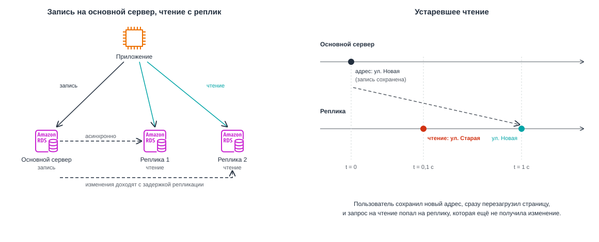

_7.2. Запись идёт на основной сервер, чтение распределяется между репликами_

### Шардирование

Реплики помогают распределить нагрузку на чтение, но не решают проблему записи и объёма данных, поскольку _каждая реплика хранит полную копию базы_. Например, магазин обрабатывает тысячи заказов в секунду. Основной сервер уже не справляется с записью, а база данных становится слишком большой для одного сервера.

В таком случае используют другой подход - **шардирование (sharding)**.

**Шардирование (sharding)** - способ распределения данных одной базы между несколькими серверами. Каждый сервер хранит и обрабатывает только свою часть данных[^11].

**Шард (shard)** - отдельная часть базы данных, которая хранится и обрабатывается на одном или нескольких серверах.

### Горизонтальное и вертикальное шардирование

Разделить данные между серверами можно двумя способами.

- _Горизонтальное шардирование_. Между серверами делят строки одной таблицы. Все шарды имеют одинаковую схему, но хранят разные строки: заказы одних клиентов лежат в первом шарде, заказы других во втором[^12].
- _Вертикальное шардирование_. Разделение таблиц базы данных между разными серверами. Например, таблица клиентов хранится на одном сервере, а таблица заказов - на другом.

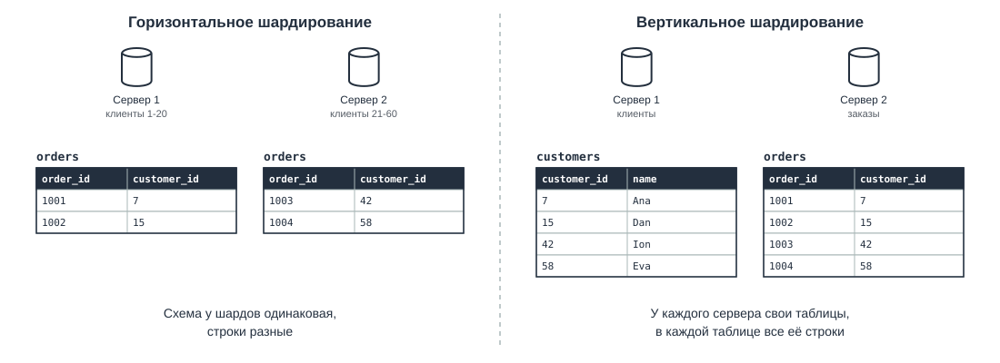

_7.3. Горизонтальное и вертикальное шардирование_

Не путайте вертикальное шардирование с вертикальным масштабированием: _шардирование всегда добавляет серверы_.

### Ключ шарда

Чтобы определить, на каком шарде хранить данные, используют _ключ шарда_.

**Ключ шарда (shard key)** - столбец, по значению которого определяется шард для хранения строки[^11]. Например, если выбрать `customer_id` в таблице заказов, все заказы одного клиента будут храниться в одном шарде. Поэтому запрос заказов клиента 42 обратится только к нему.

Ключ шарда определяет, _по какому полю разделять данные_, но не определяет сам способ распределения. Для этого используют три основных подхода[^11]:

- _По диапазону (range-based)_. Данные распределяются по диапазонам значений. _Например_, клиенты с ID от 1 до 1 000 000 хранятся в первом шарде, а следующий миллион - во втором.
- _По хешу (hash-based)_. К значению ключа применяется хеш-функция, результат которой используется для выбора шарда.
- _По географии (geo-based)_. Данные распределяются по местоположению пользователей. _Например_, клиенты из Европы хранятся на одном шарде, а из Америки - на другом.

На рисунке 7.4 показано шардирование по хешу. Заказы распределяются между тремя шардами по правилу:

```text
hash(customer_id) mod 3
```

Сначала вычисляется хеш идентификатора клиента, затем остаток от деления на 3 определяет номер шарда (`0`, `1` или `2`). Все заказы одного клиента попадают в один шард.

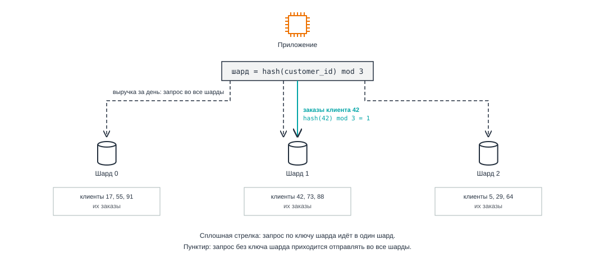

_7.4. Шардирование таблицы заказов по хешу `customer_id`._

### Недостатки шардирования

У шардирования есть серьёзные недостатки, поэтому к нему прибегают, когда другие способы исчерпаны:

- _Неравномерная нагрузка_. Если на одного крупного клиента приходится половина всех заказов, все они попадут в один шард. Шард будет перегружен, а остальные почти простаивают.
- _Запросы к нескольким шардам_. Например, чтобы посчитать общую выручку магазина за день, нужно получить данные со всех шардов и объединить результаты. Объединение таблиц и транзакции между несколькими шардами также усложняются и требуют дополнительных механизмов[^11].
- _Перераспределение данных_. При переходе с трёх шардов на четыре правило меняется на `hash(customer_id) mod 4`, и остаток от деления становится другим у большинства клиентов. Их заказы приходится переносить между серверами[^11].
- _Сложность эксплуатации_. Большинство реляционных СУБД не умеют шардировать данные сами, и эту логику пишут в приложении или в отдельном промежуточном слое[^11].

### Репликация и шардирование вместе

Репликация и шардирование используют несколько серверов, но решают разные задачи:

- _При репликации_ серверы хранят копии одних и тех же данных,
- _При шардировании_ каждый шард хранит только часть базы данных.

Разница показана на рисунке 7.5 и в таблице.

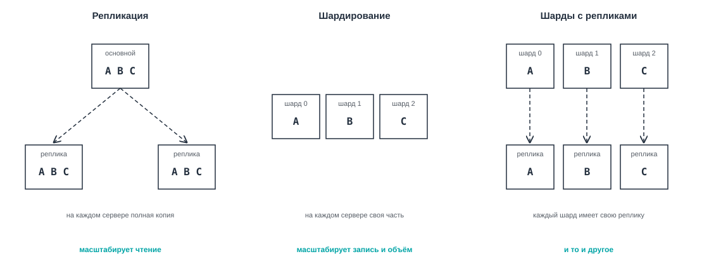

_7.5. Репликация, шардирование и их сочетание._

| Свойство            | Репликация                                             | Шардирование                                                 |
| ------------------- | ------------------------------------------------------ | ------------------------------------------------------------ |
| Как хранятся данные | Каждый сервер хранит копию одних и тех же данных.      | Каждый шард хранит свою часть данных.                        |
| Что масштабирует    | Чтение.                                                | Запись и объём хранимых данных.                              |
| Отказоустойчивость  | Реплика может заменить основной сервер при его отказе. | Без реплик отказ шарда делает часть данных недоступной.      |
| Основная сложность  | Задержка синхронизации данных между серверами.         | Выбор ключа шарда и выполнение запросов к нескольким шардам. |

На практике эти приёмы сочетают: _базу делят на шарды, а у каждого шарда есть свои реплики_[^11]. Тогда шарды распределяют запись, а реплики каждого шарда обеспечивают отказоустойчивость и чтение.

## Базы данных в облаке

### Своя СУБД или управляемый сервис

В AWS базу данных можно развернуть двумя способами:

**Неуправляемый подход (unmanaged)** - самостоятельная установка и настройка СУБД на экземпляре EC2. Вы получаете полный контроль над базой данных, но самостоятельно отвечаете за:

- масштабирование ресурсов;
- отказоустойчивость и высокую доступность;
- создание резервных копий;
- обновление операционной системы и СУБД;
- мониторинг и устранение неполадок.

**Управляемый подход (managed)** - использование готового сервиса, в котором часть задач по обслуживанию базы данных выполняет AWS. Например:

- автоматическое создание резервных копий;
- установка обновлений ОС и СУБД с учётом настроек обслуживания;
- настройка репликации и высокой доступности;
- упрощённое масштабирование: изменение класса экземпляра, добавление реплик и автоматическое увеличение хранилища;
- сбор метрик, мониторинг и настройка оповещений.

При этом _за структуру базы данных, запросы, права доступа и работу приложения по-прежнему отвечаете вы_.

### Базы данных AWS

AWS предлагает больше пятнадцати вариантов баз данных для разных моделей данных[^13]. В этой главе мы подробно разберём четыре из них (остальные упомянем коротко):

- _Amazon RDS_. Управляемые реляционные базы с привычными СУБД: PostgreSQL, MySQL и другими.
- _Amazon Aurora_. Реляционная база, совместимая с PostgreSQL и MySQL, с собственным распределённым хранилищем.
- _Amazon DynamoDB_. Нереляционная база для данных в виде пар ключ-значение и документов, без серверов, которыми нужно управлять.
- _Amazon Redshift_. Аналитическая база данных для отчётов по большим объёмам данных.

## Amazon RDS

### Что такое Amazon RDS

**Amazon RDS (Relational Database Service)** - управляемый сервис AWS для создания, обслуживания и масштабирования реляционных баз данных в облаке[^14].

| Характеристика      | Amazon RDS                                                                                                                       |
| ------------------- | -------------------------------------------------------------------------------------------------------------------------------- |
| Категория           | Базы данных (databases)                                                                                                          |
| Что делает          | Запускает и обслуживает реляционную СУБД: обновления, резервные копии, мониторинг, переключение при отказе                       |
| Для чего нужен      | Получить готовую реляционную базу без администрирования сервера и СУБД                                                           |
| Где используют      | Основные данные веб-приложений: пользователи, заказы, платежи, учёт                                                              |
| Модель обслуживания | PaaS: серверами, ОС и СУБД управляет AWS, вы управляете схемой, данными и доступом                                               |
| Область действия    | Региональный: экземпляр базы находится в одной зоне доступности, копии могут быть в других зонах и регионах                      |
| Как оплачивается    | Часы работы экземпляра (по классу), объём хранилища в месяц, хранилище резервных копий сверх бесплатного объёма, передача данных |
| Как работать        | Консоль AWS, AWS CLI (`aws rds`), SDK; к самой базе подключаются обычным клиентом СУБД                                           |
| Появился            | Октябрь 2009 года[^15]                                                                                                           |
| Аналоги             | Google Cloud SQL[^16], Azure Database for PostgreSQL                                                                             |

### Основные характеристики Amazon RDS

Основными характеристиками Amazon RDS являются:

- _Поддержка популярных СУБД_. PostgreSQL, MySQL, MariaDB, Microsoft SQL Server, Oracle Database и IBM Db2.
- _Автоматическое обслуживание_. AWS выполняет резервное копирование, обновления, обнаружение сбоев и восстановление базы данных.
- _Настройка ресурсов_. Вы выбираете мощность экземпляра и объём хранилища. Стоимость зависит от выбранных ресурсов и времени их использования.
- _Отказоустойчивость и масштабирование_. Multi-AZ позволяет использовать резервный экземпляр в другой зоне доступности, а Read Replicas - распределять нагрузку на чтение.
- _Восстановление на момент времени (PITR)_. Позволяет восстановить базу данных на выбранный момент в пределах срока хранения резервных копий.
- AWS рекомендует RDS как выбор по умолчанию для большинства реляционных баз данных[^14].

### Экземпляр базы данных

Основной ресурс RDS называется экземпляром базы данных.

**Экземпляр базы данных (DB instance)** - изолированная среда базы данных в облаке, на котором работает выбранная СУБД с одной или несколькими базами[^14].

Экземпляр базы данных похож на экземпляр EC2, и при создании для него выбирают похожие параметры:

- _Класс экземпляра (DB instance class)_. Определяет процессор и память, как тип экземпляра в EC2. Имена классов начинаются с `db.`, дальше идут знакомые семейство, поколение и размер, например `db.t4g.micro` или `db.r6g.xlarge`[^17].
- _Хранилище_. Дисковое пространство для хранения файлов базы данных. В Amazon RDS обычно используется SSD-хранилище типа `gp3`[^18].
- _Автоматическое увеличение хранилища (storage autoscaling)_. Если свободного места почти не осталось, RDS сам увеличит том, но не выше заданного вами максимума[^19].
- _Учётные данные администратора_. Имя главного пользователя (master user) и пароль, с которыми вы подключаетесь к базе.

> [!TIP]
>
> Подключаться к экземпляру по SSH нельзя: RDS не даёт прямого доступа к серверу, на котором работает СУБД[^20]. Вы работаете только с самой базой через клиент СУБД.

### Подключение к экземпляру

Каждый экземпляр RDS получает адрес для подключения.

**Endpoint экземпляра (DB instance endpoint)** - DNS-имя, по которому приложение подключается к базе данных[^20]. Например:

`shop-db.abcdefghijkl.eu-central-1.rds.amazonaws.com`

Приложение использует этот адрес вместо IP-адреса, который может измениться.

### RDS в VPC

Как и EC2, экземпляр RDS работает внутри _VPC_. Однако подсеть для него выбирают не напрямую, а через специальную группу.

**Группа подсетей базы данных (DB subnet group)** - набор подсетей VPC, в которых RDS может размещать экземпляры базы данных[^21].

Работает это следующим образом:

1. Вы создаёте группу подсетей, обычно приватных, _минимум в двух зонах доступности_ (Availability Zones).
2. RDS выбирает одну из этих подсетей и размещает в ней экземпляр базы данных.
3. Если включён режим _Multi-AZ_, RDS также размещает резервный экземпляр в другой зоне доступности для защиты от сбоев.

Доступ к базе данных контролируют два параметра:

- _Public access_ - определяет, может ли база получить публичный IP-адрес. Для базы приложения обычно выбирают `No`, чтобы исключить прямое подключение через интернет.
- _Security Group_ - определяет, какие источники могут подключаться к базе данных и через какие порты. Например, можно разрешить PostgreSQL-подключения на порту `5432` только от серверов приложения.

Таким образом

- _DB subnet group_ - определяет, где может находиться база данных
- _Security Group_ - кто может к ней подключаться.

> _[Hands-on 7.1. Первая база данных в RDS.](hands_on_01.md)_ Создание группы из двух приватных подсетей и запуск экземпляра PostgreSQL.

### Высокая доступность: Multi-AZ

Обычный экземпляр RDS работает в одной зоне доступности. Если в ней произойдёт серьёзный сбой, база данных может стать недоступной, а вместе с ней и ваше приложение.

Для защиты от таких ситуаций AWS предлагает режим _Multi-AZ_.

**Multi-AZ DB instance deployment** - режим Amazon RDS, при котором AWS создаёт резервный экземпляр базы данных (standby) в другой зоне доступности и синхронно передаёт ему изменения[^22].

В этом режиме:

- _Основной экземпляр (Primary)_ - обрабатывает все запросы на чтение и запись.
- _Резервный экземпляр (Standby)_ - получает изменения основного, но не обслуживает запросы приложения.
- _Автоматическое переключение (failover)_ - если основной экземпляр выходит из строя, RDS переключает базу на резервный[^23].

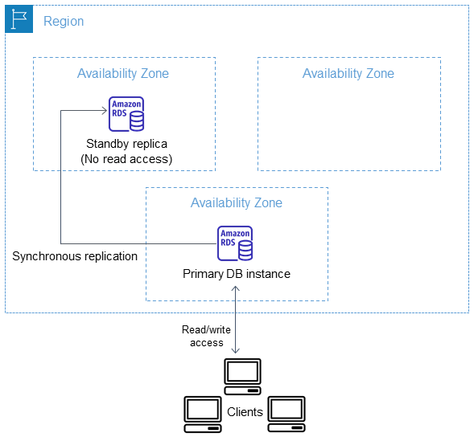

_Рисунок 7.6. Развёртывание Multi-AZ: основной и резервный экземпляры в разных зонах. Источник: Amazon Web Services[^22], лицензия CC BY-SA 4.0[^24]._

Переключение обычно занимает _60–120 секунд_[^23]. Приложение продолжает использовать тот же endpoint, но активные подключения могут оборваться, поэтому оно должно уметь подключаться повторно.

У Multi-AZ есть два недостатка:

- _Более медленная запись_. Подтверждение транзакции требует синхронизации с резервным экземпляром.
- _Более высокая стоимость_. AWS оплачивается работа как основного, так и резервного экземпляра[^25].

> [!IMPORTANT]
>
> Multi-AZ защищает от инфраструктурных сбоев, но не от ошибок приложения. Если случайно удалить таблицу, это изменение будет передано и на резервный экземпляр. Поэтому резервные копии по-прежнему необходимы.

### Реплики для чтения (Read Replicas)

_Multi-AZ_ обеспечивает отказоустойчивость, а _Read Replicas_ используются для масштабирования чтения.

**Реплика для чтения (Read Replica)** - отдельный экземпляр RDS со своим endpoint, который получает изменения основного экземпляра асинхронно[^26].

Приложение самостоятельно распределяет запросы:

- запись отправляет на основной экземпляр,
- чтение - на реплики.

RDS не распределяет эти запросы автоматически.

_Основные характеристики Read Replicas:_

- _Количество_. Обычно до 15 реплик на один основной экземпляр, но ограничение зависит от СУБД[^27].
- _Размещение_. Реплики могут находиться в той же или другой зоне доступности, а для некоторых СУБД - даже в другом регионе.
- _Продвижение (promotion)_. Реплику можно превратить в самостоятельный экземпляр, который принимает запросы на запись.
- _Создание_. Реплики создаются отдельно и не добавляются автоматически при увеличении нагрузки.

Multi-AZ и Read Replicas можно использовать одновременно. На рисунке 7.7 показан основной экземпляр с двумя копиями: синхронным резервным экземпляром (Standby) и асинхронной репликой для чтения (Read Replica).

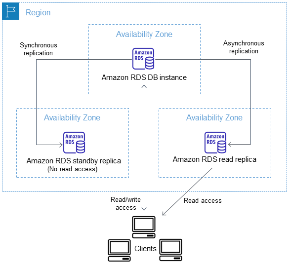

_Рисунок 7.7. Основной экземпляр с резервным экземпляром Multi-AZ и репликой для чтения. Источник: Amazon Web Services[^26], лицензия CC BY-SA 4.0[^24]._

Хотя оба механизма используют репликацию, они решают разные задачи:

| Свойство                                   | Multi-AZ                    | Read Replica                       |
| ------------------------------------------ | --------------------------- | ---------------------------------- |
| _Назначение_                               | Отказоустойчивость          | Масштабирование чтения             |
| _Репликация_                               | Синхронная                  | Асинхронная                        |
| _Обрабатывает чтение_                      | Нет                         | Да                                 |
| _Отдельный endpoint_                       | Нет                         | Да                                 |
| _Размещение_                               | Другая зона того же региона | Та же зона, другая зона или регион |
| _Действия при отказе основного экземпляра_ | Автоматическое переключение | Ручное продвижение                 |

_Таблица относится к Multi-AZ DB instance deployment, а не к Multi-AZ DB cluster._

### Резервные копии и восстановление

Multi-AZ защищает от сбоев серверов, но не от случайного удаления данных. Для этого Amazon RDS использует _резервные копии_ (backups), которые хранятся в Amazon S3[^28].

Существуют два вида резервных копий:

- _Автоматические резервные копии (automated backups)_. RDS ежедневно создаёт снимок базы данных и примерно каждые пять минут выгружает журналы транзакций. Срок хранения - от 1 до 35 дней. Значение `0` отключает автоматическое резервное копирование для обычного DB instance.
- _Ручные снимки (manual snapshots)_. Создаются пользователем, например перед изменением структуры базы данных. Хранятся до тех пор, пока их не удалят вручную[^29].

Обычный снимок позволяет восстановить базу только в том состоянии, в котором она находилась на момент его создания. Однако автоматические резервные копии вместе с журналами транзакций позволяют восстановить базу и на промежуточный момент времени.

**Восстановление на момент времени (Point-in-Time Recovery, PITR)** - возможность восстановить базу данных на выбранную секунду в пределах доступного периода резервного копирования[^30].

_Например_, администратор случайно удалил таблицу в 14:30. С помощью PITR можно восстановить базу на 14:29:59, если этот момент ещё доступен для восстановления.

Процесс состоит из двух шагов:

1. RDS берёт подходящий снимок базы данных.
2. Применяет изменения из журналов транзакций до выбранного момента.

Самая поздняя доступная точка восстановления обычно отстаёт от текущего времени на несколько минут.

> [!IMPORTANT]
>
> Восстановление не перезаписывает существующую базу. RDS создаёт новый экземпляр с отдельным endpoint. Чтобы использовать восстановленную базу, приложение нужно переключить на него[^30].

### Стоимость Amazon RDS

Стоимость Amazon RDS зависит от выбранных ресурсов и их использования[^25].

| Что оплачивается  | Как рассчитывается                                                                          |
| ----------------- | ------------------------------------------------------------------------------------------- |
| _Экземпляр_       | Время работы, класс экземпляра и выбранная СУБД.                                            |
| _Хранилище_       | Выделенный объём диска и, для некоторых типов, дополнительные параметры производительности. |
| _Резервные копии_ | Объём хранения сверх бесплатного лимита.                                                    |
| _Передача данных_ | Платный сетевой трафик, например между регионами или в интернет.                            |

_Multi-AZ и Read Replicas увеличивают стоимость_, поскольку требуют дополнительных вычислительных ресурсов и хранилища.

Для учебных лабораторных работ обычно достаточно одного экземпляра RDS в одной зоне доступности (Single-AZ). Это позволяет изучить сервис без дополнительных расходов на резервные экземпляры и реплики.

## Amazon Aurora

### Зачем понадобилась Aurora

В RDS у каждого экземпляра свой том с файлами базы:

- у основного,
- у резервного экземпляра Multi-AZ,
- у каждой реплики для чтения.

Основной экземпляр отправляет каждое изменение на все эти тома. Чем больше реплик, тем больше копий данных нужно поддерживать и тем дольше создаётся новая реплика: ей нужно получить полную копию базы.

AWS решила эту проблему иначе: отделила хранилище от вычислений. Так появилась _Aurora_.

### Что такое Amazon Aurora

**Amazon Aurora** - управляемая реляционная СУБД, совместимая с MySQL и PostgreSQL. В отличие от RDS, где у каждого экземпляра свой диск, все экземпляры Aurora работают с одним общим хранилищем[^31].

_Основные характеристики_ Amazon Aurora:

- _Совместимость с MySQL и PostgreSQL_. Приложение работает с Aurora через те же драйверы и с теми же запросами, что и с MySQL или PostgreSQL.
- _Производительность_. По данным AWS, Aurora обрабатывает до шести раз больше операций, чем обычные MySQL и PostgreSQL на похожем оборудовании[^31].
- _Общее хранилище в трёх зонах_. Данные хранятся в шести копиях, по две в каждой из трёх зон доступности[^32][^33]. Хранилище автоматически растёт до 256 ТиБ[^31].
- _Доступность_. Aurora рассчитана на доступность до 99,99% в одном регионе[^34].
- _Самовосстановление хранилища_. Aurora сама находит повреждённые участки дисков и сразу восстанавливает их по другим копиям[^35].
- _Быстрый перезапуск_. После внезапной остановки база почти сразу снова доступна приложению[^35].
- _До 15 реплик для чтения_. Реплики читают тот же общий том и своих копий данных не держат[^36].
- _Быстрая замена основного экземпляра_. При отказе одна из реплик становится основным экземпляром, и данные копировать не нужно[^36].

| Характеристика      | Amazon Aurora                                                                                                 |
| ------------------- | ------------------------------------------------------------------------------------------------------------- |
| Категория           | Базы данных (databases)                                                                                       |
| Что делает          | Запускает реляционную СУБД, совместимую с MySQL или PostgreSQL, над общим томом с копиями данных в трёх зонах |
| Для чего нужен      | Реляционная база с высокой доступностью и быстрыми репликами для нагруженных приложений                       |
| Где используют      | Нагруженные веб-приложения и SaaS-сервисы, системы, где важна быстрая замена основного сервера                |
| Модель обслуживания | PaaS                                                                                                          |
| Область действия    | Региональный: общий том охватывает три зоны доступности региона                                               |
| Как оплачивается    | Часы работы экземпляров, объём хранилища, операции ввода-вывода (зависит от конфигурации), резервные копии    |
| Как работать        | Те же консоль и команды `aws rds`, что для RDS; к базе подключаются клиентом MySQL или PostgreSQL             |
| Появился            | Анонс в ноябре 2014 года, общая доступность в июле 2015 года[^37][^38]                                        |
| Аналоги             | Google Cloud AlloyDB for PostgreSQL[^39]                                                                      |

### RDS или Aurora

Aurora не всегда лучше обычного RDS.

| Ситуация                                                           | Что выбрать         | Почему                                                 |
| ------------------------------------------------------------------ | ------------------- | ------------------------------------------------------ |
| Небольшая база, учебный проект                                     | RDS, один экземпляр | Проще и не нужно платить за лишние возможности         |
| Нужна СУБД, которой нет в Aurora: Oracle, SQL Server, Db2, MariaDB | RDS                 | Aurora совместима только с MySQL и PostgreSQL          |
| Много реплик, новые реплики нужны быстро                           | Aurora              | Реплика читает общий том, базу копировать не нужно     |
| Важна быстрая замена основного сервера                             | Aurora              | Новому основному экземпляру не нужно копировать данные |

## Amazon DynamoDB

### Зачем нужна DynamoDB

Вернёмся к корзине покупателя. Корзину читают и меняют при каждом добавлении товара и каждом открытии страницы. Обращаются к ней всегда по одному ключу, идентификатору покупателя, и никогда не объединяют с другими таблицами. В распродажу число таких запросов может вырасти в сотни раз за минуты.

Для корзин небольшого магазина PostgreSQL в RDS справится без труда. Но если операций записи станет больше, чем выдерживает самый мощный экземпляр, базу придётся шардировать. Большинство реляционных СУБД этого не умеют, и вся работа с шардами ляжет на приложение.

При этом корзине не нужны ни `JOIN`, ни транзакции между таблицами: к ней обращаются только по ключу. Для таких данных подходит база ключ-значение, которая сама делит данные на шарды и добавляет новые шарды по мере роста.

### Что такое DynamoDB

**Amazon DynamoDB** - полностью управляемая распределённая NoSQL-база данных AWS, поддерживающая модель ключ-значение и документную модель[^6].

_Основные характеристики_ Amazon DynamoDB:

- _Ключ-значение и документы_. Элемент находят по ключу, а внутри элемента могут быть вложенные поля, как в JSON[^6].
- _Автоматическое горизонтальное масштабирование_. DynamoDB сама делит данные таблицы между серверами и добавляет новые по мере роста.
- _Три зоны доступности_. DynamoDB сама копирует данные каждой таблицы в три зоны доступности региона[^6].
- _Гибкая схема_. При создании таблицы задают только первичный ключ, остальные атрибуты у каждого элемента свои.

| Характеристика      | Amazon DynamoDB                                                                                                         |
| ------------------- | ----------------------------------------------------------------------------------------------------------------------- |
| Категория           | Базы данных (databases)                                                                                                 |
| Что делает          | Хранит элементы в таблицах и выдаёт их по ключу с задержкой в несколько миллисекунд при любом объёме                    |
| Для чего нужен      | Хранить данные, к которым обращаются по ключу, с горизонтальным масштабированием без управления серверами               |
| Где используют      | Корзины и сессии, профили пользователей, игровые данные, счётчики, журналы событий                                      |
| Модель обслуживания | PaaS: серверов нет, вы управляете таблицами, данными и доступом                                                         |
| Область действия    | Региональный: данные таблицы копируются в три зоны доступности региона                                                  |
| Как оплачивается    | Запросы на чтение и запись (или заранее заданная пропускная способность), объём хранения, дополнительные функции        |
| Как работать        | Консоль AWS, AWS CLI (`aws dynamodb`), SDK (для JavaScript пакеты `@aws-sdk/client-dynamodb` и `@aws-sdk/lib-dynamodb`) |
| Появился            | Январь 2012 года[^40]                                                                                                   |
| Аналоги             | Google Cloud Firestore[^41] и Bigtable[^42], Azure Cosmos DB                                                            |

### Таблицы, элементы и атрибуты

В DynamoDB данные организованы в таблицы, элементы и атрибуты.

- _Таблица (table)_. Набор элементов, например таблица `Carts` с корзинами.
- _Элемент (item)_. Одна запись таблицы, аналог строки в реляционной таблице.
- _Атрибут (attribute)_. Отдельное значение внутри элемента, например `quantity`. Аналог столбца, но набор атрибутов у элементов одной таблицы может различаться.

Например, у одного элемента таблицы `Carts` есть атрибут `size`, у другого `color`, и таблицу для этого менять не нужно:

```json
[
  { "userId": "u-42", "productId": "p-7", "quantity": 2, "size": "L" },
  { "userId": "u-42", "productId": "p-9", "quantity": 1, "color": "red" }
]
```

Размер одного элемента ограничен 400 КБ[^43], поэтому большие данные, например фотографии, хранят в S3, а в элементе только ключ объекта.

Тип атрибута DynamoDB определяет по его значению, и заранее объявлять его не нужно. Исключение составляют атрибуты первичного ключа: их тип указывают при создании таблицы. Основные типы обозначают так[^44]:

| Обозначение      | Тип                                       | Пример значения       |
| ---------------- | ----------------------------------------- | --------------------- |
| `S`              | Строка                                    | `"u-42"`              |
| `N`              | Число                                     | `2`                   |
| `B`              | Двоичные данные                           | `"aGVsbG8="` (Base64) |
| `BOOL`           | Логическое значение                       | `true`                |
| `NULL`           | Пустое значение                           | `null`                |
| `L`              | Список                                    | `["red", 2]`          |
| `M`              | Вложенный объект (map)                    | `{"city": "Кишинёв"}` |
| `SS`, `NS`, `BS` | Множества строк, чисел, двоичных значений | `["L", "XL"]`         |

Эти обозначения понадобятся при работе через AWS CLI, где тип каждого значения указывают явно.

### Первичный ключ и разделы

Первичный ключ в DynamoDB определяет не только уникальность элемента, но и то, где элемент физически хранится. Здесь мы снова встречаем _шардирование_, только выполняет его сама DynamoDB.

**Раздел (partition)** - часть данных таблицы DynamoDB. DynamoDB сама делит таблицу на разделы и сама ими управляет[^45].

Каждый раздел DynamoDB _автоматически реплицирует в три зоны доступности региона_, поэтому отказ одной зоны не приводит к потере данных[^6].

**Ключ раздела (partition key)** - атрибут первичного ключа, по значению которого DynamoDB выбирает раздел для элемента. Значение проходит через внутреннюю хеш-функцию, и её результат определяет раздел[^45].

Иначе говоря, раздел DynamoDB соответствует шарду, а ключ раздела соответствует ключу шарда при шардировании по хешу.

Если первичный ключ состоит только из ключа раздела, значения ключа у разных элементов не должны совпадать. Для корзины это неудобно: в корзине покупателя `u-42` может лежать несколько товаров, и у всех этих элементов `userId` одинаковый. Поэтому к ключу раздела можно добавить второй атрибут.

**Ключ сортировки (sort key)** - вторая, необязательная часть первичного ключа. Она отличает друг от друга элементы с одинаковым ключом раздела и задаёт их порядок внутри раздела[^46].

Рассмотрим пример.

- В таблице `Carts` каждый элемент описывает один товар в корзине одного покупателя.
- Ключом раздела служит `userId`, ключом сортировки `productId`.

Все товары корзины одного покупателя лежат в одном разделе рядом друг с другом (рисунок 7.8), и вся корзина читается одним запросом.

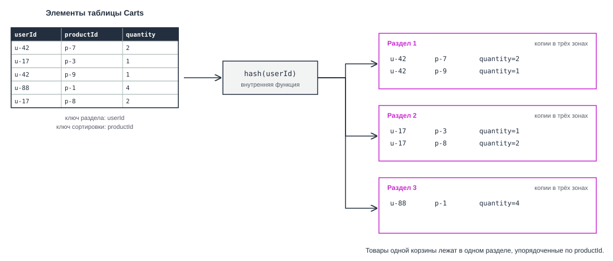

_7.8. Хеш ключа раздела `userId` определяет раздел, в котором хранятся элементы корзины_

Первичный ключ из одного ключа раздела называют простым (simple primary key), а из ключа раздела и ключа сортировки составным (composite primary key)[^46]. Выбирают между ними по тому, как приложение читает данные:

- _Простой ключ_. Подходит, когда элементы читают по одному и у каждого свой идентификатор. Например, профиль пользователя читают по `userId`, а карточку товара по `productId`.
- _Составной ключ_. Подходит, когда элементы образуют группы, которые читают целиком или по диапазону. Например, все товары корзины читают по `userId`, а заказы покупателя за месяц по `customerId` и дате заказа в ключе сортировки.

### Выбор ключа раздела

Неудачный ключ раздела создаёт ту же проблему неравномерной нагрузки, что и при шардировании. Если большая часть запросов относится к одному значению ключа, эти запросы попадают в один раздел. Раздел перестаёт справляться, DynamoDB отклоняет часть запросов (throttling), и приложению приходится повторять их позже[^47].

| Ключ раздела                                               | Оценка и причина                                                |
| ---------------------------------------------------------- | --------------------------------------------------------------- |
| Идентификатор пользователя при большом числе пользователей | Хороший: много разных значений, запросы распределены равномерно |
| Код статуса, у которого всего несколько значений           | Плохой: почти все запросы приходятся на несколько разделов      |
| Дата создания, округлённая до дня                          | Плохой: все записи текущего дня попадают в один раздел          |

### Чтение: Query и Scan

Получить данные из таблицы DynamoDB можно тремя основными операциями:

- _GetItem_. Читает один элемент по полному первичному ключу.
- _Query_. Находит элементы по ключу раздела и, при необходимости, отбирает их по условию на ключ сортировки[^48].
- _Scan_. Читает всю таблицу целиком и проверяет каждый элемент[^49].

В Query ключ раздела всегда указывают точно, например `userId = "u-42"`. Ключ сортировки можно дополнительно ограничить условием[^50]:

- _Сравнение_. Операторы `=`, `<`, `<=`, `>`, `>=`.
- _Диапазон_. `BETWEEN ... AND ...`, значение между двумя границами.
- _Начало строки_. `begins_with`, строка начинается с заданных символов.

Например, если у таблицы заказов ключ раздела `customerId`, а ключ сортировки дата заказа, Query с `BETWEEN` вернёт заказы одного покупателя за октябрь.

Чтобы получить корзину покупателя `u-42`, нужен Query по `userId = "u-42"`: DynamoDB по хешу ключа найдёт нужный раздел и прочитает только его.

> [!NOTE]
>
> Тот же результат можно получить через Scan с фильтром, но Scan прочитает все корзины всех покупателей во всех разделах, и платить придётся за весь прочитанный объём. Поэтому AWS рекомендует проектировать таблицы так, чтобы приложение использовало _Query вместо Scan_[^49].

Как и Query, за один запрос Scan читает не больше 1 МБ данных. Если данных в таблице больше, ответ содержит `LastEvaluatedKey`, и следующий запрос продолжает чтение с этого места[^51]. Чтение большой таблицы превращается в длинную серию запросов.

В PostgreSQL можно написать любой запрос, и СУБД найдёт способ его выполнить. В DynamoDB быстро выполняются только запросы по ключу, поэтому сначала составляют список запросов приложения, а потом под них выбирают ключи таблицы.

Если нужен запрос по другому атрибуту, например все корзины с определённым товаром, создают индекс.

**Глобальный вторичный индекс (global secondary index, GSI)** - дополнительная копия данных таблицы с другим ключом раздела. DynamoDB сама обновляет её при каждой записи, и по ней можно выполнять Query[^52].

Индекс с ключом раздела `productId` позволит найти все корзины с товаром `p-7`. Индекс это вторая копия данных, поэтому за его хранение и запись в него платят отдельно[^52].

### Стоимость DynamoDB

DynamoDB оплачивается не за серверы, а за хранение данных и за запросы. За запросы можно платить одним из двух способов, их называют режимами ёмкости[^53]:

- _По запросам (on-demand)_. Вы платите за каждый выполненный запрос. Это режим по умолчанию, он подходит, когда нагрузка неизвестна или резко меняется.
- _Заданная ёмкость (provisioned)_. Вы заранее задаёте, сколько чтений и записей в секунду нужно таблице, и платите за эту ёмкость, даже если она не используется. Режим подходит для ровной предсказуемой нагрузки.

В бесплатный уровень входит 25 ГБ хранения в любом режиме. Кроме того, в режиме заданной ёмкости бесплатна небольшая ёмкость, которой хватает для учебной таблицы[^54]. Поэтому учебную таблицу создают в этом режиме.

### Работа с DynamoDB через AWS CLI

Команды для работы с DynamoDB собраны в группе `aws dynamodb`[^55]:

| Команда            | Что делает                                                  |
| ------------------ | ----------------------------------------------------------- |
| `list-tables`      | Выводит список таблиц в регионе                             |
| `describe-table`   | Показывает параметры таблицы: ключи, индексы, режим ёмкости |
| `put-item`         | Записывает элемент, заменяя элемент с тем же ключом         |
| `get-item`         | Читает один элемент по полному первичному ключу             |
| `update-item`      | Изменяет отдельные атрибуты элемента                        |
| `batch-write-item` | Записывает или удаляет до 25 элементов одним запросом       |
| `query`            | Выполняет Query                                             |
| `scan`             | Выполняет Scan                                              |

В командах CLI значение каждого атрибута записывают вместе с типом из таблицы типов, например `{"quantity": {"N": "2"}}`. Числа при этом передают строкой[^44].

Команды ниже выполняют по порядку четыре действия:

1. Добавляют товар в корзину.
2. Читают этот товар.
3. Меняют его количество.
4. Читают всю корзину.

```bash
aws dynamodb put-item --table-name Carts \
  --item '{"userId": {"S": "u-42"}, "productId": {"S": "p-7"}, "quantity": {"N": "2"}}'

aws dynamodb get-item --table-name Carts \
  --key '{"userId": {"S": "u-42"}, "productId": {"S": "p-7"}}'

aws dynamodb update-item --table-name Carts \
  --key '{"userId": {"S": "u-42"}, "productId": {"S": "p-7"}}' \
  --update-expression "SET quantity = :q" \
  --expression-attribute-values '{":q": {"N": "3"}}'

aws dynamodb query --table-name Carts \
  --key-condition-expression "userId = :uid" \
  --expression-attribute-values '{":uid": {"S": "u-42"}}'
```

В выражениях `--update-expression` и `--key-condition-expression` значения не пишут напрямую, а подставляют через заполнители, начинающиеся с двоеточия, такие как `:q` и `:uid`. Сами значения передают в `--expression-attribute-values`.

### Работа с DynamoDB из Node.js

С DynamoDB приложение работает через AWS SDK. Для JavaScript удобнее всего пакет `@aws-sdk/lib-dynamodb` с клиентом документов (document client), который принимает обычные объекты JavaScript[^56]. Ниже показаны добавление товара в корзину и чтение всей корзины покупателя:

```javascript
import { DynamoDBClient } from "@aws-sdk/client-dynamodb";
import {
  DynamoDBDocumentClient,
  PutCommand,
  QueryCommand,
} from "@aws-sdk/lib-dynamodb";

const client = new DynamoDBClient({ region: "eu-central-1" });
const docClient = DynamoDBDocumentClient.from(client);

// Добавить товар в корзину покупателя u-42
await docClient.send(
  new PutCommand({
    TableName: "Carts",
    Item: { userId: "u-42", productId: "p-7", quantity: 2 },
  }),
);

// Прочитать всю корзину покупателя u-42 одним запросом Query
const result = await docClient.send(
  new QueryCommand({
    TableName: "Carts",
    KeyConditionExpression: "userId = :uid",
    ExpressionAttributeValues: { ":uid": "u-42" },
    ConsistentRead: true,
  }),
);
console.log(result.Items);
```

- `PutCommand` записывает элемент: если элемент с таким же первичным ключом уже есть, он будет заменён
- `QueryCommand` принимает условие на ключ раздела в параметре `KeyConditionExpression`, а `ConsistentRead: true` нужен потому, что корзину читают сразу после записи. Если корзина была пустой, программа выведет (порядок атрибутов может отличаться):

  ```text
  [ { userId: 'u-42', productId: 'p-7', quantity: 2 } ]
  ```

> [_Hands-on 7.2. Таблица DynamoDB._](hands_on_02.md) Создание таблицы в DynamoDB с ключом раздела и ключом сортировки, запись и чтение элементов через консоль и AWS CLI, пакетная запись `batch-write-item`, сравнение Query и Scan.

### Дополнительные возможности DynamoDB

- _Время жизни (time to live, TTL)_. Если указать атрибут со временем истечения, DynamoDB сама удалит просроченные элементы, обычно в течение нескольких дней после срока[^57]. Так удаляют брошенные корзины и старые сессии.
- _Потоки (DynamoDB Streams)_. Журнал изменений элементов таблицы, по которому другие части системы узнают об этих изменениях[^58].
- _Глобальные таблицы (global tables)_. Копии таблицы в нескольких регионах, каждая из которых принимает запись[^59].
- _Транзакции_. Изменения нескольких элементов можно выполнить как одно целое[^6].

### DynamoDB или RDS

| Свойство        | Amazon RDS                                | Amazon DynamoDB                              |
| --------------- | ----------------------------------------- | -------------------------------------------- |
| Модель данных   | Таблицы со схемой, связи между таблицами  | Элементы с гибким набором атрибутов          |
| Запросы         | Любые запросы на SQL, `JOIN`              | По ключу, Query по ключу раздела, GSI        |
| Масштабирование | Вертикальное, реплики для чтения          | Горизонтальное, автоматическое               |
| Серверы         | Вы выбираете класс экземпляра             | Серверов нет                                 |
| Оплата          | Часы работы экземпляра, даже без запросов | Запросы или заданная ёмкость, объём хранения |
| Подходит для    | Заказы, платежи, учёт, сложные отчёты     | Корзины, сессии, профили, счётчики, события  |

Если запросы к данным заранее неизвестны или нужны связи между таблицами, начинают с реляционной базы. DynamoDB выбирают, когда:

- список запросов известен заранее,
- обращения идут по ключу,
- нагрузка велика или непредсказуема.

## Amazon Redshift и аналитика

### Аналитические запросы на рабочей базе

Менеджер магазина просит отчёт о выручке по категориям товаров за каждый месяц прошлого года. Запрос для такого отчёта читает миллионы строк заказов, но только несколько столбцов: дату, категорию и сумму. Если выполнить его на основной базе магазина, он надолго загрузит сервер, и покупатели почувствуют замедление.

Реплика для чтения снимет нагрузку с основного сервера, но не сделает сам запрос быстрее: реплика хранит данные так же, как основной сервер, и прочитает миллионы заказов вместе со всеми их столбцами. Для таких запросов нужна другая организация хранения.

### OLTP и OLAP

Базы данных решают два разных вида задач[^60]:

- _OLTP (online transaction processing)_. Множество коротких запросов, каждый из которых читает или меняет несколько строк: оформление заказа, изменение корзины, вход пользователя. Для этого предназначены RDS, Aurora и DynamoDB.
- _OLAP (online analytical processing)_. Немного длинных запросов, каждый из которых читает и группирует огромное число строк: отчёты, анализ продаж, поиск закономерностей.

**Хранилище данных (data warehouse)** - база данных для аналитики, в которую данные регулярно загружаются из рабочих баз и других источников и которая оптимизирована под запросы, читающие большие объёмы данных.

Не путайте хранилище данных с хранилищем файлов вроде S3: название похоже, но это база данных для аналитических запросов на SQL.

### Amazon Redshift

**Amazon Redshift** - полностью управляемое хранилище данных AWS для аналитических запросов на SQL к данным объёмом до петабайтов[^61].

_Основные характеристики_ Amazon Redshift:

- _SQL_. Запросы пишут на SQL, а его диалект в Redshift основан на PostgreSQL[^62].
- _Хранение по столбцам_. Запрос читает с диска только нужные ему столбцы[^63].
- _Параллельная обработка_. Один запрос выполняется одновременно на нескольких серверах кластера, которые называют узлами (nodes)[^64].
- _Пакетная загрузка (batch loading)_. Данные загружают не построчно в момент покупки, а большими порциями из рабочих баз и файлов, например раз в сутки[^65].

| Характеристика      | Amazon Redshift                                                                                                    |
| ------------------- | ------------------------------------------------------------------------------------------------------------------ |
| Категория           | Аналитика (analytics)                                                                                              |
| Что делает          | Хранит большие объёмы данных и быстро выполняет аналитические SQL-запросы к ним                                    |
| Для чего нужен      | Отчёты и анализ данных без нагрузки на рабочие базы приложения                                                     |
| Где используют      | Отчёты о продажах, анализ поведения пользователей                                                                  |
| Модель обслуживания | PaaS                                                                                                               |
| Область действия    | Региональный                                                                                                       |
| Как оплачивается    | Кластер: часы работы узлов. Redshift Serverless: вычисления во время выполнения запросов. Отдельно хранение данных |
| Как работать        | Консоль AWS, AWS CLI, SQL-клиенты                                                                                  |
| Появился            | Ноябрь 2012 года, ограниченная бета-версия[^66]                                                                    |
| Аналоги             | Google BigQuery[^67], Azure Synapse Analytics                                                                      |

### Хранение по столбцам

**Хранение по столбцам, или колоночное хранение (columnar storage)** - способ хранения таблицы, при котором значения одного столбца для многих строк записываются на диск рядом, в одни и те же блоки[^63].

Не путайте колоночное хранение с колоночной моделью нереляционных баз данных: Redshift остаётся реляционной базой с SQL, а по столбцам раскладываются только данные на диске.

Обычная реляционная база хранит данные по строкам: все поля одной записи лежат рядом. На рисунке 7.9 три записи таблицы уложены в блоки диска по строкам. Чтобы прочитать один столбец, всё равно придётся прочитать все блоки.

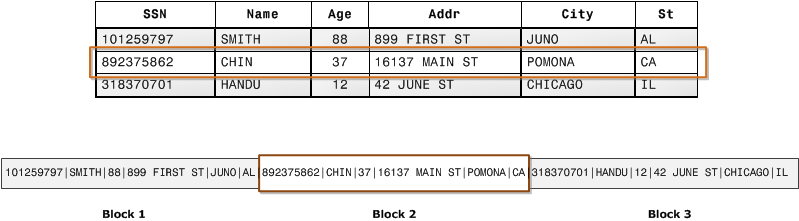

_7.9. Хранение записей в блоках диска по строкам. Источник: Amazon Web Services[^63], лицензия CC BY-SA 4.0[^24]_

На рисунке 7.10 та же таблица хранится по столбцам: в первый блок попали значения столбца SSN сразу для многих записей.

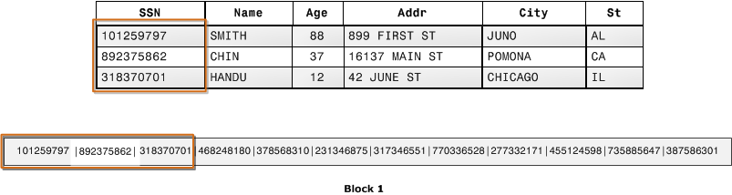

_7.10. Хранение записей в блоках диска по столбцам. Источник: Amazon Web Services[^63], лицензия CC BY-SA 4.0[^24]_

Для отчёта о выручке по категориям нужны только три столбца: дата, категория и сумма. При хранении по строкам СУБД прочитает с диска все столбцы каждого заказа, а при колоночном хранении только эти три. Чем шире таблица, тем больше выигрыш: запрос, который использует пять столбцов из ста, прочитает примерно пять процентов данных[^63].

## Другие базы данных AWS

Кроме разобранных сервисов, у AWS есть базы для других моделей данных.

| Сервис             | Модель данных  | Для чего используют                                       |
| ------------------ | -------------- | --------------------------------------------------------- |
| Amazon ElastiCache | В памяти       | Кеш часто запрашиваемых данных[^68]                       |
| Amazon MemoryDB    | В памяти       | База в памяти, не теряющая данные при отказе[^69]         |
| Amazon DocumentDB  | Документная    | Документы, совместимость с API MongoDB[^70]               |
| Amazon Keyspaces   | Колоночная     | Управляемая база, совместимая с Apache Cassandra[^71]     |
| Amazon Neptune     | Графовая       | Связи между объектами: рекомендации, социальные сети[^72] |
| Amazon Timestream  | Временные ряды | Метрики и показания датчиков[^73]                         |

## Собираем решения вместе

Применим разобранное к учебному интернет-магазину. Требования к данным у магазина разные, и для каждого нужно своё решение.

| Требование                                                           | Решение                                                               | Компромисс                                                    |
| -------------------------------------------------------------------- | --------------------------------------------------------------------- | ------------------------------------------------------------- |
| Заказы и платежи требуют транзакций и связей между таблицами         | Amazon RDS для PostgreSQL в приватных подсетях                        | Платим за часы экземпляра, даже ночью без покупателей         |
| Магазин должен пережить отказ зоны доступности                       | Режим Multi-AZ                                                        | Резервный экземпляр оплачивается, хотя не обслуживает запросы |
| Каталог читают в десятки раз чаще, чем пишут                         | Реплики для чтения, каталог читается с них                            | Новый товар появляется на репликах с задержкой                |
| Ошибочное удаление данных должно быть исправимо                      | Автоматические резервные копии, ручной снимок перед обновлением схемы | Восстановление создаёт новый экземпляр                        |
| Корзины меняются постоянно, в распродажу нагрузка растёт в сотни раз | DynamoDB, ключ раздела `userId`, TTL для брошенных корзин             | Корзину нельзя объединить с заказами в одном SQL-запросе      |
| Отчёты по продажам не должны нагружать основную базу                 | Ночная выгрузка заказов в Amazon Redshift                             | Отчёты отстают от реальных данных на сутки                    |
| Фотографии товаров                                                   | Amazon S3, в базе только ключ объекта                                 | Файлы и записи хранятся в разных сервисах                     |

Итоговая архитектура показана на рисунке 7.11.

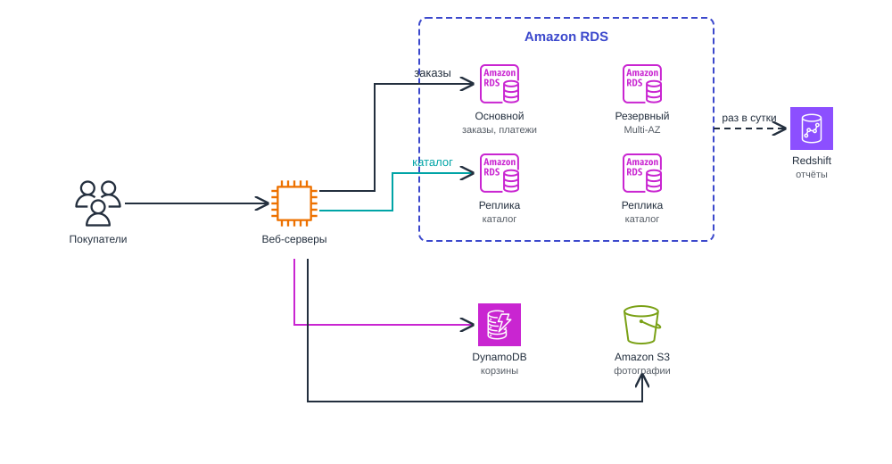

_7.11. Архитектура хранения данных учебного интернет-магазина_

Небольшой магазин обычно начинает с одного экземпляра RDS и добавляет остальное по мере роста.

## Резюме

1. Хранилище отдаёт файлы и объекты по ключу, а база данных ищет записи по содержимому, меняет отдельные поля и согласует одновременные изменения.
2. Реляционные базы хранят данные в таблицах со схемой, поддерживают SQL и транзакции ACID и обычно масштабируются вертикально. В нереляционных базах модель данных выбирают под задачу, они часто работают по модели BASE и масштабируются горизонтально, но запросы к ним приходится проектировать заранее.
3. Репликация копирует изменения основного сервера на реплики. Синхронная репликация не теряет подтверждённых данных, но замедляет запись, асинхронная быстрее, но при отказе теряет последние изменения.
4. Реплики для чтения разгружают основной сервер, но из-за задержки репликации могут показывать устаревшие данные. Запись они не ускоряют.
5. Шардирование делит данные между независимыми серверами: вертикальное разносит по серверам таблицы, а горизонтальное делит строки одной таблицы по ключу шарда. При неудачном ключе нагрузка распределяется неравномерно.
6. Amazon RDS запускает PostgreSQL, MySQL и другие СУБД как управляемый сервис. Экземпляр размещают в приватных подсетях через группу подсетей, которая охватывает минимум две зоны.
7. Multi-AZ держит синхронный резервный экземпляр в другой зоне и переключается на него автоматически, а реплики для чтения асинхронные и обслуживают чтение. Резервные копии позволяют восстановить базу на любую секунду в пределах срока хранения.
8. Aurora отделяет хранилище от вычислений: все экземпляры работают с одним общим томом в трёх зонах, поэтому реплики не копируют базу, а хранилище само восстанавливает повреждённые участки.
9. DynamoDB это управляемая база ключ-значение и документов без серверов, которыми нужно управлять. Ключ раздела через хеш определяет раздел, а ключ сортировки упорядочивает элементы внутри раздела. У ключа раздела должно быть много разных значений, а читать таблицу нужно через Query, а не Scan.
10. Redshift это хранилище данных для аналитики с колоночным хранением и параллельной обработкой. Его используют для отчётов, а не как основную базу приложения.

[^1]: Amazon Web Services (2026). _What is a Relational Database?_ AWS. Available at: https://aws.amazon.com/relational-database/

[^2]: The PostgreSQL Global Development Group (2026). _Transactions_. PostgreSQL Documentation, section 3.4. Available at: https://www.postgresql.org/docs/current/tutorial-transactions.html

[^3]: Amazon Web Services (2026). _What's the Difference Between Relational and Non-Relational Databases?_ AWS. Available at: https://aws.amazon.com/compare/the-difference-between-relational-and-non-relational-databases/

[^4]: Amazon Web Services (2026). _ACID vs BASE Databases - Difference Between Databases_. AWS. Available at: https://aws.amazon.com/compare/the-difference-between-acid-and-base-database/

[^5]: Amazon Web Services (2026). _NoSQL Databases_. AWS. Available at: https://aws.amazon.com/nosql/

[^6]: Amazon Web Services (2026). _What is Amazon DynamoDB?_ Amazon DynamoDB Developer Guide. Available at: https://docs.aws.amazon.com/amazondynamodb/latest/developerguide/Introduction.html

[^7]: Amazon Web Services (2026). _DynamoDB read consistency_. Amazon DynamoDB Developer Guide. Available at: https://docs.aws.amazon.com/amazondynamodb/latest/developerguide/HowItWorks.ReadConsistency.html

[^8]: The PostgreSQL Global Development Group (2026). _High Availability, Load Balancing, and Replication_. PostgreSQL Documentation, chapter 26. Available at: https://www.postgresql.org/docs/current/high-availability.html

[^9]: The PostgreSQL Global Development Group (2026). _Write-Ahead Logging (WAL)_. PostgreSQL Documentation, section 28.3. Available at: https://www.postgresql.org/docs/current/wal-intro.html

[^10]: The PostgreSQL Global Development Group (2026). _Log-Shipping Standby Servers_. PostgreSQL Documentation, section 26.2. Available at: https://www.postgresql.org/docs/current/warm-standby.html

[^11]: Amazon Web Services (2026). _What is Database Sharding?_ AWS. Available at: https://aws.amazon.com/what-is/database-sharding/

[^12]: Microsoft (2026). _Data partitioning guidance_. Azure Architecture Center. Available at: https://learn.microsoft.com/en-us/azure/architecture/best-practices/data-partitioning

[^13]: Amazon Web Services (2026). _Choosing an AWS database service_. AWS Decision Guides. Available at: https://docs.aws.amazon.com/decision-guides/latest/databases-on-aws-how-to-choose/databases-on-aws-how-to-choose.html

[^14]: Amazon Web Services (2026). _What is Amazon Relational Database Service (Amazon RDS)?_ Amazon RDS User Guide. Available at: https://docs.aws.amazon.com/AmazonRDS/latest/UserGuide/Welcome.html

[^15]: Amazon Web Services (2009). _Introducing Amazon Relational Database Service_. AWS What's New. Available at: https://aws.amazon.com/about-aws/whats-new/2009/10/27/introducing-amazon-relational-database-service/

[^16]: Google Cloud (2026). _Cloud SQL_. Google Cloud. Available at: https://cloud.google.com/sql

[^17]: Amazon Web Services (2026). _DB instance class types_. Amazon RDS User Guide. Available at: https://docs.aws.amazon.com/AmazonRDS/latest/UserGuide/Concepts.DBInstanceClass.Types.html

[^18]: Amazon Web Services (2026). _Amazon RDS DB instance storage_. Amazon RDS User Guide. Available at: https://docs.aws.amazon.com/AmazonRDS/latest/UserGuide/CHAP_Storage.html

[^19]: Amazon Web Services (2026). _Managing capacity automatically with Amazon RDS storage autoscaling_. Amazon RDS User Guide. Available at: https://docs.aws.amazon.com/AmazonRDS/latest/UserGuide/USER_PIOPS.Autoscaling.html

[^20]: Amazon Web Services (2026). _DB instances_. Amazon RDS User Guide. Available at: https://docs.aws.amazon.com/AmazonRDS/latest/UserGuide/Overview.DBInstance.html

[^21]: Amazon Web Services (2026). _Working with a DB instance in a VPC_. Amazon RDS User Guide. Available at: https://docs.aws.amazon.com/AmazonRDS/latest/UserGuide/USER_VPC.WorkingWithRDSInstanceinaVPC.html

[^22]: Amazon Web Services (2026). _Multi-AZ DB instance deployments for Amazon RDS_. Amazon RDS User Guide. Available at: https://docs.aws.amazon.com/AmazonRDS/latest/UserGuide/Concepts.MultiAZSingleStandby.html

[^23]: Amazon Web Services (2026). _Failing over a Multi-AZ DB instance for Amazon RDS_. Amazon RDS User Guide. Available at: https://docs.aws.amazon.com/AmazonRDS/latest/UserGuide/Concepts.MultiAZ.Failover.html

[^24]: Amazon Web Services (2026). _AWS Site Terms_. Available at: https://aws.amazon.com/terms/

[^25]: Amazon Web Services (2026). _Amazon RDS Pricing_. Available at: https://aws.amazon.com/rds/pricing/

[^26]: Amazon Web Services (2026). _Working with DB instance read replicas_. Amazon RDS User Guide. Available at: https://docs.aws.amazon.com/AmazonRDS/latest/UserGuide/USER_ReadRepl.html

[^27]: Amazon Web Services (2026). _Quotas and constraints for Amazon RDS_. Amazon RDS User Guide. Available at: https://docs.aws.amazon.com/AmazonRDS/latest/UserGuide/CHAP_Limits.html

[^28]: Amazon Web Services (2026). _Introduction to backups_. Amazon RDS User Guide. Available at: https://docs.aws.amazon.com/AmazonRDS/latest/UserGuide/USER_WorkingWithAutomatedBackups.html

[^29]: Amazon Web Services (2026). _Amazon RDS FAQs_. Available at: https://aws.amazon.com/rds/faqs/

[^30]: Amazon Web Services (2026). _Restoring a DB instance to a specified time for Amazon RDS_. Amazon RDS User Guide. Available at: https://docs.aws.amazon.com/AmazonRDS/latest/UserGuide/USER_PIT.html

[^31]: Amazon Web Services (2026). _What is Amazon Aurora?_ Amazon Aurora User Guide. Available at: https://docs.aws.amazon.com/AmazonRDS/latest/AuroraUserGuide/CHAP_AuroraOverview.html

[^32]: Amazon Web Services (2026). _High availability for Amazon Aurora_. Amazon Aurora User Guide. Available at: https://docs.aws.amazon.com/AmazonRDS/latest/AuroraUserGuide/Concepts.AuroraHighAvailability.html

[^33]: Amazon Web Services (2026). _Amazon Aurora storage_. Amazon Aurora User Guide. Available at: https://docs.aws.amazon.com/AmazonRDS/latest/AuroraUserGuide/Aurora.Overview.StorageReliability.html

[^34]: Amazon Web Services (2026). _Amazon Aurora_. AWS. Available at: https://aws.amazon.com/rds/aurora/

[^35]: Amazon Web Services (2026). _Amazon Aurora reliability_. Amazon Aurora User Guide. Available at: https://docs.aws.amazon.com/AmazonRDS/latest/AuroraUserGuide/Aurora.Overview.Reliability.html

[^36]: Amazon Web Services (2026). _Replication with Amazon Aurora_. Amazon Aurora User Guide. Available at: https://docs.aws.amazon.com/AmazonRDS/latest/AuroraUserGuide/Aurora.Replication.html

[^37]: Barr, J. (2014). _Amazon Aurora - New Cost-Effective MySQL-Compatible Database Engine for Amazon RDS_. AWS News Blog. Available at: https://aws.amazon.com/blogs/aws/highly-scalable-mysql-compat-rds-db-engine/

[^38]: Amazon Web Services (2015). _Amazon Aurora (MySQL-compatible) Database Now Generally Available_. AWS What's New. Available at: https://aws.amazon.com/about-aws/whats-new/2015/07/amazon-aurora-mysql-compatible-database-now-generally-available/

[^39]: Google Cloud (2026). _AlloyDB for PostgreSQL_. Google Cloud. Available at: https://cloud.google.com/alloydb

[^40]: Vogels, W. (2012). _Amazon DynamoDB - a Fast and Scalable NoSQL Database Service Designed for Internet Scale Applications_. All Things Distributed. Available at: https://www.allthingsdistributed.com/2012/01/amazon-dynamodb.html

[^41]: Google Cloud (2026). _Firestore_. Google Cloud. Available at: https://cloud.google.com/products/firestore

[^42]: Google Cloud (2026). _Bigtable_. Google Cloud. Available at: https://cloud.google.com/bigtable

[^43]: Amazon Web Services (2026). _Constraints in Amazon DynamoDB_. Amazon DynamoDB Developer Guide. Available at: https://docs.aws.amazon.com/amazondynamodb/latest/developerguide/Constraints.html

[^44]: Amazon Web Services (2026). _Supported data types and naming rules in Amazon DynamoDB_. Amazon DynamoDB Developer Guide. Available at: https://docs.aws.amazon.com/amazondynamodb/latest/developerguide/HowItWorks.NamingRulesDataTypes.html

[^45]: Amazon Web Services (2026). _Partitions and data distribution in DynamoDB_. Amazon DynamoDB Developer Guide. Available at: https://docs.aws.amazon.com/amazondynamodb/latest/developerguide/HowItWorks.Partitions.html

[^46]: Amazon Web Services (2026). _Core components of Amazon DynamoDB_. Amazon DynamoDB Developer Guide. Available at: https://docs.aws.amazon.com/amazondynamodb/latest/developerguide/HowItWorks.CoreComponents.html

[^47]: Amazon Web Services (2026). _Designing partition keys to distribute your workload in DynamoDB_. Amazon DynamoDB Developer Guide. Available at: https://docs.aws.amazon.com/amazondynamodb/latest/developerguide/bp-partition-key-uniform-load.html

[^48]: Amazon Web Services (2026). _Querying tables in DynamoDB_. Amazon DynamoDB Developer Guide. Available at: https://docs.aws.amazon.com/amazondynamodb/latest/developerguide/Query.html

[^49]: Amazon Web Services (2026). _Best practices for querying and scanning data in DynamoDB_. Amazon DynamoDB Developer Guide. Available at: https://docs.aws.amazon.com/amazondynamodb/latest/developerguide/bp-query-scan.html

[^50]: Amazon Web Services (2026). _Key condition expressions for the Query operation in DynamoDB_. Amazon DynamoDB Developer Guide. Available at: https://docs.aws.amazon.com/amazondynamodb/latest/developerguide/Query.KeyConditionExpressions.html

[^51]: Amazon Web Services (2026). _Scanning tables in DynamoDB_. Amazon DynamoDB Developer Guide. Available at: https://docs.aws.amazon.com/amazondynamodb/latest/developerguide/Scan.html

[^52]: Amazon Web Services (2026). _Using Global Secondary Indexes in DynamoDB_. Amazon DynamoDB Developer Guide. Available at: https://docs.aws.amazon.com/amazondynamodb/latest/developerguide/GSI.html

[^53]: Amazon Web Services (2026). _DynamoDB throughput capacity_. Amazon DynamoDB Developer Guide. Available at: https://docs.aws.amazon.com/amazondynamodb/latest/developerguide/capacity-mode.html

[^54]: Amazon Web Services (2026). _Amazon DynamoDB Pricing_. Available at: https://aws.amazon.com/dynamodb/pricing/

[^55]: Amazon Web Services (2026). _dynamodb_. AWS CLI Command Reference. Available at: https://docs.aws.amazon.com/cli/latest/reference/dynamodb/

[^56]: Amazon Web Services (2026). _Using the DynamoDB document client_. AWS SDK for JavaScript v3 Developer Guide. Available at: https://docs.aws.amazon.com/sdk-for-javascript/v3/developer-guide/dynamodb-example-document-client.html

[^57]: Amazon Web Services (2026). _Using time to live (TTL) in DynamoDB_. Amazon DynamoDB Developer Guide. Available at: https://docs.aws.amazon.com/amazondynamodb/latest/developerguide/TTL.html

[^58]: Amazon Web Services (2026). _Change data capture for DynamoDB Streams_. Amazon DynamoDB Developer Guide. Available at: https://docs.aws.amazon.com/amazondynamodb/latest/developerguide/Streams.html

[^59]: Amazon Web Services (2026). _Global tables - multi-active, multi-Region replication_. Amazon DynamoDB Developer Guide. Available at: https://docs.aws.amazon.com/amazondynamodb/latest/developerguide/GlobalTables.html

[^60]: Amazon Web Services (2026). _What's the Difference Between OLAP and OLTP?_ AWS. Available at: https://aws.amazon.com/compare/the-difference-between-olap-and-oltp/

[^61]: Amazon Web Services (2026). _What is Amazon Redshift?_ Amazon Redshift Management Guide. Available at: https://docs.aws.amazon.com/redshift/latest/mgmt/welcome.html

[^62]: Amazon Web Services (2026). _Amazon Redshift and PostgreSQL_. Amazon Redshift Database Developer Guide. Available at: https://docs.aws.amazon.com/redshift/latest/dg/c_redshift-and-postgres-sql.html

[^63]: Amazon Web Services (2026). _Columnar storage_. Amazon Redshift Database Developer Guide. Available at: https://docs.aws.amazon.com/redshift/latest/dg/c_columnar_storage_disk_mem_mgmnt.html

[^64]: Amazon Web Services (2026). _Data warehouse system architecture_. Amazon Redshift Database Developer Guide. Available at: https://docs.aws.amazon.com/redshift/latest/dg/c_high_level_system_architecture.html

[^65]: Amazon Web Services (2026). _COPY_. Amazon Redshift Database Developer Guide. Available at: https://docs.aws.amazon.com/redshift/latest/dg/r_COPY.html

[^66]: Barr, J. (2012). _Amazon Redshift - The New AWS Data Warehouse_. AWS News Blog. Available at: https://aws.amazon.com/blogs/aws/amazon-redshift-the-new-aws-data-warehouse/

[^67]: Google Cloud (2026). _BigQuery overview_. Google Cloud Documentation. Available at: https://docs.cloud.google.com/bigquery/docs/introduction

[^68]: Amazon Web Services (2026). _Amazon ElastiCache_. Available at: https://aws.amazon.com/elasticache/

[^69]: Amazon Web Services (2026). _Amazon MemoryDB_. Available at: https://aws.amazon.com/memorydb/

[^70]: Amazon Web Services (2026). _What is Amazon DocumentDB (with MongoDB compatibility)_. Amazon DocumentDB Developer Guide. Available at: https://docs.aws.amazon.com/documentdb/latest/developerguide/what-is.html

[^71]: Amazon Web Services (2026). _What is Amazon Keyspaces (for Apache Cassandra)?_ Amazon Keyspaces Developer Guide. Available at: https://docs.aws.amazon.com/keyspaces/latest/devguide/what-is-keyspaces.html

[^72]: Amazon Web Services (2026). _What is Amazon Neptune?_ Amazon Neptune User Guide. Available at: https://docs.aws.amazon.com/neptune/latest/userguide/intro.html

[^73]: Amazon Web Services (2026). _Amazon Timestream_. Available at: https://aws.amazon.com/timestream/
