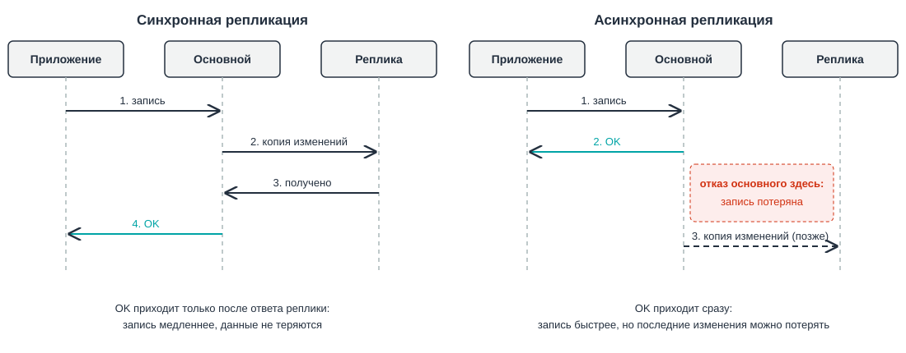
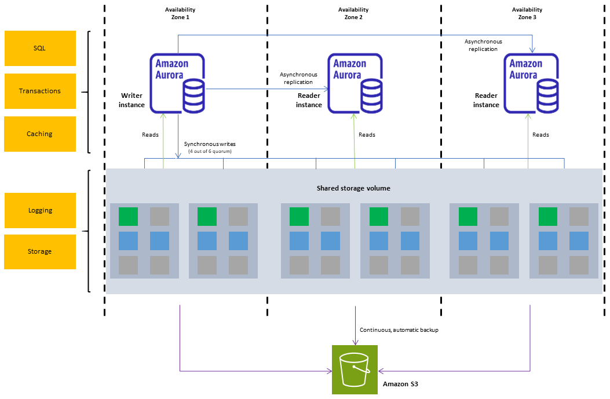

# Облачные базы данных и согласованность данных. Amazon RDS, DynamoDB

## Вопросы для самопроверки

1. Чем база данных отличается от хранилища файлов, и почему заказы интернет-магазина неудобно хранить в виде объектов S3?
2. Чем реляционные базы данных отличаются от нереляционных, и в каких задачах выбирают каждую из них?
3. Чем синхронная репликация отличается от асинхронной, и какой компромисс стоит за выбором между ними?
4. Зачем нужны реплики для чтения, и почему пользователь может не увидеть на реплике только что сохранённые данные?
5. Что такое шардирование, и почему от выбора ключа шарда зависит, будет ли нагрузка распределена равномерно?
6. Чем развёртывание Multi-AZ в Amazon RDS отличается от реплики для чтения?
7. Чем устройство Amazon Aurora отличается от обычного экземпляра Amazon RDS?
8. Как в Amazon DynamoDB ключ раздела определяет, где хранится элемент, и почему Query предпочтительнее Scan?
9. Чем OLTP отличается от OLAP, и почему отчёты по продажам неудобно строить на основной базе магазина?

## Ретроспектива

Эта глава опирается на три предыдущие главы:

- _Четвёртая глава_. Собирая первую архитектуру, мы отметили её слабое место: если база данных работает на том же экземпляре, что и приложение, её судьба привязана к судьбе машины. Там же мы назвали следующий строительный блок, управляемую базу данных.
- _Пятая глава_. Базу данных мы перенесли в приватную подсеть и открыли порт 5432 только для Security Group веб-серверов. В плане адресов VPC подсеть `private-b` во второй зоне доступности осталась в резерве "для реплики базы данных".
- _Шестая глава_. Файлы пользователей переехали в Amazon S3, а сервер приложения стал сервером без состояния. Там же мы определили репликацию, резервную копию, RPO и RTO.

Теперь на отдельном сервере остались только данные приложения: пользователи, заказы, товары. Этот сервер мы по-прежнему обслуживаем сами, и он один. Из этого вытекают вопросы, на которые отвечает глава:

- Кто будет делать копии базы и устанавливать обновления?
- Что произойдёт при отказе зоны доступности?
- Что делать, когда один сервер перестанет справляться с нагрузкой?

## Хранилище и база данных

В шестой главе мы научились хранить файлы в _Amazon S3_. Хранить там же заказы интернет-магазина, например по одному JSON-объекту на заказ, неудобно по двум причинам:

- _Поиск по содержимому_. S3 выдаёт объект по ключу, но не заглядывает внутрь объектов. Чтобы найти заказы клиента 42 за октябрь, приложению придётся скачать и разобрать все заказы магазина.
- _Одновременные изменения_. По умолчанию объект перезаписывается целиком, и побеждает последняя запись. Если два покупателя одновременно купят последний товар, оба запроса прочитают остаток "1", оба запишут "0", и товар будет продан дважды.

Эти задачи решает база данных.

**База данных (database)** - организованный набор данных, который хранится и обрабатывается системой управления, умеющей искать данные по их содержимому, изменять отдельные значения и согласовывать одновременные изменения.

**СУБД (система управления базами данных, database management system, DBMS)** - программа, которая хранит базу данных и выполняет запросы к ней, например PostgreSQL или MySQL.

| Свойство                | Объектное хранилище (Amazon S3)               | База данных                                     |
| ----------------------- | --------------------------------------------- | ----------------------------------------------- |
| Как находят данные      | По имени файла или ключу объекта              | По содержимому: любому полю или их сочетанию    |
| Изменение               | Объект перезаписывается целиком               | Изменяется отдельное поле отдельной записи      |
| Одновременные изменения | По умолчанию побеждает последняя запись       | СУБД согласует их и не даёт потерять ни одно    |
| Типичные данные         | Фотографии, документы, видео, резервные копии | Пользователи, заказы, остатки на складе, сессии |

База данных не заменяет хранилище, а работает вместе с ним. Фотография товара лежит в S3, а в базе данных хранится запись о товаре с его названием, ценой и ключом этой фотографии в бакете.

## Типы баз данных

### Реляционные базы данных (RDBMS)

Базы данных бывают разных типов, и самый распространённый из них появился задолго до облаков.

**Реляционная база данных (relational database)** - база данных, в которой данные хранятся в таблицах из строк и столбцов, а связи между таблицами задаются через значения ключей[^1].

**Схема (schema)** - описание структуры базы данных: какие в ней таблицы, какие у них столбцы, какого типа данные хранятся в каждом столбце и какие действуют ограничения.

Связи между таблицами строятся на двух видах ключей:

- _Первичный ключ (primary key)_. Столбец, значение которого однозначно определяет строку таблицы, например `customer_id` в таблице клиентов.
- _Внешний ключ (foreign key)_. Столбец, который ссылается на первичный ключ другой таблицы и тем самым связывает строки двух таблиц[^1].

На рисунке 7.1 показаны три таблицы учебного интернет-магазина: клиенты, товары и заказы. В таблице `orders` столбцы `customer_id` и `product_id` являются внешними ключами: они указывают, какой клиент сделал заказ и какой товар он купил.


_7.1. Таблицы клиентов, товаров и заказов учебного интернет-магазина_

С реляционной базой работают на языке SQL (Structured Query Language), который вы уже встречали в курсе по базам данных.

Проблему _одновременных изменений_ реляционные СУБД решают транзакциями.

**Транзакция (transaction)** - группа операций с базой данных, которую СУБД выполняет как одно целое: либо все операции применяются, либо ни одна[^2].

Оформление заказа, то есть создание заказа и уменьшение остатка на складе, выполняют _одной транзакцией_.

Если два покупателя одновременно покупают последний товар, СУБД не позволит двум транзакциям менять одну и ту же строку остатка в одно и то же время:

- вторая транзакция дождётся завершения первой и увидит остаток "0",
- поэтому вторая покупка будет отменена.

Реляционные СУБД обеспечивают свойства **ACID**, которые гарантируют корректность и надёжность транзакций.

| Буква | Свойство                      | Что это значит для заказа                                                        |
| ----- | ----------------------------- | -------------------------------------------------------------------------------- |
| A     | Атомарность (atomicity)       | Заказ создан и остаток уменьшен, или не сделано ни то, ни другое                 |
| C     | Согласованность (consistency) | После транзакции соблюдены все правила схемы: остаток не стал отрицательным      |
| I     | Изолированность (isolation)   | Одновременные транзакции не мешают друг другу, как в примере с последним товаром |
| D     | Долговечность (durability)    | Подтверждённый заказ не пропадёт, даже если сервер сразу выключится              |

_Основные характеристики_ реляционных баз данных:

- _Таблицы и схема_. Данные хранятся в таблицах, структура которых заранее задана схемой.
- _Связи через ключи_. Таблицы связаны первичными и внешними ключами, а данные из нескольких таблиц объединяют операцией `JOIN`.
- _Язык SQL_. Запрос к данным записывают на SQL, и СУБД выполнит даже тот запрос, о котором не думали при проектировании базы.
- _Примеры СУБД_. PostgreSQL, MySQL, MariaDB, Oracle Database, Microsoft SQL Server.

### Ограничения реляционной модели

Реляционная модель удобна, но с ростом приложения у неё проявляются два ограничения:

- _Жёсткая схема_. Схема задаётся заранее, и любое новое поле требует её изменения. Если у товаров магазина свойства сильно различаются (у ноутбука есть объём памяти, у футболки размер, у книги автор), таблица превращается либо в десятки полупустых столбцов, либо в набор дополнительных таблиц.
- _Масштабирование_. Реляционную базу обычно масштабируют, увеличивая мощность одного сервера, а распределить чтение и запись по многим серверам можно только особыми приёмами[^4]. Почему так происходит, разберём в следующем разделе.

Ответом на эти ограничения стали нереляционные базы данных.

### Нереляционные базы данных

**Нереляционная база данных (non-relational database, NoSQL)** - база данных, которая хранит данные не в связанных таблицах, а в модели, выбранной под конкретный вид данных и запросов[^5]:

- в парах ключ-значение,
- в документах,
- в графах,
- в других моделях.

Название NoSQL часто расшифровывают как "_not only SQL_", потому что многие такие базы поддерживают и похожие на SQL языки запросов. Основные модели данных перечислены в таблице.

| Модель                       | Как хранятся данные                                        | Пример задачи                                            |
| ---------------------------- | ---------------------------------------------------------- | -------------------------------------------------------- |
| Ключ-значение (key-value)    | Пары "ключ и значение", поиск только по ключу              | Корзина покупателя, сессия пользователя                  |
| Документная (document)       | Документы в формате, похожем на JSON, со вложенными полями | Карточки товаров с разным набором свойств                |
| Колоночная (wide-column)     | Таблицы, в которых у каждой строки свой набор столбцов     | Журналы событий огромного объёма                         |
| Графовая (graph)             | Узлы и связи между ними                                    | Рекомендации "с этим товаром покупают", социальные связи |
| В памяти (in-memory)         | Данные целиком в оперативной памяти                        | Кеш часто запрашиваемых страниц                          |
| Временные ряды (time series) | Значения, привязанные ко времени                           | Показания датчиков, метрики серверов                     |

Многие нереляционные базы хранят копии данных на нескольких серверах и ради скорости и доступности ослабляют гарантии ACID. Поведение таких баз описывает модель **BASE**[^3]:

| Часть | Свойство                                                | Что это значит                                                              |
| ----- | ------------------------------------------------------- | --------------------------------------------------------------------------- |
| BA    | Базовая доступность (basically available)               | База отвечает на запросы, даже если часть серверов недоступна               |
| S     | Гибкое состояние (soft state)                           | Копии данных на разных серверах могут какое-то время различаться            |
| E     | Согласованность в конечном счёте (eventual consistency) | Если новых изменений нет, через короткое время все копии станут одинаковыми |

> [!NOTE]
>
> Слово "согласованность" в ACID и BASE означает разное. В ACID это соблюдение правил схемы, а в BASE совпадение копий данных на разных серверах.

_Основные характеристики_ нереляционных баз данных[^4][^5]:

- _Модель под задачу_. Вместо связанных таблиц используется модель, удобная для конкретных данных: ключ-значение, документы, графы и другие.
- _Гибкая схема_. Записи одной таблицы могут иметь разный набор полей, и новое поле не требует менять структуру базы.
- _Распределение по многим серверам_. Данные и нагрузку можно разложить по многим серверам, поэтому такие базы рассчитаны на большие объёмы и большое число запросов.
- _Запросы проектируют заранее_. Запрос, которого не было в проекте, может оказаться медленным или вовсе невозможным.
- _BASE вместо ACID_. По умолчанию чтение может вернуть немного устаревшие данные, а транзакции поддерживаются не везде или с ограничениями. Операция `JOIN` в таких базах обычно не поддерживается.
- _Примеры СУБД_. MongoDB, Redis, Apache Cassandra, Amazon DynamoDB.

### Как выбрать тип базы данных

Ни один тип не лучше другого во всём. Выбор зависит от того, какие данные хранит приложение и какие запросы к ним выполняет.

| Свойство         | Реляционная база                            | Нереляционная база                                  |
| ---------------- | ------------------------------------------- | --------------------------------------------------- |
| Структура данных | Таблицы с фиксированной схемой              | Модель под задачу, гибкая схема                     |
| Запросы          | Любые запросы на SQL, объединение таблиц    | В основном по ключу, запросы проектируют заранее    |
| Гарантии         | ACID                                        | Обычно BASE, транзакции зависят от базы             |
| Масштабирование  | Обычно наращивают мощность одного сервера   | Обычно добавляют серверы                            |
| Типичные данные  | Заказы, платежи, учёт, всё, где важны связи | Корзины, сессии, каталоги, события, огромные объёмы |

Разница между ACID и BASE помогает выбрать базу для конкретных данных. Достаточно спросить: _что случится, если пользователь на секунду увидит старые данные или два одновременных изменения столкнутся?_ Возможны два ответа.

- _Пострадают деньги или товар_. Например, деньги спишутся дважды или последний товар продадут двум покупателям. Такие данные хранят в базе с гарантиями ACID.
- _Ничего страшного не произойдёт_. Например, счётчик просмотров товара на секунду покажет значение на единицу меньше. Здесь подходит база с моделью BASE: она проще масштабируется и выдерживает большую нагрузку.

> [!NOTE]
>
> Граница не жёсткая. Некоторые нереляционные базы, по запросу приложения выполняют транзакции ACID и возвращают самые свежие данные[^6][^7].

Часто в одном приложении используют _обе модели_. Например, в интернет-магазине:

- заказы и платежи требуют транзакций и попадают в реляционную базу,
- корзины покупателей читаются и пишутся только по идентификатору пользователя и хорошо ложатся в модель ключ-значение.

## Масштабирование баз данных

### Вертикальное и горизонтальное масштабирование

Пока магазин небольшой, одного сервера базы данных хватает. С ростом числа покупателей сервер перестаёт справляться:

- запросы выполняются медленнее,
- процессор загружен постоянно.

Увеличить производительность можно двумя способами:

**Вертикальное масштабирование (vertical scaling, scale up)** - увеличение мощности одного сервера: больше процессоров, памяти, быстрее диск.

**Горизонтальное масштабирование (horizontal scaling, scale out)** - добавление новых серверов, между которыми распределяется нагрузка.

| Признак                  | Вертикальное масштабирование                                         | Горизонтальное масштабирование                |
| ------------------------ | -------------------------------------------------------------------- | --------------------------------------------- |
| Как выполняется в облаке | Сменой типа экземпляра на более мощный                               | Добавлением экземпляров                       |
| Предел роста             | Самый крупный тип экземпляра когда-нибудь закончится                 | Жёсткого предела нет                          |
| Что замечает приложение  | Смена типа требует перезапуска экземпляра, то есть короткого простоя | Ничего, если нагрузку умеют распределять      |
| Отказоустойчивость       | Один сервер остаётся одной точкой отказа                             | Отказ одного сервера не останавливает систему |

Горизонтальное масштабирование для базы данных намного сложнее, чем для веб-серверов. Веб-серверы не хранят состояние и могут легко добавляться или удаляться. Серверы базы данных хранят состояние, и каждое изменение данных должно стать известно всем серверам, которые отдают эти данные[^8].

Для этого используют два приёма:

- копирование всех данных на несколько серверов,
- разделение данных между ними.

### Репликация в базах данных

**Репликация (replication)** - непрерывное копирование изменений из одного хранилища в другое.

В контексте репликации баз данных различают основной сервер и реплики.

**Основной сервер (primary)** - сервер базы данных, который принимает операции записи.

**Реплика (replica)** - сервер базы данных, который получает изменения от основного сервера и хранит копию его данных[^8].

Чтобы понять, как изменения попадают на реплику, нужен ещё один механизм.

**Журнал транзакций (write-ahead log, WAL)** - файл, в который СУБД перед изменением самих данных дописывает описание каждого изменения[^9]. Например, если в таблице товаров изменяется цена, в журнале появится запись о том, что цена конкретного товара была изменена с одного значения на другое.

Журнал нужен СУБД и без репликации: если сервер внезапно выключится, при запуске СУБД восстановит по журналу изменения, которые успела подтвердить[^9].

Репликация использует тот же журнал. Основной сервер передаёт его записи репликам, а реплики применяют те же изменения в том же порядке и поэтому хранят те же данные. В PostgreSQL этот механизм называется _потоковой репликацией_ (streaming replication)[^10].

Репликация решает две задачи:

- _Отказоустойчивость_. Если основной сервер отказал, одна из реплик может занять его место[^8].
- _Масштабирование чтения_. Реплики могут обслуживать запросы на чтение, разгружая основной сервер[^8].

**Переключение при отказе (failover)** - перевод реплики в роль основного сервера после того, как основной сервер отказал.

По тому, какие серверы принимают запись, различают две схемы репликации[^8]:

- _Один основной сервер (leader-follower)_. Запись принимает только основной сервер, а реплики получают от него изменения и могут обслуживать чтение. Эту схему называют также _primary-replica_, а в старых источниках _master-slave_. Если основной сервер отказал, одну из реплик назначают основной.
- _Несколько основных серверов (leader-leader, multi-master)_. Запись принимают сразу несколько серверов и пересылают изменения друг другу. Если одну и ту же строку одновременно изменили на двух серверах, например один администратор поменял цену товара, а другой снял его с продажи, возникает конфликт, и нужны правила, по которым решают, чьё изменение победит.

Из-за конфликтов в большинстве приложений используют первую схему. С ней мы и будем работать в AWS.

### Синхронная и асинхронная репликация

Есть два режима репликации: синхронная и асинхронная:

**Синхронная репликация (synchronous replication)** - режим, в котором основной сервер подтверждает транзакцию приложению только после того, как реплика подтвердила получение изменений[^10].

**Асинхронная репликация (asynchronous replication)** - режим, в котором основной сервер подтверждает транзакцию сразу, а изменения передаются реплике с небольшой задержкой.



_7.2. Синхронная и асинхронная репликация: когда приложение получает подтверждение_

У каждого режима своя цена:

- _Синхронная репликация_ гарантирует, что при переключении на реплику ни одна подтверждённая транзакция не потеряется. Платить за это приходится скоростью: каждая запись ждёт как минимум время сетевого обмена между серверами, поэтому время ответа приложению растёт[^10][^8].
- _Асинхронная репликация_ не замедляет запись, но если основной сервер откажет до того, как изменения дошли до реплики, последние транзакции будут потеряны[^8]. Этот промежуток показан в правой части рисунка 7.2: он лежит между подтверждением транзакции и её доставкой на реплику.

### Реплики для чтения

Посмотрим на нагрузку интернет-магазина. Покупатели в основном читают:

- открывают каталог,
- ищут товары,
- смотрят свои заказы.

Запись происходит реже:

- оформление заказа,
- отзыв о товаре,
- изменение профиля.

Если чтение в десятки раз чаще записи, основной сервер тратит большую часть времени на чтение.

**Реплика для чтения (read replica)** - реплика, которая принимает только запросы на чтение и служит для разгрузки основного сервера.

Приложение отправляет все операции записи на основной сервер, а запросы на чтение распределяет между репликами, как показано на рисунке 7.3. Чтобы увеличить мощность чтения, достаточно добавить ещё одну реплику.


_7.3. Запись идёт на основной сервер, чтение распределяется между репликами_

Реплики для чтения почти всегда _асинхронные_. Поэтому между записью на основном сервере и её появлением на реплике проходит время.

**Задержка репликации (replication lag)** - время, на которое данные реплики отстают от данных основного сервера.

Из-за задержки возникает неприятный эффект:

1. Пользователь меняет адрес доставки.
2. Запрос на запись уходит на основной сервер, и приложение сразу перезагружает страницу профиля.
3. Запрос на чтение попадает на реплику, до которой изменение ещё не дошло.
4. Пользователь видит старый адрес.

Ему кажется, что сохранение не сработало.

Обычно эту проблему решают так: запросы, которым нужны только что записанные данные, отправляют на основной сервер. _Например_, страницу профиля сразу после сохранения читают с основного сервера, а каталог товаров, где отставание на секунду никому не мешает, с реплик.

> [!IMPORTANT]
> Реплика для чтения не ускоряет запись: все изменения по-прежнему проходят через один основной сервер, а потом ещё и копируются на каждую реплику. Реплики помогают, когда узкое место в чтении.

### Шардирование

Реплики помогают с чтением, но не с записью и не с объёмом данных: _каждая реплика хранит полную копию базы_. Представим, что магазин вырос до миллионов заказов в день. Один основной сервер не успевает записывать заказы, а таблица заказов не помещается на диск самого крупного экземпляра. Здесь помогает другой приём.

**Шардирование (sharding)** - разделение данных одной базы между несколькими независимыми серверами, каждый из которых хранит и обслуживает только свою часть данных[^11].

**Шард (shard)** - один из серверов шардированной базы вместе с частью данных, которую он хранит.

### Горизонтальное и вертикальное шардирование

Разделить данные между серверами можно двумя способами.

- _Горизонтальное шардирование_. Между серверами делят строки одной таблицы. Все шарды имеют одинаковую схему, но хранят разные строки: заказы одних клиентов лежат в первом шарде, заказы других во втором[^12].
- _Вертикальное шардирование_. Между серверами делят таблицы, обычно по функции: таблица клиентов хранится на одном сервере, таблица заказов на другом. В документации Microsoft такое деление называют функциональным (functional partitioning), а вертикальным там называют деление столбцов одной таблицы[^12].


_7.4. Горизонтальное и вертикальное шардирование_

| Свойство          | Горизонтальное шардирование                       | Вертикальное шардирование                                 |
| ----------------- | ------------------------------------------------- | --------------------------------------------------------- |
| Что делят         | Строки одной таблицы                              | Таблицы                                                   |
| Схема шардов      | Одинаковая                                        | У каждого шарда своя                                      |
| Предел роста      | Шарды можно добавлять по мере роста данных        | Одна большая таблица всё равно остаётся на одном сервере  |
| Главная сложность | Выбор правила, по которому строка попадает в шард | Объединение таблиц с разных серверов выполняет приложение |

Вертикальное шардирование проще, но его возможности быстро заканчиваются: если таблица заказов сама не помещается на один сервер, её всё равно приходится делить по строкам. С вертикальным масштабированием вертикальное шардирование не связано: оба вида шардирования добавляют серверы. Поэтому, когда говорят просто "шардирование", обычно имеют в виду горизонтальное. О нём и пойдёт речь дальше.

### Ключ шарда

Чтобы решить, в какой шард попадёт строка, выбирают ключ.

**Ключ шарда (shard key)** - столбец, по значению которого определяется, в каком шарде хранится строка[^11]. Например, для таблицы заказов удобный ключ шарда это `customer_id`: все заказы одного клиента окажутся в одном шарде, и запрос "заказы клиента 42" обратится только к нему.

Ключ указывает, по какому столбцу делить строки, но _не определяет, как его значение превращается в номер шарда_. Для этого есть три основных способа[^11]:

- _По диапазону (range-based)_. Строки делят по диапазонам значений ключа: клиенты с номерами от 1 до 1 000 000 попадают в первый шард, следующий миллион во второй.
- _По хешу (hashed)_. К значению ключа применяется хеш-функция, и её результат определяет номер шарда.
- _Географический (geo)_. Шард выбирают по местоположению пользователя: данные покупателей из Европы хранятся в одном шарде, из Америки в другом.

| Способ         | Преимущество                                                  | Недостаток                                                                                 |
| -------------- | ------------------------------------------------------------- | ------------------------------------------------------------------------------------------ |
| По диапазону   | Проще всего реализовать                                       | Нагрузка может скопиться в одном шарде: новые, самые активные клиенты окажутся в последнем |
| По хешу        | Данные распределяются по шардам равномерно                    | При добавлении шарда большинство строк переходит в другой шард                             |
| Географический | Данные хранятся ближе к пользователю, поэтому запросы быстрее | Данные распределяются неравномерно: в одной стране покупателей больше, чем в другой        |

На рисунке 7.5 показано шардирование по хешу: таблица заказов разложена на три шарда по правилу `hash(customer_id) mod 3`. Номер шарда равен остатку от деления хеша на число шардов.


_7.5. Шардирование таблицы заказов по хешу `customer_id`_

### Недостатки шардирования

У шардирования есть серьёзные недостатки, поэтому к нему прибегают, когда другие способы исчерпаны:

- _Неравномерная нагрузка_. Если на одного крупного клиента приходится половина всех заказов, все они попадут в один шард. Этот шард будет перегружен, а остальные будут почти простаивать.
- _Запросы через несколько шардов_. В схеме на рисунке 7.5 запрос "общая выручка за день" придётся отправить во все шарды и сложить результаты в приложении. Объединение таблиц и транзакции, затрагивающие несколько шардов, тоже становятся задачей приложения[^11].
- _Перераспределение данных_. При переходе с трёх шардов на четыре правило меняется на `hash(customer_id) mod 4`, и остаток от деления становится другим у большинства клиентов. Их заказы приходится переносить между серверами[^11].
- _Сложность эксплуатации_. Большинство реляционных СУБД не умеют шардировать данные сами, и эту логику пишут в приложении или в отдельном промежуточном слое[^11].

### Репликация и шардирование вместе

Репликацию и шардирование легко перепутать, потому что в обоих случаях данные лежат на нескольких серверах. Разница в том, что именно лежит на каждом сервере. Она показана на рисунке 7.6 и в таблице.


_7.6. Репликация, шардирование и их сочетание_

| Свойство                    | Репликация                             | Шардирование                                  |
| --------------------------- | -------------------------------------- | --------------------------------------------- |
| Что на каждом сервере       | Полная копия одних и тех же данных     | Своя часть данных                             |
| Что масштабирует            | Чтение                                 | Запись и объём данных                         |
| Что даёт при отказе сервера | Реплика может заменить основной сервер | Без реплик часть данных становится недоступна |
| Основная сложность          | Задержка репликации                    | Выбор ключа и запросы через несколько шардов  |

На практике эти приёмы сочетают: базу делят на шарды, а у каждого шарда есть свои реплики[^11]. Тогда шарды распределяют запись, а реплики каждого шарда обеспечивают отказоустойчивость и чтение.

## Базы данных в облаке

### Своя СУБД или управляемый сервис

В AWS существует два подхода к развертыванию баз данных:

**Unmanaged (неуправляемый подход)**. Вы можете установить базу данных на EC2 инстанс самостоятельно. В этом случае вы получаете полный контроль, но также полную ответственность за:

- Масштабирование ресурсов.
- Настройку отказоустойчивости.
- Обеспечение высокой доступности.
- Создание и управление бэкапами.
- Ограничения в масштабируемости.

**Managed (управляемый подход)**. Часть задач по управлению базой данных берёт на себя облачный провайдер. AWS теперь выполняет многие рутинные операции за вас:

- Автоматические бэкапы.
- Патчинг операционной системы и СУБД. Это значит, что AWS следит за обновлениями и устанавливает их без вашего участия.
- Настройка репликации и высокой доступности.
- Масштабирование ресурсов.
- Мониторинг и оповещения.

### Базы данных AWS

AWS предлагает больше пятнадцати вариантов баз данных для разных моделей данных[^14]. В этой главе мы подробно разберём четыре из них, а остальные упомянем коротко:

- _Amazon RDS_. Управляемые реляционные базы с привычными СУБД: PostgreSQL, MySQL и другими.
- _Amazon Aurora_. Реляционная база, совместимая с PostgreSQL и MySQL, с собственным распределённым хранилищем.
- _Amazon DynamoDB_. Нереляционная база для данных в виде пар ключ-значение и документов, без серверов, которыми нужно управлять.
- _Amazon Redshift_. Аналитическая база данных для отчётов по большим объёмам данных.

## Amazon RDS

### Что такое Amazon RDS

**Amazon RDS (Relational Database Service)** - управляемый сервис AWS, который упрощает создание, эксплуатацию и масштабирование реляционной базы данных в облаке[^15].

_Основные характеристики_ Amazon RDS:

- _Привычные СУБД_. RDS поддерживает шесть СУБД:
  - PostgreSQL,
  - MySQL,
  - MariaDB,
  - Microsoft SQL Server,
  - Oracle Database,
  - IBM Db2[^15].
- _Обслуживание берёт на себя AWS_. Резервное копирование, установка обновлений, обнаружение отказов и восстановление выполняются без вас, а на вашей стороне остаются работа с данными[^15].
- _Работа с экземплярами_. Как и в EC2, вы выбираете мощность сервера и размер диска, а платите за часы работы экземпляра.
- _Отказоустойчивость и масштабирование чтения_. Резервный экземпляр в другой зоне доступности и реплики для чтения включаются настройками экземпляра.
- _Восстановление на момент времени_. Базу можно вернуть в состояние на любую секунду в пределах срока хранения резервных копий.

AWS рекомендует RDS как выбор по умолчанию для большинства реляционных баз данных[^15].

| Характеристика      | Amazon RDS                                                                                                                       |
| ------------------- | -------------------------------------------------------------------------------------------------------------------------------- |
| Категория           | Базы данных (databases)                                                                                                          |
| Что делает          | Запускает и обслуживает реляционную СУБД: обновления, резервные копии, мониторинг, переключение при отказе                       |
| Для чего нужен      | Получить готовую реляционную базу без администрирования сервера и СУБД                                                           |
| Где используют      | Основные данные веб-приложений: пользователи, заказы, платежи, учёт                                                              |
| Модель обслуживания | PaaS: серверами, ОС и СУБД управляет AWS, вы управляете схемой, данными и доступом                                               |
| Область действия    | Региональный: экземпляр базы находится в одной зоне доступности, копии могут быть в других зонах и регионах                      |
| Как оплачивается    | Часы работы экземпляра (по классу), объём хранилища в месяц, хранилище резервных копий сверх бесплатного объёма, передача данных |
| Как работать        | Консоль AWS, AWS CLI (`aws rds`), SDK; к самой базе подключаются обычным клиентом СУБД                                           |
| Появился            | Октябрь 2009 года[^16]                                                                                                           |
| Аналоги             | Google Cloud SQL[^17], Azure Database for PostgreSQL                                                                             |

### Экземпляр базы данных

Основной ресурс RDS называется экземпляром базы данных.

**Экземпляр базы данных (DB instance)** - изолированная среда базы данных в облаке, в которой работает одна СУБД с одной или несколькими базами[^15].

Экземпляр базы данных похож на экземпляр EC2, и при создании для него выбирают похожие параметры:

- _Класс экземпляра (DB instance class)_. Определяет процессор и память, как тип экземпляра в EC2. Имена классов начинаются с `db.`, дальше идут знакомые семейство, поколение и размер, например `db.t4g.micro` или `db.r6g.xlarge`. Классы `db.t` рассчитаны на небольшую нагрузку с редкими пиками, `db.m` сбалансированы, `db.r` оптимизированы по памяти[^18].
- _Хранилище_. Том EBS, на котором лежат файлы базы. Обычный выбор это General Purpose SSD `gp3`, для нагрузок с высокими требованиями к скорости дисковых операций есть Provisioned IOPS SSD (`io1`, `io2`)[^19].
- _Автоматическое увеличение хранилища (storage autoscaling)_. Если свободного места почти не осталось, RDS сам увеличит том, но не выше заданного вами максимума[^20].
- _Учётные данные администратора_. Имя главного пользователя (master user) и пароль, с которыми вы подключаетесь к базе.

> [!TIP]
>
> Подключаться к экземпляру по SSH нельзя: RDS не даёт прямого доступа к серверу, на котором работает СУБД[^21]. Вы работаете только с самой базой через клиент СУБД.

### Подключение к экземпляру

Каждый экземпляр получает адрес для подключения.

**Endpoint экземпляра (DB instance endpoint)** - DNS-имя, по которому приложение подключается к экземпляру базы данных[^21]. Например, endpoint может выглядеть так: `shop-db.abcdefghijkl.eu-central-1.rds.amazonaws.com`. Приложение подключается по этому имени, а не по IP-адресу.

### RDS в VPC

Экземпляр базы данных всегда создаётся внутри VPC. Все концепции, которые были изучены в главе про VPC, применимы и к RDS, но есть пару особенностей.

При создании экземпляра RDS нужно указать _группу подсетей, в которых он может работать_.

**Группа подсетей базы данных (DB subnet group)** - набор подсетей VPC, обычно приватных, в которых RDS может размещать экземпляры базы данных[^22].

Если экземпляр один, то он работает в одной подсети. Группа только перечисляет подсети, в которых RDS разрешено его разместить, а конкретную подсеть RDS выбирает сам[^22].

Зачем тогда несколько подсетей? AWS требует, чтобы подсети группы находились как минимум в двух зонах доступности[^22]. Вторая зона нужна для режима Multi-AZ, о котором речь пойдёт ниже: в ней работает резервный экземпляр базы, а после отказа основного экземпляра RDS создаёт новый резервный экземпляр в одной из зон группы[^22].

Ещё два параметра определяют, кто сможет подключиться к базе:

- _Public access_. Параметр определяет, получит ли экземпляр публичный IP-адрес. Для базы приложения выбирают `No`: база доступна только изнутри VPC[^22].
- _Security Group_. Окончательное решение о доступе принимают правила Security Group экземпляра[^22].

> [_Hands-on 7.1. Первая база данных в RDS._](hands_on_01.md) Создание группы подсетей из двух приватных подсетей, запуск экземпляра PostgreSQL.

### Multi-AZ: защита от отказа зоны

Экземпляр базы данных работает в одной зоне доступности. Если в этой зоне откажет сервер, сеть или диск, база станет недоступна, а вместе с ней и весь магазин.

Решение мы уже знаем из подраздела ["Репликация в базах данных"](#репликация-в-базах-данных): держать реплику в другой зоне и при отказе основного сервера переключиться на неё. В RDS это включается одной настройкой.

**Развёртывание Multi-AZ (Multi-AZ DB instance deployment)** - режим RDS, в котором AWS создаёт в другой зоне доступности резервный экземпляр (standby) и синхронно копирует на него все изменения основного экземпляра[^23].

Это схема с одним основным сервером и одной синхронной репликой, а переключение при отказе AWS выполняет сам. Масштабированием этот режим не является: резервный экземпляр не принимает ни запись, ни чтение, он только ждёт отказа основного[^23].

На рисунке 7.7 показана работа в этом режиме:

- Приложение читает и пишет только в основной экземпляр (Primary DB instance).
- Каждая запись синхронно копируется на резервный экземпляр (Standby replica) в другой зоне.
- Если основной экземпляр или его зона отказали, RDS сам переключается на резервный экземпляр, и приложение продолжает работу уже с ним[^24].


_7.7. Развёртывание Multi-AZ: основной и резервный экземпляры в разных зонах. Источник: Amazon Web Services[^23], лицензия CC BY-SA 4.0[^25]_

Переключение обычно занимает 60-120 секунд[^24]. Репликация синхронная, поэтому подтверждённые транзакции при переключении не теряются.

За надёжность приходится платить:

- _Запись становится медленнее_. Каждая транзакция ждёт подтверждения из другой зоны[^23].
- _Режим стоит дороже_. Резервный экземпляр работает круглосуточно, а RDS оплачивается по часам работы экземпляров[^26].

> [!NOTE]
>
> Multi-AZ защищает от отказа оборудования и зоны, но не от ошибок. Если приложение удалит таблицу, синхронная репликация тут же удалит её и на резервном экземпляре.

### Реплики для чтения (Read Replicas)

Multi-AZ отвечает за отказоустойчивость, а для масштабирования чтения в RDS есть реплики для чтения.

Реплика для чтения в RDS это отдельный экземпляр базы данных со своим отдельным endpoint. RDS копирует на неё изменения основного экземпляра асинхронно[^27]. Разработчик сам указывает, какие запросы отправлять на endpoint реплики: RDS не распределяет запросы автоматически.

Основные свойства реплик для чтения в RDS:

- _Количество_. К одному экземпляру можно подключить до 15 реплик. Для Oracle AWS рекомендует не больше 5, чтобы реплики меньше отставали[^28].
- _Размещение_. Реплика может находиться в той же зоне, в другой зоне или даже в другом регионе[^27]. Реплика в другом регионе приближает данные к пользователям и служит запасом на случай отказа региона.
- _Продвижение (promotion)_. Реплику можно превратить в самостоятельный экземпляр, принимающий запись. Так её используют для восстановления после аварии, если основной экземпляр потерян[^27].
- _Ручное создание_. RDS не добавляет реплики автоматически при росте нагрузки, их создают вручную[^27].

Multi-AZ и реплики для чтения можно сочетать. На рисунке 7.8 у основного экземпляра есть и синхронный резервный экземпляр без доступа на чтение, и асинхронная реплика, с которой клиенты читают данные (Read access).


_7.8. Основной экземпляр с резервным экземпляром Multi-AZ и репликой для чтения. Источник: Amazon Web Services[^27], лицензия CC BY-SA 4.0[^25]_

Multi-AZ и реплики для чтения решают разные задачи, и их часто путают.

| Свойство                | Multi-AZ                                   | Реплика для чтения                        |
| ----------------------- | ------------------------------------------ | ----------------------------------------- |
| Назначение              | Отказоустойчивость                         | Масштабирование чтения                    |
| Репликация              | Синхронная                                 | Асинхронная                               |
| Обслуживает чтение      | Нет                                        | Да                                        |
| Отдельный endpoint      | Нет, endpoint общий с основным экземпляром | Да                                        |
| Где находится           | Другая зона того же региона                | Та же зона, другая зона или другой регион |
| Переключение при отказе | Автоматическое                             | Ручное продвижение                        |

### Резервные копии и восстановление

От ошибок защищают резервные копии. Они хранятся в Amazon S3 и бывают двух видов[^29]:

- _Автоматические резервные копии (automated backups)_. RDS каждый день в заданный промежуток времени делает снимок хранилища экземпляра, а журналы транзакций выгружает каждые пять минут. Срок хранения задают от 0 до 35 дней, значение 0 отключает автоматическое резервное копирование.
- _Ручные снимки (manual snapshots)_. Их делаете вы, например перед обновлением схемы базы. Ручной снимок хранится, пока его не удалят явно, даже если сам экземпляр уже удалён[^30].

Благодаря журналам транзакций автоматические копии позволяют вернуться не только к ежедневному снимку, но и к любому моменту между снимками. Журналы выгружаются раз в пять минут, поэтому самая поздняя точка восстановления обычно отстаёт от текущего момента на несколько минут[^31].

**Восстановление на момент времени (point-in-time recovery)** - восстановление базы в состояние на выбранную секунду в пределах срока хранения резервных копий.

Восстановление устроено в два шага:

1. RDS берёт последний ежедневный снимок, сделанный до выбранного момента.
2. RDS заново применяет к этому снимку изменения из журналов транзакций вплоть до выбранной секунды.

Например, администратор по ошибке удалил таблицу заказов в 14:37. Базу восстанавливают на 14:36, за минуту до ошибки.

> [!NOTE]
>
> Восстановление не перезаписывает существующую базу: RDS создаёт новый экземпляр[^31]. Чтобы приложение начало работать с восстановленной базой, в его настройках указывают endpoint нового экземпляра.

### Стоимость RDS

Счёт за RDS складывается из нескольких частей[^26]:

| Что оплачивается | Как считается                                                          | Что важно помнить                                              |
| ---------------- | ---------------------------------------------------------------------- | -------------------------------------------------------------- |
| Экземпляр        | Часы работы, цена зависит от класса экземпляра и СУБД                  | Экземпляр оплачивается, даже если к нему никто не подключается |
| Хранилище        | Выделенный объём в месяц, для Provisioned IOPS ещё и заданная скорость | Платят за выделенный, а не за занятый объём                    |
| Резервные копии  | Объём копий сверх бесплатного                                          | Бесплатно в объёме выделенного хранилища баз в регионе[^30]    |
| Передача данных  | Трафик в интернет и между регионами                                    | Репликация на реплику в том же регионе бесплатна[^27]          |

Режим Multi-AZ и каждая реплика для чтения добавляют часы работы ещё одного экземпляра. Поэтому для учебных задач используют один экземпляр в одной зоне.

## Amazon Aurora

### Зачем понадобилась Aurora

В RDS у каждого экземпляра свой том с файлами базы:

- у основного,
- у резервного экземпляра Multi-AZ,
- у каждой реплики для чтения.

Основной экземпляр отправляет каждое изменение на все эти тома. Чем больше реплик, тем больше копий данных нужно поддерживать и тем дольше создаётся новая реплика: ей нужно получить полную копию базы.

AWS решила эту проблему иначе: отделила хранилище от вычислений. Так появилась _Aurora_.

### Что такое Amazon Aurora

**Amazon Aurora** - полностью управляемая реляционная СУБД, совместимая с MySQL и PostgreSQL, в которой данные хранятся в общем распределённом томе, отделённом от серверов СУБД[^32].

_Основные характеристики_ Amazon Aurora:

- _Совместимость с MySQL и PostgreSQL_. Приложение работает с Aurora через те же драйверы и с теми же запросами, что и с MySQL или PostgreSQL.
- _Производительность_. По данным AWS, Aurora обрабатывает до шести раз больше операций, чем обычные MySQL и PostgreSQL на похожем оборудовании[^32].
- _Общее хранилище в трёх зонах_. Данные хранятся в шести копиях, по две в каждой из трёх зон доступности[^33][^34]. Хранилище автоматически растёт до 256 ТиБ[^32].
- _Доступность_. Aurora рассчитана на доступность до 99,99% в одном регионе и до 99,999% при размещении в нескольких регионах[^35].
- _Самовосстановление хранилища_. Aurora сама находит повреждённые участки дисков и сразу восстанавливает их по другим копиям[^36].
- _Быстрый перезапуск_. После внезапной остановки база почти сразу снова доступна приложению[^36].
- _До 15 реплик для чтения_. Реплики читают тот же общий том и своих копий данных не держат[^37].
- _Быстрая замена основного экземпляра_. При отказе одна из реплик становится основным экземпляром, и данные копировать не нужно[^37].

| Характеристика      | Amazon Aurora                                                                                                 |
| ------------------- | ------------------------------------------------------------------------------------------------------------- |
| Категория           | Базы данных (databases)                                                                                       |
| Что делает          | Запускает реляционную СУБД, совместимую с MySQL или PostgreSQL, над общим томом с копиями данных в трёх зонах |
| Для чего нужен      | Реляционная база с высокой доступностью и быстрыми репликами для нагруженных приложений                       |
| Где используют      | Нагруженные веб-приложения и SaaS-сервисы, системы, где важна быстрая замена основного сервера                |
| Модель обслуживания | PaaS                                                                                                          |
| Область действия    | Региональный: общий том охватывает три зоны доступности региона                                               |
| Как оплачивается    | Часы работы экземпляров, объём хранилища, операции ввода-вывода (зависит от конфигурации), резервные копии    |
| Как работать        | Те же консоль и команды `aws rds`, что для RDS; к базе подключаются клиентом MySQL или PostgreSQL             |
| Появился            | Анонс в ноябре 2014 года, общая доступность в июле 2015 года[^38][^39]                                        |
| Аналоги             | Google Cloud AlloyDB for PostgreSQL[^40]                                                                      |

### Как устроена Aurora

**Кластер Aurora (Aurora DB cluster)** - один или несколько экземпляров базы данных вместе с общим томом, на котором лежат данные для всех этих экземпляров[^32].

Запись принимает один основной экземпляр (writer), а реплики (readers) читают данные из того же общего тома[^37]. На рисунке 7.9 основной экземпляр находится в первой зоне, реплики во второй и третьей, а общий том (shared storage volume) охватывает все три зоны. Стрелки Asynchronous replication означают, что реплики узнают об изменениях основного экземпляра с небольшой задержкой, обычно гораздо меньше 100 мс, но сами данные читают из общего тома[^37].



_7.9. Кластер Aurora: экземпляры над общим томом в трёх зонах доступности. Источник: Amazon Web Services[^41], лицензия CC BY-SA 4.0[^25]_

### RDS или Aurora

Aurora не всегда лучше обычного RDS.

| Ситуация                                                           | Что выбрать         | Почему                                                 |
| ------------------------------------------------------------------ | ------------------- | ------------------------------------------------------ |
| Небольшая база, учебный проект                                     | RDS, один экземпляр | Проще и не нужно платить за лишние возможности         |
| Нужна СУБД, которой нет в Aurora: Oracle, SQL Server, Db2, MariaDB | RDS                 | Aurora совместима только с MySQL и PostgreSQL          |
| Много чтения, нужно много реплик                                   | Aurora              | Реплики читают общий том и не копируют базу            |
| Важна быстрая замена основного сервера                             | Aurora              | Новому основному экземпляру не нужно копировать данные |

## Amazon DynamoDB

### Зачем нужна DynamoDB

Вернёмся к корзине покупателя. Корзину читают и меняют при каждом добавлении товара и каждом открытии страницы. Обращаются к ней всегда по одному ключу, идентификатору покупателя, и никогда не объединяют с другими таблицами. В распродажу число таких запросов может вырасти в сотни раз за минуты.

Для корзин небольшого магазина PostgreSQL в RDS справится без труда. Проблема появляется, когда операций записи становится так много, что с ними не справляется даже самый мощный экземпляр. Тогда базу нужно шардировать, а большинство реляционных СУБД не умеют делать это сами, и все недостатки шардированияложатся на приложение.

При этом корзине не нужны ни `JOIN`, ни транзакции между таблицами: к ней обращаются только по ключу. Для таких данных подходит база ключ-значение, которая сама делит данные на шарды и добавляет новые шарды по мере роста.

### Что такое DynamoDB

**Amazon DynamoDB** - полностью управляемая распределённая NoSQL-база данных AWS, поддерживающая модель ключ-значение и документную модель[^6].

_Основные характеристики_ Amazon DynamoDB:

- _Ключ-значение и документы_. Элемент находят по ключу, а внутри элемента могут быть вложенные поля, как в JSON[^6].
- _Автоматическое горизонтальное масштабирование_. DynamoDB сама делит данные таблицы между серверами и добавляет новые по мере роста.
- _Три зоны доступности_. DynamoDB сама копирует данные каждой таблицы в три зоны доступности региона[^6].
- _Гибкая схема_. При создании таблицы задают только первичный ключ, остальные атрибуты у каждого элемента свои.

| Характеристика      | Amazon DynamoDB                                                                                                         |
| ------------------- | ----------------------------------------------------------------------------------------------------------------------- |
| Категория           | Базы данных (databases)                                                                                                 |
| Что делает          | Хранит элементы в таблицах и выдаёт их по ключу с задержкой в несколько миллисекунд при любом объёме                    |
| Для чего нужен      | Хранить данные, к которым обращаются по ключу, с горизонтальным масштабированием без управления серверами               |
| Где используют      | Корзины и сессии, профили пользователей, игровые данные, счётчики, журналы событий                                      |
| Модель обслуживания | PaaS: серверов нет, вы управляете таблицами, данными и доступом                                                         |
| Область действия    | Региональный: данные таблицы копируются в три зоны доступности региона                                                  |
| Как оплачивается    | Запросы на чтение и запись (или заранее заданная пропускная способность), объём хранения, дополнительные функции        |
| Как работать        | Консоль AWS, AWS CLI (`aws dynamodb`), SDK (для JavaScript пакеты `@aws-sdk/client-dynamodb` и `@aws-sdk/lib-dynamodb`) |
| Появился            | Январь 2012 года[^42]                                                                                                   |
| Аналоги             | Google Cloud Firestore[^43] и Bigtable[^44], Azure Cosmos DB                                                            |

### Таблицы, элементы и атрибуты

В DynamoDB данные организованы в таблицы, элементы и атрибуты.

- _Таблица (table)_. Набор элементов, например таблица `Carts` с корзинами.
- _Элемент (item)_. Одна запись таблицы, аналог строки в реляционной таблице.
- _Атрибут (attribute)_. Отдельное значение внутри элемента, например `quantity`. Аналог столбца, но набор атрибутов у элементов одной таблицы может различаться.

Например, у одного элемента таблицы `Carts` есть атрибут `size`, у другого `color`, и таблицу для этого менять не нужно:

```json
[
  { "userId": "u-42", "productId": "p-7", "quantity": 2, "size": "L" },
  { "userId": "u-42", "productId": "p-9", "quantity": 1, "color": "red" }
]
```

Размер одного элемента ограничен 400 КБ[^45], поэтому большие данные, например фотографии, хранят в S3, а в элементе только ключ объекта.

Тип атрибута DynamoDB определяет по его значению, и заранее объявлять его не нужно. Исключение составляют атрибуты первичного ключа: их тип указывают при создании таблицы. Основные типы обозначают так[^46]:

| Обозначение      | Тип                                       | Пример значения       |
| ---------------- | ----------------------------------------- | --------------------- |
| `S`              | Строка                                    | `"u-42"`              |
| `N`              | Число                                     | `2`                   |
| `B`              | Двоичные данные                           | `"aGVsbG8="` (Base64) |
| `BOOL`           | Логическое значение                       | `true`                |
| `NULL`           | Пустое значение                           | `null`                |
| `L`              | Список                                    | `["red", 2]`          |
| `M`              | Вложенный объект (map)                    | `{"city": "Кишинёв"}` |
| `SS`, `NS`, `BS` | Множества строк, чисел, двоичных значений | `["L", "XL"]`         |

Эти обозначения понадобятся при работе через AWS CLI, где тип каждого значения указывают явно.

### Первичный ключ и разделы

Первичный ключ в DynamoDB определяет не только уникальность элемента, но и то, где элемент физически хранится. Здесь мы снова встречаем _шардирование_, только выполняет его сама DynamoDB.

**Раздел (partition)** - часть хранилища таблицы DynamoDB, которая автоматически копируется в несколько зон доступности. Разделами управляет DynamoDB, вы их не видите и не настраиваете[^47].

**Ключ раздела (partition key)** - атрибут первичного ключа, по значению которого DynamoDB выбирает раздел для элемента. Значение проходит через внутреннюю хеш-функцию, и её результат определяет раздел[^47].

Иначе говоря, раздел DynamoDB соответствует шарду, а ключ раздела соответствует ключу шарда при шардировании по хешу.

Если первичный ключ состоит только из ключа раздела, значения ключа у разных элементов не должны совпадать. Для корзины это неудобно: в корзине покупателя `u-42` может лежать несколько товаров, и у всех этих элементов `userId` одинаковый. Поэтому к ключу раздела можно добавить второй атрибут.

**Ключ сортировки (sort key)** - вторая, необязательная часть первичного ключа. Она отличает друг от друга элементы с одинаковым ключом раздела и задаёт их порядок внутри раздела[^48].

Рассмотрим пример.

- В таблице `Carts` каждый элемент описывает один товар в корзине одного покупателя.
- Ключом раздела служит `userId`, ключом сортировки `productId`.

Все товары корзины одного покупателя лежат в одном разделе рядом друг с другом (рисунок 7.10), и вся корзина читается одним запросом.


_7.10. Хеш ключа раздела `userId` определяет раздел, в котором хранятся элементы корзины_

Первичный ключ из одного ключа раздела называют простым (simple primary key), а из ключа раздела и ключа сортировки составным (composite primary key)[^48]. Выбирают между ними по тому, как приложение читает данные:

- _Простой ключ_. Подходит, когда элементы читают по одному и у каждого свой идентификатор. Например, профиль пользователя читают по `userId`, а карточку товара по `productId`.
- _Составной ключ_. Подходит, когда элементы образуют группы, которые читают целиком или по диапазону. Например, все товары корзины читают по `userId`, а заказы покупателя за месяц по `customerId` и дате заказа в ключе сортировки.

### Выбор ключа раздела

Неудачный ключ раздела создаёт ту же проблему неравномерной нагрузки, что и при шардировании. Если большая часть запросов относится к одному значению ключа, эти запросы попадают в один раздел. Раздел перестаёт справляться, DynamoDB отклоняет часть запросов (throttling), и приложению приходится повторять их позже[^49].

| Ключ раздела                                               | Оценка и причина                                                |
| ---------------------------------------------------------- | --------------------------------------------------------------- |
| Идентификатор пользователя при большом числе пользователей | Хороший: много разных значений, запросы распределены равномерно |
| Код статуса, у которого всего несколько значений           | Плохой: почти все запросы приходятся на несколько разделов      |
| Дата создания, округлённая до дня                          | Плохой: все записи текущего дня попадают в один раздел          |

### Чтение: Query и Scan

Получить данные из таблицы DynamoDB можно тремя основными операциями:

- _GetItem_. Читает один элемент по полному первичному ключу.
- _Query_. Находит элементы с одним значением ключа раздела и, при необходимости, отбирает их по условию на ключ сортировки[^50].
- _Scan_. Читает всю таблицу целиком и проверяет каждый элемент[^51].

В условии Query для ключа раздела допускается только равенство. Для ключа сортировки можно использовать сравнения `=`, `<`, `<=`, `>`, `>=`, диапазон `BETWEEN ... AND ...` и `begins_with`, который проверяет начало строки[^52]. Например, если в таблице заказов ключом сортировки служит дата `orderDate`, то условие `customerId = :c AND orderDate BETWEEN :from AND :to` со значениями `"2026-10-01"` и `"2026-10-31"` вернёт заказы покупателя за октябрь.

Чтобы получить корзину покупателя `u-42`, нужен Query по `userId = "u-42"`. Тот же результат можно получить через Scan с фильтром, но Scan прочитает все корзины всех покупателей, и платить придётся за весь прочитанный объём. Поэтому AWS рекомендует проектировать таблицы так, чтобы приложение использовало _Query вместо Scan_[^51].

За один запрос Scan читает не больше 1 МБ данных. Если данных в таблице больше, ответ содержит `LastEvaluatedKey`, и следующий запрос продолжает чтение с этого места[^53]. Чтение большой таблицы превращается в длинную серию запросов.

В PostgreSQL можно написать любой запрос, и СУБД найдёт способ его выполнить. В DynamoDB быстро выполняются только запросы по ключу, поэтому сначала составляют список запросов приложения, а потом под них выбирают ключи таблицы.

Если нужен запрос по другому атрибуту, например все корзины с определённым товаром, создают индекс.

**Глобальный вторичный индекс (global secondary index, GSI)** - копия выбранных атрибутов таблицы с другим ключом раздела, которую DynamoDB обновляет автоматически и по которой можно выполнять Query[^54].

Индекс с ключом раздела `productId` позволит найти все корзины с товаром `p-7`. Индекс это вторая копия данных, поэтому за его хранение и запись в него платят отдельно[^54].

### Согласованность чтения

DynamoDB хранит копии данных в трёх зонах доступности, и после записи изменение доходит до всех копий не сразу. Поэтому по умолчанию чтение может вернуть данные такими, какими они были до последней записи, как и положено в модели BASE. Зато такое чтение стоит вдвое дешевле[^7].

Если нужны самые свежие данные, в запросе указывают параметр `ConsistentRead: true`[^7]. Например, так читают корзину сразу после того, как покупатель добавил в неё товар: без этого параметра покупатель может не увидеть только что добавленный товар.

Индекс DynamoDB обновляет асинхронно, поэтому чтение из глобального вторичного индекса всегда согласовано только в конечном счёте[^54].

### Стоимость DynamoDB

DynamoDB оплачивается не за серверы, а за хранение данных и за запросы. За запросы можно платить одним из двух способов, их называют режимами ёмкости[^55]:

- _По запросам (on-demand)_. Вы платите за каждый выполненный запрос. Это режим по умолчанию, он подходит, когда нагрузка неизвестна или резко меняется.
- _Заданная ёмкость (provisioned)_. Вы заранее задаёте, сколько чтений и записей в секунду нужно таблице, и платите за эту ёмкость, даже если она не используется. Режим подходит для ровной предсказуемой нагрузки.

В бесплатный уровень входит 25 ГБ хранения в любом режиме. Кроме того, в режиме заданной ёмкости бесплатна небольшая ёмкость, которой хватает для учебной таблицы[^56]. Поэтому учебную таблицу создают в этом режиме.

### Работа с DynamoDB через AWS CLI

Команды для работы с DynamoDB собраны в группе `aws dynamodb`[^57]:

| Команда            | Что делает                                                  |
| ------------------ | ----------------------------------------------------------- |
| `list-tables`      | Выводит список таблиц в регионе                             |
| `describe-table`   | Показывает параметры таблицы: ключи, индексы, режим ёмкости |
| `put-item`         | Записывает элемент, заменяя элемент с тем же ключом         |
| `get-item`         | Читает один элемент по полному первичному ключу             |
| `update-item`      | Изменяет отдельные атрибуты элемента                        |
| `batch-write-item` | Записывает или удаляет до 25 элементов одним запросом       |
| `query`            | Выполняет Query                                             |
| `scan`             | Выполняет Scan                                              |

В командах CLI значение каждого атрибута записывают вместе с типом из таблицы типов, например `{"quantity": {"N": "2"}}`. Числа при этом передают строкой[^46].

Команды ниже выполняют по порядку четыре действия:

1. Добавляют товар в корзину.
2. Читают этот товар.
3. Меняют его количество.
4. Читают всю корзину.

```bash
aws dynamodb put-item --table-name Carts \
  --item '{"userId": {"S": "u-42"}, "productId": {"S": "p-7"}, "quantity": {"N": "2"}}'

aws dynamodb get-item --table-name Carts \
  --key '{"userId": {"S": "u-42"}, "productId": {"S": "p-7"}}'

aws dynamodb update-item --table-name Carts \
  --key '{"userId": {"S": "u-42"}, "productId": {"S": "p-7"}}' \
  --update-expression "SET quantity = :q" \
  --expression-attribute-values '{":q": {"N": "3"}}'

aws dynamodb query --table-name Carts \
  --key-condition-expression "userId = :uid" \
  --expression-attribute-values '{":uid": {"S": "u-42"}}'
```

В выражениях `--update-expression` и `--key-condition-expression` значения не пишут напрямую, а подставляют через заполнители, начинающиеся с двоеточия, такие как `:q` и `:uid`. Сами значения передают в `--expression-attribute-values`.

### Работа с DynamoDB из Node.js

С DynamoDB приложение работает через AWS SDK. Для JavaScript удобнее всего пакет `@aws-sdk/lib-dynamodb` с клиентом документов (document client), который принимает обычные объекты JavaScript[^58]. Ниже показаны добавление товара в корзину и чтение всей корзины покупателя:

```javascript
import { DynamoDBClient } from "@aws-sdk/client-dynamodb";
import {
  DynamoDBDocumentClient,
  PutCommand,
  QueryCommand,
} from "@aws-sdk/lib-dynamodb";

const client = new DynamoDBClient({ region: "eu-central-1" });
const docClient = DynamoDBDocumentClient.from(client);

// Добавить товар в корзину покупателя u-42
await docClient.send(
  new PutCommand({
    TableName: "Carts",
    Item: { userId: "u-42", productId: "p-7", quantity: 2 },
  }),
);

// Прочитать всю корзину покупателя u-42 одним запросом Query
const result = await docClient.send(
  new QueryCommand({
    TableName: "Carts",
    KeyConditionExpression: "userId = :uid",
    ExpressionAttributeValues: { ":uid": "u-42" },
  }),
);
console.log(result.Items);
```

`PutCommand` записывает элемент: если элемент с таким же первичным ключом уже есть, он будет заменён. `QueryCommand` принимает условие на ключ раздела в параметре `KeyConditionExpression`. Если корзина была пустой, программа выведет (порядок атрибутов может отличаться):

```text
[ { userId: 'u-42', productId: 'p-7', quantity: 2 } ]
```

> [_Hands-on 7.2. Таблица DynamoDB._](hands_on_02.md) Создание таблицы `Carts` с ключом раздела и ключом сортировки, запись и чтение элементов через консоль и AWS CLI, пакетная запись `batch-write-item`, сравнение Query и Scan.

### Дополнительные возможности DynamoDB

- _Время жизни (time to live, TTL)_. Если указать атрибут со временем истечения, DynamoDB сама удалит просроченные элементы, обычно в течение нескольких дней после срока[^59]. Так удаляют брошенные корзины и старые сессии.
- _Потоки (DynamoDB Streams)_. Журнал изменений элементов таблицы, по которому другие части системы узнают об этих изменениях[^60].
- _Глобальные таблицы (global tables)_. Копии таблицы в нескольких регионах, каждая из которых принимает запись[^61].
- _Транзакции_. Изменения нескольких элементов можно выполнить как одно целое[^6].

### DynamoDB или RDS

| Свойство        | Amazon RDS                                | Amazon DynamoDB                              |
| --------------- | ----------------------------------------- | -------------------------------------------- |
| Модель данных   | Таблицы со схемой, связи между таблицами  | Элементы с гибким набором атрибутов          |
| Запросы         | Любые запросы на SQL, `JOIN`              | По ключу, Query по ключу раздела, GSI        |
| Масштабирование | Вертикальное, реплики для чтения          | Горизонтальное, автоматическое               |
| Серверы         | Вы выбираете класс экземпляра             | Серверов нет                                 |
| Оплата          | Часы работы экземпляра, даже без запросов | Запросы или заданная ёмкость, объём хранения |
| Подходит для    | Заказы, платежи, учёт, сложные отчёты     | Корзины, сессии, профили, счётчики, события  |

Если запросы к данным заранее неизвестны или нужны связи между таблицами, начинают с реляционной базы. DynamoDB выбирают, когда:

- список запросов известен заранее,
- обращения идут по ключу,
- нагрузка велика или непредсказуема.

## Amazon Redshift и аналитика

### Аналитические запросы на рабочей базе

Менеджер магазина просит отчёт о выручке по категориям товаров за каждый месяц прошлого года. Запрос для такого отчёта читает миллионы строк заказов, но только несколько столбцов: дату, категорию и сумму. Если выполнить его на основной базе магазина, он надолго загрузит сервер, и покупатели почувствуют замедление.

Реплика для чтения снимет нагрузку с основного сервера, но не сделает сам запрос быстрее: реплика хранит данные так же, как основной сервер, и прочитает миллионы заказов вместе со всеми их столбцами. Для таких запросов нужна другая организация хранения.

### OLTP и OLAP

Базы данных решают два разных вида задач[^62]:

- _OLTP (online transaction processing)_. Множество коротких запросов, каждый из которых читает или меняет несколько строк: оформление заказа, изменение корзины, вход пользователя. Для этого предназначены RDS, Aurora и DynamoDB.
- _OLAP (online analytical processing)_. Немного длинных запросов, каждый из которых читает и группирует огромное число строк: отчёты, анализ продаж, поиск закономерностей.

**Хранилище данных (data warehouse)** - база данных для аналитики, в которую данные регулярно загружаются из рабочих баз и других источников и которая оптимизирована под запросы, читающие большие объёмы данных.

Не путайте хранилище данных с хранилищем файлов вроде S3: название похоже, но это база данных для аналитических запросов на SQL.

### Amazon Redshift

**Amazon Redshift** - полностью управляемое хранилище данных AWS для аналитических запросов на SQL к данным объёмом до петабайтов[^63].

_Основные характеристики_ Amazon Redshift:

- _SQL_. Запросы пишут на SQL, а его диалект в Redshift основан на PostgreSQL[^64].
- _Хранение по столбцам_. Запрос читает с диска только нужные ему столбцы[^65].
- _Параллельная обработка_. Один запрос выполняется одновременно на нескольких серверах кластера, которые называют узлами (nodes)[^66].
- _Пакетная загрузка (batch loading)_. Данные загружают не построчно в момент покупки, а большими порциями из рабочих баз и файлов, например раз в сутки[^67].

| Характеристика      | Amazon Redshift                                                                                                    |
| ------------------- | ------------------------------------------------------------------------------------------------------------------ |
| Категория           | Аналитика (analytics)                                                                                              |
| Что делает          | Хранит большие объёмы данных и быстро выполняет аналитические SQL-запросы к ним                                    |
| Для чего нужен      | Отчёты и анализ данных без нагрузки на рабочие базы приложения                                                     |
| Где используют      | Отчёты о продажах, анализ поведения пользователей                                                                  |
| Модель обслуживания | PaaS                                                                                                               |
| Область действия    | Региональный                                                                                                       |
| Как оплачивается    | Кластер: часы работы узлов. Redshift Serverless: вычисления во время выполнения запросов. Отдельно хранение данных |
| Как работать        | Консоль AWS, AWS CLI, SQL-клиенты                                                                                  |
| Появился            | Ноябрь 2012 года, ограниченная бета-версия[^68]                                                                    |
| Аналоги             | Google BigQuery[^69], Azure Synapse Analytics                                                                      |

### Хранение по столбцам

**Колоночное хранение (columnar storage)** - способ хранения таблицы, при котором значения одного столбца для многих строк записываются на диск рядом, в одни и те же блоки[^65].

Не путайте колоночное хранение с колоночной моделью из раздела нереляционных баз данных: Redshift остаётся реляционной базой с SQL, а по столбцам раскладываются только данные на диске.

Обычная реляционная база хранит данные по строкам: все поля одной записи лежат рядом. На рисунке 7.11 три записи таблицы уложены в блоки диска по строкам. Чтобы прочитать один столбец, всё равно придётся прочитать все блоки.


_7.11. Хранение записей в блоках диска по строкам. Источник: Amazon Web Services[^65], лицензия CC BY-SA 4.0[^25]_

На рисунке 7.12 та же таблица хранится по столбцам: в первый блок попали значения столбца SSN сразу для многих записей.


_7.12. Хранение записей в блоках диска по столбцам. Источник: Amazon Web Services[^65], лицензия CC BY-SA 4.0[^25]_

Для отчёта о выручке по категориям нужны только три столбца: дата, категория и сумма. При хранении по строкам СУБД прочитает с диска все столбцы каждого заказа, а при колоночном хранении только эти три. Чем шире таблица, тем больше выигрыш: запрос, который использует пять столбцов из ста, прочитает примерно пять процентов данных[^65].

## Другие базы данных AWS

Кроме разобранных сервисов, у AWS есть базы для других моделей данных из подраздела ["Нереляционные базы данных"](#нереляционные-базы-данных).

| Сервис             | Модель данных  | Для чего используют                                       |
| ------------------ | -------------- | --------------------------------------------------------- |
| Amazon ElastiCache | В памяти       | Кеш часто запрашиваемых данных[^70]                       |
| Amazon MemoryDB    | В памяти       | База в памяти, не теряющая данные при отказе[^71]         |
| Amazon DocumentDB  | Документная    | Документы, совместимость с API MongoDB[^72]               |
| Amazon Keyspaces   | Колоночная     | Управляемая база, совместимая с Apache Cassandra[^73]     |
| Amazon Neptune     | Графовая       | Связи между объектами: рекомендации, социальные сети[^74] |
| Amazon Timestream  | Временные ряды | Метрики и показания датчиков[^75]                         |

## Собираем решения вместе

Применим разобранное к учебному интернет-магазину. Требования к данным у магазина разные, и для каждого нужно своё решение.

| Требование                                                           | Решение                                                               | Компромисс                                                    |
| -------------------------------------------------------------------- | --------------------------------------------------------------------- | ------------------------------------------------------------- |
| Заказы и платежи требуют транзакций и связей между таблицами         | Amazon RDS для PostgreSQL в приватных подсетях                        | Платим за часы экземпляра, даже ночью без покупателей         |
| Магазин должен пережить отказ зоны доступности                       | Режим Multi-AZ                                                        | Резервный экземпляр оплачивается, хотя не обслуживает запросы |
| Каталог читают в десятки раз чаще, чем пишут                         | Реплики для чтения, каталог читается с них                            | Новый товар появляется на репликах с задержкой                |
| Ошибочное удаление данных должно быть исправимо                      | Автоматические резервные копии, ручной снимок перед обновлением схемы | Восстановление создаёт новый экземпляр                        |
| Корзины меняются постоянно, в распродажу нагрузка растёт в сотни раз | DynamoDB, ключ раздела `userId`, TTL для брошенных корзин             | Корзину нельзя объединить с заказами в одном SQL-запросе      |
| Отчёты по продажам не должны нагружать основную базу                 | Ночная выгрузка заказов в Amazon Redshift                             | Отчёты отстают от реальных данных на сутки                    |
| Фотографии товаров                                                   | Amazon S3, в базе только ключ объекта                                 | Файлы и записи хранятся в разных сервисах                     |

Итоговая архитектура показана на рисунке 7.13.


_7.13. Архитектура хранения данных учебного интернет-магазина_

Небольшой магазин обычно начинает с одного экземпляра RDS и добавляет остальное по мере роста.

## Резюме

1. Хранилище отдаёт файлы и объекты по ключу, а база данных ищет записи по содержимому, меняет отдельные поля и согласует одновременные изменения.
2. Реляционные базы хранят данные в таблицах со схемой, поддерживают SQL и транзакции ACID и обычно масштабируются вертикально. В нереляционных базах модель данных выбирают под задачу, они часто работают по модели BASE и масштабируются горизонтально, но запросы к ним приходится проектировать заранее.
3. Репликация копирует изменения основного сервера на реплики. Синхронная не теряет подтверждённых данных, но замедляет запись, асинхронная быстрее, но при отказе теряет последние изменения.
4. Реплики для чтения разгружают основной сервер, но из-за задержки репликации могут показывать устаревшие данные. Запись они не ускоряют.
5. Шардирование делит данные между независимыми серверами: вертикальное разносит по серверам таблицы, а горизонтальное делит строки одной таблицы по ключу шарда. При неудачном ключе нагрузка распределяется неравномерно.
6. Amazon RDS запускает PostgreSQL, MySQL и другие СУБД как управляемый сервис. Экземпляр размещают в приватных подсетях через группу подсетей минимум из двух зон.
7. Multi-AZ держит синхронный резервный экземпляр в другой зоне и переключается на него автоматически, а реплики для чтения асинхронные и обслуживают чтение. Резервные копии позволяют восстановить базу на любую секунду в пределах срока хранения.
8. Aurora отделяет хранилище от вычислений: все экземпляры кластера работают с одним общим томом в трёх зонах, поэтому реплики не копируют базу, а хранилище само восстанавливает повреждённые участки.
9. DynamoDB это управляемая база ключ-значение и документов без серверов, которыми нужно управлять. Ключ раздела через хеш определяет раздел, а ключ сортировки упорядочивает элементы внутри раздела. У ключа раздела должно быть много разных значений, а читать таблицу нужно через Query, а не Scan.
10. Redshift это хранилище данных для аналитики с колоночным хранением и параллельной обработкой. Его используют для отчётов, а не как основную базу приложения.

[^1]: Amazon Web Services (2026). _What is a Relational Database?_ AWS. Available at: https://aws.amazon.com/relational-database/

[^2]: The PostgreSQL Global Development Group (2026). _Transactions_. PostgreSQL Documentation, section 3.4. Available at: https://www.postgresql.org/docs/current/tutorial-transactions.html

[^3]: Amazon Web Services (2026). _ACID vs BASE Databases - Difference Between Databases_. AWS. Available at: https://aws.amazon.com/compare/the-difference-between-acid-and-base-database/

[^4]: Amazon Web Services (2026). _What's the Difference Between Relational and Non-Relational Databases?_ AWS. Available at: https://aws.amazon.com/compare/the-difference-between-relational-and-non-relational-databases/

[^5]: Amazon Web Services (2026). _NoSQL Databases_. AWS. Available at: https://aws.amazon.com/nosql/

[^6]: Amazon Web Services (2026). _What is Amazon DynamoDB?_ Amazon DynamoDB Developer Guide. Available at: https://docs.aws.amazon.com/amazondynamodb/latest/developerguide/Introduction.html

[^7]: Amazon Web Services (2026). _DynamoDB read consistency_. Amazon DynamoDB Developer Guide. Available at: https://docs.aws.amazon.com/amazondynamodb/latest/developerguide/HowItWorks.ReadConsistency.html

[^8]: The PostgreSQL Global Development Group (2026). _Comparison of Different Solutions_. PostgreSQL Documentation, section 26.1. Available at: https://www.postgresql.org/docs/current/different-replication-solutions.html

[^9]: The PostgreSQL Global Development Group (2026). _Write-Ahead Logging (WAL)_. PostgreSQL Documentation, section 28.3. Available at: https://www.postgresql.org/docs/current/wal-intro.html

[^10]: The PostgreSQL Global Development Group (2026). _Log-Shipping Standby Servers_. PostgreSQL Documentation, section 26.2. Available at: https://www.postgresql.org/docs/current/warm-standby.html

[^11]: Amazon Web Services (2026). _What is Database Sharding?_ AWS. Available at: https://aws.amazon.com/what-is/database-sharding/

[^12]: Microsoft (2026). _Data partitioning guidance_. Azure Architecture Center. Available at: https://learn.microsoft.com/en-us/azure/architecture/best-practices/data-partitioning

[^13]: The PostgreSQL Global Development Group (2026). _Failover_. PostgreSQL Documentation, section 26.3. Available at: https://www.postgresql.org/docs/current/warm-standby-failover.html

[^14]: Amazon Web Services (2026). _Choosing an AWS database service_. AWS Decision Guides. Available at: https://docs.aws.amazon.com/decision-guides/latest/databases-on-aws-how-to-choose/databases-on-aws-how-to-choose.html

[^15]: Amazon Web Services (2026). _What is Amazon Relational Database Service (Amazon RDS)?_ Amazon RDS User Guide. Available at: https://docs.aws.amazon.com/AmazonRDS/latest/UserGuide/Welcome.html

[^16]: Amazon Web Services (2009). _Introducing Amazon Relational Database Service_. AWS What's New. Available at: https://aws.amazon.com/about-aws/whats-new/2009/10/27/introducing-amazon-relational-database-service/

[^17]: Google Cloud (2026). _Cloud SQL_. Google Cloud. Available at: https://cloud.google.com/sql

[^18]: Amazon Web Services (2026). _DB instance class types_. Amazon RDS User Guide. Available at: https://docs.aws.amazon.com/AmazonRDS/latest/UserGuide/Concepts.DBInstanceClass.Types.html

[^19]: Amazon Web Services (2026). _Amazon RDS DB instance storage_. Amazon RDS User Guide. Available at: https://docs.aws.amazon.com/AmazonRDS/latest/UserGuide/CHAP_Storage.html

[^20]: Amazon Web Services (2026). _Managing capacity automatically with Amazon RDS storage autoscaling_. Amazon RDS User Guide. Available at: https://docs.aws.amazon.com/AmazonRDS/latest/UserGuide/USER_PIOPS.Autoscaling.html

[^21]: Amazon Web Services (2026). _DB instances_. Amazon RDS User Guide. Available at: https://docs.aws.amazon.com/AmazonRDS/latest/UserGuide/Overview.DBInstance.html

[^22]: Amazon Web Services (2026). _Working with a DB instance in a VPC_. Amazon RDS User Guide. Available at: https://docs.aws.amazon.com/AmazonRDS/latest/UserGuide/USER_VPC.WorkingWithRDSInstanceinaVPC.html

[^23]: Amazon Web Services (2026). _Multi-AZ DB instance deployments for Amazon RDS_. Amazon RDS User Guide. Available at: https://docs.aws.amazon.com/AmazonRDS/latest/UserGuide/Concepts.MultiAZSingleStandby.html

[^24]: Amazon Web Services (2026). _Failing over a Multi-AZ DB instance for Amazon RDS_. Amazon RDS User Guide. Available at: https://docs.aws.amazon.com/AmazonRDS/latest/UserGuide/Concepts.MultiAZ.Failover.html

[^25]: Amazon Web Services (2026). _AWS Site Terms_. Available at: https://aws.amazon.com/terms/

[^26]: Amazon Web Services (2026). _Amazon RDS Pricing_. Available at: https://aws.amazon.com/rds/pricing/

[^27]: Amazon Web Services (2026). _Working with DB instance read replicas_. Amazon RDS User Guide. Available at: https://docs.aws.amazon.com/AmazonRDS/latest/UserGuide/USER_ReadRepl.html

[^28]: Amazon Web Services (2026). _Quotas and constraints for Amazon RDS_. Amazon RDS User Guide. Available at: https://docs.aws.amazon.com/AmazonRDS/latest/UserGuide/CHAP_Limits.html

[^29]: Amazon Web Services (2026). _Introduction to backups_. Amazon RDS User Guide. Available at: https://docs.aws.amazon.com/AmazonRDS/latest/UserGuide/USER_WorkingWithAutomatedBackups.html

[^30]: Amazon Web Services (2026). _Amazon RDS FAQs_. Available at: https://aws.amazon.com/rds/faqs/

[^31]: Amazon Web Services (2026). _Restoring a DB instance to a specified time for Amazon RDS_. Amazon RDS User Guide. Available at: https://docs.aws.amazon.com/AmazonRDS/latest/UserGuide/USER_PIT.html

[^32]: Amazon Web Services (2026). _What is Amazon Aurora?_ Amazon Aurora User Guide. Available at: https://docs.aws.amazon.com/AmazonRDS/latest/AuroraUserGuide/CHAP_AuroraOverview.html

[^33]: Amazon Web Services (2026). _High availability for Amazon Aurora_. Amazon Aurora User Guide. Available at: https://docs.aws.amazon.com/AmazonRDS/latest/AuroraUserGuide/Concepts.AuroraHighAvailability.html

[^34]: Amazon Web Services (2026). _Amazon Aurora storage_. Amazon Aurora User Guide. Available at: https://docs.aws.amazon.com/AmazonRDS/latest/AuroraUserGuide/Aurora.Overview.StorageReliability.html

[^35]: Amazon Web Services (2026). _Amazon Aurora_. AWS. Available at: https://aws.amazon.com/rds/aurora/

[^36]: Amazon Web Services (2026). _Amazon Aurora reliability_. Amazon Aurora User Guide. Available at: https://docs.aws.amazon.com/AmazonRDS/latest/AuroraUserGuide/Aurora.Overview.Reliability.html

[^37]: Amazon Web Services (2026). _Replication with Amazon Aurora_. Amazon Aurora User Guide. Available at: https://docs.aws.amazon.com/AmazonRDS/latest/AuroraUserGuide/Aurora.Replication.html

[^38]: Barr, J. (2014). _Amazon Aurora - New Cost-Effective MySQL-Compatible Database Engine for Amazon RDS_. AWS News Blog. Available at: https://aws.amazon.com/blogs/aws/highly-scalable-mysql-compat-rds-db-engine/

[^39]: Amazon Web Services (2015). _Amazon Aurora (MySQL-compatible) Database Now Generally Available_. AWS What's New. Available at: https://aws.amazon.com/about-aws/whats-new/2015/07/amazon-aurora-mysql-compatible-database-now-generally-available/

[^40]: Google Cloud (2026). _AlloyDB for PostgreSQL_. Google Cloud. Available at: https://cloud.google.com/alloydb

[^41]: Amazon Web Services (2026). _Amazon Aurora DB clusters_. Amazon Aurora User Guide. Available at: https://docs.aws.amazon.com/AmazonRDS/latest/AuroraUserGuide/Aurora.Overview.html

[^42]: Vogels, W. (2012). _Amazon DynamoDB - a Fast and Scalable NoSQL Database Service Designed for Internet Scale Applications_. All Things Distributed. Available at: https://www.allthingsdistributed.com/2012/01/amazon-dynamodb.html

[^43]: Google Cloud (2026). _Firestore_. Google Cloud. Available at: https://cloud.google.com/products/firestore

[^44]: Google Cloud (2026). _Bigtable_. Google Cloud. Available at: https://cloud.google.com/bigtable

[^45]: Amazon Web Services (2026). _Constraints in Amazon DynamoDB_. Amazon DynamoDB Developer Guide. Available at: https://docs.aws.amazon.com/amazondynamodb/latest/developerguide/Constraints.html

[^46]: Amazon Web Services (2026). _Supported data types and naming rules in Amazon DynamoDB_. Amazon DynamoDB Developer Guide. Available at: https://docs.aws.amazon.com/amazondynamodb/latest/developerguide/HowItWorks.NamingRulesDataTypes.html

[^47]: Amazon Web Services (2026). _Partitions and data distribution in DynamoDB_. Amazon DynamoDB Developer Guide. Available at: https://docs.aws.amazon.com/amazondynamodb/latest/developerguide/HowItWorks.Partitions.html

[^48]: Amazon Web Services (2026). _Core components of Amazon DynamoDB_. Amazon DynamoDB Developer Guide. Available at: https://docs.aws.amazon.com/amazondynamodb/latest/developerguide/HowItWorks.CoreComponents.html

[^49]: Amazon Web Services (2026). _Designing partition keys to distribute your workload in DynamoDB_. Amazon DynamoDB Developer Guide. Available at: https://docs.aws.amazon.com/amazondynamodb/latest/developerguide/bp-partition-key-uniform-load.html

[^50]: Amazon Web Services (2026). _Querying tables in DynamoDB_. Amazon DynamoDB Developer Guide. Available at: https://docs.aws.amazon.com/amazondynamodb/latest/developerguide/Query.html

[^51]: Amazon Web Services (2026). _Best practices for querying and scanning data in DynamoDB_. Amazon DynamoDB Developer Guide. Available at: https://docs.aws.amazon.com/amazondynamodb/latest/developerguide/bp-query-scan.html

[^52]: Amazon Web Services (2026). _Key condition expressions for the Query operation in DynamoDB_. Amazon DynamoDB Developer Guide. Available at: https://docs.aws.amazon.com/amazondynamodb/latest/developerguide/Query.KeyConditionExpressions.html

[^53]: Amazon Web Services (2026). _Scanning tables in DynamoDB_. Amazon DynamoDB Developer Guide. Available at: https://docs.aws.amazon.com/amazondynamodb/latest/developerguide/Scan.html

[^54]: Amazon Web Services (2026). _Using Global Secondary Indexes in DynamoDB_. Amazon DynamoDB Developer Guide. Available at: https://docs.aws.amazon.com/amazondynamodb/latest/developerguide/GSI.html

[^55]: Amazon Web Services (2026). _DynamoDB throughput capacity_. Amazon DynamoDB Developer Guide. Available at: https://docs.aws.amazon.com/amazondynamodb/latest/developerguide/capacity-mode.html

[^56]: Amazon Web Services (2026). _Amazon DynamoDB Pricing_. Available at: https://aws.amazon.com/dynamodb/pricing/

[^57]: Amazon Web Services (2026). _dynamodb_. AWS CLI Command Reference. Available at: https://docs.aws.amazon.com/cli/latest/reference/dynamodb/

[^58]: Amazon Web Services (2026). _Using the DynamoDB document client_. AWS SDK for JavaScript v3 Developer Guide. Available at: https://docs.aws.amazon.com/sdk-for-javascript/v3/developer-guide/dynamodb-example-document-client.html

[^59]: Amazon Web Services (2026). _Using time to live (TTL) in DynamoDB_. Amazon DynamoDB Developer Guide. Available at: https://docs.aws.amazon.com/amazondynamodb/latest/developerguide/TTL.html

[^60]: Amazon Web Services (2026). _Change data capture for DynamoDB Streams_. Amazon DynamoDB Developer Guide. Available at: https://docs.aws.amazon.com/amazondynamodb/latest/developerguide/Streams.html

[^61]: Amazon Web Services (2026). _Global tables - multi-active, multi-Region replication_. Amazon DynamoDB Developer Guide. Available at: https://docs.aws.amazon.com/amazondynamodb/latest/developerguide/GlobalTables.html

[^62]: Amazon Web Services (2026). _What's the Difference Between OLAP and OLTP?_ AWS. Available at: https://aws.amazon.com/compare/the-difference-between-olap-and-oltp/

[^63]: Amazon Web Services (2026). _What is Amazon Redshift?_ Amazon Redshift Management Guide. Available at: https://docs.aws.amazon.com/redshift/latest/mgmt/welcome.html

[^64]: Amazon Web Services (2026). _Amazon Redshift and PostgreSQL_. Amazon Redshift Database Developer Guide. Available at: https://docs.aws.amazon.com/redshift/latest/dg/c_redshift-and-postgres-sql.html

[^65]: Amazon Web Services (2026). _Columnar storage_. Amazon Redshift Database Developer Guide. Available at: https://docs.aws.amazon.com/redshift/latest/dg/c_columnar_storage_disk_mem_mgmnt.html

[^66]: Amazon Web Services (2026). _Data warehouse system architecture_. Amazon Redshift Database Developer Guide. Available at: https://docs.aws.amazon.com/redshift/latest/dg/c_high_level_system_architecture.html

[^67]: Amazon Web Services (2026). _COPY_. Amazon Redshift Database Developer Guide. Available at: https://docs.aws.amazon.com/redshift/latest/dg/r_COPY.html

[^68]: Barr, J. (2012). _Amazon Redshift - The New AWS Data Warehouse_. AWS News Blog. Available at: https://aws.amazon.com/blogs/aws/amazon-redshift-the-new-aws-data-warehouse/

[^69]: Google Cloud (2026). _BigQuery overview_. Google Cloud Documentation. Available at: https://docs.cloud.google.com/bigquery/docs/introduction

[^70]: Amazon Web Services (2026). _Amazon ElastiCache_. Available at: https://aws.amazon.com/elasticache/

[^71]: Amazon Web Services (2026). _Amazon MemoryDB_. Available at: https://aws.amazon.com/memorydb/

[^72]: Amazon Web Services (2026). _What is Amazon DocumentDB (with MongoDB compatibility)_. Amazon DocumentDB Developer Guide. Available at: https://docs.aws.amazon.com/documentdb/latest/developerguide/what-is.html

[^73]: Amazon Web Services (2026). _What is Amazon Keyspaces (for Apache Cassandra)?_ Amazon Keyspaces Developer Guide. Available at: https://docs.aws.amazon.com/keyspaces/latest/devguide/what-is-keyspaces.html

[^74]: Amazon Web Services (2026). _What is Amazon Neptune?_ Amazon Neptune User Guide. Available at: https://docs.aws.amazon.com/neptune/latest/userguide/intro.html

[^75]: Amazon Web Services (2026). _Amazon Timestream_. Available at: https://aws.amazon.com/timestream/
