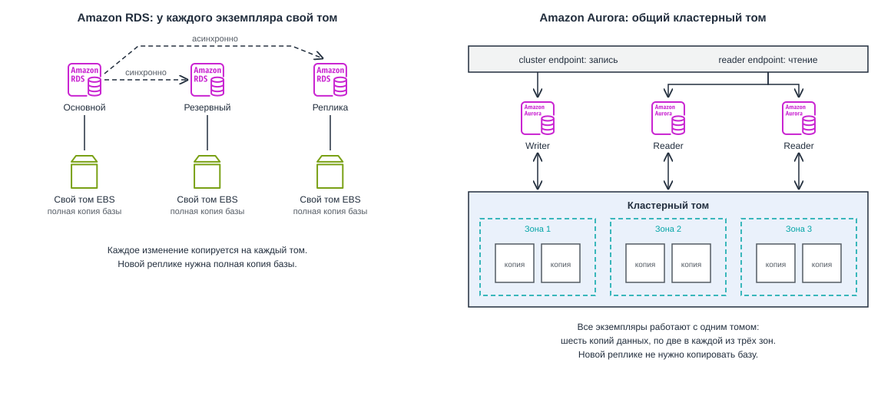

# Облачные базы данных и согласованность данных. Amazon RDS, DynamoDB

## Вопросы для самопроверки

1. Чем база данных отличается от хранилища файлов, и почему заказы интернет-магазина неудобно хранить в виде объектов S3?
2. Чем реляционные базы данных отличаются от нереляционных, и в каких задачах выбирают каждую из них?
3. Чем синхронная репликация отличается от асинхронной, и какой компромисс стоит за выбором между ними?
4. Зачем нужны реплики для чтения, и почему пользователь может не увидеть на реплике только что сохранённые данные?
5. Что такое шардирование, и почему от выбора ключа шарда зависит, будет ли нагрузка распределена равномерно?
6. Чем развёртывание Multi-AZ в Amazon RDS отличается от реплики для чтения?
7. Чем устройство Amazon Aurora отличается от обычного экземпляра Amazon RDS?
8. Как в Amazon DynamoDB ключ раздела определяет, где хранится элемент, и почему Query предпочтительнее Scan?
9. Чем OLTP отличается от OLAP, и почему отчёты по продажам неудобно строить на основной базе магазина?

## Ретроспектива

Эта глава опирается на три предыдущие главы:

- _Четвёртая глава_. Собирая первую архитектуру, мы отметили её слабое место: если база данных работает на том же экземпляре, что и приложение, её судьба привязана к судьбе машины. Там же мы назвали следующий строительный блок, управляемую базу данных.
- _Пятая глава_. Базу данных мы перенесли в приватную подсеть и открыли порт 5432 только для Security Group веб-серверов. В плане адресов VPC подсеть `private-b` во второй зоне доступности осталась в резерве "для реплики базы данных".
- _Шестая глава_. Файлы пользователей переехали в Amazon S3, а сервер приложения стал сервером без состояния. Там же мы определили репликацию, резервную копию, RPO и RTO.

Теперь на отдельном сервере остались только данные приложения: пользователи, заказы, товары. Этот сервер мы по-прежнему обслуживаем сами, и он один. Из этого вытекают вопросы, на которые отвечает глава:

- Кто будет делать копии базы и устанавливать обновления?
- Что произойдёт при отказе зоны доступности?
- Что делать, когда один сервер перестанет справляться с нагрузкой?

## Хранилище и база данных

В шестой главе мы научились хранить файлы в _Amazon S3_. Хранить там же заказы интернет-магазина, например по одному JSON-объекту на заказ, неудобно по двум причинам:

- _Поиск по содержимому_. S3 выдаёт объект по ключу, но не заглядывает внутрь объектов. Чтобы найти заказы клиента 42 за октябрь, приложению придётся скачать и разобрать все заказы магазина.
- _Одновременные изменения_. По умолчанию объект перезаписывается целиком, и побеждает последняя запись. Если два покупателя одновременно купят последний товар, оба запроса прочитают остаток "1", оба запишут "0", и товар будет продан дважды.

Эти задачи решает база данных.

**База данных (database)** - организованный набор данных, который хранится и обрабатывается системой управления, умеющей искать данные по их содержимому, изменять отдельные значения и согласовывать одновременные изменения.

**СУБД (система управления базами данных, database management system, DBMS)** - программа, которая хранит базу данных и выполняет запросы к ней, например PostgreSQL или MySQL.

| Свойство                | Хранилище (Amazon S3, EBS, EFS)               | База данных                                     |
| ----------------------- | --------------------------------------------- | ----------------------------------------------- |
| Как находят данные      | По имени файла или ключу объекта              | По содержимому: любому полю или их сочетанию    |
| Изменение               | Объект перезаписывается целиком               | Изменяется отдельное поле отдельной записи      |
| Одновременные изменения | По умолчанию побеждает последняя запись       | СУБД согласует их и не даёт потерять ни одно    |
| Типичные данные         | Фотографии, документы, видео, резервные копии | Пользователи, заказы, остатки на складе, сессии |

База данных не заменяет хранилище, а работает вместе с ним. Фотография товара лежит в S3, а в базе данных хранится запись о товаре с его названием, ценой и ключом этой фотографии в бакете.

## Типы баз данных

### Реляционные базы данных (RDBMS)

Базы данных бывают разных типов, и самый распространённый из них появился задолго до облаков.

**Реляционная база данных (relational database)** - база данных, в которой данные хранятся в таблицах из строк и столбцов, а связи между таблицами задаются через значения ключей[^1].

**Схема (schema)** - описание структуры базы данных: какие в ней таблицы, какие у них столбцы, какого типа данные хранятся в каждом столбце и какие действуют ограничения.

Связи между таблицами строятся на двух видах ключей:

- _Первичный ключ (primary key)_. Столбец, значение которого однозначно определяет строку таблицы, например `customer_id` в таблице клиентов.
- _Внешний ключ (foreign key)_. Столбец, который ссылается на первичный ключ другой таблицы и тем самым связывает строки двух таблиц[^1].

На рисунке 7.1 показаны три таблицы учебного интернет-магазина: клиенты, товары и заказы. В таблице `orders` столбцы `customer_id` и `product_id` являются внешними ключами: они указывают, какой клиент сделал заказ и какой товар он купил.

_7.1. Таблицы клиентов, товаров и заказов учебного интернет-магазина_

С реляционной базой работают на языке SQL (Structured Query Language), который вы уже встречали в курсе по базам данных.

Вторую проблему из начала главы, одновременные изменения, реляционные СУБД решают транзакциями.

**Транзакция (transaction)** - группа операций с базой данных, которую СУБД выполняет как одно целое: либо все операции применяются, либо ни одна[^2].

Оформление заказа, то есть создание заказа и уменьшение остатка на складе, выполняют _одной транзакцией_.

Если два покупателя одновременно покупают последний товар, СУБД не позволит двум транзакциям менять одну и ту же строку остатка в одно и то же время:

- вторая дождётся завершения первой, увидит остаток.
- вторая покупка будет отменена.

_Основные характеристики_ реляционных баз данных:

- _Таблицы и схема_. Данные хранятся в таблицах, структура которых заранее задана схемой.
- _Связи через ключи_. Таблицы связаны первичными и внешними ключами, а данные из нескольких таблиц объединяют операцией `JOIN`.
- _Язык SQL_. Запрос к данным записывают на SQL, и СУБД выполнит даже тот запрос, о котором не думали при проектировании базы.
- _Транзакции_. Несколько изменений выполняются как одно целое, а одновременные изменения одних и тех же строк СУБД согласует сама.
- _Примеры СУБД_. PostgreSQL, MySQL, MariaDB, Oracle Database, Microsoft SQL Server.

### Ограничения реляционной модели

Реляционная модель удобна, но с ростом приложения у неё проявляются два ограничения:

- _Жёсткая схема_. Схема задаётся заранее, и любое новое поле требует её изменения. Если у товаров магазина свойства сильно различаются (у ноутбука есть объём памяти, у футболки размер, у книги автор), таблица превращается либо в десятки полупустых столбцов, либо в набор дополнительных таблиц.
- _Масштабирование_. Реляционную базу обычно масштабируют, увеличивая мощность одного сервера, а распределить чтение и запись по многим серверам можно только особыми приёмами[^3]. Почему так происходит, разберём в следующем разделе ["Масштабирование баз данных"](#масштабирование-баз-данных).

Ответом на эти ограничения стали нереляционные базы данных.

### Нереляционные базы данных

**Нереляционная база данных (non-relational database, NoSQL)** - база данных, которая хранит данные не в связанных таблицах, а в модели, выбранной под конкретный вид данных и запросов [^4]:

- в парах ключ-значение,
- документах,
- графах,
- и других.

Название NoSQL часто расшифровывают как "_not only SQL_", потому что многие такие базы поддерживают и похожие на SQL языки запросов. Основные модели данных перечислены в таблице.

| Модель                       | Как хранятся данные                                        | Пример задачи                                            |
| ---------------------------- | ---------------------------------------------------------- | -------------------------------------------------------- |
| Ключ-значение (key-value)    | Пары "ключ и значение", поиск только по ключу              | Корзина покупателя, сессия пользователя                  |
| Документная (document)       | Документы в формате, похожем на JSON, со вложенными полями | Карточки товаров с разным набором свойств                |
| Колоночная (wide-column)     | Таблицы, в которых у каждой строки свой набор столбцов     | Журналы событий огромного объёма                         |
| Графовая (graph)             | Узлы и связи между ними                                    | Рекомендации "с этим товаром покупают", социальные связи |
| В памяти (in-memory)         | Данные целиком в оперативной памяти                        | Кеш часто запрашиваемых страниц                          |
| Временные ряды (time series) | Значения, привязанные ко времени                           | Показания датчиков, метрики серверов                     |

Модели разные, но для разработчика у них есть общая особенность. Данные в нереляционной базе раскладывают так, чтобы нужный запрос выполнялся по ключу. Произвольный запрос, может оказаться медленным или вовсе невозможным[^3][^4].

_Основные характеристики_ нереляционных баз данных[^3][^4]:

- _Модель под задачу_. Вместо связанных таблиц используется модель, удобная для конкретных данных: ключ-значение, документы, графы и другие.
- _Гибкая схема_. Записи одной таблицы или коллекции могут иметь разный набор полей, и новое поле не требует менять структуру базы.
- _Распределение по многим серверам_. Данные и нагрузку можно разложить по многим серверам, поэтому такие базы рассчитаны на большие объёмы и большое число запросов.
- _Запросы проектируют заранее_. Данные раскладывают так, чтобы нужный запрос выполнялся по ключу. Произвольный запрос, которого не было в проекте, может оказаться медленным или вовсе невозможным.
- _Ограниченные объединения и транзакции_. Операции `JOIN` обычно нет, а транзакции поддерживаются не везде или с ограничениями.
- _Примеры СУБД_. MongoDB, Redis, Apache Cassandra, Amazon DynamoDB.

### Как выбрать тип базы данных

Ни один тип не лучше другого во всём. Выбор зависит от того, какие данные хранит приложение и какие запросы к ним выполняет.

| Свойство         | Реляционная база                            | Нереляционная база                                  |
| ---------------- | ------------------------------------------- | --------------------------------------------------- |
| Структура данных | Таблицы с фиксированной схемой              | Модель под задачу, гибкая схема                     |
| Запросы          | Любые запросы на SQL, объединение таблиц    | В основном по ключу, запросы проектируют заранее    |
| Транзакции       | Полноценные транзакции                      | Зависит от базы, часто с ограничениями              |
| Масштабирование  | Обычно вертикальное                         | Обычно горизонтальное                               |
| Типичные данные  | Заказы, платежи, учёт, всё, где важны связи | Корзины, сессии, каталоги, события, огромные объёмы |

Часто в одном приложении используют _обе модели_.

- В интернет-магазине заказы и платежи требуют транзакций и попадают в реляционную базу,
- Корзины покупателей читаются и пишутся только по идентификатору пользователя и хорошо ложатся в модель ключ-значение.

## Масштабирование баз данных

### Вертикальное и горизонтальное масштабирование

Пока магазин небольшой, одного сервера базы данных хватает. С ростом числа покупателей сервер перестаёт справляться:

- запросы выполняются медленнее,
- процессор загружен постоянно.

Увеличить производительность можно двумя способами:

**Вертикальное масштабирование (vertical scaling, scale up)** - увеличение мощности одного сервера: больше процессоров, памяти, быстрее диск.

**Горизонтальное масштабирование (horizontal scaling, scale out)** - добавление новых серверов, между которыми распределяется нагрузка.

| Признак                  | Вертикальное масштабирование                                         | Горизонтальное масштабирование                |
| ------------------------ | -------------------------------------------------------------------- | --------------------------------------------- |
| Как выполняется в облаке | Сменой типа экземпляра на более мощный                               | Добавлением экземпляров                       |
| Предел роста             | Самый крупный тип экземпляра когда-нибудь закончится                 | Жёсткого предела нет                          |
| Что замечает приложение  | Смена типа требует перезапуска экземпляра, то есть короткого простоя | Ничего, если нагрузку умеют распределять      |
| Отказоустойчивость       | Один сервер остаётся одной точкой отказа                             | Отказ одного сервера не останавливает систему |

Горизонтальное масштабирование для базы данных намного сложнее, чем для веб-серверов. Веб-сервера не хранят состояние и могут легко добавляться или удаляться. Серверы базы данных хранят состояние, и каждое изменение данных должно стать известно всем серверам, которые отдают эти данные[^6].

Для этого используют два приёма:

- копирование всех данных на несколько серверов
- разделение данных между ними.

Разберём их по очереди.

### Репликация в базах данных

**Репликация** - это непрерывное копирование изменений из одного хранилища в другое.

Разделяют два основных понятия:

**Основной сервер (primary, master)** - сервер базы данных, который принимает операции записи.

**Реплика (replica, slave)** - сервер базы данных, который получает изменения от основного сервера и хранит копию его данных[^6].

Чтобы понять, как изменения попадают на реплику, нужен ещё один механизм.

**Журнал транзакций (write-ahead log, WAL)** - файл, в который СУБД перед изменением самих данных дописывает описание каждого изменения[^7].

Журнал нужен СУБД и без репликации: если сервер внезапно выключится, при запуске СУБД восстановит по журналу изменения, которые успела подтвердить[^7].

Репликация использует тот же журнал. Основной сервер передаёт его записи репликам, а реплики применяют те же изменения в том же порядке и поэтому хранят те же данные. В PostgreSQL этот механизм называется **потоковой репликацией** (_streaming replication_)[^8].

Репликация решает две задачи:

- _Отказоустойчивость_. Если основной сервер отказал, одна из реплик может занять его место[^6].
- _Масштабирование чтения_. Реплики могут обслуживать запросы на чтение, разгружая основной сервер[^6].

**Переключение при отказе (failover)** - перевод реплики в роль основного сервера после того, как основной сервер отказал.

По тому, какие серверы принимают запись, различают две схемы репликации[^6]:

- _Один основной сервер (leader-follower)_. Запись принимает только основной сервер, а реплики получают от него изменения и могут обслуживать чтение. Эту схему называют также _primary-replica_, а в старых источниках _master-slave_. Если основной сервер отказал, одну из реплик назначают основной.
- _Несколько основных серверов (leader-leader, multi-master)_. Запись принимают сразу несколько серверов и пересылают изменения друг другу. Если одну и ту же строку одновременно изменили на двух серверах, например один администратор поменял цену товара, а другой снял его с продажи, возникает конфликт, и нужны правила, по которым решают, чьё изменение победит.

Из-за конфликтов в большинстве приложений используют первую схему. С ней мы и будем работать в AWS.

### Синхронная и асинхронная репликация

Когда основной сервер может сообщить приложению, что транзакция сохранена? Возможны два ответа.

_7.2. Синхронная и асинхронная репликация: когда приложение получает подтверждение_

**Синхронная репликация (synchronous replication)** - режим, в котором основной сервер подтверждает транзакцию приложению только после того, как реплика подтвердила получение изменений[^8].

**Асинхронная репликация (asynchronous replication)** - режим, в котором основной сервер подтверждает транзакцию сразу, а изменения передаются реплике с небольшой задержкой.

У каждого режима своя цена:

- _Синхронная репликация_ гарантирует, что при переключении на реплику ни одна подтверждённая транзакция не потеряется. Платить за это приходится скоростью: каждая запись ждёт как минимум время сетевого обмена между серверами, а при медленной сети производительность может упасть вдвое и больше[^8][^6].
- _Асинхронная репликация_ не замедляет запись, но если основной сервер откажет до того, как изменения дошли до реплики, последние транзакции будут потеряны[^6].

Этот выбор напрямую связан с _RPO_, о котором мы говорили в прошлой главе.

- Синхронная реплика даёт _RPO_, близкий к нулю.
- У асинхронной реплики _RPO_ равен её отставанию от основного сервера: обычно оно небольшое, но при перегрузке растёт. В правой части рисунка 7.2 это окно потери данных показано между подтверждением транзакции и её доставкой на реплику.

### Реплики для чтения

Посмотрим на нагрузку интернет-магазина. Покупатели в основном читают:

- открывают каталог,
- ищут товары,
- смотрят свои заказы.

Запись происходит реже:

- оформление заказа, отзыв,
- изменение профиля.

Если чтение в десятки раз чаще записи, основной сервер тратит большую часть времени на чтение.

**Реплика для чтения (read replica)** - реплика, которая принимает только запросы на чтение и служит для разгрузки основного сервера.

Приложение отправляет все операции записи на основной сервер, а запросы на чтение распределяет между репликами, как показано в левой части рисунка 7.3. Чтобы увеличить мощность чтения, достаточно добавить ещё одну реплику.

_7.3. Реплики для чтения и устаревшее чтение из-за задержки репликации_

Реплики для чтения почти всегда _асинхронные_. Поэтому между записью на основном сервере и её появлением на реплике проходит время.

**Задержка репликации (replication lag)** - время, на которое данные реплики отстают от данных основного сервера.

Из-за задержки возникает неприятный эффект:

1. Пользователь меняет адрес доставки,
2. Запрос на запись уходит на основной сервер, и приложение сразу перезагружает страницу профиля.
3. Запрос на чтение попадает на реплику, до которой изменение ещё не дошло.
4. Пользователь видит старый адрес.

Ему кажется, что сохранение не сработало.

Обычно эту проблему решают так: запросы, которым нужны только что записанные данные, отправляют на основной сервер. _Например_, страницу профиля сразу после сохранения читают с основного сервера, а каталог товаров, где отставание на секунду никому не мешает, с реплик.

> [!IMPORTANT]
> Реплика для чтения не ускоряет запись: все изменения по-прежнему проходят через один основной сервер, а потом ещё и копируются на каждую реплику. Реплики помогают, когда узкое место в чтении.

### Шардирование

Реплики помогают с чтением, но не с записью и не с объёмом данных: _каждая реплика хранит полную копию базы_. Представим, что магазин вырос до миллионов заказов в день. Один основной сервер не успевает записывать заказы, а таблица заказов не помещается на диск самого крупного экземпляра. Здесь помогает другой приём.

**Шардирование (sharding)** - разделение данных одной базы между несколькими независимыми серверами, каждый из которых хранит и обслуживает только свою часть строк[^10].

**Шард (shard)** - один из серверов шардированной базы вместе с частью данных, которую он хранит.

Все шарды имеют одинаковую схему, но разные строки. Каждый шард работает независимо и ничего не знает о других[^10].

Чтобы решить, в какой шард попадёт строка, выбирают ключ.

**Ключ шарда (shard key)** - столбец, по значению которого определяется, в каком шарде хранится строка[^10].

Для таблицы заказов удобный ключ шарда это `customer_id`: все заказы одного клиента окажутся в одном шарде, и запрос "заказы клиента 42" обратится только к нему. Основных способов разложить строки по шардам два[^10]:

- _По диапазону (range-based)_. Клиенты с номерами от 1 до 1 000 000 попадают в первый шард, следующий миллион во второй. Способ простой, но нагрузка может распределиться неравномерно: все новые клиенты, обычно самые активные, окажутся в последнем шарде.
- _По хешу (hashed)_. К значению ключа применяется хеш-функция, и её результат определяет шард. Хеш распределяет клиентов по шардам равномерно и вперемешку.

На рисунке 7.4 показано шардирование таблицы заказов на три шарда по правилу `hash(customer_id) mod 3`: номер шарда равен остатку от деления хеша на число шардов.

_7.4. Шардирование таблицы заказов по хешу `customer_id`_

У шардирования есть серьёзные недостатки, поэтому к нему прибегают, когда другие способы исчерпаны:

- _Горячий шард (hotspot)_. Если ключ выбран неудачно, большая часть запросов придётся на один шард, и он станет узким местом. _Например_, один очень крупный клиент, на которого приходится половина всей нагрузки, при любом способе окажется в одном шарде.
- _Запросы через несколько шардов_. В схеме на рисунке 7.4 запрос "общая выручка за день" придётся отправить во все шарды и сложить результаты в приложении. Объединение таблиц из разных шардов тоже становится задачей приложения[^10].
- _Перераспределение данных_. При переходе с трёх шардов на четыре правило меняется на `hash(customer_id) mod 4`, и остаток от деления становится другим у большинства клиентов. Их заказы приходится переносить между серверами[^10].
- _Сложность эксплуатации_. Большинство реляционных СУБД не умеют шардировать данные сами, и эту логику пишут в приложении или в отдельном промежуточном слое[^10].

### Репликация и шардирование вместе

Репликацию и шардирование легко перепутать, потому что в обоих случаях данные лежат на нескольких серверах. Разница в том, что именно лежит на каждом сервере. Она показана на рисунке 7.5 и в таблице.

_7.5. Репликация, шардирование и их сочетание_

| Свойство                    | Репликация                             | Шардирование                                  |
| --------------------------- | -------------------------------------- | --------------------------------------------- |
| Что на каждом сервере       | Полная копия одних и тех же данных     | Своя часть данных                             |
| Что масштабирует            | Чтение                                 | Запись и объём данных                         |
| Что даёт при отказе сервера | Реплика может заменить основной сервер | Без реплик часть данных становится недоступна |
| Основная сложность          | Задержка репликации                    | Выбор ключа и запросы через несколько шардов  |

На практике эти приёмы сочетают: базу делят на шарды, а у каждого шарда есть свои реплики[^10]. Тогда шарды распределяют запись, а реплики каждого шарда обеспечивают отказоустойчивость и чтение.

## Базы данных в облаке

### Своя СУБД или управляемый сервис

Все приёмы из предыдущего раздела можно настроить самостоятельно:

1. Запустить PostgreSQL на экземпляре EC2.
2. Настроить потоковую репликацию на второй экземпляр в другой зоне доступности.
3. Написать скрипт, который при отказе основного сервера переключит приложение на реплику.

Третий пункт сложнее, чем кажется. Документация PostgreSQL говорит, что сама СУБД не обнаруживает отказ основного сервера и не переключается автоматически: для этого нужны внешние инструменты[^11]. К этому добавляется повседневная работа администратора базы данных:

- обновления СУБД и операционной системы,
- резервные копии и проверка того, что они восстанавливаются,
- контроль свободного места на диске.

- _СУБД на экземпляре EC2 это IaaS_: AWS отвечает за сервер, а за операционную систему и всё, что выше неё, отвечаете вы.
- _Управляемая база данных это PaaS_: AWS запускает и обслуживает СУБД, а вы работаете с данными и доступом к ним.

| Задача                            | СУБД на EC2 | Управляемая база данных  |
| --------------------------------- | ----------- | ------------------------ |
| Установка и обновление СУБД и ОС  | Вы          | AWS                      |
| Резервное копирование             | Вы          | AWS, по вашим настройкам |
| Обнаружение отказа и переключение | Вы          | AWS                      |
| Увеличение диска                  | Вы          | AWS, по вашим настройкам |
| Схема и запросы                   | Вы          | Вы                       |
| Доступ к базе и сетевые правила   | Вы          | Вы                       |

За удобство приходится платить меньшей свободой. У управляемой базы есть ограничения:

- Нет доступа к операционной системе сервера.
- Нельзя поставить произвольное расширение СУБД.
- Выбор версий ограничен теми, что поддерживает провайдер.

Своя СУБД на EC2 оправдана, когда нужна такая свобода. В остальных случаях управляемая база экономит много работы.

### Базы данных AWS

AWS предлагает пятнадцать с лишним сервисов баз данных, каждый под свою модель данных[^5]. В этой главе мы подробно разберём четыре из них, а остальные упомянем коротко:

- _Amazon RDS_. Управляемые реляционные базы с привычными СУБД: PostgreSQL, MySQL и другими.
- _Amazon Aurora_. Реляционная база, совместимая с PostgreSQL и MySQL, с собственным распределённым хранилищем.
- _Amazon DynamoDB_. Нереляционная база для данных в виде пар ключ-значение и документов, без серверов, которыми нужно управлять.
- _Amazon Redshift_. Аналитическая база данных для отчётов по большим объёмам данных.

## Amazon RDS

### Что такое Amazon RDS

**Amazon RDS (Relational Database Service)** - управляемый сервис AWS, который упрощает создание, эксплуатацию и масштабирование реляционной базы данных в облаке[^12].

_Основные характеристики_ Amazon RDS:

- _Привычные СУБД_. RDS поддерживает шесть СУБД: PostgreSQL, MySQL, MariaDB, Microsoft SQL Server, Oracle Database и IBM Db2[^12].
- _Обслуживание берёт на себя AWS_. Резервное копирование, установка обновлений, обнаружение отказов и восстановление выполняются без вас, а на вашей стороне остаются схема базы и оптимизация запросов[^12].
- _Работа с экземплярами_. Как и в EC2, вы выбираете мощность сервера и размер диска, а платите за часы работы экземпляра.
- _Размещение в вашей VPC_. Базу ставят в приватные подсети и закрывают Security Group.
- _Отказоустойчивость и масштабирование чтения_. Резервный экземпляр в другой зоне доступности и реплики для чтения включаются настройками экземпляра.
- _Восстановление на момент времени_. Базу можно вернуть в состояние на любую секунду в пределах срока хранения резервных копий.

AWS рекомендует RDS как выбор по умолчанию для большинства реляционных баз данных[^12].

| Характеристика      | Amazon RDS                                                                                                                       |
| ------------------- | -------------------------------------------------------------------------------------------------------------------------------- |
| Категория           | Базы данных (databases)                                                                                                          |
| Что делает          | Запускает и обслуживает реляционную СУБД: обновления, резервные копии, мониторинг, переключение при отказе                       |
| Для чего нужен      | Получить готовую реляционную базу без администрирования сервера и СУБД                                                           |
| Где используют      | Основные данные веб-приложений: пользователи, заказы, платежи, учёт                                                              |
| Модель обслуживания | PaaS: серверами, ОС и СУБД управляет AWS, вы управляете схемой, данными и доступом                                               |
| Область действия    | Региональный: экземпляр базы находится в одной зоне доступности, копии могут быть в других зонах и регионах                      |
| Как оплачивается    | Часы работы экземпляра (по классу), объём хранилища в месяц, хранилище резервных копий сверх бесплатного объёма, передача данных |
| Как работать        | Консоль AWS, AWS CLI (`aws rds`), SDK; к самой базе подключаются обычным клиентом СУБД                                           |
| Появился            | Октябрь 2009 года[^13]                                                                                                           |
| Аналоги             | Google Cloud SQL[^14], Azure Database for PostgreSQL                                                                             |

### Экземпляр базы данных

Основной ресурс RDS называется экземпляром базы данных.

**Экземпляр базы данных (DB instance)** - изолированная среда базы данных в облаке, в которой работает одна СУБД с одной или несколькими базами[^12].

Экземпляр базы данных похож на экземпляр EC2, и при создании для него выбирают похожие параметры:

- _Класс экземпляра (DB instance class)_. Определяет процессор и память, как тип экземпляра в EC2. Имена классов начинаются с `db.`, дальше идут знакомые семейство, поколение и размер, например `db.t4g.micro` или `db.r6g.xlarge`. Классы `db.t` рассчитаны на небольшую нагрузку с редкими пиками, `db.m` сбалансированы, `db.r` оптимизированы по памяти[^15].
- _Хранилище_. Том EBS, на котором лежат файлы базы. Обычный выбор это General Purpose SSD `gp3`, для нагрузок с высокими требованиями к скорости дисковых операций есть Provisioned IOPS SSD (`io1`, `io2`)[^16].

- _Автоматическое увеличение хранилища (storage autoscaling)_. Если свободного места почти не осталось, RDS сам увеличит том, но не выше заданного вами максимума[^17].
- _Учётные данные администратора_. Имя главного пользователя (master user) и пароль, с которыми вы подключаетесь к базе.

> [!TIP]
>
> Подключаться к экземпляру по SSH нельзя: RDS не даёт прямого доступа к серверу, на котором работает СУБД[^18]. Вы работаете только с самой базой через клиент СУБД.

### Подключение к экземпляру

Каждый экземпляр получает адрес для подключения.

**Endpoint экземпляра (DB instance endpoint)** - DNS-имя, по которому приложение подключается к экземпляру базы данных[^18]. Endpoint выглядит так: `shop-db.abcdefghijkl.eu-central-1.rds.amazonaws.com`. Приложение подключается по этому имени, а не по IP-адресу.

### RDS в VPC

Экземпляр базы данных всегда создаётся внутри VPC, все правила безопасности и маршрутизации действуют для него так же, как для экземпляров EC2. При создании экземпляра нужно указать, в каких подсетях он может работать.

Есть еще одно понятие, связанное с размещением экземпляров в VPC.

**Группа подсетей базы данных (DB subnet group)** - набор подсетей VPC, обычно приватных, в которых RDS может размещать экземпляры базы данных[^19].

AWS требует, чтобы подсети группы находились как минимум в двух зонах доступности одного региона[^19]. Даже если сейчас база работает в одной зоне, RDS нужна подсеть в другой зоне, чтобы при необходимости создать там резервный экземпляр.

Ещё два параметра определяют, кто сможет подключиться к базе:

- _Public access_. Параметр определяет, получит ли экземпляр публичный IP-адрес. Для базы приложения выбирают `No`: база доступна только изнутри VPC[^19].
- _Security Group_. В итоге доступ определяет Security Group экземпляра[^19].

> [_Hands-on 7.1. Первая база данных в RDS._](hands_on_01.md) Создание группы подсетей из двух приватных подсетей, запуск экземпляра PostgreSQL.

### Multi-AZ: защита от отказа зоны

Экземпляр базы данных работает в одной зоне доступности. Если в этой зоне откажет сервер, сеть или диск, база станет недоступна, а вместе с ней и весь магазин. Чтобы этого избежать, нужен второй сервер в другой зоне, готовый принять работу.

**Развёртывание Multi-AZ (Multi-AZ DB instance deployment)** - режим RDS, в котором AWS создаёт в другой зоне доступности резервный экземпляр (standby) и синхронно копирует на него все изменения основного экземпляра[^20].

Схема на рисунке 7.7 показывает этот режим:

- Клиенты читают и пишут только в основной экземпляр (Primary DB instance).
- Резервный экземпляр (Standby replica) в другой зоне получает изменения синхронно и запросов не обслуживает (No read access).

_7.7. Развёртывание Multi-AZ: основной и резервный экземпляры в разных зонах. Источник: Amazon Web Services[^20], лицензия CC BY-SA 4.0[^21]_

Работа в этом режиме устроена так:

1. Приложение работает только с основным экземпляром.
2. Каждая запись синхронно копируется на резервный экземпляр. Транзакция подтверждается приложению после того, как изменение получено резервным экземпляром.
3. Если основной экземпляр, его зона, сеть или диск отказали, RDS автоматически переключается на резервный экземпляр[^22].
4. Приложение продолжает работу уже с новым основным экземпляром.

Переключение при отказе обычно занимает 60-120 секунд, а при больших транзакциях может длиться дольше[^22].

У этого режима есть особенности, о которых часто забывают:

- _Резервный экземпляр не обслуживает чтение_. Направить на него запросы нельзя, он только ждёт отказа основного[^20].
- _Запись становится медленнее_. Каждая транзакция ждёт подтверждения из другой зоны, поэтому задержка записи и фиксации выше, чем у экземпляра в одной зоне[^20].
- _Режим стоит дороже_. Резервный экземпляр работает круглосуточно, а RDS оплачивается по часам работы экземпляров[^23].

> [!NOTE]
>
> Multi-AZ защищает от отказа оборудования и зоны, но не от ошибок. Если приложение удалит таблицу, синхронная репликация тут же удалит её и на резервном экземпляре.

### Реплики для чтения в RDS

Multi-AZ отвечает за отказоустойчивость, а для масштабирования чтения в RDS есть реплики для чтения.

Реплика для чтения в RDS это отдельный экземпляр базы данных со своим отдельным endpoint. RDS копирует на неё изменения основного экземпляра асинхронно[^9]. Разработчик сам указывает какие запросы отправлять на endpoint реплики: RDS не распределяет запросы автоматически.

Основные свойства реплик для чтения в RDS:

- _Количество_. К одному экземпляру можно подключить до 15 реплик, а для Oracle до 5[^24][^9].
- _Размещение_. Реплика может находиться в той же зоне, в другой зоне или даже в другом регионе[^9]. Реплика в другом регионе приближает данные к пользователям и служит запасом на случай отказа региона.
- _Продвижение (promotion)_. Реплику можно превратить в самостоятельный экземпляр, принимающий запись. Так её используют для восстановления после аварии, если основной экземпляр потерян[^9].
- _Ручное создание_. RDS не добавляет реплики автоматически при росте нагрузки, их создают вручную[^9].

Multi-AZ и реплики для чтения можно сочетать. На рисунке 7.8 у основного экземпляра есть и синхронный резервный экземпляр без доступа на чтение, и асинхронная реплика, с которой клиенты читают данные (Read access).

_7.8. Основной экземпляр с резервным экземпляром Multi-AZ и репликой для чтения. Источник: Amazon Web Services[^9], лицензия CC BY-SA 4.0[^21]_

Multi-AZ и реплики для чтения решают разные задачи, и их часто путают.

| Свойство                | Multi-AZ                                   | Реплика для чтения                        |
| ----------------------- | ------------------------------------------ | ----------------------------------------- |
| Назначение              | Отказоустойчивость                         | Масштабирование чтения                    |
| Репликация              | Синхронная                                 | Асинхронная                               |
| Обслуживает чтение      | Нет                                        | Да                                        |
| Отдельный endpoint      | Нет, endpoint общий с основным экземпляром | Да                                        |
| Где находится           | Другая зона того же региона                | Та же зона, другая зона или другой регион |
| Переключение при отказе | Автоматическое                             | Ручное продвижение                        |

### Резервные копии и восстановление

Multi-AZ не спасает от ошибок, поэтому RDS делает резервные копии.

**Автоматическое резервное копирование (automated backups)** - механизм RDS, который ежедневно в заданное окно делает снимок хранилища экземпляра и постоянно сохраняет журналы транзакций[^26].

Копии хранятся в Amazon S3. Срок их хранения задают от 0 до 35 дней, а значение 0 отключает автоматическое резервное копирование[^26]. Журналы транзакций RDS выгружает в S3 каждые пять минут[^26].

**Восстановление на момент времени (point-in-time recovery)** - восстановление базы в состояние на выбранную секунду в пределах срока хранения резервных копий.

Восстановление устроено в два шага:

1. RDS берёт последний ежедневный снимок, сделанный до выбранного момента.
2. RDS заново применяет к этому снимку изменения из сохранённых журналов транзакций вплоть до выбранной секунды.

Восстановление не перезаписывает существующую базу: RDS создаёт новый экземпляр с новым идентификатором[^27]. Чтобы приложение начало работать с восстановленной базой, в его настройках нужно указать endpoint нового экземпляра.

Кроме автоматических резервных копий, бывают ручные снимки (manual snapshots). Их делают перед рискованными изменениями, например перед обновлением схемы. Ручные снимки не удаляются вместе с экземпляром и хранятся, пока их не удалят явно[^28].

### Обслуживание экземпляра

Обновления СУБД и операционной системы RDS устанавливает сам, но некоторые из них требуют короткой остановки экземпляра. Чтобы это не случилось в разгар продаж, для экземпляра задают окно обслуживания.

**Окно обслуживания (maintenance window)** - еженедельный интервал времени, в который RDS применяет к экземпляру изменения, требующие его остановки, например обновления ОС или СУБД[^29].

Для магазина окно обычно ставят на ночь, когда покупателей меньше всего. В режиме Multi-AZ обновление ОС проходит почти без простоя, потому что RDS действует по шагам[^29]:

1. Обновляет резервный экземпляр.
2. Делает его основным.
3. Обновляет бывший основной экземпляр, который становится резервным.

### Стоимость RDS

Счёт за RDS складывается из нескольких частей[^23]:

- _Часы работы экземпляра_. Зависят от класса экземпляра и СУБД. Экземпляр оплачивается, пока он работает, даже если к нему никто не подключается.
- _Хранилище_. Плата за выделенный объём в месяц, а для Provisioned IOPS ещё и за заданную скорость.
- _Резервные копии_. Хранилище резервных копий бесплатно в объёме, равном выделенному хранилищу баз в регионе, а сверх него оплачивается[^28].
- _Передача данных_. Трафик из региона в интернет и между регионами. Трафик репликации между основным экземпляром и репликой в одном регионе не оплачивается[^9].

Режим Multi-AZ и каждая реплика для чтения добавляют часы работы ещё одного экземпляра. Поэтому для учебных задач используют один экземпляр в одной зоне.

## Amazon Aurora

### Зачем понадобилась Aurora

Посмотрим ещё раз на устройство RDS. У каждого экземпляра свой том с файлами базы. У резервного экземпляра Multi-AZ свой том, у каждой реплики для чтения свой том, и на все эти тома основной экземпляр отправляет каждое изменение. Чем больше реплик, тем больше копий данных нужно поддерживать и тем дольше создаётся новая реплика: ей нужно получить полную копию базы.

AWS решила эту проблему иначе: отделила хранилище от вычислений. Так появилась _Aurora_.

### Что такое Amazon Aurora

**Amazon Aurora** - полностью управляемая реляционная СУБД, совместимая с MySQL и PostgreSQL, в которой данные хранятся в общем распределённом томе, отделённом от серверов СУБД[^33].

_Основные характеристики_ Amazon Aurora:

- _Совместимость с MySQL и PostgreSQL_. Приложение работает с Aurora через тот же драйвер и с теми же запросами, поэтому код при переходе менять не нужно.
- _Шесть копий данных_. Хранилище держит по две копии в каждой из трёх зон доступности[^34][^35].
- _До 15 реплик для чтения_. Реплики читают то же хранилище и отстают от основного экземпляра обычно меньше чем на 100 миллисекунд[^36].
- _Быстрая замена основного экземпляра_. При отказе одна из реплик становится основным экземпляром, и данные копировать не нужно[^36].
- _Автоматический рост хранилища_. Объём увеличивается по мере роста базы, заранее его не выбирают[^33].

| Характеристика      | Amazon Aurora                                                                                                 |
| ------------------- | ------------------------------------------------------------------------------------------------------------- |
| Категория           | Базы данных (databases)                                                                                       |
| Что делает          | Запускает реляционную СУБД, совместимую с MySQL или PostgreSQL, над общим томом с копиями данных в трёх зонах |
| Для чего нужен      | Реляционная база с высокой доступностью и быстрыми репликами для нагруженных приложений                       |
| Где используют      | Нагруженные веб-приложения и SaaS-сервисы, системы, где важна быстрая замена основного сервера                |
| Модель обслуживания | PaaS                                                                                                          |
| Область действия    | Региональный: кластерный том охватывает три зоны доступности региона                                          |
| Как оплачивается    | Часы работы экземпляров, объём хранилища, операции ввода-вывода (зависит от конфигурации), резервные копии    |
| Как работать        | Те же консоль и команды `aws rds`, что для RDS; к базе подключаются клиентом MySQL или PostgreSQL             |
| Появился            | Анонс в ноябре 2014 года, общая доступность в июле 2015 года[^37][^38]                                        |
| Аналоги             | Google Cloud AlloyDB for PostgreSQL[^39]                                                                      |

### Кластер Aurora

Aurora работает не с отдельными экземплярами, а с кластером.

**Кластер Aurora (Aurora DB cluster)** - один или несколько экземпляров базы данных вместе с кластерным томом, который хранит данные для всех этих экземпляров[^33].

**Кластерный том (cluster volume)** - распределённое хранилище кластера Aurora, копии данных которого находятся в нескольких зонах доступности региона[^35].

Данные кластерного тома хранятся в шести копиях, по две в каждой из трёх зон доступности[^34][^35]. Запись считается выполненной, когда её подтвердили четыре копии из шести (это показано на рисунке 7.10)[^40]. Отказ целой зоны доступности уносит две копии, остаются четыре, и база продолжает принимать запись[^37]. Том растёт автоматически по мере роста базы[^33].

Над томом работают экземпляры двух видов:

- _Основной экземпляр (writer)_. Такой экземпляр в кластере один, он выполняет и чтение, и запись.
- _Реплики Aurora (Aurora Replicas, readers)_. Их может быть до 15 на кластер, они выполняют только чтение[^36].

Реплики Aurora не хранят собственных копий данных: все экземпляры кластера читают один и тот же кластерный том[^36]. Поэтому новая реплика не копирует базу и создаётся быстро, а задержка реплик обычно меньше 100 миллисекунд[^36]. Разница между RDS и Aurora показана на рисунке 7.9.

_7.9. Тома экземпляров в RDS и общий кластерный том в Aurora_

Тот же кластер на схеме из документации AWS показан на рисунке 7.10:

- Основной экземпляр (Writer instance) находится в первой зоне, две реплики (Reader instances) во второй и третьей.
- Под ними общий том (Shared storage volume) из шести блоков, по два в каждой зоне.
- Подпись "Synchronous writes (4 out of 6 quorum)" означает, что запись считается выполненной, когда её подтвердили четыре копии из шести.
- Стрелки "Asynchronous replication" между экземплярами показывают, что основной экземпляр сообщает репликам об изменениях: полную копию данных никто не пересылает, все читают из общего тома.
- Внизу показано, что Aurora непрерывно сохраняет резервные копии тома в Amazon S3.

_7.10. Кластер Aurora: экземпляры над общим кластерным томом в трёх зонах доступности. Источник: Amazon Web Services[^40], лицензия CC BY-SA 4.0[^21]_