# Hands-on 8.1. Балансировщик для двух серверов

В разделах «Балансировка нагрузки» и «Amazon Elastic Load Balancing» мы разобрали, как балансировщик даёт нескольким серверам общую точку входа, проверяет их состояние и не пускает запросы на неисправные. В этом занятии вы соберёте такую схему сами: запустите два веб-сервера в разных зонах доступности, объедините их в целевую группу с проверкой `/health` и поставите перед ними Application Load Balancer. Затем остановите один сервер и посмотрите, как балансировщик это заметит.

Как и в предыдущих занятиях, после каждого блока настроек идёт объяснение: важно не только нажать нужные кнопки, но и понять, что изменится, если выбрать другое значение.

## Что получится в конце

- Две Security Group: `alb-sg` пускает HTTP из интернета на балансировщик, `web-sg` пускает HTTP на серверы только от балансировщика.
- Экземпляры `web-1` и `web-2` с nginx в зонах `eu-central-1a` и `eu-central-1b`. Каждый сервер отдаёт страницу со своим внутренним именем хоста и зоной.
- Целевая группа `web-tg` с проверкой работоспособности по пути `/health`.
- Внешний балансировщик `web-alb` с узлами в двух публичных подсетях и listener HTTP на порту 80.

Ресурсы размещаются в default VPC: все её подсети публичные, поэтому сеть создавать не нужно.

| Зона доступности | Подсеть default VPC   | Ресурсы                              |
| ---------------- | --------------------- | ------------------------------------ |
| `eu-central-1a`  | `172.31.16.0/20`      | Узел `web-alb`, экземпляр `web-1`    |
| `eu-central-1b`  | `172.31.32.0/20`      | Узел `web-alb`, экземпляр `web-2`    |

Диапазоны подсетей у вас могут отличаться.

## Перед началом

- Вы прошли Hands-on 4.1 и 5.1: умеете запускать экземпляр с user data и создавать Security Group. Эти действия описаны кратко.
- Вы работаете в регионе `Europe (Frankfurt)`.
- Закладывайте на занятие около часа.

> [!WARNING]
> Балансировщик оплачивается почасово, пока существует, даже без трафика (раздел «Стоимость»). Отдельно оплачиваются публичные IPv4-адреса узлов балансировщика и экземпляров. Если вы не переходите к Hands-on 8.2 сразу, выполните часть 5 с удалением ресурсов.

## Часть 1. Security Group и серверы

### Шаг 1. Создайте Security Group балансировщика

Откройте `EC2`, затем `Security Groups`, и нажмите `Create security group`. Задайте имя `alb-sg`, описание `HTTP from the internet`, VPC оставьте default. Добавьте входящее правило: тип `HTTP`, источник `Anywhere-IPv4` (`0.0.0.0/0`). Порт 443 не нужен: HTTPS-listener в этом занятии не создаётся. Это первое звено цепочки из раздела «Балансировщик и Security Group»: из интернета можно попасть только на балансировщик.

> [!NOTE]
> В таблице главы группы названы `sg-alb` и `sg-web`. В консоли такие имена создать нельзя: AWS запрещает имена Security Group, которые начинаются с `sg-`, потому что с этого префикса начинаются идентификаторы групп. Поэтому здесь суффикс стоит в конце: `alb-sg`, `web-sg`.

### Шаг 2. Создайте Security Group серверов

Создайте вторую группу:

1. В поле `Security group name` введите `web-sg` (_1_), в поле `Description` введите `HTTP only from load balancer`.
2. Добавьте входящее правило с типом `HTTP` (_2_). Порт 80 подставится сам.
3. В поле `Source` начните вводить `alb-sg` и выберите группу из выпадающего списка (_3_). В поле появится её идентификатор `sg-...`. В описании правила можно указать `From ALB`.

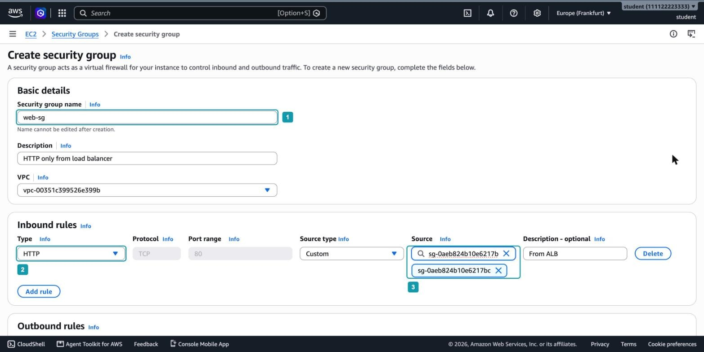

_8.1.1. Security Group серверов_

Источником правила указан не диапазон адресов, а другая Security Group. Правило читается так: «пропускать трафик от любого сетевого интерфейса, к которому привязана `alb-sg`». Узлы балансировщика меняют IP-адреса при масштабировании, а правило по группе от этого не зависит.

> [!WARNING]
> Если ввести в поле `Source` текст `alb-sg` и не выбрать группу из списка, консоль воспримет его как адрес и покажет ошибку. Выбирайте строку с идентификатором группы.

### Шаг 3. Запустите два экземпляра

Откройте `Instances` и нажмите `Launch instances`. Задайте имя `web-1`, оставьте образ Amazon Linux 2023 и тип `t3.micro`. В поле `Key pair` выберите `Proceed without a key pair (Not recommended)`: подключаться к серверам по SSH в этом занятии не нужно.

В разделе `Network settings` нажмите `Edit`:

1. В поле `VPC` оставьте default VPC (_4_).
2. В поле `Subnet` выберите подсеть зоны `eu-central-1a` (_5_). Подсеть нужно выбрать явно: при значении `No preference` AWS может запустить оба экземпляра в одной зоне.
3. В поле `Auto-assign public IP` оставьте `Enable` (_6_). Публичный адрес нужен серверу, чтобы при запуске скачать nginx из репозитория Amazon Linux.
4. В разделе `Firewall (security groups)` выберите `Select existing security group` и группу `web-sg` (_7_).

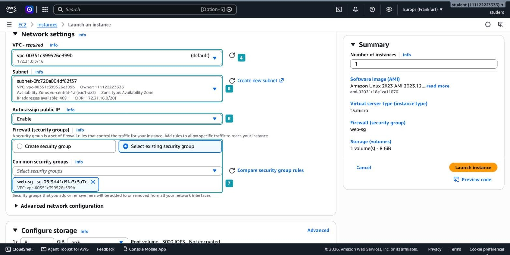

_8.1.2. Сетевые настройки экземпляра web-1_

У сервера будет публичный адрес, но открыть страницу по нему не получится: `web-sg` не пропускает трафик из интернета. Вы проверите это в шаге 12.

Раскройте `Advanced details` и вставьте в поле `User data` скрипт (_8_):

```bash
#!/bin/bash
dnf install -y nginx
TOKEN=$(curl -s -X PUT "http://169.254.169.254/latest/api/token" -H "X-aws-ec2-metadata-token-ttl-seconds: 300")
AZ=$(curl -s -H "X-aws-ec2-metadata-token: $TOKEN" http://169.254.169.254/latest/meta-data/placement/availability-zone)
echo "<h1>$(hostname)</h1><p>Zone: $AZ</p>" > /usr/share/nginx/html/index.html
echo "OK" > /usr/share/nginx/html/health
systemctl enable --now nginx
```

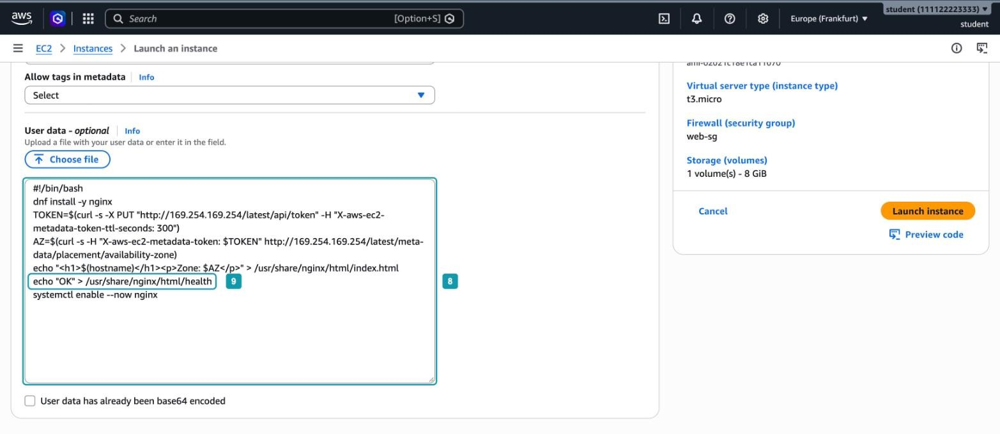

_8.1.3. User data веб-сервера_

Скрипт устанавливает nginx и создаёт две страницы:

- *Главная страница* `/`. На ней указаны имя хоста и зона доступности сервера. Зону скрипт узнаёт у Instance Metadata Service: сначала получает токен запросом `PUT`, затем передаёт его в заголовке. Это IMDSv2 из раздела «IMDSv1, IMDSv2 и история Capital One» главы 4. На Amazon Linux 2023 запрос без токена по умолчанию отклоняется. По имени и зоне в ответе вы увидите, какой сервер обработал запрос.
- *Страница* `/health` (_9_). Файл с текстом `OK`, который nginx отдаёт с кодом 200. Это локальная проверка из раздела «Что должен проверять `/health`»: она подтверждает только то, что веб-сервер на этом экземпляре запущен и отдаёт файлы.

Нажмите `Launch instance`. Затем запустите второй экземпляр с теми же настройками, но с именем `web-2` и подсетью зоны `eu-central-1b`. Удобнее всего дождаться, когда `web-1` перейдёт в состояние `Running`, выбрать его в списке и нажать `Actions`, `Image and templates`, `Launch more like this`: консоль скопирует настройки, останется только изменить имя и подсеть.

## Часть 2. Целевая группа

Целевую группу создают до балансировщика: в мастере балансировщика её нужно будет выбрать как место назначения запросов.

### Шаг 4. Задайте тип и имя целевой группы

Откройте `Target Groups` в разделе `Load Balancing` и нажмите `Create target group`:

1. В поле `Choose a target type` выберите `Instances` (_10_). Цели будут задаваться идентификаторами экземпляров. Тип `IP addresses` нужен, когда цель задают IP-адресом, например для контейнеров или серверов в собственном дата-центре, а тип `Lambda function` упоминался в разделе «Типы балансировщиков».
2. В поле `Target group name` введите `web-tg` (_11_).
3. В полях `Protocol` и `Port` оставьте `HTTP` и `80` (_12_). По этому протоколу и порту балансировщик будет передавать запросы серверам. Это не тот порт, который видят пользователи.

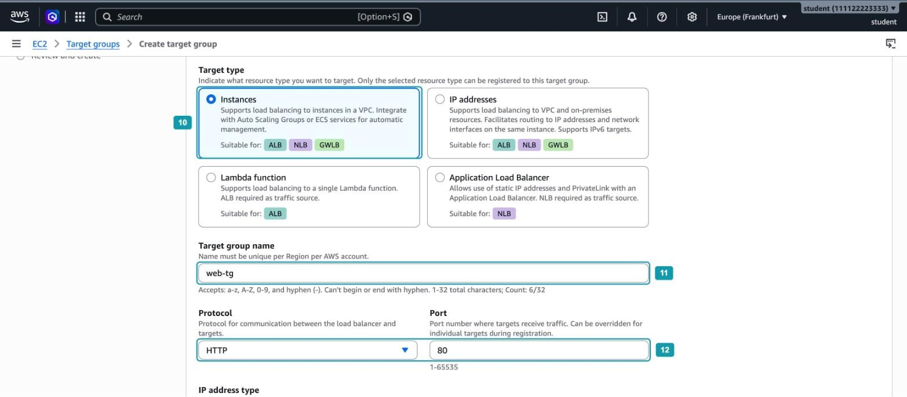

_8.1.4. Тип и имя целевой группы_

### Шаг 5. Настройте проверку работоспособности

Ниже на странице:

1. В поле `VPC` оставьте default VPC (_13_). Целевая группа принадлежит одной VPC, и регистрировать в ней можно только экземпляры из этой VPC.
2. В поле `Health check protocol` оставьте `HTTP` (_14_).
3. В поле `Health check path` введите `/health` (_15_).

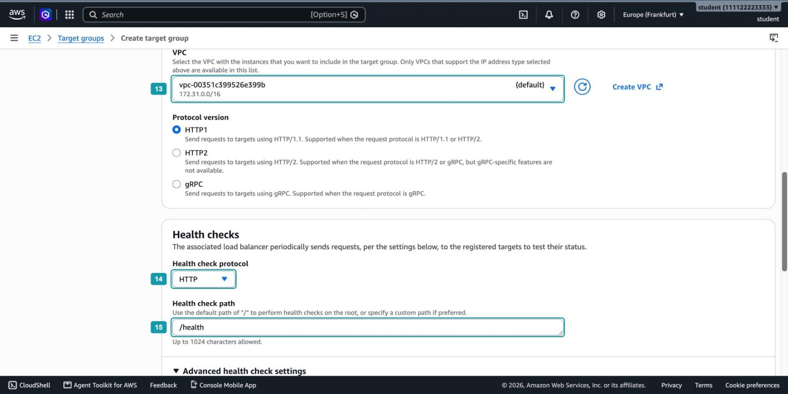

_8.1.5. Протокол и путь проверки_

Раскройте `Advanced health check settings` и задайте значения:

1. В поле `Healthy threshold` введите `2` (_16_). По умолчанию `5`.
2. В поле `Unhealthy threshold` оставьте `2` (_17_).
3. В поле `Timeout` оставьте `5` секунд (_18_).
4. В поле `Interval` введите `10` секунд (_19_). По умолчанию `30`.
5. В поле `Success codes` оставьте `200` (_20_).

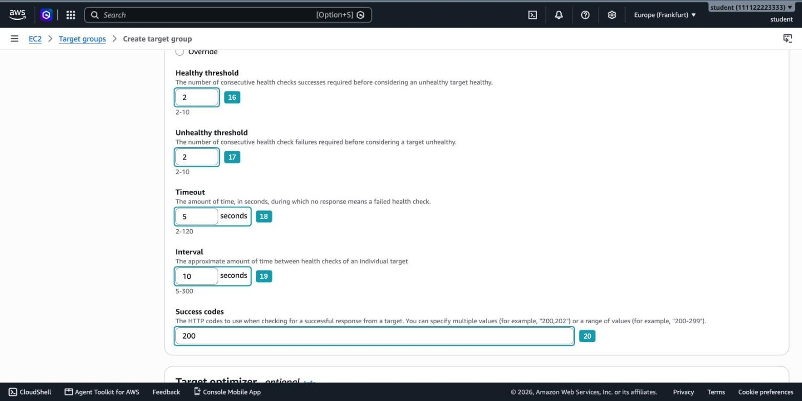

_8.1.6. Пороги и интервал проверки_

В разделе «Проверки работоспособности в целевой группе» мы посчитали, что со значениями по умолчанию сломанный сервер исключается примерно через минуту, а возвращается через две с половиной. С новыми значениями оба срока составляют около 20 секунд: две проверки с интервалом 10 секунд. Для занятия это удобно: результат виден почти сразу. Цена короткого интервала в том, что проверок становится втрое больше, а с низким порогом исправности сервер, который то отвечает, то нет, будет чаще возвращаться в работу.

### Шаг 6. Зарегистрируйте экземпляры

Нажмите `Next`. На странице `Register targets` отметьте `web-1` и `web-2`, проверьте, что указан порт `80`, и нажмите `Include as pending below`. Экземпляры появятся в таблице `Review targets` (_21_), а под ней счётчик `2 pending` (_22_). Нажмите `Next`, затем `Create target group`.

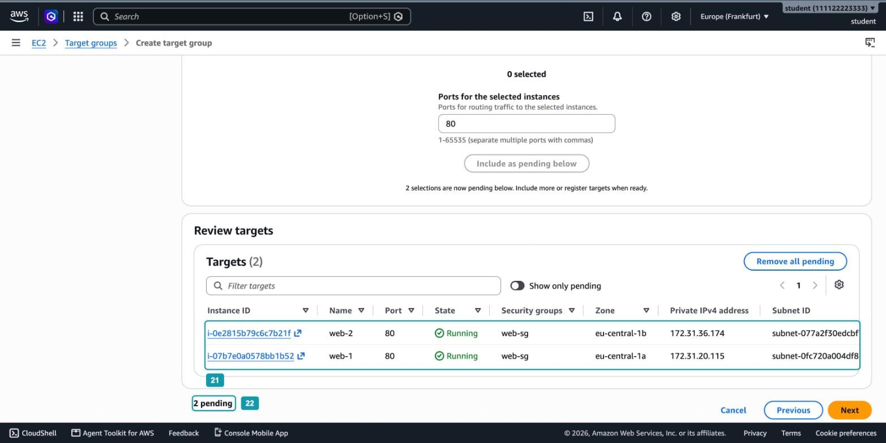

_8.1.7. Регистрация экземпляров_

Откройте созданную группу `web-tg`. В поле `Load balancer` указано `None associated` (_23_), а обе цели находятся в состоянии `Unused` (_24_).

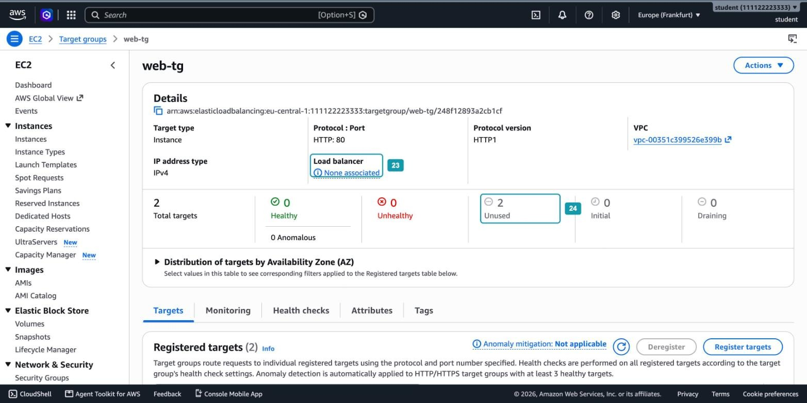

_8.1.8. Цели без балансировщика_

Проверки работоспособности выполняют узлы балансировщика. Пока группу не использует ни один балансировщик, проверять цели некому, и они остаются в состоянии `unused` из таблицы состояний главы.

## Часть 3. Балансировщик

### Шаг 7. Выберите тип и схему

Откройте `Load Balancers`, нажмите `Create load balancer` и в карточке `Application Load Balancer` нажмите `Create`:

1. В поле `Load balancer name` введите `web-alb` (_25_). Оно войдёт в DNS-имя балансировщика.
2. В поле `Scheme` оставьте `Internet-facing` (_26_). Узлы получат публичные адреса, и балансировщик будет доступен из интернета. Схему `Internal` выбирают для сервиса, к которому обращаются только изнутри VPC. Изменить схему после создания нельзя.
3. В поле `Load balancer IP address type` оставьте `IPv4` (_27_).

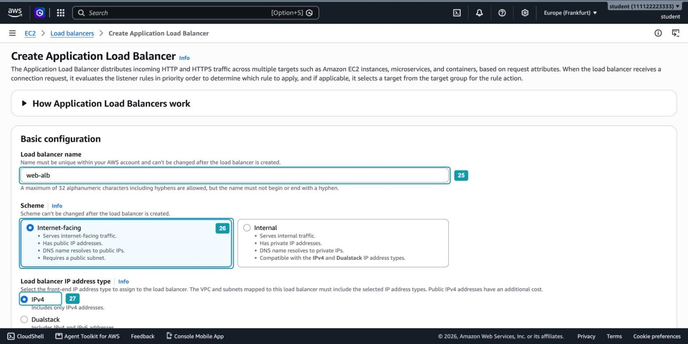

_8.1.9. Имя и схема балансировщика_

### Шаг 8. Выберите зоны и подсети

В разделе `Network mapping` оставьте default VPC и отметьте две зоны:

1. `eu-central-1a` с подсетью этой зоны (_28_).
2. `eu-central-1b` с подсетью этой зоны (_29_).

Под каждой подсетью консоль показывает `Route table: IGW (✓)` (_30_): в таблице маршрутов подсети есть маршрут в Internet Gateway, то есть подсеть публичная.

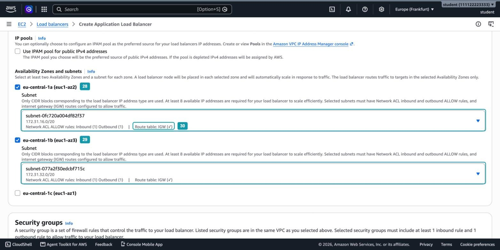

_8.1.10. Зоны и подсети балансировщика_

В каждой отмеченной зоне ELB создаст узел балансировщика, как на рисунке 8.4 главы. ALB требует минимум две зоны: если зона одна, её отказ остановит и балансировщик. Внешнему балансировщику нужны публичные подсети, иначе ответы узлов не дойдут до клиентов. Сами экземпляры могли бы находиться в приватных подсетях: узлы передают им запросы по приватным адресам.

Обратите внимание, что зоны балансировщика совпадают с зонами экземпляров. Балансировщик отправляет запросы только целям в тех зонах, которые для него включены. Если бы `web-2` работал в зоне `eu-central-1c`, которую мы не отметили, он не получал бы запросов, хотя распределение между зонами у ALB включено. Поэтому, добавляя серверы в новую зону, её включают и в балансировщике.

### Шаг 9. Выберите Security Group и настройте listener

1. В разделе `Security groups` удалите группу `default`, которую консоль подставила сама, и выберите `alb-sg` (_31_).
2. В разделе `Listeners and routing` оставьте протокол `HTTP` и порт `80` (_32_).
3. В разделе `Default action` уже выбрано `Forward to target groups` (_33_). Два других варианта, `Redirect to URL` и `Return fixed response`, соответствуют действиям `redirect` и `fixed-response` из раздела «Listener, правила и целевые группы».
4. В поле `Target group` выберите `web-tg` (_34_).

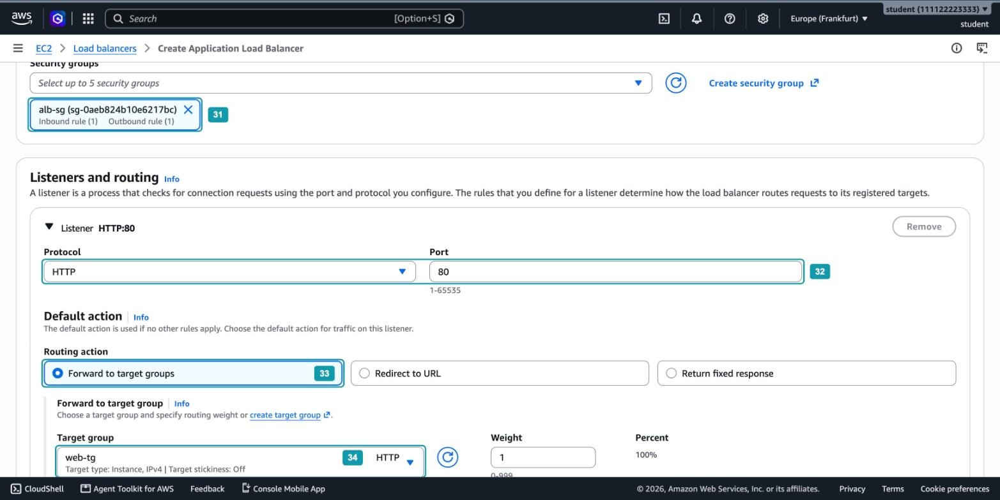

_8.1.11. Security Group и listener_

Мы настроили правило по умолчанию: все запросы на порт 80 уходят в `web-tg`. Других правил нет, поэтому маршрутизация по пути или имени хоста в этом занятии не используется.

Остальные разделы оставьте без изменений и нажмите `Create load balancer`.

### Шаг 10. Дождитесь готовности балансировщика

Консоль откроет страницу `web-alb`. Сначала в поле `Status` отображается значение `Provisioning` (_35_): AWS создаёт узлы. В поле `Availability Zones` перечислены две подсети в двух зонах (_36_), а в поле `DNS name` указан адрес балансировщика (_37_).

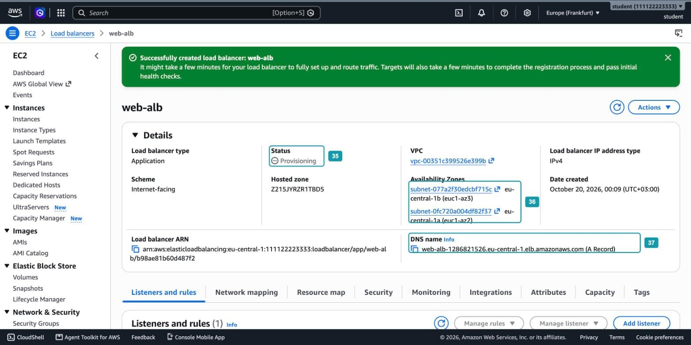

_8.1.12. Балансировщик создаётся_

Через несколько минут статус сменится на `Active`. Откройте вкладку `Resource map`. На ней показана вся цепочка, которую вы настроили:

1. Listener `HTTP:80` (_38_).
2. Правило по умолчанию `Forward to target group` (_39_).
3. Целевая группа `web-tg` с двумя целями (_40_).
4. Две цели, экземпляры `web-1` и `web-2` (на карте они показаны идентификаторами), в состоянии `Healthy` (_41_).

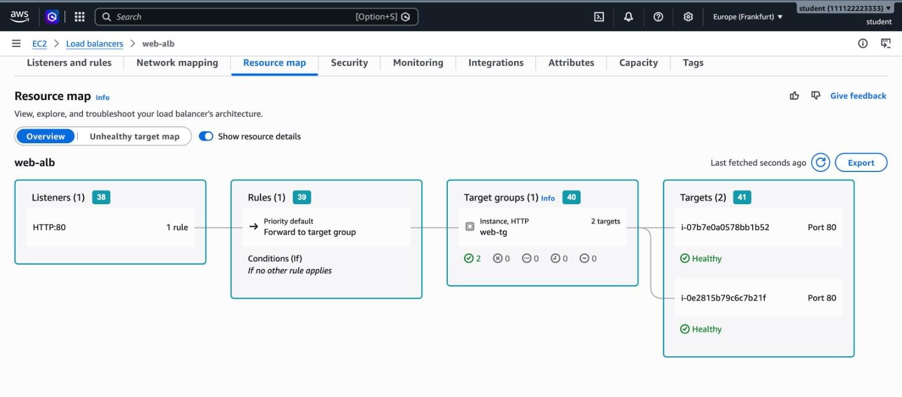

_8.1.13. Карта ресурсов балансировщика_

Если цели находятся в состоянии `Unhealthy`, проверьте, что `web-sg` пускает трафик от `alb-sg` и что скрипт user data выполнился: путь `/health` появляется только после установки nginx.

## Часть 4. Проверка

Проверять удобнее из CloudShell: из командной строки можно отправить несколько запросов подряд и сразу увидеть, какой сервер ответил. Откройте CloudShell кнопкой в нижней панели консоли и сохраните DNS-имя балансировщика в переменной:

```bash
ALB=$(aws elbv2 describe-load-balancers --names web-alb --query "LoadBalancers[0].DNSName" --output text); echo $ALB
```

> [!TIP]
> CloudShell завершает сессию после периода бездействия. Если терминал перезапустился, переменные `ALB` и `TG` пропадут: задайте их заново.

### Шаг 11. Проверьте распределение запросов

Отправьте шесть запросов на главную страницу и запрос на `/health`:

```bash
for i in 1 2 3 4 5 6; do curl -s http://$ALB/; echo; done
curl -i http://$ALB/health
```

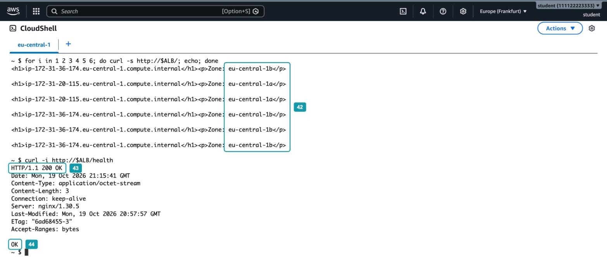

_8.1.14. Ответы двух серверов через балансировщик_

В ответах встречаются обе зоны, `eu-central-1a` и `eu-central-1b` (_42_): запросы на один адрес обслуживают два разных сервера. Ответы чередуются не строго через один. Каждый вызов `curl` открывает новое соединение и может попасть на любой из двух узлов балансировщика, а узлы выбирают цель независимо друг от друга. На большом числе запросов нагрузка делится примерно поровну.

Запрос к `/health` вернул код `200 OK` (_43_) и тело `OK` (_44_). Именно такой ответ каждые 10 секунд получают узлы балансировщика от каждого сервера.

### Шаг 12. Проверьте, что сервер недоступен напрямую

Узнайте публичный адрес `web-1` и попробуйте открыть страницу по нему:

```bash
IP=$(aws ec2 describe-instances --filters Name=tag:Name,Values=web-1 Name=instance-state-name,Values=running --query "Reservations[].Instances[].PublicIpAddress" --output text); echo $IP
curl -m 5 http://$IP/
```

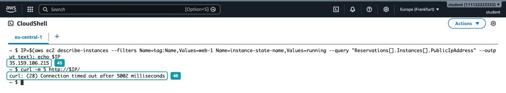

_8.1.15. Прямой запрос к серверу_

Команда вывела публичный адрес сервера (_45_), а `curl` через пять секунд завершился ошибкой `Connection timed out` (_46_). Security Group отбрасывает запрещённые пакеты молча, поэтому клиент не получает отказа и ждёт до таймаута. Через балансировщик тот же сервер отвечает, а напрямую нет: цепочка `alb-sg` и `web-sg` работает.

### Шаг 13. Остановите один сервер

Смоделируем отказ сервера. Откройте в новой вкладке консоль EC2, выберите `web-1` и нажмите `Instance state`, затем `Stop instance`. Подождите около минуты и повторите запросы в CloudShell. Чтобы вывод был короче, оставим в ответе только зону:

```bash
for i in $(seq 1 6); do curl -s -m 3 http://$ALB/ | grep -o 'Zone: [a-z0-9-]*'; done
```

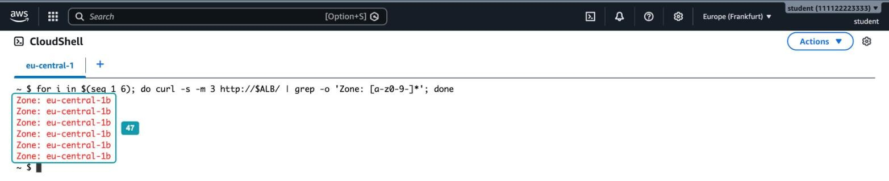

_8.1.16. Все ответы из одной зоны_

Все ответы пришли из `eu-central-1b` (_47_). Пользователь по-прежнему получает страницу, хотя один из двух серверов выключен.

Если отправлять запросы сразу после нажатия `Stop instance`, часть из них не вернёт страницу. Пока сервер выключается, балансировщик ещё считает его исправным и отправляет на него запросы. В выводе таких запросов строки с зоной не будет: балансировщик вернёт ошибку 5xx или `curl` прервёт запрос по ограничению `-m 3`. Это и есть окно из раздела «Проверки работоспособности»: время, за которое пороги и интервал позволяют заметить отказ.

Откройте целевую группу `web-tg`, вкладку `Targets`. У `web-2` состояние `Healthy` (_48_), у `web-1` состояние `Unused` (_49_), а в столбце `Health status details` указано пояснение `Target is in the stopped state`.

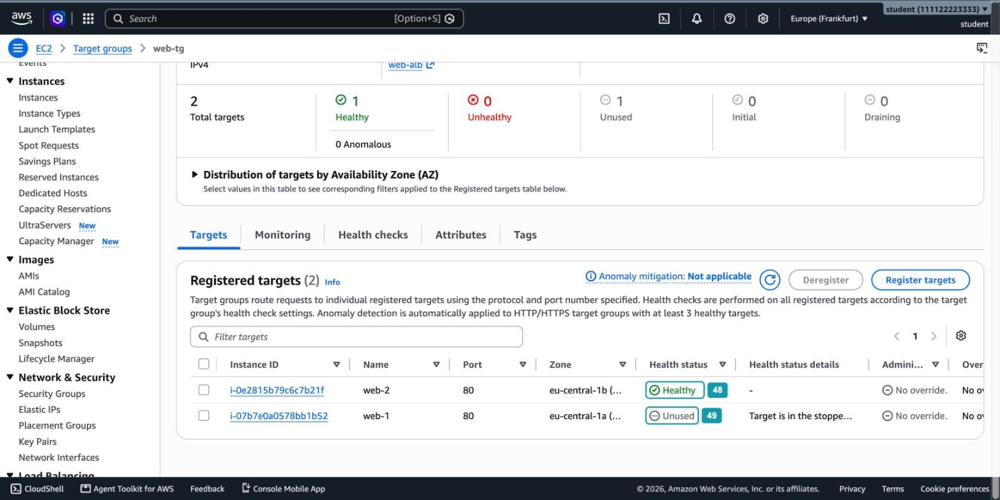

_8.1.17. Состояние целей после остановки web-1_

Почему `unused`, а не `unhealthy`? Остановленный экземпляр не может служить целью, и балансировщик даже не пытается его проверять. Состояние `unhealthy` получает работающий экземпляр, который не прошёл проверку. Такое состояние вы увидите в шаге 14.

Теперь запустите `web-1` снова: `Instance state`, затем `Start instance`. Когда экземпляр загрузится, nginx запустится сам: при установке мы включили его автозапуск командой `systemctl enable`. После двух успешных проверок цель вернётся в работу. Проверьте состояние целей из CloudShell и повторите запросы:

```bash
TG=$(aws elbv2 describe-target-groups --names web-tg --query "TargetGroups[0].TargetGroupArn" --output text)
aws elbv2 describe-target-health --target-group-arn $TG --query "TargetHealthDescriptions[].[Target.Id,TargetHealth.State]" --output text
for i in $(seq 1 6); do curl -s -m 3 http://$ALB/ | grep -o 'Zone: [a-z0-9-]*'; done
```

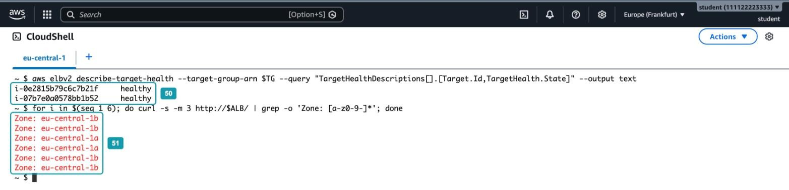

_8.1.18. Сервер вернулся в работу_

Обе цели снова в состоянии `healthy` (_50_), и в ответах опять встречаются обе зоны (_51_). Вы ничего не меняли в балансировщике: сервер вернулся в работу сам, как только начал проходить проверки.

### Шаг 14. Сломайте проверку на всех серверах

Остался последний случай из главы: что будет, если проверку провалят все цели сразу? Чтобы не ломать серверы, изменим путь проверки на несуществующий. nginx будет отвечать на него кодом 404:

```bash
aws elbv2 modify-target-group --target-group-arn $TG --health-check-path /missing --query "TargetGroups[0].HealthCheckPath" --output text
```

То же самое можно сделать в консоли: вкладка `Health checks` целевой группы, кнопка `Edit`. Подождите полминуты, проверьте состояние целей и повторите запросы:

```bash
aws elbv2 describe-target-health --target-group-arn $TG --query "TargetHealthDescriptions[].[Target.Id,TargetHealth.State,TargetHealth.Reason]" --output text
for i in $(seq 1 6); do curl -s -m 3 http://$ALB/ | grep -o 'Zone: [a-z0-9-]*'; done
```

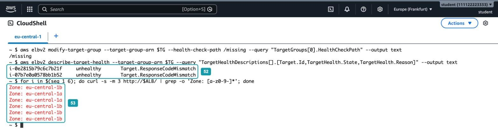

_8.1.19. Fail open_

Обе цели находятся в состоянии `unhealthy` с причиной `Target.ResponseCodeMismatch` (_52_): сервер ответил, но не кодом 200. При этом страницы приходят от обоих серверов (_53_). Это fail open: когда исправных целей не осталось, ALB отправляет запросы на все цели. Если бы проверка зависела от базы данных и база замедлилась, магазин продолжил бы обслуживать запросы, хотя и медленнее, а не стал бы недоступен целиком.

Верните правильный путь проверки:

```bash
aws elbv2 modify-target-group --target-group-arn $TG --health-check-path /health --query "TargetGroups[0].HealthCheckPath" --output text
```

> [!IMPORTANT]
> Fail open не является поводом игнорировать неисправные цели. Балансировщик в этом режиме отправляет запросы и на действительно сломанные серверы, а состояние `unhealthy` у всех целей означает, что проверка или приложение требуют внимания.

## Часть 5. Удаление ресурсов

Если вы сразу переходите к Hands-on 8.2, удалите только экземпляры `web-1` и `web-2`: в следующем занятии серверы будет запускать группа Auto Scaling. Балансировщик `web-alb`, целевую группу `web-tg` и обе Security Group оставьте. Балансировщик тем временем продолжает оплачиваться, поэтому переходите к Hands-on 8.2 в тот же день.

Если вы не переходите к нему, удалите все ресурсы. Ресурсы ссылаются друг на друга, поэтому порядок важен:

1. Удалите балансировщик: `Load Balancers`, выберите `web-alb`, `Actions`, `Delete load balancer`, введите `confirm`.
2. Удалите экземпляры: `Instances`, выберите `web-1` и `web-2`, `Instance state`, `Terminate (delete) instance`.
3. Удалите целевую группу: `Target Groups`, выберите `web-tg`, `Actions`, `Delete`. Пока группу использует listener балансировщика, удалить её нельзя.
4. Удалите Security Group: сначала `web-sg`, затем `alb-sg`. Группу `web-sg` можно удалить только после того, как оба экземпляра перейдут в состояние `Terminated`. Группу `alb-sg` нельзя удалить, пока на неё ссылается правило в `web-sg` и пока она привязана к сетевым интерфейсам балансировщика. Если консоль сообщает о зависимостях, подождите несколько минут: интерфейсы освобождаются не сразу.

Проверьте, что в `Load Balancers` и `Target Groups` пусто, а в `Instances` экземпляры находятся в состоянии `Terminated`.

## Вопросы для самопроверки

1. Почему в правиле `web-sg` источником указана группа `alb-sg`, а не диапазон адресов подсетей балансировщика?
2. Почему прямой запрос к публичному адресу сервера завершился таймаутом, а не ошибкой «соединение отклонено»?
3. Почему цели только что созданной целевой группы находились в состоянии `unused`?
4. Сколько времени займёт исключение неисправного сервера при интервале 10 секунд и пороге неисправности 2? А со значениями по умолчанию? Чем приходится платить за более короткий интервал?
5. Что произойдёт, если запустить третий сервер в зоне `eu-central-1c`, которая не отмечена в балансировщике? Будет ли он получать запросы?
6. Почему остановленный `web-1` оказался в состоянии `unused`, а при неверном пути проверки цели перешли в `unhealthy`?
7. Почему при неверном пути проверки страницы продолжали открываться? Какую проблему решает такое поведение и какую создаёт?
8. Почему проверка балансировщика обращается к `/health`, а не к главной странице `/`?
