# Hands-on 8.2. Группа Auto Scaling

В Hands-on 8.1 за балансировщиком работали два сервера, которые вы запустили вручную. Когда один из них остановился, балансировщик перестал отправлять на него запросы, но вернуть сервер в работу пришлось вам. В разделе «Amazon EC2 Auto Scaling» эту работу передают группе Auto Scaling: она сама запускает экземпляры по шаблону, регистрирует их в целевой группе, добавляет новые при росте нагрузки и заменяет отказавшие.

В этом занятии вы поставите группу за балансировщик `web-alb` из Hands-on 8.1, нагрузите процессоры серверов и посмотрите, как политика target tracking увеличит группу, а после нагрузки сократит её. Затем удалите один экземпляр вручную и проверите, что группа его заменит.

## Что получится в конце

- Роль IAM `web-ssm-role`, через которую экземпляры подключаются к AWS Systems Manager. С его помощью вы запустите нагрузку на серверах без SSH.
- Шаблон запуска `web-lt` с тем же веб-сервером, что в Hands-on 8.1.
- Группа Auto Scaling `web-asg` в зонах `eu-central-1a` и `eu-central-1b`: от 2 до 4 экземпляров, политика target tracking со средней загрузкой процессора 50%.
- Группа присоединена к целевой группе `web-tg` и сама регистрирует в ней свои экземпляры, поэтому запросы к `web-alb` обслуживают именно они.

## Перед началом

- Вы прошли Hands-on 8.1. Балансировщик `web-alb`, целевая группа `web-tg` и группы безопасности `alb-sg` и `web-sg` существуют, а экземпляры `web-1` и `web-2` удалены.
- В целевой группе `web-tg` снова задан путь проверки `/health` (последняя команда шага 14 Hands-on 8.1). Иначе группа с включёнными проверками ELB будет бесконечно заменять экземпляры.
- Вы помните из главы 4, что такое роль IAM и instance profile.
- Вы работаете в регионе `Europe (Frankfurt)`.
- Закладывайте на занятие около полутора часов. Большую часть времени занимает ожидание: группе нужно несколько минут, чтобы вырасти, и около двадцати минут, чтобы сократиться.

> [!WARNING]
> Кроме балансировщика, оплачиваются экземпляры группы, их публичные IPv4-адреса, детальный мониторинг и тревоги CloudWatch (раздел «Стоимость»). Во время нагрузочного теста в группе четыре экземпляра. Экземпляры t3 по умолчанию работают в режиме unlimited: при длительной загрузке процессора выше базового уровня оплачиваются дополнительные кредиты. За время теста это небольшая сумма, но часть 6 с удалением ресурсов обязательна.

## Часть 1. Подготовка

### Шаг 1. Создайте роль для экземпляров

Чтобы нагрузить процессоры серверов, на них нужно выполнить команду. Подключаться по SSH к каждому экземпляру группы неудобно: экземпляры появляются и исчезают, а ключей у них нет. Вместо этого воспользуемся AWS Systems Manager. На Amazon Linux 2023 уже установлен агент Systems Manager. Он сам подключается к сервису, получает команды и выполняет их, а открывать входящие порты для этого не требуется. Но агенту нужны права, и экземпляр получит их через роль IAM, как в разделе «Instance profile» главы 4.

Откройте сервис `IAM`, затем `Roles`, и нажмите `Create role`:

1. В разделе `Trusted entity type` выберите `AWS service` (_1_).
2. В поле `Service or use case` выберите `EC2` (_2_).
3. В разделе `Use case` выберите `EC2` (_3_).

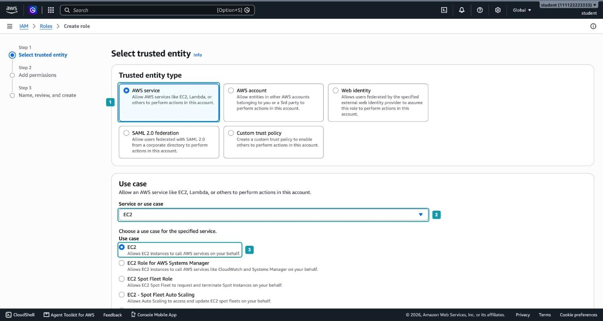

_8.2.1. Доверенная сущность роли_

Ниже в списке есть вариант `EC2 Role for AWS Systems Manager`, который сразу подставит нужную политику. Мы выбираем обычный `EC2` и добавляем политику сами, чтобы было видно, из чего состоит роль.

Нажмите `Next`. В строке поиска введите `AmazonSSMManagedInstanceCore` и отметьте эту политику (_4_). Это управляемая политика AWS (_5_), то есть её поддерживает сам AWS. Она содержит права для основных функций Systems Manager: регистрации агента и получения команд.

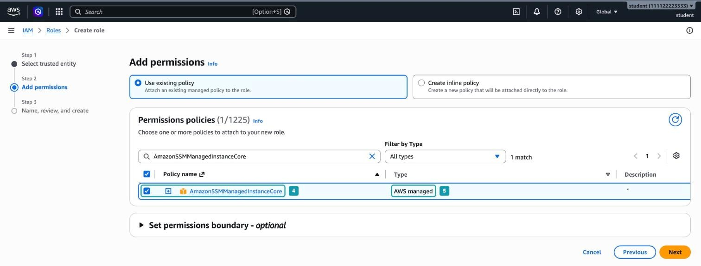

_8.2.2. Политика разрешений роли_

Нажмите `Next`. В поле `Role name` введите `web-ssm-role` (_6_). Ниже консоль показывает политику доверия, которую она составила: разрешение на действие `sts:AssumeRole` (_7_) для сервиса `ec2.amazonaws.com` (_8_). Это и есть ответ на вопрос, кто может принимать роль: экземпляры EC2, и больше никто. Нажмите `Create role`. Вместе с ролью консоль создаст instance profile с тем же именем.

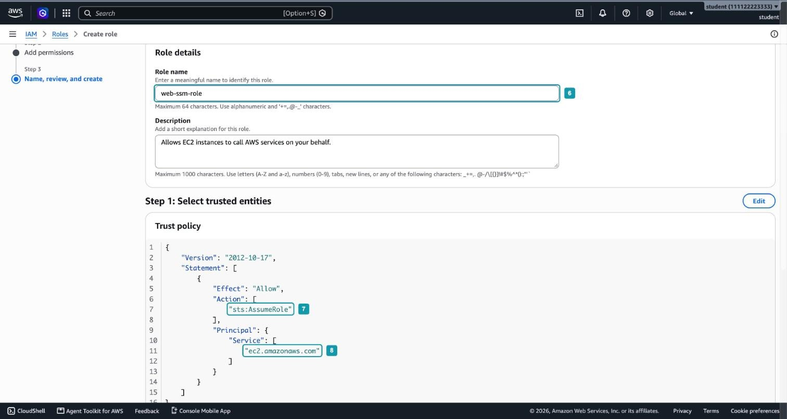

_8.2.3. Имя и политика доверия роли_

### Шаг 2. Уменьшите задержку отмены регистрации

Когда группа удаляет экземпляр, она сначала отменяет его регистрацию в целевой группе, а балансировщик переводит цель в состояние `draining` и ждёт завершения начатых запросов (раздел «Отмена регистрации и завершение запросов»). По умолчанию ожидание длится 300 секунд, и каждое сокращение группы растянулось бы на пять минут.

Откройте целевую группу `web-tg`, вкладку `Attributes`, и нажмите `Edit`. В поле `Deregistration delay (draining interval)` введите `30` (_9_) и сохраните изменения.

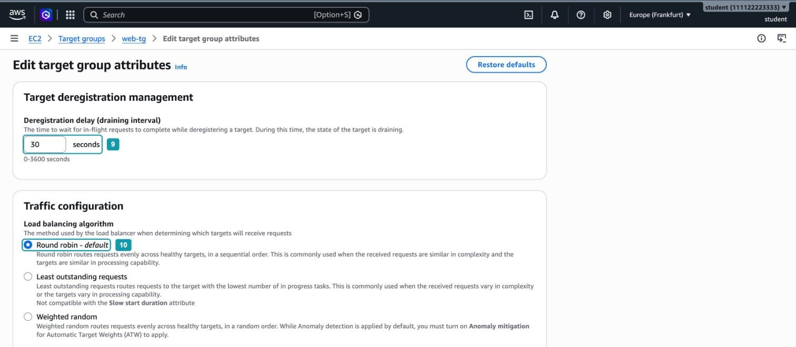

_8.2.4. Задержка отмены регистрации_

Наш сервер отдаёт статический файл за миллисекунды, и 30 секунд хватит с большим запасом. Для настоящего приложения задержку выбирают по самому долгому запросу: если загрузка файла может длиться две минуты, 30 секунд оборвут её. На этой же странице видно, что в целевой группе используется алгоритм балансировки `Round robin` (_10_), как говорилось в разделе «Listener, правила и целевые группы».

## Часть 2. Шаблон запуска

### Шаг 3. Задайте имя шаблона

Группа будет запускать экземпляры без вас, поэтому все их параметры нужно заранее сохранить в шаблоне запуска. Откройте `EC2`, затем `Launch Templates`, и нажмите `Create launch template`:

1. В поле `Launch template name` введите `web-lt` (_11_), в поле `Template version description` кратко опишите версию, например `nginx web server for web-asg`.
2. Отметьте `Provide guidance to help me set up a template that I can use with EC2 Auto Scaling` (_12_). Консоль отметит поля, обязательные для группы, и сделает недоступными те, которые группа задаёт сама, например `Availability Zone` на рисунке 8.2.7.

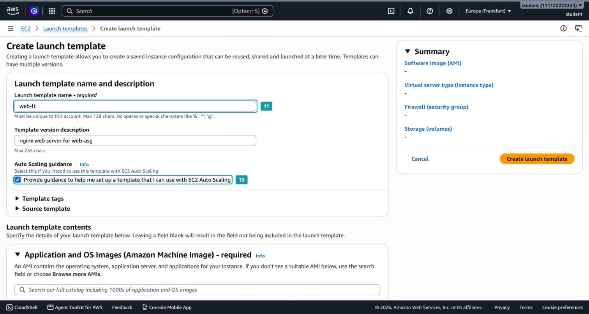

_8.2.5. Имя шаблона запуска_

### Шаг 4. Выберите образ, тип и пару ключей

1. В разделе `Application and OS Images` выберите `Quick Start`, затем `Amazon Linux`. Консоль подставит Amazon Linux 2023 (_13_).
2. В поле `Instance type` выберите `t3.micro` (_14_).
3. В поле `Key pair name` оставьте `Don't include in launch template` (_15_): подключаться по SSH мы не будем.

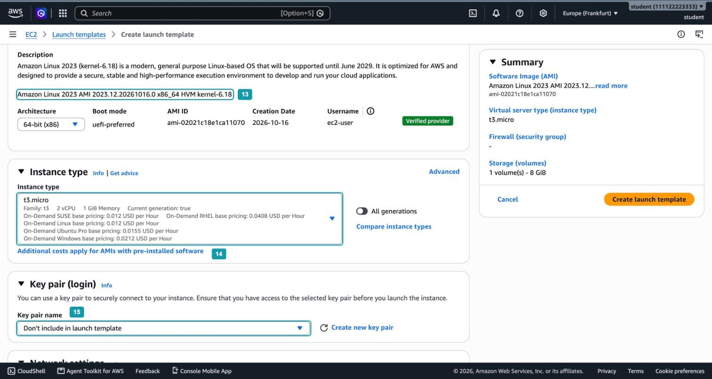

_8.2.6. Образ, тип экземпляра и пара ключей_

### Шаг 5. Настройте сеть

1. В поле `Subnet` оставьте `Don't include in launch template` (_16_). Подсети выберет группа: шаблон описывает, каким должен быть экземпляр, а группа решает, где его запустить. Даже если указать подсеть в шаблоне, группа запустит экземпляры в подсетях из собственных настроек. Поэтому поле `Availability Zone` ниже недоступно и помечено `Not applicable for EC2 Auto Scaling`.
2. В поле `Security groups` выберите `web-sg` (_17_). Цепочка `alb-sg` и `web-sg` из Hands-on 8.1 продолжает работать: экземпляры группы принимают HTTP только от балансировщика.

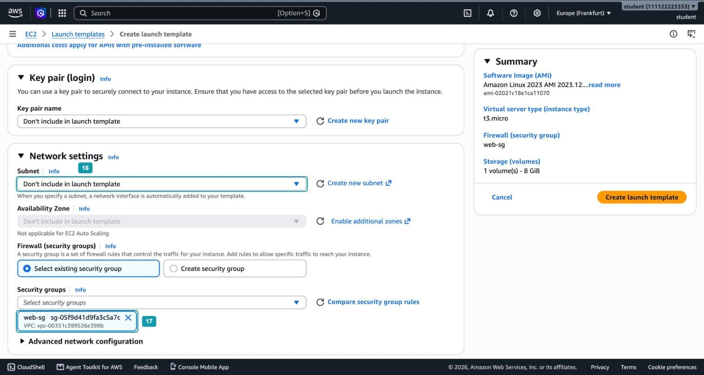

_8.2.7. Сетевые настройки шаблона_

Публичный IP-адрес экземпляры получат, потому что в подсетях default VPC включено автоматическое назначение публичных адресов. Адрес нужен им, чтобы скачать nginx и подключиться к Systems Manager.

### Шаг 6. Задайте роль, мониторинг и user data

Раскройте `Advanced details`.

1. В поле `IAM instance profile` выберите `web-ssm-role` (_18_).

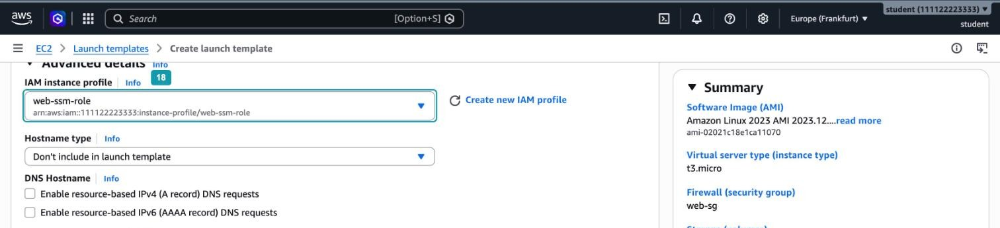

_8.2.8. Роль экземпляров в шаблоне_

2. В поле `Detailed CloudWatch monitoring` выберите `Enable` (_19_). Консоль предупреждает, что детальный мониторинг оплачивается отдельно.
3. В поле `Credit specification` оставьте `Don't include in launch template` (_20_). Тогда действует значение по умолчанию: для t3 это режим unlimited, о котором говорилось в предупреждении в начале занятия. В режиме standard экземпляр, израсходовав кредиты, работал бы с базовой производительностью, и нагрузочный тест перестал бы загружать процессор полностью.

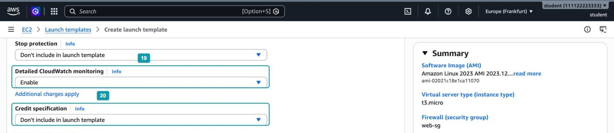

_8.2.9. Детальный мониторинг_

Детальный мониторинг нужен из-за особенностей работы политики. С ним экземпляры отправляют метрики раз в минуту, а не раз в пять минут (раздел «Метрики»), и тревога, которая ждёт три точки подряд, сработает через три минуты, а не через пятнадцать.

4. В поле `User data` вставьте скрипт (_21_):

```bash
#!/bin/bash
dnf install -y nginx
dnf install -y stress-ng
TOKEN=$(curl -s -X PUT "http://169.254.169.254/latest/api/token" -H "X-aws-ec2-metadata-token-ttl-seconds: 300")
AZ=$(curl -s -H "X-aws-ec2-metadata-token: $TOKEN" http://169.254.169.254/latest/meta-data/placement/availability-zone)
echo "<h1>$(hostname)</h1><p>Zone: $AZ</p>" > /usr/share/nginx/html/index.html
echo "OK" > /usr/share/nginx/html/health
systemctl enable --now nginx
```

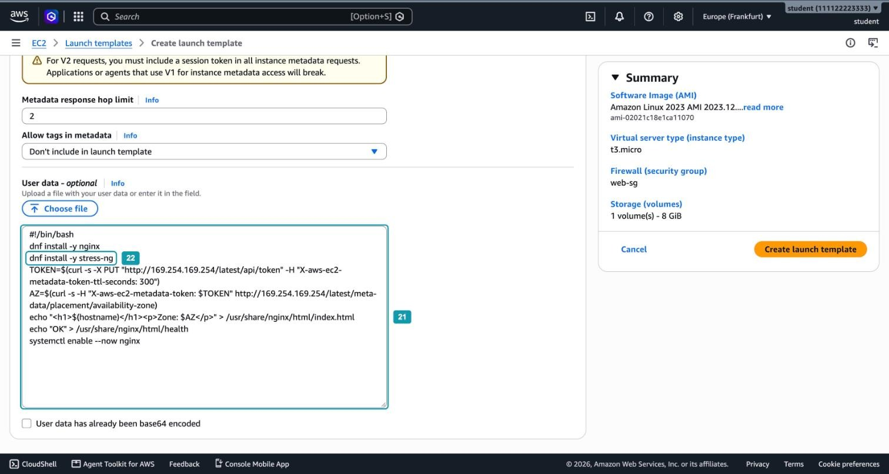

_8.2.10. User data шаблона_

Это скрипт из Hands-on 8.1 с одной новой строкой (_22_): она устанавливает утилиту `stress-ng`, которой мы позже нагрузим процессор. Команда вынесена отдельно, чтобы её ошибка не помешала установке nginx.

Нажмите `Create launch template`.

## Часть 3. Группа Auto Scaling

### Шаг 7. Выберите шаблон

Откройте `Auto Scaling Groups` и нажмите `Create Auto Scaling group`:

1. В поле `Auto Scaling group name` введите `web-asg` (_23_).
2. В поле `Launch template` выберите `web-lt` (_24_).
3. В поле `Version` оставьте `Default (1)` (_25_).

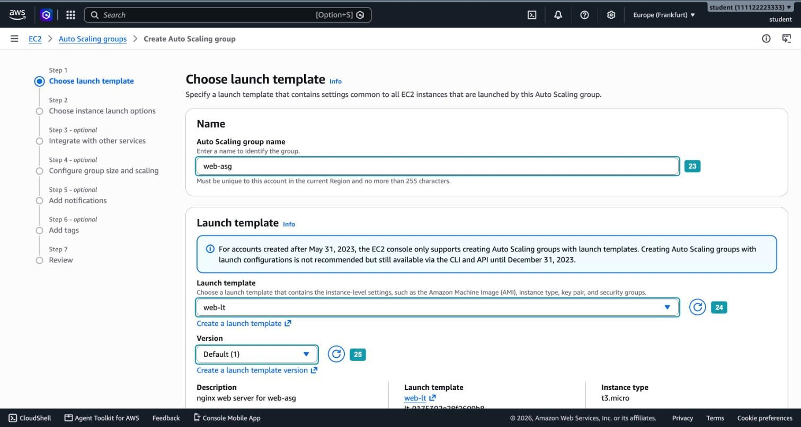

_8.2.11. Шаблон для группы_

Версия шаблона определяет, с какими параметрами будут запускаться новые экземпляры. `Default` - версия, отмеченная в шаблоне как версия по умолчанию (у нового шаблона это версия 1). `Latest` - последняя созданная версия. С `Latest` любая новая версия шаблона, в том числе ошибочная, сразу начнёт применяться к новым экземплярам группы. С `Default` новая версия применяется только после того, как её явно назначат версией по умолчанию. Уже работающие экземпляры не меняются ни в одном из случаев (раздел «Шаблон запуска»).

Нажмите `Next`.

### Шаг 8. Выберите подсети

В поле `VPC` оставьте default VPC (_26_), в поле `Availability Zones and subnets` выберите подсети зон `eu-central-1a` и `eu-central-1b` (_27_).

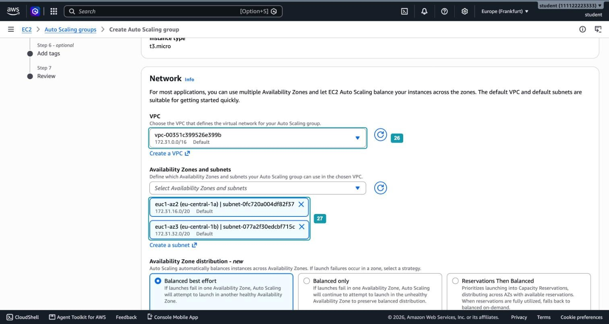

_8.2.12. Подсети группы_

Рядом с именем зоны консоль показывает её идентификатор, например `euc1-az2`. Группа распределяет экземпляры между выбранными зонами поровну (раздел «Основные характеристики Amazon EC2 Auto Scaling»).

Нажмите `Next`.

### Шаг 9. Подключите группу к балансировщику

1. В разделе `Load balancing` выберите `Attach to an existing load balancer` (_28_).
2. В поле `Existing load balancer target groups` выберите `web-tg` (_29_).

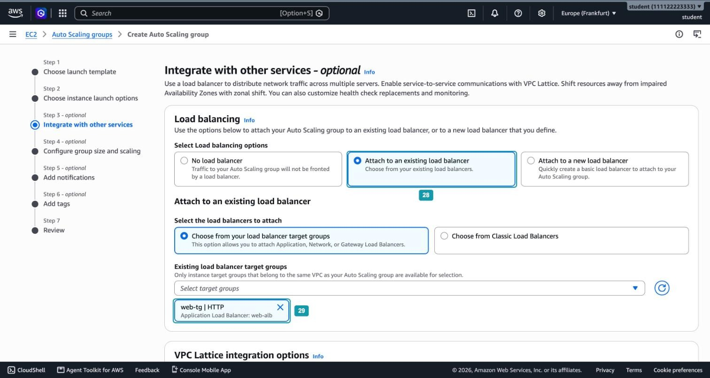

_8.2.13. Подключение к целевой группе_

Как говорилось в разделе «Связь с балансировщиком», к группе присоединяют не сам балансировщик, а его целевую группу. После этого группа сама регистрирует свои экземпляры в `web-tg`, и список целей больше не нужно вести вручную.

Ниже, в разделе `Health checks`:

1. Проверки EC2 включены всегда (_30_).
2. Отметьте `Turn on Elastic Load Balancing health checks` (_31_).
3. В поле `Health check grace period` оставьте `300` секунд (_32_).

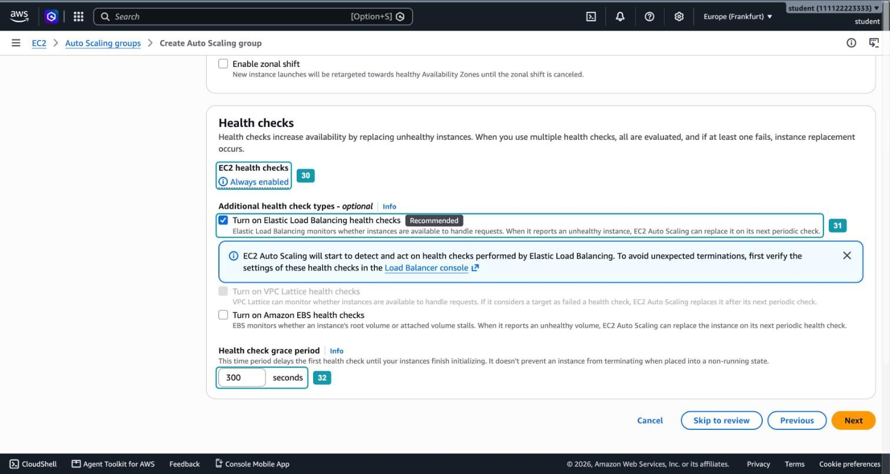

_8.2.14. Проверки работоспособности группы_

Без проверок ELB группа видит лишь то, работает ли виртуальная машина. Если на экземпляре упадёт nginx, балансировщик перестанет отправлять на него запросы, но группа не заменит его (раздел «Проверки работоспособности и замена экземпляров»). Период отсрочки даёт новому экземпляру пять минут на загрузку и установку nginx: всё это время проваленные проверки ELB не приведут к замене. Однако остановленный или удалённый экземпляр отсрочка не защищает: вы увидите это в шаге 17.

Нажмите `Next`.

### Шаг 10. Задайте размер и политику масштабирования

1. В поле `Desired capacity` введите `2` (_33_).
2. В поле `Min desired capacity` введите `2` (_34_), в поле `Max desired capacity` введите `4` (_35_).

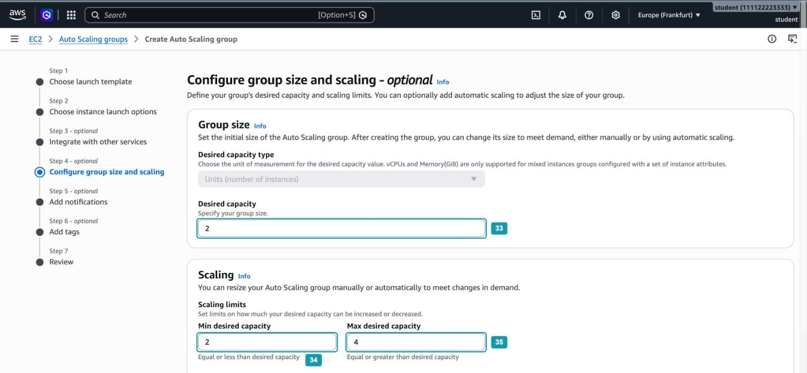

_8.2.15. Размер группы_

Минимум 2 сохраняет по экземпляру в каждой зоне даже ночью, а максимум 4 ограничивает расходы на время теста.

В разделе `Automatic scaling`:

1. Выберите `Target tracking scaling policy` (_36_) и в поле `Scaling policy name` введите `cpu-50`.
2. В поле `Metric type` оставьте `Average CPU utilization` (_37_).
3. В поле `Target value` оставьте `50` (_38_).
4. В поле `Instance warmup` введите `60` секунд (_39_).

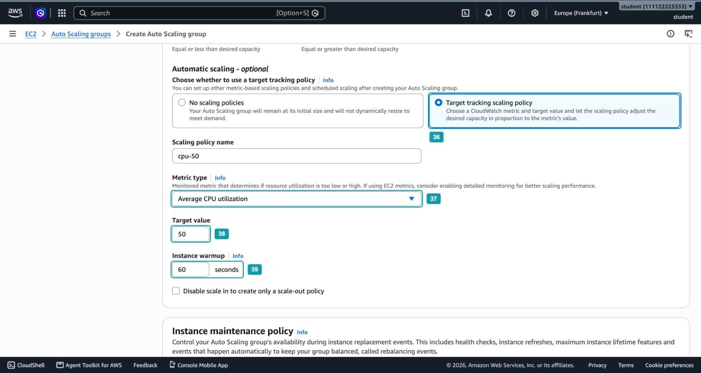

_8.2.16. Политика target tracking_

Политика будет держать среднюю загрузку процессора экземпляров группы около 50%. Над полем метрики консоль советует включить детальный мониторинг, и мы уже сделали это в шаблоне. Прогрев 60 секунд означает, что в течение первой минуты после запуска метрики нового экземпляра не входят в среднее значение группы (раздел «Политика target tracking»). В главе описана настройка группы `Default instance warmup`: она видна на рисунке 8.2.17 и действует сразу на все политики. Поле `Instance warmup` задаёт прогрев только для этой политики. Если его не заполнить, политика использует прогрев группы, а если он не включён, то 300 секунд. Наш сервер готов примерно через минуту, поэтому 300 секунд здесь было бы слишком много.

Прокрутите страницу вниз и в разделе `Additional settings` отметьте `Enable group metrics collection within CloudWatch` (_40_). Группа начнёт отправлять в CloudWatch метрики о своём размере, и на вкладке `Monitoring` появятся графики числа экземпляров.

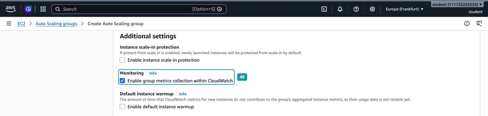

_8.2.17. Метрики группы_

Нажмите `Skip to review`, проверьте параметры и нажмите `Create Auto Scaling group`.

### Шаг 11. Убедитесь, что политика создана

Если в аккаунте раньше не создавали групп Auto Scaling, вы можете увидеть две плашки: группа создана, а политику создать не удалось (_41_). Сообщение объясняет причину: у EC2 Auto Scaling ещё нет _роли, связанной с сервисом (service-linked role)_. Это роль `AWSServiceRoleForAutoScaling`, через которую сервис запускает экземпляры и управляет тревогами от вашего имени. AWS создаёт её автоматически вместе с первой группой, но новая роль становится доступной не сразу. Статус группы `Updating capacity` (_42_), желаемый размер 2 (_43_), экземпляров пока нет.

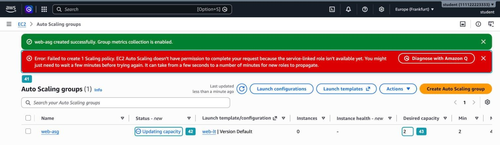

_8.2.18. Группа создана, политика нет_

Если ошибки нет, переходите к шагу 12. Если есть, подождите несколько минут и создайте политику заново. Откройте группу `web-asg`, вкладку `Automatic scaling`, и нажмите `Create dynamic scaling policy`. Задайте те же значения, что и в шаге 10: тип `Target tracking scaling` (_44_), имя `cpu-50` (_45_), метрика `Average CPU utilization` (_46_), цель `50` (_47_), прогрев `60` секунд (_48_).

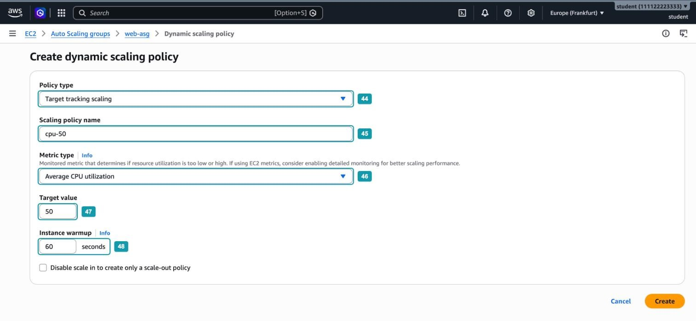

_8.2.19. Политика, созданная вручную_

### Шаг 12. Проверьте экземпляры группы

Откройте вкладку `Activity`. В `Activity history` две успешные записи о запуске экземпляров (_49_), а в столбце `Cause` приведено объяснение (_50_): пользователь создал группу с желаемым размером 2, а экземпляров в ней 0, и группа запускает недостающие. Это и есть основное правило из раздела «Размер группы»: группа приводит число экземпляров в соответствие с желаемым размером.

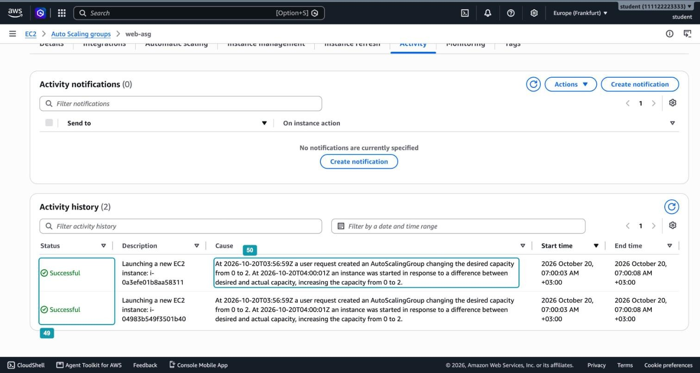

_8.2.20. История действий группы_

В нашем аккаунте между созданием группы и запуском экземпляров прошло три минуты: по-видимому, группа ждала, пока роль, связанная с сервисом, станет доступной. Обычно экземпляры запускаются через несколько секунд.

Откройте вкладку `Instance management`. Статус группы `At desired capacity` (_51_). Оба экземпляра в состоянии `InService` (_52_), в разных зонах (_53_) и исправны (_54_).

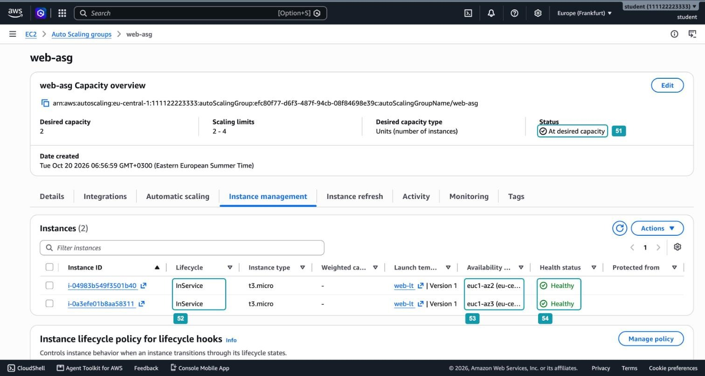

_8.2.21. Экземпляры группы_

## Часть 4. Нагрузочный тест

### Шаг 13. Проверьте балансировщик и агент Systems Manager

Откройте CloudShell, сохраните DNS-имя балансировщика в переменной и отправьте несколько запросов. Команда `sed` убирает из ответа HTML-теги, чтобы в выводе остались только имя сервера и зона:

```bash
ALB=$(aws elbv2 describe-load-balancers --names web-alb --query "LoadBalancers[0].DNSName" --output text)
for i in $(seq 1 6); do curl -s -m 3 http://$ALB/ | sed 's/<[^>]*>/ /g'; done
aws ssm describe-instance-information --query "InstanceInformationList[].[InstanceId,PingStatus]" --output text
```

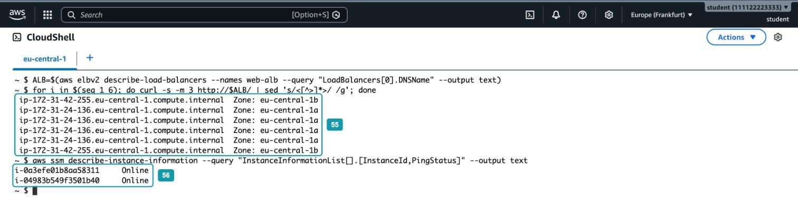

_8.2.22. Ответы экземпляров группы и агенты Systems Manager_

Отвечают два новых сервера из разных зон (_55_). Вы не регистрировали их в целевой группе: это сделала группа Auto Scaling. Последняя команда показывает, что агенты на обоих экземплярах подключились к Systems Manager и находятся в состоянии `Online` (_56_). Если список пуст, подождите минуту: агенту нужно время после загрузки экземпляра.

### Шаг 14. Нагрузите процессоры

Отправьте команду на все экземпляры группы:

```bash
aws ssm send-command \
  --document-name AWS-RunShellScript \
  --targets Key=tag:aws:autoscaling:groupName,Values=web-asg \
  --parameters 'commands=["stress-ng --cpu 0 --timeout 15m"]' \
  --query "Command.[CommandId,Status]" --output text
```

Разберём команду:

- *`AWS-RunShellScript`*. Готовый документ Systems Manager, который выполняет команды оболочки на Linux.
- *`--targets`*. Экземпляры выбираются по тегу. Группа Auto Scaling ставит каждому своему экземпляру тег `aws:autoscaling:groupName` с именем группы, поэтому команда попадёт на все экземпляры `web-asg`, которые работают в момент отправки.
- *`stress-ng --cpu 0 --timeout 15m`*. Запустить нагрузочные процессы по одному на каждый vCPU (так понимается значение `0`) и остановить их через 15 минут.

Команда вернула идентификатор и состояние `Pending` (_57_). Сохраните идентификатор в переменной и проверьте выполнение на экземплярах:

```bash
CMD=<идентификатор команды>
aws ssm list-command-invocations --command-id $CMD --query "CommandInvocations[].[InstanceId,Status]" --output text
```

На обоих экземплярах команда в состоянии `InProgress` (_58_): `stress-ng` запущен и проработает 15 минут.

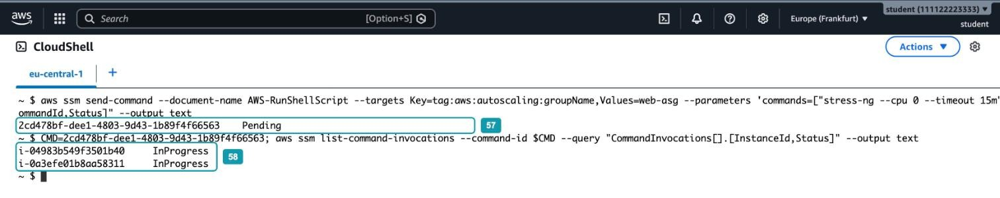

_8.2.23. Запуск нагрузки_

### Шаг 15. Посмотрите на метрику и тревогу

Подождите три-четыре минуты и посмотрите среднюю загрузку процессора группы по минутам и состояние тревог политики:

```bash
aws cloudwatch get-metric-statistics --namespace AWS/EC2 --metric-name CPUUtilization \
  --dimensions Name=AutoScalingGroupName,Value=web-asg \
  --start-time $(date -u -d '-10 min' +%FT%TZ) --end-time $(date -u +%FT%TZ) \
  --period 60 --statistics Average \
  --query "sort_by(Datapoints,&Timestamp)[].[Timestamp,Average]" --output text
aws cloudwatch describe-alarms --alarm-name-prefix TargetTracking-web-asg --query "MetricAlarms[].[AlarmName,StateValue]" --output text
```

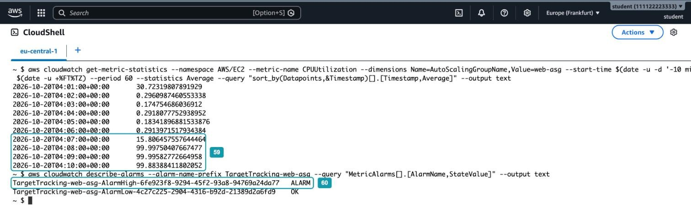

_8.2.24. Загрузка процессора и тревога_

До начала нагрузки процессоры почти не работали, а после её начала средняя загрузка группы держится около 100% (_59_). Точки идут раз в минуту: это результат детального мониторинга. Тревога с `AlarmHigh` в имени перешла в состояние `ALARM` (_60_).

Эти тревоги вы не создавали: их создала политика `cpu-50` (раздел «Политика target tracking»). Посмотрите, как они настроены:

```bash
aws cloudwatch describe-alarms --alarm-name-prefix TargetTracking-web-asg \
  --query "MetricAlarms[].[StateValue,ComparisonOperator,Threshold,Period,EvaluationPeriods,DatapointsToAlarm]" --output text
```

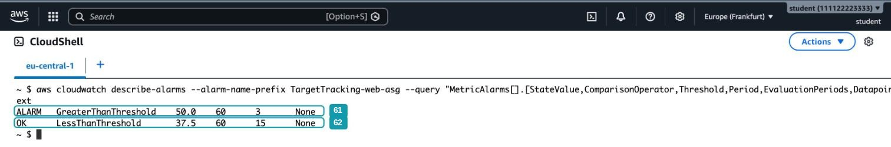

_8.2.25. Пороги тревог политики_

Тревога на рост (_61_) срабатывает, если загрузка выше 50% три минутные точки подряд. Тревога на сокращение (_62_) срабатывает, если загрузка ниже 37,5% пятнадцать точек подряд, то есть четверть часа. В этой асимметрии и выражается правило из раздела «Политика target tracking»: группа растёт быстро, а сокращается осторожно. Значение `None` в последнем столбце означает, что параметр «число точек для срабатывания» не задан и равен числу периодов.

### Шаг 16. Посмотрите, как выросла группа

Откройте группу `web-asg`, вкладку `Activity`. Появились две новые записи (_63_): экземпляры запущены и находятся в состоянии `Waiting for instance warmup`, то есть ещё не учитываются в средней загрузке. В столбце `Cause` указано (_64_), что тревога `AlarmHigh` в состоянии `ALARM` запустила политику `cpu-50`, и та изменила желаемый размер с 2 на 4.

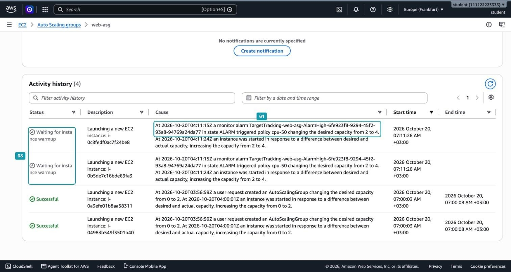

_8.2.26. Группа выросла до четырёх экземпляров_

Почему сразу до четырёх, а не на один экземпляр? Политика считает так же, как в примере из раздела «Политика target tracking»: при загрузке 100% двух экземпляров, чтобы получить 50%, нужно 2 × 100 / 50 = 4 экземпляра. Максимум группы тоже 4, так что больше она вырасти и не смогла бы.

Откройте целевую группу `web-tg`, вкладку `Targets`. В группе четыре исправные цели (_65_), по две в каждой зоне (_66_). В столбце `Name` прочерк: экземплярам группы мы не задали тег `Name`. Его можно добавить на шаге `Add tags` мастера группы, и группа будет ставить его всем экземплярам.

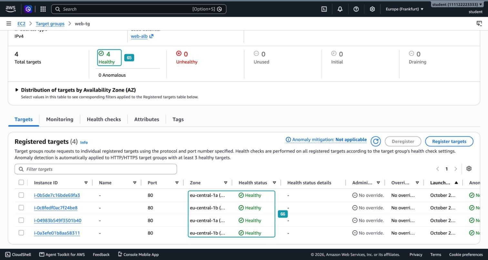

_8.2.27. Четыре цели в целевой группе_

Посчитаем, что стало со средней загрузкой. Нагрузку получили только два первых экземпляра: команда `send-command` выполнялась только на тех, которые работали в момент отправки. Новые экземпляры простаивают, и средняя загрузка группы составила (100 + 100 + 0 + 0) / 4 = 50%, ровно целевое значение. В настоящем приложении нагрузку создают запросы пользователей, и балансировщик распределил бы их и на новые экземпляры.

## Часть 5. Замена и сокращение

### Шаг 17. Удалите экземпляр вручную

Пока идёт нагрузка, проверим, как группа восстанавливается после отказа. Удалите один из двух экземпляров, запущенных при росте группы: их идентификаторы есть в записях шага 16. На них `stress-ng` не работает, поэтому после замены средняя загрузка останется около 50%. Если удалить нагруженный экземпляр, запущенный взамен будет простаивать, средняя загрузка упадёт до 25%, и тревога на сокращение начнёт отсчёт раньше времени.

Откройте `Instances`, найдите экземпляр по идентификатору (_67_) и выберите `Instance state`, затем `Terminate (delete) instance` (_68_). Подтвердите удаление.

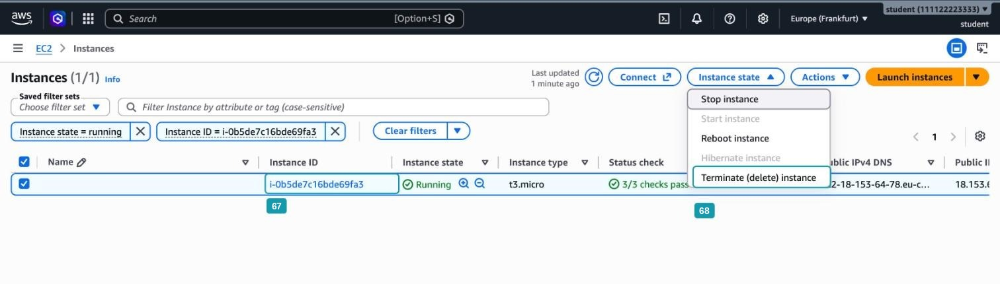

_8.2.28. Удаление экземпляра группы_

Через минуту откройте вкладку `Activity` группы. В ней появились две новые записи: экземпляр выведен из работы, потому что проверка EC2 показала, что он удалён или остановлен (_69_), и тут же запущен новый, чтобы заменить неисправный (_70_). Желаемый размер остался равным 4, и группа сама восстановила число экземпляров.

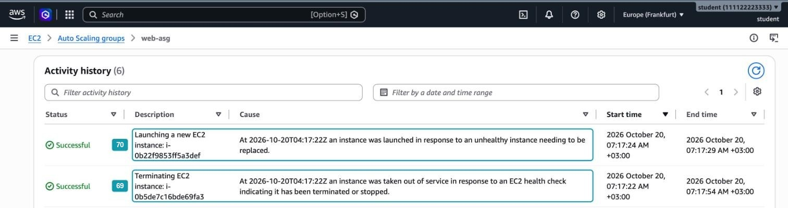

_8.2.29. Замена удалённого экземпляра_

Обратите внимание, что группа заменила экземпляр, хотя вы удалили его сами. Для группы неважно, почему экземпляр пропал: отказ оборудования, ошибка или действие человека. Она лишь сравнивает число исправных экземпляров с желаемым размером. Чтобы уменьшить группу, меняют желаемый размер, а не удаляют экземпляры.

### Шаг 18. Дождитесь сокращения группы

`stress-ng` завершится через 15 минут после запуска, и загрузка процессоров упадёт почти до нуля. Тревоге на сокращение нужно 15 минутных точек ниже 37,5%, поэтому примерно через четверть часа после окончания нагрузки она перейдёт в `ALARM`. Проверить это можно той же командой `describe-alarms`, что и в шаге 15.

Откройте вкладку `Activity` группы. Тревога `AlarmLow` запустила политику, и та уменьшила желаемый размер с 4 до 3 (_71_), а через минуту с 3 до 2 (_72_). У второй записи статус `In progress`: группа уже отменила регистрацию экземпляра в `web-tg` и ждёт 30 секунд задержки отмены регистрации из шага 2, прежде чем удалить его.

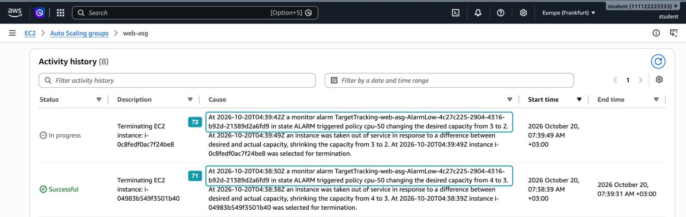

_8.2.30. Сокращение группы_

По расчёту при загрузке около нуля группу можно было бы сразу сократить до минимума, но политика убирает экземпляры постепенно, по одному в минуту, пока тревога остаётся в `ALARM` (раздел «Политика target tracking»). Если бы нагрузка вернулась в это время, группа не успела бы сократиться слишком сильно. Первым был удалён экземпляр из `eu-central-1a`, вторым из `eu-central-1b`: при сокращении группа сначала выравнивает число экземпляров по зонам (раздел «Какой экземпляр будет удалён»), поэтому в каждой зоне остался один экземпляр.

Желаемый размер снова равен минимуму 2, и дальше группа сокращаться не будет, даже если загрузка останется нулевой.

## Часть 6. Удаление ресурсов

При удалении группы удаляются её экземпляры и политики масштабирования, а вместе с политикой target tracking - и созданные ею тревоги. Группу удаляют первой: её экземпляры зарегистрированы в `web-tg` и используют `web-sg`.

1. Удалите группу: `Auto Scaling Groups`, выберите `web-asg`, `Actions`, `Delete`, введите `delete`. Дождитесь, пока группа исчезнет из списка, а её экземпляры перейдут в состояние `Terminated`.
2. Удалите шаблон: `Launch Templates`, выберите `web-lt`, `Actions`, `Delete template`, подтвердите удаление.
3. Удалите балансировщик `web-alb`, целевую группу `web-tg` и группы безопасности `web-sg` и `alb-sg`, как в части 5 Hands-on 8.1.
4. Удалите роль: `IAM`, `Roles`, выберите `web-ssm-role`, нажмите `Delete` и введите имя роли.

Роль `AWSServiceRoleForAutoScaling` удалять не нужно: она ничего не стоит и понадобится при создании следующей группы.

Проверьте, что в `Auto Scaling Groups`, `Launch Templates`, `Load Balancers` и `Target Groups` пусто, а в `Instances` все экземпляры находятся в состоянии `Terminated`.

## Вопросы для самопроверки

1. Почему подсети задают в группе Auto Scaling, а не в шаблоне запуска? Что будет, если подсеть всё-таки указать в шаблоне?
2. Зачем экземплярам роль с политикой `AmazonSSMManagedInstanceCore`? Как без неё запустить нагрузку на всех экземплярах группы?
3. Почему без детального мониторинга группа реагировала бы на нагрузку заметно медленнее?
4. Что изменится, если не включать проверки ELB в группе, а на одном экземпляре остановится nginx?
5. Почему группа выросла с 2 до 4 экземпляров за одно действие? До скольких она выросла бы при максимуме 6 и почему?
6. Почему после роста средняя загрузка группы стала 50%, хотя `stress-ng` продолжал работать? Что было бы, если бы нагрузку создавали запросы пользователей через балансировщик?
7. Почему тревога на сокращение ждёт 15 точек, а тревога на рост только 3?
8. Вы удалили экземпляр группы вручную, и группа запустила новый. Как правильно уменьшить число экземпляров, если сервер действительно больше не нужен?
