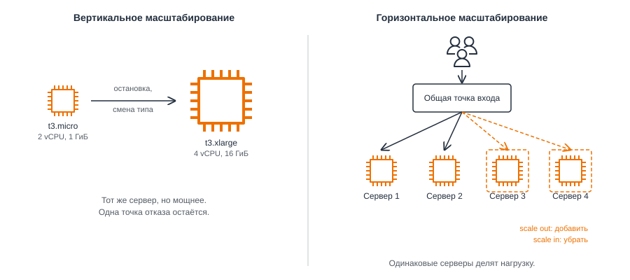
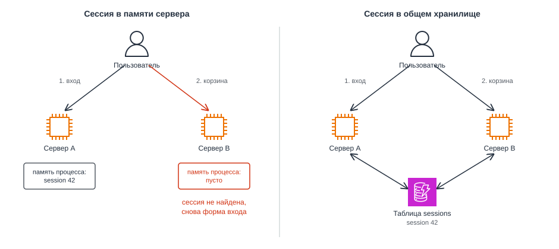
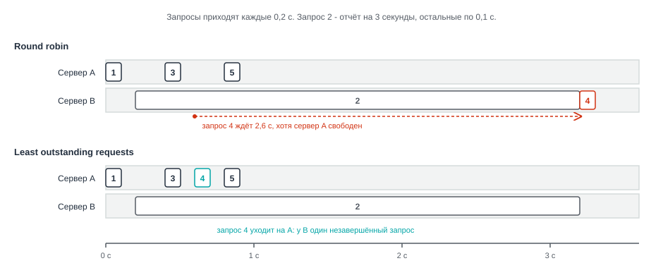
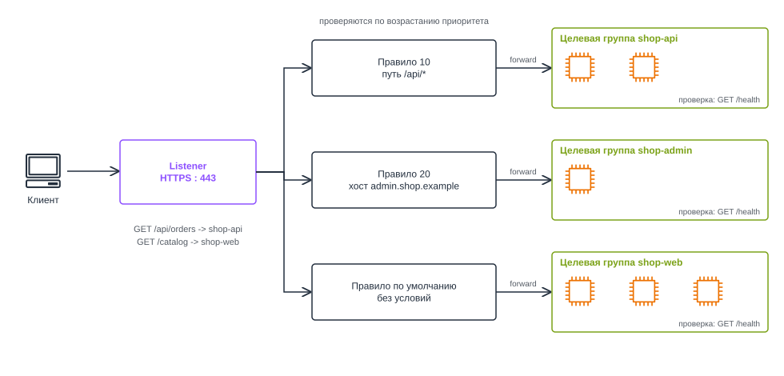
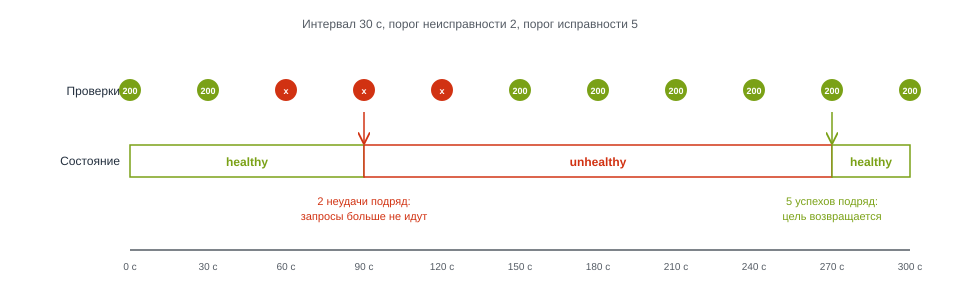
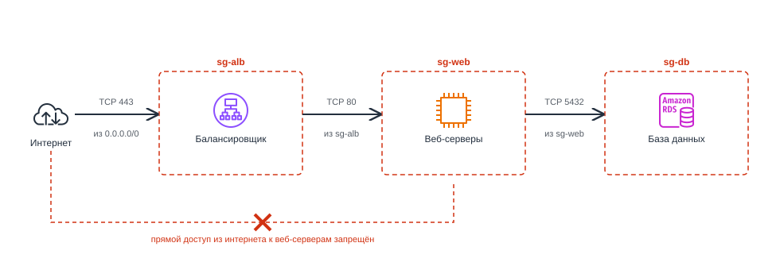
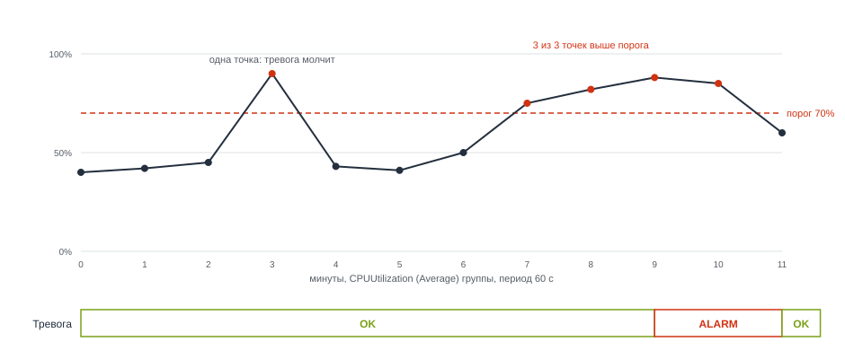
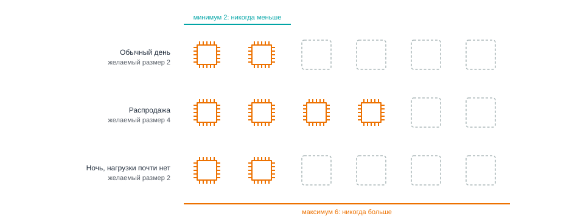
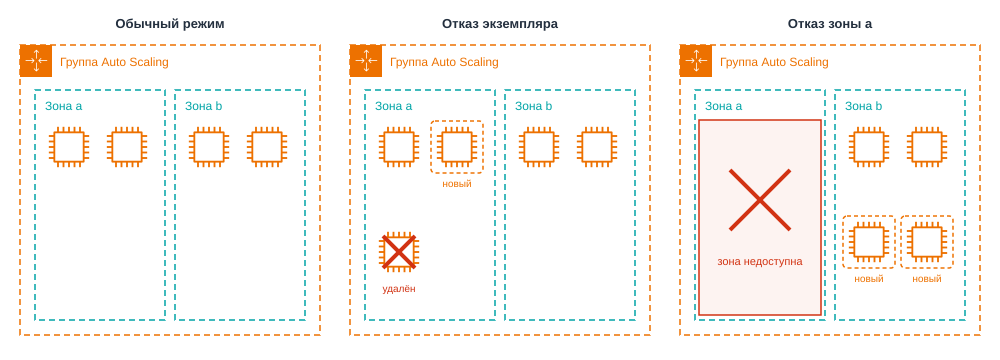
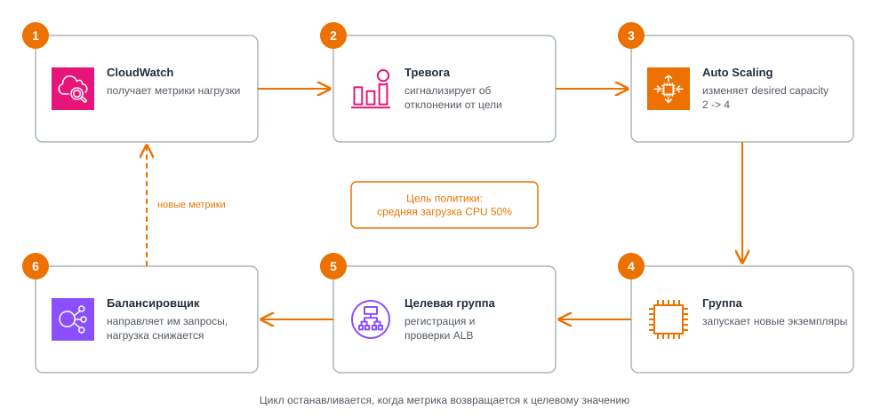

# Масштабируемость и балансировка нагрузки. Elastic Load Balancing, Amazon EC2 Auto Scaling

<i>
Демонстрация в понедельник прошла спокойно. База ещё в воскресенье ночью переехала в RDS, комиссия сделала три заказа, и все три легли в таблицу, где им и полагалось лежать. Тест Тестович со своими двумястами пятьюдесятью ковриками тоже уцелел: Джон восстановил его из дампа и считал это личной победой.

Беда пришла в среду, и с той стороны, откуда её не ждали. Староста третьего курса выложила ссылку на магазин в общий чат факультета и приписала, что первые сто заказов получат скидку. Никакой скидки в магазине не было. Но об этом знали двое, а чат читали шестьсот человек.

Эмма заметила первой: каталог открывался секунд двадцать, а потом браузер сдавался.

– База? - спросила она.

– База скучает, - ответил Джон, глядя в консоль RDS. - Процессор у неё на восьми процентах. А вот веб-сервер...

На маленьком экземпляре загрузка процессора стояла на ста процентах, ровно, будто её прибили к потолку.

Джон сделал то, что первым приходит в голову: запустил из золотого образа второй такой же сервер, потом третий. Через пять минут оба работали, оба были свободны и не получили ни одного запроса. Все шестьсот человек по-прежнему стучались на один адрес, тот, что был записан в DNS.

– Можно поменять запись на адрес второго, - предложил он.

– И тогда все уйдут на второй, - сказала Эмма. - Нам нужно, чтобы у трёх серверов был один адрес. И чтобы о сломанном сервере пользователи не узнавали раньше нас.

К вечеру поток схлынул сам: кто-то в чате написал, что скидка ненастоящая. Три сервера простаивали, и каждый исправно выставлял счёт за свой час. Джон выключил два лишних и задумался, что будет в следующий раз, когда ссылку выложат в три часа ночи.

– Нам нужен кто-то, кто будет делить запросы между серверами, - сказала Эмма. - И кто-то, кто сам будет запускать серверы, когда их не хватает, и сам выключать, когда они не нужны.

– Двое дежурных, которые никогда не спят, - сказал Джон. - Осталось понять, где таких берут.
</i>

## Содержание

- [Масштабируемость и балансировка нагрузки. Elastic Load Balancing, Amazon EC2 Auto Scaling](#масштабируемость-и-балансировка-нагрузки-elastic-load-balancing-amazon-ec2-auto-scaling)
  - [Содержание](#содержание)
  - [Вопросы для самопроверки](#вопросы-для-самопроверки)
  - [Ретроспектива](#ретроспектива)
  - [Производительность и масштабируемость](#производительность-и-масштабируемость)
    - [Когда одного сервера не хватает](#когда-одного-сервера-не-хватает)
    - [Производительность](#производительность)
    - [Масштабируемость](#масштабируемость)
  - [Вертикальное и горизонтальное масштабирование веб-серверов](#вертикальное-и-горизонтальное-масштабирование-веб-серверов)
    - [Два способа добавить ресурсы](#два-способа-добавить-ресурсы)
    - [Что выбрать](#что-выбрать)
  - [Приложение без состояния](#приложение-без-состояния)
    - [Проблема: пользователь потерял сессию](#проблема-пользователь-потерял-сессию)
    - [Где может остаться состояние](#где-может-остаться-состояние)
    - [Общее хранилище состояния](#общее-хранилище-состояния)
    - [Привязка сессий](#привязка-сессий)
  - [Балансировка нагрузки](#балансировка-нагрузки)
    - [Единая точка входа](#единая-точка-входа)
    - [Алгоритмы балансировки](#алгоритмы-балансировки)
    - [Проверки работоспособности](#проверки-работоспособности)
    - [Что проверять в `/health`](#что-проверять-в-health)
  - [Amazon Elastic Load Balancing](#amazon-elastic-load-balancing)
    - [Что такое Elastic Load Balancing](#что-такое-elastic-load-balancing)
    - [Основные характеристики Application Load Balancer](#основные-характеристики-application-load-balancer)
    - [Типы балансировщиков](#типы-балансировщиков)
    - [Listener, правила и целевые группы](#listener-правила-и-целевые-группы)
    - [Состояние целей и завершение запросов](#состояние-целей-и-завершение-запросов)
    - [Security Group и адрес пользователя](#security-group-и-адрес-пользователя)
  - [Узкие места](#узкие-места)
    - [Почему новые серверы не помогли](#почему-новые-серверы-не-помогли)
    - [Как найти узкое место](#как-найти-узкое-место)
  - [Amazon CloudWatch: метрики и тревоги](#amazon-cloudwatch-метрики-и-тревоги)
    - [Что такое CloudWatch](#что-такое-cloudwatch)
    - [Метрики](#метрики)
    - [Тревоги](#тревоги)
  - [Эластичность: реактивное и проактивное масштабирование](#эластичность-реактивное-и-проактивное-масштабирование)
  - [Amazon EC2 Auto Scaling](#amazon-ec2-auto-scaling)
    - [Что такое EC2 Auto Scaling](#что-такое-ec2-auto-scaling)
    - [Группа Auto Scaling](#группа-auto-scaling)
    - [Шаблон запуска](#шаблон-запуска)
    - [Размер группы](#размер-группы)
    - [Несколько зон и замена экземпляров](#несколько-зон-и-замена-экземпляров)
    - [Способы масштабирования](#способы-масштабирования)
    - [Политика target tracking. Динамическое масштабирование](#политика-target-tracking-динамическое-масштабирование)
    - [Избыточность и отказоустойчивость](#избыточность-и-отказоустойчивость)
  - [Стоимость](#стоимость)
  - [Собираем решения вместе](#собираем-решения-вместе)
  - [Резюме](#резюме)

## Вопросы для самопроверки

1. Чем производительность отличается от масштабируемости? Почему быстрое приложение не всегда хорошо масштабируется?
2. Чем отличаются вертикальное и горизонтальное масштабирование? Что мешает горизонтально масштабировать приложение с локальными сессиями?
3. Зачем нужен балансировщик нагрузки и как он определяет неисправные серверы?
4. Чем отличаются listener, правило listener и целевая группа Application Load Balancer?
5. Почему увеличение числа веб-серверов может не ускорить приложение?
6. Что делают CloudWatch и EC2 Auto Scaling и как они связаны?
7. Что означают minimum, desired и maximum capacity группы Auto Scaling?
8. Как работает target tracking и почему новый экземпляр начинает помогать не сразу?
9. Сколько экземпляров понадобится в трёх зонах, чтобы сохранить мощность шести экземпляров при отказе одной зоны?

## Ретроспектива

Эта глава опирается на несколько предыдущих:

- _Первая глава_. Мы различили масштабируемость и эластичность: первая позволяет справиться с ростом нагрузки за счёт новых ресурсов, вторая означает, что ресурсы добавляются и убираются автоматически.
- _Третья и четвёртая главы_. Экземпляр EC2 живёт в одной зоне доступности, поэтому один экземпляр остаётся одной точкой отказа. Там же появились AMI, золотой образ и user data, с помощью которых сервер можно пересоздать без ручной настройки.
- _Пятая глава_. В VPC мы заранее заложили публичные и приватные подсети в двух зонах, а доступ к серверам ограничили с помощью Security Group.
- _Шестая и седьмая главы_. Файлы пользователей переехали в S3, данные в управляемую базу. На диске веб-сервера не осталось пользовательских данных, и его можно заменить без их потери.

Веб-сервер теперь можно заменить, но он по-прежнему один. Отсюда возникают вопросы, на которые отвечает глава:

- Как дать нескольким серверам один адрес и делить между ними запросы?
- Как система узнает, что один из серверов сломался?
- Кто будет добавлять серверы при росте нагрузки и убирать их, когда она спадёт?
- Сколько серверов и в каких зонах нужно держать, чтобы пережить отказ целой зоны?

## Производительность и масштабируемость

### Когда одного сервера не хватает

Представим учебный интернет-магазин, чей портал работает на одном экземпляре EC2. В обычный день посетители открывают каталог, рассматривают товары и оформляют заказы. После публикации ссылки в студенческом чате на портал одновременно заходит гораздо больше людей. Страницы начинают загружаться медленно, хотя база данных работает без заметных проблем.

Посмотрим на условные показатели веб-сервера в разные моменты этого дня. Число запросов не равно числу пользователей: один посетитель открывает несколько страниц, а браузер отправляет дополнительные запросы.

| Активных пользователей | Поступает запросов/с | Обрабатывается запросов/с | Среднее время ответа | Загрузка CPU |
| ---------------------- | -------------------- | ------------------------- | -------------------- | ------------ |
| 20                     | 40                   | 40                        | 80 мс                | 15%          |
| 100                    | 200                  | 200                       | 120 мс               | 60%          |
| 200                    | 400                  | 260                       | 900 мс               | 100%         |
| 400                    | 800                  | 250                       | 4 с, есть ошибки     | 100%         |

Пока у процессора есть свободные ресурсы, сервер успевает отвечать. Когда процессор занят полностью, новые запросы ждут своей очереди. Количество обработанных запросов почти перестаёт расти, а время ожидания увеличивается. Часть посетителей получает ошибку или закрывает страницу, так и не дождавшись ответа.

В данном случае существуют два важных аспекта: _производительность_ и _масштабируемость_.

### Производительность

**Производительность (performance)** - способность системы выполнять работу при заданных ресурсах. Её оценивают по двум основным показателям:

- _Задержка (latency)_. Сколько времени проходит до ответа на запрос[^1].
- _Пропускная способность (throughput)_. Сколько запросов система обрабатывает за единицу времени.

В нашем примере один сервер обрабатывает не больше примерно 260 запросов в секунду. Можно оптимизировать приложение или выбрать более мощный экземпляр, но и у нового сервера будет предел.

### Масштабируемость

**Масштабируемость (scalability)** - способность системы справляться с ростом нагрузки при добавлении ресурсов. В хорошо масштабируемой системе увеличение числа серверов заметно увеличивает общую пропускную способность[^2].

Рассмотрим два приложения на одинаковых серверах:

| Число серверов | Приложение A, запросов/с | Приложение B, запросов/с |
| -------------- | ------------------------ | ------------------------ |
| 1              | 250                      | 400                      |
| 2              | 490                      | 450                      |
| 4              | 960                      | 470                      |

На одном сервере приложение B быстрее. Но новые серверы почти не помогают: например, каждый запрос может ждать изменения одной и той же строки в базе данных. У приложения A пропускная способность растёт почти пропорционально числу серверов.

_Производительность описывает возможности системы сейчас, а масштабируемость - то, как эти возможности изменятся при добавлении ресурсов._ Узкое место приложения B находится не на веб-серверах, поэтому добавление машин не решает проблему.

## Вертикальное и горизонтальное масштабирование веб-серверов

### Два способа добавить ресурсы

- _Вертикальное масштабирование (scale up)_. Заменить сервер более мощным: например, увеличить число виртуальных процессоров и объём памяти экземпляра EC2.
- _Горизонтальное масштабирование (scale out)_. Запустить дополнительные серверы, которые вместе обслуживают пользователей. Сокращение их числа называют _scale in_.

_8.1. Вертикальное и горизонтальное масштабирование_

На рисунке 8.1 показаны оба подхода:

- Слева один сервер становится мощнее.
- Справа несколько серверов работают за общей точкой входа.

У вертикального масштабирования EC2 есть ограничения:

- _Выключение работающего сервера_. Для изменения типа обычного экземпляра EC2 с томом EBS его нужно остановить[^3].
- _Изменение адреса_. После остановки обычный публичный IPv4-адрес может измениться, если не используется Elastic IP[^3].
- _Предел ресурсов_. Даже у наиболее мощного типа экземпляра возможности конечны.
- _Единая точка отказа_. Если сервер выйдет из строя, приложение остановится.

Горизонтальное масштабирование позволяет распределить работу между несколькими экземплярами и разместить их в разных зонах доступности. Но для этого нужны три условия:

- _Одинаковая конфигурация_. На каждом сервере работает одна и та же версия приложения.
- _Общая точка входа_. Пользователь не выбирает конкретный сервер: то на какой сервер попадёт запрос, решает система распределения нагрузки.
- _Отсутствие локального состояния_. Любой сервер может обработать следующий запрос пользователя.

### Что выбрать

| Ситуация                                                        | Возможный подход                                                              |
| --------------------------------------------------------------- | ----------------------------------------------------------------------------- |
| Небольшой внутренний сервис с постоянной нагрузкой              | Один экземпляр подходящего размера                                            |
| Веб-приложение с дневными и вечерними пиками                    | Несколько экземпляров с изменяемым числом серверов                            |
| Приложение хранит важные данные в памяти единственного процесса | Сначала изменить архитектуру, иначе горизонтальное масштабирование не поможет |
| Сайт должен пережить отказ зоны доступности                     | Несколько экземпляров в разных зонах                                          |

Выбор зависит не только от скорости. Вертикальное масштабирование проще, но оставляет один сервер. Горизонтальное требует подготовки приложения, зато позволяет менять мощность без замены работающего экземпляра[^4].

## Приложение без состояния

### Проблема: пользователь потерял сессию

Допустим, запросы магазина начали распределяться между двумя серверами.

1. Пользователь входит в аккаунт на сервере A. Приложение сохраняет данные о входе в оперативной памяти этого сервера.
2. Пользователь открывает корзину, но следующий запрос попадает на сервер B.
3. Сервер B не видит данных сессии и снова просит войти.

**Состояние (state)** - данные, от которых зависит обработка следующих запросов. Например, сведения о входе пользователя, его корзине или незавершённой операции.

**Приложение без состояния (stateless application)** - приложение, экземпляры которого не зависят от данных предыдущих запросов, сохранённых локально на конкретном сервере[^5]. Нужное состояние может существовать, но хранится отдельно и доступно всем экземплярам.

### Где может остаться состояние

- _Сессии и корзины_. Пользователь окажется неавторизованным на другом сервере.
- _Загруженные файлы_. Файл, сохранённый на локальном диске, недоступен другому экземпляру и может потеряться при удалении сервера.
- _Единственная копия данных в памяти_. Например, счётчик, значения которого нигде больше не сохраняются.
- _Задачи по расписанию_. Если одинаковая задача запускается на каждом экземпляре, письмо пользователю может отправиться несколько раз.
- _Локальные журналы_. При удалении экземпляра пропадут записи, которые не были переданы в централизованную систему.

### Общее хранилище состояния

Данные, которые нужны разным экземплярам, выносят за пределы веб-сервера. Например,

- Фотографии можно держать в S3,
- Заказы - в RDS,
- а сессии - в общем хранилище, таком как DynamoDB[^5].

_Рассмотрим сессию_.

1. При входе сервер создаёт случайный идентификатор,
2. Cохраняет под ним данные пользователя в общем хранилище,
3. Отправляет идентификатор браузеру в cookie.

При следующем запросе любой веб-сервер находит данные по этому идентификатору. Важно настроить срок действия сессии и защиту cookie.

Другой подход - подписанный токен, который сервер выдаёт после входа. Проверить подпись может любой экземпляр, если у них есть необходимые ключи. Такой подход уменьшает обращения к хранилищу, но усложняет досрочный отзыв токенов[^6].

_8.2. Сессия в памяти сервера и в общем хранилище_

На рисунке 8.2 слева данные входа доступны только серверу A, а справа оба сервера получают их из общего хранилища.

### Привязка сессий

**Привязка сессий (sticky sessions)** - настройка балансировщика, при которой запросы одного пользователя преимущественно направляются на один сервер.

Она позволяет временно использовать приложение с локальными сессиями, но не устраняет проблему[^7]:

- Нагрузка может распределяться неравномерно.
- При отказе сервера его локальные сессии теряются.
- Удалять экземпляры при уменьшении нагрузки становится сложнее.

Для нового приложения предпочтительнее общее хранилище состояния. Проверка проста: если один экземпляр исчезнет, должен ли пользователь потерять данные или авторизацию? Если да, состояние ещё привязано к конкретному серверу.

## Балансировка нагрузки

### Единая точка входа

После устранения локального состояния магазин можно запустить на нескольких экземплярах - то есть горизонтально масштабировать приложение, но для этого теперь нужно распределять запросы между ними. Для этого используют _балансировщик нагрузки_.

**Балансировщик нагрузки (load balancer)** - компонент, который принимает подключения клиентов и распределяет запросы между серверами. Серверы, получающие запросы, называют _целями (targets)_ или _бэкендами (backends)_.

Балансировщик нужен, чтобы:

- Пользователи обращались к одному адресу, даже когда экземпляров становится больше или меньше.
- Запросы распределялись между исправными серверами.
- Сервер можно было заменить или обновить, не останавливая всё приложение.

### Алгоритмы балансировки

**Алгоритм балансировки (load balancing algorithm)** - правило, по которому выбирается сервер для запроса. Сравним два варианта.

Есть множество алгоритмов балансировки, но рассмотрим два популярных.

- _Round robin_. Запросы направляются на серверы по кругу: A, B, A, B. Подходит, когда серверы и запросы примерно одинаковы.
- _Least outstanding requests_. Следующий запрос получает сервер с наименьшим числом незавершённых запросов. Этот вариант полезен, когда обработка одних запросов занимает значительно больше времени, чем других[^9].

Представим, что сервер B три секунды формирует отчёт, а сервер A свободен. Round robin может отправить следующий запрос на занятый B. Второй алгоритм скорее выберет A.

_8.3. Round robin и наименьшее число запросов в обработке_

На рисунке 8.3 видно, почему второй алгоритм иногда уменьшает ожидание. Однако одного выбора алгоритма недостаточно: сначала нужно определить, какие серверы вообще способны отвечать.

### Проверки работоспособности

Еще одним важным аспектом является проверка работоспособности серверов, так как балансировщик должен знать, какие серверы могут обрабатывать запросы, а какие временно недоступны.

Виртуальная машина может быть включена, хотя приложение зависло или не смогло запуститься.

**Проверка работоспособности (health check)** - регулярная проверка, по результатам которой балансировщик решает, можно ли направлять запросы на сервер. Для веб-приложения часто используют HTTP-запрос к пути `/health` и ожидают код `200`[^10].

Проверку настраивают с помощью следующих параметров:

- _Путь_. Например, `/health`.
- _Интервал_. Как часто выполнять запрос.
- _Таймаут_. Сколько ждать ответа.
- _Пороги_. Сколько последовательных удачных или неудачных проверок требуется для того, чтобы пометить сервер как _доступный_ или _недоступный_.

Например, при интервале 10 секунд и пороге двух неудачных проверок сервер исключат после нескольких десятков секунд, а не после первой случайной задержки. Точное время зависит от момента отказа, длительности проверок и настроек.

### Что проверять в `/health`

Для балансировщика лучше сделать быстрый путь, который показывает готовность _самого экземпляра_:

- приложение запущено,
- конфигурация прочитана,
- обработчик запросов готов[^10].

Если оно не готово, путь возвращает ошибку, например `503`.

Не стоит при каждом запросе `/health` проверять сразу все внешние зависимости. Если база данных временно замедлится, проверки могут одновременно провалиться на всех веб-серверах. Состояние базы и других зависимостей нужно отслеживать отдельно.

## Amazon Elastic Load Balancing

### Что такое Elastic Load Balancing

Если запустить собственный балансировщик на EC2, его придётся обновлять, масштабировать и защищать от отказов. AWS предлагает управляемый сервис для этой задачи.

**Elastic Load Balancing (ELB)** - сервис AWS, который принимает входящий трафик, распределяет его между зарегистрированными целями и отслеживает их работоспособность[^11].

| Характеристика      | Elastic Load Balancing                                                                  |
| ------------------- | --------------------------------------------------------------------------------------- |
| Категория           | Сетевые сервисы                                                                         |
| Что делает          | Распределяет трафик между исправными целями                                             |
| Для чего нужен      | Даёт приложению стабильное DNS-имя и позволяет заменять серверы за ним                  |
| Где используют      | Веб-приложения, API и внутренние сервисы                                                |
| Модель обслуживания | PaaS: инфраструктурой балансировщика управляет AWS, вы задаёте маршрутизацию и проверки |
| Область действия    | Регион, с узлами в выбранных зонах доступности                                          |
| Как оплачивается    | Время работы, объём использования (LCU), публичные IPv4-адреса при их наличии           |
| Как работать        | Консоль AWS, `aws elbv2`, SDK                                                           |
| Появился            | 2009 год, тип Application Load Balancer - 2016 год[^12][^13]                            |
| Аналоги             | Google Cloud Load Balancing, Azure Application Gateway                                  |

### Основные характеристики Application Load Balancer

ELB предлагает несколько типов балансировщиков. Для HTTP-приложений чаще используют **Application Load Balancer (ALB)**. AWS управляет узлами ALB, а пользователь настраивает, какие запросы принимать и каким серверам их передавать.

Важные параметры ALB:

| Параметр                   | Значение                                                                  |
| -------------------------- | ------------------------------------------------------------------------- |
| Зоны доступности           | Обычно как минимум две зоны, по одной подсети в каждой[^14]               |
| Адрес                      | Имя вида `name-id.elb.region.amazonaws.com`[^15]                          |
| Проверки целей             | HTTP или HTTPS, путь, интервал, пороги успешных и неуспешных ответов[^16] |
| Отмена регистрации         | Время для завершения начатых запросов, по умолчанию 300 секунд[^17]       |
| Распределение между зонами | Включено на уровне ALB, на уровне целевой группы может быть изменено[^14] |

_Не путайте масштабирование ALB и масштабирование приложения._ AWS самостоятельно меняет мощность балансировщика, но ELB не запускает новые экземпляры EC2. За число веб-серверов отвечает EC2 Auto Scaling.

### Типы балансировщиков

Кроме ALB, существуют и другие типы балансировщиков нагрузки, каждый из которых предназначен для определённых сценариев использования.

Вспомним уровни сети:

- На транспортном уровне (уровень 4) работают TCP и UDP,
- На прикладном уровне (уровень 7) видны HTTP-запросы, включая пути и заголовки.

| Тип                             | Уровень | Когда использовать                                                                            |
| ------------------------------- | ------- | --------------------------------------------------------------------------------------------- |
| Application Load Balancer (ALB) | 7       | Сайты и HTTP API, маршрутизация по пути или домену[^18]                                       |
| Network Load Balancer (NLB)     | 4       | TCP- или UDP-приложения, например игровой сервер, либо требование статических IP-адресов[^19] |
| Gateway Load Balancer (GWLB)    | 3       | Сетевые устройства и межсетевые экраны[^20]                                                   |
| Classic Load Balancer (CLB)     | 4 и 7   | Старый тип, который не выбирают для новых архитектур[^11]                                     |

Например, ALB может направить запрос `/api/orders` на серверы API, а запрос `/catalog` - на веб-серверы. NLB не анализирует HTTP-пути.

> [!TIP]
>
> В данной главе мы сосредоточимся на Application Load Balancer (ALB) и его настройке.

### Listener, правила и целевые группы

Настройка ALB состоит из трёх частей:

- **Listener (слушатель)** - принимает подключения на определённом протоколе и порту, например HTTPS на 443[^21]. Грубо говоря, это та часть балансировщика, которая "слушает" входящие запросы.
- **Правило listener (listener rule)** - проверяет условие (_путь, домен и другие признаки_) и определяет действие:
  - передать запрос,
  - перенаправить его,
  - вернуть готовый ответ[^22].
- **Целевая группа (target group)** - набор серверов с общими настройками выбора цели и проверок работоспособности[^17].

Рассмотрим магазин с отдельными веб-страницами, API и административной частью:

| Приоритет    | Правило listener (listener rule) | Целевая группа |
| ------------ | -------------------------------- | -------------- |
| 10           | Путь `/api/*`                    | `shop-api`     |
| 20           | Домен `admin.shop.example`       | `shop-admin`   |
| По умолчанию | Остальные запросы                | `shop-web`     |

ALB проверяет правила по приоритету и выполняет действие первого подходящего. Правило по умолчанию срабатывает последним. Алгоритм распределения запросов (например, round robin) выбирают в настройках целевой группы[^9].

_8.5. Listener, правила и целевые группы_

На рисунке 8.5 listener передаёт запрос подходящей целевой группе, а уже та определяет конкретный сервер.

### Состояние целей и завершение запросов

ALB проверяет цели (например, серверы или экземпляры), с параметрами, заданными в целевой группе. Основные состояния[^16]:

| Состояние   | Значение                                                   |
| ----------- | ---------------------------------------------------------- |
| `initial`   | Цель только зарегистрирована и проходит первые проверки    |
| `healthy`   | Цель готова получать запросы                               |
| `unhealthy` | Проверки не пройдены                                       |
| `draining`  | Цель выводится из группы, новые запросы ей не назначаются. |

По умолчанию проверка выполняется раз в 30 секунд, а два последовательных неуспешных результата переводят исправную цель в `unhealthy`. Для возвращения требуется пять успешных проверок[^16]. Эти параметры можно менять, чтобы подобрать скорость обнаружения неисправностей без лишних ложных срабатываний.

_8.6. Состояния цели при проверках работоспособности_

На рисунке 8.6 показаны переходы между состояниями после неудачных и успешных проверок.

При удалении сервера ALB прекращает назначать ему новые запросы, но даёт начатым операциям время завершиться. Это _задержка отмены регистрации (deregistration delay)_ - по умолчанию 300 секунд[^17]. После её завершения экземпляр можно безопаснее выключать.

### Security Group и адрес пользователя

Чтобы пользователи попадали к веб-серверам только через ALB, необходимо настроить последовательность разрешённых соединений[^24]:

| Security Group | Входящее правило     | Назначение                                     |
| -------------- | -------------------- | ---------------------------------------------- |
| `sg-alb`       | TCP 443 из интернета | Принимать HTTPS от клиентов                    |
| `sg-web`       | TCP 80 от `sg-alb`   | Принимать запросы _только от балансировщика_   |
| `sg-db`        | TCP 5432 от `sg-web` | Принимать подключения PostgreSQL от приложения |

_8.7. Цепочка Security Group_

На рисунке 8.7 нет прямого доступа из интернета к экземплярам и базе. Если для проверок выбран другой порт, его также нужно разрешить в `sg-web`.

> _Hands-on 8.1. Балансировщик для двух серверов._ Создание целевой группы, настройка пути `/health`, ALB в двух публичных подсетях и правила Security Group. Проверка распределения запросов и отказа одного экземпляра.

## Узкие места

### Почему новые серверы не помогли

После добавления балансировщика магазин работает на четырёх веб-серверах. Но во время очередного наплыва посетителей страницы снова открываются медленно. Посмотрим на показатели:

| Компонент          | Что наблюдаем                                                     |
| ------------------ | ----------------------------------------------------------------- |
| Четыре веб-сервера | CPU 30-35%, большая часть времени уходит на ожидание ответов базы |
| База данных        | CPU 95%, запросы стоят в очереди                                  |
| ALB                | Передаёт запросы, но не может ускорить базу                       |

**Узкое место (bottleneck)** - компонент, который ограничивает производительность всей системы. Здесь оно переместилось с веб-сервера на базу: пятый веб-сервер только добавит ей запросов[^7].

### Как найти узкое место

Для диагностики удобно использовать метод USE (utilization, saturation, errors)[^26]. Для каждого ресурса проверяют:

- _Утилизацию_. Насколько занят ресурс, например процессор.
- _Насыщение_. Есть ли очередь операций, которые ресурс не успевает выполнить.
- _Ошибки_. Сколько операций завершилось неудачно.

Проверяют процессор, память, диск, сеть и зависимости приложения. Допустим, у базы может быть высокая загрузка CPU и очередь запросов. Возможные решения - оптимизация запросов, кеширование читаемых данных или реплики для чтения, если нагрузка в основном состоит из чтения.

Есть и другой предел. Каждый экземпляр может держать _пул соединений (connection pool)_ с базой. Если один сервер открывает 20 соединений, то 4 сервера могут открыть до 80, а 12 - до 240. Значит, максимальный размер группы нужно выбирать с учётом допустимого числа соединений СУБД.

Найти такие проблемы помогают метрики: в AWS их собирают, в частности, с помощью Amazon CloudWatch.

## Amazon CloudWatch: метрики и тревоги

### Что такое CloudWatch

**Amazon CloudWatch** - сервис AWS для сбора и анализа показателей работы ресурсов и приложений, просмотра журналов и автоматических оповещений[^27]. В этой главе нужны только _метрики_ и _тревоги_: они помогают решать, когда добавлять или удалять экземпляры.

| Характеристика      | Amazon CloudWatch                                                                                     |
| ------------------- | ----------------------------------------------------------------------------------------------------- |
| Категория           | Мониторинг и наблюдение                                                                               |
| Что делает          | Собирает показатели, показывает графики и выполняет действия по заданным условиям                     |
| Для чего нужен      | Находить проблемы и реагировать на изменение нагрузки                                                 |
| Где используют      | EC2, ELB, RDS и другие сервисы AWS                                                                    |
| Модель обслуживания | PaaS: инфраструктуру мониторинга обслуживает AWS                                                      |
| Область действия    | Регион                                                                                                |
| Как оплачивается    | Часть метрик доступна без дополнительной платы, пользовательские метрики и тревоги могут оплачиваться |
| Как работать        | Консоль CloudWatch, `aws cloudwatch`, SDK                                                             |
| Появился            | 2009 год[^12]                                                                                         |
| Аналоги             | Google Cloud Monitoring, Azure Monitor                                                                |

> [!TIP]
>
> В дальнейшем, CloudWatch будет рассмотрен подробнее.

### Метрики

**Метрика (metric)** - последовательность значений показателя за определённое время[^28]. Например, загрузка CPU, количество запросов или время ответа.

Например, есть следующие метрики, которые помогают отслеживать состояние ресурсов и реагировать на изменения нагрузки:

| Источник | Метрика              | Что показывает                  |
| -------- | -------------------- | ------------------------------- |
| EC2      | `CPUUtilization`     | Загрузка процессора экземпляра  |
| ALB      | `RequestCount`       | Число запросов к балансировщику |
| ALB      | `TargetResponseTime` | Время ожидания ответа от цели   |
| ALB      | `HealthyHostCount`   | Число исправных целей           |

Метрики отображают за выбранный _период (period)_, например одну или пять минут. Для анализа используют:

- среднее значение,
- сумму,
- максимум в зависимости от показателя.

У EC2 стандартные метрики обычно доступны с интервалом пять минут, а детальный мониторинг позволяет получать минутные данные за дополнительную плату[^29].

### Тревоги

**Тревога (alarm)** - правило CloudWatch, которое сравнивает значение метрики с порогом и может запустить действие[^27]. Её состояния:

- `OK` (условие не нарушено),
- `ALARM` (условие сработало),
- `INSUFFICIENT_DATA` (данных недостаточно)[^30].

Например, тревога может переходить в `ALARM`, если _загрузка CPU была выше 70% три минуты подряд_. Такой подход уменьшает число тревог на кратковременные скачки. В настройках выбирают период измерения и сколько точек должно нарушить порог[^30]. Потому, что если реагировать на каждый кратковременный скачок, система будет генерировать слишком много уведомлений.

_8.8. Метрика, порог и состояния тревоги_

На рисунке 8.8 один краткий скачок не включает тревогу, а несколько последовательных превышений переводят её в `ALARM`.

При срабатывании можно отправить уведомление или запустить действие масштабирования[^31].

## Эластичность: реактивное и проактивное масштабирование

**Эластичность (elasticity)** означает, что система изменяет (добавляет или удаляет) количество используемых ресурсов (например, серверов) вслед за спросом[^33]. Это особенно полезно веб-приложению: днём могут понадобиться дополнительные экземпляры, а ночью их число можно сократить до установленного минимума.

- _Реактивное масштабирование_. Новые экземпляры запускаются после того, как метрики показали рост нагрузки.
- _Проактивное масштабирование_. Экземпляры готовятся заранее по расписанию или прогнозу, например перед ожидаемым утренним пиком.

Реактивное масштабирование не бывает мгновенным, нужно:

1. получить новые измерения,
2. запустить экземпляр,
3. подготовить приложение,
4. дождаться успешных проверок ALB.

В зависимости от конфигурации это может занять несколько минут. Если наплыв пользователей краткий, новые серверы могут заработать слишком поздно.

Поэтому для веб-приложения обычно оставляют базовый запас мощности, а автоматическое масштабирование используют для более длительных изменений нагрузки. Готовый AMI с установленным приложением уменьшает время запуска нового экземпляра.

## Amazon EC2 Auto Scaling

### Что такое EC2 Auto Scaling

**Amazon EC2 Auto Scaling** - сервис AWS, который поддерживает заданное число экземпляров EC2, заменяет неисправные и может увеличивать или уменьшать их число вслед за нагрузкой[^34].

| Характеристика      | Amazon EC2 Auto Scaling                                                              |
| ------------------- | ------------------------------------------------------------------------------------ |
| Категория           | Вычислительные сервисы                                                               |
| Что делает          | Запускает, заменяет и удаляет экземпляры EC2 по заданным правилам                    |
| Для чего нужен      | Автоматически восстанавливать серверы и изменять их число                            |
| Где используют      | Веб-серверы за ALB, фоновые обработчики задач                                        |
| Модель обслуживания | IaaS: вы администрируете экземпляры EC2, AWS управляет изменением их числа           |
| Область действия    | Регион, экземпляры могут размещаться в нескольких зонах                              |
| Как оплачивается    | Сам EC2 Auto Scaling без дополнительной платы, ресурсы оплачиваются отдельно[^34]    |
| Как работать        | Консоль EC2, CLI `aws autoscaling`, SDK                                              |
| Появился            | 2009 год[^12]                                                                        |
| Аналоги             | Google Compute Engine Managed Instance Groups[^35], Azure Virtual Machine Scale Sets |

EC2 Auto Scaling состоит из нескольких ключевых компонентов:

- Группа Auto Scaling
- Шаблон запуска
- Политика масштабирования

### Группа Auto Scaling

**Группа Auto Scaling (Auto Scaling group)** - набор экземпляров EC2, которыми сервис управляет по общим правилам[^34]. Для группы задают шаблон запуска, подсети, размеры и политику масштабирования.

Важные параметры:

| Параметр          | Что нужно знать                                                        |
| ----------------- | ---------------------------------------------------------------------- |
| Размер            | Minimum capacity, desired capacity, maximum capacity[^36]              |
| Проверки          | Статус EC2 по умолчанию, проверки ELB включаются отдельно[^37]         |
| Отсрочка проверок | При создании через консоль обычно 300 секунд, через CLI и SDK - 0[^38] |
| Зоны доступности  | Группа старается распределять экземпляры между выбранными зонами[^39]  |

_Не путайте Auto Scaling group и target group._ Первая управляет количеством экземпляров, вторая сообщает ALB, куда направлять запросы. Когда их связывают, новые экземпляры автоматически регистрируются в целевой группе, а удаляемые исключаются из неё[^40].

### Шаблон запуска

**Шаблон запуска (launch template)** - сохранённые параметры для создания экземпляра: AMI, тип EC2, Security Group, IAM role и при необходимости user data[^41]. Без него группе пришлось бы запускать каждый экземпляр вручную.

Есть два способа подготовить приложение:

- _Готовый AMI_. Приложение установлено заранее, запуск проходит быстрее, но образ нужно обновлять при выпуске новой версии.
- _User data_. При запуске выполняется скрипт установки, что проще на этапе обучения, но увеличивает время подготовки экземпляра.

Шаблон поддерживает версии. Если создать новую версию, уже работающие экземпляры автоматически не обновятся. Для их постепенной замены используют _instance refresh_[^42].

### Размер группы

Группа управляет тремя значениями[^36]:

- **Минимальный размер (minimum capacity)** - ниже этого числа группа не должна сокращаться при обычном масштабировании.
- **Желаемый размер (desired capacity)** - сколько экземпляров группа стремится поддерживать _сейчас_.
- **Максимальный размер (maximum capacity)** - верхняя граница, ограничивающая рост группы и расходы.

Например, можно установить: _minimum = 2_, _desired = 2_, _maximum = 6_:

- Обычно работают два сервера.
- При росте нагрузки политика повышает desired до четырёх или шести. То есть desired увеличивается в пределах минимального и максимального значений.
- Когда посетителей становится меньше, возвращает к двум.

_8.9. Минимальный, желаемый и максимальный размер группы_

На рисунке 8.9 желаемое число меняется внутри заданных границ. Если экземпляров меньше, чем требуется, группа запускает новые, если больше, удаляет лишние.

### Несколько зон и замена экземпляров

Группе задают подсети в разных зонах доступности. Она старается распределять экземпляры равномерно, чтобы отказ одного сервера или одной зоны не останавливал весь веб-уровень[^39].

- _Отказ экземпляра_. Группа запускает замену неисправного экземпляра.
- _Отказ зоны_. Оставшиеся экземпляры продолжают работать. Группа пытается восстановить недостающую мощность в доступных зонах, а после восстановления зоны выровнять распределение.

_8.10. Группа Auto Scaling при отказе экземпляра и при отказе зоны_

На рисунке 8.10 показаны замена одного экземпляра и попытка восстановления мощности после отказа зоны. Запуск новых экземпляров занимает время, поэтому эта схема сама по себе не гарантирует полной мощности во время аварии.

По умолчанию EC2 Auto Scaling использует проверки состояния виртуальных машин. Но веб-приложение может не отвечать, даже если виртуальная машина исправна. Поэтому для группы за ALB нужно отдельно включить проверки работоспособности ELB[^37]. Тогда неисправную цель сможет заменить Auto Scaling, а не только исключить из маршрутизации балансировщик.

> [!IMPORTANT]
>
> Проверки ALB и EC2 Auto Scaling решают разные задачи:
>
> - ALB перестаёт отправлять запросы неисправной цели,
> - Auto Scaling запускает новый экземпляр вместо неё.
>
> Для автоматической замены при сбое приложения включите проверки ELB в группе Auto Scaling.

Новому экземпляру нужно время для запуска, поэтому если проверять его состояние сразу после запуска, он может быть ошибочно признан неисправным. _Период отсрочки проверок (health check grace period)_ позволяет не заменять его преждевременно, пока приложение ещё подготавливается[^38]. Его продолжительность выбирают по реальному времени запуска.

### Способы масштабирования

Число экземпляров можно менять несколькими способами[^43]:

| Способ               | Пример применения                                                           |
| -------------------- | --------------------------------------------------------------------------- |
| Фиксированный размер | Нагрузка постоянна, нужна только автоматическая замена неисправных серверов |
| Вручную              | Известно о разовом мероприятии                                              |
| По расписанию        | Посетители обычно приходят с 9:00 по будням                                 |
| Динамическое         | Нагрузка меняется непредсказуемо                                            |
| Прогнозирующее       | Пики повторяются по дням или неделям[^44]                                   |

Рассмотрим пример динамического масштабирования с использованием политики target tracking.

### Политика target tracking. Динамическое масштабирование

**Политика target tracking** - способ динамического масштабирования, при котором группа поддерживает выбранную метрику около заданного значения[^32]. Это похоже на термостат: задаётся цель, а система сама регулирует мощность.

Готовые метрики для такой политики:

- `ASGAverageCPUUtilization` - средняя загрузка процессора.
- `ALBRequestCountPerTarget` - среднее число запросов на одну цель за минуту.
- `ASGAverageNetworkIn` и `ASGAverageNetworkOut` - средний сетевой трафик на экземпляр.

Рассмотрим пример. В группе два экземпляра, а цель политики - _CPU 50%_. Во время наплыва посетителей загрузка выросла до _90%_. При примерно равномерной работе серверов для той же нагрузки понадобится около `2 × 90 / 50 = 3,6`, то есть четыре экземпляра. Auto Scaling увеличивает desired capacity, чтобы снизить среднюю нагрузку. Когда поток посетителей спадёт, группа постепенно сократится, но не ниже minimum.

_8.11. Цикл target tracking_

Цикл на рисунке 8.11 выглядит так:

1. CloudWatch получает метрики нагрузки.
2. Созданная политикой тревога сигнализирует об отклонении от цели.
3. Auto Scaling изменяет desired capacity.
4. Группа запускает новые экземпляры.
5. Новые экземпляры регистрируются в целевой группе и проходят проверки ALB.
6. Балансировщик направляет им запросы, и средняя нагрузка снижается.

> _Hands-on 8.2. Группа Auto Scaling._ Создание шаблона запуска, группы в двух зонах и политики target tracking. Наблюдение за ростом и сокращением группы и проверка замены неисправного экземпляра.

### Избыточность и отказоустойчивость

Группа Auto Scaling заменяет отказавшие экземпляры, но замена занимает минуты. Чтобы пользователи не заметили отказа, нужный запас должен существовать заранее.

**Избыточность (redundancy)** - наличие у компонента запасных копий, которые могут взять на себя его работу.

**Отказоустойчивость (fault tolerance)** - способность системы продолжать работу при отказе части компонентов.

Избыточность служит средством, отказоустойчивость - результатом. Два экземпляра в одной зоне избыточны, но отказ зоны остановит оба. AWS рекомендует размещать все рабочие нагрузки минимум в двух зонах доступности одного региона и ставить перед вычислительными ресурсами балансировщик, который направляет трафик в доступные зоны[^48].

## Стоимость

Ниже приведён учебный пример расчёта для региона `eu-central-1` по ставкам из авторского расчёта на 19 октября 2026 года[^51]. Цены зависят от региона и могут меняться, поэтому для реального проекта проверяйте их на официальных страницах AWS.

| Что оплачивается                           | Цена                                                          |
| ------------------------------------------ | ------------------------------------------------------------- |
| Application Load Balancer, час работы      | 0,027 USD                                                     |
| Application Load Balancer, LCU в час       | 0,008 USD                                                     |
| EC2 Auto Scaling                           | Бесплатно[^34]                                                |
| Тревога CloudWatch стандартного разрешения | 0,10 USD в месяц, первые 10 бесплатно[^52]                    |
| Детальный мониторинг EC2                   | Оплачивается каждая метрика[^29], 0,30 USD в месяц за метрику |
| Экземпляр `t3.micro`, Linux, On-Demand     | 0,012 USD в час                                               |

**LCU (Load Balancer Capacity Unit)** - единица мощности балансировщика. Она измеряет четыре величины[^53]:

- новые соединения,
- активные соединения,
- обработанные байты,
- проверки правил listener.

Например, одна LCU включает 25 новых соединений в секунду или 1 ГБ обработанного трафика в час для экземпляров EC2[^53]. Платят по той величине, которая использована больше всего[^53]. Для учебного магазина получается так: 10 запросов в секунду с ответами по 20 КБ дают около 0,7 ГБ трафика в час и меньше 25 новых соединений в секунду, то есть меньше одной LCU.

Кроме того, у внешнего балансировщика есть публичные IPv4-адреса узлов, по одному на зону, и они оплачиваются как любые публичные адреса[^53]: 0,005 USD в час за адрес[^54].

Посчитаем месяц (730 часов) для учебного магазина:

| Статья                                     | Расчёт                   | В месяц   |
| ------------------------------------------ | ------------------------ | --------- |
| Балансировщик                              | 730 × 0,027              | 19,71 USD |
| LCU, в среднем не больше 1 LCU             | 730 × 0,008              | 5,84 USD  |
| Публичные IPv4-адреса двух узлов           | 2 × 730 × 0,005          | 7,30 USD  |
| Два постоянных экземпляра `t3.micro`       | 2 × 730 × 0,012          | 17,52 USD |
| Пики: ещё 2 экземпляра на 60 часов в месяц | 2 × 60 × 0,012           | 1,44 USD  |
| Тревоги target tracking                    | В пределах 10 бесплатных | 0 USD     |
| Итого                                      |                          | 51,81 USD |

## Собираем решения вместе

Для каждого требования к учебному магазину в таблице указано решение и его цена.

| Требование                                    | Решение                                                      | Компромисс                                                      |
| --------------------------------------------- | ------------------------------------------------------------ | --------------------------------------------------------------- |
| Любой сервер можно удалить без потери данных  | Сессии в DynamoDB, файлы в S3, данные в RDS                  | Каждое обращение к сессии идёт по сети                          |
| Один адрес для всех серверов                  | Внешний ALB в двух публичных подсетях                        | Около 33 USD в месяц вместе с адресами и LCU                    |
| Запросы не попадают на сломанный сервер       | Проверка `/health` в целевой группе                          | До минуты ошибок при значениях по умолчанию                     |
| Сломанный сервер заменяется сам               | Группа Auto Scaling с включёнными проверками ELB             | Замена занимает минуты                                          |
| Серверов становится больше при росте нагрузки | Target tracking по `ALBRequestCountPerTarget` или CPU        | Реакция с задержкой в несколько минут                           |
| Отказ зоны доступности                        | Группа в двух зонах, минимум 2 экземпляра                    | При отказе зоны половина мощности, пока группа не восстановится |
| Серверы недоступны из интернета напрямую      | Экземпляры в приватных подсетях, `sg-web` только из `sg-alb` | Обновления идут через NAT Gateway                               |

Три сервиса главы выполняют разные роли и не заменяют друг друга:

| Свойство           | Elastic Load Balancing           | Amazon EC2 Auto Scaling              | Amazon CloudWatch                                |
| ------------------ | -------------------------------- | ------------------------------------ | ------------------------------------------------ |
| Отвечает на вопрос | Куда отправить запрос            | Сколько экземпляров должно работать  | Что сейчас происходит с системой                 |
| Работает с         | Запросами и целями               | Экземплярами EC2                     | Метриками и тревогами                            |
| Область действия   | Регион, узлы в выбранных зонах   | Регион, экземпляры в выбранных зонах | Регион                                           |
| Чего не делает     | Не запускает экземпляры          | Не распределяет запросы              | Не меняет ресурсы сам, только запускает действия |
| За что платим      | Часы, LCU, публичные IPv4-адреса | Ничего, только за экземпляры         | Детальные метрики и тревоги сверх бесплатных     |

## Резюме

- Производительность говорит, сколько система выдерживает сейчас, масштабируемость - насколько вырастет производительность при добавлении ресурсов.
- Вертикальное масштабирование EC2 требует остановки экземпляра и упирается в самый мощный тип, горизонтальное требует одинаковых серверов, общей точки входа и приложения без состояния.
- Сессии, файлы и задачи по расписанию выносят с серверов. Привязка сессий - временная мера с неравномерной нагрузкой и потерей сессий при отказе.
- Балансировщик даёт серверам один адрес, выбирает цель по алгоритму и по проверкам работоспособности. Проверка для балансировщика должна быть локальной.
- Application Load Balancer работает с HTTP: listener принимает подключения, правила выбирают целевую группу, целевая группа хранит цели и настройки проверок. Обращаются к нему только по DNS-имени.
- Узкое место ищут по измерениям с помощью метода USE. Чаще всего это компонент с состоянием, и новые веб-серверы его не ускоряют.
- CloudWatch собирает метрики и поднимает тревоги. EC2 Auto Scaling поддерживает желаемый размер группы в нескольких зонах, заменяет неисправные экземпляры и меняет размер по политикам, из которых AWS рекомендует target tracking.
- Отказоустойчивость при отказе зоны требует запаса мощности заранее: при двух зонах запас 100%, при трёх 50%.

[^1]: Beyer, B., Jones, C., Petoff, J. and Murphy, N.R. (eds.) (2016). _Monitoring Distributed Systems_. In: _Site Reliability Engineering_. O'Reilly Media, chapter 6. Available at: https://sre.google/sre-book/monitoring-distributed-systems/

[^2]: Vogels, W. (2006). _A Word on Scalability_. All Things Distributed. Available at: https://www.allthingsdistributed.com/2006/03/a_word_on_scalability.html

[^3]: Amazon Web Services (2026). _Change the instance type for your Amazon EC2 instance_. Amazon EC2 User Guide. Available at: https://docs.aws.amazon.com/AWSEC2/latest/UserGuide/change-instance-type-of-ebs-backed-instance.html

[^4]: Amazon Web Services (2026). _Design principles_. AWS Well-Architected Framework, Reliability Pillar. Available at: https://docs.aws.amazon.com/wellarchitected/latest/reliability-pillar/design-principles.html

[^5]: Amazon Web Services (2026). _REL05-BP06 Make systems stateless where possible_. AWS Well-Architected Framework, Reliability Pillar. Available at: https://docs.aws.amazon.com/wellarchitected/latest/framework/rel_mitigate_interaction_failure_stateless.html

[^6]: Jones, M., Bradley, J. and Sakimura, N. (2015). _JSON Web Token (JWT)_. RFC 7519. IETF. Available at: https://www.rfc-editor.org/rfc/rfc7519

[^7]: Microsoft (2025). _Architecture strategies for designing a reliable scaling strategy_. Azure Well-Architected Framework. Available at: https://learn.microsoft.com/en-us/azure/well-architected/reliability/scaling

[^8]: Beyer, B., Jones, C., Petoff, J. and Murphy, N.R. (eds.) (2016). _Load Balancing at the Frontend_. In: _Site Reliability Engineering_. O'Reilly Media, chapter 19. Available at: https://sre.google/sre-book/load-balancing-frontend/

[^9]: Amazon Web Services (2026). _Edit target group attributes for your Application Load Balancer_. Application Load Balancers User Guide. Available at: https://docs.aws.amazon.com/elasticloadbalancing/latest/application/edit-target-group-attributes.html

[^10]: Yanacek, D. (2019). _Implementing health checks_. Amazon Builders' Library. Available at: https://aws.amazon.com/builders-library/implementing-health-checks/

[^11]: Amazon Web Services (2026). _What is Elastic Load Balancing?_ Elastic Load Balancing User Guide. Available at: https://docs.aws.amazon.com/elasticloadbalancing/latest/userguide/what-is-load-balancing.html

[^12]: Amazon Web Services (2009). _Now Available: Monitoring, Auto Scaling and Elastic Load Balancing for Amazon EC2_. AWS What's New. Available at: https://aws.amazon.com/about-aws/whats-new/2009/05/17/monitoring-auto-scaling-elastic-load-balancing/

[^13]: Barr, J. (2016). _New - AWS Application Load Balancer_. AWS News Blog. Available at: https://aws.amazon.com/blogs/aws/new-aws-application-load-balancer/

[^14]: Amazon Web Services (2026). _Application Load Balancers_. Application Load Balancers User Guide. Available at: https://docs.aws.amazon.com/elasticloadbalancing/latest/application/application-load-balancers.html

[^15]: Amazon Web Services (2026). _How Elastic Load Balancing works_. Elastic Load Balancing User Guide. Available at: https://docs.aws.amazon.com/elasticloadbalancing/latest/userguide/how-elastic-load-balancing-works.html

[^16]: Amazon Web Services (2026). _Health checks for Application Load Balancer target groups_. Application Load Balancers User Guide. Available at: https://docs.aws.amazon.com/elasticloadbalancing/latest/application/target-group-health-checks.html

[^17]: Amazon Web Services (2026). _Target groups for your Application Load Balancers_. Application Load Balancers User Guide. Available at: https://docs.aws.amazon.com/elasticloadbalancing/latest/application/load-balancer-target-groups.html

[^18]: Amazon Web Services (2026). _What is an Application Load Balancer?_ Application Load Balancers User Guide. Available at: https://docs.aws.amazon.com/elasticloadbalancing/latest/application/introduction.html

[^19]: Amazon Web Services (2026). _What is a Network Load Balancer?_ Network Load Balancers User Guide. Available at: https://docs.aws.amazon.com/elasticloadbalancing/latest/network/introduction.html

[^20]: Amazon Web Services (2026). _What is a Gateway Load Balancer?_ Gateway Load Balancers User Guide. Available at: https://docs.aws.amazon.com/elasticloadbalancing/latest/gateway/introduction.html

[^21]: Amazon Web Services (2026). _Listeners for your Application Load Balancers_. Application Load Balancers User Guide. Available at: https://docs.aws.amazon.com/elasticloadbalancing/latest/application/load-balancer-listeners.html

[^22]: Amazon Web Services (2026). _Listener rules for your Application Load Balancer_. Application Load Balancers User Guide. Available at: https://docs.aws.amazon.com/elasticloadbalancing/latest/application/listener-rules.html

[^23]: Amazon Web Services (2026). _Sticky sessions for your Application Load Balancer_. Application Load Balancers User Guide. Available at: https://docs.aws.amazon.com/elasticloadbalancing/latest/application/sticky-sessions.html

[^24]: Amazon Web Services (2026). _Security groups for your Application Load Balancer_. Application Load Balancers User Guide. Available at: https://docs.aws.amazon.com/elasticloadbalancing/latest/application/load-balancer-update-security-groups.html

[^25]: Amazon Web Services (2026). _HTTP headers and Application Load Balancers_. Application Load Balancers User Guide. Available at: https://docs.aws.amazon.com/elasticloadbalancing/latest/application/x-forwarded-headers.html

[^26]: Gregg, B. (n.d.). _The USE Method_. brendangregg.com. Available at: https://www.brendangregg.com/usemethod.html

[^27]: Amazon Web Services (2026). _What is Amazon CloudWatch?_ Amazon CloudWatch User Guide. Available at: https://docs.aws.amazon.com/AmazonCloudWatch/latest/monitoring/WhatIsCloudWatch.html

[^28]: Amazon Web Services (2026). _Amazon CloudWatch concepts_. Amazon CloudWatch User Guide. Available at: https://docs.aws.amazon.com/AmazonCloudWatch/latest/monitoring/cloudwatch_concepts.html

[^29]: Amazon Web Services (2026). _Monitor your instances using CloudWatch_. Amazon EC2 User Guide. Available at: https://docs.aws.amazon.com/AWSEC2/latest/UserGuide/using-cloudwatch-new.html

[^30]: Amazon Web Services (2026). _Alarm evaluation_. Amazon CloudWatch User Guide. Available at: https://docs.aws.amazon.com/AmazonCloudWatch/latest/monitoring/alarm-evaluation.html

[^31]: Amazon Web Services (2026). _Using Amazon CloudWatch alarms_. Amazon CloudWatch User Guide. Available at: https://docs.aws.amazon.com/AmazonCloudWatch/latest/monitoring/AlarmThatSendsEmail.html

[^32]: Amazon Web Services (2026). _Target tracking scaling policies for Amazon EC2 Auto Scaling_. Amazon EC2 Auto Scaling User Guide. Available at: https://docs.aws.amazon.com/autoscaling/ec2/userguide/as-scaling-target-tracking.html

[^33]: Mell, P. and Grance, T. (2011). _The NIST Definition of Cloud Computing_. NIST Special Publication 800-145. National Institute of Standards and Technology. Available at: https://nvlpubs.nist.gov/nistpubs/Legacy/SP/nistspecialpublication800-145.pdf

[^34]: Amazon Web Services (2026). _What is Amazon EC2 Auto Scaling?_ Amazon EC2 Auto Scaling User Guide. Available at: https://docs.aws.amazon.com/autoscaling/ec2/userguide/what-is-amazon-ec2-auto-scaling.html

[^35]: Google Cloud (2026). _Instance groups_. Compute Engine Documentation. Available at: https://docs.cloud.google.com/compute/docs/instance-groups

[^36]: Amazon Web Services (2026). _Set scaling limits for your Auto Scaling group_. Amazon EC2 Auto Scaling User Guide. Available at: https://docs.aws.amazon.com/autoscaling/ec2/userguide/asg-capacity-limits.html

[^37]: Amazon Web Services (2026). _Health checks for instances in an Auto Scaling group_. Amazon EC2 Auto Scaling User Guide. Available at: https://docs.aws.amazon.com/autoscaling/ec2/userguide/health-checks-overview.html

[^38]: Amazon Web Services (2026). _Set the health check grace period for an Auto Scaling group_. Amazon EC2 Auto Scaling User Guide. Available at: https://docs.aws.amazon.com/autoscaling/ec2/userguide/health-check-grace-period.html

[^39]: Amazon Web Services (2026). _Benefits of Amazon EC2 Auto Scaling_. Amazon EC2 Auto Scaling User Guide. Available at: https://docs.aws.amazon.com/autoscaling/ec2/userguide/auto-scaling-benefits.html

[^40]: Amazon Web Services (2026). _Attach a load balancer to your Auto Scaling group_. Amazon EC2 Auto Scaling User Guide. Available at: https://docs.aws.amazon.com/autoscaling/ec2/userguide/attach-load-balancer-asg.html

[^41]: Amazon Web Services (2026). _Launch templates_. Amazon EC2 Auto Scaling User Guide. Available at: https://docs.aws.amazon.com/autoscaling/ec2/userguide/launch-templates.html

[^42]: Amazon Web Services (2026). _Use an instance refresh to update instances in an Auto Scaling group_. Amazon EC2 Auto Scaling User Guide. Available at: https://docs.aws.amazon.com/autoscaling/ec2/userguide/asg-instance-refresh.html

[^43]: Amazon Web Services (2026). _Choose your scaling method_. Amazon EC2 Auto Scaling User Guide. Available at: https://docs.aws.amazon.com/autoscaling/ec2/userguide/scaling-overview.html

[^44]: Amazon Web Services (2026). _Predictive scaling for Amazon EC2 Auto Scaling_. Amazon EC2 Auto Scaling User Guide. Available at: https://docs.aws.amazon.com/autoscaling/ec2/userguide/ec2-auto-scaling-predictive-scaling.html

[^45]: Amazon Web Services (2026). _Set the default instance warmup for an Auto Scaling group_. Amazon EC2 Auto Scaling User Guide. Available at: https://docs.aws.amazon.com/autoscaling/ec2/userguide/ec2-auto-scaling-default-instance-warmup.html

[^46]: Amazon Web Services (2026). _Control which Auto Scaling instances terminate during scale in_. Amazon EC2 Auto Scaling User Guide. Available at: https://docs.aws.amazon.com/autoscaling/ec2/userguide/ec2-auto-scaling-termination-policies.html

[^47]: Amazon Web Services (2026). _Use instance scale-in protection to control termination_. Amazon EC2 Auto Scaling User Guide. Available at: https://docs.aws.amazon.com/autoscaling/ec2/userguide/ec2-auto-scaling-instance-protection.html

[^48]: Amazon Web Services (2026). _REL10-BP01 Deploy the workload to multiple locations_. AWS Well-Architected Framework, Reliability Pillar. Available at: https://docs.aws.amazon.com/wellarchitected/latest/reliability-pillar/rel_fault_isolation_multiaz_region_system.html

[^49]: Amazon Web Services (n.d.). _Static stability using Availability Zones_. Amazon Builders' Library. Available at: https://aws.amazon.com/builders-library/static-stability-using-availability-zones/

[^50]: Amazon Web Services (2026). _REL11-BP05 Use static stability to prevent bimodal behavior_. AWS Well-Architected Framework, Reliability Pillar. Available at: https://docs.aws.amazon.com/wellarchitected/latest/framework/rel_withstand_component_failures_static_stability.html

[^51]: Amazon Web Services (2026). _AWS Pricing Calculator_, данные о ценах Elastic Load Balancing, Amazon CloudWatch и Amazon EC2 для EU (Frankfurt), опубликованы 11.09.2026, 07.10.2026 и 15.10.2026. Available at: https://calculator.aws/

[^52]: Amazon Web Services (2026). _Amazon CloudWatch pricing_. Available at: https://aws.amazon.com/cloudwatch/pricing/

[^53]: Amazon Web Services (2026). _Elastic Load Balancing pricing_. Available at: https://aws.amazon.com/elasticloadbalancing/pricing/

[^54]: Amazon Web Services (2026). _Amazon VPC pricing: Public IPv4 Address_. Available at: https://aws.amazon.com/vpc/pricing/
