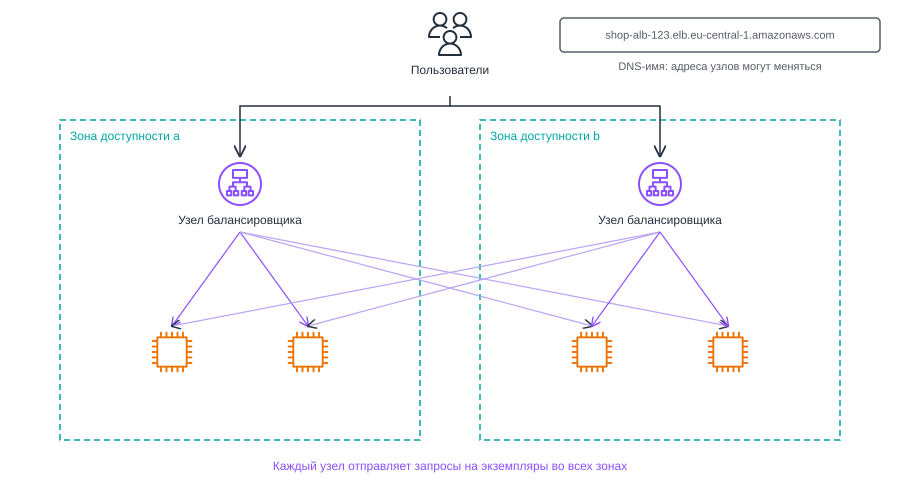
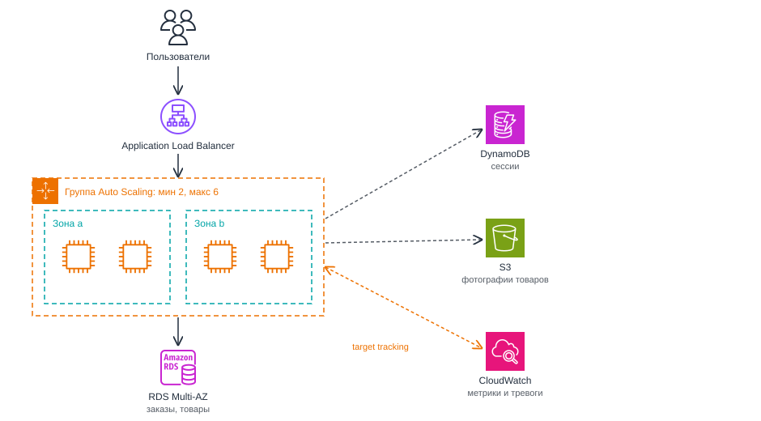

# Масштабируемость и балансировка нагрузки. Elastic Load Balancing, Amazon EC2 Auto Scaling

<i>
Демонстрация в понедельник прошла спокойно. База ещё в воскресенье ночью переехала в RDS, комиссия сделала три заказа, и все три легли в таблицу, где им и полагалось лежать. Тест Тестович со своими двумястами пятьюдесятью ковриками тоже уцелел: Джон восстановил его из дампа и считал это личной победой.

Беда пришла в среду, и с той стороны, откуда её не ждали. Староста третьего курса выложила ссылку на магазин в общий чат факультета и приписала, что первые сто заказов получат скидку. Никакой скидки в магазине не было. Но об этом знали двое, а чат читали шестьсот человек.

Эмма заметила первой: каталог открывался секунд двадцать, а потом браузер сдавался.

– База? - спросила она.

– База скучает, - ответил Джон, глядя в консоль RDS. - Процессор у неё на восьми процентах. А вот веб-сервер...

На маленьком экземпляре загрузка процессора стояла на ста процентах, ровно, будто её прибили к потолку.

Джон сделал то, что первым приходит в голову: запустил из золотого образа второй такой же сервер, потом третий. Через пять минут оба работали, оба были свободны и не получили ни одного запроса. Все шестьсот человек по-прежнему стучались на один адрес, тот, что был записан в DNS.

– Можно поменять запись на адрес второго, - предложил он.

– И тогда все уйдут на второй, - сказала Эмма. - Нам нужно, чтобы у трёх серверов был один адрес. И чтобы о сломанном сервере пользователи не узнавали раньше нас.

К вечеру поток схлынул сам: кто-то в чате написал, что скидка ненастоящая. Три сервера простаивали, и каждый исправно выставлял счёт за свой час. Джон выключил два лишних и задумался, что будет в следующий раз, когда ссылку выложат в три часа ночи.

– Нам нужен кто-то, кто будет делить запросы между серверами, - сказала Эмма. - И кто-то, кто сам будет запускать серверы, когда их не хватает, и сам выключать, когда они не нужны.

– Двое дежурных, которые никогда не спят, - сказал Джон. - Осталось понять, где таких берут.
</i>

## Вопросы для самопроверки

1. Чем производительность отличается от масштабируемости, и может ли быстрая система плохо масштабироваться?
2. Почему горизонтальное масштабирование требует приложения без состояния, и куда выносят сессии пользователей?
3. Как балансировщик нагрузки узнаёт, что сервер неисправен, и что происходит с начатыми запросами, когда сервер выводят из целевой группы?
4. Почему к Application Load Balancer обращаются по DNS-имени, а не по IP-адресу?
5. Чем listener отличается от целевой группы, и как правило listener выбирает целевую группу?
6. Как найти узкое место системы, и почему новые веб-серверы не всегда уменьшают время ответа?
7. Что означают минимальный, желаемый и максимальный размер группы Auto Scaling, и что делает группа при отказе экземпляра и при отказе зоны доступности?
8. Как работает политика target tracking, и почему новый экземпляр начинает помогать не сразу?
9. Приложению нужно 6 экземпляров. Сколько экземпляров нужно держать в каждой из трёх зон доступности, чтобы оно пережило отказ одной зоны без запуска новых машин?

## Ретроспектива

Эта глава опирается на несколько предыдущих:

- _Первая глава_. Мы различили масштабируемость и эластичность: первая позволяет справиться с ростом нагрузки за счёт новых ресурсов, вторая означает, что ресурсы добавляются и убираются автоматически.
- _Третья и четвёртая главы_. Экземпляр EC2 живёт в одной зоне доступности, поэтому один экземпляр остаётся одной точкой отказа. Там же появились AMI, золотой образ и user data, с помощью которых сервер можно пересоздать без ручной настройки.
- _Пятая глава_. В VPC мы заранее заложили публичные и приватные подсети в двух зонах, а доступ к серверам ограничили с помощью Security Group.
- _Шестая и седьмая главы_. Файлы пользователей переехали в S3, данные в управляемую базу. На диске веб-сервера не осталось пользовательских данных, и его можно заменить без их потери.

Веб-сервер теперь можно заменить, но он по-прежнему один. Отсюда возникают вопросы, на которые отвечает глава:

- Как дать нескольким серверам один адрес и делить между ними запросы?
- Как система узнает, что один из серверов сломался?
- Кто будет добавлять серверы при росте нагрузки и убирать их, когда она спадёт?
- Сколько серверов и в каких зонах нужно держать, чтобы пережить отказ целой зоны?

## Производительность и масштабируемость

### Когда одного сервера не хватает

Рассмотрим пример. Учебный интернет-магазин работает на одном экземпляре EC2. Проведём нагрузочный тест: будем увеличивать число одновременных пользователей и записывать, что происходит. Цифры условные, но картина типичная.

| Одновременных пользователей | Запросов в секунду | Среднее время ответа | Загрузка CPU |
| --------------------------- | ------------------ | -------------------- | ------------ |
| 20                          | 40                 | 80 мс                | 15%          |
| 100                         | 200                | 120 мс               | 60%          |
| 200                         | 260                | 900 мс               | 100%         |
| 400                         | 250                | 4 с, часть с ошибкой | 100%         |

Каждый пользователь в тесте отправляет около двух запросов в секунду. 100 пользователей отправляют 200 запросов в секунду, и сервер успевает их обработать. 200 пользователей отправляют уже 400 запросов в секунду, а сервер обрабатывает только 260, остальные ждут.

Пока процессор не загружен полностью, сервер обрабатывает почти все пришедшие запросы, и время ответа растёт медленно. После 100% картина меняется: число обработанных запросов перестаёт расти, а время ответа увеличивается в разы. Новые запросы встают в очередь и ждут, пока освободится процессор, а часть из них не дожидается и завершается ошибкой.

Чтобы говорить о таких таблицах точно, нужны два понятия: производительность и масштабируемость. Начнём с первого.

**Производительность (performance)** - способность системы обрабатывать работу при заданных ресурсах. Её описывают двумя величинами:

- _Задержка (latency)_. Время, за которое обслуживается один запрос[^1]. В таблице это столбец "Среднее время ответа".
- _Пропускная способность (throughput)_. Сколько запросов система обрабатывает за единицу времени. В таблице это столбец "Запросов в секунду".

Из таблицы видно, что у одного сервера есть предел пропускной способности, около 260 запросов в секунду. Сделать этот сервер быстрее можно оптимизацией кода, но предел от этого лишь сдвинется. Когда пользователей станет больше, придётся добавлять ресурсы.

### Масштабируемость

Масштабируемость мы определили в первой главе как способность справляться с ростом нагрузки за счёт добавления ресурсов. Вернер Фогельс, технический директор Amazon, уточняет это определение: сервис масштабируем, если при добавлении ресурсов его производительность растёт _пропорционально_ добавленным ресурсам[^2].

Сравним два приложения, которые запустили на одном, двух и четырёх одинаковых серверах:

| Серверов | Приложение A, запросов в секунду | Приложение B, запросов в секунду |
| -------- | -------------------------------- | -------------------------------- |
| 1        | 250                              | 400                              |
| 2        | 490                              | 450                              |
| 4        | 960                              | 470                              |

На одном сервере приложение B быстрее. Но при добавлении серверов его пропускная способность почти не растёт. Причина может быть такой: каждый запрос обновляет одну и ту же строку в базе данных, а изменять её одновременно может только один запрос. Новые серверы лишь удлиняют очередь к этой строке. К такой ситуации мы вернёмся в разделе "Узкие места". Приложение A медленнее, зато удвоение серверов почти удваивает его пропускную способность. Приложение A масштабируется, B нет.

_Не путайте производительность и масштабируемость._ Производительность говорит, сколько система выдерживает сейчас. Масштабируемость говорит, сколько она выдержит, если дать ей больше ресурсов. Быстрое приложение может плохо масштабироваться, и наоборот. Поэтому нагрузочный тест на одном сервере ещё не отвечает на вопрос, выдержит ли приложение рост: его нужно повторить на двух и четырёх серверах.

## Вертикальное и горизонтальное масштабирование веб-серверов

### Два способа добавить ресурсы

Добавить ресурсы можно двумя способами. При _вертикальном масштабировании_ сервер заменяют более мощным, при _горизонтальном_ - рядом с ним запускают ещё несколько таких же[^3]. Добавление серверов называют _scale out_, а удаление лишних при спаде нагрузки - _scale in_. Вертикальное масштабирование в документации называют _scale up_.

_8.1. Вертикальное и горизонтальное масштабирование_

На рисунке 8.1 слева сервер заменяют более мощным, справа рядом с двумя серверами запускают ещё два, и все они получают запросы через общую точку входа.

Для веб-сервера на EC2 у вертикального масштабирования есть конкретная цена:

- _Остановка сервера_. Тип экземпляра меняют только у остановленного экземпляра, поэтому на время смены приложение недоступно[^4].
- _Новый публичный адрес_. При остановке экземпляр теряет публичный IPv4-адрес и после запуска получает другой, если это не Elastic IP[^4].
- _Потолок_. Самый мощный тип экземпляра ограничен по числу процессоров и объёму памяти. Выше подняться нельзя.
- _Одна точка отказа_. Мощный сервер ломается так же, как слабый, и вместе с ним останавливается всё приложение.

Горизонтальное масштабирование лишено этих недостатков, но предъявляет требования к самому приложению:

- _Одинаковые серверы_. Все экземпляры запускаются из одного образа и с одинаковой конфигурацией, иначе пользователи будут получать разные ответы на один и тот же запрос.
- _Общая точка входа_. У пользователя один адрес, а сервер, который ответит, выбирает система. Без этого второй сервер простаивает, как в истории в начале главы.
- _Отсутствие состояния на серверах_. Любой запрос может попасть на любой сервер, поэтому ни один сервер не должен хранить то, что понадобится при следующем запросе.

AWS в принципах надёжности советует заменять один большой ресурс несколькими маленькими, которые не имеют общей точки отказа[^5].

### Что выбрать

_Вертикальное масштабирование_ подходит в двух случаях:

- когда приложение нельзя запустить в нескольких копиях (например, старая программа хранит данные в памяти)
- когда нагрузка растёт медленно и раз в год можно потерпеть плановый простой.

_Горизонтальное масштабирование_ выбирают, когда:

- нагрузка меняется в течение дня,
- простой недопустим,
- отказ одного сервера не должен останавливать приложение.

| Ситуация                                                            | Подходящий способ                                  |
| ------------------------------------------------------------------- | -------------------------------------------------- |
| Внутренний сервис для десяти сотрудников, нагрузка постоянная       | Вертикальное: один сервер нужного размера          |
| Интернет-магазин с пиками по вечерам и во время распродаж           | Горизонтальное: несколько серверов, число меняется |
| Программа, которая хранит всё в памяти одного процесса              | Вертикальное, пока приложение не переделано        |
| Сайт, который не должен останавливаться при отказе зоны доступности | Горизонтальное: серверы в нескольких зонах         |

Дальше глава по очереди разбирает три темы:

1. отсутствие состояния на серверах,
2. общую точку входа,
3. автоматическое изменение числа серверов.

## Приложение без состояния

### Проблема: пользователь потерял сессию

Предположим, магазин работает на двух серверах, и запросы поочерёдно попадают то на один, то на другой. Пользователь входит в свой аккаунт:

1. Запрос с логином и паролем попадает на сервер A. Сервер проверяет пароль, создаёт сессию и хранит её в своей оперативной памяти.
2. Пользователь открывает корзину. Запрос попадает на сервер B.
3. Сервер B ничего не знает о сессии, созданной на A, и показывает форму входа.

Файлы пользователей мы уже вынесли с серверов, но в памяти процесса осталось другое состояние.

**Состояние (state)** - данные, которые сервер запоминает между запросами и от которых зависит ответ на следующий запрос.

**Приложение без состояния (stateless application)** - приложение, которому для обработки запроса не нужно знать о предыдущих запросах, хранящихся на этом же сервере[^6]. Любой его экземпляр может обработать любой запрос, поэтому экземпляры можно добавлять, удалять и заменять без последствий для пользователей[^6].

### Где прячется состояние

Сессия в памяти не единственный вид локального состояния. Проверьте приложение по списку:

- _Сессии и корзины в памяти процесса_. Многие веб-фреймворки по умолчанию хранят сессии в памяти: это удобно при разработке и ломается на втором сервере.
- _Файлы на диске экземпляра_. Загруженные фотографии, сгенерированные отчёты, временные файлы, которые нужны в следующем запросе.
- _Кеш в памяти_. Сам по себе он не опасен, если это копия данных из базы. Опасен кеш, который считается единственным местом хранения, например счётчик просмотров, который никуда не сохраняется.
- _Задачи по расписанию_. Если каждый сервер раз в час рассылает письма, то четыре сервера разошлют каждое письмо четыре раза.
- _Журналы приложения_. Журнал на диске пропадёт вместе с экземпляром, когда его удалят.

### Куда выносят состояние

Принцип один: состояние уходит с сервера в отдельное место, общее для всех экземпляров. В качестве хранилища данных сессий AWS указывает Amazon DynamoDB, Amazon ElastiCache и Amazon EFS[^6]. ElastiCache хранит данные в памяти и отвечает быстрее, но это ещё один сервис, который нужно настроить. Для магазина подходят два варианта:

- _Общее хранилище сессий_. Сервер сохраняет сессию в таблицу DynamoDB с ключом раздела (partition key) `sessionId`, а в браузер отправляет только идентификатор в cookie. Любой сервер по идентификатору читает сессию из таблицы. Просроченные сессии удаляет TTL.
- _Токен на стороне клиента_. Сервер не хранит сессию вообще. После входа он выдаёт браузеру подписанный токен, например **JWT (JSON Web Token)** - компактную строку с данными о пользователе (claims), которую нельзя подделать без секретного ключа сервера[^7]. Секретный ключ у всех экземпляров общий, поэтому любой экземпляр проверяет подпись и узнаёт пользователя без обращения к хранилищу. Цена в том, что выданный токен трудно отозвать до истечения его срока.

_8.2. Сессия в памяти сервера и в общем хранилище_

На рисунке 8.2 слева сессия живёт в памяти сервера A, и сервер B её не видит. Справа оба сервера читают сессию из общей таблицы, и пользователь не замечает, какой сервер ему ответил.

### Привязка сессий

Есть и обходной путь: не выносить сессию, а отправлять все запросы одного пользователя на один и тот же сервер.

**Привязка сессий (sticky sessions)** - режим, в котором система запоминает, на какой сервер попал пользователь, и отправляет туда все его следующие запросы.

Есть и обходной путь: не выносить сессию, а отправлять все запросы одного пользователя на один и тот же сервер.

**Привязка сессий (sticky sessions)** - режим, в котором система запоминает, на какой сервер попал пользователь, и отправляет туда все его следующие запросы.

Этот путь быстрее переделки приложения, но у него есть цена[^8]:

- _Неравномерная нагрузка_. Активные пользователи оказываются на одном сервере, а новый сервер получает только новых пользователей.
- _Потеря сессий при отказе_. Если сервер сломался, все его сессии пропадают вместе с ним, и пользователям придётся войти заново.
- _Сложное сокращение_. Сервер нельзя удалить, пока на нём есть живые сессии.

Поэтому привязку сессий используют как временную меру для старого приложения, а новое проектируют без состояния.

> [!TIP]
>
> Приложение можно проверить простым тестом: можно ли удалить любой из серверов в любую минуту так, чтобы ни один пользователь этого не заметил? Если ответ "нет", на сервере осталось состояние.

## Балансировка нагрузки

### Единая точка входа

Приложение без состояния можно запустить на нескольких серверах. Осталось дать им общий вход.

**Балансировщик нагрузки (load balancer)** - компонент, который принимает запросы клиентов на одном адресе и распределяет их между несколькими серверами. Серверы, на которые балансировщик направляет запросы, называют _целями (targets)_ или _бэкендами (backends)_.

Балансировщик решает сразу несколько задач:

- у приложения один адрес, сколько бы серверов за ним ни стояло,
- нагрузка делится между серверами,
- запросы не попадают на неисправные серверы,
- серверы можно добавлять и выводить на обслуживание незаметно для пользователей.

### Алгоритмы балансировки

**Алгоритм балансировки (load balancing algorithm)** - правило, по которому балансировщик выбирает цель для очередного запроса. Рассмотрим три распространённых алгоритма на примере. Два сервера, A и B, получают пять запросов, которые приходят каждые 0,2 секунды. Каждый сервер обрабатывает один запрос за раз. Запрос 2 тяжёлый: это отчёт, который строится 3 секунды. Остальные обрабатываются за 100 мс.

- _Round robin_. Цели выбираются по кругу: A, B, A, B, A. Алгоритм прост и хорош, когда запросы и серверы примерно одинаковы[^10]. В нашем примере запрос 4 попадёт на сервер B, который ещё занят отчётом, хотя сервер A свободен.
- _Наименьшее число запросов в обработке (least outstanding requests)_. Запрос уходит на цель, у которой сейчас меньше всего незавершённых запросов[^10]. Пока B строит отчёт, запросы 3, 4 и 5 уходят на A. Алгоритм лучше подходит, когда запросы сильно различаются по сложности.
- _Хеширование (hashing)_. Из полей сетевого пакета, например адресов и портов, вычисляется число, по которому выбирается цель[^9]. Все пакеты одного соединения попадают на одну цель. Простое хеширование по модулю числа серверов меняет соответствие между соединениями и серверами при добавлении или удалении сервера, поэтому на практике используют _согласованное хеширование (consistent hashing)_: при добавлении сервера лишь небольшая часть соединений меняет цель[^9].

_8.3. Round robin и наименьшее число запросов в обработке_

На рисунке 8.3 видно, что при round robin запрос 4 ждёт на занятом сервере B, а при выборе по числу запросов в обработке сразу уходит на свободный сервер A.

У алгоритма наименьшего числа запросов есть слабость: неисправный сервер, который мгновенно отвечает ошибкой, выглядит свободным и начинает получать больше запросов, чем исправные[^11]. Поэтому выбор цели всегда дополняют проверкой, исправна ли она.

### Проверки работоспособности

Сервер может быть включён, но не работать:

- процесс приложения завис,
- закончилось место на диске,
- приложение запустилось с ошибкой в конфигурации.

Виртуальная машина при этом в порядке, и пинг проходит. Балансировщику нужен способ узнать, может ли сервер обрабатывать запросы.

**Проверка работоспособности (health check)** - регулярный запрос, который балансировщик отправляет каждой цели, чтобы решить, можно ли направлять на неё трафик. Обычно это HTTP-запрос на специальный путь, например `/health`, и ожидаемый ответ с кодом 200.

Проверку описывают несколько параметров:

- _Путь и протокол_. Куда отправлять запрос.
- _Интервал (interval)_. Как часто проверять.
- _Таймаут (timeout)_. Сколько ждать ответа, прежде чем считать проверку неудачной.
- _Порог неисправности (unhealthy threshold)_. Сколько неудачных проверок подряд нужно, чтобы исключить цель.
- _Порог исправности (healthy threshold)_. Сколько успешных проверок подряд нужно, чтобы вернуть цель.

Пороги нужны, чтобы одна случайная медленная проверка не выбрасывала сервер. Цена порогов в задержке. При интервале 10 секунд и пороге 2 неисправный сервер будет исключён примерно через 20 секунд, и всё это время часть пользователей получает ошибки.

### Что должен проверять `/health`

Проверки бывают разной глубины[^12]:

- _Проверка живости (liveness check)_. Сервер принимает соединение и отвечает. Такую проверку балансировщик может выполнять без участия приложения, например просто устанавливая TCP-соединение с портом.
- _Локальная проверка (local health check)_. Приложение проверяет то, что принадлежит только этому серверу: процесс запущен, конфигурация загружена, диск доступен для записи.
- _Проверка зависимостей (dependency health check)_. Приложение проверяет, что может работать с базой данных и другими сервисами.

Проверка зависимостей кажется самой полезной, но в проверке, которую выполняет балансировщик, она опасна. Если база данных замедлится, проверку одновременно провалят все серверы, хотя сами они исправны[^12]. Балансировщик исключит всех, и магазин станет недоступен целиком. Поэтому команды Amazon оставляют в быстрых проверках балансировщика только локальные[^12], а состояние зависимостей отслеживают отдельно.

Отдельный путь `/health` нужен потому, что главная страница `/` обычно обращается к базе и строится долго, и проверка по ней превращается в проверку зависимостей. Обработчик `/health` лёгкий и проверяет только сам сервер.

## Amazon Elastic Load Balancing

### Что такое Elastic Load Balancing

Балансировщик можно собрать самостоятельно, например на отдельном экземпляре с веб-сервером nginx, который умеет пересылать запросы на другие серверы. Но тогда он сам станет одной точкой отказа, и его придётся масштабировать и обновлять. В AWS эту работу выполняет управляемый сервис.

**Elastic Load Balancing (ELB)** - сервис AWS, который распределяет входящий трафик между несколькими целями, например экземплярами EC2, контейнерами и IP-адресами, в одной или нескольких зонах доступности, следит за состоянием целей и направляет трафик только на исправные[^13].

| Характеристика      | Elastic Load Balancing                                                                                                                               |
| ------------------- | ---------------------------------------------------------------------------------------------------------------------------------------------------- |
| Категория           | Сети и доставка контента (networking)                                                                                                                |
| Что делает          | Принимает входящий трафик на одном адресе и распределяет его между исправными целями                                                                 |
| Для чего нужен      | Дать нескольким серверам общую точку входа и не пускать запросы на неисправные серверы                                                               |
| Где используют      | Перед веб-серверами и API, перед группами одинаковых серверов, перед внутренними сервисами в приватных подсетях                                      |
| Модель обслуживания | PaaS: узлы балансировщика, их масштабирование и замену обслуживает AWS, а вы настраиваете правила, цели и проверки                                   |
| Область действия    | Регион: балансировщик создаётся в VPC и размещает узлы в выбранных зонах доступности                                                                 |
| Как оплачивается    | Часы работы балансировщика и использованные единицы мощности (LCU), описанные в разделе "Стоимость", и публичные IPv4-адреса внешнего балансировщика |
| Как работать        | Консоль (раздел EC2, Load Balancing), команды `aws elbv2`, SDK                                                                                       |
| Появился            | Май 2009 года, вместе с Auto Scaling и CloudWatch[^14]. Application Load Balancer появился в августе 2016 года[^15]                                  |
| Аналоги             | Google Cloud Load Balancing[^16], Azure Load Balancer и Azure Application Gateway                                                                    |

### Основные характеристики Elastic Load Balancing

Балансировщик в AWS не один сервер, а набор узлов в нескольких зонах доступности, за которыми следит AWS. Сервис сам увеличивает мощность балансировщика при росте трафика[^13], поэтому о его размере думать не нужно. Числа, которые важно знать при проектировании, собраны в таблице для самого распространённого типа, Application Load Balancer. Каждый параметр разобран в следующих разделах, а сейчас достаточно увидеть, какие настройки вообще есть.

Важные параметры Application Load Balancer:

| Параметр                                | Значение                                                                                             |
| --------------------------------------- | ---------------------------------------------------------------------------------------------------- |
| Зоны доступности                        | Не меньше двух, по одной подсети в каждой зоне[^17]                                                  |
| Узлы                                    | Один узел и один IP-адрес в каждой включённой зоне[^17]                                              |
| Адрес                                   | DNS-имя вида `name-id.elb.region.amazonaws.com`, TTL записи 60 секунд[^17][^18]                      |
| Проверка работоспособности по умолчанию | HTTP, путь `/`, интервал 30 с, таймаут 5 с, порог исправности 5, порог неисправности 2, код 200[^19] |
| Задержка отмены регистрации             | 300 секунд по умолчанию, от 0 до 3600[^20]                                                           |
| Распределение между зонами (cross-zone) | Всегда включено на уровне балансировщика[^17]                                                        |

_Не путайте масштабирование балансировщика и масштабирование приложения._ ELB сам добавляет мощность своим узлам, но не запускает новые экземпляры EC2. Если за балансировщиком два сервера и оба перегружены, балансировщик распределит запросы между двумя перегруженными серверами. Добавлять серверы будет другой сервис, Amazon EC2 Auto Scaling, которому посвящён отдельный раздел главы.

### Как устроен балансировщик

Когда для балансировщика включают зону доступности, ELB создаёт в ней _узел балансировщика (load balancer node)_[^18]. Клиент обращается не к узлу, а к DNS-имени балансировщика. DNS-серверы AWS возвращают IP-адреса узлов, и клиент подключается к одному из них[^18]. Узел выбирает цель и передаёт ей запрос по приватному адресу.

_8.4. Узлы Application Load Balancer в двух зонах доступности_

На рисунке 8.4 у балансировщика по узлу в каждой из двух зон, и каждый узел отправляет запросы на экземпляры обеих зон. При изменении трафика ELB масштабирует балансировщик и обновляет DNS-запись[^18], поэтому набор IP-адресов узлов со временем меняется. Отсюда правило для приложения: к балансировщику обращаются только по DNS-имени. Собственный домен магазина направляют на это имя в Route 53, а IP-адреса узлов никуда не записывают.

Балансировщик бывает двух видов по доступности из сети[^18]:

- _Внешний (internet-facing)_. У узлов есть публичные IP-адреса, и клиенты приходят из интернета. Узлы размещают в публичных подсетях.
- _Внутренний (internal)_. У узлов только приватные адреса, и балансировщик доступен только изнутри VPC. Его ставят, например, перед внутренним сервисом, к которому обращаются веб-серверы.

В обоих случаях цели получают запросы по приватным IP-адресам[^18]. Поэтому экземплярам за внешним балансировщиком публичные адреса не нужны, и их можно перенести в приватные подсети. Обновления из интернета они тогда получают через NAT Gateway.

### Типы балансировщиков

Для веб-приложения выбирают Application Load Balancer, и дальше глава говорит о нём. Чтобы понять, чем он отличается от остальных типов, вспомним, что сеть описывают уровнями модели OSI. Для балансировщиков важны два из них:

- _транспортный уровень (уровень 4)_, на котором есть соединения TCP и UDP, адреса и порты, но нет понятия HTTP-запроса,
- _прикладной уровень (уровень 7)_, на котором балансировщик видит HTTP-запрос целиком: метод, путь, заголовки.

Например, на уровне 4 балансировщик видит только, что клиент `203.0.113.7` подключается к порту 443. На уровне 7 он видит строку `GET /api/orders` и может отправить её на отдельную группу серверов.

ELB предлагает четыре типа балансировщиков[^13]:

| Тип                             | Уровень         | Протоколы                                             | Для чего                                                                           |
| ------------------------------- | --------------- | ----------------------------------------------------- | ---------------------------------------------------------------------------------- |
| Application Load Balancer (ALB) | 7, прикладной   | HTTP, HTTPS                                           | Веб-приложения и API, маршрутизация по пути и имени хоста[^21]                     |
| Network Load Balancer (NLB)     | 4, транспортный | TCP, UDP, TLS (шифрование, на котором работает HTTPS) | Не-HTTP протоколы, статический IP-адрес в каждой зоне[^22]                         |
| Gateway Load Balancer (GWLB)    | 3, сетевой      | Все IP-пакеты                                         | Пропуск трафика через сторонние межсетевые экраны, в курсе не рассматривается[^23] |
| Classic Load Balancer (CLB)     | 4 и 7           | HTTP, HTTPS, TCP                                      | Предыдущее поколение, AWS рекомендует перейти на текущие типы[^13]                 |

NLB выбирают, когда приложение общается не по HTTP, например игровой сервер на UDP, или когда клиентам нужен постоянный IP-адрес: у NLB статический адрес в каждой зоне, к нему можно привязать Elastic IP[^22]. Выбирая цель, NLB вычисляет хеш от протокола, адресов и портов, и одно TCP-соединение всё время своей жизни идёт на одну цель[^22].

Целью ALB может быть не только экземпляр EC2, но и функция AWS Lambda[^21]. Lambda - сервис, который запускает фрагмент кода в ответ на запрос без сервера, которым вы управляете. Мы рассмотрим его позже в курсе.

### Listener, правила и целевые группы

Настройка ALB складывается из трёх частей.

**Listener (слушатель)** - процесс балансировщика, который принимает подключения клиентов на заданном протоколе и порту[^24], например HTTP на порту 80 или HTTPS на порту 443.

Для HTTPS-listener нужен сертификат сервера[^24]: балансировщик сам расшифровывает трафик, а дальше передаёт запрос экземпляру. Это называют _завершением TLS (TLS termination)_. В примерах главы listener работает по HTTP на порту 80.

**Правило listener (listener rule)** - условие и действие, которые определяют, куда направить запрос[^25]. Условие проверяет путь, имя хоста, HTTP-метод или IP-адрес источника. Действие бывает трёх видов[^25]:

- `forward` пересылает запрос в целевую группу,
- `redirect` перенаправляет клиента на другой адрес,
- `fixed-response` возвращает готовый ответ.

Правила проверяются по возрастанию приоритета. У каждого listener есть _правило по умолчанию_[^24][^25]:

- у него нет условий,
- его нельзя удалить,
- оно срабатывает последним, если не подошло ни одно другое правило.

**Целевая группа (target group)** - набор зарегистрированных целей, на которые балансировщик направляет запросы, вместе с настройками проверки работоспособности и алгоритма балансировки[^20]. Цели в группе задаются по идентификатору экземпляра или по IP-адресу[^20].

Рассмотрим пример. В магазине есть веб-интерфейс, отдельный API для мобильного приложения и административная часть, и они работают на разных группах серверов:

| Приоритет    | Условие                   | Действие                                |
| ------------ | ------------------------- | --------------------------------------- |
| 10           | Путь `/api/*`             | Переслать в целевую группу `shop-api`   |
| 20           | Хост `admin.shop.example` | Переслать в целевую группу `shop-admin` |
| По умолчанию | Нет                       | Переслать в целевую группу `shop-web`   |

Запрос `GET /api/orders` подходит под правило 10 и попадает на серверы API. Запрос `GET /catalog` не подходит ни под одно правило с условием и уходит в `shop-web`.

_8.5. Listener, правила и целевые группы_

На рисунке 8.5 listener проверяет правила сверху вниз и пересылает запрос в первую подходящую целевую группу.

Алгоритм балансировки задаётся для целевой группы. По умолчанию это round robin, можно выбрать least outstanding requests[^10].

### Проверки работоспособности в целевой группе

Проверки работоспособности настраивают в целевой группе. Значения по умолчанию приведены в таблице "Важные параметры Application Load Balancer". По результатам проверок каждая цель находится в одном из состояний[^19]:

| Состояние   | Что означает                                                        | Получает ли новые запросы   |
| ----------- | ------------------------------------------------------------------- | --------------------------- |
| `initial`   | Цель регистрируется или проходит первые проверки                    | Нет                         |
| `healthy`   | Цель прошла проверки                                                | Да                          |
| `unhealthy` | Цель не ответила или ответ не прошёл проверку                       | Нет, кроме случая fail open |
| `draining`  | Цель выводится из группы, балансировщик дожидается текущих запросов | Нет                         |
| `unused`    | Цель не используется, например не зарегистрирована                  | Нет                         |

Посчитаем, что дают значения по умолчанию. При интервале 30 секунд и пороге неисправности 2 сломанный сервер будет исключён примерно через минуту. Чтобы вернуться, ему нужно 5 успешных проверок подряд, то есть около двух с половиной минут. Для учебного магазина минута ошибок может быть терпимой, для платёжного сервиса нет. Если минута недопустима, интервал уменьшают.

_8.6. Состояния цели при проверках работоспособности_

На рисунке 8.6 цель переходит в `unhealthy` после второй неудачной проверки и возвращается в `healthy` только после пяти успешных подряд.

Если исправных целей в группе не осталось совсем, ALB не возвращает ошибку, а начинает отправлять запросы на все цели независимо от их состояния[^19]. Такое поведение называют _fail open_. Оно защищает от ситуации, описанной в разделе "Что должен проверять `/health`": если все серверы провалили проверку из-за общей зависимости, часть запросов всё-таки будет обслужена.

### Отмена регистрации и завершение запросов

Когда цель выводят из группы, например при удалении экземпляра, балансировщик переводит её в состояние `draining`. Новые запросы на неё больше не идут, а начатые получают время завершиться. Это время называют _задержкой отмены регистрации (deregistration delay)_, по умолчанию 300 секунд[^20].

Когда экземпляр удаляет группа Auto Scaling (она разобрана в разделе "Amazon EC2 Auto Scaling"), события идут в таком порядке: группа отменяет регистрацию цели, балансировщик переводит её в `draining` и ждёт завершения начатых запросов, затем экземпляр выключается, и операционная система отправляет приложению `SIGTERM`. Обработчик `SIGTERM` из раздела "Что должен проверять `/health`" нужен для остановок без отмены регистрации, например при перезапуске приложения. Если приложение обрывает соединения при остановке, пользователи будут получать ошибки.

### Распределение между зонами

Каждый узел балансировщика получает примерно равную долю трафика: клиенты выбирают узлы через DNS. Если узел отправляет запросы только на цели своей зоны, нагрузка на цели может оказаться неравномерной[^18].

Рассмотрим пример. В зоне `a` работает один экземпляр, в зоне `b` три. Каждый узел получает 50% трафика.

| Режим                                   | Экземпляр в зоне `a` | Каждый экземпляр в зоне `b` |
| --------------------------------------- | -------------------- | --------------------------- |
| Только своя зона                        | 50%                  | около 17%                   |
| Распределение между зонами (cross-zone) | 25%                  | 25%                         |

Во втором режиме каждый узел распределяет запросы между всеми целями во всех зонах. У ALB этот режим всегда включён на уровне балансировщика, но для отдельной целевой группы его можно выключить[^17]. У NLB он по умолчанию выключен[^18].

### Привязка сессий в ALB

ALB поддерживает привязку сессий на уровне целевой группы. В режиме на основе длительности балансировщик выдаёт клиенту cookie с именем `AWSALB`, а клиент возвращает её с каждым запросом[^26]. Срок привязки задаётся от 1 секунды до 7 дней[^26]. Если цель из cookie стала неисправной или удалена, балансировщик выбирает новую цель и обновляет cookie[^26]. Сессия, хранившаяся в памяти старого сервера, при этом теряется.

Привязка не работает, если в целевой группе выключено распределение между зонами[^26].

### Балансировщик и Security Group

У ALB есть своя Security Group, а у экземпляров своя. Цепочку правил строят так, чтобы из интернета можно было попасть только на балансировщик[^27]:

| Security Group | Входящее правило            | Зачем                                                 |
| -------------- | --------------------------- | ----------------------------------------------------- |
| `sg-alb`       | TCP 80 и 443 из `0.0.0.0/0` | Пользователи из интернета приходят на балансировщик   |
| `sg-web`       | TCP 80 из группы `sg-alb`   | Экземпляры принимают запросы только от балансировщика |
| `sg-db`        | TCP 5432 из группы `sg-web` | База принимает подключения только от веб-серверов     |

Во втором правиле источником указана не подсеть, а Security Group балансировщика[^27]. Узлы балансировщика меняют адреса, а правило по группе от этого не зависит. Если приложение и проверка `/health` работают на разных портах, правило `sg-web` должно разрешать оба[^27].

_8.7. Цепочка Security Group_

На рисунке 8.7 каждая следующая Security Group пропускает трафик только от предыдущей, а прямой путь из интернета к веб-серверам закрыт.

Адрес клиента ALB передаёт в заголовке `X-Forwarded-For`, а протокол, по которому клиент подключился, в `X-Forwarded-Proto`[^28]. Если запрос прошёл через несколько _прокси_, то есть промежуточных серверов, которые пересылают запросы дальше, в заголовке будет список адресов через запятую, и балансировщик добавляет адрес клиента в конец списка[^28]. Значениям заголовка можно доверять, только если их добавили системы внутри вашей сети[^28]. Клиент может сам отправить `X-Forwarded-For: 1.2.3.4`, и после балансировщика заголовок превратится в `1.2.3.4, 203.0.113.7`. Настоящим будет только последний адрес, который дописал балансировщик. Поэтому в Express указывают, сколько доверенных прокси стоит перед приложением (`app.set("trust proxy", 1)`), и берут адрес клиента из `req.ip`.

`X-Forwarded-Proto` нужен, когда HTTPS завершается на балансировщике, то есть трафик расшифровывается на нём: до экземпляра запрос идёт по HTTP, и приложение по этому заголовку понимает, что пользователь пришёл по HTTPS, и не перенаправляет его на HTTPS повторно.

> _Hands-on 8.1. Балансировщик для двух серверов._ Создание целевой группы с проверкой `/health`, Application Load Balancer в двух публичных подсетях и цепочки Security Group. Проверка распределения запросов и отказа одного из серверов.

## Узкие места

### Почему новые серверы не помогли

Вернёмся к магазину. Веб-серверов стало четыре, балансировщик делит между ними запросы, но во время распродажи время ответа почти не уменьшилось. Посмотрим на загрузку компонентов:

| Компонент          | Загрузка CPU    | Что ещё видно                                  |
| ------------------ | --------------- | ---------------------------------------------- |
| Веб-серверы, 4 шт. | 30-35%          | Запросы долго ждут ответа базы                 |
| База данных        | 95%             | Очередь запросов, медленные запросы к каталогу |
| Балансировщик      | Обслуживает AWS | Ошибок нет                                     |

Веб-серверы простаивают: они ждут базу данных. Добавлять пятый и шестой веб-сервер бесполезно. Если узкое место - база, новые веб-серверы не помогут[^8].

**Узкое место (bottleneck)** - компонент системы, который первым исчерпывает свои ресурсы и ограничивает пропускную способность всей системы.

Узкое место перемещается. Пока сервер был один, им был процессор веб-сервера. Когда веб-уровень стал масштабироваться, узким местом стала база. Если ускорить базу, следующим может оказаться сеть или внешний платёжный сервис.

### Как найти узкое место

Брендан Грегг предлагает метод USE (по первым буквам слов utilization, saturation, errors): для каждого ресурса проверить три показателя[^29]:

- _Утилизация (utilization)_. Какую долю времени ресурс был занят, например загрузка CPU _95%_.
- _Насыщение (saturation)_. Есть ли работа, которую ресурс не успевает выполнить и ставит в очередь[^29], например запросы, ожидающие свободного соединения с базой.
- _Ошибки (errors)_. Сколько операций завершилось ошибкой.

Ресурсы перебирают по очереди для каждого компонента: процессор, память, диск и сеть. Метод применяют в начале расследования, чтобы найти системные узкие места[^29].

Применим метод к таблице загрузки компонентов из предыдущего раздела. У базы утилизация процессора 95% и есть насыщение: запросы стоят в очереди. Это узкое место. У веб-серверов утилизация 30-35% и насыщения нет: они не перегружены, а ждут базу.

Чаще всего узким местом оказываются компоненты с состоянием[^8]: база данных, общий файл, внешний сервис с лимитом запросов. Их нельзя просто размножить, как веб-серверы. Для базы применяют другие приёмы:

- реплики для чтения,
- кеширование часто читаемых данных,
- оптимизацию медленных запросов.

У горизонтального масштабирования есть и побочный эффект, который легко пропустить. Каждый веб-сервер держит _пул соединений (connection pool)_ - набор заранее открытых соединений с базой, которые приложение использует повторно, а не открывает заново на каждый запрос. Если пул рассчитан на 20 соединений, то 4 сервера держат 80 соединений, а 12 серверов уже 240. Число соединений у СУБД ограничено, и при росте группы база может начать отказывать в подключениях. Поэтому размер пула и максимальный размер группы выбирают вместе: их произведение должно быть меньше предела соединений СУБД.

Измерять загрузку и время ответа в AWS помогает Amazon CloudWatch.

## Amazon CloudWatch: метрики и тревоги

### Что такое CloudWatch

**Amazon CloudWatch** - сервис AWS, который собирает метрики ресурсов AWS и приложений, проверяет их по заданным порогам и запускает действия при выходе за пороги[^30].

| Характеристика      | Amazon CloudWatch                                                                                  |
| ------------------- | -------------------------------------------------------------------------------------------------- |
| Категория           | Управление и наблюдение (management and governance)                                                |
| Что делает          | Собирает метрики и журналы, строит графики, поднимает тревоги и запускает действия                 |
| Для чего нужен      | Знать, что происходит с системой, и автоматически реагировать на изменения                         |
| Где используют      | Мониторинг экземпляров, балансировщиков и баз данных, автоматическое масштабирование, оповещения   |
| Модель обслуживания | PaaS: хранение и обработку метрик обслуживает AWS, вы выбираете метрики, пороги и действия         |
| Область действия    | Регион: метрики и тревоги существуют в регионе ресурса                                             |
| Как оплачивается    | Базовые метрики сервисов бесплатно, платно детальные и пользовательские метрики, тревоги и журналы |
| Как работать        | Консоль (раздел CloudWatch), команды `aws cloudwatch`, SDK                                         |
| Появился            | Май 2009 года[^14]                                                                                 |
| Аналоги             | Google Cloud Monitoring, Azure Monitor                                                             |

CloudWatch умеет многое, в том числе хранить журналы приложений и строить панели мониторинга. В этой главе нужны только две его части: метрики и тревоги, потому что на них работает автоматическое масштабирование.

### Метрики

**Метрика (metric)** - упорядоченный по времени ряд значений одного показателя, которые публикуются в CloudWatch[^31]. Например, загрузка процессора экземпляра или число запросов к балансировщику.

Метрику однозначно определяют три вещи[^31]:

- _Пространство имён (namespace)_. Группа, в которой собраны метрики одного сервиса: `AWS/EC2` для экземпляров, `AWS/ApplicationELB` для ALB.
- _Имя метрики_. Например, `CPUUtilization`.
- _Измерения (dimensions)_. Пары "имя - значение", которые уточняют, чья это метрика, например `InstanceId=i-0abc...` или `AutoScalingGroupName=shop-web`.

Чтобы построить график или проверить порог, отдельные значения сводят за _период (period)_ с помощью _статистики_:

- среднего (Average),
- суммы (Sum),
- максимума (Maximum),
- процентиля[^32].

Например, для метрики `CPUUtilization` в `AWS/EC2` с измерением `AutoScalingGroupName=shop-web` статистика Average и период 60 секунд дают одну точку в минуту: среднюю загрузку процессора всех экземпляров группы. Минутные точки у EC2 есть только при детальном мониторинге, он описан ниже.

Для времени ответа среднее значение обманчиво. Рассмотрим пример:

- 90 запросов обработаны за 100 мс,
- 10 запросов за 5 секунд.

Среднее время ответа 590 мс выглядит терпимо, хотя каждый десятый пользователь ждёт 5 секунд.

_Процентиль_ показывает это лучше: `p95` означает, что `95%` значений не больше него[^32]. Здесь p95 равен 5 секундам и сразу показывает медленные запросы. Поэтому для времени ответа смотрят p95 или p99.

Экземпляры EC2 по умолчанию отправляют метрики раз в 5 минут. Это _базовый мониторинг_, он бесплатен. _Детальный мониторинг_ присылает метрики раз в минуту, его включают отдельно и оплачивают за каждую метрику[^33]. Для автоматического масштабирования рекомендуют детальный мониторинг: решение, принятое по данным пятиминутной давности, запаздывает[^34].

> [!WARNING]
> Загрузки памяти среди стандартных метрик EC2 нет[^35]. Гипервизор видит процессор, диск и сеть машины, но не знает, как операционная система распоряжается памятью. Метрику `mem_used_percent` отправляет агент CloudWatch, который устанавливают на экземпляр[^36].

Для веб-приложения за балансировщиком самые полезные метрики публикует ALB[^37]:

| Метрика                     | Что показывает                                                 | Полезная статистика                    |
| --------------------------- | -------------------------------------------------------------- | -------------------------------------- |
| `RequestCount`              | Число обработанных запросов                                    | Sum                                    |
| `TargetResponseTime`        | Время от отправки запроса цели до начала её ответа, в секундах | Average, p95, p99                      |
| `HTTPCode_Target_5XX_Count` | Число ответов с кодами 5xx, которые вернули сами цели          | Sum                                    |
| `HealthyHostCount`          | Число исправных целей                                          | Minimum                                |
| `UnHealthyHostCount`        | Число неисправных целей                                        | Maximum                                |
| `RequestCountPerTarget`     | Среднее число запросов на одну исправную цель                  | Sum: значение уже среднее на одну цель |

### Тревоги

Смотреть на графики круглосуточно никто не будет. Эту работу выполняют тревоги.

**Тревога (alarm)** - правило CloudWatch, которое следит за одной метрикой, сравнивает её с порогом и при выходе за порог выполняет действие[^30].

Тревога находится в одном из трёх состояний[^38]:

- `OK`. Метрика в пределах порога.
- `ALARM`. Метрика вышла за порог.
- `INSUFFICIENT_DATA`. Тревога только создана, метрики нет или данных недостаточно, чтобы определить состояние.

Чтобы тревога не срабатывала от единичного всплеска, задают три параметра[^38]:

- _Период_. За какой интервал вычисляется одна точка.
- _Число периодов для оценки (evaluation periods)_. Сколько последних точек рассматривается.
- _Число точек для срабатывания (datapoints to alarm)_. Сколько из них должны выйти за порог. Эти точки не обязаны идти подряд.

Рассмотрим тревогу с такими настройками: средняя загрузка CPU группы больше 70%, период 1 минута, срабатывание при 3 из 3 точек. Если загрузка подскочила до 90% на одну минуту и вернулась к 40%, тревога останется в `OK`. Если загрузка держится выше 70% три минуты подряд, тревога перейдёт в `ALARM`. При настройке 3 из 5 тревога сработает, если за последние пять минут загрузка превышала 70% трижды, даже если между этими минутами была минута ниже порога.

_8.8. Метрика, порог и состояния тревоги_

На рисунке 8.8 одна точка выше порога на третьей минуте тревогу не включает, а три точки подряд с седьмой по девятую переводят её в `ALARM`.

При смене состояния тревога может выполнить действие[^39]:

- отправить уведомление в Amazon SNS (Simple Notification Service), сервис рассылки сообщений, который, например, пришлёт письмо дежурному,
- применить к экземпляру EC2 действие, например перезагрузить его,
- запустить действие Auto Scaling, то есть изменить размер группы.

Для действий Auto Scaling есть особенность: пока тревога остаётся в новом состоянии, она повторяет действие каждую минуту[^39]. Поэтому, пока нагрузка остаётся высокой, группа продолжает расти, но не выше своего максимума. Остальные действия выполняются один раз при смене состояния.

## Эластичность: реактивное и проактивное масштабирование

Эластичность отвечает на вопрос, кто и когда добавит серверы. В определении NIST ресурсы эластично выделяются и освобождаются, иногда автоматически, в соответствии со спросом[^40].

Автоматическое изменение ресурсов бывает двух видов:

- _Реактивное_. Система замечает, что нагрузка уже выросла, и добавляет ресурсы.
- _Проактивное_. Система добавляет ресурсы заранее, по расписанию или по прогнозу.

У реактивного масштабирования есть встроенная задержка. Посчитаем, сколько проходит от начала роста нагрузки до момента, когда новый экземпляр начинает обрабатывать запросы:

| Этап                                                           | Примерное время |
| -------------------------------------------------------------- | --------------- |
| Метрика выходит за порог, тревога ждёт 3 минутные точки        | 3 мин           |
| Запуск экземпляра и загрузка ОС                                | 1 мин           |
| Установка приложения через user data                           | 2-3 мин         |
| Проверки работоспособности балансировщика до статуса `healthy` | 2-3 мин         |

Всего от 8 до 10 минут. Всплеск нагрузки, который длится две минуты, реактивное масштабирование не поймает: новые экземпляры придут, когда он закончится. Поэтому реактивное масштабирование плохо подходит для внезапных коротких всплесков[^8]. Сократить время запуска помогает золотой образ: приложение уже установлено в AMI, и этап с user data почти исчезает.

## Amazon EC2 Auto Scaling

### Что такое EC2 Auto Scaling

**Amazon EC2 Auto Scaling** - сервис AWS, который поддерживает нужное число экземпляров EC2 в группе: запускает новые при росте нагрузки, удаляет лишние при её спаде и заменяет неисправные[^41].

| Характеристика      | Amazon EC2 Auto Scaling                                                                                                         |
| ------------------- | ------------------------------------------------------------------------------------------------------------------------------- |
| Категория           | Вычисления (compute)                                                                                                            |
| Что делает          | Запускает, заменяет и удаляет экземпляры EC2 так, чтобы их число соответствовало заданному                                      |
| Для чего нужен      | Подстраивать число серверов под нагрузку и автоматически восстанавливать отказавшие серверы                                     |
| Где используют      | Веб-уровень за балансировщиком, фоновые обработчики задач, любые группы одинаковых серверов                                     |
| Модель обслуживания | Часть IaaS-сервиса EC2: экземпляры остаются вашими и администрируются вами, AWS только запускает и удаляет их по вашим правилам |
| Область действия    | Регион: одна группа размещает экземпляры в нескольких зонах доступности                                                         |
| Как оплачивается    | Сам сервис бесплатен, оплачиваются экземпляры, тревоги CloudWatch и балансировщик[^41]                                          |
| Как работать        | Консоль (раздел EC2, Auto Scaling Groups), команды `aws autoscaling`, SDK                                                       |
| Появился            | Май 2009 года[^14]                                                                                                              |
| Аналоги             | Managed instance groups в Google Compute Engine[^42], Azure Virtual Machine Scale Sets                                          |

### Основные характеристики Amazon EC2 Auto Scaling

Сервис работает с **группой Auto Scaling (Auto Scaling group)** - набором экземпляров EC2, которыми управляют как одним целым[^41]. Для группы задают:

- из чего запускать экземпляры,
- где их размещать,
- сколько их должно быть,
- когда это число менять.

Каждый из этих пунктов разобран в следующих разделах.

Важные параметры группы Auto Scaling:

| Параметр                                | Значение                                                                                      |
| --------------------------------------- | --------------------------------------------------------------------------------------------- |
| Размер                                  | Минимальный <= желаемый <= максимальный[^43]                                                  |
| Проверка работоспособности по умолчанию | Только проверки статуса EC2 (status checks), проверки балансировщика включаются отдельно[^44] |
| Период отсрочки проверок                | 300 секунд при создании в консоли, 0 при создании через CLI и SDK[^45]                        |
| Замена неисправных экземпляров          | Не больше 10% желаемого размера за раз[^44]                                                   |
| Распределение по зонам                  | Равномерно, новый экземпляр запускается в зоне, где их меньше всего[^46]                      |
| Превышение максимума при ребалансировке | На 10% или на один экземпляр, смотря что больше[^46]                                          |

_Не путайте группу Auto Scaling и целевую группу._ Целевая группа принадлежит балансировщику и отвечает на вопрос, куда отправить запрос. Группа Auto Scaling принадлежит EC2 Auto Scaling и отвечает на вопрос, сколько экземпляров должно работать. Одна связана с другой: группа Auto Scaling регистрирует свои экземпляры в целевой группе.

### Шаблон запуска

Чтобы запускать экземпляры без человека, группе нужно знать, из чего и с какими параметрами их запускать.

**Шаблон запуска (launch template)** - сохранённый набор параметров для запуска экземпляра EC2: AMI, тип экземпляра, пара ключей, Security Group и другие параметры[^47]. По желанию в шаблон добавляют роль IAM и user data[^48].

У шаблона есть версии: каждая версия хранит свой набор параметров[^47]. Если версию не указать, используется версия по умолчанию[^49]. Чтобы выпустить новую версию приложения, создают новую версию шаблона с новым AMI и указывают её в группе. Уже запущенные экземпляры от этого не меняются, но при сокращении группы первыми удаляются экземпляры, запущенные со старой версией шаблона[^50]. Чтобы заменить все экземпляры, в группе запускают обновление экземпляров (instance refresh)[^51]: группа постепенно заменяет старые экземпляры новыми по новой версии шаблона.

В старых руководствах вместо шаблонов встречаются конфигурации запуска (launch configurations). Аккаунты, созданные с 1 октября 2024 года, не могут их создавать[^52], поэтому в новых проектах используют только шаблоны.

От содержимого шаблона зависит, как быстро экземпляр начнёт работать. Есть два подхода:

- _Золотой образ_. Приложение установлено в AMI. Экземпляр готов почти сразу после загрузки, но для каждой новой версии приложения нужно собрать новый образ.
- _Установка через user data_. AMI стандартный, а скрипт при запуске устанавливает приложение. Образ собирать не нужно, но запуск длится дольше, и масштабирование запаздывает сильнее.

### Размер группы

Размер группы описывают три числа[^43]:

- **Минимальный размер (minimum capacity)** - число экземпляров, ниже которого группа никогда не опустится.
- **Максимальный размер (maximum capacity)** - число, выше которого группа не поднимется. Он ограничивает расходы и защищает базу от лавины соединений.
- **Желаемый размер (desired capacity)** - сколько экземпляров группа должна иметь сейчас. Политики масштабирования меняют именно его, оставаясь в пределах минимума и максимума.

Для магазина выберем минимум 2, желаемый 2, максимум 6. В обычный день работают два экземпляра. Во время распродажи политика поднимает желаемый размер, но не выше шести. Ночью группа не опустится ниже двух.

_8.9. Минимальный, желаемый и максимальный размер группы_

На рисунке 8.9 желаемый размер меняется от 2 до 4 и обратно, но не выходит за пределы минимума и максимума.

Если в группе меньше экземпляров, чем желаемый размер, она запускает недостающие. Если больше, удаляет лишние. Всё остальное, о чём пойдёт речь дальше, сводится к тому, что разные механизмы меняют желаемый размер, а группа приводит число экземпляров в соответствие с ним.

### Проверки работоспособности и замена экземпляров

Чтобы заменить неисправный экземпляр, группа должна узнать, что он неисправен. По умолчанию она смотрит только на проверки статуса EC2 (status checks)[^44]: работает ли виртуальная машина и инфраструктура под ней. Эти проверки не видят зависшее приложение: машина работает, а сайт не отвечает.

Проверки балансировщика видят больше, но группа по умолчанию их игнорирует[^44]. Их включают в настройках группы. После этого экземпляр, который балансировщик считает неисправным, группа помечает как `Unhealthy` при следующей периодической проверке и заменяет[^44].

> [!IMPORTANT]
> Группа за балансировщиком без включённых проверок ELB не заменит экземпляр с зависшим приложением. Балансировщик перестанет слать на него запросы, но экземпляр продолжит работать и стоить денег, а исправных серверов станет меньше.

Новому экземпляру нужно время, чтобы загрузиться и запустить приложение. Чтобы группа не удаляла его за проваленные в это время проверки, задают _период отсрочки проверок (health check grace period)_[^45]. Он должен быть не короче времени запуска приложения. Значение по умолчанию зависит от способа создания группы: 300 секунд в консоли и 0 через CLI или SDK[^45]. С нулевым значением экземпляр, которому нужно две минуты на установку приложения, будет удалён раньше, чем успеет заработать, и группа начнёт бесконечно пересоздавать экземпляры.

Замена идёт порциями: не больше 10% желаемого размера за раз[^44]. Из-за задержки отмены регистрации на балансировщике группа дожидается завершения текущих запросов или истечения задержки, прежде чем удалить экземпляр[^44].

### Связь с балансировщиком

К группе Auto Scaling присоединяют не сам балансировщик, а его целевую группу[^53]. После этого группа регистрирует каждый запущенный экземпляр в целевой группе и отменяет регистрацию удаляемых[^41]. Список целей больше не нужно поддерживать вручную.

### Способы масштабирования

Желаемый размер группы меняют несколькими способами[^54]:

| Способ               | Как меняется желаемый размер                               | Когда подходит                                              |
| -------------------- | ---------------------------------------------------------- | ----------------------------------------------------------- |
| Фиксированный размер | Не меняется, группа только заменяет неисправные экземпляры | Нагрузка постоянна, нужна только замена отказавших серверов |
| Вручную              | Человек задаёт новое значение                              | Разовое событие, о котором известно заранее                 |
| По расписанию        | Действие в заданное время, например в 9:00 по будням       | Предсказуемая нагрузка по часам и дням недели               |
| Динамическое         | Политика по метрике CloudWatch                             | Нагрузка меняется непредсказуемо                            |
| Прогнозирующее       | Прогноз по истории нагрузки за прошлые дни и недели        | Повторяющиеся суточные или недельные циклы, долгий запуск   |

Прогнозирующее масштабирование запускает экземпляры до ожидаемого роста[^55], и его сочетают с динамическим: прогноз готовит мощность к обычному утреннему пику, а динамическая политика отвечает на неожиданные всплески[^54].

### Политика target tracking

Для динамического масштабирования есть три типа политик: target tracking, пошаговая (step scaling) и простая (simple scaling)[^56]. AWS настоятельно рекомендует target tracking[^56].

**Политика target tracking** - политика, которая поддерживает выбранную метрику около заданного целевого значения, добавляя и удаляя экземпляры[^34]. Её работу удобно представлять как термостат: вы задаёте температуру, а система сама решает, когда включать обогрев.

Для группы доступны готовые метрики[^34]:

- `ASGAverageCPUUtilization` - средняя загрузка процессора экземпляров группы,
- `ASGAverageNetworkIn` и `ASGAverageNetworkOut` - средний объём входящего и исходящего трафика,
- `ALBRequestCountPerTarget` - среднее число запросов на одну цель в целевой группе.

Рассмотрим пример. Цель политики - средняя загрузка CPU 50%. В группе 2 экземпляра, и во время распродажи загрузка выросла до 90%. Чтобы при такой работе загрузка вернулась к 50%, нужно примерно 2 × 90 / 50 = 3,6 экземпляра. Политика увеличит желаемый размер до 4. Когда распродажа закончится и загрузка упадёт до 20%, политика уменьшит группу, но не ниже минимума.

_8.11. Цикл target tracking_

Цикл на рисунке 8.11 состоит из шагов:

1. Экземпляры отправляют метрики в CloudWatch.
2. Метрика выходит за порог, и тревога переходит в `ALARM`.
3. Политика меняет желаемый размер группы.
4. Группа запускает экземпляры.
5. Группа регистрирует новые экземпляры в целевой группе.
6. Балансировщик отправляет им запросы, и средняя загрузка падает.

Когда метрика возвращается к целевому значению, цикл останавливается.

У политики есть три свойства, которые нужно учитывать:

- _Тревоги создаёт сам сервис_. EC2 Auto Scaling создаёт тревоги CloudWatch для политики и управляет ими[^34]. Изменять или удалять эти тревоги вручную нельзя[^34].
- _Сокращение идёт медленнее роста_. Политика добавляет экземпляры быстро, а удаляет постепенно, потому что доступность приложения для неё важнее экономии[^34].
- _Прогрев экземпляра_. Новый экземпляр несколько минут запускает приложение: его процессор то занят установкой, то простаивает без запросов, и средняя метрика группы искажается. Пока идёт прогрев, экземпляр не входит в среднее значение, но уже считается частью желаемого размера, поэтому политика не добавляет лишних машин, пока новые ещё запускаются[^34]. _Время прогрева по умолчанию (default instance warmup)_ задаёт, сколько секунд после запуска экземпляр не учитывается в метриках группы[^57]. Эта настройка по умолчанию не включена, а для начала AWS предлагает 300 секунд[^57].

Метрику выбирают так, чтобы она росла с нагрузкой и падала при добавлении экземпляров. CPU подходит приложению, которое нагружает процессор. Если приложение в основном ждёт ответов базы, процессор будет загружен слабо при любой нагрузке, и лучше подходит `ALBRequestCountPerTarget`. Целевое значение для неё берут из нагрузочного теста. Метрика считает запросы на одну цель за минуту[^34]: если сервер уверенно обрабатывает 200 запросов в секунду, это 12 000 запросов в минуту, и цель ставят ниже, например 9000. Тогда у экземпляров остаётся запас, пока запускаются новые. Метрика, которая от числа экземпляров не зависит, например загрузка базы данных, заставит группу расти без пользы до максимума.

Пошаговая политика задаёт ступени: например, при загрузке 70-85% добавить один экземпляр, выше 85% добавить два[^56]. Простая политика выполняет одно действие и затем ждёт окончания _периода охлаждения (cooldown)_, по умолчанию 300 секунд[^58]. AWS не рекомендует использовать простые политики[^58].

### Какой экземпляр будет удалён

При сокращении группа сначала выравнивает число экземпляров по зонам: это важнее любых других правил[^50]. Внутри выбранной зоны политика удаления по умолчанию выбирает экземпляр так[^50]:

1. Сначала экземпляры с устаревшей конфигурацией, например запущенные со старой версией шаблона.
2. Затем экземпляр, который ближе всех к следующему часу оплаты. Это правило осталось от почасовой оплаты: сегодня большинство экземпляров EC2 оплачивается посекундно, и оно почти ничего не меняет[^50].
3. Если таких несколько, случайный.

Неисправные экземпляры удаляются без этих правил[^50]. Отдельные экземпляры можно защитить от удаления при сокращении (instance scale-in protection), но от замены за проваленные проверки эта защита не спасает[^59].

> _Hands-on 8.2. Группа Auto Scaling._ Шаблон запуска с user data, группа в двух зонах за балансировщиком из Hands-on 8.1, политика target tracking по CPU. Нагрузочный тест, наблюдение за ростом и сокращением группы, удаление экземпляра вручную и проверка замены.

### Запас на случай отказа

Группа Auto Scaling заменяет отказавшие экземпляры, но замена занимает минуты. Чтобы пользователи не заметили отказа, нужный запас должен существовать заранее.

**Избыточность (redundancy)** - наличие у компонента запасных копий, которые могут взять на себя его работу.

**Отказоустойчивость (fault tolerance)** - способность системы продолжать работу при отказе части компонентов.

Избыточность служит средством, отказоустойчивость - результатом. Два экземпляра в одной зоне избыточны, но отказ зоны остановит оба. AWS рекомендует размещать все рабочие нагрузки минимум в двух зонах доступности одного региона и ставить перед вычислительными ресурсами балансировщик, который направляет трафик в доступные зоны[^60].

### Статическая стабильность

Предположим, магазину во время пика нужно 6 экземпляров, и группа размещена в двух зонах, по 3 в каждой. Зона `a` отказала. Осталось 3 экземпляра на нагрузку, рассчитанную на 6. Группа начнёт запускать новые экземпляры в зоне `b`, но в это время:

- новым экземплярам нужны минуты на запуск,
- запуск зависит от того, работает ли сервис управления EC2 во время сбоя,
- в уцелевшей зоне может не хватить свободной мощности[^61].

AWS называет такое поведение _бимодальным_: в обычном режиме и в режиме сбоя система работает по-разному[^62]. Противоположный подход называют статической стабильностью.

**Статическая стабильность (static stability)** - свойство системы продолжать работу, когда одна из её зависимостей отказала, без внесения изменений во время сбоя[^61].

AWS различает две части сервиса[^61]:

- _Управляющий уровень (control plane)_. Механизмы, которые вносят изменения, например запуск нового экземпляра.
- _Уровень данных (data plane)_. Ежедневная работа уже созданных ресурсов, например доставка пакетов и запись на диск.

Во время сбоя управляющий уровень может работать с перебоями, а уже запущенные экземпляры продолжают обслуживать трафик[^61]. Статически стабильная система не нуждается в управляющем уровне, чтобы пережить отказ зоны. Для этого в каждой зоне заранее держат столько экземпляров, чтобы оставшиеся зоны справились с нагрузкой без отказавшей зоны[^62].

Посчитаем, сколько это стоит. Нужная мощность - 6 экземпляров. Если зон n, в каждой должно быть 6 / (n - 1) экземпляров:

| Зон | Экземпляров в каждой зоне | Всего экземпляров | Запас сверх нужного |
| --- | ------------------------- | ----------------- | ------------------- |
| 2   | 6                         | 12                | 100%                |
| 3   | 3                         | 9                 | 50%                 |
| 4   | 2                         | 8                 | 33%                 |

Для группы это значит: при нужной мощности 6 и трёх зонах минимальный и желаемый размер задают равными 9, по 3 экземпляра в каждой зоне, и не рассчитывают на запуск новых экземпляров во время сбоя. Чем больше зон, тем меньше запас. Сама AWS для сервисов в трёх зонах держит запас 50%, так что каждая зона в обычном режиме загружена на две трети[^61]. Статическая стабильность обменивает деньги на надёжность[^62]. Для учебного магазина разумно держать 2 экземпляра в двух зонах и согласиться, что при отказе зоны он несколько минут будет работать медленнее. Для сервиса оплаты такой компромисс может не подойти.

Минимальный размер группы при этом выбирают с учётом зон: группа с минимумом 1 не может быть отказоустойчивой при отказе зоны, а группа с минимумом 2 в двух зонах переживёт такой отказ хотя бы на половине мощности.

## Стоимость

Цены ниже приведены для региона `eu-central-1` по состоянию на 19 октября 2026 года[^63]. Цены меняются, перед расчётом проверьте их на страницах сервисов.

| Что оплачивается                           | Цена                                                          |
| ------------------------------------------ | ------------------------------------------------------------- |
| Application Load Balancer, час работы      | 0,027 USD                                                     |
| Application Load Balancer, LCU в час       | 0,008 USD                                                     |
| EC2 Auto Scaling                           | Бесплатно[^41]                                                |
| Тревога CloudWatch стандартного разрешения | 0,10 USD в месяц, первые 10 бесплатно[^64]                    |
| Детальный мониторинг EC2                   | Оплачивается каждая метрика[^33], 0,30 USD в месяц за метрику |
| Экземпляр `t3.micro`, Linux, On-Demand     | 0,012 USD в час                                               |

**LCU (Load Balancer Capacity Unit)** - единица мощности балансировщика. Она измеряет четыре величины[^65]:

- новые соединения,
- активные соединения,
- обработанные байты,
- проверки правил listener.

Например, одна LCU включает 25 новых соединений в секунду или 1 ГБ обработанного трафика в час для экземпляров EC2[^65]. Платят по той величине, которая использована больше всего[^65]. Для учебного магазина получается так: 10 запросов в секунду с ответами по 20 КБ дают около 0,7 ГБ трафика в час и меньше 25 новых соединений в секунду, то есть меньше одной LCU.

Кроме того, у внешнего балансировщика есть публичные IPv4-адреса узлов, по одному на зону, и они оплачиваются как любые публичные адреса[^65]: 0,005 USD в час за адрес[^66].

Посчитаем месяц (730 часов) для учебного магазина:

| Статья                                     | Расчёт                   | В месяц   |
| ------------------------------------------ | ------------------------ | --------- |
| Балансировщик                              | 730 × 0,027              | 19,71 USD |
| LCU, в среднем не больше 1 LCU             | 730 × 0,008              | 5,84 USD  |
| Публичные IPv4-адреса двух узлов           | 2 × 730 × 0,005          | 7,30 USD  |
| Два постоянных экземпляра `t3.micro`       | 2 × 730 × 0,012          | 17,52 USD |
| Пики: ещё 2 экземпляра на 60 часов в месяц | 2 × 60 × 0,012           | 1,44 USD  |
| Тревоги target tracking                    | В пределах 10 бесплатных | 0 USD     |
| Итого                                      |                          | 51,81 USD |

Балансировщик вместе с адресами стоит больше, чем два сервера за ним. Один сервер с публичным адресом обошёлся бы в 8,76 + 3,65 = 12,41 USD в месяц, но без отказоустойчивости и без масштабирования. Для личного проекта это разумный выбор, для магазина, который не должен останавливаться, нет. Обратите внимание и на строку о пиках: эластичность почти ничего не стоит, потому что дополнительные экземпляры работают только во время пиков. В расчёт не вошли детальный мониторинг, передача данных в интернет, база данных и NAT Gateway, через который экземпляры в приватных подсетях получают обновления. NAT Gateway оплачивается за каждый час работы и сам может стоить больше балансировщика.

## Собираем решения вместе

Для каждого требования к учебному магазину в таблице указано решение и его цена.

| Требование                                    | Решение                                                      | Компромисс                                                      |
| --------------------------------------------- | ------------------------------------------------------------ | --------------------------------------------------------------- |
| Любой сервер можно удалить без потери данных  | Сессии в DynamoDB, файлы в S3, данные в RDS                  | Каждое обращение к сессии идёт по сети                          |
| Один адрес для всех серверов                  | Внешний ALB в двух публичных подсетях                        | Около 33 USD в месяц вместе с адресами и LCU                    |
| Запросы не попадают на сломанный сервер       | Проверка `/health` в целевой группе                          | До минуты ошибок при значениях по умолчанию                     |
| Сломанный сервер заменяется сам               | Группа Auto Scaling с включёнными проверками ELB             | Замена занимает минуты                                          |
| Серверов становится больше при росте нагрузки | Target tracking по `ALBRequestCountPerTarget` или CPU        | Реакция с задержкой в несколько минут                           |
| Отказ зоны доступности                        | Группа в двух зонах, минимум 2 экземпляра                    | При отказе зоны половина мощности, пока группа не восстановится |
| Серверы недоступны из интернета напрямую      | Экземпляры в приватных подсетях, `sg-web` только из `sg-alb` | Обновления идут через NAT Gateway                               |

Итоговая архитектура показана на рисунке 8.12.

_8.12. Архитектура веб-уровня учебного интернет-магазина_

Три сервиса главы выполняют разные роли и не заменяют друг друга:

| Свойство           | Elastic Load Balancing           | Amazon EC2 Auto Scaling              | Amazon CloudWatch                                |
| ------------------ | -------------------------------- | ------------------------------------ | ------------------------------------------------ |
| Отвечает на вопрос | Куда отправить запрос            | Сколько экземпляров должно работать  | Что сейчас происходит с системой                 |
| Работает с         | Запросами и целями               | Экземплярами EC2                     | Метриками и тревогами                            |
| Область действия   | Регион, узлы в выбранных зонах   | Регион, экземпляры в выбранных зонах | Регион                                           |
| Чего не делает     | Не запускает экземпляры          | Не распределяет запросы              | Не меняет ресурсы сам, только запускает действия |
| За что платим      | Часы, LCU, публичные IPv4-адреса | Ничего, только за экземпляры         | Детальные метрики и тревоги сверх бесплатных     |

## Резюме

- Производительность говорит, сколько система выдерживает сейчас, масштабируемость - насколько вырастет производительность при добавлении ресурсов.
- Вертикальное масштабирование EC2 требует остановки экземпляра и упирается в самый мощный тип, горизонтальное требует одинаковых серверов, общей точки входа и приложения без состояния.
- Сессии, файлы и задачи по расписанию выносят с серверов. Привязка сессий - временная мера с неравномерной нагрузкой и потерей сессий при отказе.
- Балансировщик даёт серверам один адрес, выбирает цель по алгоритму и по проверкам работоспособности. Проверка для балансировщика должна быть локальной.
- Application Load Balancer работает с HTTP: listener принимает подключения, правила выбирают целевую группу, целевая группа хранит цели и настройки проверок. Обращаются к нему только по DNS-имени.
- Узкое место ищут по измерениям с помощью метода USE. Чаще всего это компонент с состоянием, и новые веб-серверы его не ускоряют.
- CloudWatch собирает метрики и поднимает тревоги. EC2 Auto Scaling поддерживает желаемый размер группы в нескольких зонах, заменяет неисправные экземпляры и меняет размер по политикам, из которых AWS рекомендует target tracking.
- Отказоустойчивость при отказе зоны требует запаса мощности заранее: при двух зонах запас 100%, при трёх 50%.

[^1]: Beyer, B., Jones, C., Petoff, J. and Murphy, N.R. (eds.) (2016). _Monitoring Distributed Systems_. In: _Site Reliability Engineering_. O'Reilly Media, chapter 6. Available at: https://sre.google/sre-book/monitoring-distributed-systems/

[^2]: Vogels, W. (2006). _A Word on Scalability_. All Things Distributed. Available at: https://www.allthingsdistributed.com/2006/03/a_word_on_scalability.html

[^3]: Microsoft (2026). _Autoscaling_. Azure Architecture Center. Available at: https://learn.microsoft.com/en-us/azure/architecture/best-practices/auto-scaling

[^4]: Amazon Web Services (2026). _Change the instance type for your Amazon EC2 instance_. Amazon EC2 User Guide. Available at: https://docs.aws.amazon.com/AWSEC2/latest/UserGuide/change-instance-type-of-ebs-backed-instance.html

[^5]: Amazon Web Services (2026). _Design principles_. AWS Well-Architected Framework, Reliability Pillar. Available at: https://docs.aws.amazon.com/wellarchitected/latest/reliability-pillar/design-principles.html

[^6]: Amazon Web Services (2026). _REL05-BP06 Make systems stateless where possible_. AWS Well-Architected Framework, Reliability Pillar. Available at: https://docs.aws.amazon.com/wellarchitected/latest/framework/rel_mitigate_interaction_failure_stateless.html

[^7]: Jones, M., Bradley, J. and Sakimura, N. (2015). _JSON Web Token (JWT)_. RFC 7519. IETF. Available at: https://www.rfc-editor.org/rfc/rfc7519

[^8]: Microsoft (2025). _Architecture strategies for designing a reliable scaling strategy_. Azure Well-Architected Framework. Available at: https://learn.microsoft.com/en-us/azure/well-architected/reliability/scaling

[^9]: Beyer, B., Jones, C., Petoff, J. and Murphy, N.R. (eds.) (2016). _Load Balancing at the Frontend_. In: _Site Reliability Engineering_. O'Reilly Media, chapter 19. Available at: https://sre.google/sre-book/load-balancing-frontend/

[^10]: Amazon Web Services (2026). _Edit target group attributes for your Application Load Balancer_. Application Load Balancers User Guide. Available at: https://docs.aws.amazon.com/elasticloadbalancing/latest/application/edit-target-group-attributes.html

[^11]: Beyer, B., Jones, C., Petoff, J. and Murphy, N.R. (eds.) (2016). _Load Balancing in the Datacenter_. In: _Site Reliability Engineering_. O'Reilly Media, chapter 20. Available at: https://sre.google/sre-book/load-balancing-datacenter/

[^12]: Yanacek, D. (2019). _Implementing health checks_. Amazon Builders' Library. Available at: https://aws.amazon.com/builders-library/implementing-health-checks/

[^13]: Amazon Web Services (2026). _What is Elastic Load Balancing?_ Elastic Load Balancing User Guide. Available at: https://docs.aws.amazon.com/elasticloadbalancing/latest/userguide/what-is-load-balancing.html

[^14]: Amazon Web Services (2009). _Now Available: Monitoring, Auto Scaling and Elastic Load Balancing for Amazon EC2_. AWS What's New. Available at: https://aws.amazon.com/about-aws/whats-new/2009/05/17/monitoring-auto-scaling-elastic-load-balancing/

[^15]: Barr, J. (2016). _New - AWS Application Load Balancer_. AWS News Blog. Available at: https://aws.amazon.com/blogs/aws/new-aws-application-load-balancer/

[^16]: Google Cloud (2026). _Cloud Load Balancing overview_. Google Cloud Documentation. Available at: https://docs.cloud.google.com/load-balancing/docs/load-balancing-overview

[^17]: Amazon Web Services (2026). _Application Load Balancers_. Application Load Balancers User Guide. Available at: https://docs.aws.amazon.com/elasticloadbalancing/latest/application/application-load-balancers.html

[^18]: Amazon Web Services (2026). _How Elastic Load Balancing works_. Elastic Load Balancing User Guide. Available at: https://docs.aws.amazon.com/elasticloadbalancing/latest/userguide/how-elastic-load-balancing-works.html

[^19]: Amazon Web Services (2026). _Health checks for Application Load Balancer target groups_. Application Load Balancers User Guide. Available at: https://docs.aws.amazon.com/elasticloadbalancing/latest/application/target-group-health-checks.html

[^20]: Amazon Web Services (2026). _Target groups for your Application Load Balancers_. Application Load Balancers User Guide. Available at: https://docs.aws.amazon.com/elasticloadbalancing/latest/application/load-balancer-target-groups.html

[^21]: Amazon Web Services (2026). _What is an Application Load Balancer?_ Application Load Balancers User Guide. Available at: https://docs.aws.amazon.com/elasticloadbalancing/latest/application/introduction.html

[^22]: Amazon Web Services (2026). _What is a Network Load Balancer?_ Network Load Balancers User Guide. Available at: https://docs.aws.amazon.com/elasticloadbalancing/latest/network/introduction.html

[^23]: Amazon Web Services (2026). _What is a Gateway Load Balancer?_ Gateway Load Balancers User Guide. Available at: https://docs.aws.amazon.com/elasticloadbalancing/latest/gateway/introduction.html

[^24]: Amazon Web Services (2026). _Listeners for your Application Load Balancers_. Application Load Balancers User Guide. Available at: https://docs.aws.amazon.com/elasticloadbalancing/latest/application/load-balancer-listeners.html

[^25]: Amazon Web Services (2026). _Listener rules for your Application Load Balancer_. Application Load Balancers User Guide. Available at: https://docs.aws.amazon.com/elasticloadbalancing/latest/application/listener-rules.html

[^26]: Amazon Web Services (2026). _Sticky sessions for your Application Load Balancer_. Application Load Balancers User Guide. Available at: https://docs.aws.amazon.com/elasticloadbalancing/latest/application/sticky-sessions.html

[^27]: Amazon Web Services (2026). _Security groups for your Application Load Balancer_. Application Load Balancers User Guide. Available at: https://docs.aws.amazon.com/elasticloadbalancing/latest/application/load-balancer-update-security-groups.html

[^28]: Amazon Web Services (2026). _HTTP headers and Application Load Balancers_. Application Load Balancers User Guide. Available at: https://docs.aws.amazon.com/elasticloadbalancing/latest/application/x-forwarded-headers.html

[^29]: Gregg, B. (n.d.). _The USE Method_. brendangregg.com. Available at: https://www.brendangregg.com/usemethod.html

[^30]: Amazon Web Services (2026). _What is Amazon CloudWatch?_ Amazon CloudWatch User Guide. Available at: https://docs.aws.amazon.com/AmazonCloudWatch/latest/monitoring/WhatIsCloudWatch.html

[^31]: Amazon Web Services (2026). _Amazon CloudWatch concepts_. Amazon CloudWatch User Guide. Available at: https://docs.aws.amazon.com/AmazonCloudWatch/latest/monitoring/cloudwatch_concepts.html

[^32]: Amazon Web Services (2026). _CloudWatch statistics definitions_. Amazon CloudWatch User Guide. Available at: https://docs.aws.amazon.com/AmazonCloudWatch/latest/monitoring/Statistics-definitions.html

[^33]: Amazon Web Services (2026). _Monitor your instances using CloudWatch_. Amazon EC2 User Guide. Available at: https://docs.aws.amazon.com/AWSEC2/latest/UserGuide/using-cloudwatch-new.html

[^34]: Amazon Web Services (2026). _Target tracking scaling policies for Amazon EC2 Auto Scaling_. Amazon EC2 Auto Scaling User Guide. Available at: https://docs.aws.amazon.com/autoscaling/ec2/userguide/as-scaling-target-tracking.html

[^35]: Amazon Web Services (2026). _Amazon EC2 metrics_. Amazon EC2 User Guide. Available at: https://docs.aws.amazon.com/AWSEC2/latest/UserGuide/viewing_metrics_with_cloudwatch.html

[^36]: Amazon Web Services (2026). _Metrics collected by the CloudWatch agent_. Amazon CloudWatch User Guide. Available at: https://docs.aws.amazon.com/AmazonCloudWatch/latest/monitoring/metrics-collected-by-CloudWatch-agent.html

[^37]: Amazon Web Services (2026). _CloudWatch metrics for your Application Load Balancer_. Application Load Balancers User Guide. Available at: https://docs.aws.amazon.com/elasticloadbalancing/latest/application/load-balancer-cloudwatch-metrics.html

[^38]: Amazon Web Services (2026). _Alarm evaluation_. Amazon CloudWatch User Guide. Available at: https://docs.aws.amazon.com/AmazonCloudWatch/latest/monitoring/alarm-evaluation.html

[^39]: Amazon Web Services (2026). _Using Amazon CloudWatch alarms_. Amazon CloudWatch User Guide. Available at: https://docs.aws.amazon.com/AmazonCloudWatch/latest/monitoring/AlarmThatSendsEmail.html

[^40]: Mell, P. and Grance, T. (2011). _The NIST Definition of Cloud Computing_. NIST Special Publication 800-145. National Institute of Standards and Technology. Available at: https://nvlpubs.nist.gov/nistpubs/Legacy/SP/nistspecialpublication800-145.pdf

[^41]: Amazon Web Services (2026). _What is Amazon EC2 Auto Scaling?_ Amazon EC2 Auto Scaling User Guide. Available at: https://docs.aws.amazon.com/autoscaling/ec2/userguide/what-is-amazon-ec2-auto-scaling.html

[^42]: Google Cloud (2026). _Instance groups_. Compute Engine Documentation. Available at: https://docs.cloud.google.com/compute/docs/instance-groups

[^43]: Amazon Web Services (2026). _Set scaling limits for your Auto Scaling group_. Amazon EC2 Auto Scaling User Guide. Available at: https://docs.aws.amazon.com/autoscaling/ec2/userguide/asg-capacity-limits.html

[^44]: Amazon Web Services (2026). _Health checks for instances in an Auto Scaling group_. Amazon EC2 Auto Scaling User Guide. Available at: https://docs.aws.amazon.com/autoscaling/ec2/userguide/health-checks-overview.html

[^45]: Amazon Web Services (2026). _Set the health check grace period for an Auto Scaling group_. Amazon EC2 Auto Scaling User Guide. Available at: https://docs.aws.amazon.com/autoscaling/ec2/userguide/health-check-grace-period.html

[^46]: Amazon Web Services (2026). _Benefits of Amazon EC2 Auto Scaling_. Amazon EC2 Auto Scaling User Guide. Available at: https://docs.aws.amazon.com/autoscaling/ec2/userguide/auto-scaling-benefits.html

[^47]: Amazon Web Services (2026). _Launch templates_. Amazon EC2 Auto Scaling User Guide. Available at: https://docs.aws.amazon.com/autoscaling/ec2/userguide/launch-templates.html

[^48]: Amazon Web Services (2026). _Create a launch template for an Auto Scaling group_. Amazon EC2 Auto Scaling User Guide. Available at: https://docs.aws.amazon.com/autoscaling/ec2/userguide/create-launch-template.html

[^49]: Amazon Web Services (2026). _Store instance launch parameters in Amazon EC2 launch templates_. Amazon EC2 User Guide. Available at: https://docs.aws.amazon.com/AWSEC2/latest/UserGuide/ec2-launch-templates.html

[^50]: Amazon Web Services (2026). _Control which Auto Scaling instances terminate during scale in_. Amazon EC2 Auto Scaling User Guide. Available at: https://docs.aws.amazon.com/autoscaling/ec2/userguide/ec2-auto-scaling-termination-policies.html

[^51]: Amazon Web Services (2026). _Use an instance refresh to update instances in an Auto Scaling group_. Amazon EC2 Auto Scaling User Guide. Available at: https://docs.aws.amazon.com/autoscaling/ec2/userguide/asg-instance-refresh.html

[^52]: Amazon Web Services (2026). _Launch configurations_. Amazon EC2 Auto Scaling User Guide. Available at: https://docs.aws.amazon.com/autoscaling/ec2/userguide/launch-configurations.html

[^53]: Amazon Web Services (2026). _Attach a load balancer to your Auto Scaling group_. Amazon EC2 Auto Scaling User Guide. Available at: https://docs.aws.amazon.com/autoscaling/ec2/userguide/attach-load-balancer-asg.html

[^54]: Amazon Web Services (2026). _Choose your scaling method_. Amazon EC2 Auto Scaling User Guide. Available at: https://docs.aws.amazon.com/autoscaling/ec2/userguide/scaling-overview.html

[^55]: Amazon Web Services (2026). _Predictive scaling for Amazon EC2 Auto Scaling_. Amazon EC2 Auto Scaling User Guide. Available at: https://docs.aws.amazon.com/autoscaling/ec2/userguide/ec2-auto-scaling-predictive-scaling.html

[^56]: Amazon Web Services (2026). _Dynamic scaling for Amazon EC2 Auto Scaling_. Amazon EC2 Auto Scaling User Guide. Available at: https://docs.aws.amazon.com/autoscaling/ec2/userguide/as-scale-based-on-demand.html

[^57]: Amazon Web Services (2026). _Set the default instance warmup for an Auto Scaling group_. Amazon EC2 Auto Scaling User Guide. Available at: https://docs.aws.amazon.com/autoscaling/ec2/userguide/ec2-auto-scaling-default-instance-warmup.html

[^58]: Amazon Web Services (2026). _Scaling cooldowns for Amazon EC2 Auto Scaling_. Amazon EC2 Auto Scaling User Guide. Available at: https://docs.aws.amazon.com/autoscaling/ec2/userguide/ec2-auto-scaling-scaling-cooldowns.html

[^59]: Amazon Web Services (2026). _Use instance scale-in protection to control termination_. Amazon EC2 Auto Scaling User Guide. Available at: https://docs.aws.amazon.com/autoscaling/ec2/userguide/ec2-auto-scaling-instance-protection.html

[^60]: Amazon Web Services (2026). _REL10-BP01 Deploy the workload to multiple locations_. AWS Well-Architected Framework, Reliability Pillar. Available at: https://docs.aws.amazon.com/wellarchitected/latest/reliability-pillar/rel_fault_isolation_multiaz_region_system.html

[^61]: Amazon Web Services (n.d.). _Static stability using Availability Zones_. Amazon Builders' Library. Available at: https://aws.amazon.com/builders-library/static-stability-using-availability-zones/

[^62]: Amazon Web Services (2026). _REL11-BP05 Use static stability to prevent bimodal behavior_. AWS Well-Architected Framework, Reliability Pillar. Available at: https://docs.aws.amazon.com/wellarchitected/latest/framework/rel_withstand_component_failures_static_stability.html

[^63]: Amazon Web Services (2026). _AWS Pricing Calculator_, данные о ценах Elastic Load Balancing, Amazon CloudWatch и Amazon EC2 для EU (Frankfurt), опубликованы 11.09.2026, 07.10.2026 и 15.10.2026. Available at: https://calculator.aws/

[^64]: Amazon Web Services (2026). _Amazon CloudWatch pricing_. Available at: https://aws.amazon.com/cloudwatch/pricing/

[^65]: Amazon Web Services (2026). _Elastic Load Balancing pricing_. Available at: https://aws.amazon.com/elasticloadbalancing/pricing/

[^66]: Amazon Web Services (2026). _Amazon VPC pricing: Public IPv4 Address_. Available at: https://aws.amazon.com/vpc/pricing/
