# Hands-on 9.2. Превью по событию S3

В Hands-on 9.1 мы запускали функцию вручную тестовым событием. В настоящих системах функцию запускает другой сервис, когда что-то происходит. В этом занятии таким сервисом будет Amazon S3.

Пользователь загружает фотографию в бакет под префикс `uploads/`. S3 сообщает об этом Lambda, функция скачивает фотографию, уменьшает её до ширины 200 пикселей и сохраняет результат под префиксом `thumbnails/`. Так устроены превью в галереях и аватарки в профилях.

В этот раз код функции зависит от сторонней библиотеки. Установить npm-пакет в консольном редакторе нельзя, поэтому вы соберёте код вместе с библиотекой в zip-архив на своём компьютере и загрузите его в Lambda.

## Что получится в конце

- Бакет `usm-cc-<ник>-photos` с префиксами `uploads/` для оригиналов и `thumbnails/` для превью.
- Функция `make-thumbnail`, которая создаёт превью с помощью библиотеки `sharp`.
- Права роли функции: читать из `uploads/` и записывать в `thumbnails/`.
- Триггер S3, который вызывает функцию при загрузке файла `.jpg` в `uploads/`.

## Перед началом

- Вы выполнили Hands-on 9.1 и умеете создавать функцию, менять её память и таймаут и читать журнал в CloudWatch Logs.
- На вашем компьютере установлены Node.js 22 или 24 и npm 10 или новее. Проверьте версии командами `node -v` и `npm -v`.
- Подготовьте горизонтальную фотографию в формате JPEG с расширением `.jpg` в нижнем регистре и назовите её `photo.jpg`.
- Выбран регион `Europe (Frankfurt)`.
- На занятие понадобится около часа.

## Часть 1. Бакет и функция

### Шаг 1. Создайте бакет

Создайте бакет `usm-cc-<ник>-photos` в регионе `Europe (Frankfurt)` с настройками по умолчанию. Доступ из интернета не нужен: `Block Public Access` остаётся включённым. На рисунках используется имя `usm-cc-student-photos`, во всех командах и политиках заменяйте его на имя своего бакета.

### Шаг 2. Создайте функцию

Создайте Event Function `make-thumbnail` так же, как в Hands-on 9.1:

- `Runtime`: `Node.js 24.x`.
- Архитектура x86_64, то есть переключатель `ARM64 architecture` выключен.
- Роль выполнения создаётся автоматически.

Затем в `Configuration` → `General configuration` задайте:

- `Memory`: `512` МБ.
- `Timeout`: `30` секунд.

Значения по умолчанию из Hands-on 9.1 здесь не подойдут. Обработка изображения нагружает процессор, а Lambda выделяет процессорное время пропорционально памяти, поэтому со 128 МБ функция работает медленно. Распакованная фотография с телефона занимает в памяти десятки мегабайт. За 3 секунды функция может не успеть обработать даже обычный снимок.

## Часть 2. Права роли

### Шаг 3. Решите, какие права нужны

Роль, которую Lambda создала в шаге 2, умеет только писать журналы. Функции нужны ещё два действия, и только с определёнными ключами:

| Действие | Ресурс | Зачем |
| --- | --- | --- |
| `s3:GetObject` | `usm-cc-student-photos/uploads/*` | Скачать оригинал |
| `s3:PutObject` | `usm-cc-student-photos/thumbnails/*` | Сохранить превью |

Можно было бы прикрепить управляемую политику `AmazonS3FullAccess`, но тогда функция получила бы доступ ко всем бакетам аккаунта. Ошибка в коде или подменённое событие позволили бы ей удалить данные других приложений в аккаунте. Узкая политика ограничивает ущерб: даже сломанная функция сможет только читать оригиналы и писать превью в одном бакете.

### Шаг 4. Добавьте политику в роль

Откройте функцию `make-thumbnail`, вкладку `Configuration` → `Permissions` и перейдите по ссылке с именем роли. Роль откроется в консоли IAM.

На вкладке `Permissions` уже есть одна политика (_1_). Это `AWSLambdaBasicExecutionRole-...` с правом писать журналы, которую Lambda создала вместе с ролью. Нажмите `Add permissions` (_2_) и выберите `Create inline policy` (_3_).

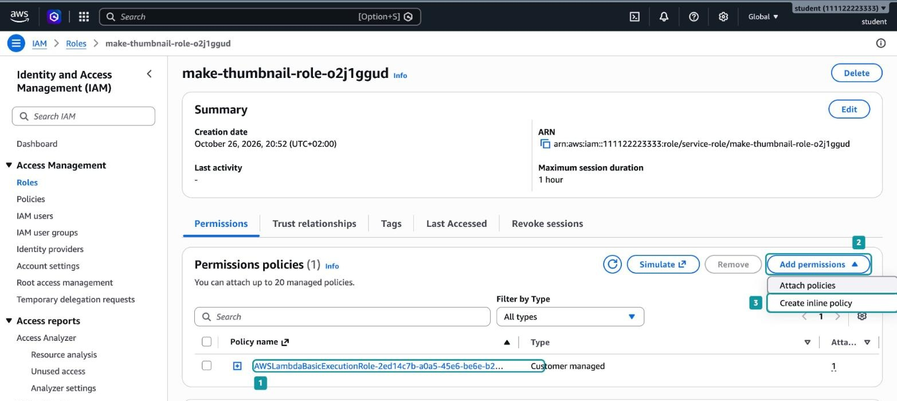

_9.2.1. Добавление политики в роль функции_

_Встроенная политика (inline policy)_ существует только внутри одной роли и удаляется вместе с ней. Управляемую политику, как `AWSLambdaBasicExecutionRole-...`, можно прикрепить к нескольким ролям, и после удаления роли она остаётся в аккаунте. Права нашей политики нужны только этой функции, поэтому встроенная подходит лучше.

Переключите редактор в режим `JSON` (_4_) и вставьте политику, заменив имя бакета на своё:

```json
{
  "Version": "2012-10-17",
  "Statement": [
    {
      "Sid": "ReadOriginals",
      "Effect": "Allow",
      "Action": "s3:GetObject",
      "Resource": "arn:aws:s3:::usm-cc-student-photos/uploads/*"
    },
    {
      "Sid": "WriteThumbnails",
      "Effect": "Allow",
      "Action": "s3:PutObject",
      "Resource": "arn:aws:s3:::usm-cc-student-photos/thumbnails/*"
    }
  ]
}
```

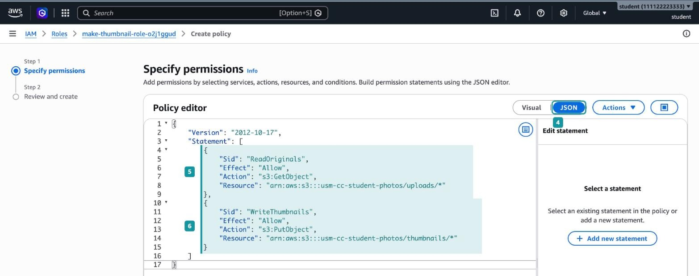

_9.2.2. Политика в редакторе JSON_

В политике два правила:

- `ReadOriginals` (_5_). Разрешает `s3:GetObject`, то есть чтение объектов, но только с ключами, которые начинаются на `uploads/`.
- `WriteThumbnails` (_6_). Разрешает `s3:PutObject`, то есть запись, но только под префиксом `thumbnails/`.

`Sid` - необязательное имя правила. Оно ни на что не влияет, но помогает понять, зачем правило нужно.

Нажмите `Next`. Укажите имя политики `thumbnail-s3-access` (_7_). В таблице ниже консоль показывает итог: доступ только к S3, уровень `Limited: Read, Write` (_8_). Нажмите `Create policy` (_9_).

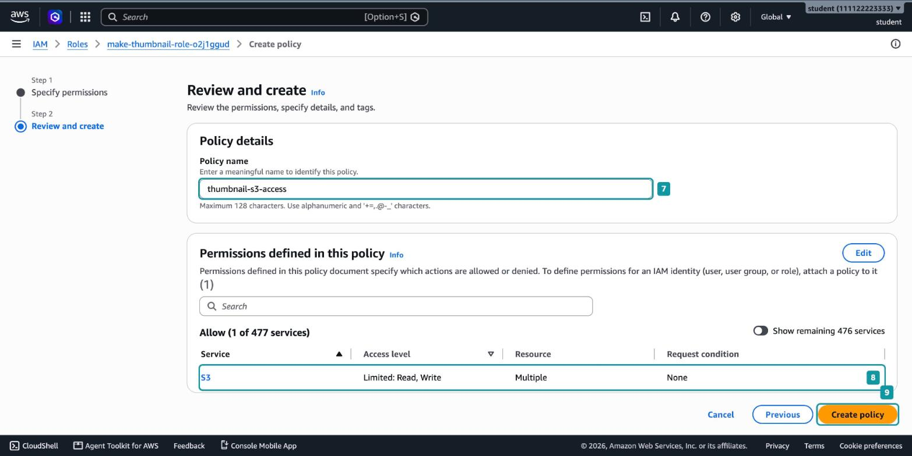

_9.2.3. Имя и проверка политики_

## Часть 3. Код функции и zip-архив

Эту часть вы выполняете на своём компьютере, в терминале.

### Шаг 5. Создайте проект и установите sharp

Создайте папку проекта и установите библиотеку `sharp`:

```bash
mkdir make-thumbnail
cd make-thumbnail
npm init -y
npm install --os=linux --cpu=x64 --libc=glibc sharp
```

`npm init -y` создаёт файл `package.json` с описанием проекта. После установки в нём появится зависимость `sharp`, а в папке `node_modules` код библиотеки.

Флаги в последней команде нужны из-за того, как устроена `sharp`. Сама обработка изображений выполняется библиотекой libvips, написанной на C. Её код скомпилирован заранее отдельно для каждой операционной системы и процессора. Без флагов npm установит вариант для вашего компьютера, например Windows или macOS на процессоре Apple. Lambda же запускает функцию в Amazon Linux 2023 на процессоре x86_64. Флаги говорят npm, для какой системы нужна библиотека[^1]:

- `--os=linux`. Операционная система Linux.
- `--cpu=x64`. Процессор x86_64, та архитектура, которую мы выбрали при создании функции.
- `--libc=glibc`. Стандартная библиотека C, которая используется в Amazon Linux.

Проверьте результат: в папке `node_modules/@img` должны появиться `sharp-linux-x64` и `sharp-libvips-linux-x64`.

> [!WARNING]
> Если установить `sharp` без флагов, в архив попадёт библиотека для вашей операционной системы. В версии `sharp` 0.35 функция всё равно запустится на запасной сборке WebAssembly, но обработает снимок в несколько раз медленнее, а платите вы за время работы. Старые версии `sharp` в такой ситуации завершаются ошибкой загрузки модуля.

### Шаг 6. Напишите код функции

Создайте в папке проекта файл `index.mjs`:

```javascript
import { S3Client, GetObjectCommand, PutObjectCommand } from "@aws-sdk/client-s3";
import sharp from "sharp";

const s3 = new S3Client({});

export const handler = async (event) => {
  console.log("Получено событие:", JSON.stringify(event));

  for (const record of event.Records) {
    const bucket = record.s3.bucket.name;
    const key = decodeURIComponent(record.s3.object.key.replace(/\+/g, " "));
    const thumbKey = key.replace(/^uploads\//, "thumbnails/");

    const original = await s3.send(new GetObjectCommand({ Bucket: bucket, Key: key }));
    const body = Buffer.from(await original.Body.transformToByteArray());

    const thumbnail = await sharp(body).resize({ width: 200 }).jpeg().toBuffer();

    await s3.send(new PutObjectCommand({
      Bucket: bucket,
      Key: thumbKey,
      Body: thumbnail,
      ContentType: "image/jpeg",
    }));

    console.log(`Создано превью ${thumbKey}: ${body.length} -> ${thumbnail.length} байт`);
  }
};
```

Разберём код по частям.

_Импорт_. `@aws-sdk/client-s3` в `package.json` нет, и устанавливать его не нужно: AWS SDK for JavaScript v3 уже входит в среду выполнения Node.js в Lambda. В архив попадает только то, чего в среде нет, то есть `sharp`.

_Клиент S3 вне обработчика_. Строка `const s3 = new S3Client({})` выполняется один раз, при подготовке среды выполнения, а не при каждом вызове. В Hands-on 9.1 вы видели, что тёплые вызовы попадают в уже готовую среду, поэтому они переиспользуют созданный клиент. Ключи доступа клиенту не передаются: SDK сам получает временные учётные данные роли функции.

_Цикл по `event.Records`_. Событие S3 содержит массив записей, по одной на каждый объект. Обычно запись одна, но код не должен на это рассчитывать. Из записи берутся имя бакета `s3.bucket.name` и ключ объекта `s3.object.key`. Полную структуру события вы увидите в журнале в части 6.

_Раскодирование ключа_. В событии S3 ключ закодирован так же, как параметры в адресе страницы: пробел заменён на `+`, а кириллица и спецсимволы записаны кодами вида `%D1%84`[^2]. Ключ `uploads/my photo.jpg` придёт как `uploads/my+photo.jpg`. Сначала `replace(/\+/g, " ")` возвращает пробелы, затем `decodeURIComponent` раскодирует остальное. Без этой строки функция попробовала бы скачать несуществующий объект и получила бы ошибку `AccessDenied`: без права `s3:ListBucket` S3 не сообщает, что объекта нет, а просто отказывает в доступе.

_Ключ превью_. `key.replace(/^uploads\//, "thumbnails/")` меняет префикс: `uploads/photo.jpg` превращается в `thumbnails/photo.jpg`.

_Чтение оригинала_. `GetObjectCommand` возвращает тело объекта как поток. `transformToByteArray()` читает поток целиком, а `Buffer.from` превращает результат в буфер, с которым работает `sharp`.

_Уменьшение_. `resize({ width: 200 })` задаёт только ширину, а высоту `sharp` рассчитывает сама, сохраняя пропорции снимка. `.jpeg()` сохраняет результат в JPEG, а `.toBuffer()` возвращает его в память.

_Запись превью_. `PutObjectCommand` сохраняет буфер под новым ключом. `ContentType: "image/jpeg"` нужен, чтобы браузер при открытии превью показал картинку, а не предложил скачать файл.

### Шаг 7. Соберите zip-архив

_Пакет развёртывания (deployment package)_ - zip-архив с кодом функции и всеми её зависимостями, который загружается в Lambda.

Lambda распаковывает архив и ищет обработчик по настройке `Handler`. Значение `index.handler` означает функцию `handler` из файла `index.mjs` в _корне_ архива. Поэтому в корне должны лежать сами файлы, а не папка проекта:

```text
function.zip
├── index.mjs
├── package.json
└── node_modules/
    ├── sharp/
    └── @img/
```

Соберите архив из папки проекта. На macOS и Linux:

```bash
zip -r function.zip index.mjs package.json node_modules
```

Если команды `zip` нет, в Ubuntu её устанавливают командой `sudo apt install zip`.

На Windows в PowerShell или командной строке:

```powershell
tar -caf function.zip index.mjs package.json node_modules
```

Команда `tar` входит в Windows. Флаг `c` создаёт архив, `f` задаёт имя файла, а `a` выбирает формат по расширению, поэтому получится обычный zip[^3]. Выполняйте её именно в PowerShell или командной строке, а не в Git Bash: в Git Bash вызывается другая программа `tar`, которая создаст не zip, а tar-архив с расширением `.zip`.

Проверьте содержимое архива. На macOS и Linux выполните `unzip -l function.zip | head`, на Windows `tar -tf function.zip | more`. Первыми в списке файлов должны идти `index.mjs` и `package.json` без папки перед ними. Архив занимает 9-12 МБ, почти всё это `node_modules`.

> [!WARNING]
> Типичная ошибка - сжать саму папку `make-thumbnail` в проводнике Windows ("Сжать в ZIP-файл" или "Отправить" → "Сжатая ZIP-папка") или в Finder ("Сжать"). Тогда в корне архива окажется папка `make-thumbnail/`, внутри которой лежит `index.mjs`, и Lambda не найдёт обработчик.

## Часть 4. Загрузка кода в Lambda

### Шаг 8. Загрузите архив в функцию

Откройте функцию `make-thumbnail`, вкладку `Code`. В редакторе пока лежит пример кода, который Lambda создала вместе с функцией. Нажмите `Update` (_10_) и выберите `Update from a .zip file` (_11_).

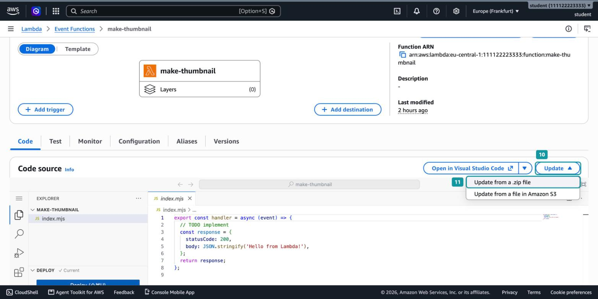

_9.2.4. Загрузка кода из zip-архива_

В открывшемся окне нажмите `Choose file` (_12_) и выберите `function.zip`. Под кнопкой появится имя и размер архива (_13_). Нажмите `Update` (_14_).

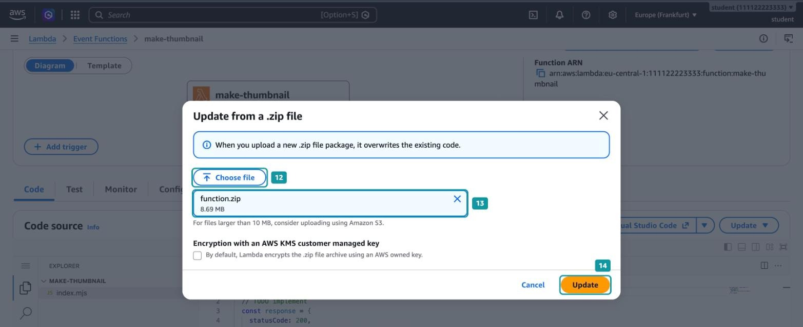

_9.2.5. Выбор архива_

Обратите внимание на два сообщения в окне:

- Загруженный архив полностью заменяет текущий код функции. Если вы правили код в консольном редакторе, эти правки пропадут.
- Для архивов больше 10 МБ консоль советует загрузку через Amazon S3. Ваш архив весит 9-12 МБ, но это только совет: напрямую через консоль можно загрузить архив до 50 МБ[^4]. Архивы большего размера кладут в бакет и указывают Lambda его адрес через `Update from a file in Amazon S3`.

После загрузки в списке файлов функции появятся `node_modules`, `index.mjs` и `package.json` (_15_), а у раздела `DEPLOY` стоит `Current` (_16_). Нажимать `Deploy` не нужно: загрузка архива сразу развёртывает код.

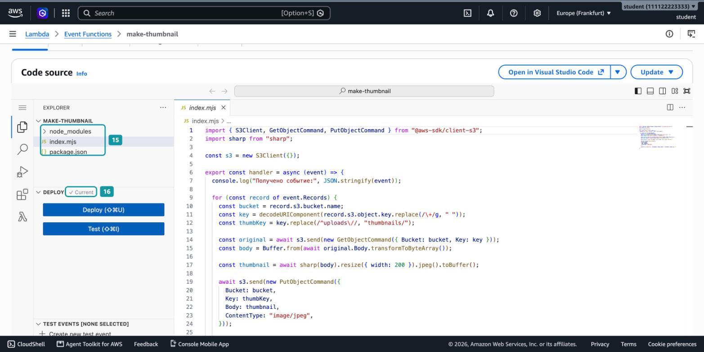

_9.2.6. Код функции после загрузки архива_

> [!WARNING]
> Если после загрузки в списке файлов вы видите папку `make-thumbnail`, а не `index.mjs`, архив собран неправильно. Lambda не найдёт обработчик, и каждый вызов завершится ошибкой. Пересоберите архив из папки проекта, как в шаге 7, и загрузите его снова.

## Часть 5. Триггер S3

### Шаг 9. Выберите источник событий

_Триггер (trigger)_ - настройка, которая связывает источник событий с функцией: при каждом подходящем событии источник вызывает функцию и передаёт ей описание события.

На странице функции нажмите `Add trigger`. В поле `Select a source` начните вводить `S3` и выберите `S3` (_17_).

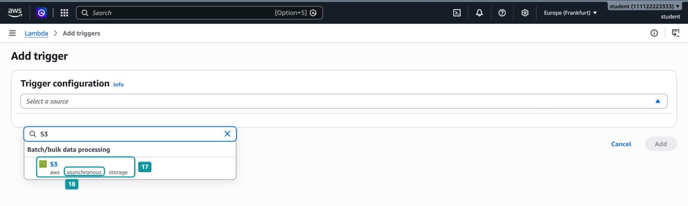

_9.2.7. Выбор S3 как источника событий_

Под названием источника указано `asynchronous` (_18_). S3 вызывает функцию асинхронно: отправляет событие и не ждёт ответа. В Hands-on 9.1 мы вызывали функцию синхронно и сразу видели результат. Здесь результат работы функции придётся искать самим: в бакете и в журнале. Если асинхронный вызов завершится ошибкой, Lambda сама повторит его ещё до двух раз, поэтому одна ошибка может появиться в журнале трижды.

### Шаг 10. Укажите бакет и фильтры

Заполните форму:

1. `Bucket`: ваш бакет `usm-cc-<ник>-photos` (_19_). Консоль показывает его с приставкой `s3/`.
2. `Event types`: оставьте `All object create events` (_20_). Функция будет вызываться при любом способе создания объекта: обычной загрузке, копировании, составной загрузке.
3. `Prefix`: `uploads/` (_21_).
4. `Suffix`: `.jpg` (_22_).

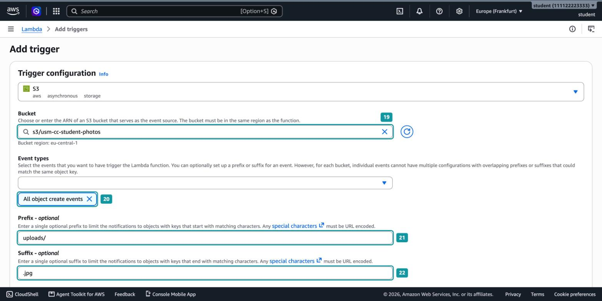

_9.2.8. Бакет, тип событий и фильтры_

Фильтры здесь важнее, чем кажется. Функция сама записывает превью в тот же бакет. Без фильтра каждое превью снова вызывало бы функцию. Такая ошибка называется _рекурсивным вызовом_: функция вызывает сама себя, а вы платите за каждый вызов. Lambda умеет обнаруживать такие циклы и останавливает их примерно после 16 вызовов[^5], но полагаться на это не стоит.

Префикс `uploads/` разрывает этот круг: превью сохраняются в `thumbnails/`, и их создание триггер не замечает. Суффикс `.jpg` отсекает файлы, которые функция не умеет обрабатывать, например PDF в той же папке. Фильтр учитывает регистр: файлы `IMG_1234.JPG` или `photo.jpeg` функцию не вызовут.

### Шаг 11. Подтвердите риск рекурсии

Прокрутите форму вниз. Для любого триггера S3 консоль просит подтвердить, что вы понимаете риск рекурсивного вызова. Отметьте флажок (_23_).

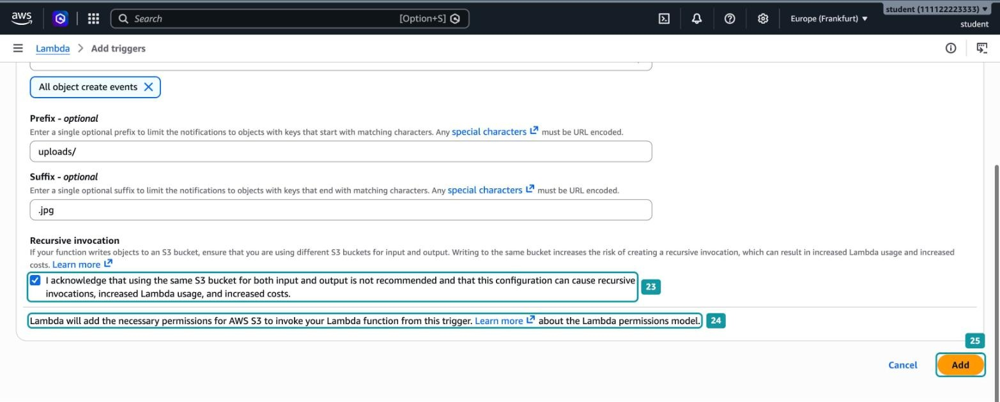

_9.2.9. Подтверждение риска рекурсивного вызова_

AWS советует использовать для оригиналов и результатов разные бакеты. В учебном примере мы оставляем один бакет, потому что так проще убирать за собой. От цикла нас защищают две вещи: фильтр `uploads/` и политика из шага 4, которая не разрешает функции читать `thumbnails/`. В рабочем проекте надёжнее завести отдельный бакет для превью.

Строка ниже (_24_) сообщает, что Lambda сама добавит права, чтобы S3 мог вызывать функцию. Нажмите `Add` (_25_).

### Шаг 12. Посмотрите, что создал триггер

Lambda откроет вкладку `Configuration` → `Triggers`, а на схеме функции слева появится S3. Раскройте `Details` у триггера.

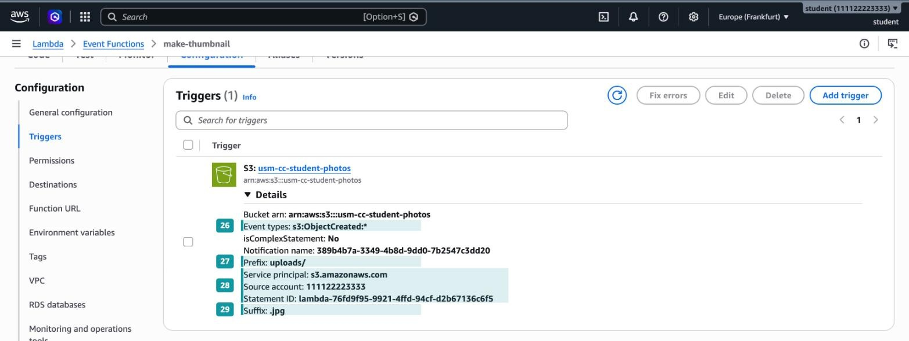

_9.2.10. Настройки триггера S3_

Здесь видно, что именно настроено:

- `Event types: s3:ObjectCreated:*` (_26_). Все события создания объекта.
- `Prefix: uploads/` (_27_) и `Suffix: .jpg` (_29_). Фильтры из шага 10.
- `Service principal`, `Source account` и `Statement ID` (_28_). Это правило _политики ресурса_ функции. В главе 6 политика бакета решала, кто может обращаться к бакету. Здесь политика функции разрешает сервису `s3.amazonaws.com` вызывать `make-thumbnail`, но только для бакетов вашего аккаунта.

Триггер состоит из двух частей в двух сервисах. В бакете появилась настройка уведомлений: при создании объекта с подходящим ключом отправить событие в Lambda. В функции появилось разрешение принимать вызовы от S3. Обе части консоль создала одной кнопкой `Add`.

## Часть 6. Проверка

### Шаг 13. Загрузите фотографию

Откройте бакет, создайте папку `uploads/` кнопкой `Create folder`, откройте её и загрузите `photo.jpg` кнопкой `Upload`.

Подождите несколько секунд и обновите список объектов. В бакете появилась папка `thumbnails/`. Откройте её (_30_): внутри лежит `photo.jpg` (_31_). Его размер (_32_) в десятки раз меньше оригинала: в примере 3,3 КБ вместо 83 КБ.

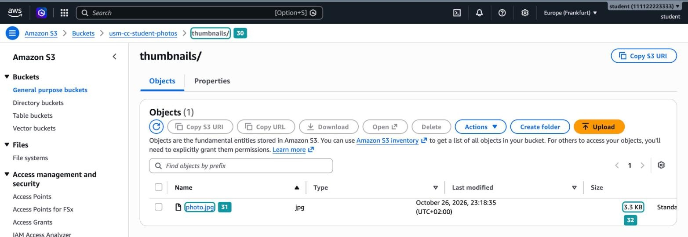

_9.2.11. Превью в бакете_

Отметьте `photo.jpg` и нажмите `Open`. Убедитесь, что это ваша фотография шириной 200 пикселей.

Затем проверьте ещё два случая:

1. Загрузите в `uploads/` файл с пробелом в имени, например `my photo.jpg`. В `thumbnails/` должно появиться `my photo.jpg`.
2. Загрузите любой файл `.jpg` в корень бакета, вне `uploads/`. Превью для него не появится: ключ не подходит под префикс, и S3 не вызывает функцию.

### Шаг 14. Посмотрите событие S3 в журнале

Откройте в CloudWatch Logs группу `/aws/lambda/make-thumbnail` и её поток журнала. Если потоков несколько, начните с последнего. Найдите вызов для `my photo.jpg` и раскройте строку `Получено событие:` стрелкой слева. CloudWatch покажет JSON события в читаемом виде.

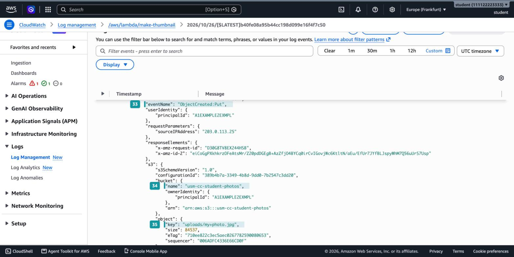

_9.2.12. Событие S3 в журнале функции_

Это то самое событие, которое код получает в параметре `event`:

- `eventName: "ObjectCreated:Put"` (_33_). Объект создан обычной загрузкой.
- `s3.bucket.name` (_34_). Имя бакета, из которого код берёт `bucket`.
- `s3.object.key` (_35_). Ключ объекта: `uploads/my+photo.jpg`. Пробел действительно пришёл как `+`, и именно поэтому код раскодирует ключ перед `GetObject`.

Кроме того, событие содержит время, регион, размер объекта и служебные идентификаторы запроса. Код их не использует, но по ним удобно искать конкретную загрузку.

### Шаг 15. Сравните два вызова

Сверните раскрытую строку и посмотрите на поток целиком.

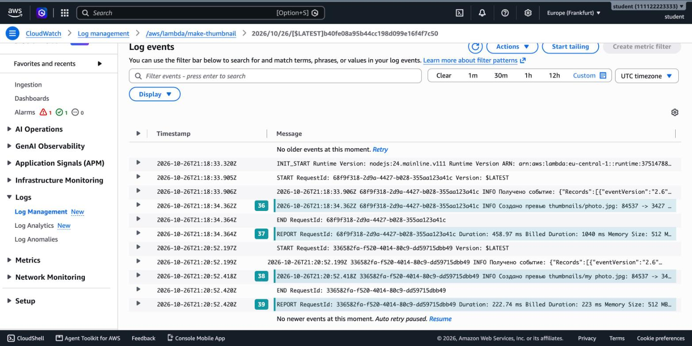

_9.2.13. Два вызова функции_

В журнале ровно два вызова, по одному на каждый файл в `uploads/`. Файл в корне бакета функцию не вызвал. В каждом вызове есть строка `Создано превью` с размерами до и после (_36_, _38_).

Сравните строки `REPORT` двух вызовов:

- Первый вызов (_37_) холодный. `Duration` около 460 мс, а `Billed Duration` 1040 мс. Раскройте строку `REPORT`: в конце указана `Init Duration` около 580 мс. Это время подготовки среды, в том числе загрузки `sharp` из `node_modules`.
- Второй вызов (_39_) тёплый. Тот же объём работы занял 223 мс, и подготовка не понадобилась. Если между загрузками прошло много времени, второй вызов тоже может оказаться холодным и попасть в отдельный поток.

Зависимости увеличивают время холодного старта: чем больше библиотек загружается при старте, тем дольше первый вызов.

## Часть 7. Удаление ресурсов

Удалите ресурсы в таком порядке:

1. Очистите бакет `usm-cc-<ник>-photos` и удалите его. Триггер перестанет работать вместе с бакетом.
2. Удалите функцию `make-thumbnail`.
3. Удалите роль `make-thumbnail-role-...`. Встроенная политика `thumbnail-s3-access` удалится вместе с ней.
4. Удалите управляемую политику `AWSLambdaBasicExecutionRole-...`, которая осталась от этой роли.
5. Удалите группу журналов `/aws/lambda/make-thumbnail`.

Папку проекта на своём компьютере можно оставить: она пригодится, если вы захотите изменить код и загрузить новый архив.

## Вопросы для самопроверки

1. Почему эту функцию нельзя собрать в консольном редакторе, как в Hands-on 9.1?
2. Зачем при установке `sharp` указывать флаги `--os`, `--cpu` и `--libc`?
3. Какие файлы должны лежать в корне zip-архива и что случится, если упаковать папку проекта целиком?
4. Почему `@aws-sdk/client-s3` не нужно включать в архив?
5. Зачем ключ объекта из события раскодируют перед вызовом `GetObject`?
6. Почему функция записывает превью под другим префиксом и что произойдёт, если триггер срабатывает на весь бакет?
7. Почему роли функции выдают права только на `uploads/*` и `thumbnails/*`, а не `AmazonS3FullAccess`?

[^1]: Fuller, L. (2026). _Installation_. sharp documentation. Available at: https://sharp.pixelplumbing.com/install

[^2]: Amazon Web Services (2026). _Event message structure_. Amazon S3 User Guide. Available at: https://docs.aws.amazon.com/AmazonS3/latest/userguide/notification-content-structure.html

[^3]: Microsoft (2026). _tar_. Microsoft Learn. Available at: https://learn.microsoft.com/windows/tar/

[^4]: Amazon Web Services (2026). _Lambda quotas_. AWS Lambda Developer Guide. Available at: https://docs.aws.amazon.com/lambda/latest/dg/gettingstarted-limits.html

[^5]: Amazon Web Services (2026). _Use Lambda recursive loop detection to prevent infinite loops_. AWS Lambda Developer Guide. Available at: https://docs.aws.amazon.com/lambda/latest/dg/invocation-recursion.html
