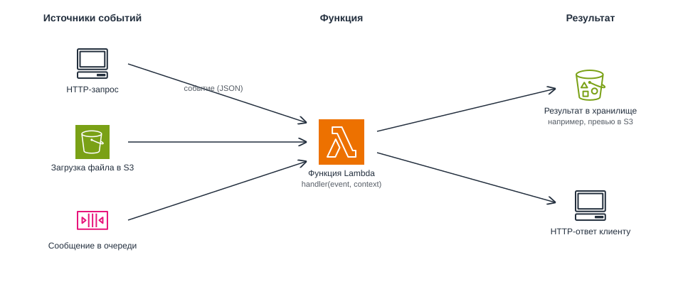
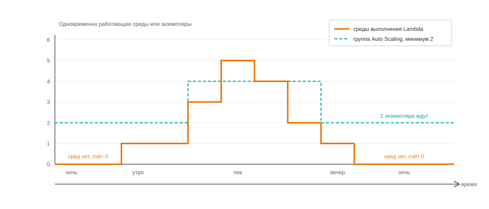
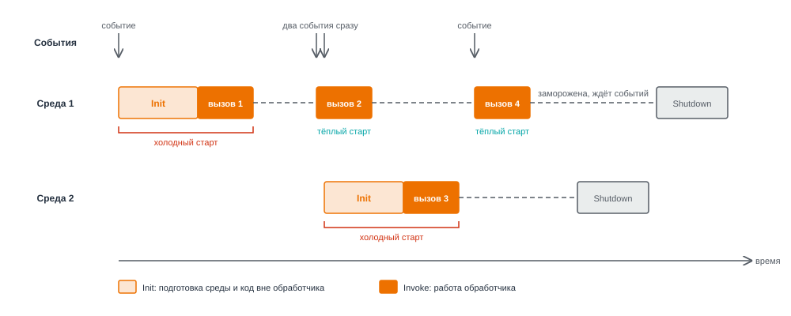
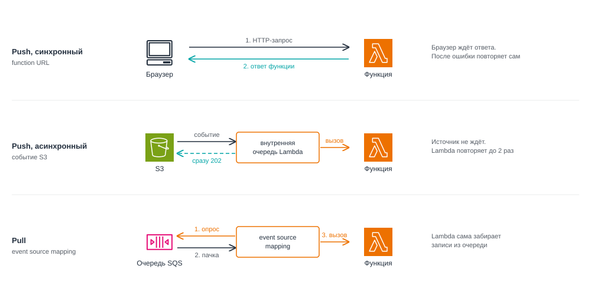
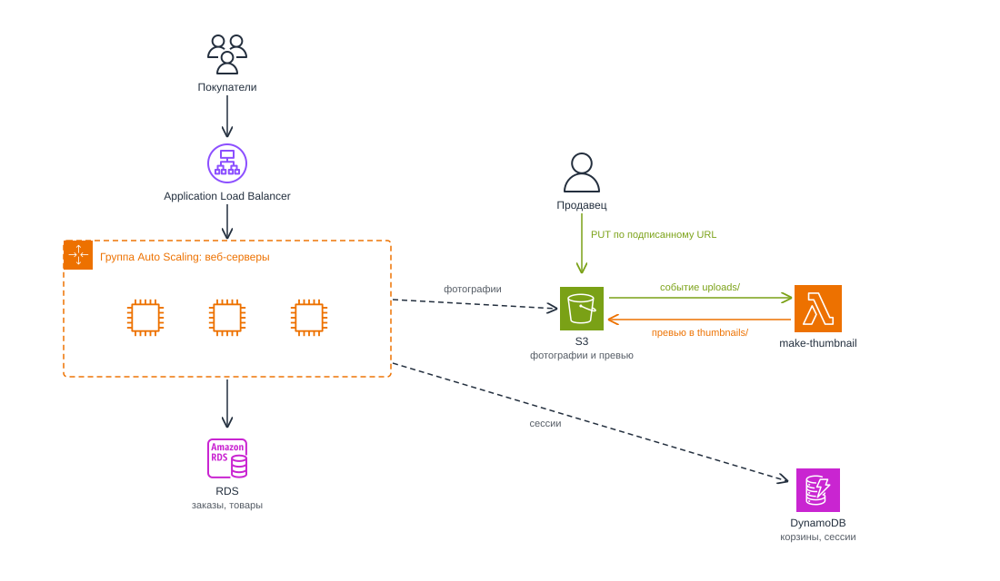

# Бессерверные вычисления и Function as a Service (FaaS). AWS Lambda

<i>
Ссылку на магазин снова выложили в общий чат факультета в среду, в три часа ночи. Кто-то из первокурсников написал, что там продаются кружки с гербом университета. Утром Джон открыл консоль и долго смотрел на график: группа выросла до пяти серверов, к шести утра сжалась обратно до двух, и ни один запрос не потерялся. Дежурные, которые никогда не спят, нашлись: балансировщик и группа Auto Scaling.

Но у Эммы появилась новая забота. Продавцы, а их теперь было трое, загружали фотографии товаров прямо с телефонов, по восемь-десять мегабайт каждая. Загружали правильно: сервер выдавал подписанную ссылку, и браузер отправлял фотографию прямо в S3. Зато каталог теперь открывался медленно: на странице было двадцать товаров, и браузер честно скачивал двадцать огромных фотографий.

– Нам нужны маленькие копии для каталога, - сказала Эмма. - Превью шириной четыреста пикселей. Большая фотография пусть открывается только на странице товара.

– Сделаем на сервере, - ответил Джон. - Хотя... сервер этих фотографий даже не видит. Они идут из браузера прямо в бакет.

Он предложил то, что первым приходит в голову: завести отдельный маленький сервер, который раз в минуту заглядывает в бакет, находит новые фотографии и делает для них превью.

Эмма открыла калькулятор.

– Если продавцы разойдутся, фотографий будет штук триста в день. На каждую уходит секунда. Получается пять минут работы в сутки, а платить мы будем за все двадцать четыре часа. И ещё на нём придётся обновлять систему и следить, чтобы он не упал.

– Тогда пусть бакет проверяют веб-серверы, - не сдавался Джон.

– Их пять в три часа ночи и два утром. Какой из них будет проверять? Все пять сразу?

Джон промолчал. Ответ "один, специально назначенный" вёл обратно к серверу с особой ролью, от которого они только что избавились.

– Нам не нужен сервер, который ждёт, - сказала Эмма. - Нам нужно, чтобы кто-то сам запускал наш код в ту секунду, когда в бакете появилась фотография. И чтобы мы платили только за эту секунду.

– Код без сервера? - хмыкнул Джон. - Так не бывает. Где-то же он должен выполняться.

– Где-то должен, - согласилась Эмма. - Вопрос в том, чей это сервер и кто платит, пока он ждёт.
</i>

## Содержание

- [Бессерверные вычисления и Function as a Service (FaaS). AWS Lambda](#бессерверные-вычисления-и-function-as-a-service-faas-aws-lambda)
  - [Содержание](#содержание)
  - [Вопросы для самопроверки](#вопросы-для-самопроверки)
  - [Ретроспектива](#ретроспектива)
  - [Сервер, который ждёт работы](#сервер-который-ждёт-работы)
  - [Бессерверные вычисления](#бессерверные-вычисления)
    - [Определение бессерверных вычислений](#определение-бессерверных-вычислений)
    - [Бессерверные вычисления и PaaS](#бессерверные-вычисления-и-paas)
  - [Функция как услуга (Function as a Service, FaaS)](#функция-как-услуга-function-as-a-service-faas)
    - [Что такое FaaS](#что-такое-faas)
    - [Событийная модель](#событийная-модель)
  - [AWS Lambda](#aws-lambda)
    - [Что такое Lambda](#что-такое-lambda)
    - [Основные характеристики AWS Lambda](#основные-характеристики-aws-lambda)
    - [Квоты сервиса](#квоты-сервиса)
  - [Код функции](#код-функции)
    - [Обработчик](#обработчик)
    - [Первая функция](#первая-функция)
    - [Аргументы event и context](#аргументы-event-и-context)
  - [Сборка и настройка функции](#сборка-и-настройка-функции)
    - [Среда выполнения языка](#среда-выполнения-языка)
    - [Пакет развёртывания](#пакет-развёртывания)
    - [Переменные окружения](#переменные-окружения)
    - [Роль выполнения и политика функции](#роль-выполнения-и-политика-функции)
  - [Как Lambda выполняет функцию](#как-lambda-выполняет-функцию)
    - [Среда выполнения функции](#среда-выполнения-функции)
    - [Жизненный цикл среды](#жизненный-цикл-среды)
    - [Масштабирование и параллелизм](#масштабирование-и-параллелизм)
    - [Холодный и тёплый старт](#холодный-и-тёплый-старт)
    - [Ограничение параллелизма](#ограничение-параллелизма)
    - [Журналы функции](#журналы-функции)
  - [Триггеры и способы вызова](#триггеры-и-способы-вызова)
    - [Push и pull](#push-и-pull)
    - [Синхронный вызов](#синхронный-вызов)
    - [Асинхронный вызов](#асинхронный-вызов)
    - [Pull: event source mapping](#pull-event-source-mapping)
    - [Повторная доставка и идемпотентность](#повторная-доставка-и-идемпотентность)
  - [Стоимость](#стоимость)
  - [Lambda или EC2](#lambda-или-ec2)
  - [Собираем решения вместе](#собираем-решения-вместе)
  - [Резюме](#резюме)

## Вопросы для самопроверки

1. Почему вычисления называют бессерверными, хотя серверы существуют? Чем FaaS отличается от бессерверных вычислений в целом?
2. Что функция Lambda получает в аргументах `event` и `context` и как Lambda находит обработчик в коде?
3. От чего зависит мощность процессора функции и что такое таймаут?
4. Как оценить параллелизм функции и что произойдёт, если он превысит квоту аккаунта?
5. Чем холодный старт отличается от тёплого и почему код вне обработчика выполняется не при каждом вызове?
6. Почему функция не должна хранить данные пользователей в глобальных переменных и в каталоге `/tmp`?
7. Чем push отличается от pull, а синхронный вызов от асинхронного? Кто повторяет вызов после ошибки в каждом случае?
8. Почему функция, которая делает превью по событию S3, должна быть идемпотентной и как не допустить бесконечного цикла вызовов?
9. За что платят при работе с Lambda и в каких задачах она подходит хуже экземпляров EC2?

## Ретроспектива

Эта глава опирается на несколько предыдущих:

- _Первая глава_. Среди названий XaaS мы упомянули FaaS - запуск отдельных функций. Там же появилась оплата по факту потребления и модель разделённой ответственности: чем выше уровень услуги, тем меньше обслуживает клиент.
- _Вторая глава_. Мы сравнили виртуальные машины и контейнеры и разобрали, что такое образ контейнера.
- _Четвёртая глава_. Экземпляр EC2 получает права через роль IAM. Временные учётные данные роли выдаёт AWS STS, и ключи в коде не хранятся.
- _Шестая и седьмая главы_. Файлы пользователей лежат в S3, корзины - в DynamoDB, заказы - в RDS. Браузер может загрузить файл прямо в S3 по подписанному URL, минуя сервер приложения.
- _Восьмая глава_. Веб-серверы работают за Application Load Balancer в группе Auto Scaling. Группа сама добавляет и убирает экземпляры, но минимум два из них работают круглосуточно, и новый экземпляр готовится несколько минут.

Серверы теперь масштабируются сами, но оплачиваются, даже когда ждут запросов, и их по-прежнему нужно обновлять. Отсюда вопросы, на которые отвечает глава:

- Можно ли запускать код только тогда, когда для него есть работа, и платить только за это время?
- Как запустить код в ответ на событие, например на загрузку файла в S3?
- Кто масштабирует такой код и где он хранит данные между запусками?
- Для каких задач такой подход годится, а для каких лучше остаться на серверах?

## Сервер, который ждёт работы

Рассмотрим интернет-магазин. Для каталога нужны _превью_ - уменьшенные копии фотографий шириной 400 пикселей. Но браузер загружает оригиналы прямо в S3 по подписанному URL, минуя веб-сервер. Значит, после загрузки нужно отдельно скачать фотографию из бакета, уменьшить её и сохранить превью. Эту работу можно поручить отдельному экземпляру EC2.

Такой экземпляр мог бы раз в минуту проверять бакет и обрабатывать новые фотографии. Посчитаем, насколько он будет занят: допустим, в магазин загружают 300 фотографий в день, и на каждое превью уходит одна секунда:

| Показатель                          | Расчёт                       | Значение                |
| ----------------------------------- | ---------------------------- | ----------------------- |
| Полезная работа в сутки             | 300 × 1 с                    | 300 с, или 5 минут      |
| Полезная работа в месяц             | 5 мин × 30 дней              | 150 минут, или 2,5 часа |
| Оплаченное время экземпляра в месяц | 24 ч × 365 дней / 12 месяцев | 730 часов               |
| Доля полезного времени              | 2,5 / 730                    | около 0,3%              |
| Счёт за `t3.micro` в `eu-central-1` | 730 × 0,012 USD              | 8,76 USD в месяц        |

Цена `t3.micro` взята из расчёта стоимости в восьмой главе. Сумма небольшая, но 99,7% времени экземпляр ждёт. Кроме того, за ним нужно ухаживать:

- обновлять операционную систему,
- пересобирать AMI,
- следить, чтобы он работал.

Один экземпляр остаётся единой точкой отказа, а при двух нужно решать, какой из них проверяет бакет, чтобы превью не делалось дважды.

Удобнее, если провайдер сам запускает код в момент загрузки фотографии и берёт плату только за секунду работы. Так устроены бессерверные вычисления.

## Бессерверные вычисления

### Определение бессерверных вычислений

**Бессерверные вычисления (serverless computing)** - модель, в которой приложение запускается и _работает без управления серверами_: провайдер выделяет ресурсы, масштабирует их и выставляет счёт по фактическому использованию[^1].

Код по-прежнему выполняется на серверах, но выбирает, обновляет и обслуживает их _провайдер_[^1]. У бессерверных вычислений два основных признака[^2]:

- _Автоматическое масштабирование_. Сервис сам выделяет ресурсы при росте нагрузки, клиент не заказывает их заранее.
- _Оплата за использование_. Счёт зависит от выполненной работы, а не от зарезервированных ресурсов.

При отсутствии нагрузки ресурсы могут сокращаться до нуля. При этом хранение данных и дополнительные настройки могут оплачиваться отдельно.

### Бессерверные вычисления и PaaS

В PaaS и бессерверных вычислениях операционную систему и среду выполнения обслуживает провайдер, а клиент отвечает за код и данные. Разница - в запуске и оплате: PaaS-приложение обычно работает постоянно и оплачивается даже без запросов, а бессерверные функции запускаются по вызовам[^2]. Ниже сравниваются типичные варианты: отдельные PaaS-платформы тоже умеют масштабироваться до нуля.

| Свойство                              | PaaS                                                          | Бессерверные вычисления                           |
| ------------------------------------- | ------------------------------------------------------------- | ------------------------------------------------- |
| Кто обслуживает ОС и среду выполнения | Провайдер                                                     | Провайдер                                         |
| Что работает без запросов             | Обычно хотя бы один экземпляр приложения                      | Нет активных вызовов                              |
| Масштабирование                       | Провайдер часто масштабирует приложение, но обычно не до нуля | Сервис масштабируется сам, вплоть до нуля         |
| За что платят                         | За время работы приложения                                    | За выполненную работу: запросы и время выполнения |
| Примеры                               | Google App Engine, Heroku, Azure App Service                  | AWS Lambda, Google Cloud Run functions            |

## Функция как услуга (Function as a Service, FaaS)

### Что такое FaaS

**Функция как услуга (Function as a Service, FaaS)** - модель бессерверных вычислений, в которой клиент загружает код отдельными функциями. Провайдер запускает функцию при каждом событии, на которое она подписана[^1].

_Функция_ в FaaS - небольшая программа с одной точкой входа, которая обрабатывает одно событие и завершается.

### Событийная модель

Функцию FaaS запускает событие.

**Событие (event)** - сообщение о произошедшем изменении или действии: пришёл HTTP-запрос, в бакет загрузили файл, в очередь поступило сообщение[^3]. Событие передаётся функции как документ JSON с подробностями: например, имя бакета и ключ загруженного объекта[^3].

**Событийно-ориентированная архитектура (event-driven architecture)** - способ построения системы, в котором компоненты реагируют на сообщения о произошедших событиях[^3]. Например, S3 сообщает "объект создан", а подписанная на это событие функция делает превью. При этом S3 не нужно знать, как устроена обработка изображения.



_9.1. Источники событий, функция и результат_

На рисунке 9.1 слева показаны три источника событий: HTTP-запрос, загрузка файла в S3 и сообщение в очереди. Каждое событие запускает функцию, а функция сохраняет результат в хранилище или возвращает ответ.

## AWS Lambda

### Что такое Lambda

**AWS Lambda** - бессерверный вычислительный сервис AWS, который выполняет код без выделения серверов и управления ими[^4]. Lambda сама[^4]:

- обслуживает серверы,
- выделяет мощность,
- масштабирует её,
- устанавливает обновления.

| Характеристика      | AWS Lambda                                                                                 |
| ------------------- | ------------------------------------------------------------------------------------------ |
| Категория           | Вычисления (compute)                                                                       |
| Что делает          | Выполняет код функции в ответ на события и вызовы                                          |
| Для чего нужен      | Запускать короткие задачи без управления серверами и платить только за время их выполнения |
| Где используют      | Обработка загруженных файлов, небольшие HTTP API, обработка событий других сервисов        |
| Модель обслуживания | FaaS: клиент отвечает за код, настройки функции, права и данные                            |
| Область действия    | Регион. Lambda сама запускает функцию в нескольких зонах доступности региона[^5]           |
| Как оплачивается    | Число запросов и время выполнения с учётом выделенной памяти[^6]                           |
| Как работать        | Консоль (раздел Lambda), AWS CLI (`aws lambda`), SDK                                       |
| Появился            | Ноябрь 2014 года, предварительная версия[^7]                                               |
| Аналоги             | Google Cloud Run functions, Azure Functions                                                |

> [!NOTE]
> В документации и консоли обычная функция Lambda называется _Event Function_. Именно она рассматривается в этой главе. В API, AWS CLI и SDK по-прежнему используется название _function_[^4].

### Основные характеристики AWS Lambda

Главная идея Lambda: _вы загружаете код и выбираете, какие события его запускают_[^4]. Lambda запускает функцию для одного события. Функция обрабатывает событие и завершает выполнение. Теперь вы платите только за время выполнения функции, а не за простаивающие серверы.

Для вызова задают _объём памяти, таймаут и другие параметры_. Основные настройки и ограничения собраны в таблице:

| Параметр                 | Что означает                                                                                               | Значение                                                                                                |
| ------------------------ | ---------------------------------------------------------------------------------------------------------- | ------------------------------------------------------------------------------------------------------- |
| Память                   | Оперативная память, которую получает функция                                                               | От 128 до 10 240 МБ, по умолчанию 128 МБ[^8]                                                            |
| Процессор                | Вычислительная мощность, отдельно не настраивается                                                         | Пропорционален памяти, при 1 769 МБ - один vCPU[^9]                                                     |
| Таймаут (timeout)        | Максимальное время одного вызова. Если функция не успела, Lambda прерывает её, и вызов считается неудачным | По умолчанию 3 секунды, максимум 900 секунд (15 минут)[^10]                                             |
| Архитектура процессора   | Тип процессора, на котором выполняется код                                                                 | `x86_64` по умолчанию или `arm64` (процессоры AWS Graviton)[^11][^12]                                   |
| Временный каталог `/tmp` | Место на диске для временных файлов                                                                        | От 512 до 10 240 МБ[^9]                                                                                 |
| Размер кода              | Сколько занимает код функции вместе с библиотеками                                                         | Архив .zip до 50 МБ при прямой загрузке и до 250 МБ в распакованном виде, образ контейнера до 10 ГБ[^9] |
| Размер события и ответа  | Сколько данных функция получает и возвращает за один вызов                                                 | До 6 МБ каждый при синхронном вызове, событие до 1 МБ при асинхронном[^9]                               |
| Одновременные выполнения | Сколько вызовов всех функций аккаунта идёт одновременно в одном регионе                                    | 1 000 по умолчанию[^9]                                                                                  |
| Переменные окружения     | Настройки функции в виде пар "имя и значение"                                                              | Не больше 4 КБ на все переменные функции[^9]                                                            |

### Квоты сервиса

Ограничения сервиса называют _квотами_. _Жёсткие квоты_ изменить нельзя, а увеличение _мягких квот_ можно запросить через раздел консоли Service Quotas[^9]. Например, квоту одновременных выполнений можно увеличить до десятков тысяч. У новых аккаунтов квоты памяти и одновременных выполнений могут быть ниже. AWS повышает их по мере использования[^9].

Кроме ограничений из таблицы, учитывают следующие квоты:

- _Скорость масштабирования_. Одна функция может увеличивать число одновременных выполнений не больше чем на 1 000 за 10 секунд[^26][^9]. Эту квоту изменить нельзя.
- _Запросы в секунду_. При синхронных вызовах предел запросов в секунду в 10 раз больше квоты одновременных выполнений: при квоте 1 000 это 10 000 запросов в секунду[^9].
- _Хранилище кода_. Архивы .zip всех функций региона в распакованном виде занимают не больше 300 ГБ. Эту квоту увеличить нельзя[^9].

_Не путайте функцию Lambda и экземпляр EC2._ Функция работает только во время вызова и не дольше таймаута. Если задача длится больше 15 минут, Lambda прервёт функцию. Такую задачу придётся перепроектировать или перенести на другой сервис[^13].

## Код функции

Код функции Lambda можно писать на Node.js, Python, Java, .NET и Ruby, а для других языков, например Go и Rust, нужна отдельная среда выполнения[^14]. Какие версии и среды доступны, разберём в разделе "Среда выполнения языка". Примеры этой главы написаны на Node.js.

### Обработчик

Чтобы Lambda могла выполнить код, в нём должна быть точка входа.

**Обработчик (handler)** - функция в коде, которую Lambda вызывает для обработки события[^15]. Вызов заканчивается в одном из трёх случаев[^15]:

- обработчик вернул ответ,
- обработчик завершился с ошибкой,
- обработчик превысил таймаут.

Lambda находит обработчик по настройке _Handler_ в формате `<имя файла>.<имя функции>`[^15]:

- _имя файла_ - имя файла с кодом без расширения,
- _имя функции_ - имя функции, которую файл экспортирует.

Например, `index.handler` означает функцию `handler` из файла `index.mjs`, а `thumbnail.resize` - функцию `resize` из файла `thumbnail.mjs`. Если переименовать файл или функцию и не поправить _Handler_, Lambda не найдёт обработчик, и каждый вызов будет завершаться ошибкой.

### Первая функция

Рассмотрим пример. Разработчик создаёт в консоли Lambda новую функцию на Node.js, и в ней уже есть файл `index.mjs` с заготовкой обработчика `handler`[^16]. Например, содержимое файла может быть таким:

```javascript
export const handler = async (event, context) => {
  const name = event.name ?? "гость";
  console.log(`Вызов ${context.awsRequestId}, имя: ${name}`);
  return { message: `Привет, ${name}!` };
};
```

Разберём код по строкам:

1. `export const handler` объявляет функцию `handler` и экспортирует её из файла `index.mjs`. Отсюда значение настройки _Handler_ - `index.handler`: имя файла и имя функции через точку.
2. Обработчик объявлен как `async`: так рекомендует AWS[^15].
3. Оператор `??` подставляет `"гость"`, если в событии нет поля `name`.
4. `console.log` пишет строку в логи функции.
5. `return` возвращает объект с приветствием.

Если вызвать функцию с тестовым событием `{ "name": "Анна" }`, значение поля `name` попадёт в приветствие, и функция вернёт:

```json
{ "message": "Привет, Анна!" }
```

Если вызвать функцию с пустым событием `{}`, поля `name` в нём нет, и функция вернёт `{ "message": "Привет, гость!" }`.

> [_Hands-on 9.1. Первая функция Lambda._](hands_on_01.md) Создание функции на Node.js 24 в консоли, тестовое событие, просмотр ответа и журнала функции.

### Аргументы event и context

Обработчик получает два аргумента[^15]:

- `event`. Данные о том, что произошло. При тестовом вызове это JSON, который вы ввели в консоли, а при загрузке файла в S3 - имя бакета и ключ файла. Поэтому у каждого источника событий своя структура `event`.
- `context`. Сведения о самом вызове. Например, `context.awsRequestId` - идентификатор вызова, а `context.getRemainingTimeInMillis()` возвращает, сколько миллисекунд осталось до таймаута[^17].

## Сборка и настройка функции

### Среда выполнения языка

Чтобы выполнить файл `index.mjs`, нужен интерпретатор Node.js подходящей версии. Его предоставляет Lambda.

**Среда выполнения языка (runtime)** - компонент Lambda, который запускает код на выбранном языке, передаёт ему события и возвращает ответы[^14]. У каждой версии есть свой идентификатор: например, `nodejs24.x` означает Node.js 24.

Lambda предоставляет готовые среды для пяти языков[^14]:

| Язык    | Примеры идентификаторов    |
| ------- | -------------------------- |
| Node.js | `nodejs24.x`, `nodejs22.x` |
| Python  | `python3.14`, `python3.13` |
| Java    | `java25`, `java21`         |
| .NET    | `dotnet10`                 |
| Ruby    | `ruby4.0`, `ruby3.4`       |

Для других языков, например Go и Rust, используют `provided.al2023` на базе Amazon Linux 2023. В этом случае разработчик сам добавляет компоненты для запуска своего кода[^14].

AWS обновляет среду выполнения языка сама, но у каждой версии есть дата окончания поддержки, например 30 апреля 2027 года для `nodejs22.x`[^16]. После этой даты функция продолжит работать, но без обновлений безопасности, поэтому нужно вовремя перейти на новую версию[^14].

### Пакет развёртывания

Чтобы Lambda могла выполнить функцию, ей передают код вместе с нужными библиотеками. Такой набор называют **пакетом развёртывания (deployment package)**. Его загружают одним из двух способов[^18]:

- _Архив .zip_ подходит для большинства функций. В него кладут код и папку `node_modules`. Архив до 50 МБ загружают прямо в консоли, больший - через S3[^11][^9].
- _Образ контейнера_ размером до 10 ГБ нужен, когда библиотеки не помещаются в архив[^18].

Тип пакета выбирают при создании функции, потом его поменять нельзя[^18].

### Переменные окружения

Настройки, которые могут меняться без правки кода, например размер превью или имя бакета, выносят в _переменные окружения_.

**Переменная окружения (environment variable)** - пара строк "имя и значение" в настройках функции, доступная в Node.js через `process.env`[^19][^15]. Например, `process.env.THUMBNAIL_WIDTH` содержит ширину превью. Поскольку значение всегда строка, перед вычислениями его преобразуют в число: `Number(process.env.THUMBNAIL_WIDTH)`.

> [!NOTE]
>
> Пароли и другие секреты AWS рекомендует хранить не в переменных окружения, а в AWS Secrets Manager, сервисе для хранения секретов[^19].

### Роль выполнения и политика функции

Lambda может обращаться к другим сервисам AWS, например, читать и записывать объекты в S3, работать с таблицами DynamoDB. Для этого ей нужны права. Также отдельно нужно решить, кто может запускать саму функцию. За эти два вопроса отвечают разные настройки:

| Вопрос                       | Настройка        | Пример для функции превью                              |
| ---------------------------- | ---------------- | ------------------------------------------------------ |
| Что может делать функция?    | Роль выполнения  | Читать и записывать объекты в бакете `usm-shop-photos` |
| Кто может запускать функцию? | Политика функции | S3 может вызывать функцию при загрузке файла           |

**Роль выполнения (execution role)** - роль IAM, которая даёт функции права обращаться к сервисам AWS[^20]. В примере ниже функция получает права только на чтение и запись объектов в бакете `usm-shop-photos`:

```json
{
  "Effect": "Allow",
  "Action": ["s3:GetObject", "s3:PutObject"],
  "Resource": "arn:aws:s3:::usm-shop-photos/*"
}
```

**Политика функции (resource-based policy)** - политика, которая прикреплена к самой функции и разрешает другим сервисам и аккаунтам вызывать эту функцию[^22]. Политику функции пишут так же, как политику бакета: в поле `Principal` указан тот, кому разрешено действие. Например, такое правило разрешает сервису S3 запускать функцию превью для событий из бакета `usm-shop-photos`[^22][^23]:

```json
{
  "Effect": "Allow",
  "Principal": { "Service": "s3.amazonaws.com" },
  "Action": "lambda:InvokeFunction",
  "Resource": "arn:aws:lambda:eu-central-1:123456789012:function:make-thumbnail",
  "Condition": {
    "ArnLike": { "aws:SourceArn": "arn:aws:s3:::usm-shop-photos" },
    "StringEquals": { "aws:SourceAccount": "123456789012" }
  }
}
```

Условие `Condition` ограничивает разрешение бакетом `usm-shop-photos` в аккаунте `123456789012` - подставьте свой номер. Проверка аккаунта нужна потому, что после удаления бакета его имя может занять другой владелец[^23].

## Как Lambda выполняет функцию

### Среда выполнения функции

**Среда выполнения функции (execution environment)** - изолированное окружение, в котором Lambda запускает обработчик[^24]. Оно содержит:

- выделенную память и процессор,
- среду выполнения языка, например Node.js 24,
- код функции и зависимости,
- переменные окружения,
- каталог `/tmp`.

Среда выполнения языка, например Node.js, запускает код внутри среды функции. По умолчанию одна среда выполнения функции обрабатывает только один запрос за раз[^4].

### Жизненный цикл среды

Рассмотрим пример. Приходит запрос 1 к функции, для которой нет готовых сред. Lambda выполняет следующие шаги[^24]:

1. Создаёт среду A, загружает код, запускает среду языка и выполняет код вне обработчика. Это фаза _Init_.
2. Передаёт событие обработчику в среде A и ждёт завершения обработки. Это фаза _Invoke_, длительность которой ограничена таймаутом функции.
3. После завершения вызова замораживает среду A. Код сейчас не выполняется, но среда может использоваться повторно.

Приходит запрос 2. Если среда A сохранилась и свободна, Lambda использует её: передаёт новое событие обработчику без повторной подготовки[^26].

Если запросов долго нет, Lambda может удалить среду. Это фаза _Shutdown_. Срок её хранения не гарантирован; Lambda также может пересоздать среду для обновления[^24].

### Масштабирование и параллелизм

А что произойдёт, если запрос 3 придёт, пока запрос 2 ещё выполняется в среде A? Предположим, других готовых сред нет, а квоты позволяют создать новую[^26]:

1. Среда A продолжает обрабатывать запрос 2: она не может принять ещё один запрос одновременно.
2. Lambda создаёт среду B с тем же кодом, подготавливает её и запускает обработчик для запроса 3.
3. Пока оба обработчика работают, среда A обрабатывает запрос 2, а среда B - запрос 3. В каждой среде своё событие и своя память.

Когда запрос 2 завершится, среда A освободится. Если в этот момент придёт запрос 4, Lambda сможет использовать её повторно. Новая среда нужна, когда нет готовой свободной среды, а не при каждом запросе.

**Параллелизм (concurrency)** - число запросов, которые функция обрабатывает одновременно[^26]. В нашем примере при выполнении запросов 2 и 3 он равен двум. При росте одновременной нагрузки Lambda масштабирует функцию, добавляя среды.

Для оценки среднего параллелизма используют формулу[^26]:

```text
параллелизм = (среднее число запросов в секунду) × (средняя длительность запроса в секундах)
```

Например, при 100 запросах в секунду и длительности 0,5 секунды получаем `100 × 0,5 = 50`. Одновременно заняты в среднем 50 сред[^26].



_9.2. Запросы и среды выполнения во времени_

На рисунке 9.2 показано, как число занятых сред следует за нагрузкой. Без запросов активных вызовов нет, хотя готовые среды могут сохраняться. Для сравнения пунктиром показана группа Auto Scaling с минимумом в два экземпляра.

### Холодный и тёплый старт

В примере среда A готовилась перед запросом 1, а среда B - перед запросом 3. Их обработка заняла больше времени из-за подготовки среды.

**Холодный старт (cold start)** - вызов, перед которым Lambda создаёт новую среду выполнения функции и выполняет фазу Init[^24]. Вызов в уже готовой среде называют _тёплым стартом (warm start)_[^24].

Для запроса 2 Lambda использовала готовую среду A без повторной фазы Init. Запрос 4 она тоже сможет обработать в ней, если среда сохранится.

Время подготовки новой среды тоже оплачивается[^24].



_9.3. Жизненный цикл среды выполнения функции_

На рисунке 9.3 показан тот же пример: среда A обслуживает запросы 1, 2 и 4, а среда B - запрос 3. Каждая среда проходит Init перед своим первым вызовом.

_Код вне функции-обработчика выполняется только в фазе Init._ Рассмотрим пример на JavaScript:

```javascript
let invocations = 0;
const startedAt = new Date().toISOString();

export const handler = async () => {
  invocations += 1;
  return { startedAt, invocations };
};
```

Первый вызов в новой среде вернёт `invocations: 1`, следующие в той же среде - 2, 3 и так далее. Но в другой среде счётчик начнётся заново.

Длительность холодного старта зависит от фазы Init: чем больше пакет и чем дольше выполняется код вне обработчика, тем дольше ждёт первый вызов. Чтобы сократить задержку холодного старта, используют заранее подготовленные среды (_provisioned concurrency_): Lambda держит нужное число сред готовыми, и они оплачиваются, даже когда не обрабатывают вызовы[^24][^26].

### Ограничение параллелизма

**Ограничение запросов (throttling)** - отказ Lambda выполнять запрос из-за превышения квоты или скорости масштабирования[^26]. Синхронный вызов получает ошибку `TooManyRequestsException` с HTTP-кодом `429`[^30]. Асинхронные события ждут во внутренней очереди: Lambda повторяет попытки, пока не истечёт срок хранения события, по умолчанию 6 часов[^31][^32].

> [!NOTE]
>
> _Зарезервированный параллелизм (reserved concurrency)_ - часть квоты аккаунта, закреплённая за одной функцией[^26]. Другие функции не могут её занять, а сама функция не может превысить этот предел[^33]. Например, значение 50 ограничит число одновременных вызовов функции, которая обращается к базе данных, и поможет снизить нагрузку на базу.

### Журналы функции

К среде Lambda нельзя подключиться по SSH. Для разбора ошибок и проверки работы функции используют журналы.

_Amazon CloudWatch Logs_ - часть CloudWatch для хранения и поиска журналов приложений и сервисов. Записи журнала одного источника собираются в _группу журналов (log group)_. Lambda по умолчанию отправляет журналы каждого вызова в группу `/aws/lambda/<имя функции>`[^27]. Права на запись даёт политика `AWSLambdaBasicExecutionRole` из роли выполнения[^27].

Всё, что функция выводит через `console.log`, попадает в журнал. Среда выполнения также добавляет служебные строки `START`, `END` и `REPORT`[^28][^29]. В строке `REPORT` собраны показатели одного вызова:

```text
REPORT RequestId: 8f507cfc-xmpl-4697-b07a-ac58fc914c95  Duration: 128.83 ms  Billed Duration: 296 ms  Memory Size: 128 MB  Max Memory Used: 74 MB  Init Duration: 166.62 ms
```

Разберём поля[^28]:

- _Duration_. Обработчик работал 128,83 мс.
- _Init Duration_. Есть только у холодного старта. Подготовка среды и код вне обработчика заняли 166,62 мс.
- _Billed Duration_. Оплаченное время - 296 мс: сумма `128,83 + 166,62 = 295,45` мс округляется вверх до целой миллисекунды[^6][^24].
- _Memory Size_ и _Max Memory Used_. Функции выделено 128 МБ, а использовано 74 МБ. Если `Max Memory Used` близко к `Memory Size`, памяти стоит добавить.

Журналы появляются в CloudWatch Logs не сразу, иногда через 5-10 минут после вызова[^27]. За хранение журналов CloudWatch Logs берёт плату по своим тарифам, а группа журналов не удаляется вместе с функцией[^27][^28].

## Триггеры и способы вызова

### Push и pull

Функцию можно вызвать напрямую через консоль, AWS CLI или SDK. Но чаще её вызывает другой сервис, когда в нём происходит событие.

**Триггер (trigger)** - связь между источником событий и функцией: когда в источнике происходит событие, запускается функция[^34].

Событие запускает функцию одним из двух способов[^3]:

- _Push_. Сервис сам вызывает функцию, когда происходит событие.
- _Pull_. Lambda сама "слушает" события в очереди или потоке данных. Когда появляются новые записи, она забирает их и вызывает функцию с ними.

Push-вызов, в свою очередь, бывает синхронным и асинхронным. От этого зависит, кто ждёт ответа и кто повторяет вызов после ошибки:

| Вид               | Как вызывается функция                                                 | Кто повторяет после ошибки                          | Пример                                                      |
| ----------------- | ---------------------------------------------------------------------- | --------------------------------------------------- | ----------------------------------------------------------- |
| Push, синхронный  | Вызывающая сторона ждёт ответа функции                                 | Вызывающая сторона                                  | HTTP-адрес функции (function URL), тестовый вызов в консоли |
| Push, асинхронный | Lambda ставит событие во внутреннюю очередь и сразу отвечает источнику | Lambda, при ошибке функции по умолчанию два повтора | S3                                                          |
| Pull              | Lambda опрашивает очередь и вызывает функцию с пачкой записей          | Lambda, по правилам и настройкам источника          | Очередь сообщений Amazon SQS                                |



_9.4. Push- и pull-триггеры_

На рисунке 9.4 сверху клиент ждёт ответа функции, посередине событие S3 сначала попадает во внутреннюю очередь Lambda, а снизу Lambda сама забирает сообщения из очереди. Разберём каждый вид подробнее.

### Синхронный вызов

**Синхронный вызов (synchronous invocation)** - вызов, при котором вызывающая сторона ждёт, пока функция обработает событие, и получает значение, которое вернул обработчик[^34][^35]. Если функция завершилась ошибкой, вызывающая сторона сама решает, повторять ли вызов[^31].

Синхронно функцию вызывают, например[^36]:

- _тестовый вызов в консоли_ - разработчик сразу видит ответ,
- _Application Load Balancer_ - передаёт функции HTTP-запрос пользователя,
- _Amazon API Gateway_ - принимает запросы к API,
- _function URL_ - собственный HTTP-адрес функции, по которому её вызывают HTTP-запросом[^37].

### Асинхронный вызов

**Асинхронный вызов (asynchronous invocation)** - вызов, при котором Lambda ставит событие во внутреннюю очередь и сразу отвечает источнику кодом `202`, а функцию вызывает позже[^38][^30]. Если функция завершилась ошибкой, Lambda по умолчанию повторяет вызов ещё два раза[^31]. Если и повторы не помогли, Lambda по умолчанию отбрасывает событие[^32].

Например, S3 вызывает функцию асинхронно: когда в бакет загружают файл, S3 отправляет событие и не ждёт, пока функция закончит обработку[^39]. Если функция записывает результат в бакет, из которого пришло событие, событие о новом объекте снова запустит её, и вызовы пойдут по кругу[^39].

> [!WARNING]
> Сохраняйте результат функции в другой бакет или ограничьте триггер префиксом входящих файлов, например `uploads/`. Lambda обнаруживает такие циклы с участием S3 и останавливает цепочку примерно после 16 вызовов[^40]. Но эти вызовы всё равно оплачиваются.

> [_Hands-on 9.2. Превью по событию S3._](hands_on_02.md) Функция, которая делает превью загруженных фотографий.

### Pull: event source mapping

Третий способ устроен наоборот: источник ничего не вызывает, Lambda сама забирает данные.

**Event source mapping (сопоставление источника событий)** - ресурс Lambda, который читает очередь или поток и вызывает функцию с пачкой записей[^41]. Например, так Lambda получает сообщения из Amazon SQS (Simple Queue Service). После успешной обработки сообщения удаляются из очереди, а при ошибке по умолчанию вся пачка может поступить повторно. Дальнейшие попытки зависят от настроек очереди. Подробнее очереди разбираются в отдельной главе курса.

### Повторная доставка и идемпотентность

Одно и то же событие иногда приходит дважды. S3 доставляет уведомления _хотя бы один раз (at least once)_, а не ровно один раз[^42]. Кроме того, Lambda повторяет вызов после ошибки: если функция успела записать превью, а на следующей строке завершилась ошибкой, повтор запишет его ещё раз. Значит, повторная обработка не должна ничего портить.

**Идемпотентность (idempotency)** - свойство операции, при котором её повторное выполнение с теми же данными не создаёт дополнительных изменений[^43]. AWS настоятельно рекомендует делать функции идемпотентными[^41].

Функция превью идемпотентна. Повторное событие для `uploads/p-7/red mug.jpg` снова создаст превью с тем же ключом `thumbnails/p-7/red mug.jpg`, и S3 просто заменит объект таким же.

Теперь представим, что в ключ превью добавили время создания: `thumbnails/p-7/red mug-1729934142.jpg`. Тогда каждое повторное событие создаст ещё одно превью той же фотографии, и в бакете накопятся копии. Поэтому при повторной обработке одного оригинала функция должна использовать тот же ключ превью.

## Стоимость

Lambda берёт плату за две вещи:

- за число запросов
- за время работы функции с учётом выделенной памяти[^6].

Время измеряют в особых единицах.

**ГБ-секунда (GB-second)** - единица оплаты времени выполнения: одна секунда работы функции с 1 ГБ выделенной памяти. Время округляется вверх до целой миллисекунды, и в него входит фаза Init[^6][^24]. Например, функция с 512 МБ памяти, которая работает 0,2 секунды, расходует `0,5 ГБ × 0,2 с = 0,1` ГБ-секунды.

Ниже приведены цены для региона `eu-central-1` по данным AWS Price List, опубликованным 22 октября 2026 года[^44]:

| Что оплачивается                       | Цена                                           |
| -------------------------------------- | ---------------------------------------------- |
| Запросы к функции                      | 0,20 USD за 1 млн запросов                     |
| Время выполнения, архитектура `x86_64` | 0,0000166667 USD за ГБ-секунду                 |
| Время выполнения, архитектура `arm64`  | 0,0000133334 USD за ГБ-секунду                 |
| Бесплатный уровень Lambda              | 1 млн запросов и 400 000 ГБ-секунд в месяц[^6] |

Цены зависят от региона и меняются: для реального проекта проверяйте их на официальных страницах AWS. Платят за выделенную память, даже если функция использует меньше, поэтому память подбирают по полю `Max Memory Used` в строке `REPORT`. Отдельно оплачиваются хранение журналов в CloudWatch Logs и сервисы, с которыми работает функция, например S3[^27].

## Lambda или EC2

Lambda и EC2 подходят для разных задач. Чтобы выбрать сервис, сравним, как они масштабируются, сохраняют состояние и оплачиваются:

| Свойство                  | Amazon EC2 с Auto Scaling                                        | AWS Lambda                                                                                     |
| ------------------------- | ---------------------------------------------------------------- | ---------------------------------------------------------------------------------------------- |
| Единица работы            | Экземпляр, который работает, пока его не остановят               | Вызов функции, не дольше 15 минут[^10]                                                         |
| Что администрирует клиент | Операционную систему, обновления, AMI, размер группы             | Код, настройки и права функции                                                                 |
| Масштабирование           | Группа добавляет экземпляры по метрикам, запуск занимает минуты  | Lambda добавляет среды при каждом новом одновременном запросе, до 1 000 сред за 10 секунд[^26] |
| Без нагрузки              | Работает не меньше минимального размера группы                   | Нет активных вызовов, готовые среды могут сохраняться                                          |
| Задержка первого запроса  | Экземпляр уже работает                                           | Холодный старт от менее 100 мс до более 1 с[^24]                                               |
| Состояние                 | Память и диск экземпляра, хотя в группе состояние лучше выносить | Нельзя рассчитывать на память и `/tmp` между вызовами                                          |
| Постоянные соединения     | Поддерживает, например WebSocket-сервер                          | Вызов заканчивается вместе с обработкой события                                                |
| За что платят             | Время работы экземпляров                                         | Запросы и ГБ-секунды выполнения                                                                |

Lambda подходит для:

- коротких задач по событиям,
- нерегулярной нагрузки,
- задач, которые запускаются редко.

По данным AWS, большинство вызовов Lambda длятся меньше секунды[^13]. Долгие и постоянные процессы AWS рекомендует запускать на других сервисах, например на экземплярах EC2 или в контейнерах[^13]. К таким процессам относятся:

- длительные пакетные задачи,
- постоянные соединения WebSocket,
- обработка дольше 15 минут.

Оплата за использование выгодна при непредсказуемой нагрузке с пиками и простоем, а при постоянной предсказуемой нагрузке заранее выделенная мощность может быть выгоднее[^13]. Есть и цена за удобство: код функции, формат её событий и связанные сервисы привязывают приложение к AWS, и перенос в другое облако потребует переделки[^13][^2].

Модель FaaS не принадлежит одному провайдеру. В Google Cloud тот же подход реализует сервис Cloud Run functions, который до августа 2024 года назывался Cloud Functions[^45]. Там тоже есть HTTP-функции и функции, которые запускаются событиями, например загрузкой объекта в Cloud Storage[^46].

## Собираем решения вместе

Для каждого требования к учебному магазину в таблице указаны решение и компромисс.

| Требование                                               | Решение                                                                                  | Компромисс                                                                                                                                          |
| -------------------------------------------------------- | ---------------------------------------------------------------------------------------- | --------------------------------------------------------------------------------------------------------------------------------------------------- |
| Для каждой загруженной фотографии появляется превью      | Уведомление `s3:ObjectCreated:*` для префикса `uploads/` и функция с библиотекой `sharp` | Превью появляется через секунды после загрузки, иногда позже минуты[^47]                                                                            |
| Функция не запускает сама себя                           | Превью в `thumbnails/` или отдельном бакете, триггер только на `uploads/`                | Нужен ещё один префикс или бакет                                                                                                                    |
| Повторное событие не создаёт лишних копий                | Ключ превью зависит только от ключа оригинала                                            | Нельзя добавлять в имя время или случайные значения                                                                                                 |
| Функция имеет только нужные права                        | Роль выполнения с `AWSLambdaBasicExecutionRole` и правами на один бакет                  | Роль нужно поддерживать при изменении функции                                                                                                       |
| Функция, которая подключается к RDS, не перегружает базу | Подключение к VPC и зарезервированный параллелизм, например 50                           | Выход в интернет требует настройки сети, например NAT Gateway, при превышении параллелизма 50 синхронные вызовы получают `429`                      |
| Веб-страницы магазина                                    | Остаются на EC2 за ALB                                                                   | Экземпляры оплачиваются круглосуточно, но при постоянной нагрузке заранее выделенная мощность выгоднее (раздел ["Lambda или EC2"](#lambda-или-ec2)) |



_9.5. Учебный магазин с функциями Lambda_

На рисунке 9.5 веб-уровень из восьмой главы не изменился: ALB и группа Auto Scaling обслуживают страницы магазина. Рядом с веб-уровнем появилась функция `make-thumbnail`: события S3 запускают её, и она создаёт превью фотографий.

## Резюме

- Бессерверные вычисления не убирают серверы: их выбирает, масштабирует и обновляет провайдер. В обычном режиме Lambda клиент платит за вызовы и выполнение кода, а не за простой.
- В модели FaaS провайдер запускает отдельные функции по событиям, а в AWS эту модель реализует Lambda.
- Функция Lambda состоит из кода с обработчиком, пакета с зависимостями, настроек памяти и таймаута, роли выполнения и политики функции. Обработчик получает `event` и `context`, процессор выделяется пропорционально памяти, вызов длится не больше 15 минут.
- Параллелизм оценивают как среднее число запросов в секунду, умноженное на среднюю длительность запроса. При исчерпании квоты параллелизма синхронные вызовы получают `429`, а зарезервированный параллелизм ограничивает отдельную функцию.
- При холодном старте Lambda готовит новую среду и выполняет код вне обработчика, при тёплом использует готовую. Среды создаются и исчезают без участия клиента, поэтому постоянные данные сохраняют во внешнем хранилище.
- При push сервис-источник вызывает функцию сам: синхронно, как function URL, или асинхронно, как S3. При pull Lambda сама забирает записи из очереди через event source mapping. События могут прийти повторно, поэтому функции делают идемпотентными.
- Lambda берёт плату за запросы и ГБ-секунды, а 1 млн запросов и 400 000 ГБ-секунд в месяц бесплатны.
- Lambda подходит для коротких задач по событиям и нерегулярной нагрузки, а долгие процессы и постоянные соединения остаются на серверах.

[^1]: CNCF Serverless Working Group (2018). _CNCF Serverless Whitepaper v1.0_. Cloud Native Computing Foundation, GitHub. Available at: https://github.com/cncf/wg-serverless/tree/master/whitepapers/serverless-overview

[^2]: Jonas, E., Schleier-Smith, J., Sreekanti, V., Tsai, C.-C., Khandelwal, A., Pu, Q., Shankar, V., Carreira, J.M., Krauth, K., Yadwadkar, N., Gonzalez, J.E., Popa, R.A., Stoica, I. and Patterson, D.A. (2019). _Cloud Programming Simplified: A Berkeley View on Serverless Computing_. Technical Report UCB/EECS-2019-3. University of California, Berkeley. Available at: https://www2.eecs.berkeley.edu/Pubs/TechRpts/2019/EECS-2019-3.pdf

[^3]: Amazon Web Services (2026). _Creating event-driven architectures with Lambda_. AWS Lambda Developer Guide. Available at: https://docs.aws.amazon.com/lambda/latest/dg/concepts-event-driven-architectures.html

[^4]: Amazon Web Services (2026). _What is AWS Lambda?_ AWS Lambda Developer Guide. Available at: https://docs.aws.amazon.com/lambda/latest/dg/welcome.html

[^5]: Amazon Web Services (2026). _Resilience in AWS Lambda_. AWS Lambda Developer Guide. Available at: https://docs.aws.amazon.com/lambda/latest/dg/security-resilience.html

[^6]: Amazon Web Services (2026). _AWS Lambda pricing_. Available at: https://aws.amazon.com/lambda/pricing/

[^7]: Amazon Web Services (2014). _Introducing AWS Lambda_. AWS What's New. Available at: https://aws.amazon.com/about-aws/whats-new/2014/11/13/introducing-aws-lambda/

[^8]: Amazon Web Services (2026). _Configure Lambda Event Function memory_. AWS Lambda Developer Guide. Available at: https://docs.aws.amazon.com/lambda/latest/dg/configuration-memory.html

[^9]: Amazon Web Services (2026). _Lambda quotas_. AWS Lambda Developer Guide. Available at: https://docs.aws.amazon.com/lambda/latest/dg/gettingstarted-limits.html

[^10]: Amazon Web Services (2026). _Configure Lambda Event Function timeout_. AWS Lambda Developer Guide. Available at: https://docs.aws.amazon.com/lambda/latest/dg/configuration-timeout.html

[^11]: Amazon Web Services (2026). _Deploying Lambda Event Functions as .zip file archives_. AWS Lambda Developer Guide. Available at: https://docs.aws.amazon.com/lambda/latest/dg/configuration-function-zip.html

[^12]: Amazon Web Services (2026). _Selecting and configuring an instruction set architecture for your Lambda function_. AWS Lambda Developer Guide. Available at: https://docs.aws.amazon.com/lambda/latest/dg/foundation-arch.html

[^13]: Amazon Web Services (2026). _Choosing an AWS serverless service_. AWS Decision Guides. Available at: https://docs.aws.amazon.com/decision-guides/latest/decision-guides/choosing-aws-serverless-service.html

[^14]: Amazon Web Services (2026). _Lambda Event Function runtimes_. AWS Lambda Developer Guide. Available at: https://docs.aws.amazon.com/lambda/latest/dg/lambda-runtimes.html

[^15]: Amazon Web Services (2026). _Define Lambda Event Function handler in Node.js_. AWS Lambda Developer Guide. Available at: https://docs.aws.amazon.com/lambda/latest/dg/nodejs-handler.html

[^16]: Amazon Web Services (2026). _Building Lambda Event Functions with Node.js_. AWS Lambda Developer Guide. Available at: https://docs.aws.amazon.com/lambda/latest/dg/lambda-nodejs.html

[^17]: Amazon Web Services (2026). _Using the Lambda context object to retrieve Node.js Event Function information_. AWS Lambda Developer Guide. Available at: https://docs.aws.amazon.com/lambda/latest/dg/nodejs-context.html

[^18]: Amazon Web Services (2026). _Create a Lambda Event Function using a container image_. AWS Lambda Developer Guide. Available at: https://docs.aws.amazon.com/lambda/latest/dg/images-create.html

[^19]: Amazon Web Services (2026). _Working with Lambda environment variables_. AWS Lambda Developer Guide. Available at: https://docs.aws.amazon.com/lambda/latest/dg/configuration-envvars.html

[^20]: Amazon Web Services (2026). _Defining Lambda Event Function permissions with an execution role_. AWS Lambda Developer Guide. Available at: https://docs.aws.amazon.com/lambda/latest/dg/lambda-intro-execution-role.html

[^21]: Amazon Web Services (2026). _AWSLambdaBasicExecutionRole_. AWS Managed Policy Reference Guide. Available at: https://docs.aws.amazon.com/aws-managed-policy/latest/reference/AWSLambdaBasicExecutionRole.html

[^22]: Amazon Web Services (2026). _Working with resource-based policies in Lambda_. AWS Lambda Developer Guide. Available at: https://docs.aws.amazon.com/lambda/latest/dg/access-control-resource-based.html

[^23]: Amazon Web Services (2026). _Tutorial: Using an Amazon S3 trigger to create thumbnail images_. AWS Lambda Developer Guide. Available at: https://docs.aws.amazon.com/lambda/latest/dg/with-s3-tutorial.html

[^24]: Amazon Web Services (2026). _Understanding the Lambda execution environment lifecycle_. AWS Lambda Developer Guide. Available at: https://docs.aws.amazon.com/lambda/latest/dg/lambda-runtime-environment.html

[^25]: Amazon Web Services (2026). _Designing Lambda applications_. AWS Lambda Developer Guide. Available at: https://docs.aws.amazon.com/lambda/latest/dg/concepts-application-design.html

[^26]: Amazon Web Services (2026). _Understanding Lambda Event Function scaling_. AWS Lambda Developer Guide. Available at: https://docs.aws.amazon.com/lambda/latest/dg/lambda-concurrency.html

[^27]: Amazon Web Services (2026). _Sending Lambda Event Function logs to CloudWatch Logs_. AWS Lambda Developer Guide. Available at: https://docs.aws.amazon.com/lambda/latest/dg/monitoring-cloudwatchlogs.html

[^28]: Amazon Web Services (2026). _Log and monitor Node.js Lambda Event Functions_. AWS Lambda Developer Guide. Available at: https://docs.aws.amazon.com/lambda/latest/dg/nodejs-logging.html

[^29]: Amazon Web Services (2026). _Log and monitor Python Lambda Event Functions_. AWS Lambda Developer Guide. Available at: https://docs.aws.amazon.com/lambda/latest/dg/python-logging.html

[^30]: Amazon Web Services (2026). _Invoke_. AWS Lambda API Reference. Available at: https://docs.aws.amazon.com/lambda/latest/api/API_Invoke.html

[^31]: Amazon Web Services (2026). _Understanding retry behavior in Lambda Event Functions_. AWS Lambda Developer Guide. Available at: https://docs.aws.amazon.com/lambda/latest/dg/invocation-retries.html

[^32]: Amazon Web Services (2026). _Configuring error handling settings for Lambda asynchronous invocations_. AWS Lambda Developer Guide. Available at: https://docs.aws.amazon.com/lambda/latest/dg/invocation-async-configuring.html

[^33]: Amazon Web Services (2026). _Configuring reserved concurrency for an Event Function_. AWS Lambda Developer Guide. Available at: https://docs.aws.amazon.com/lambda/latest/dg/configuration-concurrency.html

[^34]: Amazon Web Services (2026). _Understanding Lambda Event Function invocation methods_. AWS Lambda Developer Guide. Available at: https://docs.aws.amazon.com/lambda/latest/dg/lambda-invocation.html

[^35]: Amazon Web Services (2026). _Invoke a Lambda Event Function synchronously_. AWS Lambda Developer Guide. Available at: https://docs.aws.amazon.com/lambda/latest/dg/invocation-sync.html

[^36]: Amazon Web Services (2026). _Invoking Lambda with events from other AWS services_. AWS Lambda Developer Guide. Available at: https://docs.aws.amazon.com/lambda/latest/dg/lambda-services.html

[^37]: Amazon Web Services (2026). _Creating and managing Lambda function URLs_. AWS Lambda Developer Guide. Available at: https://docs.aws.amazon.com/lambda/latest/dg/urls-configuration.html

[^38]: Amazon Web Services (2026). _Invoking a Lambda Event Function asynchronously_. AWS Lambda Developer Guide. Available at: https://docs.aws.amazon.com/lambda/latest/dg/invocation-async.html

[^39]: Amazon Web Services (2026). _Process Amazon S3 event notifications with Lambda_. AWS Lambda Developer Guide. Available at: https://docs.aws.amazon.com/lambda/latest/dg/with-s3.html

[^40]: Amazon Web Services (2026). _Use Lambda recursive loop detection to prevent infinite loops_. AWS Lambda Developer Guide. Available at: https://docs.aws.amazon.com/lambda/latest/dg/invocation-recursion.html

[^41]: Amazon Web Services (2026). _How Lambda processes records from stream and queue-based event sources_. AWS Lambda Developer Guide. Available at: https://docs.aws.amazon.com/lambda/latest/dg/invocation-eventsourcemapping.html

[^42]: Amazon Web Services (2026). _Event notification types and destinations_. Amazon S3 User Guide. Available at: https://docs.aws.amazon.com/AmazonS3/latest/userguide/notification-how-to-event-types-and-destinations.html

[^43]: Amazon Web Services (2026). _Idempotency_. Powertools for AWS Lambda (Python) documentation. Available at: https://docs.aws.amazon.com/powertools/python/latest/utilities/idempotency/

[^44]: Amazon Web Services (2026). _AWS Price List Bulk API_, файл цен AWSLambda для EU (Frankfurt), опубликован 22.10.2026. Available at: https://pricing.us-east-1.amazonaws.com/offers/v1.0/aws/AWSLambda/current/eu-central-1/index.json

[^45]: Google Cloud (2026). _Cloud Run functions (formerly known as Cloud Functions) release notes_. Google Cloud Documentation. Available at: https://docs.cloud.google.com/functions/docs/release-notes

[^46]: Google Cloud (2026). _Compare Cloud Run functions_. Cloud Run Documentation. Available at: https://docs.cloud.google.com/run/docs/functions/comparison

[^47]: Amazon Web Services (2026). _Amazon S3 Event Notifications_. Amazon S3 User Guide. Available at: https://docs.aws.amazon.com/AmazonS3/latest/userguide/EventNotifications.html
