# Hands-on 9.1. Первая функция Lambda

В этом занятии вы создадите функцию AWS Lambda в консоли и вызовете её вручную тестовым событием. Сервер, операционную систему и Node.js настраивать не нужно: вы пишете только код обработчика, а запускает его Lambda.

Затем посмотрим, что Lambda сообщает о каждом вызове: ответ функции, время выполнения, оплаченное время и журнал. В конце намеренно сломаем функцию двумя способами, ошибкой в коде и превышением времени, и разберём, как выглядит каждый сбой.

## Что получится в конце

- Функция `hello-lambda` на Node.js 24, которая получает имя в событии и возвращает приветствие.
- Два сохранённых тестовых события: `greet-anna` и `empty-event`.
- Группа журналов `/aws/lambda/hello-lambda` в CloudWatch Logs с записями всех вызовов.

## Перед началом

- Выбран регион `Europe (Frankfurt)`.
- Вы помните, что такое роль IAM и политика: функция получит права через роль так же, как экземпляр EC2 в Hands-on 4.3.
- На занятие понадобится около 40 минут.

> [!NOTE]
> Lambda оплачивается по числу вызовов и по времени выполнения, поэтому десяток тестовых запусков стоит меньше цента. Журналы в CloudWatch Logs хранятся и оплачиваются отдельно от функции, их мы удалим в части 5.

## Часть 1. Создание функции

### Шаг 1. Заполните основные параметры

Откройте сервис `Lambda`. Если в регионе ещё нет ни одной функции, консоль покажет стартовую страницу с кнопкой `Create an Event Function`. Если функции уже есть, откройте список `Event Functions` и нажмите кнопку создания функции.

Консоль делит функции на два вида. _Event Function_ запускается событием: тестовым запуском, загрузкой файла в S3, сообщением из очереди. _Web Function_ сразу получает адрес и отвечает на HTTP-запросы. Нам нужна первая.

В форме создания укажите:

1. `Author from scratch` (_1_). Функция начнётся с минимального примера кода.
2. `Function name`: `hello-lambda` (_2_).
3. `Runtime`: `Node.js 24.x` (_3_).

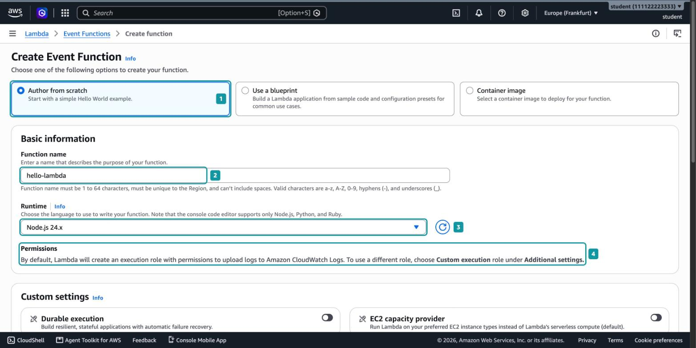

_9.1.1. Основные параметры функции_

_Среда выполнения (runtime)_ - набор из операционной системы, языка и библиотек, в котором Lambda запускает код функции. Среда `Node.js 24.x` работает на Amazon Linux 2023 и уже содержит AWS SDK for JavaScript v3, поэтому для вызова других сервисов AWS устанавливать его не нужно.

Обратите внимание на блок `Permissions` (_4_). Lambda сама создаст для функции роль выполнения с правом записывать журналы в CloudWatch Logs. Как и экземпляр EC2, функция не хранит ключей доступа: она получает временные учётные данные этой роли.

### Шаг 2. Проверьте дополнительные настройки

Оба переключателя блока `Custom settings`, `Durable execution` и `EC2 capacity provider`, оставьте выключенными: эти режимы нужны для длительных процессов и для запуска функций на своих экземплярах EC2.

Раскройте `Additional settings`. Здесь тоже ничего менять не нужно, но два переключателя стоит понимать:

- `ARM64 architecture` (_5_). По умолчанию функция работает на процессорах x86_64. Архитектура важна, когда в коде есть библиотеки, собранные под конкретный процессор. С такой библиотекой мы встретимся в Hands-on 9.2.
- `Custom execution role` (_6_). Переключатель выключен: значит, Lambda создаст новую роль сама.

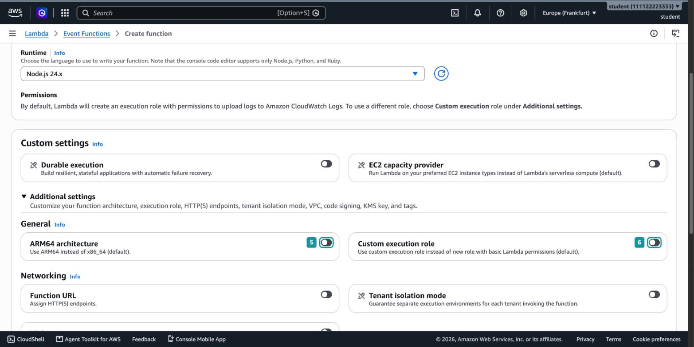

_9.1.2. Дополнительные настройки функции_

Нажмите `Create Event Function`. Если появится окно `Getting started`, закройте его кнопкой `Dismiss`.

### Шаг 3. Осмотрите страницу функции

Через несколько секунд откроется страница `hello-lambda`. В блоке `Function overview` функция показана на схеме (_7_). Слева от неё будут триггеры, то есть источники событий, которые её запускают. Пока триггеров нет, их добавляют кнопкой `Add trigger` (_8_). Справа появятся назначения, куда функция может отправить результат.

Ниже находятся вкладки (_9_), с которыми мы будем работать:

- `Code`. Редактор кода и кнопка развёртывания.
- `Test`. Тестовые события и ручной вызов.
- `Monitor`. Графики вызовов и переход к журналам.
- `Configuration`. Память, таймаут, роль, триггеры и другие настройки.

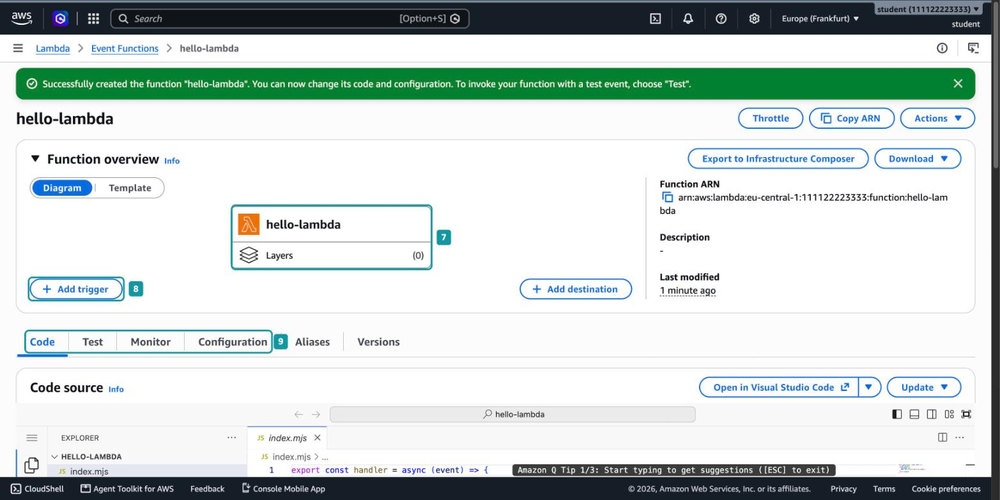

_9.1.3. Страница функции_

## Часть 2. Код и тестовое событие

### Шаг 4. Измените код и разверните его

Прокрутите страницу до блока `Code source`. Это редактор в стиле Visual Studio Code. Слева список файлов функции, в нём один файл `index.mjs`. Расширение `.mjs` означает модуль ECMAScript, поэтому в коде используются `export` и `import`, а не `module.exports` и `require`.

Замените код в `index.mjs` на следующий:

```javascript
export const handler = async (event) => {
  console.log("Получено событие:", JSON.stringify(event));

  const name = event.name ?? "незнакомец";
  const message = `Привет, ${name}!`;

  console.log("Ответ:", message);
  return { message };
};
```

_Обработчик (handler)_ - функция в коде, которую Lambda вызывает при каждом запуске. Lambda находит её по настройке `Handler`, которая по умолчанию равна `index.handler`: файл `index` и экспортированная функция `handler`.

Разберём код:

- `event` - событие, с которым вызвана функция. Это обычный объект JavaScript. Его содержимое зависит от источника: тестовое событие мы напишем сами, а событие от S3 сформирует сервис.
- `console.log` пишет в журнал функции. Всё, что функция выводит, попадёт в CloudWatch Logs.
- `event.name ?? "незнакомец"` берёт имя из события, а если поля нет, подставляет запасное значение.
- `return` возвращает ответ тому, кто вызвал функцию. Lambda превращает объект в JSON.

После изменения кода (_10_) рядом с разделом `DEPLOY` появится пометка `Undeployed` (_11_). Код в редакторе пока существует только в вашем браузере: Lambda по-прежнему запускает старую версию. Нажмите `Deploy` (_12_), чтобы отправить код в Lambda.

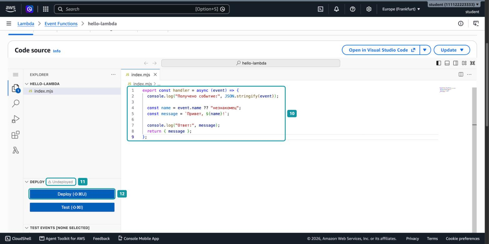

_9.1.4. Новый код и кнопка Deploy_

После развёртывания пометка сменится на `Current`.

> [!WARNING]
> Самая частая ошибка в этом занятии - изменить код и сразу нажать `Test`, забыв про `Deploy`. Функция при этом отработает без ошибок, но со старым кодом. Если результат не совпадает с ожидаемым, сначала проверьте пометку у `DEPLOY`.

### Шаг 5. Создайте тестовое событие

Чтобы вызвать функцию, нужно событие. Пока у функции нет триггеров, событие напишем вручную.

Откройте вкладку `Test`:

1. `Test event action`: `Create new event` (_13_).
2. `Invocation type`: `Synchronous` (_14_). При синхронном вызове консоль ждёт, пока функция закончит работу, и сразу показывает ответ.
3. `Event name`: `greet-anna` (_15_).

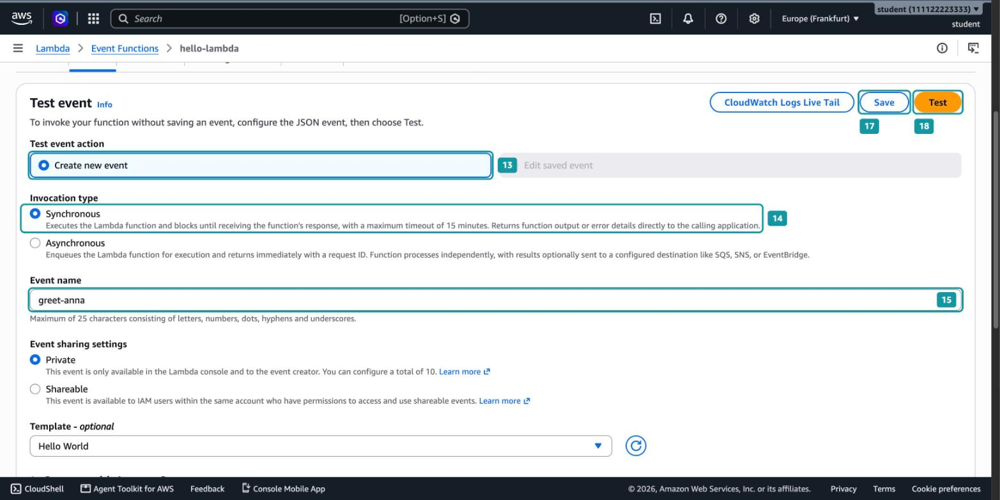

_9.1.5. Параметры тестового события_

Прокрутите форму вниз до `Event JSON` и замените пример на своё событие (_16_):

```json
{
  "name": "Анна"
}
```

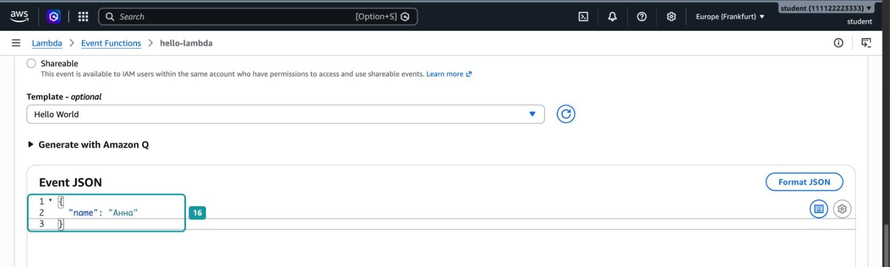

_9.1.6. JSON тестового события_

Этот JSON Lambda передаст в обработчик как параметр `event`, поэтому `event.name` будет равно `"Анна"`.

Вернитесь наверх формы и нажмите `Save` (_17_), чтобы событие сохранилось и его можно было запускать повторно. Затем нажмите `Test` (_18_).

### Шаг 6. Разберите результат вызова

Над формой появится зелёный блок `Executing function: succeeded` (_19_). Если блок `Details` свёрнут, раскройте его.

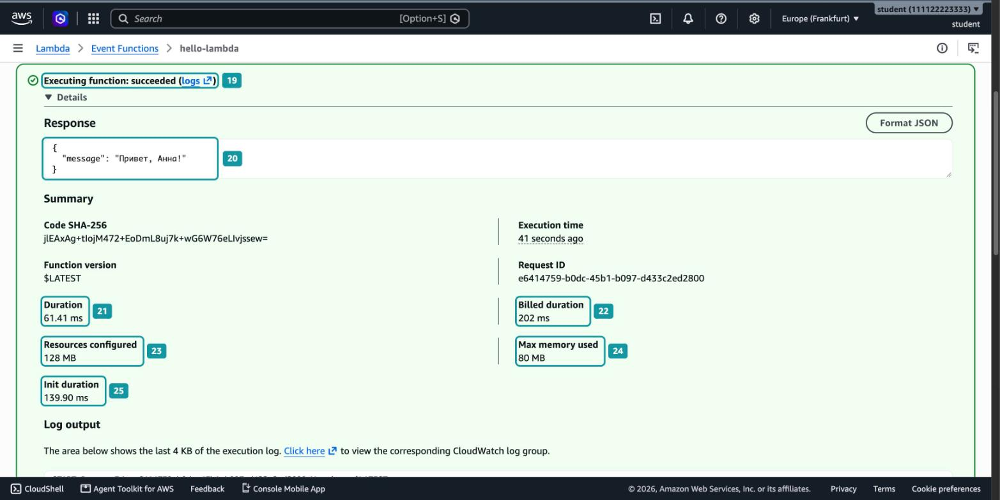

_9.1.7. Результат вызова функции_

В блоке `Response` (_20_) находится объект, который вернул `return`: `{"message": "Привет, Анна!"}`. В блоке `Summary` собраны числа, по которым Lambda считает стоимость:

- `Duration` (_21_). Время работы обработчика, в примере 61 мс.
- `Billed duration` (_22_). Время, за которое берётся плата: `Duration` плюс `Init duration`, если она есть, с округлением вверх до миллисекунды.
- `Resources configured` (_23_). Память, выделенная функции, по умолчанию 128 МБ.
- `Max memory used` (_24_). Сколько памяти функция на самом деле использовала.
- `Init duration` (_25_). Время подготовки новой среды выполнения перед первым вызовом в ней.

Почему `Billed duration` равна 202 мс, если обработчик работал 61 мс? Перед первым вызовом Lambda создала новую среду выполнения: загрузила код, запустила Node.js и выполнила код модуля вне обработчика. Это заняло 139,9 мс. С августа 2025 года время этой подготовки оплачивается вместе с работой обработчика[^1]: 61,41 + 139,90 ≈ 202 мс.

_Холодный старт (cold start)_ - вызов, перед которым Lambda создаёт новую среду выполнения. Он дольше обычного вызова на время `Init duration`[^2].

### Шаг 7. Посмотрите журнал вызова

Прокрутите результат ниже, до `Log output`. Здесь показан конец журнала этого вызова.

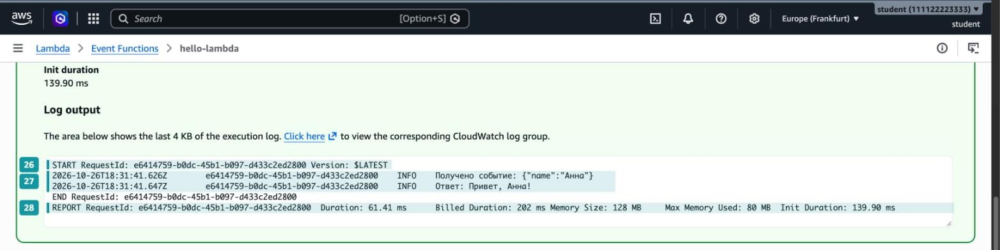

_9.1.8. Журнал вызова_

В журнале три вида строк:

- `START` (_26_). Lambda начала вызов. `RequestId` - уникальный номер вызова, по нему ищут записи конкретного запуска.
- Строки `console.log` (_27_). Вывод вашего кода с временем, номером вызова и уровнем `INFO`.
- `END` и `REPORT`. Вызов закончен. Строка `REPORT` (_28_) повторяет числа из `Summary`.

Все эти строки Lambda записывает и в CloudWatch Logs.

### Шаг 8. Вызовите функцию повторно

Сразу нажмите `Test` ещё раз и найдите строку `REPORT` нового вызова (_29_).

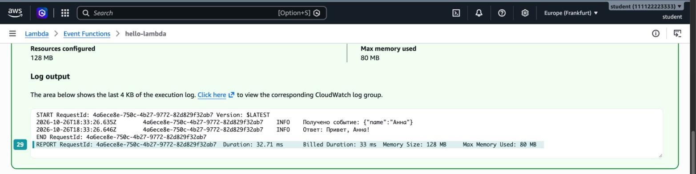

_9.1.9. Повторный вызов без Init Duration_

В строке нет `Init Duration`, а `Billed Duration` почти совпадает с `Duration`: 33 мс вместо 202 мс. После первого вызова Lambda не уничтожила среду выполнения, а "заморозила" её. Второй вызов попал в ту же среду, поэтому подготовка не понадобилась. Такой вызов называют тёплым.

Lambda не обещает хранить среду долго. Если функцию долго не вызывать или изменить её код или настройки, следующий вызов снова будет холодным.

## Часть 3. Журнал в CloudWatch Logs

### Шаг 9. Найдите группу журналов функции

Блок `Log output` в консоли Lambda показывает только последний вызов и не больше 4 КБ текста. Полный журнал хранится в Amazon CloudWatch Logs.

Откройте сервис `CloudWatch` и в меню слева выберите `Logs` → `Log Management` (_30_). В списке появилась группа `/aws/lambda/hello-lambda` (_31_). Lambda создаёт её при первом вызове и называет по шаблону `/aws/lambda/<имя функции>`. Откройте группу.

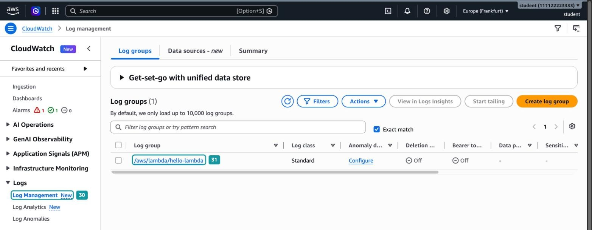

_9.1.10. Группа журналов функции_

### Шаг 10. Проверьте срок хранения журналов

В блоке `Log group details` найдите `Retention` (_32_). Значение `Never expire` означает, что записи хранятся бессрочно и место под них оплачивается всё это время.

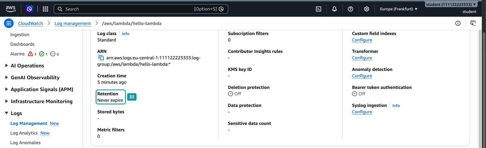

_9.1.11. Срок хранения журналов_

Для учебной функции это несколько килобайт, но у рабочей функции, которую вызывают миллионы раз, журналы занимают гигабайты. Поэтому в реальных проектах срок хранения ограничивают в настройках группы журналов, например 30 днями.

### Шаг 11. Откройте поток журнала

Сверните `Log group details`. На вкладке `Log streams` есть один поток (_33_). Имя потока содержит дату, версию функции `[$LATEST]` и идентификатор среды выполнения. Каждая среда выполнения пишет в свой поток, поэтому при параллельных вызовах потоков будет несколько.

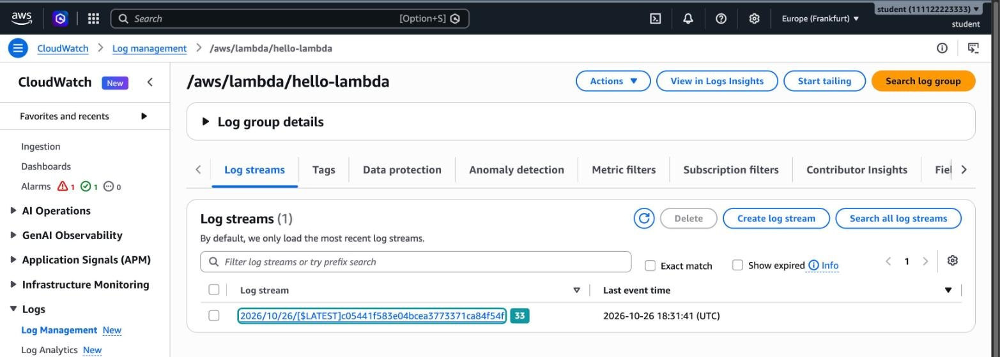

_9.1.12. Поток журнала_

Откройте поток.

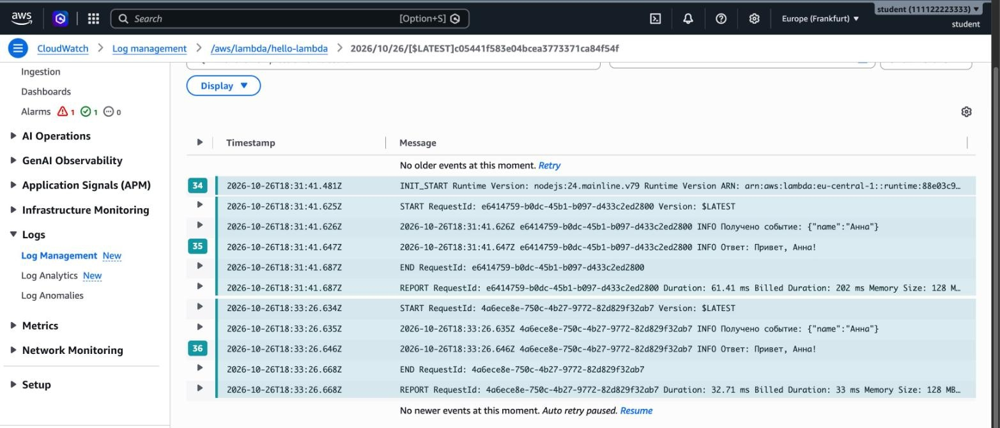

_9.1.13. События в потоке журнала_

На рисунке 9.1.13 видны оба вызова из шагов 6 и 8:

- `INIT_START` (_34_). Запись о подготовке среды, в ней указана версия runtime Node.js. Она есть только один раз, перед первым вызовом в этой среде.
- Первый вызов (_35_) от `START` до `REPORT`.
- Второй вызов (_36_) в том же потоке, без новой строки `INIT_START`.

Это и есть повторное использование среды выполнения из шага 8, только теперь его видно в журнале.

## Часть 4. Ошибки и настройки

### Шаг 12. Посмотрите на ошибку в коде

Функции обычно ломаются из-за неожиданного события. Добавим проверку: если в событии нет имени, функция выбрасывает исключение.

Вернитесь в Lambda, на вкладку `Code` функции `hello-lambda`, и замените код:

```javascript
export const handler = async (event) => {
  console.log("Получено событие:", JSON.stringify(event));

  if (!event.name) {
    throw new Error("Поле name не передано");
  }

  const message = `Привет, ${event.name}!`;
  console.log("Ответ:", message);
  return { message };
};
```

Нажмите `Deploy`. Затем на вкладке `Test` создайте второе событие:

1. `Test event action`: `Create new event`.
2. `Event name`: `empty-event`.
3. В `Event JSON` замените всё содержимое на `{}`.
4. Нажмите `Save`, затем `Test`.

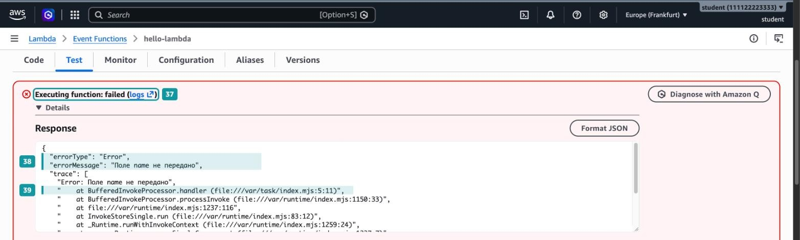

_9.1.14. Вызов, завершившийся ошибкой_

Теперь блок результата красный: `Executing function: failed` (_37_). Исключение не потерялось: Lambda вернула его вызывающему в виде JSON:

- `errorType` и `errorMessage` (_38_). Тип исключения и текст из `new Error(...)`.
- `trace` (_39_). Стек вызовов. Строка с `/var/task/index.mjs:5:11` указывает файл, строку и позицию, где выброшено исключение. В папке `/var/task` Lambda хранит код функции. Строки с `/var/runtime` относятся к коду самой среды выполнения, их можно не читать.

### Шаг 13. Превысьте таймаут

Вторая частая причина сбоя - функция работает дольше, чем ей разрешено. Добавьте в код паузу на 5 секунд перед формированием ответа:

```javascript
  await new Promise((resolve) => setTimeout(resolve, 5000));
```

Строку поставьте после блока `if`, затем нажмите `Deploy`. На вкладке `Test` выберите `Edit saved event`, в списке `Event name` выберите `greet-anna` и нажмите `Test`.

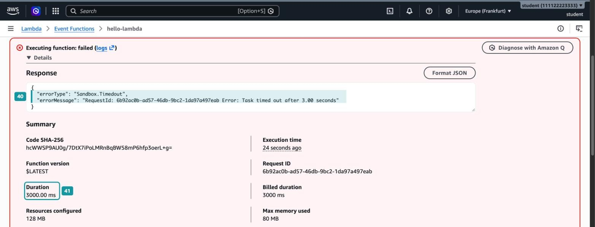

_9.1.15. Вызов, прерванный по таймауту_

Вызов снова завершился ошибкой, но другого типа: `Sandbox.Timedout`, а сообщение заканчивается словами `Task timed out after 3.00 seconds` (_40_). `Duration` равна ровно 3000 мс (_41_).

_Таймаут функции (timeout)_ - максимальное время одного вызова. По умолчанию это 3 секунды, максимум 15 минут[^3]. Когда время выходит, Lambda останавливает выполнение, даже если код не закончил работу. В `Log output` этого вызова нет строки `Ответ:`: до неё код не дошёл.

> [!IMPORTANT]
> Прерванный по таймауту вызов оплачивается целиком, за все 3000 мс. Короткий таймаут ограничивает расходы на зависший код: с таймаутом 15 минут такой вызов оплачивался бы все 15 минут.

### Шаг 14. Увеличьте таймаут

Откройте вкладку `Configuration`, раздел `General configuration` (_42_). Здесь видно текущее значение `Timeout` (_43_). Нажмите `Edit` (_44_).

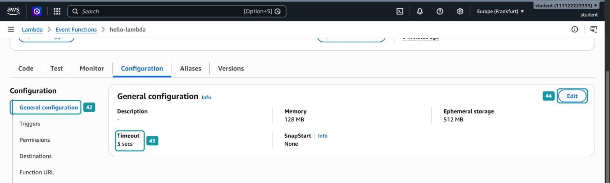

_9.1.16. Общие настройки функции_

На странице `Edit basic settings` находятся три настройки, с которыми вы будете работать чаще всего:

- `Memory` (_45_). Объём памяти от 128 МБ до 10 240 МБ. Вместе с памятью Lambda пропорционально выделяет процессорное время: при 1769 МБ функция получает примерно один полный vCPU[^4]. Цена секунды работы тоже растёт с памятью.
- `Timeout` (_46_). Укажите `0` минут и `10` секунд.
- `Execution role` (_47_). Роль, которую Lambda создала в шаге 1. Её имя содержит случайный суффикс, у вас он будет другим.

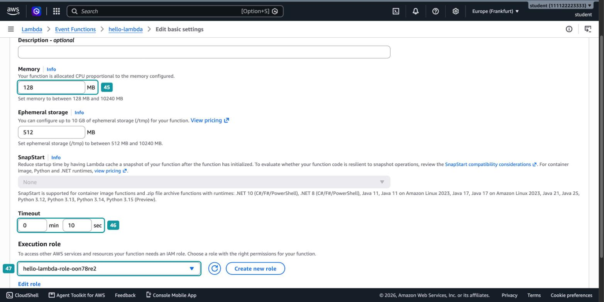

_9.1.17. Память, таймаут и роль функции_

Прокрутите страницу вниз и нажмите `Save`. Снова запустите событие `greet-anna`. Теперь вызов успешен, `Duration` около 5100 мс. В строке `REPORT` снова есть `Init Duration`: после изменения настроек Lambda создала новую среду выполнения.

### Шаг 15. Посмотрите права функции

В разделе `Configuration` выберите `Permissions` (_48_). Здесь видно имя роли выполнения (_49_), а ниже, в `Resource summary`, к каким сервисам у функции есть доступ (_50_).

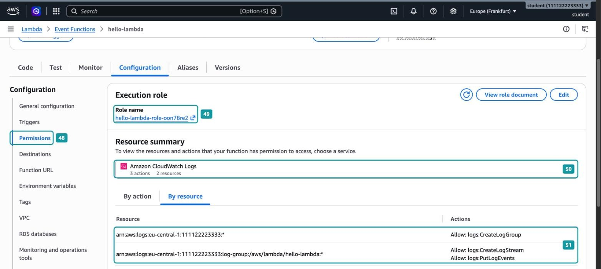

_9.1.18. Роль выполнения и её права_

Таблица на вкладке `By resource` (_51_) показывает три действия CloudWatch Logs:

- `logs:CreateLogGroup` на любые группы журналов аккаунта в регионе. Право создать группу журналов при первом вызове.
- `logs:CreateLogStream` и `logs:PutLogEvents` только для группы `/aws/lambda/hello-lambda`. Право создавать потоки и писать в них.

Никаких других прав у функции нет. Если добавить в код чтение из S3, вызов упадёт с ошибкой `AccessDenied`: сначала нужно дописать разрешение в роль. Именно это мы сделаем в Hands-on 9.2.

## Часть 5. Удаление ресурсов

Откройте функцию и выберите `Actions` → `Delete function`. Прочитайте предупреждение в окне (_52_): функция удаляется, а её журналы, роль и тестовые события остаются в аккаунте. Введите `confirm` (_53_) и нажмите `Delete` (_54_).

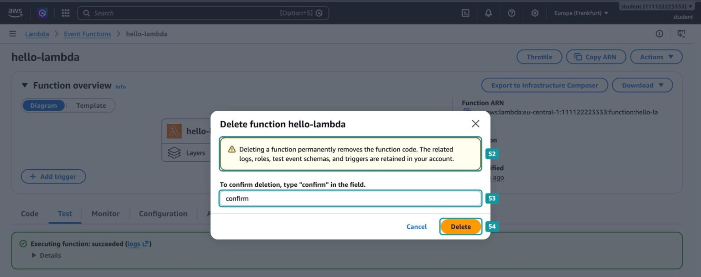

_9.1.19. Удаление функции_

Затем удалите то, что осталось после функции:

1. В `CloudWatch` → `Logs` → `Log Management` отметьте группу `/aws/lambda/hello-lambda` и выберите `Actions` → `Delete log group(s)`.
2. В `IAM` → `Roles` найдите роль `hello-lambda-role-...` и удалите её.
3. В `IAM` → `Policies` найдите политику `AWSLambdaBasicExecutionRole-...`, которую консоль создала вместе с ролью, и удалите её.

## Вопросы для самопроверки

1. Что такое обработчик и как Lambda находит его в коде?
2. Что произойдёт, если изменить код в редакторе и нажать `Test` без `Deploy`?
3. Откуда в обработчике берётся объект `event` при ручном тестовом вызове?
4. Почему `Billed duration` первого вызова больше, чем `Duration`, а у второго вызова почти равна ей?
5. Где хранится полный журнал функции и почему его срок хранения стоит ограничивать?
6. Чем отличается результат вызова с ошибкой в коде от вызова, прерванного по таймауту?
7. Какие права есть у роли, которую Lambda создаёт по умолчанию, и чего функция с этой ролью сделать не сможет?
8. Какие ресурсы остаются в аккаунте после удаления функции?

[^1]: Gupta, S. and Gebhart, J. (2025). _AWS Lambda standardizes billing for INIT Phase_. AWS Compute Blog. Available at: https://aws.amazon.com/blogs/compute/aws-lambda-standardizes-billing-for-init-phase/

[^2]: Amazon Web Services (2026). _Understanding the Lambda execution environment lifecycle_. AWS Lambda Developer Guide. Available at: https://docs.aws.amazon.com/lambda/latest/dg/lambda-runtime-environment.html

[^3]: Amazon Web Services (2026). _Lambda quotas_. AWS Lambda Developer Guide. Available at: https://docs.aws.amazon.com/lambda/latest/dg/gettingstarted-limits.html

[^4]: Amazon Web Services (2026). _Configure Lambda function memory_. AWS Lambda Developer Guide. Available at: https://docs.aws.amazon.com/lambda/latest/dg/configuration-memory.html
