# Hands-on 10.1. Очередь SQS и функция Lambda

В Hands-on 9.2 сервис S3 сам вызывал функцию, как только в бакете появлялся файл. В этом занятии между отправителем и обработчиком появится очередь.

Учебный сценарий такой. Интернет-магазин принимает заказы и кладёт каждый заказ в очередь Amazon SQS. Функция Lambda забирает заказы из очереди и обрабатывает их. Магазину не нужно ждать обработчика: он отправляет сообщение и сразу отвечает покупателю. Если обработчик сломан, заказы не пропадают, а ждут в очереди. Заказ, который не удалось обработать после нескольких попыток, попадает в отдельную очередь недоставленных сообщений. Оттуда его можно вернуть, когда ошибка исправлена.

## Что получится в конце

- Очередь `orders-queue` для заказов и очередь недоставленных сообщений `orders-dlq`.
- Функция `process-order`, которая получает заказы из очереди через event source mapping.
- Заказ, который из-за ошибки в коде попал в `orders-dlq`, а после исправления кода вернулся в `orders-queue` и был обработан.

## Перед началом

- Вы выполнили Hands-on 9.1 и 9.2: умеете создавать функцию, менять её таймаут, добавлять права роли и читать журнал в CloudWatch Logs.
- Выбран регион `Europe (Frankfurt)`.
- На занятие понадобится около часа.

> [!NOTE]
> Amazon SQS бесплатно обрабатывает первый миллион запросов в месяц, Lambda - первый миллион вызовов, поэтому занятие ничего не стоит. Учтите одну особенность: пока к очереди подключена функция, Lambda постоянно опрашивает очередь, даже пустую, и каждый опрос считается запросом к SQS. Поэтому в части 6 обязательно удалите триггер и функцию.

## Часть 1. Очереди

### Шаг 1. Создайте очередь недоставленных сообщений

_Очередь недоставленных сообщений (dead-letter queue, DLQ)_ - обычная очередь, куда SQS переносит сообщения, полученные потребителем заданное число раз, но так и не обработанные. Без неё такое "ядовитое" сообщение (poison message) возвращалось бы в основную очередь снова и снова, пока не истечёт срок хранения, и каждый раз ломало бы обработчик.

Основная очередь при создании ссылается на DLQ, поэтому DLQ создаётся первой. Откройте сервис `Simple Queue Service` и нажмите `Create queue`:

1. `Type`: `Standard` (_1_). DLQ должна быть того же типа, что и основная очередь.
2. `Name`: `orders-dlq` (_2_).
3. `Message retention period`: `14` дней (_3_). Это максимум.

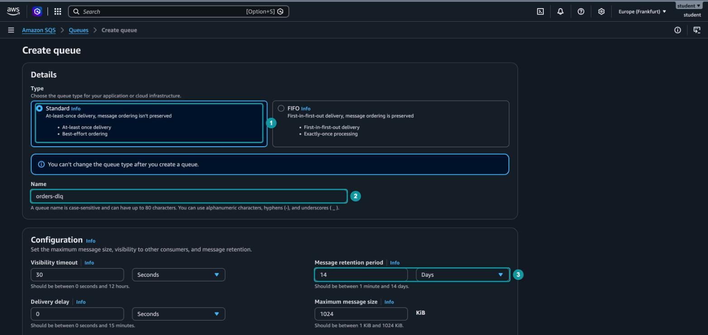

_10.1.1. Создание очереди orders-dlq_

Почему 14 дней, а не 4 дня по умолчанию? У стандартной очереди срок хранения сообщения отсчитывается от момента его первой отправки, а не от переноса в DLQ[^1]. Если заказ провёл в основной очереди 3 дня, то в DLQ с хранением 4 дня он проживёт всего сутки. Срок хранения DLQ делают больше, чем у основной очереди, чтобы у команды было время разобраться с ошибкой.

Остальные параметры оставьте по умолчанию и нажмите `Create queue` внизу страницы. Обратите внимание, что шифрование `Amazon SQS key (SSE-SQS)` уже включено: SQS шифрует сообщения при хранении без дополнительной настройки.

### Шаг 2. Создайте основную очередь

Снова нажмите `Create queue` и создайте стандартную очередь `orders-queue` (_4_). В блоке `Configuration` важны два параметра.

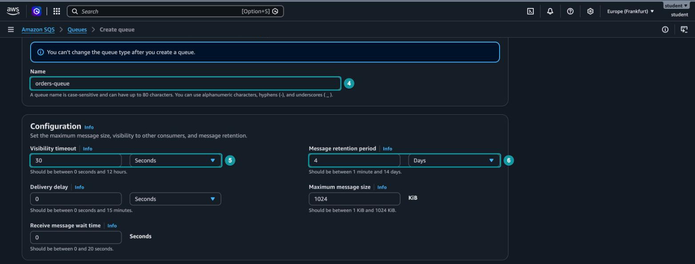

_10.1.2. Параметры основной очереди_

`Visibility timeout` (_5_) оставьте равным 30 секундам. Когда потребитель получает сообщение, SQS его не удаляет, а только скрывает от других потребителей. _Таймаут видимости (visibility timeout)_ - время, на которое сообщение скрывается после получения. За это время потребитель должен обработать сообщение и сам удалить его из очереди. Если он не успел или завершился с ошибкой, сообщение снова становится видимым, и его сможет получить любой потребитель, в том числе тот же.

Значение таймаута видимости зависит от обработчика. Для функции Lambda AWS советует задавать его не меньше шестикратного таймаута функции[^2]. Если таймаут видимости окажется короче времени работы функции, сообщение снова станет видимым, пока функция ещё его обрабатывает, и Lambda передаст его повторно. Запас нужен и на случай, когда Lambda не смогла сразу вызвать функцию и повторяет вызов. У нашей функции таймаут будет 5 секунд, поэтому 30 секунд подходят.

`Message retention period` (_6_) оставьте равным 4 дням. Столько необработанный заказ может пролежать в очереди, прежде чем SQS удалит его.

### Шаг 3. Подключите DLQ

Прокрутите форму до блока `Dead-letter queue`:

1. Выберите `Enabled` (_7_).
2. В `Choose queue` выберите ARN очереди `orders-dlq` (_8_).
3. `Maximum receives`: `3` (_9_).

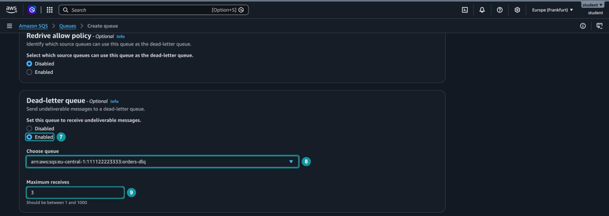

_10.1.3. Настройка DLQ для основной очереди_

`Maximum receives` - сколько раз сообщение можно получить из очереди, прежде чем SQS перенесёт его в DLQ. В документации этот параметр называется `maxReceiveCount`, а вся настройка целиком - политикой перенаправления (redrive policy): она определяет, куда и после скольких получений перенаправлять сообщение. Для очереди, которую читает Lambda, AWS рекомендует значение не меньше 5[^2]. Мы ставим 3, чтобы не ждать долго в части 4.

Нажмите `Create queue`.

## Часть 2. Сообщения вручную

Прежде чем подключать функцию, побудем потребителем сами и посмотрим, как ведёт себя сообщение в очереди.

### Шаг 4. Отправьте два заказа

На странице `orders-queue` нажмите `Send and receive messages`. В поле `Message body` (_10_) введите первый заказ и нажмите `Send message` (_11_):

```json
{"orderId": "A-1001", "customer": "Анна", "amount": 1250}
```

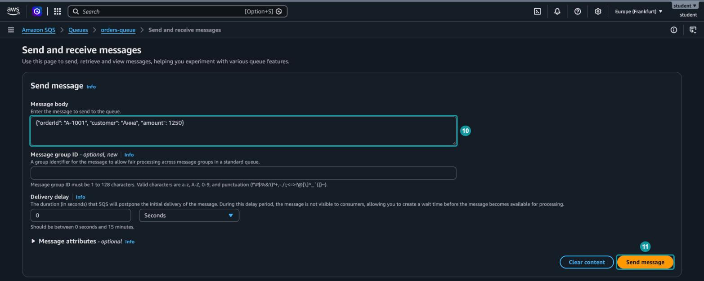

_10.1.4. Отправка сообщения в очередь_

Поле `Message group ID` оставьте пустым.

Замените текст и отправьте второй заказ:

```json
{"orderId": "A-1002", "customer": "Иван", "amount": 480}
```

Для SQS тело сообщения - просто строка размером до 1 МиБ, это значение `Maximum message size` на рисунке 10.1.1. Очередь не проверяет, что внутри JSON: формат сообщения - договорённость между отправителем и получателем.

### Шаг 5. Получите сообщения

Прокрутите страницу до блока `Receive messages` и нажмите `Poll for messages`. Консоль 30 секунд опрашивает очередь и показывает всё, что получила.

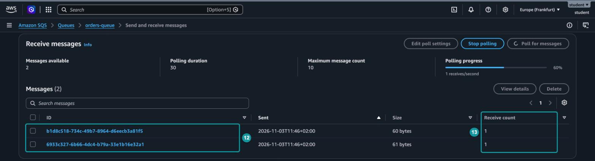

_10.1.5. Полученные сообщения_

В списке два сообщения (_12_). SQS присвоил каждому уникальный идентификатор. В столбце `Receive count` (_13_) видно, сколько раз сообщение уже получали: пока по одному разу. Нажмите на идентификатор любого сообщения: на вкладке `Body` будет JSON заказа.

### Шаг 6. Посмотрите, как сообщение возвращается

Дождитесь конца опроса и посмотрите на `Receive count` ещё раз.

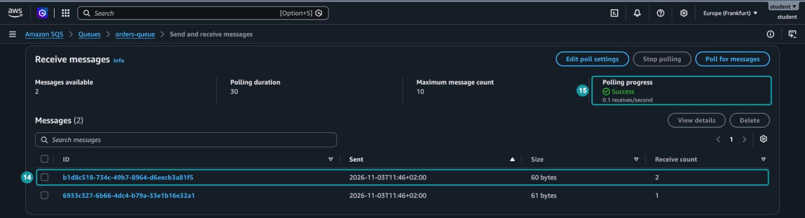

_10.1.6. Сообщение получено повторно_

У одного из сообщений счётчик стал равен 2 (_14_), хотя опрос (_15_) запускался один раз. Консоль получила сообщение в начале опроса, но не удалила его. Через 30 секунд истёк таймаут видимости, сообщение снова стало видимым, и консоль, которая всё ещё опрашивала очередь, получила его второй раз. Именно так SQS повторяет доставку: если потребитель не удалил сообщение, оно возвращается в очередь.

Опрос и таймаут видимости длятся по 30 секунд, поэтому результат зависит от того, в какой момент консоль получила сообщения. У вас может увеличиться счётчик обоих сообщений или ни одного. Во втором случае запустите опрос ещё раз.

> [!WARNING]
> Получение сообщения в консоли тоже считается попыткой доставки[^3]. Если опросить очередь ещё пару раз, `Receive count` превысит `Maximum receives`, и сообщение уйдёт в DLQ, хотя никакой ошибки не было.

### Шаг 7. Удалите сообщения

Обработав сообщение, потребитель обязан удалить его сам. Отметьте оба сообщения флажками, нажмите `Delete` и подтвердите удаление. Очередь пуста.

## Часть 3. Функция и триггер

### Шаг 8. Создайте функцию

Создайте Event Function `process-order` на `Node.js 24.x` так же, как в Hands-on 9.1. В `Configuration` → `General configuration` задайте `Timeout` 5 секунд: именно под этот таймаут мы выбрали таймаут видимости очереди.

Замените код в `index.mjs` и нажмите `Deploy`:

```javascript
export const handler = async (event) => {
  console.log(`Получено сообщений: ${event.Records.length}`);

  for (const record of event.Records) {
    const attempt = record.attributes.ApproximateReceiveCount;
    console.log(`Сообщение ${record.messageId}, попытка ${attempt}`);

    const order = JSON.parse(record.body);

    if (typeof order.amount !== "number") {
      throw new Error(`Заказ ${order.orderId}: сумма должна быть числом`);
    }

    console.log(`Заказ ${order.orderId} от ${order.customer} на сумму ${order.amount} обработан`);
  }
};
```

Разберём, что приходит в `event`:

- `event.Records` - массив сообщений. Lambda передаёт функции сообщения пачкой (batch), а не по одному, поэтому код обходит массив в цикле.
- `record.body` - тело сообщения в том виде, в каком его отправили, то есть строка. Чтобы получить объект заказа, строку разбирают через `JSON.parse`.
- `record.messageId` - тот же идентификатор, который вы видели в консоли SQS.
- `record.attributes.ApproximateReceiveCount` - тот же счётчик, что и `Receive count` в консоли. По нему в журнале будет видно, какая это попытка.

В коде намеренно оставлена ошибка: функция считает корректной только сумму-число. Скоро мы отправим заказ, в котором сумма записана строкой.

Кода для удаления сообщений в функции нет. Удаляет их Lambda: если функция завершилась без ошибки, все сообщения пачки удаляются из очереди. Если функция выбросила исключение, Lambda ничего не удаляет, и после таймаута видимости вся пачка возвращается в очередь[^2].

### Шаг 9. Попробуйте добавить триггер

На странице функции нажмите `Add trigger` и в списке источников выберите `SQS` (_16_). Под названием источника видны метки `event-source-mapping` и `polling`.

_Сопоставление источника событий (event source mapping)_ - ресурс Lambda, который сам читает сообщения из источника и вызывает функцию. В Hands-on 9.2 было наоборот: S3 сам отправлял событие в Lambda. Очередь ничего никуда не отправляет, она только хранит сообщения, пока их не заберут. Поэтому забирать сообщения приходится самой Lambda: её служебные процессы постоянно опрашивают очередь (polling) и вызывают функцию синхронно, передавая ей пачку сообщений. S3 в Hands-on 9.2, напротив, вызывал функцию асинхронно.

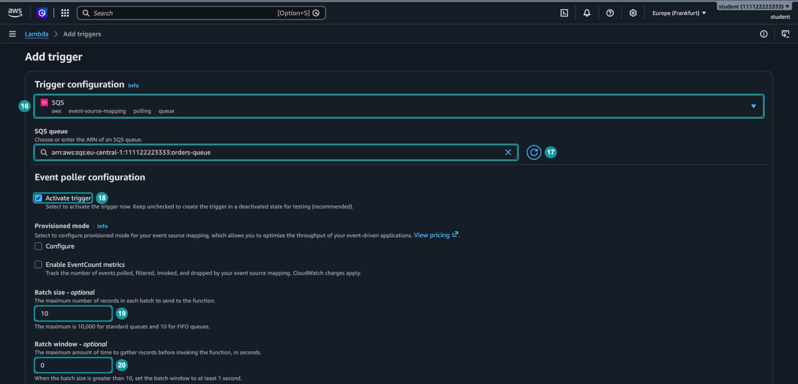

_10.1.7. Настройки триггера SQS_

Заполните форму:

1. `SQS queue`: очередь `orders-queue` (_17_). Консоль подставит её ARN.
2. `Activate trigger` (_18_) оставьте отмеченным, чтобы опрос начался сразу. Консоль советует сначала создать выключенный триггер и проверить настройки, но в учебном примере проверять нечего.
3. `Batch size`: `10` (_19_). Lambda передаст функции не больше 10 сообщений за один вызов.
4. `Batch window`: `0` (_20_). Lambda не ждёт, пока соберётся полная пачка, и вызывает функцию сразу, как только появились сообщения.

`Provisioned mode` и `Enable EventCount metrics` оставьте выключенными. Прокрутите форму вниз, к её концу (рисунок 10.1.8).

Флажок `Report batch item failures` (_21_) оставьте пустым. С ним функция может сообщить Lambda, какие именно сообщения пачки не удалось обработать, и в очередь вернутся только они. Без него одно плохое сообщение возвращает в очередь всю пачку, и уже обработанные заказы будут обработаны повторно. В учебном примере сообщения приходят по одному, поэтому разница не будет видна, но в рабочем проекте этот флажок обычно включают.

Нажмите `Add`. Триггер не создастся, а внизу появится ошибка (_22_): у роли функции нет права вызывать `ReceiveMessage` для SQS. В этом и состоит отличие от S3. Там сервис S3 сам вызывал функцию, и Lambda добавила в политику ресурса функции разрешение для S3. Здесь очередь читает сама Lambda, от имени роли функции, а роль, созданная по умолчанию, умеет только писать журналы.

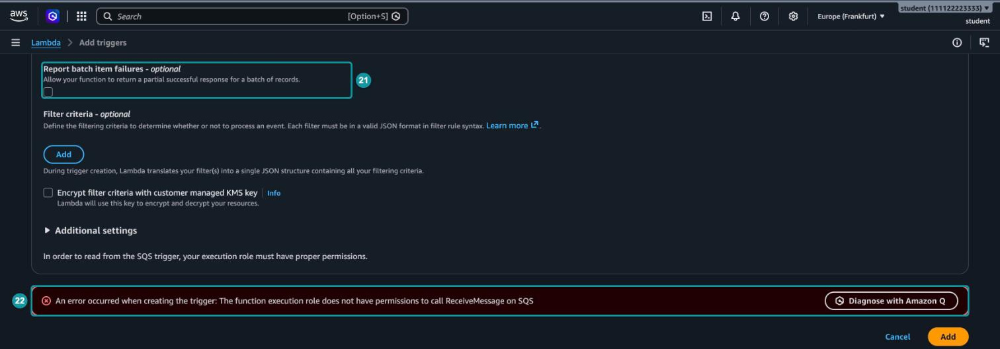

_10.1.8. Ошибка при создании триггера_

### Шаг 10. Добавьте права роли

Откройте роль функции из `Configuration` → `Permissions`, как в Hands-on 9.2. Нажмите `Add permissions` → `Attach policies`, найдите управляемую политику `AWSLambdaSQSQueueExecutionRole` и отметьте её (_23_). Раскройте её кнопкой `+`, чтобы увидеть содержимое.

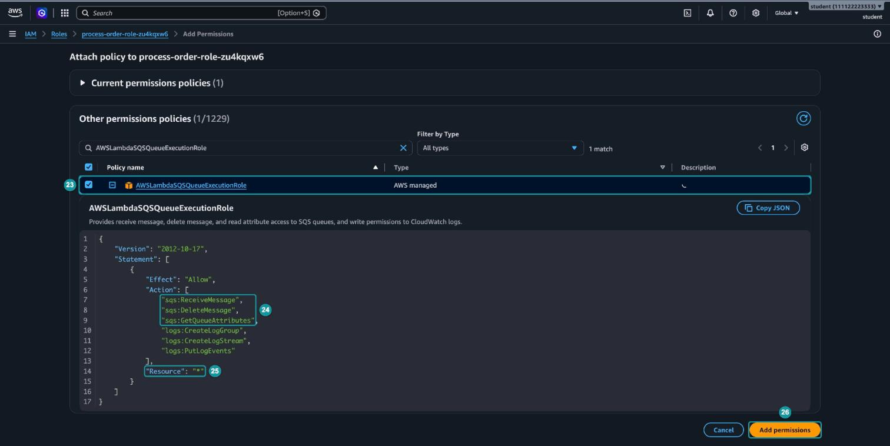

_10.1.9. Политика для чтения очереди_

Политика разрешает три действия SQS (_24_):

- `sqs:ReceiveMessage`. Получать сообщения.
- `sqs:DeleteMessage`. Удалять обработанные сообщения.
- `sqs:GetQueueAttributes`. Читать настройки очереди, например таймаут видимости.

Остальные три действия разрешают запись журналов, которая у роли уже есть.

Обратите внимание на `"Resource": "*"` (_25_): политика разрешает работать с любой очередью аккаунта. Для учебного занятия это удобно. В рабочем проекте вместо неё пишут собственную политику с ARN конкретной очереди, как мы сделали для бакета в Hands-on 9.2.

Нажмите `Add permissions` (_26_).

### Шаг 11. Создайте триггер

Вернитесь к функции и снова нажмите `Add trigger`. Заполните форму так же, как в шаге 9, и нажмите `Add`. Теперь триггер создаётся. Откройте `Configuration` → `Triggers` и раскройте `Details`.

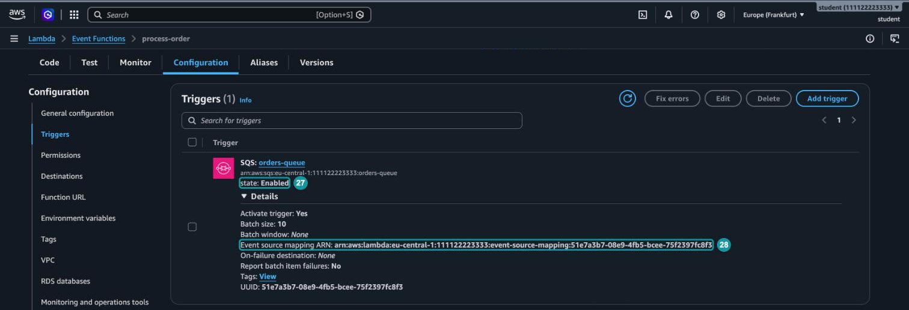

_10.1.10. Созданный триггер_

Сразу после создания триггер находится в состоянии `Creating`. Через полминуты обновите страницу: состояние станет `Enabled` (_27_), и Lambda начнёт опрашивать очередь. В строке `Event source mapping ARN` (_28_) видно, что триггер - отдельный ресурс Lambda со своим идентификатором.

## Часть 4. Проверка

### Шаг 12. Отправьте корректный и ошибочный заказы

Откройте `orders-queue` → `Send and receive messages` и отправьте корректный заказ:

```json
{"orderId": "A-1003", "customer": "Мария", "amount": 2100}
```

Через несколько секунд отправьте второй заказ. Новая версия сайта магазина записала в нём сумму строкой:

```json
{"orderId": "A-1004", "customer": "Павел", "amount": "1200"}
```

Сразу перейдите к списку очередей.

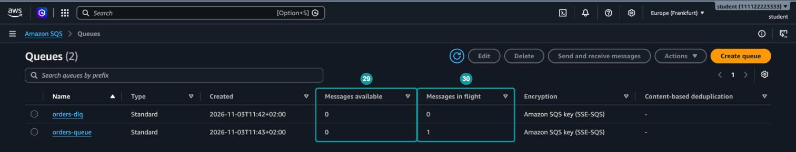

_10.1.11. Сообщение в обработке_

У `orders-queue` в столбце `Messages available` ноль (_29_), а в `Messages in flight` одно сообщение (_30_): оно получено, но ещё не удалено. Это заказ `A-1004`: функция получила его и завершилась с ошибкой, и теперь сообщение скрыто на время таймаута видимости. Заказа `A-1003` в очереди уже нет: функция обработала его, и Lambda удалила сообщение.

> [!NOTE]
> Счётчики в списке очередей приблизительные и обновляются с задержкой до минуты. Если оба счётчика `orders-queue` равны нулю, обновите страницу.

### Шаг 13. Найдите повторы в журнале

Откройте в CloudWatch Logs группу `/aws/lambda/process-order` и нажмите `Search log group`, чтобы видеть события всех потоков сразу. В меню `Display` выберите `View in plain text`: так строки журнала не обрезаются.

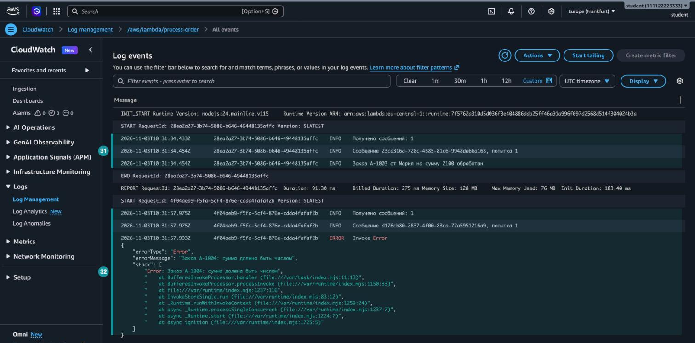

_10.1.12. Журнал функции_

Первый вызов (_31_) получил одно сообщение, заказ `A-1003`, и обработал его с первой попытки. Второй вызов (_32_) получил заказ `A-1004` и завершился ошибкой `Invoke Error`. Текст ошибки тот, что в `throw`, а стек указывает на строку 11 файла `index.mjs`.

Чтобы увидеть все попытки, введите в поле фильтра `попытка` (_33_) и нажмите Enter.

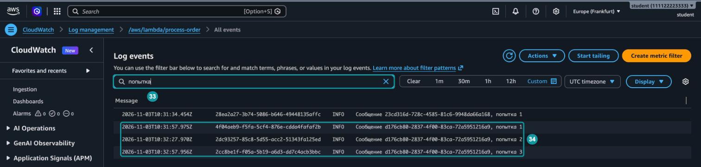

_10.1.13. Повторные попытки обработать заказ_

Сообщение с одним и тем же идентификатором функция получила три раза (_34_). Посмотрите на время: между попытками примерно по 30 секунд, то есть по одному таймауту видимости. После третьей неудачи `Receive count` достиг `Maximum receives`, и при следующей попытке получить сообщение SQS перенёс его в DLQ.

### Шаг 14. Найдите заказ в DLQ

Вернитесь к списку очередей.

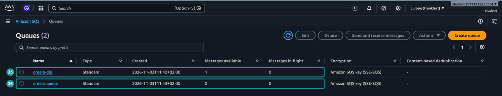

_10.1.14. Заказ переместился в DLQ_

В `orders-dlq` появилось одно доступное сообщение (_35_), а `orders-queue` пуста (_36_). Обработчик больше не тратит время на сообщение, которое не может обработать, а заказ при этом не потерян.

Откройте `orders-dlq` → `Send and receive messages` и нажмите `Poll for messages`.

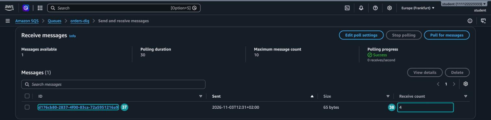

_10.1.15. Сообщение в DLQ_

У сообщения тот же идентификатор (_37_), что и в журнале функции: SQS переносит в DLQ само сообщение, а не его копию. `Receive count` равен 4 (_38_): три попытки функции и ваш опрос в консоли. В столбце `Sent` указано время исходной отправки заказа, а не переноса в DLQ: именно от него отсчитывается срок хранения, о котором шла речь в шаге 1. Нажмите на идентификатор.

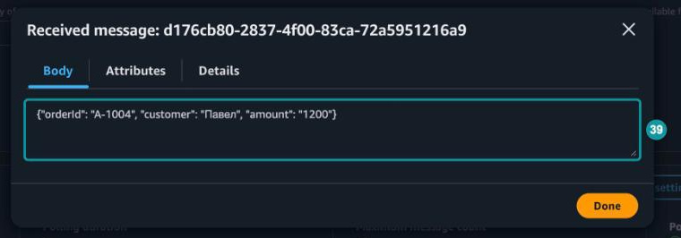

_10.1.16. Тело сообщения в DLQ_

Тело сообщения (_39_) не изменилось. По нему видно, что сломало обработку: `"amount": "1200"` записано строкой. Нажмите `Done`.

## Часть 5. Исправление и возврат заказа

Представим, что разработчики решили принимать сумму и числом, и строкой. Исправим функцию, а потом вернём застрявший заказ на обработку.

### Шаг 15. Исправьте код

Откройте функцию `process-order`, замените код и нажмите `Deploy`:

```javascript
export const handler = async (event) => {
  console.log(`Получено сообщений: ${event.Records.length}`);

  for (const record of event.Records) {
    const attempt = record.attributes.ApproximateReceiveCount;
    console.log(`Сообщение ${record.messageId}, попытка ${attempt}`);

    const order = JSON.parse(record.body);
    const amount = Number(order.amount);

    if (Number.isNaN(amount)) {
      throw new Error(`Заказ ${order.orderId}: сумма должна быть числом`);
    }

    console.log(`Заказ ${order.orderId} от ${order.customer} на сумму ${amount} обработан`);
  }
};
```

`Number(order.amount)` превращает и число `1200`, и строку `"1200"` в число. Если в поле окажется текст вроде `"тысяча"`, получится `NaN`, и функция по-прежнему выбросит исключение.

### Шаг 16. Верните сообщение из DLQ

_Возврат из DLQ (DLQ redrive)_ - перенос сообщений из очереди недоставленных сообщений обратно в исходную или в другую очередь. Обратите внимание: словом redrive AWS называет перенос в обе стороны. Политика redrive policy отправляет сообщения в DLQ, а DLQ redrive возвращает их обратно.

Откройте очередь `orders-dlq` и нажмите `Start DLQ redrive`.

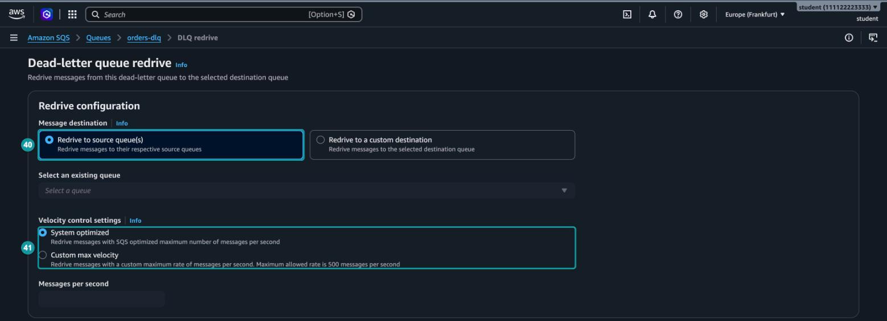

_10.1.17. Настройка возврата сообщений_

Оставьте настройки по умолчанию:

- `Redrive to source queue(s)` (_40_). SQS помнит, из какой очереди пришло каждое сообщение, и вернёт его туда. В нашем случае это `orders-queue`.
- `System optimized` (_41_). SQS сам выбирает скорость переноса. Ограничение скорости (`Custom max velocity`) нужно, когда в DLQ тысячи сообщений и обработчик не должен получить их все разом.

Нажмите `DLQ redrive` внизу страницы. SQS запустит задачу переноса, а её состояние появится на вкладке `Dead-letter queue redrive tasks`.

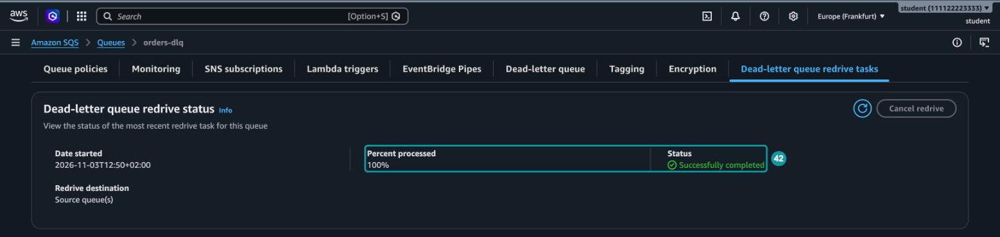

_10.1.18. Задача переноса выполнена_

Через несколько секунд обновите вкладку: обработано 100% сообщений, задача завершилась успешно (_42_).

> [!WARNING]
> Возвращайте сообщения из DLQ только после того, как исправили причину ошибки. Иначе они снова пройдут все попытки и вернутся в DLQ.

### Шаг 17. Проверьте журнал

Откройте журнал функции, как в шаге 13, и введите в фильтр `?попытка ?обработан`. Знак `?` перед словом означает "или": фильтр покажет строки, в которых есть хотя бы одно из слов.

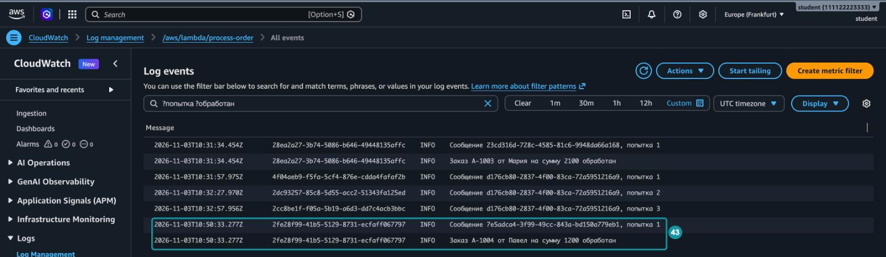

_10.1.19. Заказ обработан после возврата_

В конце журнала появились две новые строки (_43_): заказ `A-1004` обработан, сумма 1200. Обратите внимание на идентификатор и номер попытки. В отличие от переноса в DLQ, при возврате SQS отправил содержимое заказа в `orders-queue` как новое сообщение, поэтому у него другой идентификатор, а счётчик получений начался заново с единицы.

## Часть 6. Удаление ресурсов

Удалите ресурсы в таком порядке:

1. Удалите триггер. Откройте функцию, `Configuration` → `Triggers`, отметьте триггер `SQS: orders-queue` и нажмите `Delete`. Это обязательный шаг: при удалении функции Lambda предупреждает, что триггеры остаются в аккаунте.
2. Удалите функцию `process-order`.
3. Удалите очереди `orders-queue` и `orders-dlq`.
4. Удалите роль `process-order-role-...` и управляемую политику `AWSLambdaBasicExecutionRole-...`, которая осталась от этой роли. Политику `AWSLambdaSQSQueueExecutionRole` удалять не нужно: она принадлежит AWS и после удаления роли просто перестаёт быть прикреплённой.
5. Удалите группу журналов `/aws/lambda/process-order`.

## Вопросы для самопроверки

1. Зачем нужна очередь недоставленных сообщений и что происходило бы с "ядовитым" сообщением без неё?
2. Что такое таймаут видимости и почему сообщение, которое потребитель получил, но не удалил, снова появляется в очереди?
3. Почему таймаут видимости очереди должен быть заметно больше таймаута функции Lambda?
4. Почему срок хранения сообщений в DLQ задают больше, чем в основной очереди?
5. Чем триггер SQS отличается от триггера S3 из Hands-on 9.2? Кто кого вызывает и чьи права для этого нужны?
6. Кто удаляет сообщение из очереди после успешной обработки функцией и что происходит с пачкой, если функция выбросила исключение?
7. Зачем нужен флажок `Report batch item failures`?
8. Почему перед удалением функции нужно отдельно удалить триггер SQS?

[^1]: Amazon Web Services (2026). _Using dead-letter queues in Amazon SQS_. Amazon SQS Developer Guide. Available at: https://docs.aws.amazon.com/AWSSimpleQueueService/latest/SQSDeveloperGuide/sqs-dead-letter-queues.html

[^2]: Amazon Web Services (2026). _Creating and configuring an Amazon SQS event source mapping_. AWS Lambda Developer Guide. Available at: https://docs.aws.amazon.com/lambda/latest/dg/services-sqs-configure.html

[^3]: Amazon Web Services (2026). _Troubleshoot Amazon SQS dead-letter queue and DLQ redrive issues_. Amazon SQS Developer Guide. Available at: https://docs.aws.amazon.com/AWSSimpleQueueService/latest/SQSDeveloperGuide/troubleshooting-dlq-redrive.html
