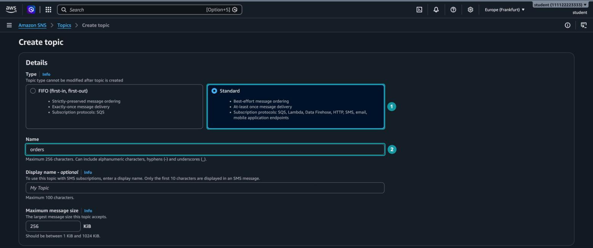
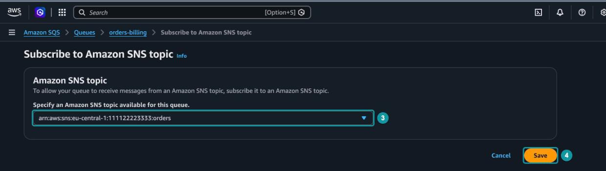
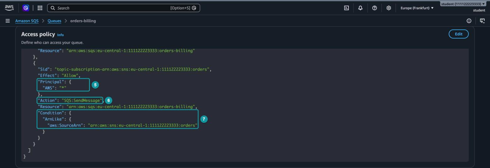
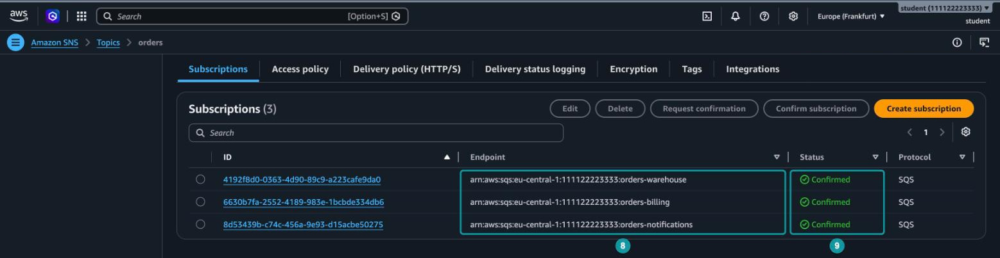
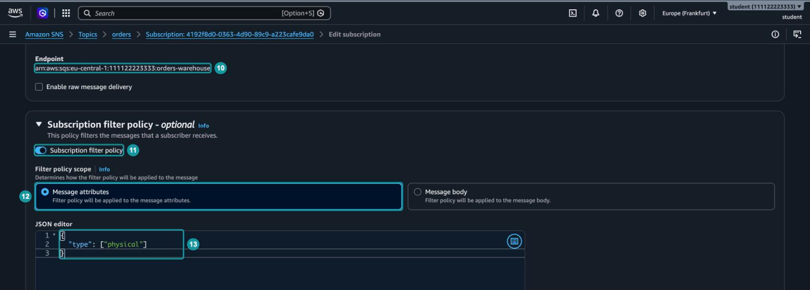
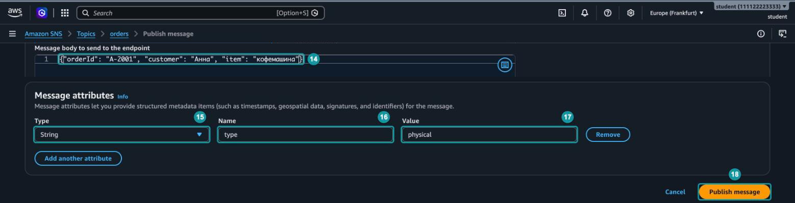
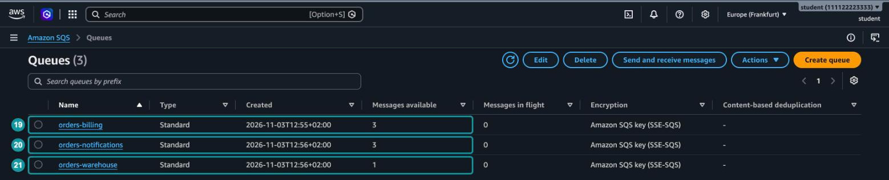
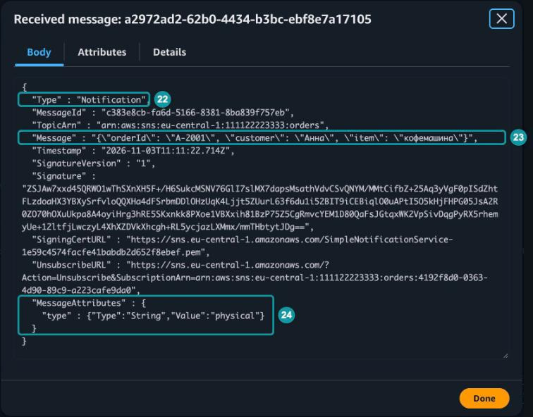

# Hands-on 10.2. Веерная рассылка через SNS

В Hands-on 10.1 у очереди был один получатель: функция, которая обрабатывала заказ. В настоящем магазине о новом заказе должны узнать сразу несколько сервисов. Сервис оплаты выставляет счёт, склад собирает посылку, сервис уведомлений отправляет покупателю письмо. Если сайт будет сам отправлять заказ в три очереди, то при появлении четвёртого сервиса придётся менять код сайта.

Amazon SNS решает эту задачу иначе. Сайт публикует заказ один раз в тему SNS, а SNS сам доставляет копию сообщения каждому подписчику. _Веерная рассылка (fan-out)_ - схема, в которой одно опубликованное сообщение доставляется сразу нескольким получателям. Чтобы подключить новый сервис, достаточно добавить подписку, а сайт об этом даже не узнает.

Добавим ещё одно правило. Складу нужны только заказы с физическими товарами: электронную книгу или подарочную карту собирать незачем. Такие заказы отсеет политика фильтрации.

## Что получится в конце

- Тема `orders` в Amazon SNS.
- Три очереди `orders-billing`, `orders-warehouse` и `orders-notifications`, подписанные на тему.
- Политика фильтрации, благодаря которой в `orders-warehouse` попадают только заказы с атрибутом `type` = `physical`.
- Три опубликованных заказа и проверка, в какие очереди попал каждый.

## Перед началом

- Вы выполнили Hands-on 10.1 и умеете отправлять и получать сообщения в консоли SQS.
- Выбран регион `Europe (Frankfurt)`.
- На занятие понадобится около 40 минут.

> [!NOTE]
> SNS бесплатно обрабатывает первый миллион запросов в месяц, а доставка из SNS в очереди SQS не оплачивается отдельно. Занятие ничего не стоит.

## Часть 1. Тема и очереди

### Шаг 1. Создайте тему

_Тема (topic)_ - точка публикации в SNS. Отправитель публикует сообщение в тему, а не конкретному получателю. Кто получит сообщение, решают подписки темы.

Откройте сервис `Simple Notification Service`, в меню слева выберите `Topics` и нажмите `Create topic`:

1. `Type`: `Standard` (_1_). Консоль может предложить `FIFO` по умолчанию, переключите тип.
2. `Name`: `orders` (_2_).



_10.2.1. Создание темы orders_

Стандартная тема похожа на стандартную очередь: сообщение доставляется хотя бы один раз, а порядок доставки не гарантируется. Зато подписчиком стандартной темы может быть почти что угодно: очередь SQS, функция Lambda, конечная точка HTTP(S), электронная почта, SMS. Тема FIFO сохраняет порядок сообщений, но доставляет их только в очереди SQS.

Остальные параметры оставьте по умолчанию и нажмите `Create topic` внизу страницы.

### Шаг 2. Создайте три очереди

В консоли SQS создайте три стандартные очереди с настройками по умолчанию:

- `orders-billing`. Очередь сервиса оплаты.
- `orders-warehouse`. Очередь склада.
- `orders-notifications`. Очередь сервиса уведомлений.

У каждого сервиса своя очередь. Если склад перестанет забирать сообщения, заказы будут копиться только в `orders-warehouse`, а оплата и уведомления продолжат работать.

## Часть 2. Подписки

### Шаг 3. Подпишите очередь на тему

_Подписка (subscription)_ - связь между темой и получателем. Тема доставляет опубликованное сообщение каждому подписчику, если сообщение проходит политику фильтрации подписки. О политиках фильтрации речь пойдёт в части 3, а пока у подписок их нет.

Откройте очередь `orders-billing`, вкладку `SNS subscriptions`, и нажмите `Subscribe to Amazon SNS topic`. В списке выберите ARN темы `orders` (_3_) и нажмите `Save` (_4_).



_10.2.2. Подписка очереди на тему_

Таким же способом подпишите на тему `orders-warehouse` и `orders-notifications`.

### Шаг 4. Посмотрите политику доступа очереди

Подписку можно создать и из консоли SNS, но тогда разрешение в политику очереди придётся добавить вручную, иначе сообщения в очередь не дойдут. SNS доставляет сообщение в очередь от своего имени, а по умолчанию писать в очередь может только её владелец. Когда вы подписываете очередь из консоли SQS, консоль сама добавляет нужное разрешение в политику очереди.

Откройте `orders-billing`, вкладку `Queue policies`.



_10.2.3. Разрешение для темы в политике очереди_

Первое правило политики, `__owner_statement`, было в очереди с момента создания: оно разрешает аккаунту-владельцу любые действия с очередью (`SQS:*`). На рисунке оно не поместилось, его видно выше, если прокрутить политику вверх. Второе правило консоль добавила при подписке:

- `Principal` (_5_). Значение `"*"` означает "кто угодно". Само по себе это опасно.
- `Action` (_6_). Разрешено только одно действие, `SQS:SendMessage`, то есть отправка сообщений в очередь.
- `Condition` (_7_). Разрешение действует, только если запрос пришёл от темы `orders`. Условие `aws:SourceArn` сужает "кого угодно" до одной темы.

Документация SNS рекомендует ещё точнее указать отправителя: вместо `"*"` записать в `Principal` сам сервис SNS, `{"Service": "sns.amazonaws.com"}`, и оставить условие `aws:SourceArn`[^1]. Для занятия хватит правила, которое добавила консоль.

Это политика ресурса, похожая на политику бакета из главы 6: она записана в самой очереди и решает, кто может к ней обращаться.

> [!WARNING]
> Если подписка создана в консоли SNS, а разрешения в политике очереди нет, подписка всё равно будет в состоянии `Confirmed`. Публикация пройдёт без ошибок, но сообщения в очередь не попадут. Неудачные доставки видны только в метрике темы `NumberOfNotificationsFailed` в CloudWatch. Если очередь остаётся пустой, первым делом проверьте её политику.

### Шаг 5. Проверьте подписки темы

Откройте тему `orders`. На вкладке `Subscriptions` три подписки, по одной на каждую очередь (_8_). Все они в состоянии `Confirmed` (_9_).



_10.2.4. Подписки темы orders_

Если очередь находится в том же аккаунте, что и тема, SNS подтверждает подписку сразу. Подписке на очередь из другого аккаунта, конечную точку HTTP(S) или электронную почту сначала нужно подтверждение от получателя: до этого она находится в состоянии `Pending confirmation` и сообщений не получает.

## Часть 3. Политика фильтрации

### Шаг 6. Добавьте фильтр складу

_Политика фильтрации (filter policy)_ - JSON-документ в подписке, который описывает, какие сообщения нужны этому подписчику. Сообщения, которые не подходят под политику, SNS этому подписчику не доставляет. Подписка без политики получает все сообщения темы.

Фильтровать можно по атрибутам сообщения. _Атрибут сообщения (message attribute)_ - дополнительное поле, которое отправитель передаёт вместе с сообщением, но отдельно от его тела. У атрибута есть имя, тип и значение. Например, имя `type`, тип `String` и значение `physical`.

На вкладке `Subscriptions` откройте подписку, у которой в `Endpoint` указана очередь `orders-warehouse`, и нажмите `Edit`. Убедитесь, что редактируете нужную подписку (_10_): идентификаторы подписок похожи, а очередь видна только в `Endpoint`.

Раскройте блок `Subscription filter policy` и включите одноимённый переключатель (_11_). В `Filter policy scope` оставьте `Message attributes` (_12_) и введите политику (_13_):

```json
{
  "type": ["physical"]
}
```



_10.2.5. Политика фильтрации для склада_

Политика означает: доставлять сообщение, только если у него есть атрибут `type` со значением `physical`. В квадратных скобках перечисляют допустимые значения. Политика `{"type": ["physical", "bulky"]}` пропустила бы оба типа.

Фильтр в режиме `Message attributes` смотрит только на атрибуты. Режим `Message body` фильтрует по полям JSON в самом теле сообщения.

Нажмите `Save changes` внизу страницы.

> [!NOTE]
> Новая или изменённая политика фильтрации начинает действовать не сразу, а в течение нескольких минут, в худшем случае до 15 минут[^2]. Поэтому после сохранения политики подождите несколько минут и только потом переходите к публикации. Если на шаге 8 в `orders-warehouse` окажется лишнее сообщение, очистите все три очереди кнопкой `Purge`, подождите ещё немного и опубликуйте все три заказа заново.

## Часть 4. Публикация и проверка

### Шаг 7. Опубликуйте три заказа

Откройте тему `orders` и нажмите `Publish message`. В `Message body` введите заказ с кофемашиной (_14_):

```json
{"orderId": "A-2001", "customer": "Анна", "item": "кофемашина"}
```

Прокрутите страницу до блока `Message attributes` и добавьте атрибут:

1. `Type`: `String` (_15_).
2. `Name`: `type` (_16_).
3. `Value`: `physical` (_17_).



_10.2.6. Публикация сообщения с атрибутом_

Нажмите `Publish message` (_18_). Консоль покажет идентификатор опубликованного сообщения.

Опубликуйте ещё два заказа. Для второго снова нажмите `Publish message` и добавьте атрибут так же, как в первом заказе, но со значением `digital`. Это электронная книга:

```json
{"orderId": "A-2002", "customer": "Иван", "item": "электронная книга"}
```

Третий заказ - подарочная карта. Блок `Message attributes` для него оставьте пустым:

```json
{"orderId": "A-2003", "customer": "Мария", "item": "подарочная карта"}
```

### Шаг 8. Проверьте, куда попали заказы

Откройте список очередей SQS. Если он уже был открыт, обновите его кнопкой обновления: сам список не обновляется.



_10.2.7. Сообщения в очередях после публикации_

Сравните `Messages available`:

- `orders-billing` (_19_). Три сообщения. У подписки нет фильтра, поэтому оплата получила все заказы.
- `orders-notifications` (_20_). Тоже три сообщения, по той же причине.
- `orders-warehouse` (_21_). Одно сообщение, заказ `A-2001`. Заказ `A-2002` не прошёл фильтр: значение `digital` не входит в список. Заказ `A-2003` тоже отсеян: у него вообще нет атрибута `type`, а сообщение без нужного атрибута политику фильтрации не проходит.

Сайт опубликовал каждый заказ один раз, а SNS сам решил, кому его доставить. Ни сайт, ни очереди ничего не знают о фильтре: правило хранится в подписке.

### Шаг 9. Посмотрите, что пришло в очередь

Откройте `orders-warehouse` → `Send and receive messages`, нажмите `Poll for messages` и откройте полученное сообщение.



_10.2.8. Сообщение SNS в очереди_

В очередь пришёл не сам заказ, а конверт, в который SNS упаковал опубликованное сообщение:

- `"Type": "Notification"` (_22_). Признак того, что это уведомление SNS.
- `Message` (_23_). Опубликованный заказ. Обратите внимание, что это строка, а не объект: кавычки внутри экранированы обратной косой чертой. Обработчику очереди придётся разобрать JSON дважды: сначала тело сообщения SQS, затем поле `Message`.
- `MessageAttributes` (_24_). Атрибуты, с которыми сообщение было опубликовано.

Кроме того, в конверте есть идентификатор сообщения, ARN темы, время публикации и цифровая подпись, по которой получатель может проверить, что сообщение действительно отправил SNS.

> [!TIP]
> Если обработчику конверт не нужен, в настройках подписки можно включить `Enable raw message delivery`. Тогда в очередь попадёт только опубликованное тело сообщения, а атрибуты SNS передаст как атрибуты сообщения SQS[^3].

## Часть 5. Удаление ресурсов

Удалите ресурсы в таком порядке:

1. Удалите тему `orders`: откройте её, нажмите `Delete` и введите фразу `delete me`.
2. Откройте в SNS раздел `Subscriptions`. Если подписки удалённой темы ещё остались в списке, отметьте их по одной и удалите.
3. Удалите очереди `orders-billing`, `orders-warehouse` и `orders-notifications`.

## Вопросы для самопроверки

1. Что такое веерная рассылка и какую проблему она решает по сравнению с отправкой заказа сразу в три очереди?
2. Чем стандартная тема SNS отличается от темы FIFO?
3. Зачем каждому сервису отдельная очередь, а не одна общая?
4. Какое правило добавляется в политику очереди при подписке на тему и зачем в нём условие `aws:SourceArn`?
5. Что произойдёт, если подписать очередь на тему из консоли SNS и не изменить политику очереди?
6. Какие заказы получит подписка с политикой `{"type": ["physical"]}` и что будет с сообщением, у которого атрибута `type` нет?
7. Почему в очередь попадает не сам заказ, а конверт SNS, и как получить только тело сообщения?

[^1]: Amazon Web Services (2026). _Subscribing an Amazon SQS queue to an Amazon SNS topic_. Amazon SNS Developer Guide. Available at: https://docs.aws.amazon.com/sns/latest/dg/subscribe-sqs-queue-to-sns-topic.html

[^2]: Amazon Web Services (2026). _Amazon SNS subscription filter policies_. Amazon SNS Developer Guide. Available at: https://docs.aws.amazon.com/sns/latest/dg/sns-subscription-filter-policies.html

[^3]: Amazon Web Services (2026). _Amazon SNS raw message delivery_. Amazon SNS Developer Guide. Available at: https://docs.aws.amazon.com/sns/latest/dg/sns-large-payload-raw-message-delivery.html
