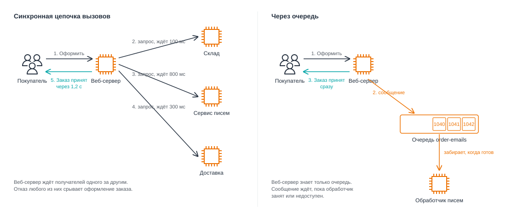
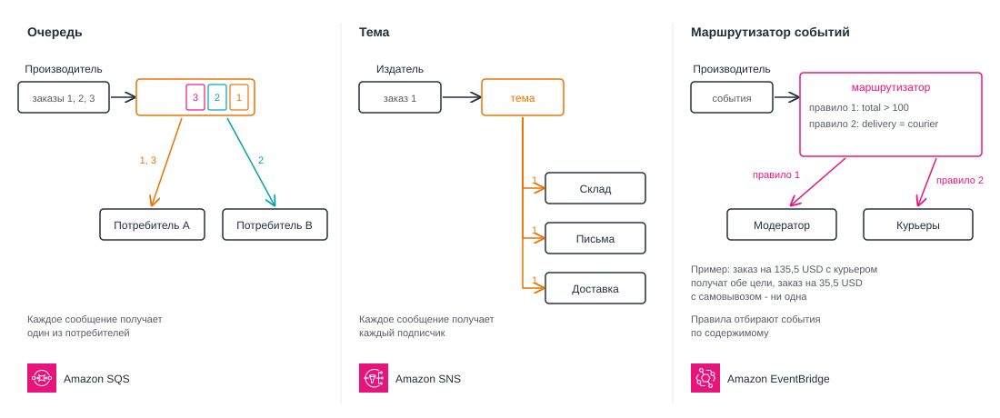
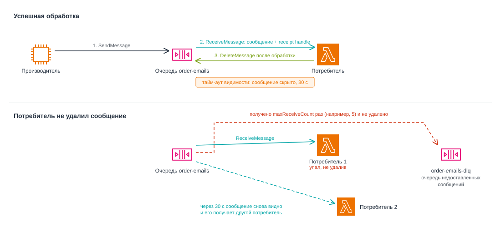
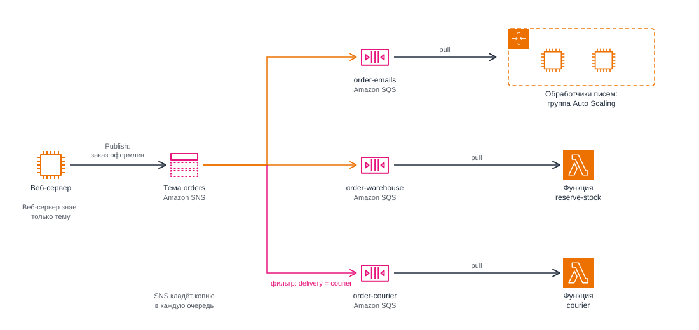
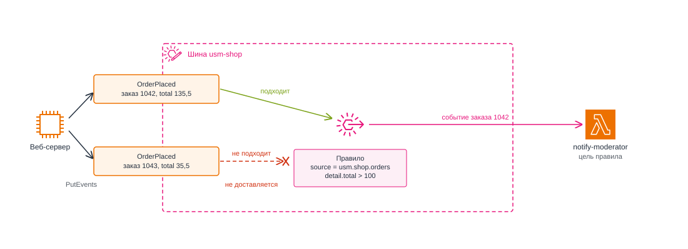
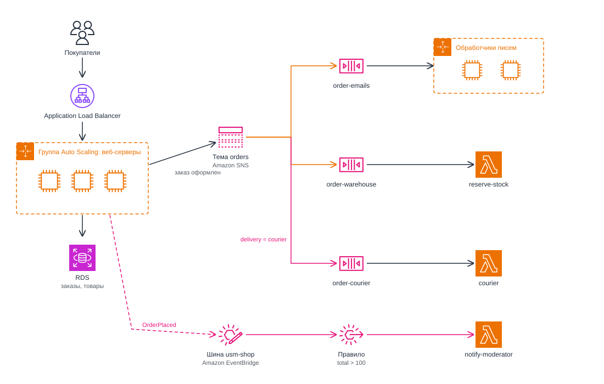

# Событийно-ориентированная архитектура и обмен сообщениями. Amazon SQS, SNS и EventBridge

<i>
Превью теперь появлялись сами. Продавец загружал фотографию, и через пару секунд в каталоге уже была маленькая копия. Джон даже перестал заглядывать в журналы функции: за месяц она обошлась дешевле одной чашки кофе.

В пятницу Эмма запустила первую распродажу. Скидка на худи с гербом университета действовала всего час, и ссылку разослали всем студенческим советам. К вечеру в общем чате посыпались жалобы.

– "Я три раза нажимал "Оформить заказ", - писал кто-то. - Крутится, а потом ошибка. Деньги списались один раз, а заказ вообще есть?"

Джон открыл журналы веб-серверов. Балансировщик работал, экземпляры в группе Auto Scaling добавились вовремя, база отвечала быстро. Ошибки шли из одного места.

– Почтовый сервис, - сказал он. - Мы после каждого заказа сразу отправляем покупателю письмо. Сервис писем не справился с потоком и начал отвечать через десять секунд, а потом и вовсе с ошибкой. А веб-сервер ждёт его ответа и только потом говорит покупателю "заказ принят".

– То есть заказ сорвался из-за письма? - Эмма подняла брови. - Письмо можно было отправить и через пять минут. Покупателю это всё равно.

– И не только письмо. Ещё склад резервирует товар, и служба доставки получает адрес. Всё по очереди, всё с ожиданием. Упадёт любой - упадёт оформление заказа.

– А если завтра понадобится ещё что-то? Например, начислять бонусы за покупку?

– Тогда я допишу в код оформления заказа четвёртый вызов, - вздохнул Джон. - И буду ждать ещё и его.

Эмма задумалась.

– Получается, веб-сервер должен знать про всех, кому интересен заказ, и ждать каждого. А ему достаточно сказать "заказ оформлен" и пойти дальше. Кому надо, тот услышит.

– Сказать кому? - спросил Джон. - Если сервис писем лежит, он ничего не услышит.

– Значит, кто-то должен это сообщение подержать, пока сервис писем не поднимется, - ответила Эмма. - Вопрос в том, кто.
</i>

## Содержание

- [Событийно-ориентированная архитектура и обмен сообщениями. Amazon SQS, SNS и EventBridge](#событийно-ориентированная-архитектура-и-обмен-сообщениями-amazon-sqs-sns-и-eventbridge)
  - [Содержание](#содержание)
  - [Вопросы для самопроверки](#вопросы-для-самопроверки)
  - [Ретроспектива](#ретроспектива)
  - [Как приложения общаются](#как-приложения-общаются)
    - [Монолитная и микросервисная архитектура](#монолитная-и-микросервисная-архитектура)
    - [Синхронные запросы](#синхронные-запросы)
    - [Проблемы синхронного взаимодействия](#проблемы-синхронного-взаимодействия)
    - [Асинхронное взаимодействие](#асинхронное-взаимодействие)
    - [Асинхронный HTTP-запрос](#асинхронный-http-запрос)
    - [Асинхронное взаимодействие через реляционную базу данных](#асинхронное-взаимодействие-через-реляционную-базу-данных)
  - [Очереди сообщений](#очереди-сообщений)
    - [Сообщение и очередь](#сообщение-и-очередь)
    - [Конкурирующие потребители](#конкурирующие-потребители)
    - [Гарантии доставки](#гарантии-доставки)
  - [Событийно-ориентированная архитектура](#событийно-ориентированная-архитектура)
    - [Команда и событие](#команда-и-событие)
    - [Как устроена событийно-ориентированная архитектура](#как-устроена-событийно-ориентированная-архитектура)
      - [Публикация и подписка](#публикация-и-подписка)
      - [Маршрутизатор событий](#маршрутизатор-событий)
  - [Цена асинхронности](#цена-асинхронности)
    - [Как получить результат обработки](#как-получить-результат-обработки)
  - [Amazon SQS](#amazon-sqs)
    - [Что такое SQS](#что-такое-sqs)
    - [Основные характеристики Amazon SQS](#основные-характеристики-amazon-sqs)
    - [Стандартная очередь и очередь FIFO](#стандартная-очередь-и-очередь-fifo)
    - [Жизненный цикл сообщения](#жизненный-цикл-сообщения)
    - [Короткий и длинный опрос](#короткий-и-длинный-опрос)
    - [Очередь недоставленных сообщений в SQS (DLQ)](#очередь-недоставленных-сообщений-в-sqs-dlq)
    - [Кто читает очередь](#кто-читает-очередь)
      - [Функция Lambda](#функция-lambda)
      - [Экземпляры EC2 в группе Auto Scaling](#экземпляры-ec2-в-группе-auto-scaling)
      - [Метрики очереди](#метрики-очереди)
    - [Стоимость SQS](#стоимость-sqs)
  - [Amazon SNS](#amazon-sns)
    - [Что такое SNS](#что-такое-sns)
    - [Основные характеристики Amazon SNS](#основные-характеристики-amazon-sns)
    - [Темы и подписки](#темы-и-подписки)
    - [Веерная рассылка через SNS и SQS](#веерная-рассылка-через-sns-и-sqs)
    - [Фильтрация сообщений](#фильтрация-сообщений)
    - [Повторы и потеря сообщений](#повторы-и-потеря-сообщений)
    - [Стоимость SNS](#стоимость-sns)
  - [Amazon EventBridge](#amazon-eventbridge)
    - [Что такое EventBridge](#что-такое-eventbridge)
    - [Шина событий, правила и цели](#шина-событий-правила-и-цели)
    - [Стоимость EventBridge](#стоимость-eventbridge)
  - [Как выбрать способ связи](#как-выбрать-способ-связи)
    - [SQS, SNS и EventBridge](#sqs-sns-и-eventbridge)
    - [Когда что использовать](#когда-что-использовать)
  - [Собираем решения вместе](#собираем-решения-вместе)
  - [Резюме](#резюме)

## Вопросы для самопроверки

1. Почему цепочка синхронных HTTP-вызовов делает оформление заказа медленным и хрупким? Что такое каскадный отказ?
2. Что такое очередь сообщений и как она помогает пережить пик нагрузки? Почему очередь накапливает сообщения, если производитель в среднем быстрее потребителя?
3. Чем конкурирующие потребители отличаются от подписчиков темы?
4. Чем команда отличается от события? Почему издателю события не нужно знать своих получателей?
5. Что такое таймаут видимости в SQS? Что произойдёт, если потребитель обработал сообщение, но не удалил его?
6. Чем стандартная очередь SQS отличается от очереди FIFO и зачем нужна очередь недоставленных сообщений?
7. Как устроена веерная рассылка через SNS и SQS? Что тема SNS делает с сообщением, если у неё нет подписчиков?
8. В каких задачах подходит SQS, в каких SNS, а в каких EventBridge? Когда прямой HTTP-вызов остаётся лучшим выбором?
9. Как сервис может узнать результат асинхронной задачи? Зачем в запросе и ответе нужен общий идентификатор?

## Ретроспектива

Эта глава опирается на несколько предыдущих:

- _Седьмая глава_. Мы разобрали модель BASE и согласованность в конечном счёте.
- _Восьмая глава_. Веб-серверы магазина работают за Application Load Balancer в группе Auto Scaling, а CloudWatch собирает метрики и поднимает тревоги. Группа масштабируется по метрике, например по загрузке процессора.
- _Девятая глава_. Мы познакомились с событиями на примере Lambda, разобрали синхронный и асинхронный вызов Lambda, push и pull, event source mapping и идемпотентность. Функция Lambda там забирала сообщения из очереди, но сама очередь осталась без объяснения.

## Как приложения общаются

### Монолитная и микросервисная архитектура

Рассмотрим учебный интернет-магазин. После оформления заказа нужно зарезервировать товар, отправить покупателю письмо и передать данные службе доставки.

Эти действия может выполнять одна программа: её части вызывают друг друга как обычные функции. Такой подход называют _монолитной архитектурой_. Приложение развёртывают и масштабируют как единое целое: например, при нехватке обработчиков писем приходится добавлять экземпляры всего приложения[^1].

Другой подход - разделить приложение на самостоятельные _сервисы_: например, сервис заказов, склад и сервис писем. Каждый можно обновлять и масштабировать независимо. Если сервисы организованы вокруг отдельных задач и развёртываются независимо, такой подход называют _микросервисной архитектурой (microservices)_[^2].

Разделение добавляет сложность: чтобы обратиться к другому сервису, нужен сетевой запрос. Он занимает время и может завершиться ошибкой[^3]. Для небольшого приложения монолит может быть проще и удобнее[^4].

Рассмотрим, как взаимодействуют отдельные сервисы магазина и какие проблемы при этом возникают.

### Синхронные запросы

Вернёмся к интернет-магазину. Предположим, что приложение состоит из нескольких сервисов:

- _Сервис склада_ - отвечает за резервирование и списание товаров со склада.
- _Сервис писем_ - отвечает за отправку писем покупателю.
- _Служба доставки_ - отвечает за организацию доставки заказов.

Один из способов связать сервисы - последовательно вызывать их из кода оформления заказа.

```javascript
async function order() {
  const stockReserved = await reserveStock();
  // process stock reservation result
  const isEmailSent = await sendConfirmationEmail();
  // process email sending result
  const isDeliveryScheduled = await sendToDeliveryService();
  // process delivery scheduling result
}
```

Каждая функция отправляет HTTP-запрос своему сервису и ждёт ответа. Следующий вызов начинается только после получения ответа.

**Синхронное взаимодействие (synchronous communication)** - способ связи, при котором отправитель передаёт запрос и ждёт ответа, прежде чем продолжить работу[^5].

Рассмотрим пример. Веб-сервер получает запрос "_Оформить заказ_" и выполняет такие шаги:

1. Сохраняет заказ в базе данных.
2. Вызывает склад и ждёт ответа, примерно _100 мс_.
3. Вызывает сервис писем и ждёт ответа, примерно _800 мс_.
4. Вызывает службу доставки и ждёт ответа, примерно _300 мс_.
5. Отвечает покупателю "Заказ принят".

Покупатель ждёт сумму всех задержек: `100 + 800 + 300 = 1 200` мс. Это больше секунды, не считая времени сохранения заказа в базе данных.

### Проблемы синхронного взаимодействия

Теперь части приложения разделены, но цепочка синхронных вызовов снова связывает их и создаёт четыре проблемы:

- _Задержки складываются_. Последовательные вызовы увеличивают общее время выполнения операции. Например, покупатель ждёт, пока все сервисы завершат свою часть работы.
- _Отказ одного получателя срывает всю операцию_. Недоступность одного компонента влияет на работу остальных. Например, если сервис писем не отвечает, оформление заказа может завершиться ошибкой, даже если товар уже зарезервирован.
- _Пик нагрузки передаётся всем получателям_. Медленные сервисы становятся узким местом системы. Например, магазин получает 50 заказов в секунду, а сервис писем способен обработать только 10, что приводит к задержкам и ошибкам.
- _Новый получатель требует менять отправителя_. Отправитель напрямую зависит от получателей. Например, для начисления бонусов потребуется добавить новый вызов в код оформления заказа.

Все четыре проблемы возникают из-за того, что компоненты слишком зависят друг от друга.

**Связанность (coupling)** - степень зависимости компонентов друг от друга: насколько изменение или отказ одного компонента требует изменений или вызывает отказ другого[^6].

**Слабая связанность (loose coupling)** - свойство системы, в которой поведение одного компонента изолировано от компонентов, которые от него зависят[^6].

### Асинхронное взаимодействие

Рассмотрим другой способ взаимодействия - _асинхронный_. Покупателю достаточно увидеть на сайте, что заказ принят, а письмо может прийти позже. Веб-серверу достаточно передать задачу на отправку письма, не дожидаясь её выполнения.

**Асинхронное взаимодействие (asynchronous communication)** - способ связи, при котором отправитель передаёт запрос и продолжает работу, не дожидаясь его обработки получателем[^5]. При этом отправитель и получатель не обязаны работать одновременно: получатель может быть занят или временно недоступен[^7].

_AWS рекомендует использовать асинхронное взаимодействие в случаях, когда немедленный ответ не требуется_[^6].

Синхронный вызов остаётся правильным выбором, когда отправителю нужен результат прямо сейчас и с маленькой задержкой[^8]. В приложении интернет-магазина синхронно могут выполняться следующие операции:

- проверка, что товар есть в наличии,
- подтверждение оплаты,
- расчёт стоимости доставки на странице заказа.

_Не путайте асинхронное взаимодействие с асинхронным кодом._ Ключевое слово `await` в Node.js не делает связь асинхронной в контексте этой главы: веб-сервер всё равно ждёт ответа сервиса писем, прежде чем ответить покупателю.

### Асинхронный HTTP-запрос

Асинхронное взаимодействие можно построить на том же HTTP.

1. Сервис A отправляет HTTP-запрос сервису B.
2. Сервис B принимает запрос и кладёт задачу в список в своей памяти.
3. Сервис B отвечает кодом `202 Accepted`: задача принята для обработки, но ещё не выполнена[^9].
4. Позже сервис B выполняет задачу, когда освобождается. Успешное выполнение ответ `202` не гарантирует.

Рассмотрим пример оформления заказа в магазине:

1. _Веб-сервер_ отправляет запрос сервису склада и ожидает ответа - примерно _100 мс_.
2. _Веб-сервер_ отправляет запрос `POST /emails` сервису писем, передавая данные заказа.
3. _Сервис писем_ добавляет задачу во внутреннюю очередь в памяти и примерно через _10 мс_ возвращает ответ `202 Accepted`, не дожидаясь отправки письма.
4. _Веб-сервер_ обращается к службе доставки и ожидает ответа - примерно _300 мс_.
5. _Веб-сервер_ возвращает покупателю подтверждение: _"Заказ принят"_.

Позже сервис писем отправляет письма из списка, когда освобождается.

Покупатель теперь ждёт `100 + 10 + 300 = 410` мс вместо 1 200 мс: веб-сервер ждёт 10 мс, пока сервис писем примет задачу, а не 800 мс, пока он отправит письмо.

Задержка уменьшилась, но остальные проблемы остались, и появилась ещё одна:

- _Получатель должен работать в момент запроса_. Если сервис, который обрабатывает письма, завершился или перезапускается, принять запрос некому. Веб-сервер получает ошибку и сам решает, что делать с письмом: повторить запрос, сохранить письмо у себя или сообщить покупателю об ошибке.
- _Принятая задача может пропасть_. Список задач хранится в памяти сервиса писем. Если сервис перезапустится до отправки, список пропадёт, хотя веб-сервер уже получил `202`.
- _Пик нагрузки приходится на получателя_. Во время распродажи все 50 запросов в секунду приходят прямо в сервис писем, а отправляет он только 10 в секунду, поэтому список в его памяти растёт, пока её хватает.
- _Адреса получателей записаны в коде отправителя_. Адреса сервисов указаны в коде отправителя. Например, для добавления системы начисления бонусов потребуется изменить код оформления заказа и добавить новый запрос.

Каждому сервису пришлось бы самому надёжно хранить принятые задачи, переживать перезапуски и выдерживать пики нагрузки.

### Асинхронное взаимодействие через реляционную базу данных

Чтобы задача не пропала при перезапуске сервиса писем, её можно сохранить в базе данных, а не в памяти сервиса.

Рассмотрим пример. В таблице `email_tasks` есть столбцы `id`, `order_id` и `status`:

1. Веб-сервер сохраняет заказ и добавляет задачу на отправку письма со статусом `new`.
2. Веб-сервер отвечает покупателю: "Заказ принят".
3. Сервис писем периодически ищет новые задачи, отправляет письма и отмечает выполненные задачи статусом `done`.

Если сервис писем временно недоступен, сохранённые задачи остаются в базе. Однако при нескольких обработчиках нужно организовать получение задач так, чтобы два экземпляра не взяли одну и ту же строку. Также приложению нужны правила повторной обработки после сбоя и обработки задач, которые постоянно завершаются ошибкой[^10].

Таблица задач может подойти небольшому приложению, особенно если база уже используется. Другой вариант - применить специальную очередь сообщений: она предоставляет механизмы хранения и повторного получения сообщений.

## Очереди сообщений

Все рассмотренные выше подходы применяются на практике, однако каждый из них имеет свои ограничения и требует дополнительных усилий со стороны разработчика. Для упрощения взаимодействия между сервисами существуют специализированные решения - _брокеры сообщений (message brokers)_.

Брокер сообщений выступает посредником между отправителем и получателем. В зависимости от способа доставки он может временно хранить сообщения или передавать их получателям. Разберём первый вариант - очередь.

### Сообщение и очередь

**Сообщение (message)** - блок данных, который один компонент передаёт другому через брокера сообщений[^11]. У сообщения есть _тело (body)_ с данными и _атрибуты_ (их также называют заголовком) со служебной информацией, например идентификатором сообщения[^11].

**Брокер сообщений (message broker)** - посредник, который принимает сообщения от отправителей и передаёт их получателям[^12].

**Очередь сообщений (message queue)** - место, куда отправители отправляют сообщения и где эти сообщения ждут, пока получатели их не заберут[^13]. Отправитель знает только адрес очереди и не знает, сколько у получателя серверов и где они работают.

В контексте очередей сообщений выделяют два типа компонентов: _производителей_ и _потребителей_.

- **Производитель (producer)** - тот, кто кладёт сообщения в очередь. В нашем примере с интернет-магазином это веб-сервер.
- **Потребитель (consumer)** - тот, кто забирает сообщения из очереди и обрабатывает их[^6]. В нашем примере с интернет-магазином это обработчик писем.

> [!NOTE]
>
> Понятия _производитель_ и _потребитель_ относительны, и один компонент может быть одновременно и производителем, и потребителем в зависимости от контекста.

Рассмотрим пример. При заказе в интернет-магазине веб-сервер выполняет следующие действия:

1. Сохраняет заказ в базе данных.
2. Кладёт в очередь `order-emails` сообщение с данными заказа:

   ```json
   { "orderId": 1042, "email": "student@example.com", "total": 35.5 }
   ```

3. Сразу отвечает покупателю "_Заказ принят_".

Обработчик писем забирает сообщения из очереди и отправляет письма. Если он перегружен или перезапускается, сообщения ждут в очереди, а покупатели по-прежнему получают ответ сразу.



_10.1. Синхронная цепочка вызовов и очередь_

На рисунке 10.1 слева веб-сервер вызывает три компонента один за другим и отвечает покупателю только после последнего ответа. Справа веб-сервер кладёт сообщение в очередь и отвечает сразу, а обработчик забирает сообщение, когда готов.

Такой подход также позволяет **сглаживать пиковые нагрузки (queue-based load leveling)**: производитель отправляет сообщения в очередь независимо от скорости их обработки, а потребитель забирает их по мере своих возможностей. Если сообщения поступают быстрее, чем обрабатываются, они накапливаются в очереди и обрабатываются позже.

### Конкурирующие потребители

Один обработчик писем - узкое место и единая точка отказа. Без очереди веб-серверу пришлось бы самому искать свободный обработчик и повторять запрос, если тот не работает. С очередью обработчики сами приходят за работой: они читают одну очередь и делят сообщения между собой.

**Конкурирующие потребители (competing consumers)** - несколько потребителей, которые одновременно читают одну очередь и делят между собой работу[^14][^15]. Обычно сообщение получает один потребитель, но при повторной доставке его может обработать и другой.

Рассмотрим пример. В очереди лежат сообщения о заказах 1042, 1043 и 1044, и их читают два обработчика. Первый обработчик получает заказ 1042, второй - заказ 1043. Тот, кто освободится раньше, возьмёт заказ 1044.

У конкурирующих потребителей три свойства[^14]:

- _Нагрузку можно масштабировать_. При росте очереди добавляют потребителей, при спаде убирают.
- _Отказ потребителя не блокирует производителя_. Сообщение, которое не обработал упавший потребитель, может взять любой работающий.
- _Порядок обработки не гарантирован_. Заказ 1044 может быть обработан раньше заказа 1043.

Если задачи нужно выполнять строго по порядку, конкурирующие потребители не подходят без дополнительных мер[^14].

### Гарантии доставки

Легко ожидать, что очередь доставит каждое сообщение ровно один раз и в том порядке, в котором его отправили. На практике системы обмена сообщениями дают одну из трёх гарантий[^16]:

| Гарантия                            | Что обещает                 | Цена                                                        |
| ----------------------------------- | --------------------------- | ----------------------------------------------------------- |
| Не более одного раза (at-most-once) | Сообщение не придёт дважды  | При сбое брокера или потребителя сообщение может потеряться |
| Хотя бы один раз (at-least-once)    | При соблюдении условий системы сообщение доставляется как минимум раз | Возможны дубликаты |
| Ровно один раз (exactly-once)       | Без потерь и без дубликатов | Нужна дополнительная координация, растёт задержка           |

Многие очереди сообщений работают по схеме "_хотя бы один раз_"[^17]. Брокер считает сообщение обработанным, только когда потребитель это подтвердит. Если подтверждения нет, например потребитель упал, брокер выдаёт сообщение снова. Например, так работает стандартная очередь Amazon SQS[^18]. Срок хранения ограничен: если никто не обработает сообщение вовремя, оно будет удалено. Дубликат возникает и тогда, когда производитель отправил сообщение, не получил ответа из-за сбоя сети и отправил его снова[^17].

Поэтому обработчик сообщений должен быть _идемпотентным_ - повторная обработка одного и того же сообщения не должна приводить к повторному выполнению операции.

Для этого потребитель обычно сохраняет _уникальный идентификатор задачи_ из содержимого сообщения, например номер заказа, и использует его для проверки повторов[^17]. Идентификатор, присвоенный брокером, не всегда подходит: если производитель отправит ту же задачу повторно, новое сообщение может получить другой идентификатор.

_Например_, перед отправкой письма обработчик проверяет, было ли уже отправлено подтверждение для заказа № 1042. Если известно, что письмо уже отправлено, обработчик может пропустить повторную отправку. Такую проверку нужно организовать с учётом сбоев и одновременной работы нескольких обработчиков.

**Очередь недоставленных сообщений (dead-letter queue, DLQ)** - отдельная очередь, куда переносят сообщения, которые не удалось обработать за заданное число попыток[^19]. Сообщения в DLQ не мешают остальным, и их можно изучить и обработать повторно[^20].

## Событийно-ориентированная архитектура

Очередь помогает отделить приём задачи от её выполнения: веб-сервер не ждёт обработки, а сообщения могут накопиться во время пика нагрузки. При этом доступность самого посредника и срок хранения сообщений по-прежнему важны.

Остаётся задача добавления новых получателей: при отправке отдельных команд для них приходится менять код отправителя. Потребители одной очереди делят сообщения между собой: склад, сервис писем и сервис доставки не получат из неё каждый свою копию одного события. Веб-сервер кладёт три разных сообщения в три очереди:

- "отправь письмо" в очередь писем,
- "зарезервируй товар" в очередь склада,
- "забери посылку" в очередь доставки.

Для бонусной программы придётся завести четвёртую очередь и снова менять код оформления заказа. Очередь избавила веб-сервер от ожидания, но не от знания о том, кому и что поручить.

### Команда и событие

Каждое сообщение из списка выше - поручение конкретному получателю.

**Команда (command)** - сообщение, которое просит конкретного получателя выполнить действие[^21]. Например: "Отправь письмо по заказу 1042".

При отправке команд веб-сервер должен знать, каким сервисам их адресовать. Чтобы устранить эту зависимость, можно изменить подход к обмену сообщениями: вместо отправки конкретных команд сообщать о произошедших событиях.

**Событие (event)** - сообщение о факте, который уже произошёл в системе, например _"Заказ № 1042 оформлен"_[^22][^23]. В отличие от команды, событие не указывает, какие действия необходимо выполнить. Каждый получатель самостоятельно решает, как на него реагировать.

> [!TIP]
>
> Важно учитывать, что термин "событие" может использоваться в разных контекстах. Например, в AWS Lambda событием называют и поступление сообщения из очереди, даже если оно содержит команду. В рамках данного раздела под событием будем понимать именно сообщение о произошедшем факте.

Сравним два сообщения:

| Свойство                       | Команда                                        | Событие                                                             |
| ------------------------------ | ---------------------------------------------- | ------------------------------------------------------------------- |
| _Назначение_                   | Указывает, какое действие необходимо выполнить | Сообщает о произошедшем факте                                       |
| _Форма глагола_                | Повелительное наклонение: что сделать          | Прошедшее время: что произошло                                      |
| _Количество получателей_       | Обычно один конкретный получатель              | Один или несколько подписчиков                                      |
| _Добавление нового получателя_ | Требует изменения логики отправки команд       | Новый получатель подписывается на события без изменения отправителя |
| _Пример_                       | "Отправь письмо по заказу № 1042"              | "Заказ № 1042 оформлен"                                             |

Команда остаётся правильным выбором, когда отправителю нужен конкретный исполнитель: например, "_верни деньги за заказ 1042_" отправляют именно платёжному сервису[^21]. Событие подходит, когда отправителю неважно, кто на него отреагирует и сколько будет получателей.

### Как устроена событийно-ориентированная архитектура

**Событийно-ориентированная архитектура (event-driven architecture, EDA)** - способ построения системы, в котором сервисы сообщают о произошедшем через события и реагируют на события других сервисов, не обращаясь друг к другу напрямую[^23][^24].

Событийно-ориентированная архитектура необязательна: команды и прямые вызовы никуда не исчезают, и в одной системе можно сочетать оба подхода.

В AWS этот подход встроен в саму платформу: многие сервисы AWS сами сообщают о происходящем событиями[^25]. Например, S3 сообщает, что в бакет загружен объект, и функция Lambda создаёт превью. Поэтому, даже если приложение построено на командах, с событиями в AWS всё равно приходится работать.

В событийно-ориентированной системе три роли[^23]:

- производитель, который сообщает о произошедшем,
- посредник, который принимает события и передаёт их потребителям,
- потребитель, который реагирует на события.

Рассмотрим пример. Веб-сервер - производитель: после оформления заказа он передаёт посреднику одно событие "_Заказ 1042 оформлен_". Сервис склада резервирует товар, сервис писем отправляет письмо, а сервис доставки готовит отправку. Производитель не знает потребителей, и новый потребитель подключается без изменений в его коде[^24].

Остаётся вопрос, как посредник доставит одно событие всем потребителям. Очередь для этого не подходит: из неё сообщение получает только один потребитель. Для событий есть два других способа доставки:

- _публикация-подписка_, когда копию события получает каждый, кто на него подписан,
- _маршрутизация_, когда посредник отбирает, кому какое событие нужно.

#### Публикация и подписка

**Публикация-подписка (publish-subscribe, pub/sub)** - способ доставки, при котором отправитель публикует сообщение в общий канал, а тот доставляет копию каждому, кто на него подписан[^26][^16]. Отправителя называют _издателем (publisher)_, а получателей - _подписчиками (subscribers)_. Это те же производитель и потребитель, только в модели публикации-подписки.

**Тема (topic)** - именованный канал, в который издатели публикуют сообщения и на который подписываются получатели[^27].

Рассмотрим пример. В магазине есть тема `_orders_`, и на неё подписаны склад, сервис писем и служба доставки:

1. Веб-сервер публикует в тему одно событие "_Заказ 1042 оформлен_".
2. Тема доставляет по копии события каждому из трёх подписчиков.
3. Через месяц на тему подписывается бонусная программа, и теперь тема доставляет четыре копии, а код веб-сервера не изменился.

**Веерная рассылка (fan-out)** - доставка одного сообщения сразу нескольким получателям, которые обрабатывают его параллельно[^27]. В примере веерная рассылка идёт сначала трём получателям, а после подключения бонусной программы - четырём.

Издатель знает только тему и не знает подписчиков. Издатель не ждёт обработки события каждым подписчиком. Для надёжной доставки при сбоях могут потребоваться повторы или отдельные очереди[^16].

Тема не всегда хранит сообщения. Если подписчик в момент доставки недоступен, копию для него нужно где-то сохранить. Поэтому перед подписчиком часто ставят очередь: тема раздаёт копии, а очередь хранит их, пока подписчик не будет готов их обработать[^28].

_Не путайте очередь и тему._ Они решают разные задачи[^14][^16]:

| Свойство                         | Очередь                              | Тема                                   |
| -------------------------------- | ------------------------------------ | -------------------------------------- |
| Кто получает сообщение           | Один из потребителей                 | Каждый подписчик                       |
| Зачем нужна                      | Разделить работу между потребителями | Сообщить одно и то же всем подписчикам |
| Что будет, если получателей двое | Каждый получит свою часть сообщений  | Каждый получит все сообщения           |

Типичная ошибка вытекает из последней строки таблицы. Если два экземпляра обработчика писем подпишутся на тему по отдельности, каждый получит свою копию события, и покупателю придут два письма. Правильно так: тема доставляет копию в одну очередь писем, а оба экземпляра читают эту очередь как конкурирующие потребители.

#### Маршрутизатор событий

**Маршрутизатор событий (event router)** - посредник, который принимает события от производителей, отбирает их по содержимому и передаёт подходящим потребителям[^23][^16]. Производители и потребители знают только маршрутизатор и не знают друг друга[^23].

Рассмотрим пример. Маршрутизатору заданы два условия: заказы дороже 100 USD направлять модераторам, а заказы с курьерской доставкой - службе доставки. Рассмотрим два события:

1. Заказ на 135,5 USD с курьерской доставкой подходит под оба условия: его получают и модераторы, и служба доставки.
2. Заказ на 35,5 USD с самовывозом не подходит ни под одно условие, и маршрутизатор никому его не передаёт.

Без фильтра тема доставляет каждому подписчику все сообщения, а маршрутизатор решает по содержимому события, кому оно нужно. Хотя простой отбор возможен и в теме, если задать подписке фильтр, маршрутизатор позволяет строить более сложные правила маршрутизации.



_10.3. Очередь, тема и маршрутизатор событий_

На рисунке 10.3 слева показана очередь: каждое сообщение получает один из потребителей. Посередине - тема: каждое сообщение получает каждый подписчик. Справа - маршрутизатор событий: он отбирает события по содержимому, и одно событие могут получить несколько потребителей, а другое - ни один.

В AWS эти модели реализуют три сервиса, которые разберём дальше: очередь - Amazon SQS, тему - Amazon SNS, маршрутизатор событий - Amazon EventBridge.

## Цена асинхронности

Асинхронное взаимодействие позволяет устранить многие недостатки синхронного подхода, однако имеет свои ограничения:

- _Согласованность в конечном счёте (eventual consistency)_. Данные в разных сервисах обновляются не одновременно, поэтому некоторое время их состояния могут различаться. Например, покупатель уже увидел сообщение "Заказ принят", но товар ещё не зарезервирован на складе[^29].
- _Сложность возврата результата_. Отправитель не получает результат обработки сообщения сразу, поэтому для передачи ответа необходим отдельный механизм. Например, если товар закончился на складе, покупателя придётся уведомить об этом позже[^29].
- _Сложность отслеживания операций_. Обработка одного сообщения может происходить в нескольких независимых сервисах, что затрудняет отслеживание всего процесса. Например, чтобы определить, на каком этапе находится заказ, необходимо проанализировать журналы нескольких сервисов[^30].
- _Дубликаты и нарушение порядка сообщений_. Сообщения могут доставляться повторно или не в том порядке, в котором были отправлены. Например, уведомление об отмене заказа может поступить раньше сообщения о его создании, если система не гарантирует порядок доставки.
- _Риск потери сообщений_. Сохранение данных и отправка сообщения брокеру обычно являются отдельными операциями, между которыми может произойти сбой. Например, заказ сохранится в базе данных, но веб-сервер завершит работу до отправки сообщения, и остальные сервисы не узнают о новом заказе[^31].

Часть этих проблем можно уменьшить с помощью дополнительных механизмов.

**Идентификатор корреляции (correlation ID)** - значение, которое связывает сообщения и операции, относящиеся к одному запросу. Сервисы записывают его в журналы, чтобы найти все этапы обработки[^29]. Один заказ может содержать несколько запросов, поэтому каждой операции можно назначить отдельный идентификатор.

**Transactional Outbox** помогает не потерять событие между сохранением заказа и отправкой сообщения. Приложение сохраняет заказ и запись о событии вместе, в одной транзакции базы данных. Затем отдельный процесс отправляет событие посреднику и при сбое может повторить попытку[^31]. Поскольку повторная отправка возможна, потребитель по-прежнему должен учитывать дубликаты.

### Как получить результат обработки

Покупатель может не ждать письма, но магазину нужно узнать, удалось ли зарезервировать товар. Для этого обработчик может отправить результат отдельным сообщением.

Рассмотрим пример с двумя очередями: одна хранит задачи для склада, другая - ответы для сервиса заказов.

1. Сервис заказов отправляет задачу "Зарезервировать товар для заказа 1042" в очередь задач. Вместе с ней он передаёт идентификатор запроса `req-17`.
2. Сервис склада получает задачу и пытается зарезервировать товар.
3. Сервис склада отправляет в очередь ответов сообщение с результатом: "Товар зарезервирован" или "Товара нет". В ответе он указывает тот же идентификатор `req-17`.
4. Сервис заказов читает ответ, находит запрос по идентификатору и обновляет состояние заказа[^32].

Общий идентификатор помогает сопоставить ответ с запросом. Если для заказа 1042 отправят ещё одну задачу, ей назначат другой идентификатор. Очередь не создаёт ответ сама: его отправляет обработчик после выполнения задачи.

Результат может задержаться или не прийти, поэтому приложению нужны срок ожидания и действия на случай отсутствия ответа. Сохранённое состояние задачи позволяет не потерять его при перезапуске сервиса.

Другой способ - записать результат в базу данных. Тогда приложение по идентификатору проверяет состояние задачи: "обрабатывается", "товар зарезервирован" или "товара нет"[^33].

Не путайте принятие задачи с результатом. Подтверждение от очереди означает, что она приняла сообщение, но не говорит, удалось ли зарезервировать товар. Покупателю можно сразу показать "Заказ принят", а после ответа склада - обновить статус.

## Amazon SQS

### Что такое SQS

**Amazon SQS (Simple Queue Service)** - полностью управляемый сервис очередей сообщений AWS, через который компоненты распределённой системы обмениваются сообщениями, не завися друг от друга[^34][^35]. SQS сам масштабируется под любую нагрузку и не требует заранее выделять ресурсы[^34].

| Характеристика      | Amazon SQS                                                                                        |
| ------------------- | ------------------------------------------------------------------------------------------------- |
| Категория           | Интеграция приложений (application integration)                                                   |
| Что делает          | Принимает сообщения от производителей, хранит их и выдаёт потребителям                            |
| Для чего нужен      | Развязать компоненты и сгладить пики нагрузки                                                     |
| Где используют      | Фоновые задачи после запроса пользователя, раздача задач обработчикам, пакетная обработка         |
| Модель обслуживания | PaaS: AWS обслуживает серверы и хранение сообщений, клиент отвечает за очереди, сообщения и права |
| Область действия    | Регион                                                                                            |
| Как оплачивается    | Число запросов к API[^36]                                                                         |
| Как работать        | Консоль (раздел Simple Queue Service), AWS CLI (`aws sqs`), SDK                                   |
| Появился            | Ноябрь 2004 года, бета-версия[^37]; июль 2006 года, общий доступ[^38]                             |
| Аналоги             | Google Cloud Pub/Sub, Azure Service Bus                                                           |

### Основные характеристики Amazon SQS

Главная идея SQS: _сообщение хранится в очереди, пока потребитель не удалит его сам или пока не истечёт срок хранения_[^34]. Потребитель сам приходит за сообщениями: это модель _pull_. Важные параметры собраны в таблице:

| Параметр                                   | Описание                                                                              | Значение                                                                           |
| ------------------------------------------ | ------------------------------------------------------------------------------------- | ---------------------------------------------------------------------------------- |
| _Размер сообщения_                         | Максимальный объём данных, который можно передать в одном сообщении                   | От 1 байта до 1 МиБ (с августа 2025 года)[^39][^40]                                |
| _Срок хранения (Message Retention Period)_ | Как долго сообщение хранится в очереди, если его не удалили                           | По умолчанию 4 дня, можно настроить от 1 минуты до 14 дней[^40]                    |
| _Таймаут видимости (Visibility Timeout)_   | На какое время сообщение становится невидимым для других потребителей после получения | По умолчанию 30 секунд, можно настроить от 0 секунд до 12 часов[^40]               |
| _Задержка доставки (Delivery Delay)_       | Через какое время после отправки сообщение становится доступным для обработки         | От 0 до 15 минут[^40]                                                              |
| _Отказоустойчивость_                       | Как обеспечивается сохранность сообщений при сбоях серверов                           | Сообщения хранятся в нескольких копиях на серверах в разных зонах доступности[^41] |

Сообщение больше 1 МиБ кладут в S3, а в очередь отправляют ссылку на объект[^34].

_Не путайте очередь SQS с базой данных._ Сообщение исчезает после удаления или по истечении срока хранения, максимум через 14 дней. Его нельзя найти по номеру заказа или изменить, поэтому данные, которые нужны дольше, хранят в RDS, DynamoDB или S3.

### Стандартная очередь и очередь FIFO

Тип очереди выбирают при создании, и позже изменить его нельзя.

**FIFO (first in, first out)** - принцип "первым пришёл - первым ушёл". В SQS такой порядок сохраняется внутри группы сообщений.

Типы очередей отличаются гарантиями:

| Свойство               | Стандартная очередь (standard queue)                          | Очередь FIFO (FIFO queue)                                                                                                                                |
| ---------------------- | ------------------------------------------------------------- | -------------------------------------------------------------------------------------------------------------------------------------------------------- |
| Доставка               | Хотя бы один раз, возможны дубликаты[^41]                     | Повторная отправка с тем же идентификатором в течение 5 минут не создаёт новое сообщение[^42] |
| Порядок                | По возможности, иногда нарушается[^41]                        | Строгий внутри группы сообщений[^43]                                                                                                                     |
| Пропускная способность | Подходит для высокой нагрузки[^41] | Ограничения зависят от настроек очереди и региона[^40] |
| Когда выбирать         | Порядок не важен, а потребитель идемпотентный: письма, превью | Порядок важен: изменения одного заказа, операции по одному счёту                                                                                         |

В очереди FIFO порядок действует внутри _группы сообщений (message group)_ - набора сообщений с одинаковым значением `MessageGroupId`[^43]. Это значение обязательно при отправке в очередь FIFO[^40].

Рассмотрим пример. В очередь FIFO поступают три сообщения:

1. "Заказ _1042_ создан" - группа `1042`.
2. "Заказ _1043_ создан" - группа `1043`.
3. "Заказ _1042_ оплачен" - группа `1042`.

_SQS сохраняет порядок выдачи сообщений внутри одной группы._ Например, если предыдущее сообщение группы уже выдано и ещё не удалено, следующее сообщение той же группы не будет выдано другому запросу до удаления первого или окончания таймаута видимости. При получении пачки несколько сообщений одной группы могут прийти вместе, и обработчик должен сохранять их порядок. При этом разные группы могут обрабатываться параллельно[^43].

**Дедупликация (deduplication)** - механизм, который предотвращает добавление повторных сообщений в очередь. Если в течение 5 минут отправить сообщение с тем же идентификатором дедупликации, SQS не добавит его повторно[^44].

Важно, чтобы разные события имели разные идентификаторы. Например, создание и оплата заказа 1042 - это два разных события, даже если они относятся к одному заказу.

Через 5 минут повторное сообщение может попасть в очередь, поэтому потребитель всё равно должен уметь обрабатывать дубликаты.

### Жизненный цикл сообщения

Если потребитель упадёт посреди обработки, сообщение не должно потеряться. Поэтому SQS не удаляет сообщение в момент выдачи: его удаляет сам потребитель, когда закончит.

Жизненный цикл сообщения состоит из трёх операций API[^34]:

1. Производитель вызывает `SendMessage`, и SQS сохраняет сообщение в нескольких зонах доступности.
2. Потребитель вызывает `ReceiveMessage` и получает сообщение вместе с _дескриптором получения (receipt handle)_ - строкой, по которой сообщение потом удаляют. Сообщение остаётся в очереди и временно скрывается от других потребителей. В стандартной очереди повторная доставка всё же возможна[^45].
3. Потребитель обрабатывает сообщение и вызывает `DeleteMessage` с дескриптором получения. Только после этого сообщение исчезает из очереди.

**Таймаут видимости (visibility timeout)** - время, в течение которого полученное сообщение остаётся в очереди и обычно не выдаётся другим потребителям[^45]. Если потребитель не удалил сообщение до конца таймаута, оно снова становится видимым и его может получить другой потребитель[^45]. По умолчанию таймаут равен 30 секундам[^45].



_10.4. Жизненный цикл сообщения в SQS_

На рисунке 10.4 сверху показан успешный путь:

- отправка,
- получение,
- удаление.

Снизу потребитель не удалил сообщение, таймаут видимости закончился, и сообщение снова стало видимым. Справа сообщение, которое не удалось обработать несколько раз, уходит в очередь недоставленных сообщений.

Рассмотрим пример производителя. Веб-сервер на Node.js отправляет сообщение о заказе через AWS SDK.

```javascript
import { SQSClient, SendMessageCommand } from "@aws-sdk/client-sqs";

const sqs = new SQSClient({});
const queueUrl = process.env.QUEUE_URL;

const order = { orderId: 1042, email: "student@example.com", total: 35.5 };

const result = await sqs.send(
  new SendMessageCommand({
    QueueUrl: queueUrl,
    MessageBody: JSON.stringify(order),
  }),
);

console.log("Сообщение отправлено:", result.MessageId);
```

Разберём код по шагам:

1. `SQSClient` - клиент SDK для SQS. Регион и права он берёт из окружения, например из роли экземпляра EC2. Роли нужно право `sqs:SendMessage` на эту очередь.
2. `QUEUE_URL` - адрес очереди вида `https://sqs.eu-central-1.amazonaws.com/123456789012/order-emails`, который SQS выдаёт при создании очереди.
3. `MessageBody` - тело сообщения, всегда строка. Объект заказа превращают в JSON через `JSON.stringify`.
4. `MessageId` в ответе - идентификатор, который SQS присвоил сохранённому сообщению.

Теперь потребитель. Обработчик на экземпляре EC2 в цикле забирает и удаляет сообщения. Для простоты вместо отправки письма он выводит строку в консоль:

```javascript
import {
  SQSClient,
  ReceiveMessageCommand,
  DeleteMessageCommand,
} from "@aws-sdk/client-sqs";

const sqs = new SQSClient({});
const queueUrl = process.env.QUEUE_URL;

async function sendEmail(order) {
  console.log(`Письмо по заказу ${order.orderId} отправлено на ${order.email}`);
}

while (true) {
  const { Messages = [] } = await sqs.send(
    new ReceiveMessageCommand({
      QueueUrl: queueUrl,
      MaxNumberOfMessages: 10,
      WaitTimeSeconds: 20,
    }),
  );

  for (const message of Messages) {
    const order = JSON.parse(message.Body);

    await sendEmail(order);

    await sqs.send(
      new DeleteMessageCommand({
        QueueUrl: queueUrl,
        ReceiptHandle: message.ReceiptHandle,
      }),
    );
  }
}
```

Разберём код по шагам:

1. `ReceiveMessageCommand` забирает до 10 сообщений (`MaxNumberOfMessages: 10`). Параметр `WaitTimeSeconds: 20` включает длинный опрос, его разберём в следующем разделе.
2. Если сообщений нет, в ответе нет поля `Messages`, и запись `{ Messages = [] }` подставляет пустой массив.
3. `sendEmail` в этом примере только выводит строку в консоль. Настоящий сервис отправки писем здесь не подключён.
4. `DeleteMessageCommand` удаляет сообщение по `ReceiptHandle`, а не по `MessageId`[^46]. Удаление идёт после вызова `sendEmail`: если обработчик упадёт раньше, сообщение может вернуться в очередь.
5. Если тело сообщения испорчено, `JSON.parse` выбросит ошибку и обработчик остановится, не удалив сообщение. После таймаута видимости сообщение станет доступно снова.

Пример показывает получение и удаление, но не защищает от повторной обработки. В настоящем приложении несколько экземпляров и перезапуски нужно учитывать при хранении идентификаторов выполненных задач. Даже при такой проверке сбой между отправкой письма и сохранением отметки требует отдельного решения.

### Короткий и длинный опрос

Чтобы получить сообщения из очереди, потребитель отправляет запрос `ReceiveMessage`. Каждый такой запрос оплачивается, даже если очередь пуста[^36].

В Amazon SQS существуют два режима получения сообщений:

- **Короткий опрос (short polling)** - SQS сразу отвечает на запрос, даже если сообщений нет [^47][^48].
- **Длинный опрос (long polling)** - SQS ожидает появления сообщения до 20 секунд и возвращает его, как только оно становится доступно[^47].

Рассмотрим пример. Если очередь пуста в течение минуты, потребитель при коротком опросе раз в секунду сделает 60 пустых запросов. При длинном опросе с ожиданием 20 секунд - всего около 3.

Таким образом, длинный опрос уменьшает количество пустых запросов и затраты на SQS. Поэтому в большинстве случаев рекомендуется использовать именно его[^47].

### Очередь недоставленных сообщений в SQS (DLQ)

Если сообщение постоянно вызывает ошибку при обработке, оно снова и снова возвращается в очередь. Для решения этой проблемы в Amazon SQS используется **очередь недоставленных сообщений** (Dead-Letter Queue, DLQ) - отдельная очередь, в которую попадают сообщения после нескольких неудачных попыток обработки[^49].

Количество попыток задаётся параметром `maxReceiveCount` (Maximum receives) в настройках Redrive Policy.

Пример: у очереди `order-emails` установлено `maxReceiveCount = 5`. Если обработчик пять раз не смог обработать сообщение, SQS перенесёт его в `order-emails-dlq`, чтобы оно не мешало обработке остальных сообщений.

При настройке DLQ важно учитывать:

- Тип очереди должен совпадать: для FIFO используется FIFO DLQ, для Standard - Standard DLQ[^50].
- Срок хранения DLQ рекомендуется делать больше, чем у основной очереди, чтобы сообщения не удалились до проверки[^49].

После исправления ошибки сообщения можно вернуть из DLQ в исходную очередь с помощью DLQ Redrive[^51].

> [_Hands-on 10.1. Очередь SQS и функция Lambda._](hands_on_01.md) Создание очереди и DLQ в консоли, отправка сообщений, подключение функции через event source mapping.

### Кто читает очередь

Потребителем очереди может быть любой код с правами на `sqs:ReceiveMessage` и `sqs:DeleteMessage`, чаще всего функция Lambda или экземпляры EC2.

#### Функция Lambda

Lambda работает с очередью через _event source mapping_ - настройку связи между очередью и функцией. AWS опрашивает очередь, передаёт функции пачку сообщений и удаляет их при успешной обработке[^52].

Если функция возвращает ошибку, по умолчанию повторно доступной становится вся пачка, в том числе уже обработанные сообщения. Поэтому обработчик должен учитывать повторы. Можно настроить частичные ответы, чтобы повторно обрабатывались только сообщения с ошибками[^53]. Функции также нужны права на чтение очереди, а таймаут видимости должен давать достаточно времени на обработку и повторные попытки[^54].

#### Экземпляры EC2 в группе Auto Scaling

Очередь могут читать и обработчики на экземплярах EC2. Их удобно использовать, например, когда для обработки нужны установленные программы.

При росте очереди группе Auto Scaling можно добавить экземпляры. Для этого учитывают не только количество ожидающих сообщений, но и количество работающих обработчиков. Например, 100 сообщений на один экземпляр означают больше работы для каждого обработчика, чем те же 100 сообщений на десять экземпляров[^55].

#### Метрики очереди

SQS публикует метрики в CloudWatch в пространстве имён `AWS/SQS`[^56]. Для потребителей важны две:

- `ApproximateNumberOfMessagesVisible` - сколько сообщений ждёт обработки,
- `ApproximateAgeOfOldestMessage` - сколько секунд ждёт самое старое сообщение.

Тревога по первой метрике сообщает, что количество ожидающих сообщений превысило заданный порог. Тревога по той же метрике для DLQ сообщает о сообщениях, которые не удалось обработать[^56].

### Стоимость SQS

SQS оплачивается по числу запросов к API: отправка, получение и удаление считаются отдельно. Пустой запрос на получение также оплачивается. Стоимость зависит от типа очереди, объёма данных и региона; актуальные цены приведены на странице AWS[^36].

## Amazon SNS

### Что такое SNS

В AWS модель публикации-подписки реализует Amazon SNS: сервис принимает опубликованное событие и доставляет его подходящим подписчикам.

**Amazon SNS (Simple Notification Service)** - полностью управляемый сервис AWS, который доставляет сообщения от издателей подписчикам по модели публикации-подписки[^27]. Издатель отправляет сообщение в тему, а SNS сам доставляет копию каждому подписчику[^27].

| Характеристика      | Amazon SNS                                                                                                          |
| ------------------- | ------------------------------------------------------------------------------------------------------------------- |
| Категория           | Интеграция приложений (application integration)                                                                     |
| Что делает          | Принимает сообщения в темы и доставляет копии всем подписчикам                                                      |
| Для чего нужен      | Сообщить об одном событии нескольким получателям, не зная их                                                        |
| Где используют      | Веерная рассылка событий в очереди SQS и функции Lambda, оповещения по email и SMS (текстовые сообщения на телефон) |
| Модель обслуживания | PaaS: AWS обслуживает серверы и доставку, клиент отвечает за темы, подписки, сообщения и права                      |
| Область действия    | Регион                                                                                                              |
| Как оплачивается    | Число публикаций, число доставок и объём данных[^27]                                                                |
| Как работать        | Консоль (раздел Simple Notification Service), AWS CLI (`aws sns`), SDK                                              |
| Появился            | Апрель 2010 года[^57]                                                                                               |
| Аналоги             | Google Cloud Pub/Sub, Azure Service Bus (темы)                                                                      |

### Основные характеристики Amazon SNS

Главная идея SNS: _тема передаёт сообщения подписчикам, а не служит очередью для последующего чтения_[^58]. Подписчик не забирает сообщение из темы, как из очереди SQS: SNS сам отправляет его подписчику. Это модель push. Важные параметры собраны в таблице:

| Параметр                     | Описание                                              | Значение                                                                                                         |
| ---------------------------- | ----------------------------------------------------- | ---------------------------------------------------------------------------------------------------------------- |
| _Размер сообщения_           | Максимальный объём данных в одном сообщении           | По умолчанию 256 КиБ, можно увеличить до 1 МиБ[^59]                                                              |
| _Хранение сообщений_         | Как долго SNS хранит сообщения                        | Обычно передаёт сообщения подписчикам без длительного хранения. Для FIFO доступно архивирование до 365 дней[^58] |
| _Повторные попытки доставки_ | Что происходит при сбое доставки | SNS повторяет доставку для некоторых ошибок; политика зависит от типа получателя[^60] |
| _Отказоустойчивость_         | Как обеспечивается сохранность сообщений              | Сообщения хранятся в нескольких копиях в разных зонах доступности[^61]                                           |

_Не путайте тему SNS с очередью SQS._ Очередь хранит сообщение, пока потребитель не удалит его, но не дольше 14 дней, а тема доставляет сообщения подписчикам и не предназначена для чтения истории. Для FIFO-тем доступно отдельное архивирование.

### Темы и подписки

**Подписка (subscription)** - связь между темой SNS и получателем сообщений. Получателем может быть очередь SQS, функция Lambda, HTTP-адрес или электронная почта[^27].

SNS может доставлять сообщения другим приложениям через очереди, функции и HTTP-адреса, а также людям через email, SMS и push-уведомления[^27].

Рассмотрим пример. Тревога CloudWatch публикует сообщение в тему `ops-alerts`, когда загрузка процессора долго превышает порог, и два подписанных на тему администратора получают письмо. Подписку на email нужно подтвердить по ссылке из письма SNS, иначе сообщения не доставляются. Подписка очереди SQS подтверждается автоматически, если её создаёт владелец очереди[^62].

Рассмотрим, как веб-сервер магазина публикует событие о заказе в тему `orders`:

```javascript
import { SNSClient, PublishCommand } from "@aws-sdk/client-sns";

const sns = new SNSClient({});

const order = {
  orderId: 1042,
  email: "student@example.com",
  total: 35.5,
  delivery: "courier",
};

const result = await sns.send(
  new PublishCommand({
    TopicArn: process.env.TOPIC_ARN,
    Message: JSON.stringify(order),
    MessageAttributes: {
      delivery: { DataType: "String", StringValue: order.delivery },
    },
  }),
);

console.log("Опубликовано:", result.MessageId);
```

Код похож на отправку в SQS, но вместо адреса очереди указан ARN темы, например `arn:aws:sns:eu-central-1:123456789012:orders`. Поле `MessageAttributes` добавляет атрибут `delivery` со способом доставки: он лежит отдельно от тела, и по нему SNS умеет фильтровать сообщения.

### Веерная рассылка через SNS и SQS

Функцию Lambda можно подписать прямо на тему, и тогда она обрабатывает сообщения асинхронно[^63]. Если подписать на тему очередь SQS и доставка в неё пройдёт успешно, сообщение сохранится и подождёт потребителя[^28]. Очередь даёт то, чего нет у прямой подписки:

- сообщение хранится до 14 дней,
- количество ожидающих сообщений видно в метриках,
- потребитель забирает сообщения пачками в своём темпе.

Для обмена событиями между сервисами часто используют связку Amazon SNS и Amazon SQS.

- SNS отправляет копии сообщения в несколько очередей,
- а SQS хранит их до обработки соответствующими сервисами.

Рассмотрим пример. К теме SNS `orders` подключены три очереди:

- `order-emails` - сообщения обрабатывает сервис писем, работающий на EC2 с Auto Scaling.
- `order-warehouse` - сообщения получает функция Lambda, которая резервирует товары на складе.
- `order-courier` - сообщения обрабатывает функция, передающая заказы службе доставки.

При оформлении заказа веб-сервер публикует одно событие, а SNS отправляет его копию в каждую очередь. Если сервис писем станет недоступен, сообщения продолжат накапливаться в `order-emails`, при этом склад и служба доставки продолжат работать независимо.



_10.5. Веерная рассылка через SNS и SQS_

На рисунке 10.5 тема `orders` доставляет копию события в три очереди, и у каждой свой потребитель. Фильтр на подписке `order-courier` пропускает только заказы с курьерской доставкой.

Чтобы тема могла писать в очередь, в политике доступа очереди нужно разрешить SNS отправлять сообщения. Разрешение можно ограничить конкретной темой[^62].

По умолчанию SNS помещает в очередь JSON с метаданными, а исходное сообщение находится в поле `Message`. Если в настройках подписки включить `RawMessageDelivery`, очередь получит исходное сообщение без этой обёртки[^64].

> [_Hands-on 10.2. Веерная рассылка через SNS._](hands_on_02.md) Создание темы `orders`, подписка трёх очередей, политика фильтрации и проверка, куда попадает каждое сообщение.

### Фильтрация сообщений

По умолчанию подписчик получает все сообщения темы[^65]. Очереди `order-courier` нужны только заказы с курьерской доставкой, а самовывоз ей не интересен.

**Политика фильтрации (filter policy)** - документ JSON на подписке, который описывает, какие сообщения темы доставлять этому подписчику[^65]. Если у подписки нет политики фильтрации, подписчик получает все сообщения[^65].

Рассмотрим пример. На подписку очереди `order-courier` ставят политику:

```json
{
  "delivery": ["courier"]
}
```

- Сообщение с атрибутом `delivery`, равным `courier`, попадёт в очередь `order-courier`.
- Сообщение со значением `pickup` или без данного атрибута в неё не попадёт, но придёт в `order-emails` и `order-warehouse`: на их подписках фильтра нет.

> [!NOTE]
>
> По умолчанию политика проверяет атрибуты сообщения. Чтобы фильтровать по полям тела в формате JSON, у подписки задают область фильтра `MessageBody`[^66].

### Повторы и потеря сообщений

Если доставка не удалась из-за временной ошибки, SNS может повторить попытку. Срок и число повторов зависят от получателя и причины ошибки. Например, при некоторых ошибках прав доступа SNS не повторяет доставку[^60][^67].

Если доставить сообщение не удалось, его можно сохранить в DLQ, подключённой к подписке. Без такой очереди недоставленное сообщение может быть потеряно[^67].

Если у темы нет подписчиков в момент публикации, новые подписчики обычно не получат это сообщение позже. Для FIFO-тем можно отдельно настроить архивирование[^58].

### Стоимость SNS

SNS берёт плату за публикацию сообщений и некоторые виды доставки. Стоимость зависит от типа темы, получателя, объёма данных и региона. Актуальные тарифы приведены на странице AWS[^68].

## Amazon EventBridge

### Что такое EventBridge

Многие события происходят в самих сервисах AWS:

- экземпляр EC2 запустился,
- в бакет загрузили объект,
- тревога CloudWatch сработала.

Кроме того, получателю иногда нужны события, отобранные по сложному условию. Для таких задач AWS предлагает маршрутизатор событий.

**Amazon EventBridge** - бессерверный сервис AWS, который связывает компоненты приложения через события: принимает события от сервисов AWS, собственных приложений и SaaS-сервисов партнёров и доставляет их получателям по правилам[^69].

| Характеристика        | Amazon EventBridge                                                              |
| --------------------- | ------------------------------------------------------------------------------- |
| _Категория_           | Интеграция приложений (Application Integration)                                 |
| _Что делает_          | Принимает события и направляет их нужным сервисам по заданным правилам          |
| _Для чего нужен_      | Автоматическая реакция на события и маршрутизация сообщений                     |
| _Где используют_      | Связь между приложениями, сервисами и аккаунтами AWS                            |
| _Модель обслуживания_ | Полностью управляемый сервис (PaaS)                                             |
| _Область действия_    | Регион AWS                                                                      |
| _Оплата_              | За количество событий; события сервисов AWS на шине по умолчанию бесплатны[^70] |
| _Управление_          | AWS Console, CLI, SDK                                                           |
| _Год появления_       | 2019 (развитие CloudWatch Events)[^71]                                          |
| _Аналоги_             | Google Cloud Eventarc, Azure Event Grid                                         |

### Шина событий, правила и цели

**Шина событий (event bus)** - маршрутизатор событий в EventBridge: она принимает события и проверяет их по своим правилам[^72]. В каждом аккаунте есть _шина по умолчанию (default event bus)_, которая сама получает события сервисов AWS[^72]. Для событий своего приложения можно использовать шину по умолчанию или создать собственную шину[^72].

Событие EventBridge - документ JSON с одинаковыми полями верхнего уровня[^73]:

- `source` - кто отправил событие, например `aws.s3` или `usm.shop.orders`,
- `detail-type` - тип события, например `Object Created` или `OrderPlaced`,
- `detail` - данные события, их состав зависит от источника,
- `account`, `region`, `time` - аккаунт, регион и время события.

**Правило (rule)** - настройка EventBridge, которая определяет, какие события нужно обрабатывать и куда их отправлять[^74].

Правило состоит из двух основных элементов:

- _Шаблон события (event pattern)_ - JSON-документ, который определяет, каким условиям должно соответствовать событие[^72].
- _Цели (targets)_ - сервисы AWS, которым отправляется подходящее событие, например Lambda, SQS или SNS.

Одно правило может иметь до 5 целей, а одно событие может соответствовать сразу нескольким правилам[^72][^75].

Рассмотрим пример. Приложение отправляет событие о заказе на шину `usm-shop`. В событии ниже показаны основные поля; служебные поля, такие как время и регион, для краткости опущены[^73].

Пример события оформления заказа:

```json
{
  "source": "usm.shop.orders",
  "detail-type": "OrderPlaced",
  "detail": {
    "orderId": 1042,
    "email": "student@example.com",
    "total": 135.5,
    "delivery": "courier"
  }
}
```

Предположим, что администраторам интернет-магазина нужны уведомления о заказах на сумму более 100 USD. Для этого в EventBridge создают правило со следующим шаблоном:

```json
{
  "source": ["usm.shop.orders"],
  "detail-type": ["OrderPlaced"],
  "detail": {
    "total": [{ "numeric": [">", 100] }]
  }
}
```

EventBridge проверяет три условия:

- `source` - событие должно поступить от usm.shop.orders.
- `detail-type` - тип события должен быть OrderPlaced.
- `total` - сумма заказа должна превышать 100.

Например, заказ № 1042 на 135,5 USD соответствует всем условиям, поэтому EventBridge передаст событие функции Lambda `shop-order-notify-administrator`, которая уведомит администратора. Заказ на 35,5 USD не соответствует правилу и не будет передан этой функции.



_10.6. Правило EventBridge для крупных заказов_

EventBridge также может обрабатывать события сервисов AWS. Например, если в настройках бакета включена отправка событий в EventBridge, при загрузке файла событие может поступить на шину и запустить функцию Lambda[^76].

SNS тоже поддерживает фильтрацию на подписках. EventBridge удобен, когда события поступают из разных источников, включая сервисы AWS, и их нужно направлять целям по правилам.

Если цель недоступна, EventBridge по умолчанию повторяет доставку до 185 раз в течение 24 часов. Если доставить событие не удалось, оно теряется. Чтобы избежать этого, для цели можно настроить DLQ - отдельную очередь SQS для неудачных сообщений[^77][^78].

### Стоимость EventBridge

Стоимость зависит от источника и числа событий. Например, доставка собственных событий через `PutEvents` оплачивается, а события сервисов AWS на шине по умолчанию не тарифицируются как собственные события. Цены и дополнительные платные возможности приведены на странице AWS[^70].

## Как выбрать способ связи

### SQS, SNS и EventBridge

Все три сервиса предназначены для взаимодействия между компонентами приложения, однако работают по-разному[^58]. Сравним их с прямыми HTTP-вызовами.

| Свойство                     | HTTP                            | Amazon SQS                            | Amazon SNS                               | Amazon EventBridge (Rules)               |
| ---------------------------- | ------------------------------- | ------------------------------------- | ---------------------------------------- | ---------------------------------------- |
| _Способ передачи_            | Отправитель вызывает получателя | Потребитель забирает сообщение (pull) | SNS доставляет сообщение (push)          | EventBridge доставляет событие (push)    |
| _Получатели_                 | Конкретный сервис               | Один из потребителей очереди          | Все подходящие подписчики                | Цели подходящих правил                   |
| _Что знает отправитель_      | Адрес сервиса                   | Адрес очереди                         | ARN темы                                 | Имя шины                                 |
| _Хранение сообщений_         | Нет                             | До 14 дней                            | Нет по умолчанию                         | Нет по умолчанию                         |
| _Порядок_                   | Зависит от реализации           | FIFO сохраняет порядок внутри группы | Для сохранения порядка нужна подходящая цепочка, например SNS FIFO и SQS FIFO | Не гарантируется |
| _Фильтрация сообщений_       | В коде приложения               | В коде потребителя                    | Фильтры подписок                         | Шаблоны событий                          |
| _Если получатель недоступен_ | Возможна ошибка или таймаут     | Сообщение ожидает обработки           | Повторные попытки доставки, возможна DLQ | Повторные попытки доставки, возможна DLQ |

Важно понимать, что эти подходы не исключают друг друга. Например, интернет-магазин может одновременно использовать HTTP для оформления заказа, SNS для публикации событий и SQS для их последующей обработки.

### Когда что использовать

Выбор начинается с вопроса, нужен ли отправителю ответ сразу:

- _HTTP_ - когда результат нужен сразу. Например, проверка наличия товара или проведение оплаты.
- _Amazon SQS_ - когда задачу можно выполнить позже и необходимо сгладить нагрузку. Например, отправка писем или генерация отчётов.
- _Amazon SNS_ - когда одно сообщение нужно отправить нескольким получателям. Например, уведомить склад, доставку и сервис писем о новом заказе.
- _Amazon EventBridge_ - когда события необходимо фильтровать и направлять разным сервисам по определённым условиям. Например, запускать Lambda при загрузке файла в S3.

Сервисы часто работают вместе[^79]:

- _SNS и SQS_. Тема раздаёт копии события, а очередь у каждого получателя хранит его копию и сглаживает нагрузку.
- _EventBridge и SQS_. Правило отбирает события и кладёт их в очередь, а потребитель читает очередь в своём темпе.

## Собираем решения вместе

Для каждого требования к учебному магазину в таблице указаны решение и компромисс.

| Требование                                    | Решение                                                                     | Компромисс                                                                              |
| --------------------------------------------- | --------------------------------------------------------------------------- | --------------------------------------------------------------------------------------- |
| Покупатель не ждёт письма, склад и доставку   | Веб-сервер публикует событие в тему SNS `orders` и отвечает "Заказ принят"           | Статус резервирования станет известен позже; товар может оказаться недоступен        |
| Отказ сервиса писем не срывает заказ          | Очередь SQS `order-emails` между темой и обработчиками писем                | При долгом сбое письма приходят с задержкой; после восстановления сервис постепенно обработает накопившиеся сообщения    |
| Распродажа не перегружает обработчики писем   | Группа Auto Scaling добавляет обработчики с учётом количества ожидающих сообщений на один экземпляр              | Нужно настроить метрику и тревоги, обработка во время пика отстаёт                      |
| Курьерская служба получает только свои заказы | Политика фильтрации `{"delivery": ["courier"]}` на подписке `order-courier` | Издатель должен заполнять атрибут `delivery`, изменения фильтра применяются до 15 минут |
| Модератор видит крупные заказы                | Правило EventBridge с шаблоном `total > 100` и функцией уведомления         | Событие оплачивается отдельно, то же условие можно задать фильтром SNS                  |



_10.7. Учебный магазин с очередями и темой_

На рисунке 10.7 веб-уровень на ALB и группе Auto Scaling не изменился. Приём заказа ещё не означает, что товар зарезервирован: статус меняется после ответа склада. Событие о заказе SNS раскладывает по трём очередям: письма обрабатывают экземпляры EC2, склад и курьерскую доставку - функции Lambda. Снизу крупный заказ через EventBridge попадает к функции уведомления модератора.

## Резюме

- Приложение делят на сервисы, чтобы развёртывать и масштабировать части независимо, но цепочка синхронных вызовов между ними складывает задержки и передаёт отказ и пик нагрузки остальным.
- Очередь хранит сообщения и сглаживает пики; конкурирующие потребители делят работу и учитывают возможные повторы.
- Сообщения обычно доставляются хотя бы один раз, поэтому потребителя делают идемпотентным, а ядовитые сообщения уходят в очередь недоставленных сообщений.
- Команда поручает действие одному получателю, а событие сообщает факт: тема доставляет его каждому подписчику, а маршрутизатор - только тем, кому оно нужно.
- Потребитель SQS сам удаляет обработанное сообщение, иначе через таймаут видимости оно вернётся в очередь.
- Стандартная очередь SQS доставляет хотя бы один раз, а очередь FIFO сохраняет порядок в группе и отсекает дубликаты в пределах 5 минут.
- Тема SNS доставляет копии события подписчикам; очереди SQS могут хранить эти копии до обработки.
- EventBridge отбирает события по правилам; HTTP подходит для немедленного ответа, а результат асинхронной задачи можно сохранить в базе или передать отдельным сообщением.

[^1]: Amazon Web Services (2026). _What's the Difference Between Monolithic and Microservices Architecture?_ AWS. Available at: https://aws.amazon.com/compare/the-difference-between-monolithic-and-microservices-architecture/

[^2]: Lewis, J. and Fowler, M. (2014). _Microservices: a definition of this new architectural term_. martinfowler.com. Available at: https://martinfowler.com/articles/microservices.html

[^3]: Fowler, M. (2015). _Microservice Trade-Offs_. martinfowler.com. Available at: https://martinfowler.com/articles/microservice-trade-offs.html

[^4]: Fowler, M. (2015). _MonolithFirst_. martinfowler.com. Available at: https://martinfowler.com/bliki/MonolithFirst.html

[^5]: Hohpe, G. and Woolf, B. (2003). _Enterprise Integration Patterns: Introduction to Messaging Systems_. enterpriseintegrationpatterns.com. Available at: https://www.enterpriseintegrationpatterns.com/patterns/messaging/Introduction.html

[^6]: Amazon Web Services (2025). _REL04-BP02 Implement loosely coupled dependencies_. AWS Well-Architected Framework, Reliability Pillar. Available at: https://docs.aws.amazon.com/wellarchitected/latest/reliability-pillar/rel_prevent_interaction_failure_loosely_coupled_system.html

[^7]: Hohpe, G. and Woolf, B. (2003). _Enterprise Integration Patterns: Messaging_. enterpriseintegrationpatterns.com. Available at: https://www.enterpriseintegrationpatterns.com/patterns/messaging/Messaging.html

[^8]: Microsoft (2026). _Queue-Based Load Leveling pattern_. Azure Architecture Center, Microsoft Learn. Available at: https://learn.microsoft.com/en-us/azure/architecture/patterns/queue-based-load-leveling

[^9]: Fielding, R., Nottingham, M. and Reschke, J. (eds.) (2022). _RFC 9110: HTTP Semantics, section 15.3.3. 202 Accepted_. IETF. Available at: https://www.rfc-editor.org/rfc/rfc9110.html#name-202-accepted

[^10]: The PostgreSQL Global Development Group (2026). _SELECT: The Locking Clause_. PostgreSQL Documentation. Available at: https://www.postgresql.org/docs/current/sql-select.html#SQL-FOR-UPDATE-SHARE

[^11]: Hohpe, G. and Woolf, B. (2003). _Enterprise Integration Patterns: Message_. enterpriseintegrationpatterns.com. Available at: https://www.enterpriseintegrationpatterns.com/patterns/messaging/Message.html

[^12]: Hohpe, G. and Woolf, B. (2003). _Enterprise Integration Patterns: Message Broker_. enterpriseintegrationpatterns.com. Available at: https://www.enterpriseintegrationpatterns.com/patterns/messaging/MessageBroker.html

[^13]: Amazon Web Services (2025). _Implementing Microservices on AWS: Communication mechanisms_. AWS Whitepapers. Available at: https://docs.aws.amazon.com/whitepapers/latest/microservices-on-aws/communication-mechanisms.html

[^14]: Microsoft (2026). _Competing Consumers pattern_. Azure Architecture Center, Microsoft Learn. Available at: https://learn.microsoft.com/en-us/azure/architecture/patterns/competing-consumers

[^15]: Hohpe, G. and Woolf, B. (2003). _Enterprise Integration Patterns: Point-to-Point Channel_. enterpriseintegrationpatterns.com. Available at: https://www.enterpriseintegrationpatterns.com/patterns/messaging/PointToPointChannel.html

[^16]: Microsoft (2026). _Publisher-Subscriber pattern_. Azure Architecture Center, Microsoft Learn. Available at: https://learn.microsoft.com/en-us/azure/architecture/patterns/publisher-subscriber

[^17]: Microsoft (2026). _Idempotent Consumer pattern_. Azure Architecture Center, Microsoft Learn. Available at: https://learn.microsoft.com/en-us/azure/architecture/patterns/idempotent-consumer

[^18]: Amazon Web Services (2026). _Amazon SQS visibility timeout_. Amazon SQS Developer Guide. Available at: https://docs.aws.amazon.com/AWSSimpleQueueService/latest/SQSDeveloperGuide/sqs-visibility-timeout.html

[^19]: Hohpe, G. and Woolf, B. (2003). _Enterprise Integration Patterns: Dead Letter Channel_. enterpriseintegrationpatterns.com. Available at: https://www.enterpriseintegrationpatterns.com/patterns/messaging/DeadLetterChannel.html

[^20]: Amazon Web Services (2025). _Serverless Applications Lens: Failure management_. AWS Well-Architected Framework. Available at: https://docs.aws.amazon.com/wellarchitected/latest/serverless-applications-lens/failure-management.html

[^21]: Hohpe, G. and Woolf, B. (2003). _Enterprise Integration Patterns: Command Message_. enterpriseintegrationpatterns.com. Available at: https://www.enterpriseintegrationpatterns.com/patterns/messaging/CommandMessage.html

[^22]: Hohpe, G. and Woolf, B. (2003). _Enterprise Integration Patterns: Event Message_. enterpriseintegrationpatterns.com. Available at: https://www.enterpriseintegrationpatterns.com/patterns/messaging/EventMessage.html

[^23]: Amazon Web Services (2026). _What is an Event-Driven Architecture?_ Available at: https://aws.amazon.com/event-driven-architecture/

[^24]: Amazon Web Services (2026). _What is EDA (Event-Driven Architecture)?_ AWS. Available at: https://aws.amazon.com/what-is/eda/

[^25]: Amazon Web Services (2026). _Events in Amazon EventBridge_. Amazon EventBridge User Guide. Available at: https://docs.aws.amazon.com/eventbridge/latest/userguide/eb-events.html

[^26]: Hohpe, G. and Woolf, B. (2003). _Enterprise Integration Patterns: Publish-Subscribe Channel_. enterpriseintegrationpatterns.com. Available at: https://www.enterpriseintegrationpatterns.com/patterns/messaging/PublishSubscribeChannel.html

[^27]: Amazon Web Services (2026). _What is Amazon SNS?_ Amazon SNS Developer Guide. Available at: https://docs.aws.amazon.com/sns/latest/dg/welcome.html

[^28]: Amazon Web Services (2026). _Fanout Amazon SNS notifications to Amazon SQS queues for asynchronous processing_. Amazon SNS Developer Guide. Available at: https://docs.aws.amazon.com/sns/latest/dg/sns-sqs-as-subscriber.html

[^29]: Amazon Web Services (2026). _Creating event-driven architectures with Lambda_. AWS Lambda Developer Guide. Available at: https://docs.aws.amazon.com/lambda/latest/dg/concepts-event-driven-architectures.html

[^30]: Fowler, M. (2017). _What do you mean by "Event-Driven"?_ martinfowler.com. Available at: https://martinfowler.com/articles/201701-event-driven.html

[^31]: Amazon Web Services (2026). _Transactional outbox pattern_. AWS Prescriptive Guidance: Cloud design patterns, architectures, and implementations. Available at: https://docs.aws.amazon.com/prescriptive-guidance/latest/cloud-design-patterns/transactional-outbox.html

[^32]: Amazon Web Services (2026). _Implementing request-response systems in Amazon SQS_. Amazon SQS Developer Guide. Available at: https://docs.aws.amazon.com/AWSSimpleQueueService/latest/SQSDeveloperGuide/implementing-request-response-systems.html

[^33]: Amazon Web Services (2026). _Asynchronous communication_. AWS Prescriptive Guidance. Available at: https://docs.aws.amazon.com/prescriptive-guidance/latest/modernization-integrating-microservices/asynchronous.html

[^34]: Amazon Web Services (2026). _What is Amazon Simple Queue Service?_ Amazon SQS Developer Guide. Available at: https://docs.aws.amazon.com/AWSSimpleQueueService/latest/SQSDeveloperGuide/welcome.html

[^35]: Amazon Web Services (2026). _Amazon Simple Queue Service_. Available at: https://aws.amazon.com/sqs/

[^36]: Amazon Web Services (2026). _Amazon SQS pricing_. Available at: https://aws.amazon.com/sqs/pricing/

[^37]: Amazon Web Services (2004). _Introducing the Amazon Simple Queue Service_. AWS What's New. Available at: https://aws.amazon.com/about-aws/whats-new/2004/11/03/introducing-the-amazon-simple-queue-service/

[^38]: Amazon Web Services (2006). _Amazon Simple Queue Service (Amazon SQS) Now Generally Available_. AWS What's New. Available at: https://aws.amazon.com/about-aws/whats-new/2006/07/11/amazon-simple-queue-service-amazon-sqs-now-generally-available/

[^39]: Amazon Web Services (2025). _Amazon SQS increases maximum message payload size to 1 MiB_. AWS What's New. Available at: https://aws.amazon.com/about-aws/whats-new/2025/08/amazon-sqs-max-payload-size-1mib/

[^40]: Amazon Web Services (2026). _Amazon SQS message quotas_. Amazon SQS Developer Guide. Available at: https://docs.aws.amazon.com/AWSSimpleQueueService/latest/SQSDeveloperGuide/quotas-messages.html

[^41]: Amazon Web Services (2026). _Amazon SQS standard queues_. Amazon SQS Developer Guide. Available at: https://docs.aws.amazon.com/AWSSimpleQueueService/latest/SQSDeveloperGuide/standard-queues.html

[^42]: Amazon Web Services (2026). _Amazon SQS FIFO queues_. Amazon SQS Developer Guide. Available at: https://docs.aws.amazon.com/AWSSimpleQueueService/latest/SQSDeveloperGuide/sqs-fifo-queues.html

[^43]: Amazon Web Services (2026). _FIFO queue delivery logic in Amazon SQS_. Amazon SQS Developer Guide. Available at: https://docs.aws.amazon.com/AWSSimpleQueueService/latest/SQSDeveloperGuide/FIFO-queues-understanding-logic.html

[^44]: Amazon Web Services (2026). _Exactly-once processing in Amazon SQS_. Amazon SQS Developer Guide. Available at: https://docs.aws.amazon.com/AWSSimpleQueueService/latest/SQSDeveloperGuide/FIFO-queues-exactly-once-processing.html

[^45]: Amazon Web Services (2026). _Amazon SQS visibility timeout_. Amazon SQS Developer Guide. Available at: https://docs.aws.amazon.com/AWSSimpleQueueService/latest/SQSDeveloperGuide/sqs-visibility-timeout.html

[^46]: Amazon Web Services (2026). _DeleteMessage_. Amazon SQS API Reference. Available at: https://docs.aws.amazon.com/AWSSimpleQueueService/latest/APIReference/API_DeleteMessage.html

[^47]: Amazon Web Services (2026). _Amazon SQS short and long polling_. Amazon SQS Developer Guide. Available at: https://docs.aws.amazon.com/AWSSimpleQueueService/latest/SQSDeveloperGuide/sqs-short-and-long-polling.html

[^48]: Amazon Web Services (2026). _ReceiveMessage_. Amazon SQS API Reference. Available at: https://docs.aws.amazon.com/AWSSimpleQueueService/latest/APIReference/API_ReceiveMessage.html

[^49]: Amazon Web Services (2026). _Using dead-letter queues in Amazon SQS_. Amazon SQS Developer Guide. Available at: https://docs.aws.amazon.com/AWSSimpleQueueService/latest/SQSDeveloperGuide/sqs-dead-letter-queues.html

[^50]: Amazon Web Services (2026). _Configure a dead-letter queue using the Amazon SQS console_. Amazon SQS Developer Guide. Available at: https://docs.aws.amazon.com/AWSSimpleQueueService/latest/SQSDeveloperGuide/sqs-configure-dead-letter-queue.html

[^51]: Amazon Web Services (2026). _Learn how to configure a dead-letter queue redrive in Amazon SQS_. Amazon SQS Developer Guide. Available at: https://docs.aws.amazon.com/AWSSimpleQueueService/latest/SQSDeveloperGuide/sqs-configure-dead-letter-queue-redrive.html

[^52]: Amazon Web Services (2026). _Using Lambda with Amazon SQS_. AWS Lambda Developer Guide. Available at: https://docs.aws.amazon.com/lambda/latest/dg/with-sqs.html

[^53]: Amazon Web Services (2026). _Handling errors for an SQS event source in Lambda_. AWS Lambda Developer Guide. Available at: https://docs.aws.amazon.com/lambda/latest/dg/services-sqs-errorhandling.html

[^54]: Amazon Web Services (2026). _Creating and configuring an Amazon SQS event source mapping_. AWS Lambda Developer Guide. Available at: https://docs.aws.amazon.com/lambda/latest/dg/services-sqs-configure.html

[^55]: Amazon Web Services (2026). _Scaling policy based on Amazon SQS_. Amazon EC2 Auto Scaling User Guide. Available at: https://docs.aws.amazon.com/autoscaling/ec2/userguide/as-using-sqs-queue.html

[^56]: Amazon Web Services (2026). _Available CloudWatch metrics for Amazon SQS_. Amazon SQS Developer Guide. Available at: https://docs.aws.amazon.com/AWSSimpleQueueService/latest/SQSDeveloperGuide/sqs-available-cloudwatch-metrics.html

[^57]: Amazon Web Services (2010). _Announcing Amazon Simple Notification Service_. AWS What's New. Available at: https://aws.amazon.com/about-aws/whats-new/2010/04/07/announcing-amazon-simple-notification-service/

[^58]: Amazon Web Services (2025). _Amazon SQS, Amazon SNS, or Amazon EventBridge?_ AWS Decision Guides. Available at: https://docs.aws.amazon.com/decision-guides/latest/sns-or-sqs-or-eventbridge/sns-or-sqs-or-eventbridge.html

[^59]: Amazon Web Services (2026). _Amazon SNS endpoints and quotas_. AWS General Reference. Available at: https://docs.aws.amazon.com/general/latest/gr/sns.html

[^60]: Amazon Web Services (2026). _Amazon SNS message delivery retries_. Amazon SNS Developer Guide. Available at: https://docs.aws.amazon.com/sns/latest/dg/sns-message-delivery-retries.html

[^61]: Amazon Web Services (2026). _Amazon SNS FAQs_. Available at: https://aws.amazon.com/sns/faqs/

[^62]: Amazon Web Services (2026). _Subscribing an Amazon SQS queue to an Amazon SNS topic_. Amazon SNS Developer Guide. Available at: https://docs.aws.amazon.com/sns/latest/dg/subscribe-sqs-queue-to-sns-topic.html

[^63]: Amazon Web Services (2026). _Invoking Lambda functions with Amazon SNS notifications_. AWS Lambda Developer Guide. Available at: https://docs.aws.amazon.com/lambda/latest/dg/with-sns.html

[^64]: Amazon Web Services (2026). _Amazon SNS raw message delivery_. Amazon SNS Developer Guide. Available at: https://docs.aws.amazon.com/sns/latest/dg/sns-large-payload-raw-message-delivery.html

[^65]: Amazon Web Services (2026). _Amazon SNS message filtering_. Amazon SNS Developer Guide. Available at: https://docs.aws.amazon.com/sns/latest/dg/sns-message-filtering.html

[^66]: Amazon Web Services (2026). _Amazon SNS subscription filter policy scope_. Amazon SNS Developer Guide. Available at: https://docs.aws.amazon.com/sns/latest/dg/sns-message-filtering-scope.html

[^67]: Amazon Web Services (2026). _Amazon SNS dead-letter queues_. Amazon SNS Developer Guide. Available at: https://docs.aws.amazon.com/sns/latest/dg/sns-dead-letter-queues.html

[^68]: Amazon Web Services (2026). _Amazon SNS pricing_. Available at: https://aws.amazon.com/sns/pricing/

[^69]: Amazon Web Services (2026). _What Is Amazon EventBridge?_ Amazon EventBridge User Guide. Available at: https://docs.aws.amazon.com/eventbridge/latest/userguide/eb-what-is.html

[^70]: Amazon Web Services (2026). _Amazon EventBridge pricing_. Available at: https://aws.amazon.com/eventbridge/pricing/

[^71]: Amazon Web Services (2019). _Introducing Amazon EventBridge_. AWS What's New. Available at: https://aws.amazon.com/about-aws/whats-new/2019/07/introducing-amazon-eventbridge/

[^72]: Amazon Web Services (2026). _Event buses in Amazon EventBridge_. Amazon EventBridge User Guide. Available at: https://docs.aws.amazon.com/eventbridge/latest/userguide/eb-event-bus.html

[^73]: Amazon Web Services (2026). _Event structure_. AWS Events Reference. Available at: https://docs.aws.amazon.com/eventbridge/latest/ref/overiew-event-structure.html

[^74]: Amazon Web Services (2026). _Rules in Amazon EventBridge_. Amazon EventBridge User Guide. Available at: https://docs.aws.amazon.com/eventbridge/latest/userguide/eb-rules.html

[^75]: Amazon Web Services (2026). _Amazon EventBridge quotas_. Amazon EventBridge User Guide. Available at: https://docs.aws.amazon.com/eventbridge/latest/userguide/eb-quota.html

[^76]: Amazon Web Services (2026). _Using EventBridge_. Amazon S3 User Guide. Available at: https://docs.aws.amazon.com/AmazonS3/latest/userguide/EventBridge.html

[^77]: Amazon Web Services (2026). _How EventBridge retries delivering events_. Amazon EventBridge User Guide. Available at: https://docs.aws.amazon.com/eventbridge/latest/userguide/eb-rule-retry-policy.html

[^78]: Amazon Web Services (2026). _Using dead-letter queues to process undelivered events in EventBridge_. Amazon EventBridge User Guide. Available at: https://docs.aws.amazon.com/eventbridge/latest/userguide/eb-rule-dlq.html

[^79]: Amazon Web Services (2026). _Amazon SNS and Amazon SQS - AWS Product Comparison_. Available at: https://aws.amazon.com/compare/sns-and-sqs/
