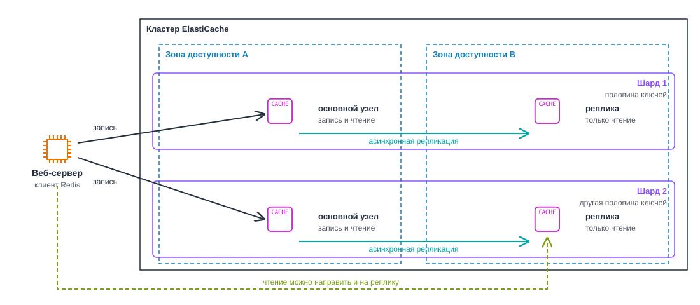

# Кэширование и CDN. Amazon ElastiCache и Amazon CloudFront

<i>
Вторая распродажа прошла спокойнее первой. Веб-сервер теперь записывал заказ, отправлял сообщение о нём и сразу отвечал покупателю. Письма, склад и доставка разбирали сообщения в своём темпе. Когда почтовый сервис снова замедлился, письма пришли на несколько минут позже, а заказы не пострадали.

Жалобы всё равно появились, только другие.

– "Страница с худи открывается секунд пять, - писал кто-то в общем чате. - А фотографии появляются по одной".

Джон открыл графики. Веб-серверов хватало: группа Auto Scaling добавила ещё три. Зато база данных работала на пределе.

– Смотри, - сказал он. - За час страницу худи открыли четыре тысячи раз. И каждый раз сервер заново спрашивал у базы название, описание и цену.

– А цена за этот час менялась? - спросила Эмма.

– Ни разу. Мы четыре тысячи раз получили один и тот же ответ.

– Добавим ещё серверов?

– Не поможет. Серверов станет больше, а база останется одна. Вопросов к ней будет только больше.

Эмма открыла письмо от выпускницы, которая переехала в Канаду и хотела купить кружку с гербом.

– Вот ещё. У неё фотографии товаров загружаются по несколько секунд. И при каждом заходе заново, хотя мы не меняли их с прошлой недели.

– Бакет находится во Франкфурте, - пожал плечами Джон. - До Канады далеко.

– Получается, мы всё время повторяем одну и ту же работу, - сказала Эмма. - База тысячи раз читает один и тот же товар, а браузер снова и снова скачивает одну и ту же фотографию через океан.

– Можно один раз запомнить ответ и потом отдавать готовый, - предложил Джон. - Только где его хранить? И что увидят покупатели, когда ты поменяешь цену?

– Это и надо выяснить, - ответила Эмма. - Где держать копию и как понять, что ей уже нельзя верить.
</i>

## Содержание

- [Кэширование и CDN. Amazon ElastiCache и Amazon CloudFront](#кэширование-и-cdn-amazon-elasticache-и-amazon-cloudfront)
  - [Содержание](#содержание)
  - [Вопросы для самопроверки](#вопросы-для-самопроверки)
  - [Результаты обучения](#результаты-обучения)
  - [Ретроспектива](#ретроспектива)
  - [Зачем нужен кэш](#зачем-нужен-кэш)
    - [Ключ, попадание и промах](#ключ-попадание-и-промах)
  - [Где можно хранить копии](#где-можно-хранить-копии)
    - [Кэш браузера](#кэш-браузера)
    - [CDN](#cdn)
    - [Кэш приложения](#кэш-приложения)
    - [Кэш базы данных](#кэш-базы-данных)
    - [Сравнение видов кэша](#сравнение-видов-кэша)
  - [Как приложение работает с кэшем](#как-приложение-работает-с-кэшем)
    - [Ленивая загрузка](#ленивая-загрузка)
    - [TTL и устаревшие данные](#ttl-и-устаревшие-данные)
    - [Инвалидация после изменения данных](#инвалидация-после-изменения-данных)
    - [Сквозная запись](#сквозная-запись)
    - [Вытеснение и типичные ошибки](#вытеснение-и-типичные-ошибки)
  - [HTTP-кэширование](#http-кэширование)
    - [Cache-Control](#cache-control)
    - [ETag и ответ 304](#etag-и-ответ-304)
    - [Версия в имени файла](#версия-в-имени-файла)
  - [Amazon ElastiCache](#amazon-elasticache)
    - [Назначение сервиса](#назначение-сервиса)
    - [Узлы, реплики и Serverless](#узлы-реплики-и-serverless)
    - [Подключение из приложения](#подключение-из-приложения)
    - [Ленивая загрузка в коде](#ленивая-загрузка-в-коде)
    - [Метрики кэша](#метрики-кэша)
    - [Стоимость](#стоимость)
  - [Amazon CloudFront](#amazon-cloudfront)
    - [Назначение сервиса](#назначение-сервиса-1)
    - [Как проходит запрос](#как-проходит-запрос)
    - [Как проходит запрос](#как-проходит-запрос-1)
    - [Distribution, origin и behavior](#distribution-origin-и-behavior)
    - [Ключ и срок свежести](#ключ-и-срок-свежести)
      - [Срок свежести (TTL)](#срок-свежести-ttl)
    - [Закрытый S3 и HTTPS](#закрытый-s3-и-https)
    - [Обновление файлов в CloudFront](#обновление-файлов-в-cloudfront)
      - [1. Новое имя файла](#1-новое-имя-файла)
      - [2. Инвалидация (Invalidation)](#2-инвалидация-invalidation)
    - [Стоимость CloudFront](#стоимость-cloudfront)
  - [Собираем решения вместе](#собираем-решения-вместе)
  - [Резюме](#резюме)

## Вопросы для самопроверки

1. Как кэш ускоряет повторные запросы и снижает нагрузку на источник?
2. Чем отличаются кэш браузера, CDN и кэш приложения?
3. Что делает приложение при попадании в кэш и при промахе?
4. Зачем нужны TTL и инвалидация? Почему они не гарантируют, что копия всегда актуальна?
5. Чем отличаются `no-cache` и `no-store`? Зачем нужен ответ `304 Not Modified`?
6. Почему состояние пользователя выносят за пределы отдельных веб-серверов?
7. Какие задачи решают ElastiCache и CloudFront?
8. Как отделить общие файлы сайта от личных ответов API в CloudFront?

## Результаты обучения

После изучения главы вы сможете

- объяснить работу кэша на примере повторного чтения товара,
- выбрать место для кэширования разных данных,
- описать обновление и удаление копий,
- прочитать основные директивы `Cache-Control`,
- объяснить роль ElastiCache и CloudFront в приложении.

## Ретроспектива

В предыдущих главах мы разобрали хранение файлов в S3, работу с базами данных и горизонтальное масштабирование. Несколько веб-серверов позволяют обслужить больше пользователей, но все серверы продолжают обращаться к общей базе данных.

Теперь разберём, как сократить повторные чтения из базы и повторную загрузку файлов. В качестве примера будем использовать интернет-магазин с каталогом товаров.

## Зачем нужен кэш

Приложения часто повторно запрашивают одни и те же данные. Если при каждом обращении заново читать их из источника или выполнять вычисления, система тратит ресурсы на одинаковую работу.

**Кэш (cache)** - временное хранилище копий данных или готовых результатов. При повторном запросе использование копии сокращает время ответа и снижает нагрузку на источник[^1]. _Источник данных_ - система, из которой получают исходные данные.

Кэш ускоряет доступ несколькими способами.

- _Хранит данные ближе_. Копия располагается ближе к тому, кто её запрашивает, что сокращает время доступа.
- _Использует быстрое хранилище_. Чтение копии занимает меньше времени, чем получение данных из источника.
- _Сохраняет готовый результат_. Приложению не приходится повторно выполнять запрос или вычисление.

Но при множественных плюсов, у кэша есть и некоторые недостатки. При изменении исходных данных копия может устареть. Поэтому нужно определить, когда обновлять или удалять её. Важные данные сохраняют в основном хранилище, чтобы после потери кэша копии можно было получить заново.

Рассмотрим пример. Тысячи пользователей открывают одну страницу товара, а цена и описание меняются редко. Приложение может один раз получить товар из базы и сохранить готовый результат в кэше. Следующие запросы используют копию, и к базе данных не обращаются повторно. Если цена изменится, сохранённую информацию потребуется обновить или удалить.

### Ключ, попадание и промах

Чтобы найти нужную копию среди сохранённых данных, система обращается к кэшу по ключу.

**Ключ кэша (cache key)** - идентификатор, по которому кэш находит сохранённые данные[^2].

При обращении к кэшу возможны два результата.

- **Попадание в кэш (cache hit)** - подходящая копия найдена, и её можно использовать.
- **Промах кэша (cache miss)** - подходящей копии нет. Данные приходится получать из источника.

Рассмотрим пример. Для товара с `id=42` приложение может использовать ключ `product:42`. Если записи нет, происходит _промах_. Приложение читает данные товара из базы и сохраняет её под этим ключом. Следующее чтение находит копию и даёт попадание, поэтому повторный запрос в базу не нужен[^3].

## Где можно хранить копии

Хранить кэш можно в разных местах:

- На устройстве пользователя,
- В сети доставки содержимого (Content Delivery Network, CDN),
- На сервере.

От выбора места зависит, насколько быстро данные будут доступны и какую нагрузку удастся снизить.

### Кэш браузера

Самым быстрым способом получить данные является кэш на устройстве пользователя. Браузер сохраняет ответы на устройстве пользователя. При повторном открытии страницы он может взять сохранённую картинку или файл стилей без загрузки с сервера.

**Частный кэш (private cache)** - кэш, предназначенный для одного пользователя. Правила хранения задаются заголовками HTTP и правилами самого браузера. При отсутствии явных заголовков браузер иногда определяет срок хранения самостоятельно[^5].

Такой кэш особенно полезен при повторных посещениях. При первом обращении нужной копии ещё может не быть, и содержимое приходится загружать с сервера.

Например, на страницах онлайн-магазина используется файл стилей `style.css`.

- При открытии первой страницы браузер загружает и сохраняет файл.
- При переходе на вторую он использует локальную копию, если правила разрешают её повторное использование без проверки.

Дополнительный запрос за стилями не уходит в сеть.

### CDN

Локальный кэш браузера помогает при повторных обращениях, но новым посетителям тоже нужно быстро получать содержимое.

**CDN (content delivery network)** - сеть доставки содержимого, которая обслуживает пользователей через географически распределённые серверы[^6]. Кэширование на этих серверах сокращает путь до данных и нагрузку на источник. Простыми словами, это сеть серверов, которые хранят копии данных географически ближе к пользователям, чем основной сервер с исходным содержимым.

**Точка присутствия (point of presence, PoP)** - дата-центр CDN с серверами, принимающими запросы пользователей. Источник, из которого CDN получает содержимое, называют _origin_[^7].

**Общий кэш (shared cache)** - кэш, который обслуживает многих пользователей. Такой кэш используется в CDN. Одну копию можно возвращать разным пользователям, если запрошенное содержимое для них одинаково.

CDN направляет запрос в подходящую точку присутствия с небольшой задержкой. При попадании она возвращает копию, при промахе получает данные из источника. Если правила разрешают кэширование, полученный ответ сохраняется для следующих обращений.

Рассмотрим пример. Фотография товара хранится на сервере во Франкфурте, а покупатель находится в Кишинёве.

1. Запрос фотографии попадает в обслуживающую покупателя точку CDN, например, в Руминию.
2. Копии ещё нет, поэтому CDN получает фотографию из источника (то есть с сервера во Франкфурте) и передаёт покупателю.
3. CDN сохраняет разрешённую к кэшированию копию.
4. Следующий покупатель, которого обслуживает та же точка, получает фотографию из её кэша. Его браузер при этом может впервые открывать магазин.

### Кэш приложения

Еще одним видом кэша является _кэш приложения_.

**Кэш приложения (application cache)** - хранилище копий данных или результатов вычислений, которым управляет код приложения. Код выбирает ключи, проверяет наличие копии и обращается к источнику при промахе[^8]. Проще говоря, это кэш, которым управляет само приложение, а не браузер или CDN.

Кэш может находиться в оперативной памяти процесса или в отдельном сервисе. Для нескольких веб-серверов часто используют общее хранилище в памяти. Самыми популярными решениями являются:

- Redis,
- Memcached.

Попадание в кэш приложения позволяет пропустить чтение из базы, но запрос пользователя всё равно доходит до веб-сервера. При попадании в CDN обращение к веб-серверу может вообще не потребоваться.

Рассмотрим пример:

- Веб-сервер прочитал товар из базы и положил её в общий кэш.
- Запрос следующего покупателя попал на второй веб-сервер. Он нашёл готовую информацию о товаре в том же кэше и использовал её при формировании ответа, не обращаясь повторно к базе.

### Кэш базы данных

Кэширование можно организовать перед конкретной базой данных. Такой сервис принимает поддерживаемые обращения приложения, проверяет наличие копии и при необходимости читает данные из базы.

В этом случае часть работы по заполнению кэша выполняет сама база данных. Разработчику не нужно отдельно сохранять результат каждого чтения под собственным ключом. При этом решение привязано к определённой базе и её операциям.

### Сравнение видов кэша

Виды кэша различаются местом хранения копий и тем, кто управляет их использованием. В одном приложении можно сочетать несколько видов, если они сокращают разные повторяющиеся операции.

| Вид кэша               | Где хранится копия               | Кто управляет кэшированием              |
| ---------------------- | -------------------------------- | --------------------------------------- |
| Кэш браузера           | На устройстве пользователя       | Браузер с учётом HTTP-заголовков        |
| CDN                    | В точках присутствия             | CDN с учётом настроек и HTTP-заголовков |
| Кэш приложения         | В процессе или отдельном сервисе | Код приложения                          |
| Кэш перед базой данных | В специализированном сервисе     | Сам сервис                              |

Каждый слой хранит отдельные копии и применяет свои правила обновления. Очистка одного кэша не очищает остальные. При этом приложению не обязательно нужны все перечисленные виды.

Рассмотрим пример. Фотография товара хранится в браузере и CDN, а данные карточки - в кэше приложения. Изменение цены требует обновить копию карточки. Замена фотографии требует обновить файл и учесть его копии в браузере и CDN. Для магазина с RDS дальше будем использовать кэш приложения, а DAX оставим примером решения для DynamoDB.

## Как приложение работает с кэшем

Рассмотрим работу с кэшем приложения. В отличие от браузера, он не получает правил хранения кэша. _Разработчик добавляет в код обращения к кэшу и определяет, когда сохранять, обновлять или удалять копии_.

### Ленивая загрузка

**Ленивая загрузка (lazy loading, cache-aside)** - подход, при котором приложение заполняет кэш по мере чтения данных[^3]. Копия создаётся после запроса, если подходящей записи в кэше ещё нет.

Приложение выполняет следующий алгоритм.

1. Ищет данные в кэше по ключу.
2. При попадании возвращает копию.
3. При промахе читает данные из источника.
4. Сохраняет полученные данные в кэш и возвращает результат.

Так в память попадают только востребованные данные. Промах требует дополнительных обращений, зато следующие попадания позволяют пропускать чтение источника. _Однако изменение исходных данных само по себе не обновляет уже сохранённую копию_.

Рассмотрим пример. Товара с `id=42` ещё нет в кэше. Приложение проверяет ключ `product:42`, читает карточку из базы и сохраняет копию. При следующем обращении оно находит запись и возвращает её сразу.



_11.2. Первое и повторное чтение при ленивой загрузке_

### TTL и устаревшие данные

После изменения данных в источнике сохранённая копия может перестать соответствовать оригиналу. Такие данные называют _устаревшими_. Чтобы ограничить время их использования, записям задают срок жизни.

**Время жизни (time to live, TTL)** - срок, после которого запись кэша перестаёт использоваться[^3]. В рассматриваемой схеме он отсчитывается от сохранения копии. По истечении TTL следующее чтение даёт промах, и приложение получает данные из источника.

TTL не обновляет копию сразу после изменения базы и не запускает загрузку по расписанию. Запрос к источнику происходит, когда данные снова понадобятся приложению.

- Короткий TTL уменьшает время использования старых данных, но увеличивает число промахов.
- Длинный TTL снижает нагрузку на источник, но позволяет дольше возвращать устаревшие значения.

Выбор зависит от допустимой задержки обновления. Операции, которым требуются актуальные данные, должны проверять их в основном хранилище.

Например, для данных о товаре выбран TTL 300 секунд (5 минут).

1. В 12:00 приложение сохранило в кэше цену 35 USD.
2. В 12:01 цена в базе изменилась на 30 USD.
3. До 12:05 кэш может возвращать прежнюю цену.
4. После 12:05 следующий запрос получает промах. Приложение читает цену 30 USD из базы и сохраняет новые данные о товаре.



_11.3. Срок жизни записи и устаревшая копия_

### Инвалидация после изменения данных

Ожидание окончания TTL подходит не всегда. Если приложение знает, что исходные данные изменились, оно может сразу убрать старую копию.

**Инвалидация (invalidation)** - удаление копии из кэша или пометка её как непригодной для использования. При ленивой загрузке следующее чтение заново получает данные из источника[^10].

В данном случае, при обновлении данных:

1. Сначала _выполняют запись в базу_,
2. После успешного завершения записи удаляют ключ кэша.

Если удалить ключ раньше, параллельное чтение может получить из базы ещё старое значение и снова сохранить его в кэш.

Инвалидация и TTL дополняют друг друга:

- Удаление убирает старую копию вскоре после изменения,
- TTL ограничивает её использование, если удаление не удалось.

Рассмотрим пример. Администратор меняет цену товара 42 с 35 до 30 USD.

1. Приложение записывает цену 30 USD в базу.
2. После успешной записи удаляет `product:42` из кэша.
3. Следующий покупатель запрашивает карточку, и приложение получает промах.
4. Приложение читает обновлённую карточку из базы и сохраняет её в кэш с TTL.



_11.4. Порядок записи в базу и удаления ключа_

Если бы ключ удалили до изменения базы, между этими действиями другой запрос мог бы снова сохранить цену 35 USD. Правильный порядок уменьшает этот риск.

### Сквозная запись

После инвалидации следующий запрос требует чтения источника. Если обновлённые данные скоро понадобятся снова, приложение может сразу сохранить новую копию.

**Сквозная запись (write-through)** - подход, при котором обновление данных сопровождается записью нового значения в кэш[^3].

Сквозная запись позволяет подготовить кэш заранее: после изменения данных приложение сразу сохраняет в нём новое значение. Следующий запрос получает готовую копию без чтения базы. Однако приложение обновляет кэш даже для данных, которые потом никто не запросит. Если запись в базу прошла успешно, а обновление кэша завершилось ошибкой, в кэше может остаться старая копия.

Сквозная запись не гарантирует, что копия будет храниться в кэше постоянно: её могут удалить, например, при очистке кэша или после истечения TTL. Поэтому при чтении можно дополнительно использовать ленивую загрузку. Если копии нет, приложение получает данные из базы и снова сохраняет их в кэш.

Рассмотрим пример сквозной записи.

1. Приложение записывает цену 30 USD в базу.
2. После успешной записи сохраняет товар с новой ценой под ключом `product:42`.
3. Следующий покупатель получает эту карточку из кэша без дополнительного чтения базы.



_11.5. Сквозная запись_

### Вытеснение и типичные ошибки

Память кэша ограничена. Когда она заполняется, для новых данных приходится освобождать место.

**Вытеснение (eviction)** - удаление записей самим кэшем, когда нужно освободить память. Какие записи удалить, определяет выбранное правило. Одно из таких правил выбирает записи, к которым давно не обращались[^8].

Кроме отдельных промахов, нужно учитывать ситуации, когда много обращений одновременно доходят до источника.

| Ситуация                                      | Последствие                                   | Что предусмотреть                                                    |
| --------------------------------------------- | --------------------------------------------- | -------------------------------------------------------------------- |
| Кэш пуст после запуска или сбоя               | Много запросов одновременно обращаются к базе | Учитывать эту нагрузку и ограничивать поток запросов при перегрузке  |
| У многих записей одновременно истекает TTL    | Возникает всплеск обращений к базе            | Добавлять к TTL небольшую случайную величину                         |
| Важные данные есть только в кэше              | После удаления записи их нельзя восстановить  | Хранить исходные данные в базе                                       |
| Личные данные записаны под одним общим ключом | Пользователь может получить чужие данные      | Включать идентификатор пользователя в ключ и проверять права доступа |

## HTTP-кэширование

Кэшем данных приложения управляет его код. _Браузер и CDN работают с готовыми HTTP-ответами_. Им нужны правила, определяющие возможность хранения и повторного использования каждого ответа.

Сервер сообщает эти правила в заголовках HTTP:

- Для динамического ответа их задаёт код приложения,
- Для статического файла - настройки веб-сервера или хранилища.

Рассмотрим некоторые заголовки HTTP, которые управляют кэшированием.

### Cache-Control

**`Cache-Control`** - HTTP-заголовок с правилами хранения и повторного использования ответа[^2]. Он позволяет задать срок свежести, потребовать проверку копии или запретить её хранение.

При работе с HTTP-кэшированием есть понятие "свежести" ответа. Ответ считается свежим, если его возраст не превышает заданного срока. Если ответ свежий, кэш может использовать его без обращения к источнику.

`Cache-Control` поддерживает несколько директив, которые задают правила кэширования для ответа.

| Директива    | Что означает                                                                                                       |
| ------------ | ------------------------------------------------------------------------------------------------------------------ |
| `max-age=N`  | Ответ считается свежим N секунд                                                                                    |
| `s-maxage=N` | Отдельный срок свежести для общих кэшей, например CDN. Для них имеет приоритет над `max-age;` на браузер не влияет |
| `no-cache`   | Ответ можно сохранить, но перед повторным использованием нужно проверить у источника                               |
| `no-store`   | Ответ нельзя сохранять в кэше                                                                                      |
| `private`    | Ответ может хранить частный кэш, но не общий                                                                       |

Рассмотрим пример. Для общей страницы сервер вернул `Cache-Control: max-age=60, s-maxage=300`. Браузер считает ответ свежим одну минуту, а CDN - пять минут. После окончания соответствующего срока кэшу потребуется проверить копию или получить её заново при следующем запросе.

Для ответа с корзиной сервер использует `Cache-Control: private, no-store`, а кэширование этого пути в CDN отключено. Такой ответ не сохраняется для повторного использования.

### ETag и ответ 304

После истечения срока свежести данные на сервере могут остаться прежними. В таком случае кэш может проверить свою копию, чтобы не скачивать те же данные повторно.

**ETag** - HTTP-заголовок с идентификатором версии ресурса, который задаёт сервер[^11]. Кэш сохраняет его вместе с ответом. Когда копию нужно проверить, кэш отправляет запрос с заголовком `If-None-Match`, указывая в нём сохранённый ETag.

Сервер сравнивает версии и отвечает:

- `304 Not Modified`, если ресурс не изменился. Содержимое повторно не передаётся, и кэш использует сохранённую копию.
- `200 OK`, если ресурс изменился. Сервер передаёт новое содержимое и новый ETag[^5].

Такой запрос называют _условным_: ответ зависит от того, изменилась ли версия ресурса. Проверка требует обращения к серверу, но позволяет не передавать содержимое повторно, если оно осталось прежним.

Рассмотрим пример с файлом `/catalog.json` размером 50 КБ.

1. Браузер запрашивает файл.
2. Сервер возвращает его с заголовками `ETag: "v7"` и `Cache-Control: no-cache`.
3. При следующем обращении браузер отправляет `If-None-Match: "v7"`.
4. Файл не изменился, поэтому сервер отвечает `304 Not Modified`, и браузер использует сохранённую копию.

Из-за `no-cache` проверка потребовалась при повторном использовании. Но 50 КБ содержимого второй раз по сети не передавались.



_11.6. Условный запрос и ответ 304_

### Версия в имени файла

Если браузеру разрешено хранить CSS- или JavaScript-файл в кэше долго, он может не сразу получить обновление. Даже после замены файла на сервере браузер продолжит использовать сохранённую копию, пока она считается свежей.

Чтобы решить эту проблему, при обновлении файла меняют его имя, добавляя номер версии. В HTML-странице указывают новое имя. Для браузера это уже другой адрес, поэтому он загружает новый файл.

Такой файл можно кэшировать надолго: при следующем обновлении у него снова будет другое имя.

При этом саму HTML-страницу нужно регулярно проверять, иначе браузер не узнает о новом имени файла. Для неё задают короткий срок свежести или `no-cache`, который требует проверки перед повторным использованием.

Рассмотрим пример.

1. HTML-страница подключает скрипт `app.v1.js`. Браузер скачивает его и сохраняет в кэш.
2. Разработчик публикует обновлённый скрипт под именем `app.v2.js` и меняет ссылку в HTML. Старый файл остаётся без изменений.
3. Получив обновлённую HTML-страницу, браузер видит ссылку на `app.v2.js` и скачивает его.

## Amazon ElastiCache

### Назначение сервиса

**Amazon ElastiCache** - управляемый сервис AWS для хранения данных в памяти. Он поддерживает движки Valkey, Redis OSS и Memcached. Обозначение OSS означает open source software, программное обеспечение с открытым кодом [^13].

Сервис для кэша приложения можно установить на EC2 самостоятельно. Тогда нужно:

- обслуживать программу,
- следить за ресурсами,
- заменять отказавшие серверы.

ElastiCache берёт значительную часть этой работы на себя.

| Характеристика      | Amazon ElastiCache                                                                |
| ------------------- | --------------------------------------------------------------------------------- |
| Категория           | Управляемое хранилище в памяти                                                    |
| Что делает          | Хранит значения по ключам и быстро возвращает их приложению                       |
| Для чего нужен      | Снижать нагрузку на базу при повторных чтениях                                    |
| Где используют      | Каталоги, результаты вычислений, сессии                                           |
| Модель обслуживания | PaaS. AWS обслуживает инфраструктуру, разработчик управляет данными и доступом    |
| Область действия    | Регион AWS                                                                        |
| Как оплачивается    | За используемые ресурсы Serverless или время работы узлов                         |
| Как работать        | Создать кэш через консоль, CLI или SDK, затем подключить клиент выбранного движка |

Создание ElastiCache предоставляет приложению хранилище, но правила его заполнения и обновления разработчик реализует в коде. Сервис не определяет самостоятельно, какие данные нужно читать из другой базы.

Рассмотрим пример. В RDS лежит основная информация о товаре, а в ElastiCache - её копия под ключом `product:42`. При промахе код читает RDS и заполняет кэш. После изменения товара тот же код удаляет старую копию.

### Узлы, реплики и Serverless

ElastiCache предоставляет два варианта размещения[^13].

| Вариант                       | Что делает разработчик             | Что делает AWS                                   |
| ----------------------------- | ---------------------------------- | ------------------------------------------------ |
| Кластер из узлов (node-based) | Выбирает тип и количество серверов | Обслуживает выбранные узлы                       |
| ElastiCache Serverless        | Настраивает кэш и доступ к нему    | Подбирает ресурсы и масштабирует их под нагрузку |

_Узел (node)_ - сервер с работающим движком. Для Valkey и Redis OSS можно создать основной узел и _реплики_ - дополнительные узлы с копиями данных.

Реплика в другой зоне доступности помогает пережить отказ основного узла. При включённом Multi-AZ, ElastiCache может назначить её новым основным узлом[^14].

При большом объёме данных ключи можно распределить между _шардами_. Каждый шард хранит свою часть ключей, а его реплики - копии этой же части. Шарды позволяют распределить объём данных и нагрузку, реплики помогают пережить отказ узла [^15][^16].

Например, каталог продуктов разделён между двумя шардами. У каждого есть основной узел и реплика в другой зоне доступности.

- Первый шард хранит одну часть товаров, второй - другую.
- Реплика первого шарда содержит копию его данных.
- При отказе основного узла первого шарда ElastiCache с Multi-AZ может назначить его реплику основным узлом. Приложение возобновит работу после переключения и восстановления соединения.



_11.7. Кластер ElastiCache из двух шардов_

### Подключение из приложения

Приложение подключается к ElastiCache по _endpoint_ - DNS-имени, которое выдаёт сервис. Код использует клиентскую библиотеку выбранного движка. Она позволяет читать, записывать и удалять значения по ключам.

Пример подключения к кэшу через клиентскую библиотеку `redis` показан ниже:

```javascript
import { createClient } from "redis";

// Endpoint кэша берётся из консоли ElastiCache и передаётся через переменную окружения:
// REDIS_URL=rediss://my-cache-abc123.serverless.euc1.cache.amazonaws.com:6379
const client = createClient({ url: process.env.REDIS_URL });

client.on("error", (err) => console.error("Ошибка Redis:", err));

await client.connect();

// Запись значения по ключу на 300 секунд
await client.set("user:42:name", "Ana", { EX: 300 });

// Чтение значения по ключу
const name = await client.get("user:42:name");
console.log(name); // Ana

// Удаление ключа
await client.del("user:42:name");

await client.quit();
```

### Ленивая загрузка в коде

Рассмотрим ленивую загрузку на примере Node.js с клиентской библиотекой `redis`[^18]. Переменная `client`- это подключение к elasticache. Функция `loadProductFromDb` имитирует чтение базы и возвращает карточку с ценой 35 USD.

Для демонстрации используем ключ `lesson:product:42`. Префикс `lesson:` отделяет учебные данные от ключей приложения.

```javascript
async function getProduct(id) {
  const key = `lesson:product:${id}`;
  const cached = await client.get(key);

  if (cached !== null) {
    console.log(`Попадание: ${key}`);
    return JSON.parse(cached);
  }

  console.log(`Промах: ${key}`);
  const product = await loadProductFromDb(id);
  await client.set(key, JSON.stringify(product), { EX: 300 });
  return product;
}

await getProduct(42);
await getProduct(42);
```

`cache.get` читает значение по ключу. Если ключа нет, метод возвращает `null`, и функция продолжает работу с базой. При попадании сохранённая строка JSON преобразуется в объект через `JSON.parse` и сразу возвращается вызывающему коду.

При промахе функция получает карточку из базы и сохраняет её через `cache.set`. `JSON.stringify` преобразует объект в строку, а `{ EX: 300 }` задаёт TTL пять минут. Все сетевые операции здесь ожидаются через `await`.

Если ключа ещё нет, для двух последовательных вызовов ожидается такой вывод.

```text
Промах: lesson:product:42
Запрос к базе: товар 42
Попадание: lesson:product:42
```

### Метрики кэша

В CloudWatch, сервисе метрик AWS, следят за попаданиями и вытеснениями. Основные метрики кэша приведены в таблице.

| Метрика                         | Что показывает                            | На что указывает                                                               |
| ------------------------------- | ----------------------------------------- | ------------------------------------------------------------------------------ |
| `CacheHits`                     | Число попаданий: запрос нашёл ключ в кэше | Вместе с `CacheMisses` показывает, как часто кэш отвечает вместо базы          |
| `CacheMisses`                   | Число промахов: ключа в кэше не было      | Рост промахов означает, что больше запросов идёт в базу                        |
| `CacheHitRate`                  | Долю попаданий в процентах                | Низкая доля может означать слишком короткий TTL или редкое повторение запросов |
| `Evictions`                     | Число ключей, вытесненных из кэша         | Частый рост может указывать на нехватку памяти[^19]                            |
| `DatabaseMemoryUsagePercentage` | Заполненность памяти в процентах          | Помогает понять, связаны ли вытеснения с нехваткой памяти                      |

Например, если популярные карточки постоянно вытесняются и снова загружаются из базы, нужно проверить объём кэша и состав хранимых данных. Если память свободна, но запросы почти не повторяются, её увеличение само по себе не повысит долю попаданий.

### Стоимость

У кластера из узлов оплачивается время работы каждого узла, включая реплики. У Serverless оплачиваются хранимые данные и обработка запросов[^20]. Обработка измеряется в _ECPU (ElastiCache Processing Unit)_: простая команда `GET` или `SET`, которая передаёт до 1 КБ данных, расходует одну ECPU.

| Что оплачивается                                  | Valkey  | Redis OSS |
| ------------------------------------------------- | ------- | --------- |
| Узел `cache.t4g.micro` (0,5 GiB), за час          | $0.0144 | $0.0180   |
| Узел `cache.t4g.small` (1,37 GiB), за час         | $0.0288 | $0.0360   |
| Узел `cache.r7g.large` (13,07 GiB), за час        | $0.2104 | $0.2630   |
| Serverless: хранение данных, за 1 ГБ в час        | $0.101  | $0.151    |
| Serverless: обработка, за 1 миллион ECPU          | $0.0027 | $0.0041   |
| Serverless: минимальный оплачиваемый объём данных | 100 МБ  | 1 ГБ      |

Месяц в расчётах AWS равен 730 часам. Кластер на Valkey из основного узла и одной реплики `cache.t4g.micro` стоит 2 × 0,0144 × 730 ≈ $21.02 в месяц. Пустой кэш Serverless на Valkey оплачивается как минимум за 100 МБ: 0,1 × 0,101 × 730 ≈ $7.37 в месяц. На Redis OSS минимум равен 1 ГБ, и пустой кэш стоит 1 × 0,151 × 730 ≈ $110.23 в месяц.

Кэш добавляет расходы, но может уменьшить нагрузку на базу. Перед его добавлением полезно проверить, действительно ли повторные чтения занимают заметную часть работы приложения. Цены в таблице приведены для региона `eu-central-1` на ноябрь 2026 года. Тариф зависит от региона и движка, актуальные значения приведены на странице цен AWS[^20].

## Amazon CloudFront

### Назначение сервиса

Для доставки файлов пользователям в разных странах AWS предоставляет CDN.

**Amazon CloudFront** - сервис доставки содержимого через глобальную сеть точек присутствия AWS. Он может кэшировать HTTP-ответы и передавать остальные запросы источнику[^7].

**Edge-локация (edge location)** - точка присутствия AWS, в которой CloudFront принимает запросы пользователей и хранит кэшированные копии содержимого. Запрос направляется в подходящую edge-локацию, обычно с наименьшей сетевой задержкой для пользователя[^7].

> [!NOTE]
>
> В документации CloudFront названия edge location и PoP обозначают одно и то же понятие.

| Характеристика      | Amazon CloudFront                                                            |
| ------------------- | ---------------------------------------------------------------------------- |
| Категория           | Сеть доставки содержимого                                                    |
| Что делает          | Принимает запросы пользователей, возвращает копии или обращается к источнику |
| Для чего нужен      | Ускорять доставку файлов и снижать нагрузку на источник                      |
| Где используют      | Сайты, изображения, видео и API                                              |
| Модель обслуживания | PaaS. AWS обслуживает сеть, разработчик настраивает источники и правила      |
| Область действия    | Глобальная сеть                                                              |
| Как оплачивается    | По использованию или по выбранному месячному плану                           |
| Как работать        | Консоль CloudFront, AWS CLI или SDK                                          |

Сохранение и использование копий зависят от правил кэширования. Для ответов, которые нужно получать от приложения при каждом запросе, кэширование можно отключить.

Например, при первом запросе фотографии CloudFront получает её из S3 и сохраняет разрешённую к кэшированию копию. Следующие посетители той же edge-локации получают фотографию из кэша, и повторное чтение S3 не требуется.

### Как проходит запрос

### Как проходит запрос

Запрос пользователя проходит несколько шагов:

1. _Edge-локация_. Запрос пользователя поступает в подходящую edge-локацию CloudFront. При попадании сервис возвращает копию, при промахе ищет или получает содержимое дальше по пути к источнику.
2. _Региональный кэш_. Между точками присутствия и источниками CloudFront также использует _региональные кэши (regional edge caches)_. Такой кэш хранит копии для нескольких edge-локаций и уменьшает число обращений к источнику[^7].
3. _Источник_. Если подходящей копии нет на пути запроса, CloudFront получает ответ из источника и возвращает его пользователю. Копии сохраняются в соответствии с правилами кэширования.

Запросы, для которых кэширование отключено, CloudFront передаёт источнику. Выбор источника и правил обработки определяется настройками сервиса.

Рассмотрим пример с фотографией `/assets/hoodie.v2.jpg` в S3.

1. Браузер запрашивает фотографию через CloudFront, но в обслуживающей точке присутствия её нет.
2. Если копия найдётся в региональном кэше на пути запроса, CloudFront получит её оттуда.
3. Если подходящей копии нет и там, CloudFront обращается к S3.
4. Фотография передаётся браузеру и сохраняется по правилам кэширования. Следующий запрос к той же точке присутствия может получить попадание.

### Distribution, origin и behavior

CloudFront может доставлять содержимое из нескольких источников. Например, файлы сайта хранятся в S3, а запросы к API обрабатываются веб-серверами за ALB.

Для настройки используются три понятия:

- _Distribution_ - конфигурация CloudFront для сайта или приложения.
- _Origin_ - источник содержимого, например бакет S3 или ALB.
- _Cache behavior_ - правило, которое определяет, куда направить запрос и как его обрабатывать.

Рассмотрим интернет-магазин, для которого настроена одна distribution:

| Путь запроса         | Источник                             | Кэширование |
| -------------------- | ------------------------------------ | ----------- |
| `/assets/*`          | S3 с изображениями, CSS и JavaScript | Включено    |
| `/api/*`             | ALB перед веб-серверами              | Отключено   |
| Остальные пути (`*`) | S3 с HTML-страницами                 | Отключено   |

CloudFront выбирает правило по пути запроса[^21]:

- `/assets/logo.png` - файл запрашивается из S3 или возвращается из кэша.
- `/api/cart` - запрос передаётся веб-серверу через ALB.
- `/about.html` - используется правило по умолчанию, поскольку другие не подходят.

Для каждого правила можно выбрать **политику кэша (cache policy)**. Она определяет, какие ответы кэшировать и как долго их хранить[^22].

AWS предоставляет готовые политики:

- `CachingOptimized` — подходит для статических файлов, например изображений, CSS и JavaScript. По умолчанию CloudFront не учитывает параметры URL и cookie при поиске копии.
- `CachingDisabled` — отключает кэширование в CloudFront. Подходит для API, возвращающего персональные данные.

> [!TIP]
>
> Отключение кэширования не означает, что CloudFront автоматически передаст источнику все данные запроса. Например, для API может потребоваться передавать cookie сессии или заголовок `Authorization`. Для этого настраивается **origin request policy**[^23].

### Ключ и срок свежести

Когда CloudFront получает запрос, он проверяет, есть ли подходящая копия в кэше.

Для поиска используется **ключ кэша (cache key)** - набор данных, позволяющий отличать одну копию от другой.

Например, интернет-магазин поддерживает два языка:

- `/catalog?lang=ro` - каталог на румынском.
- `/catalog?lang=ru` - каталог на русском.

Если CloudFront не учитывает параметр `lang`, он может вернуть русскоязычному пользователю румынскую версию страницы.

Поэтому параметры, от которых зависит содержимое ответа, необходимо включать в ключ кэша. Помимо пути, ключ может учитывать параметры URL, cookie и заголовки[^24].

#### Срок свежести (TTL)

Копия не должна храниться бесконечно, поскольку содержимое может измениться.

**TTL (Time to Live)** - время, в течение которого CloudFront может использовать сохранённую копию без повторного обращения к источнику.

Источник может указать срок в HTTP-заголовке:

`Cache-Control: max-age=60` или `Cache-Control: s-maxage=60`

Это означает, что ответ можно считать свежим в течение 60 секунд.

В политике CloudFront также задаются три значения:

- _Minimum TTL_ - минимальный срок.
- _Default TTL_ - срок, если источник его не указал.
- _Maximum TTL_ - максимальный срок.

_Минимальный TTL_ определяет, как минимум долго CloudFront считает копию свежей, а _максимальный TTL_ ограничивает этот срок сверху. Например, при минимальном TTL 60 секунд и максимальном 3600 секунд копия будет считаться свежей не менее минуты, но не более часа.

Допустим, если источник указал `max-age=7200`, а максимальный TTL в CloudFront равен 3600 секундам, копия будет считаться свежей не более часа.

Заголовок `s-maxage` позволяет отдельно указать срок для общих кэшей, включая CloudFront, и не использовать для них значение `max-age`[^25].

> [!IMPORTANT]
>
> Для персональных данных нельзя использовать политику, которая принудительно кэширует ответы. Например, у `CachingOptimized` минимальный TTL составляет одну секунду, поэтому ответ может кэшироваться даже при `Cache-Control: no-store`. Для таких данных следует использовать `CachingDisabled` и соответствующие HTTP-заголовки[^22].

### Закрытый S3 и HTTPS

CloudFront позволяет доставлять файлы из S3, не открывая сам бакет для публичного доступа.

Для этого используется **Origin Access Control (OAC)** - механизм, который позволяет CloudFront обращаться к закрытому бакету S3 с необходимыми разрешениями[^26].

Схема работы:

1. Пользователь запрашивает файл у CloudFront.
2. Если файла нет в кэше, CloudFront запрашивает его из S3.
3. S3 разрешает доступ CloudFront, но не анонимным пользователям.

Таким образом, посетители могут получать файлы через CloudFront, но не напрямую из закрытого бакета.

### Обновление файлов в CloudFront

После изменения файла в S3 CloudFront может продолжать возвращать старую копию, пока не истечёт её TTL.

Существуют два основных способа обновления содержимого.

#### 1. Новое имя файла

Вместо замены существующего файла публикуется новая версия:

- Старая фотография: `/assets/hoodie.v1.jpg`
- Новая фотография: `/assets/hoodie.v2.jpg`

После обновления ссылки на HTML-странице браузер запрашивает новый адрес. Поскольку для него ещё нет сохранённой копии, загружается новая фотография.

Это удобно для изображений, CSS и JavaScript, которым можно назначать длительный срок кэширования.

Однако _сама HTML-страница тоже может находиться в кэше браузера_. Если браузер продолжает использовать старый HTML, он будет запрашивать прежние файлы. Поэтому HTML обычно не кэшируют надолго либо требуют проверки его актуальности.

#### 2. Инвалидация (Invalidation)

Если имя файла необходимо сохранить, можно удалить его старую копию из CloudFront.

Например, разработчик заменяет `/assets/logo.png` в S3 и создаёт инвалидацию для этого пути. После завершения операции CloudFront при следующем запросе получает обновлённый файл из источника[^28].

Но инвалидация действует только на CloudFront. _Она не удаляет копии, уже сохранённые в браузерах пользователей._

Поэтому для статических файлов с длительным сроком кэширования обычно удобнее использовать новые имена, а для HTML - короткий срок свежести или проверку актуальности.

### Стоимость CloudFront

При оплате по использованию стоимость CloudFront зависит прежде всего от объёма переданных пользователям данных и числа запросов. Также доступны месячные планы. Дополнительные операции, включая инвалидации сверх бесплатного объёма, могут оплачиваться отдельно[^29].

Цена CloudFront зависит не от региона источника, а от того, где находятся пользователи. Каждый месяц бесплатно доступны 1 ТБ переданных данных и 10 миллионов запросов. Передача данных из S3, EC2 и ALB в CloudFront не оплачивается.

| Что оплачивается                                                     | Цена для пользователей в Европе |
| -------------------------------------------------------------------- | ------------------------------- |
| Передача данных пользователям, следующие 9 ТБ после бесплатного 1 ТБ | $0.085 за ГБ                    |
| HTTPS-запросы сверх бесплатных 10 миллионов                          | $0.012 за 10 000 запросов       |
| Инвалидации сверх 1 000 бесплатных путей в месяц                     | $0.005 за путь                  |

Например, магазин за месяц отдал пользователям в Европе 2 ТБ данных и обработал 20 миллионов HTTPS-запросов. Первый терабайт и первые 10 миллионов запросов бесплатны. За второй терабайт магазин заплатит 1 024 × 0,085 ≈ $87.04, за остальные запросы 10 000 000 / 10 000 × 0,012 = $12.00, всего около $99.

Месячный план стоит фиксированную сумму за одну distribution, и доплат за превышение объёма нет[^29]:

| План     | Цена в месяц | Запросов в месяц | Данных в месяц |
| -------- | ------------ | ---------------- | -------------- |
| Free     | $0           | 1 миллион        | 100 ГБ         |
| Pro      | $15          | 10 миллионов     | 50 ТБ          |
| Business | $200         | 125 миллионов    | 50 ТБ          |
| Premium  | $1 000       | 500 миллионов    | 50 ТБ          |

Объём плана - это не жёсткий предел. Если сайт долго превышает объём плана, AWS может замедлить доставку и предложит перейти на план выше.

## Собираем решения вместе

В учебном магазине исходные данные товаров и заказов лежат в RDS, файлы - в S3, сессии - в DynamoDB. Добавим кэширование там, где повторяются чтения.

| Данные                        | Решение                                     | Как обновлять                           |
| ----------------------------- | ------------------------------------------- | --------------------------------------- |
| Картинки, стили и скрипты     | Браузер и CloudFront                        | Выпускать новую версию под новым именем |
| Карточки товаров              | ElastiCache, ленивая загрузка и TTL         | После изменения базы удалять ключ       |
| Корзина и заказы пользователя | API с CachingDisabled и `private, no-store` | Читать из основного хранилища           |
| Сессии                        | Общее хранилище DynamoDB                    | Обновлять при действиях пользователя    |

Проследим открытие карточки товара в этой схеме.

1. Браузер получает HTML-страницу и запрашивает её стили и изображения. Подходящие локальные копии он использует сразу.
2. Недостающие файлы из `/assets/*` браузер запрашивает у CloudFront. При попадании CloudFront отвечает из кэша, при промахе получает файл из S3.
3. Данные карточки браузер запрашивает через API. CloudFront передаёт запрос на ALB, который выбирает веб-сервер.
4. Веб-сервер проверяет `product:42` в ElastiCache. При попадании он использует копию, при промахе читает карточку из RDS и сохраняет её с TTL.
5. Если странице нужна корзина, браузер отправляет отдельный запрос с сессией. Приложение проверяет пользователя и возвращает его данные с запретом кэширования.

После изменения цены приложение сначала обновляет RDS, затем удаляет `product:42`. Следующее чтение заполняет кэш новой карточкой. При подтверждении покупки приложение проверяет актуальную цену и остаток в основном хранилище независимо от ранее показанной карточки.

Каждый слой снимает свою часть работы. Браузер сокращает повторные загрузки, CloudFront - обращения за файлами к S3, ElastiCache - повторные чтения каталога из RDS. Общее хранилище сессий позволяет обслуживать пользователя на любом веб-сервере.

## Резюме

- Кэш хранит повторно используемую копию и снижает нагрузку на источник.
- При попадании используется копия, при промахе данные получают из источника.
- Ленивая загрузка заполняет кэш при чтении, сквозная запись обновляет его при записи.
- TTL ограничивает срок использования копии, инвалидация убирает её после изменения данных.
- `no-cache` требует проверки перед использованием, `no-store` запрещает хранение, а `ETag` помогает избежать повторной передачи файла.
- Сервер без состояния может обслуживать запрос независимо от предыдущего сервера, но ответ всё ещё может зависеть от пользователя.
- ElastiCache хранит данные для кода приложения, CloudFront доставляет HTTP-ответы пользователям.
- Выбор кэша зависит от повторяемости запросов, допустимого устаревания и того, кому предназначены данные.

[^1]: Amazon Web Services (2026). _What is Caching and How it Works_. AWS. Available at: https://aws.amazon.com/caching/

[^2]: Fielding, R., Nottingham, M. and Reschke, J. (eds.) (2022). _RFC 9111: HTTP Caching_. RFC Editor. Available at: https://www.rfc-editor.org/rfc/rfc9111.html

[^3]: Amazon Web Services (2026). _Caching strategies for Memcached_. Amazon ElastiCache User Guide. Available at: https://docs.aws.amazon.com/AmazonElastiCache/latest/dg/Strategies.html

[^4]: Amazon Web Services (2026). _Caching and availability_. Amazon CloudFront Developer Guide. Available at: https://docs.aws.amazon.com/AmazonCloudFront/latest/DeveloperGuide/ConfiguringCaching.html

[^5]: MDN contributors (2026). _HTTP caching_. MDN Web Docs. Available at: https://developer.mozilla.org/en-US/docs/Web/HTTP/Guides/Caching

[^6]: MDN contributors (2026). _CDN_. MDN Web Docs Glossary. Available at: https://developer.mozilla.org/en-US/docs/Glossary/CDN

[^7]: Amazon Web Services (2026). _How CloudFront delivers content_. Amazon CloudFront Developer Guide. Available at: https://docs.aws.amazon.com/AmazonCloudFront/latest/DeveloperGuide/HowCloudFrontWorks.html

[^8]: Microsoft (2026). _Caching guidance_. Azure Architecture Center. Available at: https://learn.microsoft.com/en-us/azure/architecture/best-practices/caching

[^9]: Amazon Web Services (2026). _In-memory acceleration with DynamoDB Accelerator (DAX)_. Amazon DynamoDB Developer Guide. Available at: https://docs.aws.amazon.com/amazondynamodb/latest/developerguide/DAX.html

[^10]: Microsoft (2025). _Cache-Aside pattern_. Azure Architecture Center. Available at: https://learn.microsoft.com/en-us/azure/architecture/patterns/cache-aside

[^11]: Fielding, R., Nottingham, M. and Reschke, J. (eds.) (2022). _RFC 9110: HTTP Semantics_. RFC Editor. Available at: https://www.rfc-editor.org/rfc/rfc9110.html

[^12]: Amazon Web Services (2026). _REL05-BP06 Make systems stateless where possible_. AWS Well-Architected Framework, Reliability Pillar. Available at: https://docs.aws.amazon.com/wellarchitected/latest/framework/rel_mitigate_interaction_failure_stateless.html

[^13]: Amazon Web Services (2026). _What is Amazon ElastiCache?_ Amazon ElastiCache User Guide. Available at: https://docs.aws.amazon.com/AmazonElastiCache/latest/dg/WhatIs.html

[^14]: Amazon Web Services (2026). _Minimizing downtime in ElastiCache by using Multi-AZ with Valkey and Redis OSS_. Amazon ElastiCache User Guide. Available at: https://docs.aws.amazon.com/AmazonElastiCache/latest/dg/AutoFailover.html

[^15]: Amazon Web Services (2026). _ElastiCache components and features_. Amazon ElastiCache User Guide. Available at: https://docs.aws.amazon.com/AmazonElastiCache/latest/dg/WhatIs.Components.html

[^16]: Amazon Web Services (2026). _Comparing node-based Valkey, Memcached, and Redis OSS clusters_. Amazon ElastiCache User Guide. Available at: https://docs.aws.amazon.com/AmazonElastiCache/latest/dg/SelectEngine.html

[^17]: Amazon Web Services (2026). _Access Patterns for Accessing an ElastiCache Cache in an Amazon VPC_. Amazon ElastiCache User Guide. Available at: https://docs.aws.amazon.com/AmazonElastiCache/latest/dg/elasticache-vpc-accessing.html

[^18]: Redis (2026). _node-redis guide (JavaScript)_. Redis Docs. Available at: https://redis.io/docs/latest/develop/clients/nodejs/

[^19]: Amazon Web Services (2026). _Metrics for Valkey and Redis OSS_. Amazon ElastiCache User Guide. Available at: https://docs.aws.amazon.com/AmazonElastiCache/latest/dg/CacheMetrics.Redis.html

[^20]: Amazon Web Services (2026). _Amazon ElastiCache pricing_. Available at: https://aws.amazon.com/elasticache/pricing/

[^21]: Amazon Web Services (2026). _Cache behavior settings_. Amazon CloudFront Developer Guide. Available at: https://docs.aws.amazon.com/AmazonCloudFront/latest/DeveloperGuide/DownloadDistValuesCacheBehavior.html

[^22]: Amazon Web Services (2026). _Use managed cache policies_. Amazon CloudFront Developer Guide. Available at: https://docs.aws.amazon.com/AmazonCloudFront/latest/DeveloperGuide/using-managed-cache-policies.html

[^23]: Amazon Web Services (2026). _Control origin requests with a policy_. Amazon CloudFront Developer Guide. Available at: https://docs.aws.amazon.com/AmazonCloudFront/latest/DeveloperGuide/controlling-origin-requests.html

[^24]: Amazon Web Services (2026). _Understand the cache key_. Amazon CloudFront Developer Guide. Available at: https://docs.aws.amazon.com/AmazonCloudFront/latest/DeveloperGuide/understanding-the-cache-key.html

[^25]: Amazon Web Services (2026). _Manage how long content stays in the cache (expiration)_. Amazon CloudFront Developer Guide. Available at: https://docs.aws.amazon.com/AmazonCloudFront/latest/DeveloperGuide/Expiration.html

[^26]: Amazon Web Services (2026). _Restrict access to an Amazon S3 origin_. Amazon CloudFront Developer Guide. Available at: https://docs.aws.amazon.com/AmazonCloudFront/latest/DeveloperGuide/private-content-restricting-access-to-s3.html

[^27]: Amazon Web Services (2026). _Requirements for using SSL/TLS certificates with CloudFront_. Amazon CloudFront Developer Guide. Available at: https://docs.aws.amazon.com/AmazonCloudFront/latest/DeveloperGuide/cnames-and-https-requirements.html

[^28]: Amazon Web Services (2026). _Invalidate files to remove content_. Amazon CloudFront Developer Guide. Available at: https://docs.aws.amazon.com/AmazonCloudFront/latest/DeveloperGuide/Invalidation.html

[^29]: Amazon Web Services (2026). _Amazon CloudFront pricing_. Available at: https://aws.amazon.com/cloudfront/pricing/
