# Hands-on 12.1. Образ в Amazon ECR и сервис Amazon ECS на Fargate

В этом занятии сервис каталога из главы проходит весь путь: от Dockerfile на ноутбуке до работающей задачи в AWS. Сначала вы соберёте образ и запустите его локально. Затем загрузите его в приватный репозиторий Amazon ECR, опишете запуск в определении задачи и создадите сервис Amazon ECS, который держит одну задачу на AWS Fargate.

Во второй половине занятия вы увидите, чем сервис отличается от просто запущенного контейнера. Вы вручную остановите задачу и увидите, как сервис сам запускает замену. Потом выпустите версию `1.5.0` и обновите сервис без остановки: новая задача поднимется раньше, чем остановится старая.

## Что получится в конце

- Образы `catalog:1.4.0` и `catalog:1.5.0` в репозитории ECR `catalog` с неизменяемыми тегами.
- Определение задачи `catalog` с двумя ревизиями.
- Кластер `shop` и сервис `catalog`, который обновлён с ревизии 1 на ревизию 2.
- Журналы контейнера в группе `/ecs/catalog` в CloudWatch Logs.

## Перед началом

- На ноутбуке установлен и запущен Docker Desktop (или Docker Engine в Linux), команда `docker version` выводит версии клиента и сервера. В Windows Docker Desktop должен работать с Linux-контейнерами: это режим по умолчанию.
- Установлен AWS CLI, и в нём командой `aws configure` настроены ключи доступа пользователя IAM и регион `eu-central-1`. Команда `aws sts get-caller-identity` должна вернуть номер вашего аккаунта в поле `Account`. У пользователя должны быть права на ECR, ECS, IAM, EC2, CloudFormation и CloudWatch Logs.
- Скачана папка `catalog` с кодом сервиса из папки `code` этой главы: файлы `server.js`, `package.json`, `package-lock.json`, `Dockerfile` и `.dockerignore`.
- В консоли AWS выбран регион `Europe (Frankfurt)`.
- На занятие понадобится около полутора часов.

> [!NOTE]
> Задача Fargate с 0,25 vCPU и 0,5 ГБ памяти стоит около 0,014 USD в час: `0,25 × 0,04656 + 0,5 × 0,00511`[^1]. Публичный IPv4-адрес задачи оплачивается отдельно, 0,005 USD в час[^2]. Пока сервис работает, плата начисляется, даже если к нему никто не обращается. Удалите сервис в части 7, а если прерываете занятие, установите в сервисе `Desired tasks` равным `0`.
>
> Хранение образов в ECR для новых аккаунтов бесплатно в пределах 500 МБ в месяц в течение первого года, а наши образы занимают около 64 МБ.

## Часть 1. Образ на ноутбуке

### Шаг 1. Соберите образ

Откройте терминал в папке `catalog` и выполните команду сборки:

```bash
docker build --platform linux/amd64 -t catalog:1.4.0 .
```

Флаг `-t` задаёт имя и тег образа, а точка в конце - контекст сборки, папку с Dockerfile. Из этих флагов новый только `--platform`.

_Платформа образа_ - операционная система и архитектура процессора, для которых собраны программы внутри образа. Docker по умолчанию собирает образ под архитектуру компьютера, на котором идёт сборка. На ноутбуке с процессором Apple M1-M4 это `linux/arm64`, а Fargate по умолчанию запускает задачи на процессорах x86_64[^3]. Флаг `--platform linux/amd64` собирает образ для x86_64 на любом компьютере. На ноутбуке с процессором Intel или AMD флаг ничего не меняет.

> [!WARNING]
> Если собрать образ на Mac с Apple Silicon без `--platform linux/amd64`, сборка и локальный запуск пройдут без ошибок, а задача в ECS не запустится: архитектура образа не совпадёт с архитектурой Fargate. Fargate умеет запускать и задачи `Linux/ARM64`, но в этом занятии все образы собираются с флагом, а в определении задачи выбирается `Linux/X86_64`.

Docker скачает базовый образ `node:24-alpine`, выполнит строки Dockerfile и закончит сборку строкой:

```text
#10 naming to docker.io/library/catalog:1.4.0 done
```

Проверьте, что образ появился в списке:

```bash
docker images catalog
```

```text
IMAGE           ID             DISK USAGE   CONTENT SIZE   EXTRA
catalog:1.4.0   0e860b4c033a        247MB         63.1MB
```

В столбце `DISK USAGE` указано место, которое образ занимает на диске в распакованном виде, а в `CONTENT SIZE` - сжатый размер слоёв: примерно столько Docker отправит в реестр.

### Шаг 2. Запустите контейнер

Запустите контейнер в фоне и передайте ему две переменные окружения:

```bash
docker run -d --name catalog -p 8080:3000 -e DATABASE_URL=postgres://db:5432/shop -e APP_VERSION=1.4.0 catalog:1.4.0
```

Флаг `-d` запускает контейнер в фоне и возвращает терминал, а `--name` даёт контейнеру имя, по которому к нему удобно обращаться. Флаги `-p` и `-e` разобраны в главе: порт `8080` ноутбука ведёт на порт `3000` контейнера, а переменные окружения задают конфигурацию. Без `DATABASE_URL` сервис не запустится. К базе он при этом не подключается, поэтому адрес условный.

На Mac с Apple Silicon Docker перед запуском выведет предупреждение `The requested image's platform (linux/amd64) does not match the detected host platform (linux/arm64/v8)`. Это не ошибка: образ собран для x86_64, и Docker Desktop запускает его через эмуляцию.

Откройте в браузере адрес `http://localhost:8080/products/42`. Сервис ответит:

```json
{"product":42,"version":"1.4.0"}
```

Значение `version` сервис взял из переменной `APP_VERSION`. Посмотрите журнал контейнера:

```bash
docker logs catalog
```

```text
catalog listening on port 3000
{"method":"GET","path":"/products/42"}
```

Первая строка - сообщение о запуске, вторая - ваш запрос. Браузер может запросить ещё и значок сайта `/favicon.ico`, тогда в журнале будет третья строка.

### Шаг 3. Остановите контейнер

```bash
docker stop catalog
docker logs catalog
```

В конце журнала появится строка `SIGTERM received, closing server`. Команда `docker stop` отправила процессу сигнал `SIGTERM`, и сервис закрылся сам, как описано в разделе "Процессы без состояния и остановка (VI, IX)". ECS останавливает задачи тем же сигналом.

Удалите остановленный контейнер командой `docker rm catalog`. Образ при этом остаётся.

## Часть 2. Репозиторий ECR

### Шаг 4. Создайте репозиторий

Откройте сервис `Elastic Container Registry` и нажмите `Create repository`.

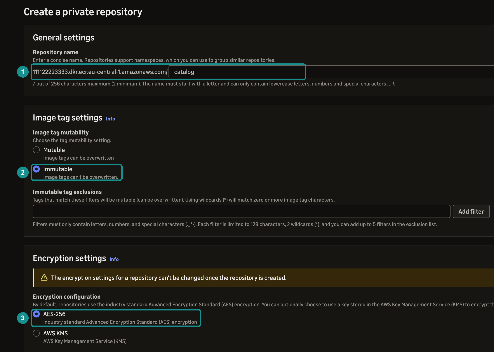

_12.1.1. Создание репозитория catalog_

Заполните форму:

1. `Repository name`: `catalog` (_1_). Слева от поля консоль показывает адрес реестра вашего аккаунта: в нём номер аккаунта и регион. Полное имя образа будет таким: адрес реестра, косая черта, имя репозитория и тег.
2. `Image tag mutability`: `Immutable` (_2_). Тег нельзя будет переклеить на другой образ.
3. `Encryption configuration` оставьте `AES-256` (_3_). Образы шифруются всегда, а этот способ шифрования не требует настройки ключей. Изменить его после создания репозитория нельзя.

Блок `Image scanning settings` не трогайте: он помечен как устаревший (deprecated), а сканирование образов теперь настраивается для всего реестра в `Features & Settings`.

Нажмите `Create`. Если консоль предложит оценить работу сервиса, закройте окно кнопкой `Cancel`.

### Шаг 5. Посмотрите команды для загрузки

Отметьте репозиторий `catalog` в списке и нажмите `View push commands`. Консоль покажет готовые команды для вашего аккаунта.

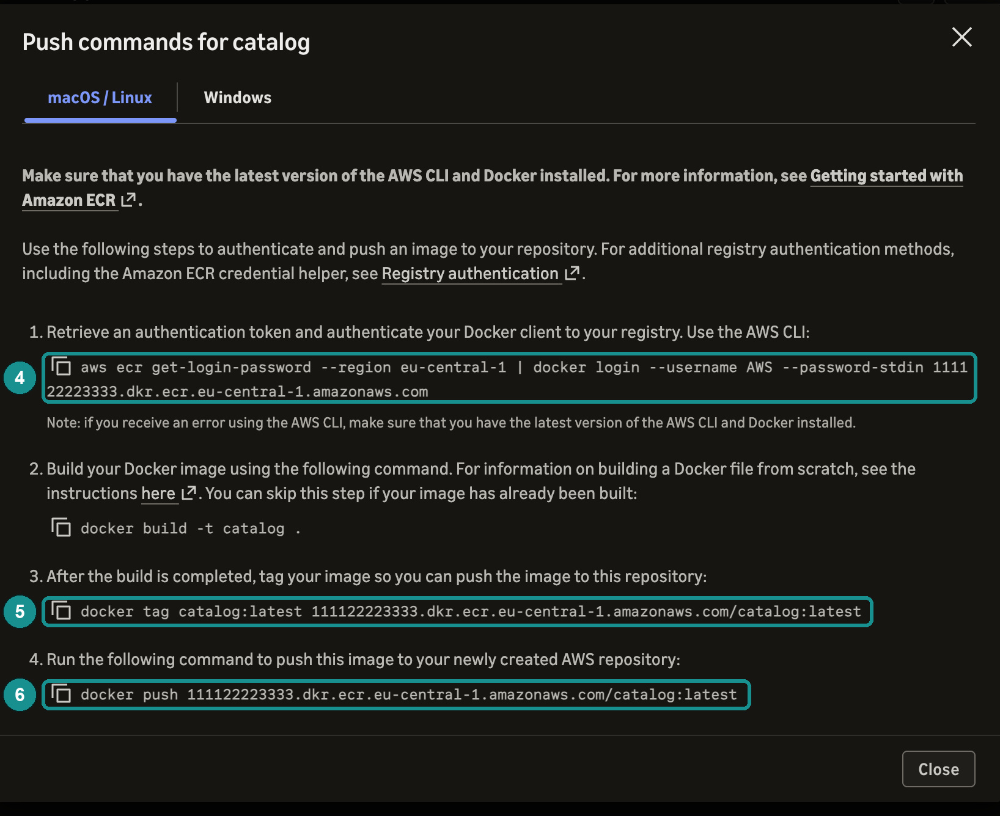

_12.1.2. Команды для загрузки образа_

На вкладке `macOS / Linux` четыре шага. Все, кроме сборки, совпадают с разделом "Загрузка образа в ECR" главы:

- Вход в реестр (_4_). AWS CLI получает временный токен и передаёт его `docker login`. Для Windows такая же команда есть на соседней вкладке.
- Сборка. Образ уже собран в шаге 1, этот шаг пропускаем.
- Второе имя образа с адресом реестра (_5_).
- Отправка образа в реестр (_6_).

Консоль подставляет тег `latest`. Репозиторий с неизменяемыми тегами примет `latest` только один раз, а в продакшене этот тег не используют. Поэтому в командах ниже вместо `latest` везде стоит `1.4.0`.

Нажмите `Close`.

### Шаг 6. Загрузите образ

Выполните три команды в терминале на ноутбуке. Вместо `111122223333` подставьте номер своего аккаунта: его возвращает `aws sts get-caller-identity` в поле `Account`, он же есть в командах консоли. Проверьте номер во всех трёх командах: при ошибке в любой из них `docker push` завершится ошибкой.

```bash
aws ecr get-login-password --region eu-central-1 | docker login --username AWS --password-stdin 111122223333.dkr.ecr.eu-central-1.amazonaws.com
docker tag catalog:1.4.0 111122223333.dkr.ecr.eu-central-1.amazonaws.com/catalog:1.4.0
docker push 111122223333.dkr.ecr.eu-central-1.amazonaws.com/catalog:1.4.0
```

Первая команда должна закончиться строкой `Login Succeeded`. Вывод `docker push`:

```text
The push refers to repository [111122223333.dkr.ecr.eu-central-1.amazonaws.com/catalog]
704c1ba6b2b4: Pushed
8041da22c797: Pushed
375c95dccd03: Pushed
dbe25bb79100: Pushed
d9f34054bd28: Pushed
b4e5ae444e1d: Pushed
cb540e45c2e5: Pushed
75f1d9657d88: Pushed
1.4.0: digest: sha256:9be5bc6027488c3c692c9bbe85575667b16babe24e5bb1080a23fcb8fe6cf467 size: 1988
```

Каждая строка с `Pushed` - один слой образа: четыре слоя базового образа `node:24-alpine`, папка `/app`, файлы `package*.json`, зависимости и код. В репозитории ещё нет ни одного слоя, поэтому отправлены все. В последней строке ECR вернул дайджест образа - его неизменный идентификатор. Хэши слоёв и дайджест у вас будут другими.

> [!TIP]
> Если `docker push` завершился ошибкой `no basic auth credentials` или `authorization token has expired`, выполните первую команду ещё раз. Токен ECR действует 12 часов.

### Шаг 7. Попробуйте переписать тег

Проверим, что неизменяемые теги действительно защищают версию. Допишите в конец `server.js` строку-комментарий `// fix`, пересоберите образ под тем же тегом и отправьте его:

```bash
docker build --platform linux/amd64 -t catalog:1.4.0 .
docker tag catalog:1.4.0 111122223333.dkr.ecr.eu-central-1.amazonaws.com/catalog:1.4.0
docker push 111122223333.dkr.ecr.eu-central-1.amazonaws.com/catalog:1.4.0
```

```text
17fe81b19a52: Pushed
8041da22c797: Layer already exists
...
tag invalid: The image tag '1.4.0' already exists in the 'catalog' repository and cannot be overwritten because the tag is immutable.
```

Изменился только код, поэтому новым оказался один слой, и Docker отправил только его. Остальные слои уже были в реестре (`Layer already exists`). Но тег `1.4.0` ECR не перенёс, и под ним остался прежний образ[^4].

Удалите строку `// fix` из `server.js`: в части 6 из этого файла будет собрана версия `1.5.0`.

### Шаг 8. Найдите образ в репозитории

Откройте репозиторий `catalog`. На вкладке `Images` один образ.

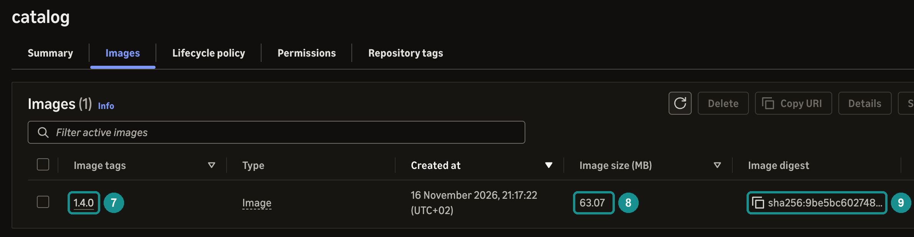

_12.1.3. Образ 1.4.0 в репозитории_

- Тег `1.4.0` (_7_). Неудачная загрузка из шага 7 новый образ не создала.
- Размер `63.07` МБ (_8_). Это сжатый размер, как `CONTENT SIZE` в шаге 1. ECR берёт плату за хранение именно этого объёма.
- Дайджест (_9_) - тот же `sha256:9be5bc...`, что вернула команда `docker push`.

Столбец `Last pulled at` пока пуст: образ ещё никто не скачивал.

## Часть 3. Кластер и определение задачи

### Шаг 9. Создайте кластер

Откройте сервис `Elastic Container Service`, раздел `Clusters`, и нажмите `Create cluster`.

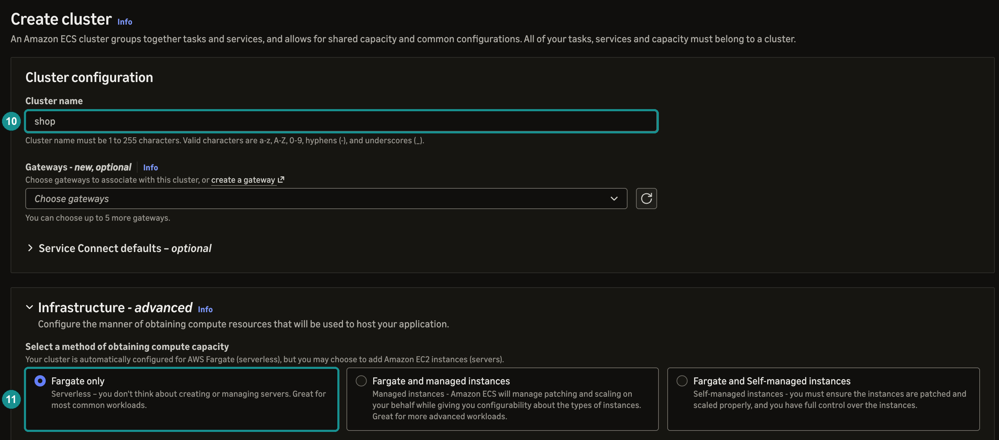

_12.1.4. Создание кластера shop_

1. `Cluster name`: `shop` (_10_). Консоль подставляет случайное имя, замените его.
2. В блоке `Infrastructure` оставьте `Fargate only` (_11_). Серверы для задач будет выбирать и обслуживать AWS. Два других варианта добавляют к кластеру экземпляры EC2: их обслуживает либо ECS (`managed instances`), либо вы сами.

Нажмите `Create`. Создание займёт до минуты: консоль готовит кластер через CloudFormation. Кластер на Fargate ничего не стоит, пока в нём не запущены задачи.

### Шаг 10. Задайте параметры задачи

Откройте `Task definitions` и нажмите `Create new task definition`.

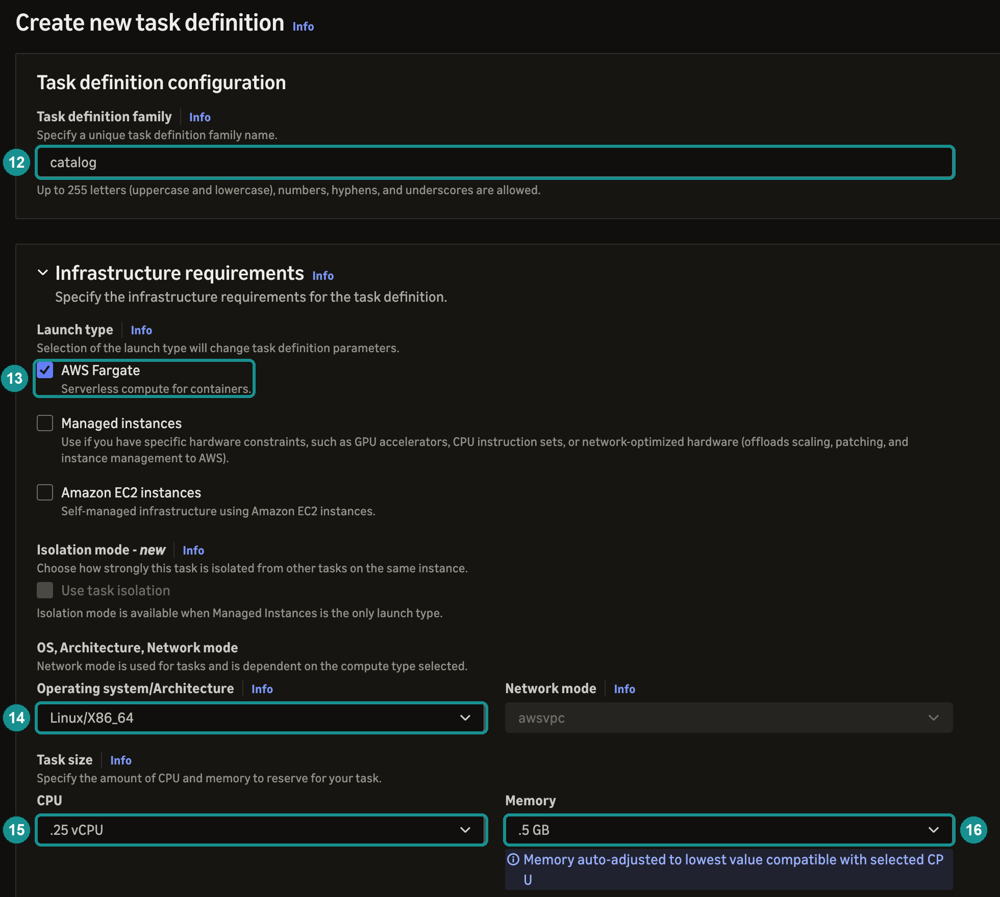

_12.1.5. Семейство, тип запуска и размер задачи_

1. `Task definition family`: `catalog` (_12_). Ревизии будут нумероваться внутри этого семейства: `catalog:1`, `catalog:2`.
2. `Launch type`: оставьте только `AWS Fargate` (_13_).
3. `Operating system/Architecture`: `Linux/X86_64` (_14_). Именно под эту архитектуру собран образ в шаге 1. Режим сети `awsvpc` выбран автоматически: на Fargate каждая задача получает свой сетевой интерфейс.
4. `CPU`: `.25 vCPU` (_15_). Это 256 единиц из главы.
5. `Memory`: `.5 GB` (_16_). Консоль сама подставила наименьший объём памяти, допустимый для 0,25 vCPU. Fargate принимает только определённые сочетания процессора и памяти.

Ниже, в блоке `Task roles`, две роли из раздела "Определение задачи и роли".

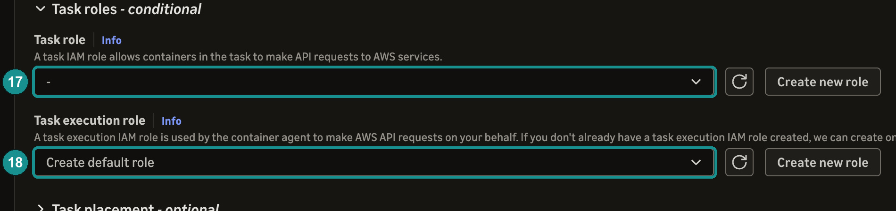

_12.1.6. Роли задачи_

- `Task role` (_17_) оставьте пустой. Код сервиса каталога не обращается к другим сервисам AWS, и прав ему не нужно.
- `Task execution role`: `Create default role` (_18_). Консоль создаст роль `ecsTaskExecutionRole` с правами скачивать образы из ECR и писать журналы в CloudWatch Logs. Если роль уже есть в аккаунте, выберите её в списке.

### Шаг 11. Опишите контейнер

Прокрутите форму до блока `Container - 1`.

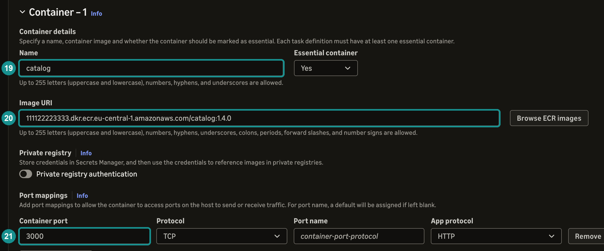

_12.1.7. Контейнер catalog_

1. `Name`: `catalog` (_19_).
2. `Image URI`: полный адрес образа с тегом (_20_): `111122223333.dkr.ecr.eu-central-1.amazonaws.com/catalog:1.4.0` с номером вашего аккаунта. Можно нажать `Browse ECR images` и выбрать образ в списке.
3. `Container port`: `3000` (_21_). На этом порту слушает сервер внутри контейнера.

Переключатель `Private registry authentication` не нужен: он нужен для реестров вне AWS, например Docker Hub. В ECR ECS входит по роли выполнения задачи.

### Шаг 12. Добавьте переменные и журналы

Ниже, в блоке `Environment variables`, нажмите `Add environment variable` два раза и заполните строки.

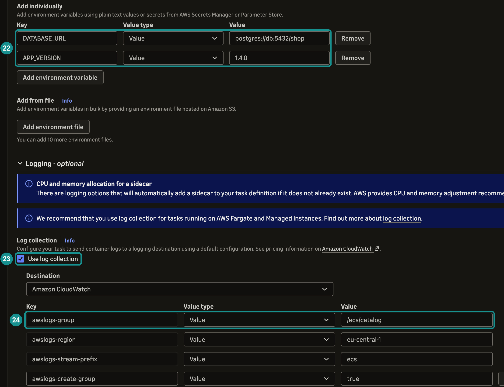

_12.1.8. Переменные окружения и журналы_

Переменные (_22_):

| Key | Value type | Value |
| --- | --- | --- |
| `DATABASE_URL` | `Value` | `postgres://db:5432/shop` |
| `APP_VERSION` | `Value` | `1.4.0` |

Без `DATABASE_URL` сервис сразу после запуска завершится с сообщением `DATABASE_URL is not set`, и задача остановится. После трёх неудачных запусков circuit breaker из шага 15 признает развёртывание неудачным.

> [!IMPORTANT]
> Пароль от настоящей базы данных в обычную переменную (`Value`) не записывают: её значение видит каждый, кто может прочитать определение задачи. Для секретов в списке `Value type` есть `ValueFrom`: значение берётся из Secrets Manager или Parameter Store, как в файле `task-definition.json` из папки `code` главы.

Флажок `Use log collection` (_23_) оставьте включённым. Консоль настроила драйвер `awslogs`: всё, что контейнер пишет в stdout, попадёт в группу журналов `/ecs/catalog` (_24_). С параметром `awslogs-create-group` со значением `true` группу не нужно создавать заранее: она появится автоматически.

Остальные параметры оставьте по умолчанию и нажмите `Create` внизу страницы.

### Шаг 13. Посмотрите определение задачи в JSON

Консоль откроет ревизию `catalog:1`. Перейдите на вкладку `JSON`.

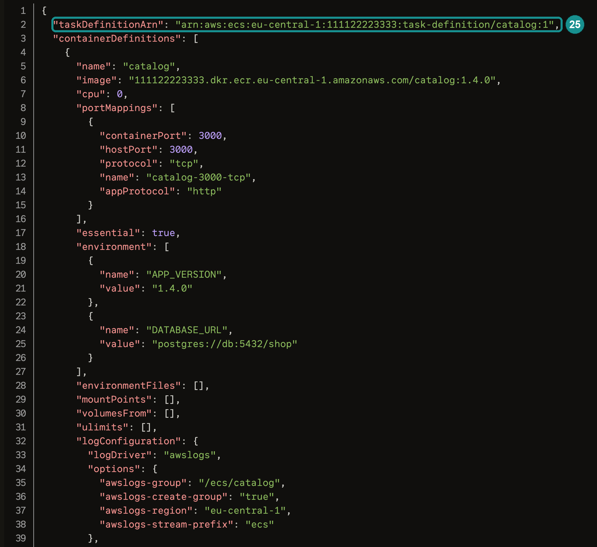

_12.1.9. Определение задачи в формате JSON_

Всё, что вы ввели в форму, консоль сохранила в том же формате JSON, что разобран в главе: `image`, `portMappings`, `environment`, `logConfiguration`. В ARN ревизии (_25_) после имени семейства стоит номер ревизии `:1`. Изменить эту ревизию нельзя: любая правка создаст ревизию 2.

## Часть 4. Сервис

### Шаг 14. Выберите определение задачи

Откройте кластер `shop`, на вкладке `Services` нажмите `Create`.

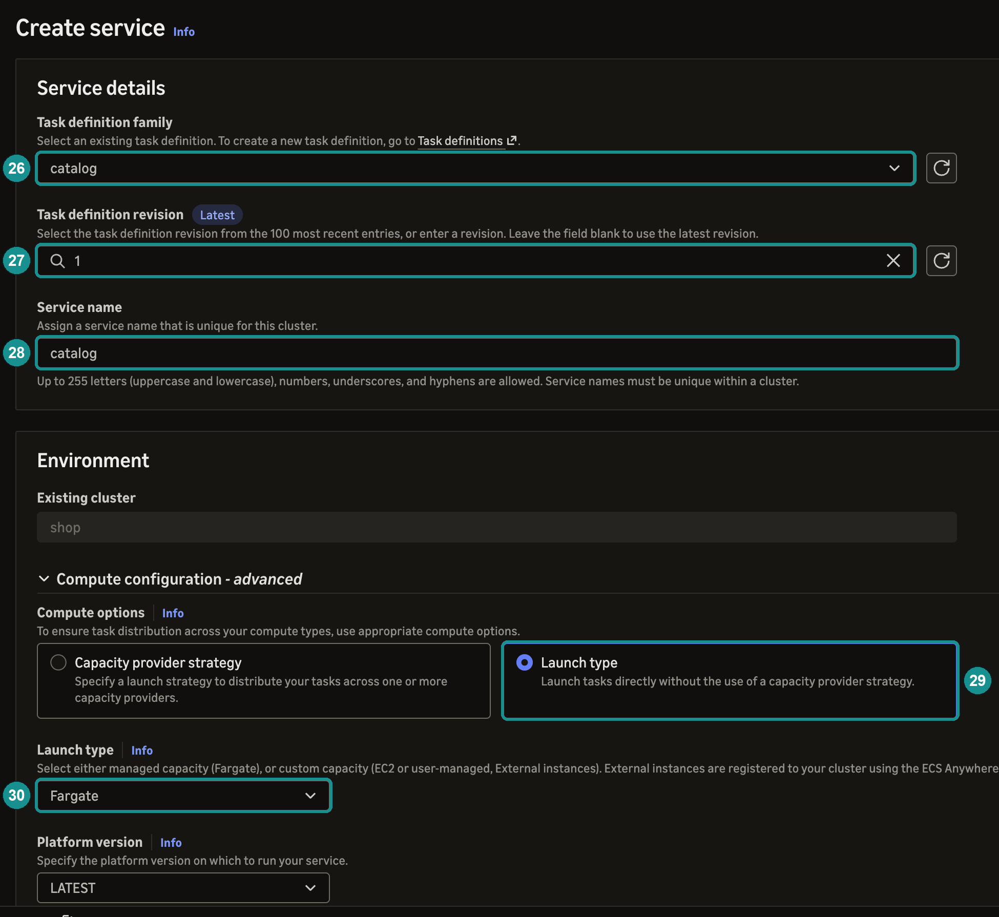

_12.1.10. Определение задачи и тип запуска сервиса_

1. `Task definition family`: `catalog` (_26_).
2. `Task definition revision`: `1` (_27_). Если оставить поле пустым, сервис возьмёт последнюю ревизию.
3. `Service name`: `catalog` (_28_).
4. В блоке `Compute configuration` выберите `Launch type` (_29_) и в списке ниже - `Fargate` (_30_). Вариант `Capacity provider strategy` распределяет задачи между несколькими источниками мощностей, например между Fargate и экземплярами EC2. Для одного Fargate он не нужен.

### Шаг 15. Задайте желаемое состояние

Прокрутите форму до блока `Deployment configuration`.

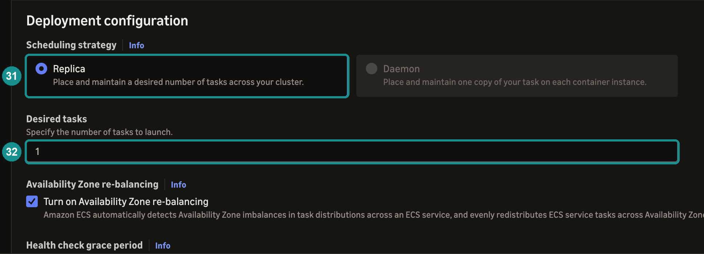

_12.1.11. Желаемое число задач_

Стратегия `Replica` (_31_) поддерживает заданное число одинаковых задач. В поле `Desired tasks` (_32_) оставьте `1`. Это и есть желаемое состояние сервиса: одна работающая задача по ревизии `catalog:1`. Дальше ECS будет сам сравнивать текущее состояние с желаемым.

Раскройте `Deployment options`.

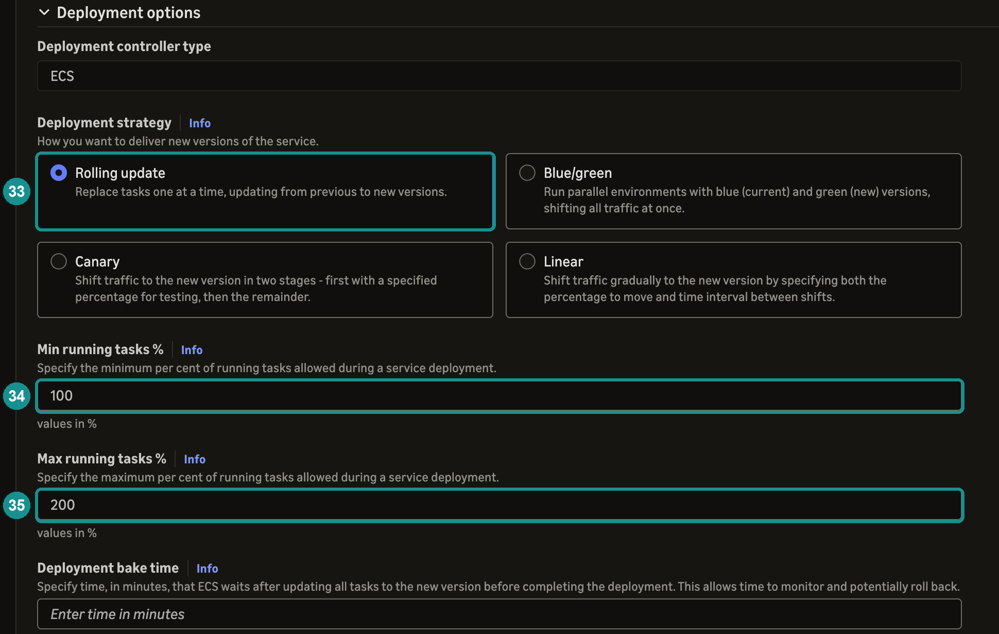

_12.1.12. Параметры скользящего обновления_

Стратегия `Rolling update` (_33_) - скользящее обновление из раздела "Конвейер для контейнерного приложения": ECS заменяет старые задачи новыми постепенно. Как именно, задают два числа в процентах от желаемого числа задач[^5]:

- `Min running tasks %`: `100` (_34_). Во время обновления число работающих задач не опускается ниже одной. Значит, старую задачу нельзя остановить, пока не запустится новая.
- `Max running tasks %`: `200` (_35_). Во время обновления может работать до двух задач одновременно, старая и новая.

Вместе эти значения дают обновление без остановки сервиса. Вы увидите его в части 6.

Раскройте `Deployment failure detection`.

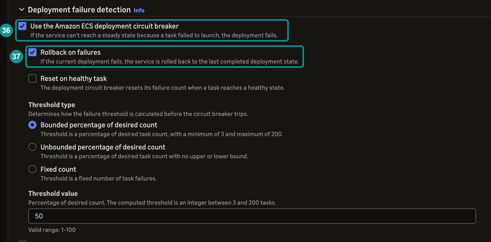

_12.1.13. Защита от неудачного развёртывания_

Флажки `Use the Amazon ECS deployment circuit breaker` (_36_) и `Rollback on failures` (_37_) уже отмечены. Если новые задачи раз за разом не запускаются, ECS признаёт развёртывание неудачным и возвращает сервис к последней работавшей ревизии[^6]. При одной желаемой задаче порог - 3 неудачных запуска: консоль пишет, что порог не бывает меньше трёх.

### Шаг 16. Настройте сеть

Раскройте блок `Networking`.

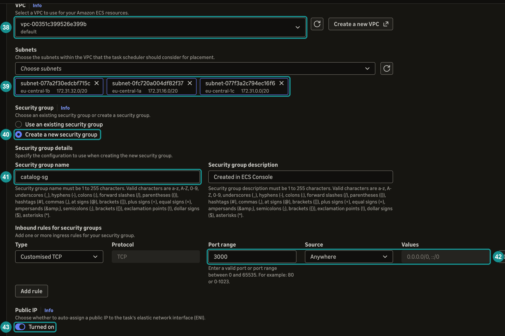

_12.1.14. Сеть и группа безопасности сервиса_

1. `VPC`: оставьте VPC по умолчанию (_38_). Если списки VPC и подсетей пусты, VPC по умолчанию в аккаунте удалён. Создайте его заново: `VPC` → `Your VPCs` → `Actions` → `Create default VPC`.
2. `Subnets`: оставьте все три подсети (_39_), по одной в каждой зоне доступности. ECS сам выберет подсеть для задачи.
3. `Security group`: выберите `Create a new security group` (_40_).
4. `Security group name`: `catalog-sg` (_41_).
5. В правиле входящего трафика (_42_): `Type` - `Customised TCP`, `Port range` - `3000`, `Source` - `Anywhere`. Задача будет принимать запросы на порт `3000` из любого адреса.
6. `Public IP` оставьте включённым (_43_).

Публичный IP-адрес здесь нужен по двум причинам:

- _Скачать образ_. Чтобы скачать образ из ECR, задаче нужен маршрут в интернет. В публичной подсети без NAT такой маршрут есть только у задачи с публичным адресом[^7].
- _Обратиться к сервису_. По этому адресу вы сами отправите запрос сервису.

Открытый всему интернету порт приложения подходит только для учебного занятия. В рабочем проекте задачи стоят в приватных подсетях, а запросы к ним идут через балансировщик нагрузки.

Блоки `Service Connect`, `Service discovery`, `Load balancing` и остальные оставьте выключенными. Нажмите `Create` внизу страницы.

### Шаг 17. Дождитесь запуска задачи

Консоль вернётся на страницу кластера, и сервис `catalog` появится в списке со статусом развёртывания `In progress`. Через одну-две минуты откройте сервис и перейдите на вкладку `Tasks`.

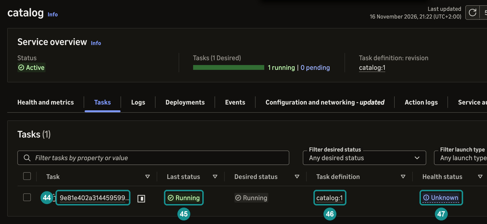

_12.1.15. Задача сервиса запущена_

- Идентификатор задачи (_44_). Его выдал ECS, по нему задачу видно в событиях и журналах.
- `Last status`: `Running` (_45_). Перед этим задача прошла состояния `Provisioning` и `Pending`: Fargate выделял ресурсы и скачивал образ из ECR.
- `Task definition`: `catalog:1` (_46_). По этому столбцу видно, какая ревизия работает в задаче.
- `Health status`: `Unknown` (_47_). Проверка работоспособности в определении задачи не задана, поэтому ECS не знает, здоров ли контейнер[^8]. Задачу он считает работающей, пока работает её процесс.

> [!TIP]
> Если задача не дошла до `Running` и в списке появляются всё новые остановленные задачи, отфильтруйте список по `Stopped`, откройте любую из них и прочитайте `Stopped reason`. Затем загляните на вкладку `Logs`. Частые причины две: образ собран без `--platform linux/amd64` или в определении задачи нет переменной `DATABASE_URL`. Тег `1.4.0` занят, поэтому загрузите исправленный образ под новым тегом, например `1.4.1`, и создайте с ним новую ревизию, как в шаге 23.

### Шаг 18. Отправьте запрос сервису

Нажмите на идентификатор задачи. На вкладке `Configuration` прокрутите страницу до блока `Networking`.

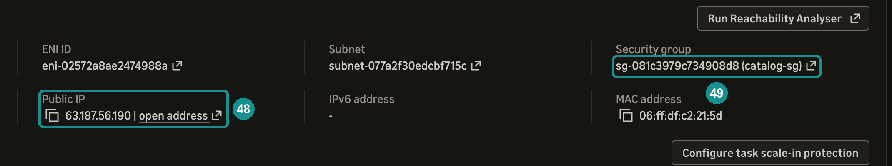

_12.1.16. Публичный IP-адрес задачи_

`Public IP` (_48_) - адрес, который Fargate выдал сетевому интерфейсу задачи. Рядом видна группа безопасности `catalog-sg` (_49_), созданная в шаге 16.

Откройте в браузере адрес `http://<Public IP>:3000/products/42`, например `http://63.187.56.190:3000/products/42`. Ответ тот же, что на ноутбуке в шаге 2:

```json
{"product":42,"version":"1.4.0"}
```

Это тот же образ, который вы собрали и проверили локально. Изменились только место запуска и источник переменных окружения: теперь их передаёт ECS из определения задачи.

### Шаг 19. Посмотрите журнал задачи

Откройте вкладку `Logs` задачи.

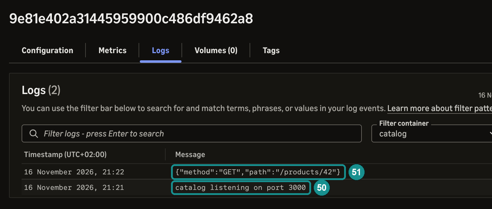

_12.1.17. Журнал задачи_

В журнале те же строки, что выводила команда `docker logs` в шаге 2: сообщение о запуске (_50_) и ваш запрос (_51_). Новые строки идут сверху. Вкладка показывает записи из группы `/ecs/catalog` в CloudWatch Logs, и кнопка `View in CloudWatch` открывает эту группу.

## Часть 5. Желаемое состояние

Сервис обещает, что работающих задач будет столько, сколько указано в `Desired tasks`. Проверим это: остановим задачу вручную, как будто она упала.

### Шаг 20. Остановите задачу

На странице задачи нажмите `Stop`.

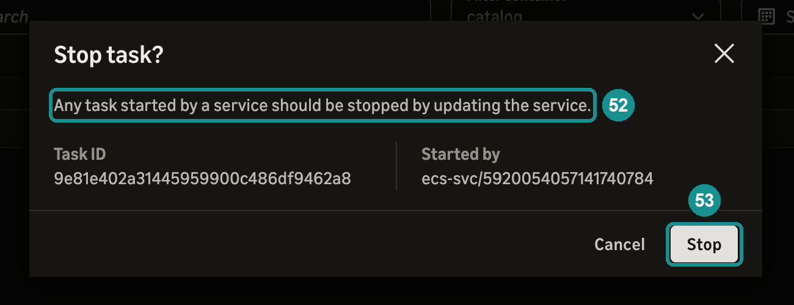

_12.1.18. Остановка задачи вручную_

Консоль предупреждает (_52_): задачу, которую запустил сервис, правильнее останавливать через обновление сервиса. Если остановить её напрямую, сервис запустит новую. Именно это мы и хотим увидеть. Нажмите `Stop` (_53_).

### Шаг 21. Найдите замену

Через полминуты откройте сервис `catalog`, вкладку `Events`.

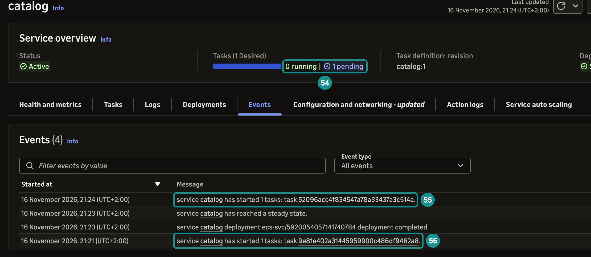

_12.1.19. События сервиса_

В блоке `Service overview` сейчас `0 running | 1 pending` (_54_): старая задача остановлена, а новая уже запускается. В событиях новые записи сверху:

- после остановки задачи сервис запустил новую с другим идентификатором (_55_);
- раньше сервис достиг устойчивого состояния (`steady state`) - текущее состояние совпало с желаемым;
- самая старая запись - первая задача, запущенная при создании сервиса (_56_).

Никто не нажимал кнопку запуска: ECS сам заметил, что работающих задач стало 0 при желаемой 1, и устранил разницу. Так оркестратор поддерживает желаемое состояние, как описано в разделе "Зачем нужен оркестратор".

Откройте вкладку `Tasks`. В фильтре `Filter desired status` выбрано `Any desired status`, поэтому видны и остановленные задачи.

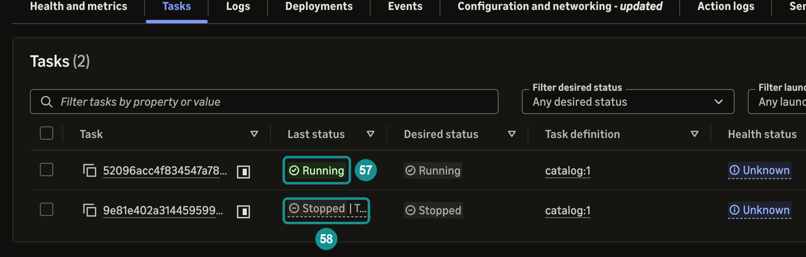

_12.1.20. Остановленная задача и её замена_

Новая задача работает (_57_), а старая остановлена (_58_). У новой задачи другой публичный IP-адрес: найдите его на странице задачи так же, как в шаге 18. Старый адрес больше не отвечает. Адрес задачи меняется при каждой замене, поэтому клиенты обращаются к сервису через балансировщик нагрузки.

## Часть 6. Новая версия

### Шаг 22. Соберите и загрузите версию 1.5.0

Добавим в ответ сервиса цену товара. В `server.js` найдите строку с ответом:

```javascript
res.end(JSON.stringify({ product: 42, version: process.env.APP_VERSION }));
```

и замените её на такую:

```javascript
res.end(JSON.stringify({ product: 42, price: 1250, version: process.env.APP_VERSION }));
```

Соберите образ с новым тегом и загрузите его в ECR:

```bash
docker build --platform linux/amd64 -t catalog:1.5.0 .
docker tag catalog:1.5.0 111122223333.dkr.ecr.eu-central-1.amazonaws.com/catalog:1.5.0
docker push 111122223333.dkr.ecr.eu-central-1.amazonaws.com/catalog:1.5.0
```

```text
The push refers to repository [111122223333.dkr.ecr.eu-central-1.amazonaws.com/catalog]
ea78b0d2b803: Pushed
8041da22c797: Layer already exists
375c95dccd03: Layer already exists
dbe25bb79100: Layer already exists
d9f34054bd28: Layer already exists
b4e5ae444e1d: Layer already exists
cb540e45c2e5: Layer already exists
75f1d9657d88: Layer already exists
1.5.0: digest: sha256:accfceb87261229f2d3d8dbbd026fef36949dd1315e2359eec75a011e183a144 size: 1988
```

Отправлен один слой - слой с кодом. Слои с Alpine, Node.js и зависимостями у версий `1.4.0` и `1.5.0` общие. Если токен ECR истёк, сначала снова выполните вход из шага 6.

Обновите страницу репозитория `catalog`.

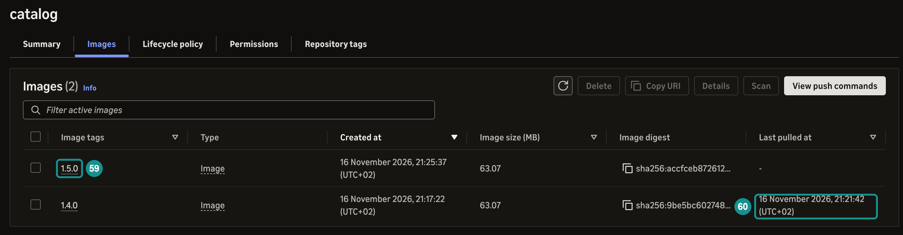

_12.1.21. Две версии образа в репозитории_

Появился образ `1.5.0` (_59_). У образа `1.4.0` теперь заполнен столбец `Last pulled at` (_60_): его скачивал Fargate, когда запускал задачи.

### Шаг 23. Создайте ревизию 2

Откройте `Task definitions` → `catalog` → ревизию `1` и выберите `Create new revision` → `Create new revision`. Откроется та же форма, что в шагах 10-12, уже заполненная значениями ревизии 1. Измените два поля:

1. В `Image URI` замените тег `1.4.0` на `1.5.0`.
2. В переменной `APP_VERSION` замените значение `1.4.0` на `1.5.0`.

Нажмите `Create`. Консоль откроет ревизию `catalog:2`. На вкладке `JSON` в поле `Revision to compare` выберите `1` и нажмите `Compare`.

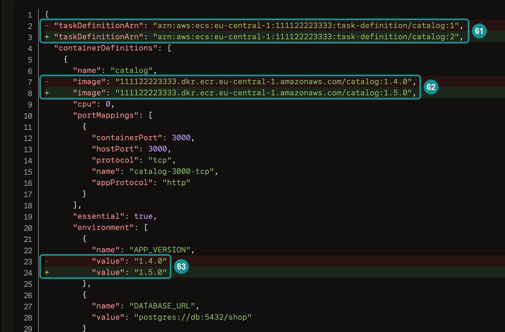

_12.1.22. Сравнение ревизий 1 и 2_

Консоль подсветила все отличия: номер ревизии в ARN (_61_), тег образа (_62_) и значение `APP_VERSION` (_63_). Ревизия 1 осталась без изменений. Чтобы откатиться, сервису достаточно снова указать её.

### Шаг 24. Обновите сервис

Откройте сервис `catalog` и нажмите `Update service`.

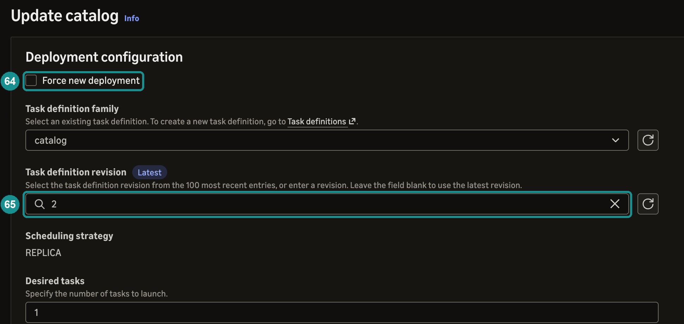

_12.1.23. Обновление сервиса_

Флажок `Force new deployment` (_64_) оставьте пустым: ревизия меняется, и новые задачи запустятся и без него. Флажок нужен, когда ревизия та же, а задачи надо заменить. Например, если в определении задачи стоит изменяемый тег `latest`, а под ним в реестре уже новый образ.

В поле `Task definition revision` (_65_) выберите `2`. Остальные параметры оставьте как есть и нажмите `Update` внизу страницы.

### Шаг 25. Посмотрите, как идёт обновление

Консоль откроет вкладку `Deployments`. Обновляйте страницу кнопкой со стрелкой.

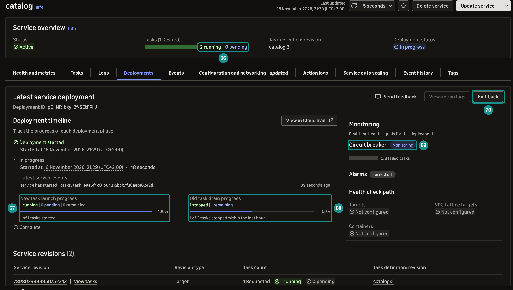

_12.1.24. Развёртывание ревизии 2_

Примерно через минуту после начала:

- в `Service overview` работают 2 задачи (_66_), хотя желаемая одна. Это `Max running tasks %` = 200 из шага 15 в действии;
- `New task launch progress` (_67_): новая задача по ревизии 2 запущена;
- `Old task drain progress` (_68_): старая задача ещё работает и будет остановлена следующей. Счётчик `1 stopped` учитывает задачу, которую вы остановили вручную в шаге 20;
- `Circuit breaker` в состоянии `Monitoring` (_69_): ECS следит, запускаются ли новые задачи;
- кнопка `Roll-back` (_70_) вернёт сервис к ревизии 1 вручную, если с новой версией что-то не так.

Откройте вкладку `Tasks`.

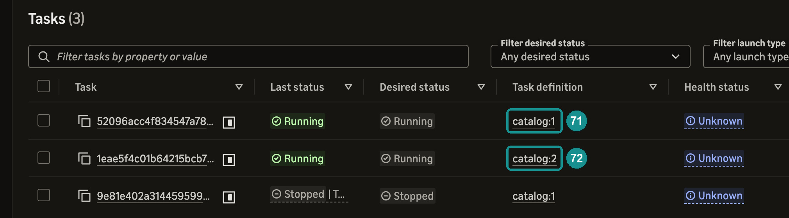

_12.1.25. Задачи двух ревизий во время обновления_

Сейчас работают две задачи: старая по ревизии `catalog:1` (_71_) и новая по `catalog:2` (_72_). Пока новая запускалась, старая продолжала отвечать на запросы. Найдите публичный IP новой задачи и откройте в браузере `/products/42`:

```json
{"product":42,"price":1250,"version":"1.5.0"}
```

В ответе есть поле `price` из нового кода и версия `1.5.0` из новой ревизии.

### Шаг 26. Дождитесь завершения

Через две-три минуты вернитесь на вкладку `Deployments`.

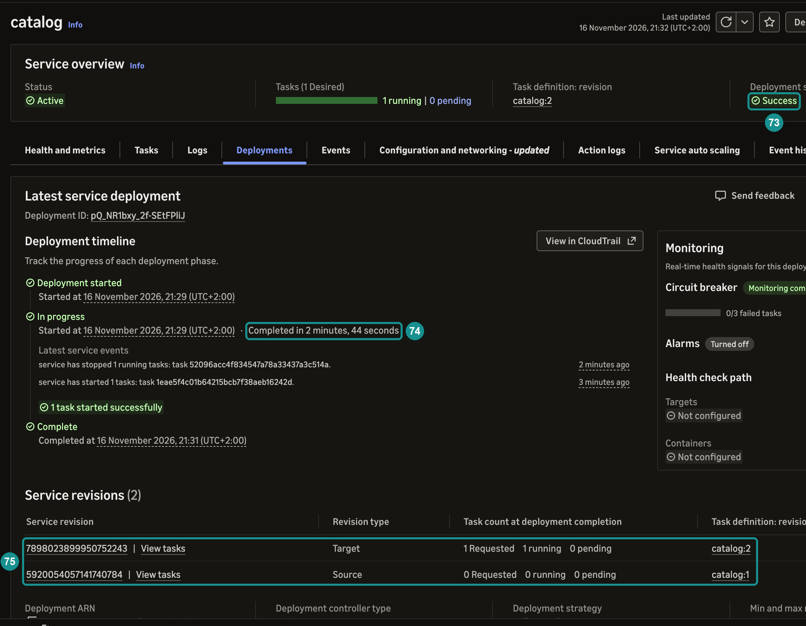

_12.1.26. Развёртывание завершено_

`Deployment status` стал `Success` (_73_). Развёртывание заняло около трёх минут (_74_): ECS запустил новую задачу, остановил старую и подождал, пока сервис придёт в устойчивое состояние. В таблице `Service revisions` (_75_) видно, что новая конфигурация сервиса (`Target`, определение задачи `catalog:2`) работает в одной задаче, а у прежней (`Source`, `catalog:1`) задач не осталось.

Старый адрес задачи по ревизии 1 больше не отвечает. Сервис обновился без остановки, но адрес, по которому к нему обращаться, сменился. Эту проблему решает балансировщик нагрузки перед сервисом: у него постоянный адрес, а задачи он находит сам.

## Часть 7. Удаление ресурсов

Если сразу переходите к Hands-on 12.2, удалите только сервис (пункт 1). Кластер `shop`, определение задачи `catalog`, репозиторий ECR с образами и роль `ecsTaskExecutionRole` оставьте: они понадобятся дальше. Без работающих задач они почти ничего не стоят: платить придётся только за хранение образов в ECR сверх бесплатного объёма.

Если заканчиваете работу, удалите ресурсы в таком порядке:

1. Сервис. Откройте сервис `catalog` и нажмите `Delete service`. Сервис с работающими задачами удалить нельзя, поэтому отметьте `Force delete`: ECS сам уменьшит число задач до нуля. Введите `delete` и нажмите `Delete`. Группа безопасности `catalog-sg` удалится вместе с сервисом: консоль создала её вместе с ним через CloudFormation.
2. Кластер. Когда задачи остановятся, откройте кластер `shop` и нажмите `Delete cluster`.
3. Определение задачи. В `Task definitions` → `catalog` отметьте обе ревизии и выберите `Actions` → `Deregister`. Затем там же выберите `Actions` → `Delete`.
4. Репозиторий. В ECR отметьте репозиторий `catalog` и нажмите `Delete`. Репозиторий удаляется вместе со всеми образами.
5. Журналы. В `CloudWatch` → `Logs` → `Log Management` удалите группу `/ecs/catalog`.
6. Образы на ноутбуке. Команда `docker images` покажет четыре имени: `catalog:1.4.0`, `catalog:1.5.0` и те же образы с адресом реестра. Удалите их все командой `docker rmi` с этими именами через пробел.

Роль `ecsTaskExecutionRole` можно оставить: консоль подставит её в следующее определение задачи. Сама по себе роль ничего не стоит.

## Вопросы для самопроверки

1. Зачем при сборке образа на Mac с процессором Apple Silicon указывают `--platform linux/amd64`? Как решить ту же проблему в определении задачи?
2. Что произошло при повторном `docker push` с тегом `1.4.0` и почему Docker всё же отправил один слой?
3. Почему при загрузке версии `1.5.0` в реестр ушёл только один слой?
4. Чем роль задачи отличается от роли выполнения задачи и какая из них понадобилась в этом занятии?
5. Зачем задаче Fargate в публичной подсети публичный IP-адрес, даже если к ней никто не обращается из интернета?
6. Что сделал сервис, когда вы вручную остановили задачу, и как это связано с желаемым состоянием?
7. Как значения `Min running tasks %` = 100 и `Max running tasks %` = 200 позволяют обновить сервис без остановки?
8. Почему после замены задачи сервис перестал отвечать по старому адресу и что решает эту проблему?

[^1]: Amazon Web Services (2026). _AWS Fargate Pricing_. Available at: https://aws.amazon.com/fargate/pricing/

[^2]: Amazon Web Services (2026). _Amazon VPC Pricing_. Available at: https://aws.amazon.com/vpc/pricing/

[^3]: Amazon Web Services (2026). _Amazon ECS task definition parameters for Fargate_. Amazon ECS Developer Guide. Available at: https://docs.aws.amazon.com/AmazonECS/latest/developerguide/task_definition_parameters.html

[^4]: Amazon Web Services (2026). _Preventing image tags from being overwritten in Amazon ECR_. Amazon ECR User Guide. Available at: https://docs.aws.amazon.com/AmazonECR/latest/userguide/image-tag-mutability.html

[^5]: Amazon Web Services (2026). _Deploy Amazon ECS services by replacing tasks_. Amazon ECS Developer Guide. Available at: https://docs.aws.amazon.com/AmazonECS/latest/developerguide/deployment-type-ecs.html

[^6]: Amazon Web Services (2026). _How the Amazon ECS deployment circuit breaker detects failures_. Amazon ECS Developer Guide. Available at: https://docs.aws.amazon.com/AmazonECS/latest/developerguide/deployment-circuit-breaker.html

[^7]: Amazon Web Services (2026). _Amazon ECS task networking options for Fargate_. Amazon ECS Developer Guide. Available at: https://docs.aws.amazon.com/AmazonECS/latest/developerguide/fargate-task-networking.html

[^8]: Amazon Web Services (2026). _Determine Amazon ECS task health using container health checks_. Amazon ECS Developer Guide. Available at: https://docs.aws.amazon.com/AmazonECS/latest/developerguide/healthcheck.html
