# Hands-on 12.2. Сервис за балансировщиком и конвейер CI/CD в GitHub Actions

В конце Hands-on 12.1 у сервиса каталога осталась одна проблема: после каждой замены задачи меняется её адрес. В этом занятии вы поставите перед сервисом Application Load Balancer: у балансировщика постоянный адрес, а задачи он находит сам. Сервис будет держать две задачи в разных зонах доступности.

Затем вы соберёте конвейер из раздела "Конвейер для контейнерного приложения" главы. Код сервиса вы положите в свой репозиторий на GitHub. После каждого `git push` в ветку `main` GitHub Actions запустит тесты, соберёт образ, загрузит его в ECR и обновит сервис ECS. Ключей доступа AWS в GitHub при этом не будет: конвейер получит временные учётные данные через роль IAM. В конце вы отправите сломанную версию и увидите, что тест не пропустит её в продакшен.

## Что получится в конце

- Две группы безопасности: `alb-sg` принимает HTTP-запросы из интернета, а `catalog-sg` пускает к задачам на порт `3000` только балансировщик.
- Целевая группа `catalog-tg` с типом цели `IP` и балансировщик `catalog-alb`.
- Сервис `catalog` с двумя задачами, которые балансировщик проверяет по пути `/health`.
- Поставщик удостоверений GitHub в IAM, политика `github-deploy-catalog` и роль `github-actions-catalog`.
- Ваш приватный репозиторий `catalog-service` на GitHub с тестом и конвейером `deploy`.
- Ревизия `catalog:3` и образ с тегом из хэша коммита, которые создал конвейер.

## Перед началом

- Выполнен Hands-on 12.1, и в части 7 удалён только сервис. Остались репозиторий ECR `catalog` с образами `1.4.0` и `1.5.0`, определение задачи `catalog` с ревизиями 1 и 2, кластер `shop` и роль `ecsTaskExecutionRole`.
- На ноутбуке есть папка `catalog` из Hands-on 12.1, в которой `server.js` уже возвращает цену товара (шаг 22 Hands-on 12.1).
- Есть аккаунт на GitHub, а на ноутбуке установлен Git. Команда `git --version` выводит версию.
- В консоли AWS выбран регион `Europe (Frankfurt)`.
- На занятие понадобится около двух часов.

> [!WARNING]
> Пока ресурсы занятия существуют, плата идёт, даже если запросов нет[^1][^2]:
>
> - балансировщик - 0,027 USD в час, плюс 0,008 USD за каждую использованную единицу мощности LCU в час;
> - пять публичных IPv4-адресов (по одному на узел балансировщика в каждой из трёх зон и по одному на задачу) - `5 × 0,005 = 0,025` USD в час;
> - две задачи Fargate по 0,014 USD в час, как в Hands-on 12.1, - 0,028 USD в час.
>
> Всего около 0,08 USD в час. Не прерывайте занятие надолго, а в конце выполните часть 9.

## Часть 1. Группы безопасности

В Hands-on 12.1 порт `3000` задачи был открыт всему интернету. Теперь запросы к задачам будет пропускать только балансировщик, как веб-серверам в восьмой главе.

### Шаг 1. Создайте группу балансировщика

Если группа `alb-sg` осталась после восьмой главы, пропустите этот шаг.

Откройте `EC2` → `Security Groups` → `Create security group` и укажите:

- `Security group name`: `alb-sg`,
- `Description`: `HTTP from the internet`,
- `VPC`: VPC по умолчанию,
- входящее правило: `HTTP`, источник `Anywhere-IPv4` (`0.0.0.0/0`).

Нажмите `Create security group`.

### Шаг 2. Создайте группу задач

Снова нажмите `Create security group`. Если группа `catalog-sg` осталась после Hands-on 12.1, сначала удалите её: две группы с одним именем в VPC создать нельзя.

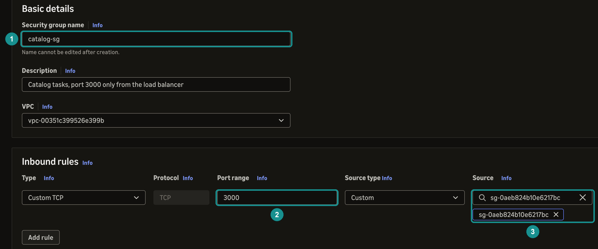

_12.2.1. Группа безопасности задач_

1. `Security group name`: `catalog-sg` (_1_). `Description`: `Catalog tasks, port 3000 only from the load balancer`.
2. Добавьте входящее правило: `Type` - `Custom TCP`, `Port range` - `3000` (_2_).
3. В `Source` найдите в списке и выберите группу `alb-sg` (_3_). В поле появится её идентификатор `sg-...`.

Нажмите `Create security group`. В каждой зоне у балансировщика работает свой узел со своим IP-адресом, и эти адреса могут меняться. Правило с группой `alb-sg` в источнике пропускает запросы от любого узла балансировщика, какой бы адрес у него ни был.

## Часть 2. Целевая группа

### Шаг 3. Выберите тип цели

Откройте `EC2` → `Target Groups` → `Create target group`.

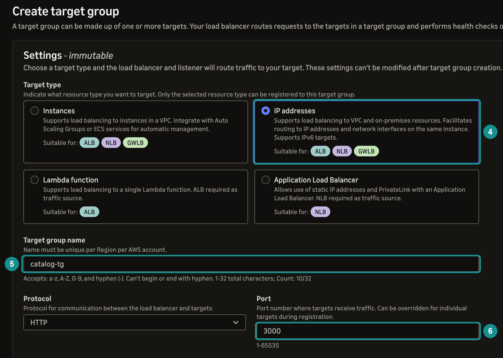

_12.2.2. Тип цели и порт целевой группы_

1. `Target type`: `IP addresses` (_4_). У задачи Fargate нет экземпляра EC2, который можно зарегистрировать в группе, но есть собственный IP-адрес. Балансировщик будет отправлять запросы прямо на него.
2. `Target group name`: `catalog-tg` (_5_).
3. `Protocol`: `HTTP`, `Port`: `3000` (_6_). На этом порту слушает сервер в контейнере.

Ниже оставьте `IPv4` и VPC по умолчанию. Эти настройки помечены как `immutable`: после создания группы их не изменить.

### Шаг 4. Настройте проверку работоспособности

Прокрутите форму до блока `Health checks`.

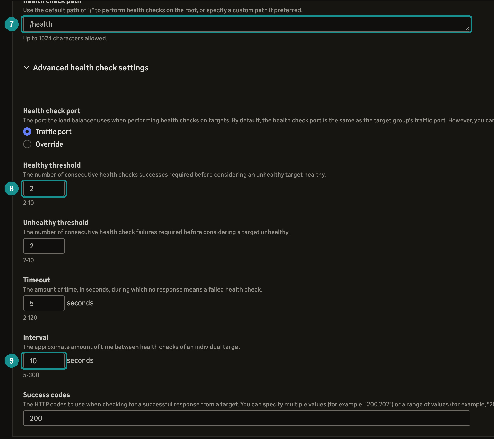

_12.2.3. Путь, пороги и интервал проверки_

1. `Health check path`: `/health` (_7_). На этот путь сервис каталога отвечает кодом 200 и текстом `ok`.
2. Раскройте `Advanced health check settings`. `Healthy threshold`: `2` (_8_) вместо `5`.
3. `Interval`: `10` секунд (_9_) вместо `30`.

`Unhealthy threshold` 2, `Timeout` 5 секунд и `Success codes` 200 оставьте как есть. С такими значениями новая задача начнёт получать запросы примерно через 20 секунд после запуска: две успешные проверки с интервалом 10 секунд.

Нажмите `Next`. На странице `Register targets` ничего не добавляйте: IP-адреса задач будет регистрировать сам сервис ECS. Нажмите `Create target group`.

### Шаг 5. Уменьшите задержку отмены регистрации

Когда сервис останавливает старую задачу, он сначала отменяет её регистрацию в целевой группе. **Задержка отмены регистрации (deregistration delay)** - время, в течение которого балансировщик больше не отправляет цели новые запросы, но даёт закончиться уже начатым[^3]. В это время цель находится в состоянии `draining`. По умолчанию задержка 300 секунд, и каждое обновление сервиса длилось бы на пять минут дольше.

Откройте `catalog-tg`, вкладку `Attributes`, и нажмите `Edit`.

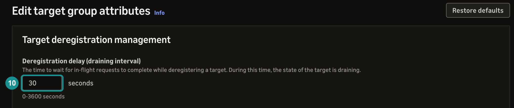

_12.2.4. Задержка отмены регистрации_

`Deregistration delay`: `30` секунд (_10_). Запросы к сервису каталога выполняются за миллисекунды, и 30 секунд им хватит с запасом. Нажмите `Save changes`.

## Часть 3. Балансировщик

### Шаг 6. Создайте балансировщик

Откройте `Load Balancers` → `Create load balancer` → `Application Load Balancer` → `Create`.

1. `Load balancer name`: `catalog-alb`.
2. `Scheme`: `Internet-facing`, `Load balancer IP address type`: `IPv4`.
3. В `Network mapping` оставьте VPC по умолчанию и отметьте все три зоны доступности. Задачи сервиса будут запускаться в любой из трёх подсетей, и балансировщик должен работать в каждой из этих зон.

Прокрутите форму ниже.

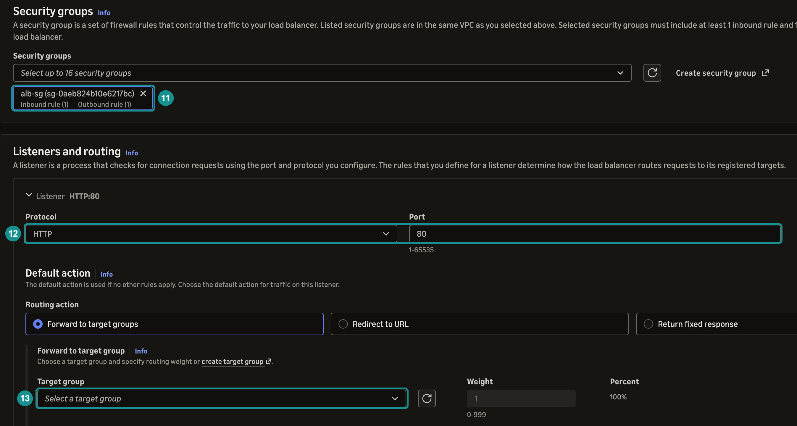

_12.2.5. Группа безопасности и listener балансировщика_

1. В `Security groups` уберите `default` и выберите `alb-sg` (_11_).
2. Listener: `HTTP`, порт `80` (_12_).
3. `Default action`: `Forward to target groups`, в `Target group` выберите `catalog-tg` (_13_).

Остальное не меняйте и нажмите `Create load balancer`.

### Шаг 7. Дождитесь готовности балансировщика

Через две-три минуты обновите страницу `catalog-alb`.

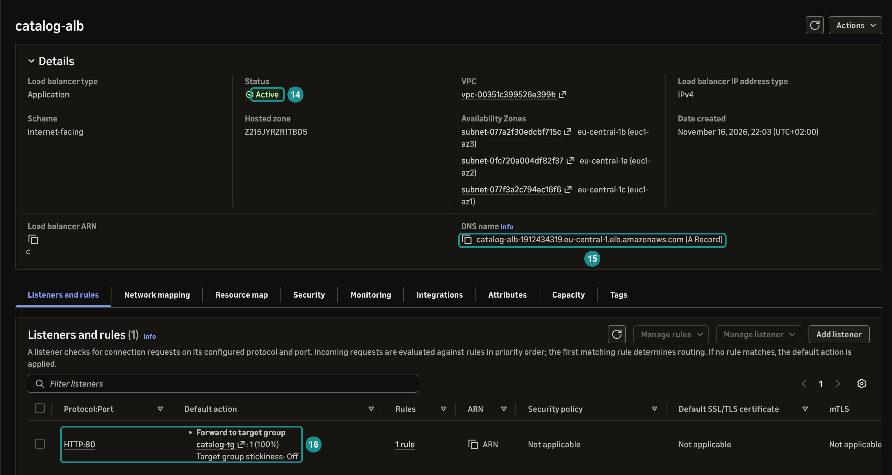

_12.2.6. Балансировщик готов_

- `Status`: `Active` (_14_).
- `DNS name` (_15_) - постоянный адрес сервиса, например `catalog-alb-1912434319.eu-central-1.elb.amazonaws.com`. Скопируйте его без приписки `(A Record)`: он понадобится в шагах 11 и 21.
- Listener `HTTP:80` отправляет запросы в `catalog-tg` (_16_).

Целевая группа пока пуста: сервиса за балансировщиком ещё нет. Если открыть DNS-адрес сейчас, балансировщик ответит ошибкой `503 Service Temporarily Unavailable`.

## Часть 4. Сервис за балансировщиком

### Шаг 8. Создайте сервис

Откройте кластер `shop`, вкладку `Services`, и нажмите `Create`. Форма та же, что в шагах 14-15 Hands-on 12.1:

1. `Task definition family`: `catalog`.
2. `Task definition revision` оставьте пустым: сервис возьмёт последнюю ревизию `catalog:2` с образом `1.5.0`.
3. `Service name`: `catalog`.
4. `Compute configuration`: `Launch type`, `Fargate`.
5. `Desired tasks`: `2`.

Настройки `Rolling update` (`Min running tasks %` 100, `Max running tasks %` 200) и circuit breaker оставьте как есть. При двух задачах обновление сначала поднимет две новые задачи и только потом остановит две старые.

Раскройте `Networking`.

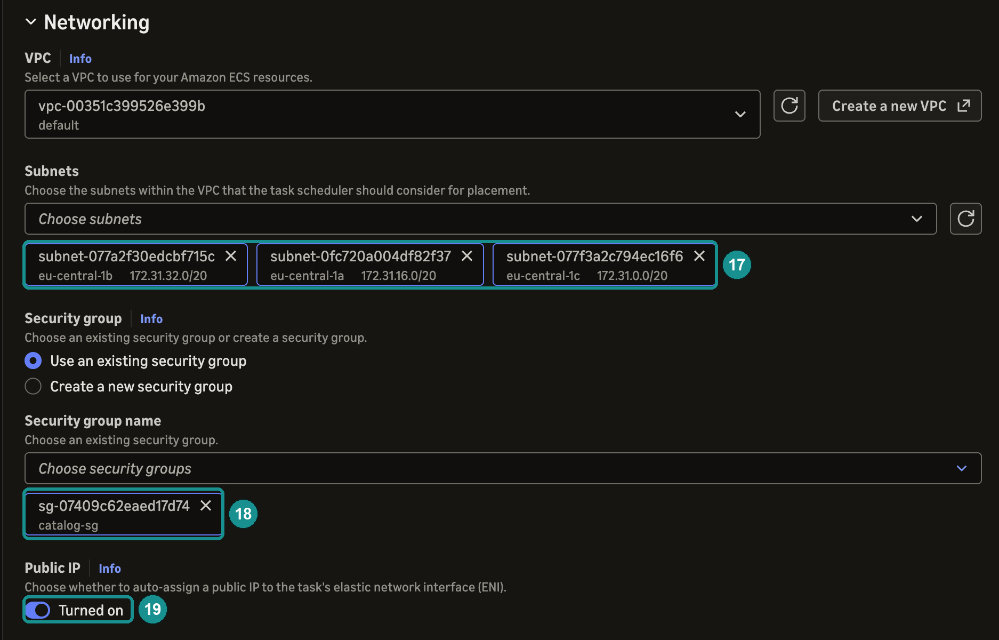

_12.2.7. Сеть сервиса за балансировщиком_

1. `Subnets`: все три подсети VPC по умолчанию (_17_). ECS распределит задачи по разным зонам.
2. `Security group`: `Use an existing security group` и группа `catalog-sg` (_18_). Если в списке выбрана `default`, уберите её.
3. `Public IP` оставьте включённым (_19_). Задача по-прежнему скачивает образ из ECR через интернет, но обратиться к ней по этому адресу теперь нельзя.

### Шаг 9. Подключите балансировщик

Сервис не создаёт балансировщик сам. Он регистрирует IP-адреса своих задач в целевой группе и отменяет регистрацию, когда останавливает задачу. Поэтому сервису нужно указать, какой балансировщик и какую целевую группу использовать.

Раскройте блок `Load balancing` и включите `Use load balancing`. В `Load balancer type` выберите `Application Load Balancer`, в `Container` - `catalog 3000:3000`. Имя контейнера и порт `3000` консоль берёт из определения задачи.

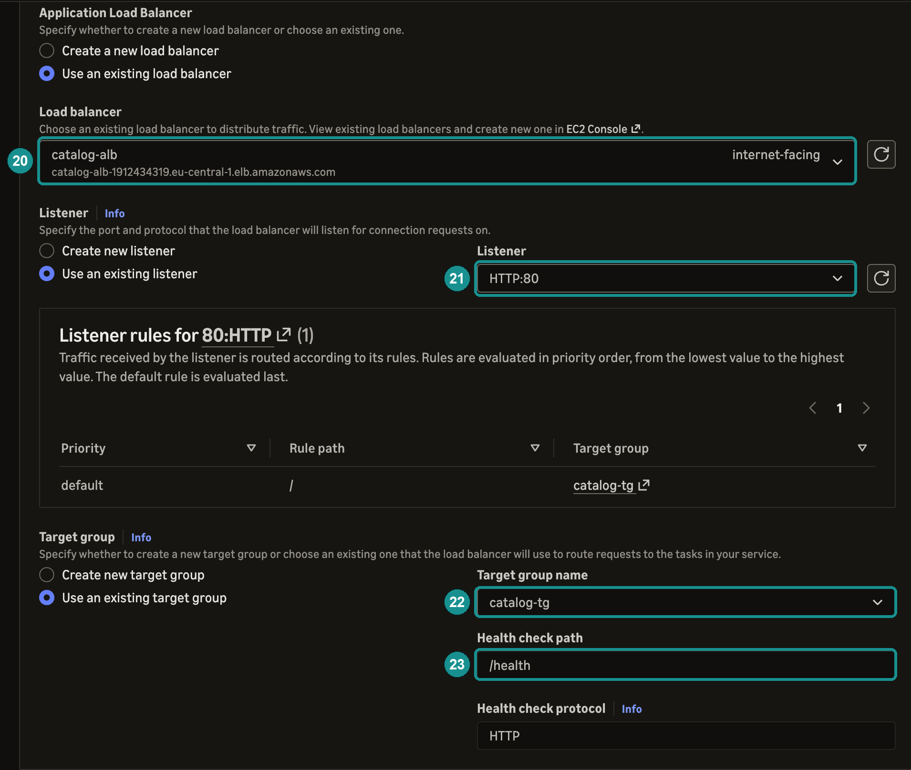

_12.2.8. Балансировщик, listener и целевая группа сервиса_

1. `Use an existing load balancer` и `catalog-alb` (_20_).
2. `Listener`: `Use an existing listener` и `HTTP:80` (_21_). Консоль показывает правило listener: всё идёт в `catalog-tg`.
3. `Target group`: `Use an existing target group` и `catalog-tg` (_22_).
4. `Health check path`: `/health` (_23_). Консоль подставляет путь из целевой группы.

Нажмите `Create` внизу страницы.

### Шаг 10. Дождитесь работоспособных целей

Сервис запустит две задачи и зарегистрирует их IP-адреса в `catalog-tg`. Через две-три минуты откройте `EC2` → `Target Groups` → `catalog-tg`.

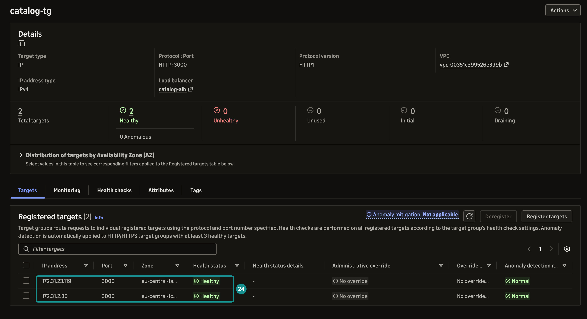

_12.2.9. Задачи в целевой группе_

В таблице `Registered targets` две цели (_24_): частные IP-адреса задач в VPC, порт `3000`, разные зоны доступности и статус `Healthy`. Сначала цели проходят состояние `Initial`: балансировщик ждёт двух успешных проверок.

> [!TIP]
> Если цели остаются `Unhealthy`, проверьте правило `catalog-sg`: порт `3000`, источник `alb-sg`. Если задачи всё время останавливаются и запускаются заново, откройте в сервисе вкладку `Events`: там видно, какую проверку задача не прошла.

### Шаг 11. Отправьте запросы через балансировщик

Откройте в браузере адрес `http://<DNS name>/products/42`, например `http://catalog-alb-1912434319.eu-central-1.elb.amazonaws.com/products/42`. Порт указывать не нужно: listener слушает порт `80`.

```json
{"product":42,"price":1250,"version":"1.5.0"}
```

Обновите страницу несколько раз. Ответ всегда одинаковый, но запросы по очереди обрабатывают две задачи. Это видно на вкладке `Logs` сервиса: строки `{"method":"GET","path":"/products/42"}` приходят от двух разных задач.

Теперь адрес сервиса не зависит от задач. Сервис может заменить любую из них, а DNS-имя балансировщика останется прежним.

## Часть 5. Доступ GitHub Actions к AWS

Конвейеру нужны права AWS: загрузить образ в ECR и обновить сервис ECS. Можно создать пользователя IAM и сохранить его ключи доступа в секретах (secrets) репозитория - зашифрованных значениях, которые GitHub передаёт конвейеру. Но такие ключи действуют, пока их не удалят, и если они утекут, ими сможет воспользоваться кто угодно.

Поэтому конвейер получит временные учётные данные через роль IAM, как экземпляр EC2 в четвёртой главе. Их выдаёт AWS STS, но сначала он должен убедиться, что запрос на роль пришёл именно от вашего конвейера, а не от чужого. Для этого GitHub и AWS используют OIDC.

**OpenID Connect (OIDC)** - протокол, по которому одна система подтверждает другой, кто выполняет запрос: первая система выдаёт подписанный токен с данными о том, кому он выдан[^4]. При каждом запуске конвейера GitHub выдаёт ему такой токен. В токене записано, из какого репозитория и ветки запущен конвейер. Конвейер передаёт токен в AWS STS. STS проверяет подпись GitHub и условия политики доверия роли и выдаёт временные учётные данные, которые действуют около часа.

Чтобы AWS доверял токенам GitHub, нужны три ресурса IAM: поставщик удостоверений, политика с правами и роль.

**Поставщик удостоверений (identity provider)** - запись в IAM о внешней системе, токенам которой AWS доверяет: её адрес и допустимое значение `aud`[^4]. По этому адресу AWS получает открытые ключи GitHub и проверяет ими подпись токена.

### Шаг 12. Добавьте поставщика удостоверений

Откройте `IAM` → `Identity providers` → `Add provider`.

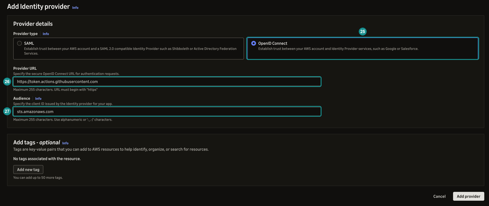

_12.2.10. Поставщик удостоверений GitHub_

1. `Provider type`: `OpenID Connect` (_25_).
2. `Provider URL`: `https://token.actions.githubusercontent.com` (_26_). С этого адреса GitHub выдаёт токены конвейерам.
3. `Audience`: `sts.amazonaws.com` (_27_). Поле `aud` указывает, для кого выпущен токен. Действие `aws-actions/configure-aws-credentials` запрашивает у GitHub токен именно с этим значением[^4], а AWS примет только токен, в котором `aud` совпадает с `Audience` поставщика.

Нажмите `Add provider`. Поставщик создаётся один раз на аккаунт, и его могут использовать все репозитории GitHub.

### Шаг 13. Создайте политику с правами конвейера

Откройте `Policies` → `Create policy` и переключите редактор на `JSON`. Вставьте политику, подставив номер своего аккаунта вместо `111122223333` в трёх местах. Это тот же номер, что в адресе реестра в Hands-on 12.1, 12 цифр без дефисов:

```json
{
  "Version": "2012-10-17",
  "Statement": [
    {
      "Sid": "EcrLogin",
      "Effect": "Allow",
      "Action": "ecr:GetAuthorizationToken",
      "Resource": "*"
    },
    {
      "Sid": "EcrPush",
      "Effect": "Allow",
      "Action": [
        "ecr:BatchCheckLayerAvailability",
        "ecr:BatchGetImage",
        "ecr:InitiateLayerUpload",
        "ecr:UploadLayerPart",
        "ecr:CompleteLayerUpload",
        "ecr:PutImage"
      ],
      "Resource": "arn:aws:ecr:eu-central-1:111122223333:repository/catalog"
    },
    {
      "Sid": "TaskDefinition",
      "Effect": "Allow",
      "Action": [
        "ecs:DescribeTaskDefinition",
        "ecs:RegisterTaskDefinition"
      ],
      "Resource": "*"
    },
    {
      "Sid": "Service",
      "Effect": "Allow",
      "Action": [
        "ecs:UpdateService",
        "ecs:DescribeServices"
      ],
      "Resource": "arn:aws:ecs:eu-central-1:111122223333:service/shop/catalog"
    },
    {
      "Sid": "PassExecutionRole",
      "Effect": "Allow",
      "Action": "iam:PassRole",
      "Resource": "arn:aws:iam::111122223333:role/ecsTaskExecutionRole"
    }
  ]
}
```

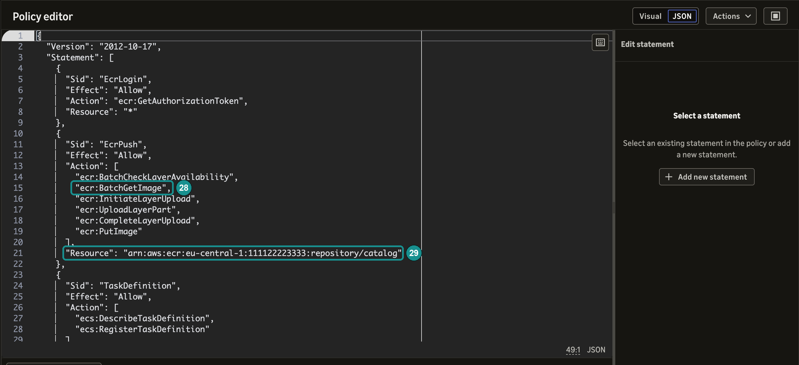

_12.2.11. Политика конвейера в редакторе JSON_

Каждый блок `Statement` разрешает один шаг конвейера:

- _`EcrLogin`_. Получить токен для входа в реестр. Это действие не относится к конкретному репозиторию, поэтому `Resource` - `*`.
- _`EcrPush`_. Загрузить слои и манифест образа. Действие `ecr:BatchGetImage` (_28_) легко забыть. Перед загрузкой Docker проверяет, есть ли уже такой манифест в реестре, и без этого права `docker push` завершится ошибкой `403 Forbidden`[^5]. `Resource` (_29_) разрешает загрузку только в репозиторий `catalog`.
- _`TaskDefinition`_. Прочитать последнюю ревизию определения задачи и зарегистрировать новую. Эти действия ECS не ограничиваются отдельной ревизией, поэтому `Resource` - `*`.
- _`Service`_. Обновить сервис `catalog` в кластере `shop` и следить за ходом развёртывания.
- _`PassExecutionRole`_. Новая ревизия ссылается на роль `ecsTaskExecutionRole`. Чтобы передать роль сервису AWS, нужно право `iam:PassRole` на эту роль.

Других прав у конвейера нет: он не может удалить репозиторий, создать сервис или изменить другой сервис.

Нажмите `Next`. `Policy name`: `github-deploy-catalog`, `Description`: `GitHub Actions pushes catalog images and updates the catalog service`. Нажмите `Create policy`.

### Шаг 14. Создайте роль

Откройте `Roles` → `Create role`.

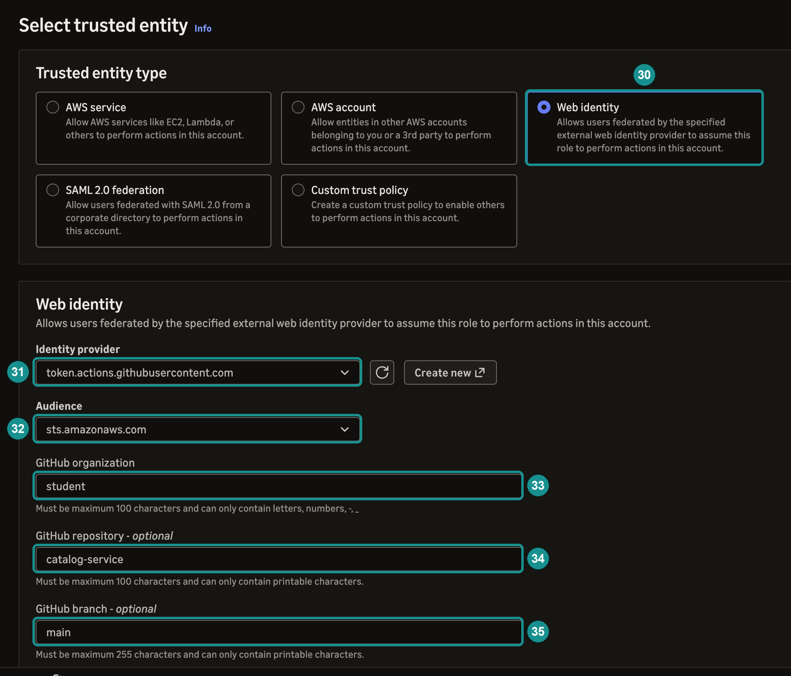

_12.2.12. Доверенная сущность роли_

1. `Trusted entity type`: `Web identity` (_30_). Роль будет принимать не сервис AWS, а внешний поставщик удостоверений.
2. `Identity provider`: `token.actions.githubusercontent.com` (_31_).
3. `Audience`: `sts.amazonaws.com` (_32_).
4. `GitHub organization`: ваш логин на GitHub (_33_). Для личного аккаунта владелец репозиториев - сам пользователь, поэтому укажите его логин. Регистр букв должен точно совпадать с адресом вашего профиля: условие в политике доверия его различает.
5. `GitHub repository`: `catalog-service` (_34_). Репозитория ещё нет, вы создадите его в части 6.
6. `GitHub branch`: `main` (_35_). Роль сможет принять только конвейер, запущенный из ветки `main` этого репозитория.

Нажмите `Next`. На странице `Add permissions` отметьте политику `github-deploy-catalog` и нажмите `Next`. `Role name`: `github-actions-catalog`.

На этой же странице в блоке `Step 1: Select trusted entities` консоль показывает политику доверия, которую она составила из ваших ответов.

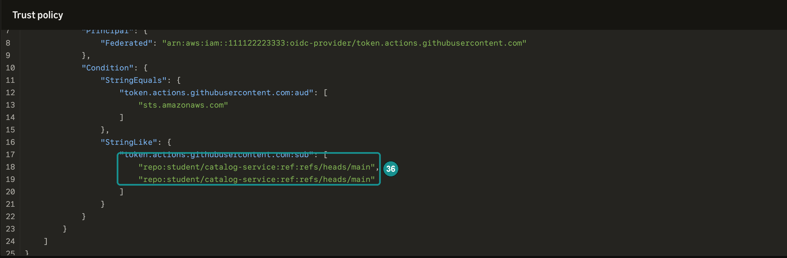

_12.2.13. Условие политики доверия_

Найдите условие на поле `sub` токена (_36_). В нём стоит значение `repo:<логин>/catalog-service:ref:refs/heads/main`, которое мастер записал два раза. GitHub записывает в `sub`, из какого репозитория и ветки запущен конвейер, и STS сравнит содержимое `sub` с этим значением. Действие в политике - `sts:AssumeRoleWithWebIdentity`, а не `sts:AssumeRole` из четвёртой главы: роль принимают по токену внешнего поставщика удостоверений. В шаге 19 окажется, что этот формат не подходит для нового репозитория, и в шаге 20 вы его исправите.

Нажмите `Create role`. Откройте роль `github-actions-catalog` и скопируйте её `ARN`: `arn:aws:iam::111122223333:role/github-actions-catalog` с номером вашего аккаунта.

## Часть 6. Репозиторий на GitHub

### Шаг 15. Создайте репозиторий

На GitHub нажмите `+` → `New repository`.

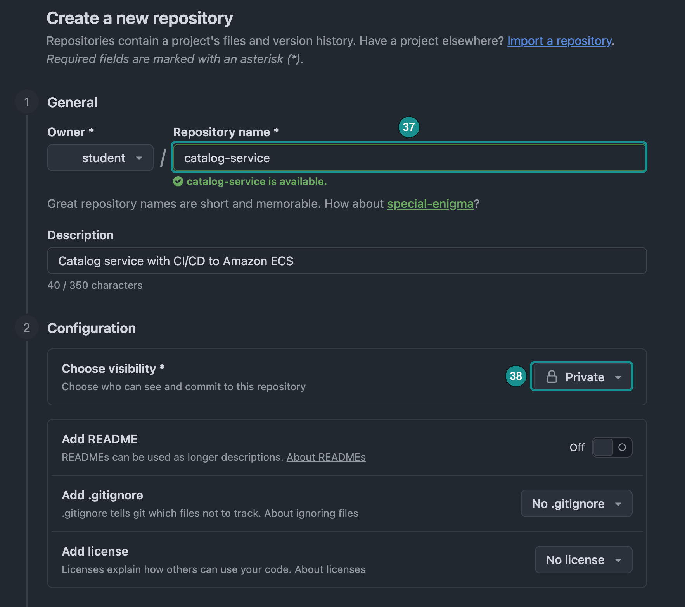

_12.2.14. Новый репозиторий_

1. `Repository name`: `catalog-service` (_37_). Имя должно совпадать с тем, что вы указали в роли в шаге 14.
2. `Choose visibility`: `Private` (_38_).
3. `Add README`, `.gitignore` и `license` оставьте выключенными. Репозиторий должен быть пустым: код вы отправите в шаге 18.

Нажмите `Create repository`.

> [!NOTE]
> Конвейер в приватном репозитории расходует бесплатный лимит GitHub Free: 12 USD в месяц, около 2000 минут на Linux[^6]. Один запуск этого конвейера занимает около четырёх минут.

### Шаг 16. Добавьте в папку тест и конвейер

В папке `catalog` из Hands-on 12.1 уже есть `server.js`, `Dockerfile`, `.dockerignore` и оба файла `package*.json`. Скопируйте в неё из папки `code/catalog` этой главы:

- `package.json` - замените им старый файл: в новом появился скрипт `test`,
- папку `test` с файлом `server.test.js`,
- папку `.github` с файлом `workflows/deploy.yml`.

Папка `.github` начинается с точки: Finder и Проводник по умолчанию такие папки не показывают. Проверьте её командой `ls -a` в папке `catalog`.

Тест проверяет, что `/health` отвечает кодом 200:

```javascript
test("GET /health returns 200", async () => {
  const server = await startServer();
  try {
    const res = await fetch(`http://localhost:${PORT}/health`);
    assert.equal(res.status, 200);
  } finally {
    server.kill("SIGTERM");
  }
});
```

Функция `startServer` в начале файла запускает `node server.js` на порту `3100` и ждёт строки `listening` в выводе. Команда `npm test` выполняет `node --test`: встроенный в Node.js запуск тестов находит файлы в папке `test`.

Конвейер описан в `.github/workflows/deploy.yml`. GitHub Actions запускает файлы из папки `.github/workflows` сам, без отдельной настройки. Файл повторяет конвейер из раздела "Конвейер для контейнерного приложения" главы:

```yaml
on:
  push:
    branches: [main]

permissions:
  id-token: write
  contents: read
```

- `on: push` с `branches: [main]` запускает конвейер после каждого `git push` в ветку `main`.
- `id-token: write` разрешает конвейеру запросить токен OIDC у GitHub[^4]. Без этой строки роль принять нельзя. Право `contents: read` нужно, чтобы скачать код репозитория.

В конвейере два задания (job). Задание `test` устанавливает Node.js 24, выполняет `npm ci` и `npm test`. Задание `deploy` начинается строкой `needs: test` и запускается, только если тесты прошли. Первым шагом оно, как и `test`, скачивает код репозитория действием `actions/checkout`: без кода `docker build` нечего собирать. Остальные шаги:

```yaml
      - name: Configure AWS credentials
        uses: aws-actions/configure-aws-credentials@v6
        with:
          role-to-assume: ${{ vars.AWS_ROLE_ARN }}
          aws-region: ${{ env.AWS_REGION }}

      - name: Log in to Amazon ECR
        id: ecr
        uses: aws-actions/amazon-ecr-login@v2

      - name: Build and push image
        id: build
        run: |
          TAG="${GITHUB_SHA::7}"
          IMAGE="${{ steps.ecr.outputs.registry }}/$ECR_REPOSITORY:$TAG"
          docker build -t "$IMAGE" .
          docker push "$IMAGE"
          echo "image=$IMAGE" >> "$GITHUB_OUTPUT"
          echo "tag=$TAG" >> "$GITHUB_OUTPUT"

      - name: Render task definition
        id: render
        uses: aws-actions/amazon-ecs-render-task-definition@v1
        with:
          task-definition-family: catalog
          container-name: ${{ env.CONTAINER_NAME }}
          image: ${{ steps.build.outputs.image }}
          environment-variables: APP_VERSION=${{ steps.build.outputs.tag }}

      - name: Deploy to Amazon ECS
        uses: aws-actions/amazon-ecs-deploy-task-definition@v2
        with:
          task-definition: ${{ steps.render.outputs.task-definition }}
          service: ${{ env.ECS_SERVICE }}
          cluster: ${{ env.ECS_CLUSTER }}
          wait-for-service-stability: true
```

1. `Configure AWS credentials` получает токен OIDC, принимает роль из переменной `AWS_ROLE_ARN` и сохраняет временные учётные данные для следующих шагов.
2. `Log in to Amazon ECR` выполняет тот же вход в реестр, что команда `aws ecr get-login-password | docker login` в Hands-on 12.1.
3. `Build and push image` собирает и загружает образ. Тег - первые 7 символов хэша коммита из переменной `GITHUB_SHA`, например `c6f4e8d`. Флаг `--platform` не нужен: серверы GitHub Actions с `ubuntu-latest` работают на x86_64. Строки с `GITHUB_OUTPUT` передают адрес образа и тег следующим шагам.
4. `Render task definition` читает последнюю ревизию семейства `catalog`, заменяет в контейнере `catalog` образ и значение `APP_VERSION` и сохраняет результат в файл[^7].
5. `Deploy to Amazon ECS` регистрирует из этого файла новую ревизию и обновляет сервис. С `wait-for-service-stability: true` шаг ждёт, пока сервис придёт в устойчивое состояние[^8]. Устойчивым сервис становится и после отката: если circuit breaker вернёт сервис к прежней ревизии, шаг может завершиться успешно, хотя новая версия не выпущена[^9].

Регион и имена ресурсов заданы в блоке `env` в начале файла:

```yaml
env:
  AWS_REGION: eu-central-1
  ECR_REPOSITORY: catalog
  ECS_CLUSTER: shop
  ECS_SERVICE: catalog
  CONTAINER_NAME: catalog
```

Если в Hands-on 12.1 вы назвали что-то иначе, поправьте эти значения. Имя семейства `catalog` записано прямо в шаге `Render task definition`.

### Шаг 17. Сохраните ARN роли в переменной

Откройте репозиторий `catalog-service` → `Settings` → `Secrets and variables` → `Actions`, вкладку `Variables` (не `Secrets`), и нажмите `New repository variable`.

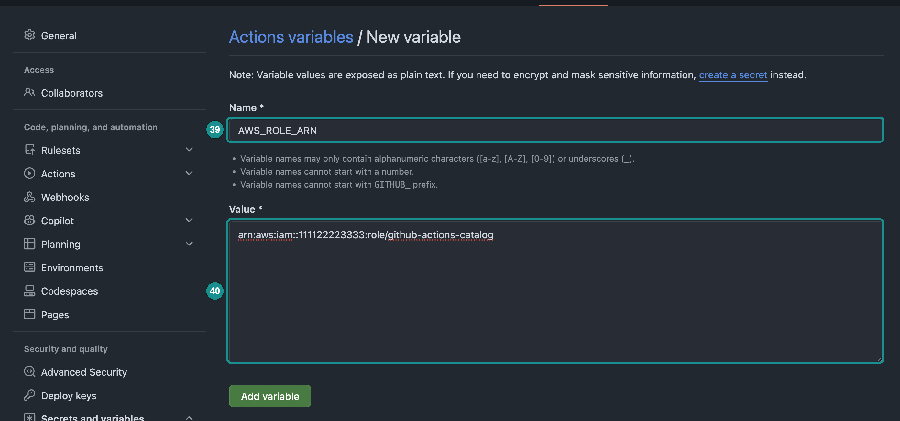

_12.2.15. Переменная с ARN роли_

1. `Name`: `AWS_ROLE_ARN` (_39_).
2. `Value`: ARN роли из шага 14 (_40_).

Нажмите `Add variable`. В файле конвейера переменная доступна как `${{ vars.AWS_ROLE_ARN }}`. ARN роли не секрет: без токена GitHub из этого репозитория по нему ничего нельзя сделать. Поэтому он хранится в переменной (variable), а не в секрете (secret).

Переменную нужно создать до первого `git push`: конвейер запустится сразу после него.

### Шаг 18. Отправьте код в репозиторий

В терминале перейдите в папку `catalog` и выполните команды, подставив своё имя пользователя GitHub:

```bash
git init -b main
git add .
git commit -m "Catalog service with CI/CD pipeline"
git remote add origin https://github.com/<логин>/catalog-service.git
git push -u origin main
```

Первые три команды создают локальный репозиторий с веткой `main` и первый коммит со всеми файлами папки. Команда `git remote add` связывает его с репозиторием на GitHub, а `git push` отправляет коммит.

Возможные трудности:

- _`git commit` просит представиться_. Git ещё не знает автора коммитов. Выполните `git config --global user.name "Имя Фамилия"` и `git config --global user.email "почта@example.com"` со своими данными и повторите `git commit`.
- _`git push` просит пароль_. Пароль от аккаунта GitHub для `git push` не подходит. Если Git открыл окно браузера, войдите в нём. Если он спрашивает пароль в терминале, введите вместо пароля personal access token: его создают на GitHub в `Settings` → `Developer settings` → `Personal access tokens`. Коммит добавляет файл конвейера, поэтому токену нужно право менять конвейеры. Для `Tokens (classic)` отметьте области `repo` и `workflow`. Для `Fine-grained tokens` выберите репозиторий `catalog-service` и дайте права `Contents` и `Workflows` уровня `Read and write`.

## Часть 7. Первый запуск конвейера

### Шаг 19. Найдите ошибку в первом запуске

В репозитории, созданном после 15 июля 2026 года, первый запуск конвейера завершится ошибкой. Так и задумано: в этом шаге вы найдёте её причину, а в шаге 20 исправите. Если у вас первый запуск прошёл, пропустите шаги 19 и 20. Тогда в шаге 21 вместо перезапуска отправьте из второго окна терминала пустой коммит: `git commit --allow-empty -m "Redeploy"` и `git push`. Первый запуск уже выпустил ревизию `catalog:3`, поэтому дальше все номера ревизий у вас будут на один больше. Старой версией в выводе цикла будет хэш первого коммита, а не `1.5.0`.

Откройте в репозитории вкладку `Actions`. Запуск называется по сообщению коммита: `Catalog service with CI/CD pipeline`. Через минуту-две откройте его и выберите задание `deploy`.

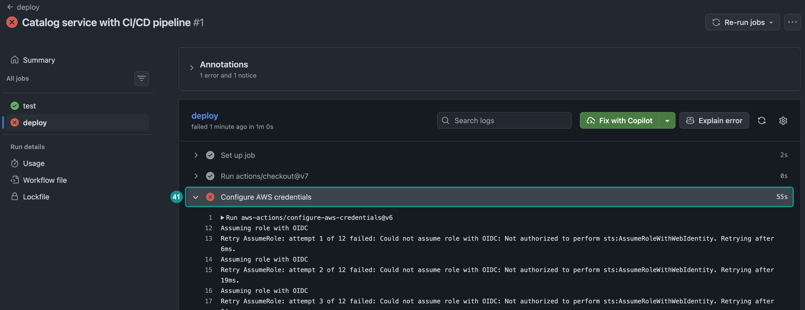

_12.2.16. Конвейер не смог принять роль_

Задание `test` прошло, а `deploy` остановилось на шаге `Configure AWS credentials` (_41_):

```text
Could not assume role with OIDC: Not authorized to perform sts:AssumeRoleWithWebIdentity
```

Действие повторило попытку 12 раз и остановилось. STS отказал: токен GitHub не подошёл под условие политики доверия.

Причина в формате поля `sub`. Для репозиториев, созданных после 15 июля 2026 года, GitHub добавляет в `sub` числовые идентификаторы владельца и репозитория[^10]:

```text
repo:<логин>@<id владельца>/catalog-service@<id репозитория>:ref:refs/heads/main
```

Имя пользователя или репозитория можно сменить, а освободившееся имя может занять кто-то другой. Числовые идентификаторы не меняются, поэтому чужой репозиторий с тем же именем не сможет принять такую роль. Мастер IAM в шаге 14 составил условие в прежнем формате, без идентификаторов, и оно не совпало с токеном.

### Шаг 20. Исправьте политику доверия

Откройте `IAM` → `Roles` → `github-actions-catalog`, вкладку `Trust relationships`, и нажмите `Edit trust policy`.

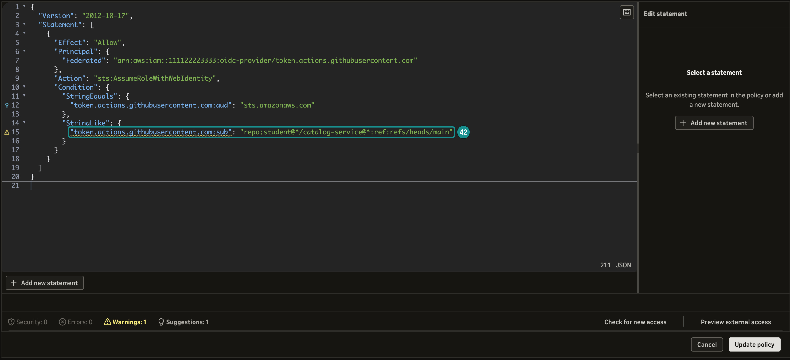

_12.2.17. Исправленное условие на поле sub_

Замените блок `StringLike` целиком, вместе со списком из двух одинаковых значений, на такой (_42_). Блок `StringEquals` с полем `aud` не трогайте. Вместо `<логин>` подставьте свой логин GitHub с тем же регистром букв:

```json
"StringLike": {
  "token.actions.githubusercontent.com:sub": "repo:<логин>@*/catalog-service@*:ref:refs/heads/main"
}
```

Оператор `StringLike` разрешает в значении символ `*`: он совпадает с любой последовательностью символов. Здесь `*` стоит на месте идентификаторов, а имя, репозиторий и ветка проверяются точно. Нажмите `Update policy`.

Со `*` вместо идентификаторов роль снова зависит только от имён. В рабочем проекте вместо `*` записывают настоящие идентификаторы. Если установлен GitHub CLI, их выводит команда `gh api repos/<логин>/catalog-service --jq '.owner.id, .id'`: первое число - идентификатор владельца, второе - репозитория. В этом занятии команда не нужна.

### Шаг 21. Перезапустите конвейер и проверьте обновление без остановки

Пока конвейер обновляет сервис, проверим, отвечает ли он на запросы. Откройте терминал macOS или Linux, в Windows - Git Bash, который устанавливается вместе с Git. Подойдёт и CloudShell: он открывается значком `>_` в верхней строке консоли AWS. Запустите цикл, который раз в секунду отправляет запрос и выводит время, ответ и код HTTP. В первой строке замените адрес из примера на DNS-имя своего балансировщика из шага 7:

```bash
ALB=catalog-alb-1912434319.eu-central-1.elb.amazonaws.com
while true; do echo "$(date +%T) $(curl -s -m 3 -w ' %{http_code}' http://$ALB/products/42)"; sleep 1; done
```

Флаг `-w ' %{http_code}'` дописывает после ответа код HTTP, а `-m 3` ограничивает ожидание ответа тремя секундами.

Вернитесь к запуску на GitHub и нажмите `Re-run jobs` → `Re-run failed jobs`. Задание `test` уже прошло, поэтому GitHub перезапустит только `deploy`. Через три-четыре минуты запуск завершится.

> [!TIP]
> Если перезапуск снова упал, но уже после шага `Build and push image`, образ этого коммита уже лежит в ECR. Следующий перезапуск соберёт образ с тем же тегом, и неизменяемый тег не позволит загрузить образ повторно: `tag invalid`. Исправьте причину ошибки, затем отправьте пустой коммит `git commit --allow-empty -m "Redeploy"` и `git push`: у нового коммита будет новый хэш и новый тег.

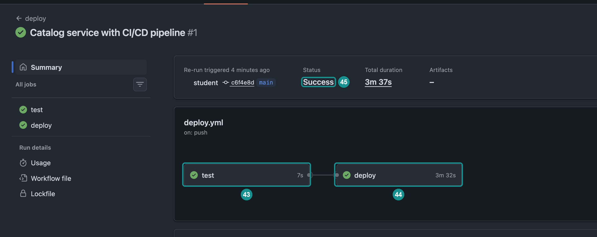

_12.2.18. Конвейер прошёл_

Оба задания, `test` (_43_) и `deploy` (_44_), прошли, а запуск получил статус `Success` (_45_). Откройте задание `deploy`.

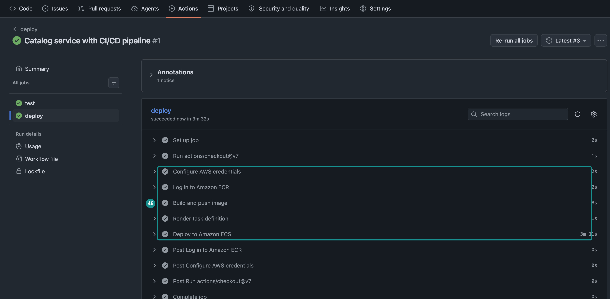

_12.2.19. Шаги задания deploy_

Все пять шагов задания, разобранные в шаге 16, выполнены (_46_). Почти всё время занял последний шаг, `Deploy to Amazon ECS`: около трёх минут он ждал устойчивого состояния сервиса. Это дольше самой замены задач: после неё действие ещё опрашивает сервис, пока ECS не сообщит, что развёртывание завершено.

Теперь посмотрите на вывод цикла в терминале. В момент переключения ответы чередуются:

```text
22:28:05 {"product":42,"price":1250,"version":"1.5.0"} 200
22:28:06 {"product":42,"price":1250,"version":"c6f4e8d"} 200
22:28:07 {"product":42,"price":1250,"version":"1.5.0"} 200
22:28:08 {"product":42,"price":1250,"version":"1.5.0"} 200
22:28:09 {"product":42,"price":1250,"version":"c6f4e8d"} 200
```

- `version` `1.5.0` - ответ старой задачи по ревизии `catalog:2`.
- `version` `c6f4e8d` - ответ новой задачи: конвейер записал в `APP_VERSION` тег образа, хэш коммита. У вас хэш будет другим.
- Код каждого ответа `200`.

Балансировщик отправлял запросы и старым, и новым задачам, пока старые не перешли в состояние `draining`. Примерно через полторы минуты в выводе остаётся только новая версия. В нашем запуске цикл отправил 767 запросов, и ни один не завершился ошибкой. Остановите цикл клавишами `Ctrl+C`.

### Шаг 22. Найдите образ конвейера в ECR

Откройте репозиторий ECR `catalog`.

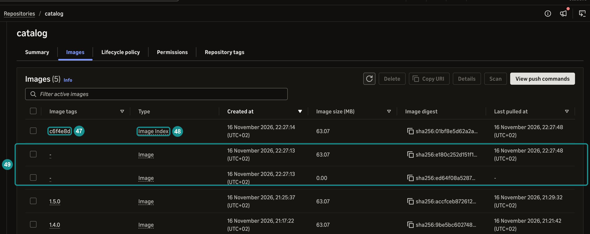

_12.2.20. Образ, загруженный конвейером_

- Тег `c6f4e8d` (_47_) - тот же хэш коммита, что в ответе сервиса. По тегу видно, из какого коммита собран образ в работающих задачах.
- Тип `Image Index` (_48_), а не `Image`, как у `1.4.0` и `1.5.0`.
- Две записи без тега (_49_).

Docker на серверах GitHub по умолчанию добавляет к образу _аттестацию происхождения (provenance attestation)_ - описание того, как и из чего собран образ[^11]. Поэтому тег указывает на индекс образа, а индекс ссылается на сам образ (`63.07` МБ) и на аттестацию (`0.00` МБ). Fargate по индексу скачивает образ. Записи без тега удалять нельзя: индекс станет неполным.

### Шаг 23. Посмотрите развёртывание в ECS

Откройте сервис `catalog`, вкладку `Deployments`.

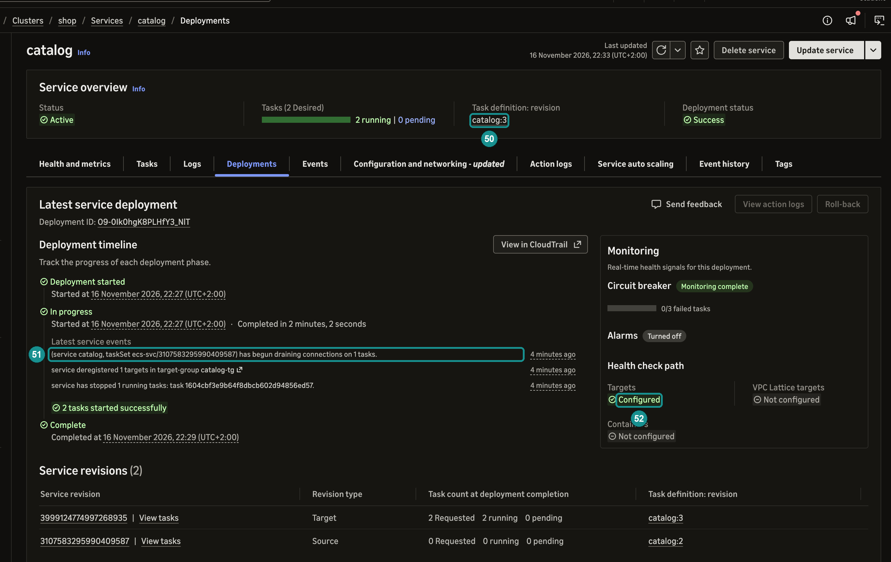

_12.2.21. Развёртывание, запущенное конвейером_

- Сервис работает по ревизии `catalog:3` (_50_). Её создал конвейер из ревизии 2: изменились только образ и `APP_VERSION`.
- В событиях развёртывания (_51_) видно, как сервис убирает старую задачу: балансировщик начинает `draining connections`, сервис отменяет регистрацию цели в `catalog-tg` и затем останавливает задачу.
- `Health check path`: `Configured` (_52_). Новая задача считается готовой, только когда проходит проверку балансировщика.

В таблице `Service revisions` у ревизии `catalog:3` две работающие задачи, а у `catalog:2` - ни одной. Развёртывание заняло около двух минут: сервис дождался двух проверок `/health` у новых задач и 30 секунд задержки отмены регистрации у старых.

## Часть 8. Сломанный выпуск

Проверим, что конвейер не пропустит сломанную версию. Допустим, правка сломала проверку работоспособности: сервис отвечает на `/health` кодом 500.

### Шаг 24. Отправьте сломанную версию

В папке `catalog` на ноутбуке откройте `server.js` и в обработчике пути `/health` замените строку:

```javascript
res.writeHead(200).end("ok");
```

на такую:

```javascript
res.writeHead(500).end("db unavailable");
```

Отправьте правку в репозиторий:

```bash
git commit -am "Return 500 from /health"
git push
```

Флаг `-a` добавляет в коммит все изменённые файлы, которые Git уже отслеживает. Откройте новый запуск на вкладке `Actions`.

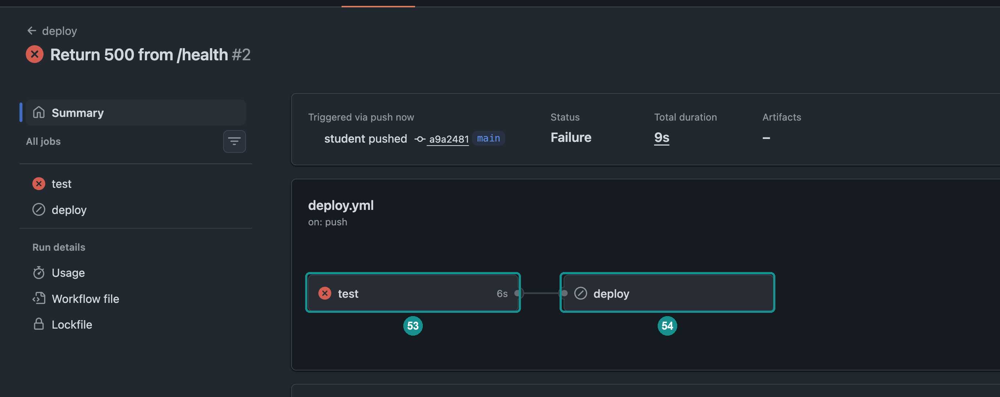

_12.2.22. Тест остановил конвейер_

Задание `test` завершилось ошибкой (_53_), а `deploy` не запускалось (_54_): у него `needs: test`. Весь запуск занял меньше десяти секунд. Откройте задание `test` и шаг `Run npm test`.

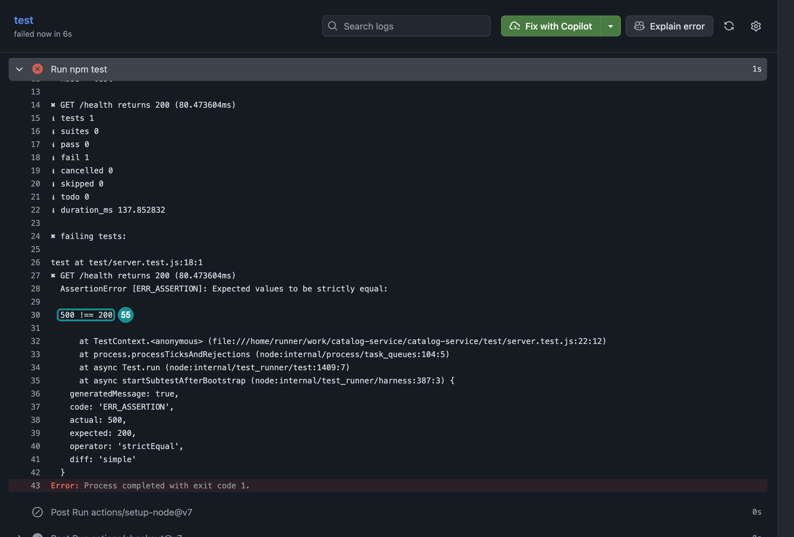

_12.2.23. Сообщение упавшего теста_

Тест `GET /health returns 200` ожидал код `200`, а получил `500` (_55_). Это видно в строках `actual: 500` и `expected: 200` ниже. Новый образ не собран, в ECR ничего не загружено, и сервис продолжает работать по ревизии `catalog:3`. Проверьте это в браузере: `http://<DNS name>/products/42` отвечает, как в шаге 21.

Если бы теста не было, сломанная версия дошла бы до ECS. Новые задачи не прошли бы проверку балансировщика, сервис не переключил бы на них запросы, а circuit breaker после нескольких неудачных запусков вернул бы сервис к ревизии `catalog:3`. Пользователи ошибки не увидели бы. Но запуск конвейера мог бы завершиться со статусом `Success`, как сказано в шаге 16. О неудачном выпуске можно было бы узнать только по номеру ревизии в ECS. Тест нашёл ошибку за секунды и остановил конвейер явно.

### Шаг 25. Отмените сломанную правку

```bash
git revert --no-edit HEAD
git push
```

Команда `git revert` создаёт новый коммит, который отменяет изменения последнего коммита (`HEAD`). Сломанный коммит остаётся в истории, и по ней видно, что было сломано и когда исправлено. Флаг `--no-edit` оставляет сообщение коммита по умолчанию, `Revert "Return 500 from /health"`. Конвейер пройдёт оба задания и выпустит ревизию `catalog:4` с новым хэшем коммита в теге.

Дождитесь, пока этот запуск завершится со статусом `Success`, и только потом переходите к удалению ресурсов. Иначе конвейер попытается обновить сервис, который вы удаляете.

## Часть 9. Удаление ресурсов

Удалите ресурсы в таком порядке. Они ссылаются друг на друга: сервис регистрирует задачи в целевой группе, целевую группу использует listener балансировщика, а группы безопасности заняты, пока есть задачи и балансировщик. Поэтому сначала удаляют то, что ссылается на другие.

1. Сервис. Откройте сервис `catalog`, нажмите `Delete service`, отметьте `Force delete`, введите `delete` и нажмите `Delete`.
2. Балансировщик. В `EC2` → `Load Balancers` отметьте `catalog-alb` и выберите `Actions` → `Delete load balancer`, введите `confirm`.
3. Целевая группа. В `Target Groups` отметьте `catalog-tg` и выберите `Actions` → `Delete`.
4. Группы безопасности. Когда задачи остановятся, удалите `catalog-sg`, затем `alb-sg`. Если консоль сообщает, что группа используется, подождите несколько минут: AWS ещё не удалил сетевые интерфейсы задач и балансировщика.
5. Кластер. Откройте кластер `shop` и нажмите `Delete cluster`.
6. Определение задачи. В `Task definitions` → `catalog` отметьте все ревизии, выберите `Actions` → `Deregister`, затем `Actions` → `Delete`.
7. Репозиторий ECR. Отметьте `catalog` и нажмите `Delete`. Репозиторий удаляется вместе со всеми образами.
8. Журналы. В `CloudWatch` → `Logs` → `Log Management` удалите группу `/ecs/catalog`.
9. IAM. Удалите роль `github-actions-catalog`, политику `github-deploy-catalog` и в `Identity providers` - поставщика `token.actions.githubusercontent.com`.
10. Образы на ноутбуке. Если после Hands-on 12.1 вы их не удалили, удалите командой `docker rmi`, как в пункте 6 части 7 Hands-on 12.1.

Роль `ecsTaskExecutionRole` можно оставить, она ничего не стоит. Репозиторий `catalog-service` на GitHub тоже можно оставить: приватный репозиторий бесплатен, а без роли в AWS конвейер ничего не сможет обновить. Если хотите его удалить, откройте `Settings` и в самом низу страницы, в блоке `Danger Zone`, нажмите `Delete this repository`.

## Вопросы для самопроверки

1. Почему для задач Fargate в целевой группе выбирают тип цели `IP addresses`, а не `Instances`?
2. Почему у `catalog-sg` источник правила - группа `alb-sg`, а не `Anywhere`? Что изменилось для запросов на публичный IP-адрес задачи?
3. Что делает задержка отмены регистрации и почему в занятии её уменьшили до 30 секунд?
4. Чем доступ конвейера через роль и OIDC лучше ключей доступа пользователя IAM, сохранённых в секретах GitHub?
5. Почему первый запуск не смог принять роль и что изменили в политике доверия?
6. Зачем в политике конвейера права `ecr:BatchGetImage` и `iam:PassRole`?
7. Как по ответу сервиса и по тегу образа в ECR узнать, из какого коммита собрана работающая версия?
8. Почему в шаге 21 ни один запрос не завершился ошибкой, хотя сервис заменил обе задачи?
9. Что остановило сломанную версию в части 8 и что произошло бы без теста?

[^1]: Amazon Web Services (2026). _Elastic Load Balancing pricing_. Цены для `eu-central-1` по данным AWS Price List от 11 ноября 2026 года. Available at: https://aws.amazon.com/elasticloadbalancing/pricing/

[^2]: Amazon Web Services (2026). _Amazon VPC Pricing_. Available at: https://aws.amazon.com/vpc/pricing/

[^3]: Amazon Web Services (2026). _Edit target group attributes for your Application Load Balancer_. Elastic Load Balancing User Guide. Available at: https://docs.aws.amazon.com/elasticloadbalancing/latest/application/edit-target-group-attributes.html

[^4]: GitHub (2026). _Configuring OpenID Connect in Amazon Web Services_. GitHub Docs. Available at: https://docs.github.com/en/actions/how-tos/secure-your-work/security-harden-deployments/oidc-in-aws

[^5]: Amazon Web Services (2026). _IAM permissions for pushing an image to an Amazon ECR private repository_. Amazon ECR User Guide. Available at: https://docs.aws.amazon.com/AmazonECR/latest/userguide/image-push-iam.html

[^6]: GitHub (2026). _GitHub Actions billing_. GitHub Docs. Available at: https://docs.github.com/en/billing/concepts/product-billing/github-actions

[^7]: Amazon Web Services (2026). _Amazon ECS "Render Task Definition" Action for GitHub Actions_. GitHub. Available at: https://github.com/aws-actions/amazon-ecs-render-task-definition

[^8]: Amazon Web Services (2026). _Amazon ECS "Deploy Task Definition" Action for GitHub Actions_. GitHub. Available at: https://github.com/aws-actions/amazon-ecs-deploy-task-definition

[^9]: aws-actions (2023). _Issue #494_. GitHub, aws-actions/amazon-ecs-deploy-task-definition. Available at: https://github.com/aws-actions/amazon-ecs-deploy-task-definition/issues/494

[^10]: GitHub (2026). _OpenID Connect reference_. GitHub Docs. Available at: https://docs.github.com/en/actions/reference/security/oidc

[^11]: Docker (2026). _Build attestations_. Docker Docs. Available at: https://docs.docker.com/build/metadata/attestations/
