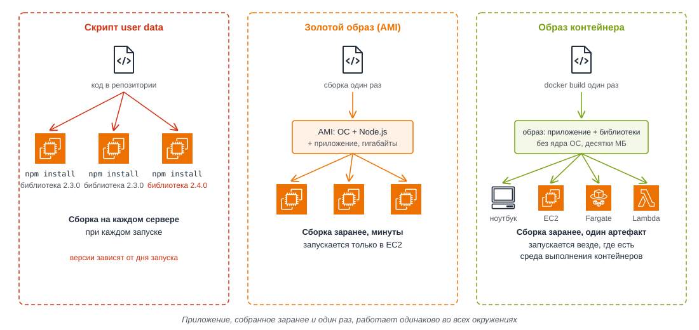
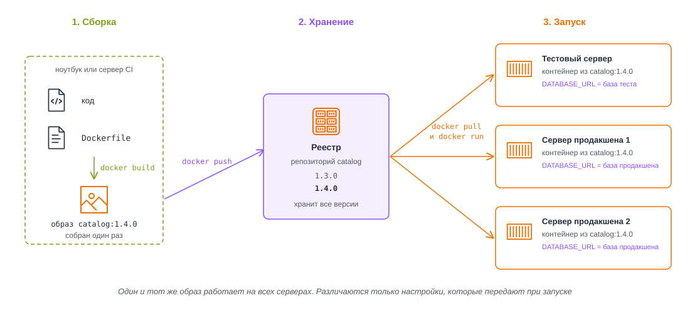
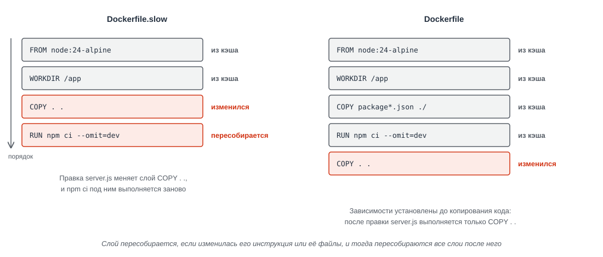
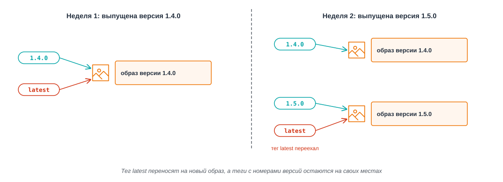
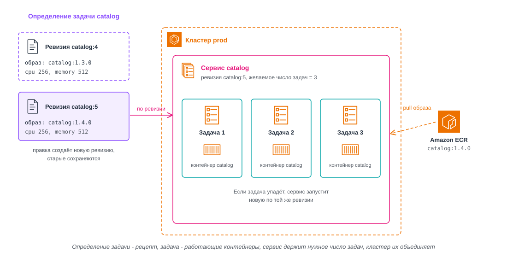
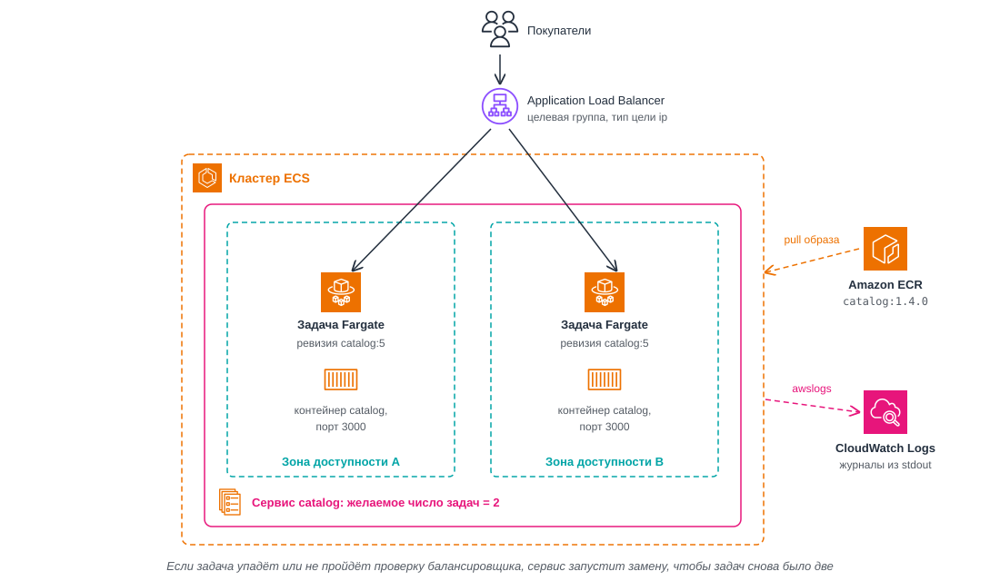
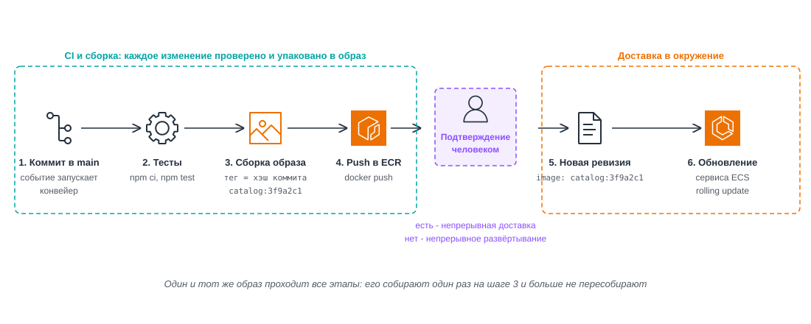
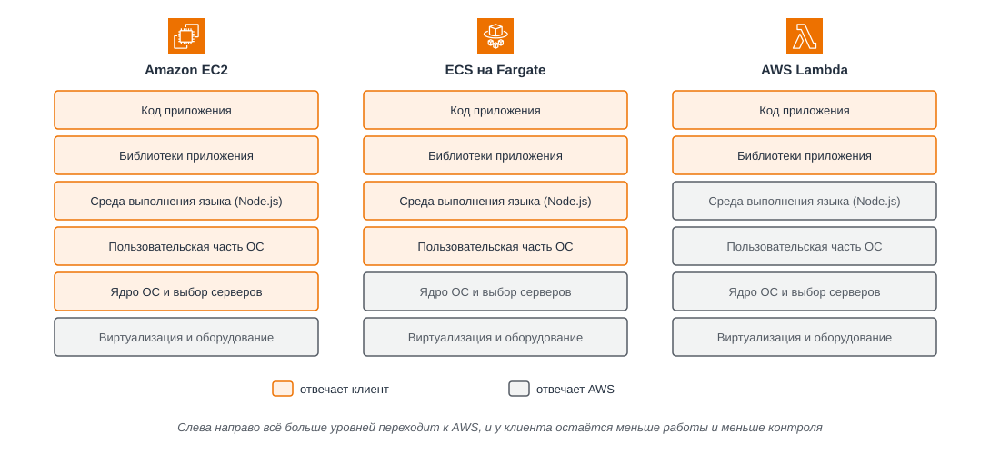
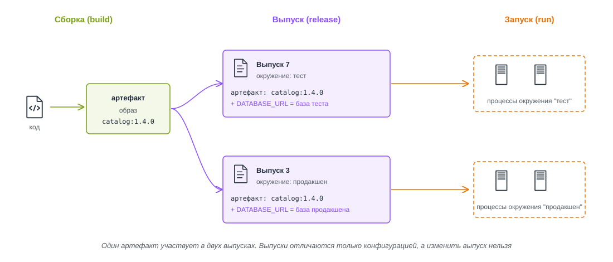
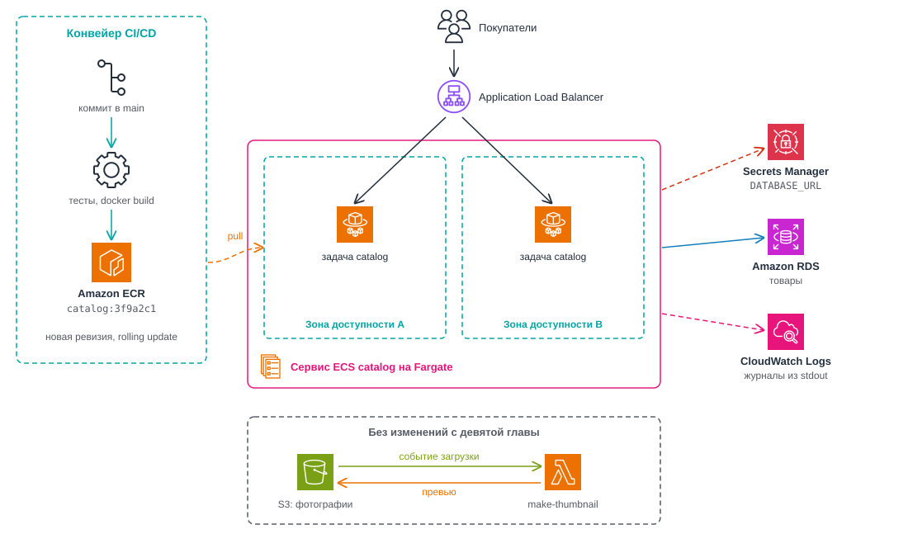

# Контейнеры и cloud-native архитектура. Amazon ECR, Amazon ECS и AWS Fargate

<!-- Место для вступительной истории Эммы и Джона: её пишет автор. -->

## Содержание

- [Контейнеры и cloud-native архитектура. Amazon ECR, Amazon ECS и AWS Fargate](#контейнеры-и-cloud-native-архитектура-amazon-ecr-amazon-ecs-и-aws-fargate)
  - [Содержание](#содержание)
  - [Вопросы для самопроверки](#вопросы-для-самопроверки)
  - [Результаты обучения](#результаты-обучения)
  - [Ретроспектива](#ретроспектива)
  - [Зачем нужны контейнеры](#зачем-нужны-контейнеры)
    - [Проблема развёртывания](#проблема-развёртывания)
    - [Артефакт и единица развёртывания](#артефакт-и-единица-развёртывания)
    - [Какой артефакт выбрать для сервера](#какой-артефакт-выбрать-для-сервера)
    - [Образ и контейнер](#образ-и-контейнер)
    - [Как работают с контейнерами](#как-работают-с-контейнерами)
  - [Образ контейнера: Dockerfile, сборка и запуск](#образ-контейнера-dockerfile-сборка-и-запуск)
    - [Dockerfile](#dockerfile)
    - [Порядок строк и кэш сборки](#порядок-строк-и-кэш-сборки)
    - [Запуск контейнера](#запуск-контейнера)
  - [Версии и хранение образов](#версии-и-хранение-образов)
    - [Теги](#теги)
    - [Реестр, репозиторий, push и pull](#реестр-репозиторий-push-и-pull)
  - [Amazon ECR](#amazon-ecr)
    - [Назначение сервиса](#назначение-сервиса)
    - [Основные характеристики Amazon ECR](#основные-характеристики-amazon-ecr)
    - [Загрузка образа в ECR](#загрузка-образа-в-ecr)
    - [Стоимость ECR](#стоимость-ecr)
  - [Оркестрация контейнеров](#оркестрация-контейнеров)
    - [Зачем нужен оркестратор](#зачем-нужен-оркестратор)
    - [Kubernetes в двух словах](#kubernetes-в-двух-словах)
  - [Amazon ECS и AWS Fargate](#amazon-ecs-и-aws-fargate)
    - [Назначение сервиса](#назначение-сервиса-1)
    - [Основные понятия ECS](#основные-понятия-ecs)
    - [Определение задачи и роли](#определение-задачи-и-роли)
    - [AWS Fargate](#aws-fargate)
    - [Стоимость ECS и Fargate](#стоимость-ecs-и-fargate)
  - [Непрерывная интеграция и доставка (CI/CD)](#непрерывная-интеграция-и-доставка-cicd)
    - [Непрерывная интеграция](#непрерывная-интеграция)
    - [Непрерывная доставка и непрерывное развёртывание](#непрерывная-доставка-и-непрерывное-развёртывание)
    - [Конвейер для контейнерного приложения](#конвейер-для-контейнерного-приложения)
  - [Виртуальные машины, контейнеры и функции](#виртуальные-машины-контейнеры-и-функции)
    - [Сравнение по свойствам](#сравнение-по-свойствам)
    - [Что выбрать для задачи](#что-выбрать-для-задачи)
  - [Cloud-native архитектура](#cloud-native-архитектура)
    - [Перенос без изменений](#перенос-без-изменений)
    - [Определение cloud-native](#определение-cloud-native)
    - [Из чего строится cloud-native приложение](#из-чего-строится-cloud-native-приложение)
    - [Инфраструктура как код](#инфраструктура-как-код)
    - [Когда подход нужен](#когда-подход-нужен)
  - [Двенадцать факторов (The Twelve-Factor App)](#двенадцать-факторов-the-twelve-factor-app)
    - [Что такое Twelve-Factor App](#что-такое-twelve-factor-app)
    - [Twelve-Factor App и cloud-native](#twelve-factor-app-и-cloud-native)
    - [Сборка, выпуск и запуск (V)](#сборка-выпуск-и-запуск-v)
    - [Конфигурация в окружении (III)](#конфигурация-в-окружении-iii)
    - [Процессы без состояния и остановка (VI, IX)](#процессы-без-состояния-и-остановка-vi-ix)
    - [Журналы (XI)](#журналы-xi)
    - [Ограничения методологии](#ограничения-методологии)
  - [Собираем решения вместе](#собираем-решения-вместе)
  - [Резюме](#резюме)

## Вопросы для самопроверки

1. Что такое артефакт и единица развёртывания? Чем образ контейнера удобнее установки приложения через user data?
2. Чем образ контейнера отличается от контейнера? Почему запущенный контейнер не правят, а заменяют?
3. Почему в Dockerfile файлы `package*.json` копируют раньше остального кода?
4. Что такое тег образа и почему в продакшене не используют `latest`? Чем реестр отличается от репозитория?
5. Что такое желаемое состояние? Чем отличаются определение задачи, ревизия, задача и сервис в Amazon ECS?
6. Чем непрерывная доставка отличается от непрерывного развёртывания?
7. Когда выбрать EC2, когда контейнеры на Fargate, а когда Lambda?
8. Что отличает cloud-native приложение от приложения, которое просто перенесли в облако? Как с этим связана методология Twelve-Factor App?
9. Почему приложение должно читать настройки из переменных окружения и корректно обрабатывать сигнал `SIGTERM`?

## Результаты обучения

После изучения главы вы сможете:

- объяснить, что такое артефакт и единица развёртывания и почему сервисы доставляют в виде образов контейнеров,
- описать путь образа от Dockerfile через реестр до запущенного контейнера,
- прочитать и написать простой Dockerfile,
- объяснить, зачем образу тег, и отличать реестр от репозитория,
- загрузить образ в Amazon ECR и оценить стоимость хранения,
- описать определение задачи, задачу, сервис и кластер в Amazon ECS и роль AWS Fargate,
- описать этапы конвейера CI/CD для контейнерного приложения,
- выбрать между виртуальной машиной, контейнером и функцией для конкретной задачи,
- объяснить, что такое cloud-native архитектура и инфраструктура как код,
- применить принципы Twelve-Factor App к своему сервису.

## Ретроспектива

Эта глава опирается на несколько предыдущих:

- _Вторая и четвёртая главы_. Контейнер запускают из образа, который состоит из слоёв, а образы хранят в реестре, например в Docker Hub. Экземпляр EC2 запускается из AMI, а программы на нём устанавливает скрипт user data.
- _Восьмая, десятая и одиннадцатая главы_. Группа Auto Scaling поддерживает заданное число экземпляров за Application Load Balancer. Приложение без состояния хранит сессии и файлы вне сервера, и его можно разделить на независимые сервисы.
- _Девятая глава_. Lambda запускает код по событиям, вызов длится не больше 15 минут, а настройки функции передают через переменные окружения.

Сервисов становится больше, и у каждого свои версия, библиотеки и график выпуска. Отсюда вопросы, на которые отвечает глава:

- Как собрать приложение один раз и запускать его одинаково на ноутбуке, на тестовом сервере и в продакшене?
- Кто размещает, перезапускает и обновляет десятки контейнеров?
- Как автоматизировать путь от коммита до работающего сервиса?
- Когда выбирать виртуальную машину, контейнер или функцию?
- Как писать приложение, чтобы оно хорошо работало в облаке?

## Зачем нужны контейнеры

### Проблема развёртывания

Приложение мало написать: его нужно доставить на сервер и запустить там с нужными библиотеками и настройками. Контейнеры появились как ответ именно на эту задачу, поэтому раздел начинается с развёртывания и его проблем.

**Развёртывание (deployment)** - процесс, который переносит новую версию приложения в окружение и запускает её там. _Окружение (environment)_ - набор серверов, сервисов и настроек, где работает приложение: ноутбук разработчика, тестовый сервер, продакшен.

Самый простой способ развёртывания встречался в четвёртой главе: при запуске сервера скрипт user data устанавливает всё нужное и скачивает код приложения. Каждый сервер готовит окружение для приложения сам.

Рассмотрим пример. Разработчик написал веб-приложение на Node.js 24 и проверил его на ноутбуке. На сервере скрипт user data устанавливает Node.js из репозитория операционной системы, и там оказывается более старая версия, например Node.js 18. Код использует возможность, которой в старой версии нет, и на сервере приложение падает при запуске, хотя у разработчика всё работает.

Версию Node.js можно точнее указать в скрипте, но проблема шире. Когда каждый сервер устанавливает приложение сам, возникают три трудности:

- _Окружения расходятся_. Версии Node.js, библиотек и системных пакетов на ноутбуке, тестовом сервере и в продакшене могут отличаться, и ошибка появляется только в одном из них.
- _Новый сервер запускается медленно_. Сначала он скачивает и устанавливает пакеты и только потом начинает принимать запросы, а при пике нагрузки он нужен сразу.
- _Запуск зависит от внешних сервисов_. Если репозиторий пакетов недоступен, новый сервер не запустится.

### Артефакт и единица развёртывания

Все три трудности возникают потому, что приложение собирается на каждом сервере заново. Надёжнее собрать его один раз, заранее, и копировать на серверы готовый результат сборки.

**Артефакт (artifact)** - файл или набор файлов, который получается в результате сборки[^1].

Простыми словами, артефакт - это всё, что выдала сборка: архив с программой, образ, отчёт о тестах.

Понятие артефакта нужно, чтобы понять контейнеры. Образ контейнера - тоже артефакт, и у него те же свойства, что у других артефактов, которые запускают:

- его собирают один раз,
- хранят под номером версии,
- при обновлении заменяют целиком, а не правят на сервере.

Рассмотрим простой пример. Программу-калькулятор на C++ компилируют один раз и получают файл `calc-1.2.0.exe`. Этот файл - артефакт: его копируют на другие компьютеры и запускают без повторной компиляции. Номер `1.2.0` - версия.

Другие примеры артефактов:

- _Архив .zip для Lambda_ из девятой главы: код функции и уже установленные библиотеки.
- _Образ AMI_ с заранее установленным приложением. Внутри целая операционная система вместе с ядром, Node.js и код приложения:

  ```text
  shop-web-1.2.0 (AMI)
  ├── Amazon Linux 2023 с ядром
  ├── Node.js 24
  └── /app
      ├── server.js
      └── node_modules/
  ```

- _Образ контейнера_. Внутри только файлы системы без ядра, Node.js и код приложения:

  ```text
  catalog:1.4.0
  ├── файлы Alpine Linux, без ядра
  ├── Node.js 24
  └── /app
      ├── server.js
      └── node_modules/
  ```

**Единица развёртывания (unit of deployment)** - часть системы, которую выпускают, обновляют и откатывают независимо от остальных частей, только целиком и под одним номером версии.

Простыми словами, единица развёртывания - это то, что при обновлении заменяют за один раз.

Рассмотрим тот же пример:

- _Единица развёртывания_ - программа-калькулятор.
- _Артефакт_ - файл `calc-1.2.0.exe`, в котором программу доставляют пользователям.
- _Исправление_. Чтобы поправить в программе даже одну строку, её компилируют заново в `calc-1.2.1.exe` и заменяют этим файлом старый целиком.
- _Не каждый артефакт запускают_. Отчёт о тестах тоже получается при сборке, но пользователям его не отдают[^1].

В контейнерах всё устроено так же: единица развёртывания - сервис, например сервис каталога, а артефакт - его образ `catalog:1.4.0`.

### Какой артефакт выбрать для сервера

Для серверов EC2 в курсе уже встречались два способа доставки, и у обоих есть недостатки:

- _User data_. Артефакта нет: окружения расходятся, а запуск сервера медленный и зависит от репозитория пакетов.
- _AMI с установленным приложением_. Все серверы одинаковые, но сборка AMI занимает минуты, образ весит гигабайты и запускается только в EC2.

Нужен артефакт, который содержит приложение вместе с Node.js и всеми библиотеками, весит немного и запускается в любом окружении. Таким артефактом стал образ контейнера.



_12.1. Способы доставить приложение на сервер_

На рисунке 12.1 три способа доставки стоят рядом. При установке через user data приложение собирается на каждом сервере заново, а AMI и образ контейнера собирают заранее. AMI содержит целую операционную систему, а образ контейнера - только приложение и его библиотеки, поэтому он намного меньше.

### Образ и контейнер

Образ и контейнер встречались во второй главе. Теперь их можно описать как артефакт и то, что из него запускают:

- _Образ контейнера (container image)_ - артефакт: файлы приложения, его библиотеки и настройки запуска, но без ядра операционной системы. Образ хранят и копируют, сам он не работает.
- _Контейнер (container)_ - изолированный процесс, запущенный из образа и использующий его файлы, библиотеки и настройки.

Образ относится к контейнеру так же, как исполняемый файл к процессу. Из одного исполняемого файла можно запустить много процессов, а из одного образа - много контейнеров. Есть и бытовое сравнение: образ - чертёж, а контейнер - автомобиль, собранный по этому чертежу. Все контейнеры из одного образа работают одинаково.

Внутри контейнера приложение видит только файлы и библиотеки из образа, и версии Node.js и библиотек на самом сервере на него не влияют. Ядро операционной системы контейнер берёт у сервера, на котором работает.

Образ запускается на любом компьютере (хосте) со _средой выполнения контейнеров_ - программой, которая запускает контейнеры из образов. Таким хостом может быть ноутбук разработчика или экземпляр EC2. Lambda тоже принимает образ вместо архива .zip, если он подготовлен для Lambda[^2].

### Как работают с контейнерами

Работа с контейнерами состоит из трёх шагов:

1. _Сборка_. По файлу с инструкциями собирают образ, например `catalog:1.4.0`.
2. _Хранение_. Образ отправляют в реестр - общее хранилище образов.
3. _Запуск_. Каждый сервер скачивает образ из реестра и запускает из него контейнер.



_12.2. Путь образа от сборки до запущенных контейнеров_

На рисунке 12.2 образ собирают один раз. Тестовый сервер и два сервера продакшена скачивают из реестра один и тот же образ `catalog:1.4.0`. Везде работает одинаковый код с одинаковыми библиотеками. Различаются только настройки, например адрес базы данных: их передают контейнеру при запуске.

Новую версию приложения не устанавливают в работающий контейнер. Если править контейнеры по одному, они разойдутся по версиям, как серверы с user data из примера выше. Вместо этого собирают новый образ и заменяют им старые контейнеры целиком. При замене старый контейнер удаляется, и всё, что приложение записало в его файловую систему, пропадает[^3]. Поэтому данные внутри контейнера не хранят. Загруженные пользователями файлы и сессии выносят во внешние сервисы, как мы уже успели рассмотреть в прошлых главах.

> [!IMPORTANT]
>
> Главная идея контейнеров: образ собирают один раз, а затем один и тот же образ без изменений запускают везде - на ноутбуке, на тестовом сервере и в продакшене.

## Образ контейнера: Dockerfile, сборка и запуск

### Dockerfile

Образ можно собрать вручную, но тогда второй разработчик не повторит сборку в точности. Поэтому шаги сборки записывают в файл.

Во второй главе Docker был назван самым распространённым инструментом для работы с контейнерами. _Docker_ - программа, которая собирает образы и запускает из них контейнеры. Это одна из сред выполнения контейнеров.

**Dockerfile** - текстовый файл с инструкциями, по которым Docker собирает образ. Инструкции выполняются по порядку, сверху вниз[^4]. Dockerfile похож на скрипт user data: в нём те же шаги установки. Разница в том, что выполняются они один раз, при сборке образа, а не на каждом сервере.

Рассмотрим пример. Для веб-приложения написан небольшой сервис каталога товаров на Node.js. Его Dockerfile:

```dockerfile
FROM node:24-alpine
WORKDIR /app
COPY package*.json ./
RUN npm ci --omit=dev
COPY . .
ENV PORT=3000
EXPOSE 3000
CMD ["node", "server.js"]
```

Что делает каждая строка[^4]:

| Строка                      | Что делает                                                                                     |
| --------------------------- | ---------------------------------------------------------------------------------------------- |
| `FROM node:24-alpine`       | Берёт за основу готовый образ: небольшой Linux Alpine с установленным Node.js 24               |
| `WORKDIR /app`              | Создаёт папку `/app` внутри образа и переходит в неё                                           |
| `COPY package*.json ./`     | Копирует `package.json` и `package-lock.json` - список зависимостей с точными версиями         |
| `RUN npm ci --omit=dev`     | Устанавливает зависимости строго по `package-lock.json`, без пакетов, нужных только разработке |
| `COPY . .`                  | Копирует остальной код, в том числе `server.js`                                                |
| `ENV PORT=3000`             | Задаёт переменную окружения `PORT` по умолчанию                                                |
| `EXPOSE 3000`               | Отмечает, что приложение слушает порт `3000`. Сам порт эта строка не открывает                 |
| `CMD ["node", "server.js"]` | Задаёт команду, которую контейнер выполнит при запуске. Во время сборки она не выполняется     |

Образ собирают командой `docker build`. Флаг `-t` задаёт имя и версию образа, а точка в конце указывает на папку с Dockerfile и файлами проекта:

```bash
docker build -t catalog:1.4.0 .
```

Эту папку Docker передаёт сборщику целиком, её называют _контекстом сборки (build context)_[^5].

> [!TIP]
> Положите рядом с Dockerfile файл `.dockerignore` и перечислите в нём файлы, которые не должны попасть в образ[^5]:
>
> ```text
> node_modules
> .git
> .env
> ```
>
> Локальная папка `node_modules` не должна заменить зависимости, которые установил `npm ci`, а файл `.env` с паролями не должен попасть в образ совсем.

### Порядок строк и кэш сборки

Порядок строк в Dockerfile влияет на скорость сборки. Каждая инструкция `COPY` и `RUN` добавляет в образ новый слой.

Слои прошлой сборки Docker хранит в _кэше сборки (build cache)_ и берёт оттуда, если инструкция и её файлы не изменились. Если изменился один слой, Docker собирает заново его и все слои после него[^6].

Код меняется при каждой правке, а список зависимостей - редко. Поэтому в Dockerfile сервиса каталога зависимости устанавливают до того, как копируют код. Если поставить `COPY . .` выше `RUN npm ci`, любая правка `server.js` заставит Docker заново устанавливать все зависимости.



_12.3. Слои образа и кэш сборки_

На рисунке 12.3:

- Слева показан медленный Dockerfile: после правки кода пересобираются оба нижних слоя.
- Справа слой с зависимостями стоит выше слоя с кодом и остаётся в кэше.

Правило простое: то, что меняется редко, ставят в начало Dockerfile, а то, что меняется часто, - в конец[^6].

### Запуск контейнера

Собранный образ запускают командой `docker run`[^7]:

```bash
docker run -p 8080:3000 -e DATABASE_URL=postgres://db:5432/shop catalog:1.4.0
```

Флаг `-e` передаёт контейнеру переменную окружения, здесь адрес базы данных. Флаг `-p` открывает приложение для запросов с ноутбука: адрес `localhost:8080` ведёт в контейнер на порт `3000`. Тот же образ запускают и на других серверах, меняя только переменные окружения.

## Версии и хранение образов

### Теги

У сервиса со временем появляются десятки образов, и нужно понимать, какая версия где работает.

**Тег (tag)** - название версии образа, которое выбирает тот, кто собирает образ[^8]. В записи `catalog:1.4.0`:

- часть `catalog` - имя образа,
- `1.4.0` - тег.

Тег похож на наклейку на образе. Наклейку можно снять и приклеить к другому образу.

Если при сборке тег не указать, Docker сам поставит тег `latest`. Несмотря на название, `latest` - обычный тег: Docker не проверяет, что под ним самая новая версия. Тег `latest` указывает на тот образ, который последним собрали или отправили в реестр с этим тегом.

Рассмотрим пример. Версию `1.4.0` пометили ещё и тегом `latest`.

1. Первый сервер запустил `catalog:latest` и получил версию `1.4.0`.
2. Через неделю вышла версия `1.5.0`, и тег `latest` переклеили на неё.
3. Новый сервер запустил `catalog:latest` и получил уже версию `1.5.0`.

Теперь под одним именем работают две разные версии, и по имени нельзя понять, какая где. Поэтому _в продакшене указывают тег, который никогда не переклеивают_: номер выпуска, например `1.4.0`, или хэш коммита Git - уникальный идентификатор коммита[^9].

Тег `latest` удобен для опытов на ноутбуке, например в команде `docker run nginx`, где не важно, какая именно версия запустится.



_12.4. Тег latest переходит на новую версию_

### Реестр, репозиторий, push и pull

Образ собирают на одном компьютере, а запускать его нужно на многих серверах. Для этого образы хранят в реестре.

_Реестр образов (container registry)_ - сервис, который хранит образы и отдаёт их по сети. Реестр уже встречался во второй главе: например, Docker Hub - публичный реестр, из которого скачивают готовые образы Nginx или Node.js. Внутри реестр делится на репозитории.

**Репозиторий образов (image repository)** - именованная коллекция версий одного образа внутри реестра. Например, в реестре компании есть репозитории `catalog` и `orders`, а в репозитории `catalog` лежат образы с тегами `1.4.0` и `1.5.0`.

С реестром работают двумя командами[^8]:

- `docker push` отправляет образ с компьютера в реестр,
- `docker pull` скачивает образ из реестра на компьютер или сервер.

Команды похожи на `git push` и `git pull`, только вместо коммитов передаются образы. Docker передаёт лишь те слои, которых нет на другой стороне. Если новая версия отличается от старой только кодом, по сети уйдёт один небольшой слой.

На рисунке 12.2 сборка заканчивается командой `docker push catalog:1.4.0`, а каждый из трёх серверов выполняет `docker pull catalog:1.4.0` и запускает контейнер. Для краткости адрес реестра здесь опущен.

Формат образа и протокол реестра описаны в открытых спецификациях Open Container Initiative (OCI)[^10]. Благодаря общему стандарту образ, собранный Docker, можно загрузить в реестр любого провайдера и запустить в любом облаке.

> [!NOTE]
>
> Реестр и репозиторий - разные понятия.
>
> - Реестр - сервис с адресом, например Docker Hub или реестр аккаунта AWS.
> - Репозиторий - папка с версиями одного образа внутри реестра.

## Amazon ECR

### Назначение сервиса

Публичный Docker Hub подходит для готовых образов, например Nginx, но образы собственных сервисов компания не публикует, для этого они используют приватный реестр. Доступ к нему управляется теми же правами, что и остальные ресурсы аккаунта, а находится он рядом с серверами, которые запускают контейнеры.

**Amazon Elastic Container Registry (Amazon ECR)** - управляемый сервис AWS для хранения образов контейнеров[^11]. Он хранит образы Docker и OCI, а доступ к репозиториям настраивается через IAM.

| Характеристика      | Amazon ECR                                                                               |
| ------------------- | ---------------------------------------------------------------------------------------- |
| Категория           | Контейнеры                                                                               |
| Что делает          | Хранит образы контейнеров в приватных и публичных репозиториях                           |
| Для чего нужен      | Чтобы серверы, сервисы AWS и разработчики скачивали образы из одного защищённого места   |
| Где используют      | Хранение образов для серверов и сервисов AWS, которые запускают контейнеры, и для Lambda |
| Модель обслуживания | PaaS: серверы реестра обслуживает AWS, клиент управляет образами и доступом              |
| Область действия    | Регион: адрес реестра содержит номер аккаунта и регион[^12]                              |
| Как оплачивается    | Хранение образов и передача данных[^11]                                                  |
| Как работать        | Консоль, AWS CLI, Docker CLI (`docker push`, `docker pull`)                              |
| Появился            | Общедоступен с декабря 2015 года[^13]                                                    |
| Аналоги             | Google Artifact Registry[^14], Docker Hub                                                |

### Основные характеристики Amazon ECR

Каждый аккаунт AWS в каждом регионе получает свой приватный реестр, и репозитории создаются внутри него[^12]. Для образов, которые нужно открыть всем, есть отдельный сервис ECR Public: из его репозиториев образы может скачать кто угодно, даже без входа в AWS[^15].

Важные параметры ECR:

| Параметр                  | Что означает                                                                                                                                                                                | Пример и что он делает                                                                                                                                            |
| ------------------------- | ------------------------------------------------------------------------------------------------------------------------------------------------------------------------------------------- | ----------------------------------------------------------------------------------------------------------------------------------------------------------------- |
| Реестр                    | Один приватный реестр на аккаунт в каждом регионе[^12]                                                                                                                                      | `123456789012.dkr.ecr.eu-central-1.amazonaws.com` - реестр аккаунта `123456789012` в регионе `eu-central-1`. По этому адресу Docker отправляет и скачивает образы |
| Доступ                    | Кто может загружать и скачивать образы, задают права IAM. Docker не умеет работать с IAM, поэтому входит в реестр по временному токену. Токен действует 12 часов: этот срок задаёт AWS[^16] | Команда `aws ecr get-login-password` выдаёт токен, а `docker login` входит с ним в реестр. Через 12 часов токен перестаёт действовать, и вход повторяют           |
| Неизменяемые теги         | Настройка репозитория: тег нельзя перенести на другой образ[^17]                                                                                                                            | В репозитории уже есть `catalog:1.4.0`. Повторный `docker push` с тегом `1.4.0` завершится ошибкой, и прежний образ останется на месте                            |
| Сканирование уязвимостей  | ECR проверяет пакеты в образе по базе известных уязвимостей: базово при загрузке или непрерывно через Amazon Inspector - сервис AWS для поиска уязвимостей[^18]                             | При включённом сканировании при загрузке ECR проверяет каждый новый образ и показывает в консоли список уязвимых пакетов                                          |
| Политики жизненного цикла | Правила, по которым ECR сам удаляет старые образы. Удаление происходит в течение 24 часов после того, как образ попал под правило[^19]                                                      | Правило "хранить не больше 30 образов" удаляет самые старые образы, как только их становится больше 30                                                            |
| Репликация                | Автоматическое копирование образов в другие регионы и аккаунты[^11]                                                                                                                         | Правило репликации копирует каждый новый образ из `eu-central-1` в `us-east-1`, и серверы в США скачивают его из ближнего реестра                                 |

Для продакшена в репозитории обычно включают неизменяемые теги. Тег `latest` в таком репозитории тоже нельзя перенести, поэтому смысла в нём нет: образы загружают только с номерами версий. Если `latest` всё же нужен, например чтобы тестовый сервер всегда брал последнюю сборку, для него делают исключение. В настройке репозитория выбирают значение `IMMUTABLE_WITH_EXCLUSION` и фильтр `latest`: этот тег можно переносить, а остальные остаются неизменяемыми[^17].

ECR и S3 - разные хранилища: ECR понимает формат образов и принимает `docker push`, а в бакет S3 образ можно положить только как обычный файл.

### Загрузка образа в ECR

Docker CLI не умеет входить в реестр с учётными данными IAM. Поэтому сначала AWS CLI получает временный токен, а Docker входит с ним в реестр[^16]. Загрузка образа сервиса каталога состоит из трёх шагов:

```bash
aws ecr get-login-password --region eu-central-1 | docker login --username AWS --password-stdin 123456789012.dkr.ecr.eu-central-1.amazonaws.com
docker tag catalog:1.4.0 123456789012.dkr.ecr.eu-central-1.amazonaws.com/catalog:1.4.0
docker push 123456789012.dkr.ecr.eu-central-1.amazonaws.com/catalog:1.4.0
```

1. Первая команда получает токен и передаёт его команде `docker login` через вертикальную черту. Имя пользователя всегда `AWS`.
2. `docker tag` даёт локальному образу второе имя с адресом реестра и именем репозитория `catalog`. Без этого шага `docker push` не знает, в какой реестр отправлять образ.
3. `docker push` загружает в реестр те слои, которых там ещё нет.

Репозиторий `catalog` должен существовать до первой загрузки. Его создают в консоли или командой `aws ecr create-repository`, в которой можно сразу включить неизменяемые теги параметром `--image-tag-mutability IMMUTABLE`[^17].

### Стоимость ECR

Цены ECR в регионе `eu-central-1` по данным AWS Price List от 13 ноября 2026 года[^20]:

| Что оплачивается                                            | Цена                           |
| ----------------------------------------------------------- | ------------------------------ |
| Хранение образов в приватных репозиториях                   | 0,10 USD за ГБ в месяц         |
| Хранение для новых клиентов в течение первого года          | 500 МБ в месяц бесплатно       |
| Загрузка образов в ECR                                      | Бесплатно                      |
| Передача между ECR и другими сервисами AWS в том же регионе | Бесплатно                      |
| Передача из ECR в интернет                                  | По тарифам передачи данных AWS |

Рассмотрим пример. Сервис каталога хранит 30 последних версий образа по 60 МБ, всего около 1,8 ГБ. Хранение стоит `1,8 × 0,10 = 0,18 USD` в месяц, а скачивание образов на серверы того же региона бесплатно. Без политики жизненного цикла старые версии копятся годами, поэтому такую политику настраивают сразу. Цены меняются: для реального проекта их сверяют со страницей цен ECR.

## Оркестрация контейнеров

### Зачем нужен оркестратор

Один контейнер можно запустить командой `docker run`. Но у приложения обычно несколько сервисов, у каждого по несколько контейнеров на разных серверах. Кто-то должен решать, на каком сервере запустить контейнер, перезапускать упавшие и заменять старую версию новой.

**Оркестрация контейнеров (container orchestration)** - автоматическое управление контейнерами на группе серверов. Программу или сервис, которые это делают, называют _оркестратором_. Обычно оркестратор берёт на себя такие задачи[^21]:

- _Размещение_. Выбирает сервер, на котором хватает процессора и памяти для контейнера.
- _Самовосстановление_. Перезапускает и заменяет контейнеры, которые упали или не прошли проверку работоспособности (health check).
- _Обнаружение и балансировка_. Даёт контейнерам адрес и распределяет запросы между ними.
- _Обновление и откат_. Постепенно заменяет контейнеры новой версией и при неудаче возвращает старую.

Оркестратору не дают команды _"запусти контейнер на сервере 3"_. Ему описывают результат.

**Желаемое состояние (desired state)** - описание того, что должно работать:

- какой образ,
- сколько контейнеров запустить,
- сколько им дать ресурсов.

Оркестратор постоянно сравнивает желаемое состояние с текущим и устраняет разницу. Так работает термостат: человек задаёт температуру, а термостат сам включает и выключает обогрев[^22].

Рассмотрим пример. Желаемое состояние сервиса каталога - три работающих контейнера, запущенных из образа `catalog:1.4.0`.

1. Один сервер вышел из строя, и вместе с ним остановился один из трёх контейнеров.
2. Оркестратор видит два работающих контейнера вместо трёх и запускает третий контейнер из того же образа на другом сервере.

Так же работает группа Auto Scaling: она поддерживает желаемый размер (desired capacity), только единицей там служит экземпляр EC2.

### Kubernetes в двух словах

Самый распространённый оркестратор с открытым кодом - Kubernetes.

**Kubernetes** - переносимая платформа с открытым кодом для управления контейнерными приложениями по декларативной конфигурации[^21]. Декларативная конфигурация описывает желаемое состояние, а не команды.

В облаке Kubernetes чаще используют как управляемый сервис:

- в AWS это Amazon Elastic Kubernetes Service (EKS),
- в Google Cloud - Google Kubernetes Engine (GKE)[^23][^24].

Провайдер берёт на себя _управляющий слой (control plane)_ Kubernetes - программы, которые принимают описание и решают, где запускать контейнеры[^23].

## Amazon ECS и AWS Fargate

### Назначение сервиса

У AWS есть и собственный оркестратор, который проще Kubernetes и не требует отдельного управляющего слоя.

**Amazon Elastic Container Service (Amazon ECS)** - полностью управляемый сервис AWS для оркестрации контейнеров: он развёртывает, обслуживает и масштабирует контейнерные приложения[^25].

| Характеристика      | Amazon ECS                                                                                                 |
| ------------------- | ---------------------------------------------------------------------------------------------------------- |
| Категория           | Контейнеры                                                                                                 |
| Что делает          | Запускает контейнеры по описанию и поддерживает нужное число контейнеров                                   |
| Для чего нужен      | Чтобы не размещать и не перезапускать контейнеры вручную                                                   |
| Где используют      | Веб-сервисы и API, микросервисы, фоновые обработчики очередей, пакетные задачи                             |
| Модель обслуживания | PaaS: оркестратор ведёт AWS. С Fargate серверы тоже на стороне AWS, с EC2 экземпляры администрирует клиент |
| Область действия    | Регион: кластер ECS принадлежит одному региону[^26]                                                        |
| Как оплачивается    | За оркестрацию отдельной платы нет, оплачиваются EC2 или Fargate[^27]                                      |
| Как работать        | Консоль, AWS CLI, SDK                                                                                      |
| Появился            | Предварительная версия в 2014 году, общедоступен с апреля 2015 года[^28]                                   |
| Аналоги             | Amazon EKS, Google Cloud Run, GKE                                                                          |

ECS решает, что и сколько запускать, но контейнерам нужны серверы, на которых они работают. Чаще всего выбирают один из двух вариантов[^25]:

- _экземпляры EC2_, которые клиент запускает и обслуживает сам, как в четвёртой главе,
- _AWS Fargate_, где серверы для контейнеров выбирает и обслуживает AWS.

Fargate описан в разделе ["AWS Fargate"](#aws-fargate).

### Основные понятия ECS

В ECS пять основных понятий[^25]. Удобнее всего разбирать их в том порядке, в каком их создают.

**Определение задачи (task definition)** - описание того, как запускать контейнеры: какой образ, сколько процессора и памяти, какой порт, какие переменные окружения. Простыми словами, это рецепт, по которому ECS запускает контейнеры. Определение задачи похоже на шаблон запуска EC2 из восьмой главы.

**Ревизия (revision)** - пронумерованная версия определения задачи. Созданное определение задачи изменить нельзя: каждая правка, например новый образ, создаёт следующую ревизию[^29]. Запись `catalog:5` означает пятую ревизию определения задачи `catalog`. Старые ревизии сохраняются, поэтому вернуться к прошлой версии приложения - значит снова запустить предыдущую ревизию. Так же нумеруются версии шаблона запуска EC2.

**Задача (task)** - один или несколько контейнеров, которые ECS запустил по определению задачи. Простыми словами, определение задачи - это описание приложения, а задача - работающее приложение. Из одного определения можно запустить сколько угодно задач, как из одного шаблона запуска - много экземпляров EC2.

**Сервис (service)** - объект ECS, который держит заданное число задач. Если задача упала или не прошла проверку работоспособности балансировщика, сервис запускает замену и регистрирует новые задачи в целевой группе[^30]. Число задач - это желаемое состояние сервиса. Сервис похож на группу Auto Scaling.

**Кластер (cluster)** - логическая группа, внутри которой работают сервисы и задачи. Например, для тестового окружения и для продакшена можно создать отдельные кластеры.



_12.5. Понятия Amazon ECS: определение задачи, сервис, задачи и кластер_

На рисунке 12.5 у определения задачи `catalog` две ревизии:

- ревизия `4` указывает на образ `1.3.0`,
- ревизия `5` - на образ `1.4.0`.

Сервис `catalog` в кластере `prod` работает с ревизией `5` и держит три задачи. Каждая задача - контейнер, запущенный из образа `catalog:1.4.0`, который ECS скачал из ECR. Если одна задача упадёт, сервис запустит новую по той же ревизии.

### Определение задачи и роли

Определение задачи хранят в формате JSON. Рассмотрим пример - фрагмент определения задачи сервиса каталога:

```json
{
  "family": "catalog",
  "cpu": "256",
  "memory": "512",
  "containerDefinitions": [
    {
      "name": "catalog",
      "image": "123456789012.dkr.ecr.eu-central-1.amazonaws.com/catalog:1.4.0",
      "portMappings": [{ "containerPort": 3000 }],
      "environment": [{ "name": "APP_VERSION", "value": "1.4.0" }]
    }
  ]
}
```

Поля фрагмента:

- `family` - имя определения задачи. Ревизии нумеруются внутри него[^29].
- `cpu` и `memory` - ресурсы задачи. 1 vCPU равен 1024 единицам, поэтому `256` - это 0,25 vCPU, а `512` - 512 МБ памяти.
- `image` - образ из репозитория `catalog` в ECR с неизменяемым тегом `1.4.0`.
- `portMappings` - порт, на котором слушает контейнер. Это тот же порт `3000`, что в Dockerfile.
- `environment` - переменные окружения, как флаг `-e` у `docker run`.

Полный файл содержит ещё режим сети, роли, пароль базы из Secrets Manager и отправку журналов в CloudWatch Logs [^29].

У задачи есть две роли IAM. Они задаются полями `taskRoleArn` и `executionRoleArn`, и спутать их легко[^31]:

- _Роль задачи (task role)_ даёт права коду внутри контейнера, например на чтение бакета S3. Это аналог роли экземпляра EC2 из четвёртой главы.
- _Роль выполнения задачи (task execution role)_ даёт права самому ECS: скачать образ из ECR, прочитать секрет из Secrets Manager и отправить журналы в CloudWatch Logs. Код в контейнере эти права не получает.

Типичная ошибка - добавить права на S3 в роль выполнения. Приложение всё равно получит отказ в доступе, потому что эти права принадлежат ECS, а не контейнеру.

### AWS Fargate

Если задачи ECS работают на экземплярах EC2, клиент снова:

- выбирает типы экземпляров,
- обновляет систему,
- следит, чтобы задачам хватало места.

**AWS Fargate** - бессерверный вычислительный движок для контейнеров: с ним задачи ECS запускаются без управления серверами и кластерами EC2[^32]. Клиент указывает процессор и память задачи, а сервер для неё выбирает и обслуживает AWS.



_12.6. Сервис ECS с задачами Fargate за балансировщиком_

На рисунке 12.6 сервис `catalog` поддерживает две задачи Fargate в разных зонах доступности, а Application Load Balancer из восьмой главы распределяет между ними запросы.

Каждая задача Fargate работает в отдельной изолированной среде. Контейнеры на одном экземпляре EC2 используют общее ядро операционной системы экземпляра, а задача Fargate не делит с другими задачами ни ядро, ни процессор, ни память[^32]. Соседние задачи не влияют на работу задачи Fargate.

Задача Fargate также получает собственный сетевой интерфейс и IP-адрес[^32]. Экземпляра EC2, который можно зарегистрировать в балансировщике, у неё нет. Поэтому в целевой группе для задач Fargate выбирают тип цели `ip`: балансировщик отправляет запросы прямо на IP-адрес задачи, а не на экземпляр[^32].

### Стоимость ECS и Fargate

За оркестрацию ECS AWS отдельно не берёт: клиент платит за EC2 или Fargate, на которых работают задачи[^27]. Для Linux Fargate считает процессор и память, выделенные задаче, посекундно с минимумом в одну минуту[^33]. Цены в `eu-central-1` для Linux на x86 по данным AWS Price List от 11 ноября 2026 года[^34]:

| Что оплачивается | Цена в час  |
| ---------------- | ----------- |
| 1 vCPU           | 0,04656 USD |
| 1 ГБ памяти      | 0,00511 USD |

Рассмотрим пример. Сервис каталога работает круглосуточно в двух задачах по 0,25 vCPU и 0,5 ГБ. В месяце в среднем `24 × 365 / 12 = 730` часов:

- процессор: `2 × 0,25 × 730 × 0,04656 = 16,99 USD`,
- память: `2 × 0,5 × 730 × 0,00511 = 3,73 USD`,
- итого около 20,72 USD в месяц.

Балансировщик оплачивается отдельно, как в восьмой главе. Fargate берёт плату за выделенные ресурсы, даже если задача в этот момент не обрабатывает запросы[^35]. Цены меняются, поэтому для реального проекта их сверяют с официальной страницей.

## Непрерывная интеграция и доставка (CI/CD)

### Непрерывная интеграция

Если каждый разработчик неделями работает отдельно, к выпуску накапливаются конфликты, и уже непонятно, чья правка сломала программу. Если собирать и загружать образ вручную, рано или поздно кто-то забудет запустить тесты.

**Непрерывная интеграция (continuous integration, CI)** - практика, при которой разработчики часто и небольшими порциями объединяют свои изменения с общей кодовой базой, а каждое объединение автоматически проверяют сборкой и тестами[^36]. Если проверка не прошла, ошибку исправляют сразу, до следующих правок[^36].

Проверку выполняет _сервер CI_ - сервис, который сам запускает сборку и тесты при каждом изменении в репозитории. Пример такого сервиса - GitHub Actions, встроенный в GitHub[^37].

Рассмотрим пример. После каждого `git push` в ветку `main` сервер CI выполняет одни и те же шаги:

1. скачивает код из репозитория,
2. устанавливает зависимости командой `npm ci`,
3. запускает тесты,
4. сообщает результат: проверка пройдена или не пройдена.

Допустим, правка `server.js` сломала один тест. Через несколько минут после `git push` автор правки видит, что проверка не пройдена. Он сразу знает, что виновата его правка: кроме неё, в этой проверке ничего нового нет. Без CI та же ошибка нашлась бы через несколько недель, среди десятков чужих правок.

### Непрерывная доставка и непрерывное развёртывание

CI проверяет код, но не выпускает его. Следующий шаг - автоматически готовить каждую проверенную версию к выпуску.

**Непрерывная доставка (continuous delivery, CD)** - практика, при которой каждое изменение кода автоматически собирается, проверяется и подготавливается к выпуску в продакшен[^38]. Готовую версию можно выпустить в любой момент, но решение о выпуске принимает человек.

**Непрерывное развёртывание (continuous deployment)** - вариант той же практики, в котором изменение попадает в продакшен автоматически, без ручного подтверждения[^38].

Обе практики сокращают как CD, и о какой из них речь, определяют по контексту.

**Конвейер (pipeline)** - автоматическая последовательность этапов, через которую проходит каждое изменение: сборка, тесты, развёртывание в тестовое окружение и в продакшен. В AWS конвейеры строят в сервисе AWS CodePipeline[^39], на GitHub - в GitHub Actions[^37].

### Конвейер для контейнерного приложения

Для контейнерного сервиса конвейер собирает образ один раз и дальше передаёт из этапа в этап именно этот образ. Рассмотрим конвейер сервиса каталога, похожий на пример из документации GitHub[^40]:

1. Разработчик отправляет коммит в ветку `main`, и это событие запускает конвейер.
2. Конвейер устанавливает зависимости и запускает тесты.
3. Конвейер собирает образ и ставит ему тег, равный хэшу коммита, например `catalog:3f9a2c1`.
4. Конвейер входит в ECR и загружает образ командой `docker push`.
5. Конвейер создаёт новую ревизию определения задачи, в которой поле `image` указывает на новый тег.
6. Конвейер обновляет сервис ECS и ждёт, пока новые задачи станут работоспособными.



_12.7. Конвейер CI/CD для сервиса в ECS_

На рисунке 12.7:

- этапы 1-4 относятся к CI и сборке,
- этапы 5-6 - к доставке.

Конвейер из списка выше идёт без остановок, поэтому это непрерывное развёртывание. Для непрерывной доставки между шагами 4 и 5 добавляют ручное подтверждение: готовый образ ждёт в ECR, пока человек не разрешит выпуск. Тег из хэша коммита связывает работающий контейнер с конкретной правкой кода.

На шаге 6 ECS не останавливает старые задачи все сразу, а заменяет их постепенно[^30]:

1. запускает задачи новой версии рядом со старыми,
2. ждёт, пока новые задачи пройдут проверку балансировщика,
3. останавливает задачи старой версии.

Такой способ называют _скользящим обновлением (rolling update)_. Пока идёт замена, часть задач всё время отвечает на запросы, и пользователи обновления не замечают. Если новые задачи не удаётся запустить или они не проходят проверку, ECS прекращает обновление: за этим следит механизм _deployment circuit breaker_. Если в сервисе включён откат, сервис возвращается к последней рабочей ревизии[^41].

> [!WARNING]
>
> Отдельный образ для каждого окружения не собирают. Если тестовая среда и продакшен получают разные сборки, тесты проверили не тот образ, который выпущен. Образ собирают один раз, а различия окружений передают переменными окружения и секретами.

## Виртуальные машины, контейнеры и функции

### Сравнение по свойствам

В курсе рассматривались три способа запускать код в AWS. AWS называет их тремя моделями вычислений[^42]:

- _виртуальные машины_ (экземпляры EC2), когда нужен контроль над операционной системой,
- _контейнеры_ (ECS на Fargate), когда приложение упаковано в образ,
- _функции_ (Lambda), когда код запускается по событиям без управления серверами и контейнерами.

Таблица отвечает на вопросы, которые возникают при выборе модели. Ответы взяты из четвёртой, девятой и этой глав.

| Вопрос                                | Amazon EC2                                                                                             | ECS на Fargate                                                                                              | AWS Lambda                                                              |
| ------------------------------------- | ------------------------------------------------------------------------------------------------------ | ----------------------------------------------------------------------------------------------------------- | ----------------------------------------------------------------------- |
| Что выкладывают в окружение           | AMI                                                                                                    | Образ контейнера                                                                                            | Архив .zip или образ контейнера[^2]                                     |
| Что обслуживает клиент                | Операционную систему, её обновления и число экземпляров                                                | Содержимое образа и число задач                                                                             | Только код функции и её настройки                                       |
| Сколько может работать код            | Без ограничения                                                                                        | Без ограничения                                                                                             | До 15 минут на один вызов[^2]                                           |
| Как оплачивается                      | Время работы экземпляров, даже без запросов                                                            | Процессор и память запущенных задач посекундно, даже без запросов                                           | Число запросов и время работы с учётом памяти. Нет запросов - нет платы |
| Можно ли перейти к другому провайдеру | Приложение можно установить на виртуальную машину другого провайдера, но сам AMI работает только в AWS | Образ запускается в любом облаке с контейнерами, но определение задачи и сервис ECS придётся описать заново | С трудом: код и события привязаны к AWS                                 |

Свойство в таблице - не плюс и не минус. Например, ограничение в 15 минут не мешает функции превью, но исключает Lambda для двухчасового отчёта.



_12.8. Кто за что отвечает в EC2, ECS на Fargate и Lambda_

На рисунке 12.8 слева направо всё больше уровней переходит к AWS. Чем больше берёт на себя провайдер, тем меньше у клиента контроля над окружением.

AWS называет бессерверными и Fargate, и Lambda: в обоих случаях клиент не управляет серверами[^42]. Но модель оплаты разная. Lambda обычно дешевле при небольшом трафике, а Fargate - при постоянной высокой нагрузке[^35]. В Google Cloud тем же трём моделям соответствуют Compute Engine, Cloud Run и Cloud Run functions[^43].

### Что выбрать для задачи

Обозначения в таблице:

- ✓ - модель подходит,
- ? - подходит с оговорками, ограничение указано в столбце "Почему",
- ✗ - не подходит, причина указана в столбце "Почему".

| Задача                                                    | EC2 | ECS на Fargate | Lambda | Почему                                                                                                                                                                                              |
| --------------------------------------------------------- | --- | -------------- | ------ | --------------------------------------------------------------------------------------------------------------------------------------------------------------------------------------------------- |
| Веб-API каталога, запросы круглые сутки                   | ?   | ✓              | ?      | 1. EC2: нужно самим обновлять систему и AMI<br>2. Lambda: при постоянной высокой нагрузке Fargate обычно дешевле[^35]                                                                               |
| Превью для каждой загруженной фотографии, секунда на файл | ?   | ?              | ✓      | 1. EC2 и Fargate: сервер и задача оплачиваются, пока ждут событий<br>2. Lambda: запускается событием S3                                                                                             |
| Ночной отчёт, который считается два часа                  | ✓   | ✓              | ✗      | Вызов Lambda длится не больше 15 минут                                                                                                                                                              |
| Чат на WebSocket с постоянными соединениями               | ✓   | ✓              | ?      | Вызов Lambda заканчивается вместе с обработкой события. Соединения может держать сервис API Gateway, а Lambda обрабатывает отдельные сообщения[^44]                                                 |
| Обучение модели на GPU                                    | ✓   | ✗              | ✗      | 1. Fargate не поддерживает GPU[^45]<br>2. Обучение длится часы, а Lambda ограничена 15 минутами                                                                                                     |
| Готовое приложение, которое нужно перенести без переделки | ✓   | ?              | ✗      | 1. EC2: приложение работает как на старом сервере<br>2. Fargate: приложение сначала упаковывают в образ<br>3. Lambda: приложение пришлось бы переписать на функции, которые запускаются по событиям |

Если подходят и EC2, и Fargate, выбор зависит от того, нужен ли контроль над операционной системой: нужен - EC2, не нужен - Fargate.

Модели можно сочетать в одной системе. Например, веб-приложению не нужно выбирать одну модель на всё:

- веб-API каталога работает в контейнерах на Fargate,
- превью делает функция Lambda из девятой главы,
- обучение модели для рекомендаций товаров работает на EC2 с GPU,
- база данных остаётся в RDS.

Есть несколько типичных заблуждений:

- _"Контейнеры всегда дешевле виртуальных машин"_. Fargate берёт плату за выделенные vCPU и память, и за ту же мощность счёт бывает выше, чем у экземпляра EC2. Экономия получается на администрировании: серверами не нужно заниматься.
- _"Fargate и Lambda - одно и то же"_. Оба сервиса бессерверные, но Fargate запускает долгоживущие контейнеры, а Lambda - короткие функции по событиям.

## Cloud-native архитектура

### Перенос без изменений

Самый быстрый способ попасть в облако - перенести приложение как есть:

1. создать экземпляр EC2,
2. установить на него то же приложение, что работало на собственном сервере,
3. переключить DNS на новый адрес.

Такой перенос называют _lift and shift_.

Рассмотрим пример. Старое веб-приложение интернет-магазина перенесли на один экземпляр EC2 без изменений:

- сессии хранятся в памяти процесса,
- фотографии лежат на диске сервера,
- новая версия выкладывается вручную по SSH.

Что происходит дальше:

1. В час распродажи нагрузка выросла, но добавить второй сервер нельзя: он не увидит сессий и фотографий первого.
2. Экземпляр вышел из строя, и вместе с ним пропали загруженные фотографии.
3. Каждый выпуск требует ручной работы и останавливает приложение.

Приложение работает в облаке, но не пользуется ни эластичностью, ни автоматической заменой серверов. Эти проблемы курс уже решал по частям:

- файлы - в S3,
- сессии - в DynamoDB,
- нагрузку - балансировщиком и Auto Scaling.

Удобнее, когда приложение с самого начала проектируют под такие возможности облака.

### Определение cloud-native

**Cloud Native Computing Foundation (CNCF)** - некоммерческий фонд, который развивает Kubernetes и другие проекты с открытым кодом для облачных приложений. Его определение cloud-native версии 1.1 принято в 2024 году[^46].

**Cloud-native** - подход к разработке, при котором приложения строят и запускают так, чтобы программно и повторяемо использовать возможности облачной среды: публичного, частного или гибридного облака[^46]. По определению CNCF, такие системы состоят из слабо связанных частей, которые взаимодействуют безопасно, устойчиво, управляемо и наблюдаемо. Вместе с автоматизацией эти свойства позволяют часто и предсказуемо выпускать изменения без большого объёма ручной работы[^46].

Определение перечисляет свойства, а не технологии. Что каждое из них означает для приложения:

- _Слабая связанность_. Сервисы можно менять и выпускать независимо друг от друга, как в десятой главе.
- _Устойчивость_. Отказ одного контейнера или одного сервиса не останавливает всю систему.
- _Управляемость_. Систему меняют через конфигурацию и API, а не ручной правкой серверов.
- _Наблюдаемость (observability)_. По журналам, метрикам и другим сигналам можно понять, что происходит внутри системы[^47]. В AWS для этого служит CloudWatch из восьмой главы.
- _Автоматизация_. Сборку, проверку, выпуск и масштабирование выполняют программы, а не люди.

### Из чего строится cloud-native приложение

CNCF перечисляет технологии, из которых обычно складываются cloud-native системы[^46]. AWS добавляет к ним практики CI/CD и DevOps[^48]. _DevOps_ - культура совместной работы разработчиков и инженеров эксплуатации[^48]. Большинство этих блоков уже встречались в курсе:

| Строительный блок           | Что даёт                                               | Где в курсе                           |
| --------------------------- | ------------------------------------------------------ | ------------------------------------- |
| Контейнеры                  | Одинаковый запуск в любом окружении                    | Вторая глава и эта глава              |
| Микросервисы                | Независимый выпуск и масштабирование частей приложения | Десятая глава                         |
| Неизменяемая инфраструктура | Серверы и контейнеры заменяют, а не правят             | Эта глава                             |
| Бессерверные вычисления     | Код без управления серверами, оплата за работу         | Девятая глава                         |
| Декларативное описание      | Описывается результат, а не шаги                       | Желаемое состояние ECS и Auto Scaling |
| События и очереди           | Слабая связь между сервисами                           | Десятая глава                         |
| CI/CD                       | Частые и предсказуемые выпуски                         | Эта глава                             |
| Инфраструктура как код      | Окружение создаётся из файлов, а не вручную            | Эта глава                             |

Каждому микросервису из десятой главы удобно дать свой контейнер: у сервиса свой образ, своя версия и свой выпуск.

### Инфраструктура как код

До сих пор ресурсы курса создавали в консоли или командами CLI. Через полгода уже никто не помнит, какие настройки выбирали в консоли, и повторить такое же окружение для теста трудно.

**Инфраструктура как код (infrastructure as code, IaC)** - практика, при которой описание инфраструктуры хранят в файлах, как программный код[^47]. Эти файлы лежат в Git рядом с кодом приложения, а ресурсы по ним создаёт программа.

_Terraform_ - инструмент IaC от компании HashiCorp: ресурсы облака описывают в текстовых файлах конфигурации, а Terraform создаёт и меняет их[^49].

Рассмотрим пример. Файл `main.tf` описывает репозиторий ECR для сервиса каталога:

```hcl
provider "aws" {
  region = "eu-central-1"
}

resource "aws_ecr_repository" "catalog" {
  name                 = "catalog"
  image_tag_mutability = "IMMUTABLE"

  image_scanning_configuration {
    scan_on_push = true
  }
}
```

1. Блок `provider "aws"` говорит, что ресурсы создаются в AWS, в регионе `eu-central-1`.
2. Блок `resource` описывает один ресурс. Тип `aws_ecr_repository` - репозиторий ECR, а `catalog` - имя, под которым этот ресурс знает сам Terraform.
3. `name` - имя репозитория, `image_tag_mutability = "IMMUTABLE"` включает неизменяемые теги, а `scan_on_push = true` - сканирование при загрузке[^50]. Это те же настройки, что в таблице "Важные параметры ECR".

С файлом работают тремя командами[^49]:

1. `terraform init` готовит папку к работе и скачивает _провайдер_ - модуль, через который Terraform работает с AWS[^51],
2. `terraform plan` сравнивает описание с тем, что уже есть в аккаунте, и показывает, что изменится,
3. `terraform apply` выполняет эти изменения.

Если репозитория ещё нет, Terraform его создаст. Если он уже есть с такими же настройками, Terraform ничего не сделает. Это то же желаемое состояние, что у оркестратора: файл описывает результат, а Terraform устраняет разницу.

### Когда подход нужен

Cloud-native архитектура окупается, когда:

- приложение выпускается часто, иногда несколько раз в день,
- нагрузка заметно меняется в течение дня или года,
- над системой работают несколько команд, и каждая выпускает свой сервис,
- простой стоит дорого, и отказ одного сервера не должен быть заметен пользователю.

У подхода есть цена. Микросервисы общаются по сети, и каждый вызов может завершиться ошибкой. Нужны конвейеры, мониторинг и люди, которые их поддерживают. Небольшому приложению одной команды часто хватает монолита в контейнере, который соблюдает правила из следующего раздела.

Не путайте cloud-native и "работает в облаке": приложение после lift and shift работает в облаке, но cloud-native не считается.

## Двенадцать факторов (The Twelve-Factor App)

### Что такое Twelve-Factor App

Cloud-native архитектура отвечает на вопрос, _какой должна быть система_: устойчивой, управляемой, наблюдаемой и автоматизированной. Инструменты для этого в главе уже есть: контейнеры, оркестратор, конвейер CI/CD и инфраструктура как код.

Но инструменты сами по себе не делают приложение cloud-native. Оркестратор может остановить контейнер в любую секунду, перенести его на другой сервер или запустить десять контейнеров вместо двух. Не каждое приложение это переживёт:

- одно хранит файлы на диске,
- другое читает пароль из файла в коде,
- третье теряет запросы при остановке.

Такое приложение можно упаковать в контейнер и запустить в ECS, но cloud-native оно от этого не станет. Определение cloud-native говорит, какой должна получиться система, но не говорит, как написать для неё само приложение. Правила для самого приложения собраны в методологии Twelve-Factor App.

**The Twelve-Factor App** - методология из двенадцати правил для создания приложений, которые работают как сетевой сервис[^52]. Её в 2011 году опубликовал Адам Виггинс, сооснователь Heroku - платформы для запуска приложений в облаке. В ноябре 2024 года Heroku открыла текст методологии для развития сообществом[^53].

| №    | Фактор              | Правило                                                          | Что это значит                                                                                                                                                        |
| ---- | ------------------- | ---------------------------------------------------------------- | --------------------------------------------------------------------------------------------------------------------------------------------------------------------- |
| I    | Codebase            | Одна кодовая база в системе контроля версий, много развёртываний | У приложения один репозиторий Git. Из него разворачивают и тестовую версию, и продакшен. Если двум приложениям нужен общий код, его выносят в библиотеку              |
| II   | Dependencies        | Зависимости объявлены явно и изолированы                         | Все библиотеки с версиями перечислены в файле, например в `package.json` и `package-lock.json`. Приложение не рассчитывает, что нужная программа уже стоит на сервере |
| III  | Config              | Конфигурация хранится в окружении                                | Всё, что отличается между тестом и продакшеном (адрес базы, пароли, ключи), приложение читает из переменных окружения, а не из кода                                   |
| IV   | Backing services    | Сторонние службы - подключаемые ресурсы                          | База данных, кэш и очередь подключаются по адресу из конфигурации. Чтобы перейти с локальной базы на облачную, меняют адрес, а не код                                 |
| V    | Build, release, run | Сборка, выпуск и запуск строго разделены                         | Из кода собирают артефакт, соединяют его с настройками окружения в пронумерованный выпуск и только потом запускают. Код на работающем сервере не правят               |
| VI   | Processes           | Приложение - один или несколько процессов без состояния          | Процесс не хранит у себя сессии и файлы. Всё, что нужно сохранить, записывают в базу или хранилище, поэтому процесс можно остановить в любой момент                   |
| VII  | Port binding        | Сервис сам слушает порт и доступен через него                    | Приложение само принимает запросы на своём порту, например `3000`. Приложению не нужен отдельный веб-сервер, внутри которого оно работало бы                          |
| VIII | Concurrency         | Масштабирование числом процессов                                 | Чтобы обработать больше запросов, запускают больше одинаковых процессов, а не делают один процесс мощнее                                                              |
| IX   | Disposability       | Быстрый запуск и корректная остановка                            | Процесс запускается за секунды. Получив сигнал остановки, он заканчивает текущие запросы и выходит, ничего не потеряв                                                 |
| X    | Dev/prod parity     | Окружения разработки и продакшена максимально похожи             | На ноутбуке те же версии базы и библиотек, что в продакшене, а код попадает в продакшен через часы, а не через недели                                                 |
| XI   | Logs                | Журналы - поток событий                                          | Приложение просто печатает журнал в стандартный вывод. Собирает, хранит и ищет записи внешняя система                                                                 |
| XII  | Admin processes     | Административные задачи - разовые процессы                       | Миграцию базы или разовый скрипт запускают отдельным процессом из той же версии кода и с теми же настройками, что и приложение                                        |

Названия факторов в таблице оставлены на английском, как на сайте методологии[^52]. Большинство факторов понятны из таблицы. Ниже на примерах разобраны пять факторов, которые сильнее всего влияют на работу приложения в контейнерах.

### Twelve-Factor App и cloud-native

Определение cloud-native описывает свойства всей системы: устойчивость, наблюдаемость, автоматизацию. Twelve-Factor App описывает свойства отдельного приложения[^54]. Каждое свойство системы держится на нескольких факторах, и без них это свойство не получить:

| Свойство cloud-native  | Факторы     | Почему                                                                             |
| ---------------------- | ----------- | ---------------------------------------------------------------------------------- |
| Устойчивость           | VI, IX      | Процесс без состояния можно остановить и заменить в любой момент без потери данных |
| Масштабирование        | VI, VIII    | Новые процессы запускаются из того же артефакта и сразу принимают запросы          |
| Автоматизация выпусков | I, II, V, X | Одна кодовая база и одна сборка: конвейер выпускает один артефакт во все окружения |
| Слабая связанность     | III, IV     | Службы подключаются по адресу из настроек и заменяются без правки кода             |
| Наблюдаемость          | XI          | Журналы всех процессов собирает одна внешняя система                               |

### Сборка, выпуск и запуск (V)

Фактор V делит путь от кода до работающего приложения на три стадии[^52]:

1. _Сборка (build)_ превращает код в артефакт, например в образ контейнера.
2. _Выпуск (release)_ соединяет артефакт с настройками окружения и получает номер.
3. _Запуск (run)_ запускает приложение из выпуска в окружении.

Выпуск после создания не меняют. Чтобы внести правку, создают новый выпуск, а откат - это запуск предыдущего выпуска[^52]. Разделение нужно, чтобы выпустить или откатить версию без новой сборки: артефакт уже готов. В примере главы сборка - это `docker build` и `docker push`, выпуск - ревизия определения задачи ECS, а запуск - работающие задачи.



_12.9. Сборка, выпуск и запуск_

На рисунке 12.9 один образ `catalog:1.4.0` участвует в двух выпусках: выпуск `7` для тестового окружения и выпуск `3` для продакшена. Номера выпусков у каждого окружения свои. Выпуски отличаются только настройками, а образ одинаковый.

### Конфигурация в окружении (III)

Конфигурация - всё, что отличается между окружениями: адрес базы данных, ключи внешних сервисов, имена бакетов[^52]. Фактор III требует, чтобы приложение читало её из переменных окружения, а не из кода. Простая проверка: можно ли прямо сейчас открыть исходный код всем, не раскрыв ни одного пароля[^52]?

Рассмотрим пример. Сервис каталога читает настройки следующим образом:

```javascript
const port = Number(process.env.PORT ?? 3000);
const dbUrl = process.env.DATABASE_URL;

if (!dbUrl) {
  console.error("DATABASE_URL is not set");
  process.exit(1);
}
```

- `process.env.PORT` - порт из переменной окружения. Если переменной нет, оператор `??` подставляет `3000`, а `Number` превращает строку в число.
- `process.env.DATABASE_URL` - адрес базы данных. Значения по умолчанию у него нет: без адреса сервис выводит сообщение об ошибке и сразу завершается с кодом `1`, который сообщает об ошибке запуска.

Благодаря этой проверке ошибку в настройках видно сразу при запуске, а не через час на первом запросе к базе. Пароли - тоже часть конфигурации, но для них есть особое правило. Оно описано в подразделе "Ограничения методологии".

Значения переменных передают при запуске: флагом `-e` команды `docker run` или полем `environment` определения задачи.

### Процессы без состояния и остановка (VI, IX)

Оркестратор постоянно останавливает и запускает контейнеры: при обновлении, при уменьшении их числа, при переносе на другой сервер. Это безопасно, только если приложение соблюдает два фактора[^52]:

- _VI. Процесс не хранит состояние_. Сессии и файлы лежат во внешней службе, и остановленный процесс ничего не уносит с собой.
- _IX. Процесс корректно останавливается_. Получив сигнал `SIGTERM`, он заканчивает текущие запросы и только потом завершается.

_Сигнал (signal)_ - короткое уведомление, которое операционная система передаёт процессу. `SIGTERM` просит процесс завершиться и даёт ему время закончить работу. Если процесс не завершился за отведённое время, оркестратор отправляет `SIGKILL`, и процесс останавливается немедленно. ECS по умолчанию ждёт 30 секунд[^26].

Рассмотрим пример. Сервис каталога обрабатывает `SIGTERM` так (объект `server` создан выше в том же файле функцией `http.createServer`):

```javascript
process.on("SIGTERM", () => {
  server.close(() => process.exit(0));
});
```

Получив сигнал, сервер перестаёт принимать новые соединения, ждёт завершения текущих запросов и выходит с кодом `0`, который означает успешное завершение. Без такого обработчика пользователи получали бы ошибки при каждом обновлении сервиса.

### Журналы (XI)

Фактор XI требует, чтобы приложение не записывало журналы в файлы, а просто печатало их в стандартный вывод (stdout)[^52]. В Node.js для этого служит `console.log`. Собирает, хранит и ищет записи внешняя система, в AWS - CloudWatch Logs[^55]. Файл с журналом внутри контейнера пропал бы вместе с контейнером, и после сбоя разбирать было бы нечего.

### Ограничения методологии

Twelve-Factor App появилась в 2011 году, и часть её советов сегодня уточняют:

- _Секреты_. Методология предлагает обычные переменные окружения, а сейчас пароли хранят в хранилище секретов и передают в окружение только при запуске[^29]. Фактору III это не противоречит: код по-прежнему читает окружение.
- _Не только веб-приложения_. Правила написаны для сетевых сервисов. Для функций Lambda часть факторов, например привязка к порту, неприменима.

## Собираем решения вместе

Соберём решения главы для сервиса каталога веб-приложения:

| Требование                                                   | Решение                                                                  | Компромисс                                                        |
| ------------------------------------------------------------ | ------------------------------------------------------------------------ | ----------------------------------------------------------------- |
| Одинаковое приложение во всех окружениях                     | Образ с `npm ci` по `package-lock.json`, собранный один раз              | Базовый образ нужно регулярно обновлять и пересобирать            |
| Понятно, какая версия работает                               | Тег из хэша коммита, неизменяемые теги в ECR                             | Старые образы нужно удалять политикой жизненного цикла            |
| Сервис работает без администрирования серверов               | Сервис ECS на Fargate, две задачи в разных зонах доступности за ALB      | Около 21 USD в месяц за задачи даже без нагрузки                  |
| Каждая правка проходит тесты и выпускается без ручной работы | Конвейер CI/CD: тесты, сборка, push в ECR, новая ревизия, rolling update | Конвейер нужно поддерживать, а доступ к AWS для него ограничивать |
| Пароль базы не хранится в коде и образе                      | Параметр `secrets` и Secrets Manager                                     | После смены секрета задачи нужно перезапустить                    |
| Обновление не обрывает запросы                               | Обработка `SIGTERM` и скользящее обновление                              | Остановка задачи может занять до 30 секунд                        |
| Репозиторий и настройки можно создать заново                 | Описание ресурсов в Terraform                                            | Нужно изучить ещё один инструмент и не менять ресурсы вручную     |



_12.10. Сервис каталога веб-приложения_

На рисунке 12.10 слева конвейер CI/CD собирает образ и загружает его в ECR. В центре сервис ECS поддерживает задачи Fargate в двух зонах доступности за Application Load Balancer. Задачи:

- получают пароль базы из Secrets Manager,
- читают данные из RDS,
- пишут журналы в CloudWatch Logs.

Функция превью и бакет S3 из девятой главы работают как раньше.

## Резюме

- Артефакт - результат сборки, единица развёртывания - часть системы, которую заменяют целиком. Сервис доставляют в виде образа контейнера: его собирают один раз и без изменений запускают во всех окружениях.
- Работа с контейнерами состоит из сборки по Dockerfile, хранения в реестре (push) и запуска на серверах (pull и run). Запущенный контейнер не правят, а заменяют.
- Тег - имя версии образа. `latest` - обычный тег, который переносят на новые образы, поэтому в продакшене указывают номер версии.
- Amazon ECR хранит образы в приватных репозиториях с доступом через IAM, неизменяемыми тегами и политиками жизненного цикла.
- Оркестратор поддерживает желаемое состояние. В ECS сервис держит нужное число задач по ревизии определения задачи, а Fargate запускает их без управления серверами.
- CI проверяет каждое изменение сборкой с тестами, CD готовит или сразу выпускает проверенную версию, а конвейер передаёт по этапам один и тот же образ.
- EC2 выбирают ради контроля над системой, контейнеры - для долгоживущих сервисов, Lambda - для коротких задач по событиям; модели можно сочетать.
- Cloud-native описывает свойства системы, инфраструктура как код создаёт её из файлов, а Twelve-Factor App задаёт свойства самого приложения: конфигурация в окружении, процессы без состояния, корректная остановка, журналы в stdout.

[^1]: GitHub (2026). _Workflow artifacts_. GitHub Docs. Available at: https://docs.github.com/en/actions/concepts/workflows-and-actions/workflow-artifacts

[^2]: Amazon Web Services (2026). _Create a Lambda function using a container image_. AWS Lambda Developer Guide. Available at: https://docs.aws.amazon.com/lambda/latest/dg/images-create.html

[^3]: Docker Inc. (2026). _Storage_. Docker Docs. Available at: https://docs.docker.com/engine/storage/

[^4]: Docker Inc. (2026). _Dockerfile reference_. Docker Docs. Available at: https://docs.docker.com/reference/dockerfile/

[^5]: Docker Inc. (2026). _Build context_. Docker Docs. Available at: https://docs.docker.com/build/concepts/context/

[^6]: Docker Inc. (2026). _Optimize cache usage in builds_. Docker Docs. Available at: https://docs.docker.com/build/cache/optimize/

[^7]: Docker Inc. (2026). _Publishing ports_. Docker Docs. Available at: https://docs.docker.com/get-started/docker-concepts/running-containers/publishing-ports/

[^8]: Open Container Initiative (2026). _OCI Distribution Specification_. GitHub. Available at: https://github.com/opencontainers/distribution-spec/blob/main/spec.md

[^9]: The Kubernetes Authors (2026). _Images_. Kubernetes Documentation. Available at: https://kubernetes.io/docs/concepts/containers/images/

[^10]: Open Container Initiative (2026). _OCI Image Manifest Specification_. GitHub. Available at: https://github.com/opencontainers/image-spec/blob/main/manifest.md

[^11]: Amazon Web Services (2026). _What is Amazon Elastic Container Registry?_ Amazon ECR User Guide. Available at: https://docs.aws.amazon.com/AmazonECR/latest/userguide/what-is-ecr.html

[^12]: Amazon Web Services (2026). _Amazon ECR private registry_. Amazon ECR User Guide. Available at: https://docs.aws.amazon.com/AmazonECR/latest/userguide/Registries.html

[^13]: Amazon Web Services (2015). _EC2 Container Registry - Now Generally Available_. AWS News Blog. Available at: https://aws.amazon.com/blogs/aws/ec2-container-registry-now-generally-available

[^14]: Google LLC (2026). _Artifact Registry overview_. Google Cloud Documentation. Available at: https://docs.cloud.google.com/artifact-registry/docs/overview

[^15]: Amazon Web Services (2026). _What Is Amazon Elastic Container Registry Public?_ Amazon ECR Public User Guide. Available at: https://docs.aws.amazon.com/AmazonECR/latest/public/what-is-ecr.html

[^16]: Amazon Web Services (2026). _Private registry authentication in Amazon ECR_. Amazon ECR User Guide. Available at: https://docs.aws.amazon.com/AmazonECR/latest/userguide/registry_auth.html

[^17]: Amazon Web Services (2026). _Preventing image tags from being overwritten in Amazon ECR_. Amazon ECR User Guide. Available at: https://docs.aws.amazon.com/AmazonECR/latest/userguide/image-tag-mutability.html

[^18]: Amazon Web Services (2026). _Scan images for software vulnerabilities in Amazon ECR_. Amazon ECR User Guide. Available at: https://docs.aws.amazon.com/AmazonECR/latest/userguide/image-scanning.html

[^19]: Amazon Web Services (2026). _Automate the cleanup of images by using lifecycle policies in Amazon ECR_. Amazon ECR User Guide. Available at: https://docs.aws.amazon.com/AmazonECR/latest/userguide/LifecyclePolicies.html

[^20]: Amazon Web Services (2026). _Amazon ECR pricing_ и _AWS Price List: AmazonECR, eu-central-1_ (publicationDate 2026-11-13). Available at: https://aws.amazon.com/ecr/pricing/

[^21]: The Kubernetes Authors (2026). _Overview_. Kubernetes Documentation. Available at: https://kubernetes.io/docs/concepts/overview/

[^22]: The Kubernetes Authors (2026). _Controllers_. Kubernetes Documentation. Available at: https://kubernetes.io/docs/concepts/architecture/controller/

[^23]: Amazon Web Services (2026). _What is Amazon EKS?_ Amazon EKS User Guide и _Amazon EKS pricing_. Available at: https://docs.aws.amazon.com/eks/latest/userguide/what-is-eks.html ; https://aws.amazon.com/eks/pricing/

[^24]: Google LLC (2026). _GKE overview_. Google Kubernetes Engine documentation. Available at: https://docs.cloud.google.com/kubernetes-engine/docs/concepts/kubernetes-engine-overview

[^25]: Amazon Web Services (2026). _What is Amazon Elastic Container Service?_ Amazon ECS Developer Guide. Available at: https://docs.aws.amazon.com/AmazonECS/latest/developerguide/Welcome.html

[^26]: Amazon Web Services (2026). _StopTask_. Amazon ECS API Reference. Available at: https://docs.aws.amazon.com/AmazonECS/latest/APIReference/API_StopTask.html

[^27]: Amazon Web Services (2026). _Amazon ECS pricing_. Available at: https://aws.amazon.com/ecs/pricing/

[^28]: Amazon Web Services (2015). _Amazon EC2 Container Service is Now Generally Available_. AWS What's New. Available at: https://aws.amazon.com/about-aws/whats-new/2015/04/amazon-ec2-container-service-is-now-generally-available/ ; Amazon Web Services (2025). _Celebrating 10 Years of Amazon ECS: Powering a Decade of Containerized Innovation_. AWS News Blog. Available at: https://aws.amazon.com/blogs/aws/celebrating-10-years-of-amazon-ecs-powering-a-decade-of-containerized-innovation/

[^29]: Amazon Web Services (2026). _Amazon ECS task definition parameters for Fargate_. Amazon ECS Developer Guide. Available at: https://docs.aws.amazon.com/AmazonECS/latest/developerguide/task_definition_parameters.html

[^30]: Amazon Web Services (2026). _Amazon ECS services_. Amazon ECS Developer Guide. Available at: https://docs.aws.amazon.com/AmazonECS/latest/developerguide/ecs_services.html

[^31]: Amazon Web Services (2026). _Amazon ECS task IAM role_ и _Amazon ECS task execution IAM role_. Amazon ECS Developer Guide. Available at: https://docs.aws.amazon.com/AmazonECS/latest/developerguide/task-iam-roles.html ; https://docs.aws.amazon.com/AmazonECS/latest/developerguide/task_execution_IAM_role.html

[^32]: Amazon Web Services (2026). _Architect for AWS Fargate for Amazon ECS_. Amazon ECS Developer Guide. Available at: https://docs.aws.amazon.com/AmazonECS/latest/developerguide/AWS_Fargate.html

[^33]: Amazon Web Services (2026). _AWS Fargate pricing_. Available at: https://aws.amazon.com/fargate/pricing/

[^34]: Amazon Web Services (2026). _AWS Price List: AmazonECS, eu-central-1_ (publicationDate 2026-11-11). Available at: https://pricing.us-east-1.amazonaws.com/offers/v1.0/aws/AmazonECS/current/eu-central-1/index.json

[^35]: Amazon Web Services (2026). _AWS Fargate or AWS Lambda?_ AWS Decision Guides. Available at: https://docs.aws.amazon.com/decision-guides/latest/fargate-or-lambda/fargate-or-lambda.html

[^36]: Fowler, M. (2024). _Continuous Integration_. martinfowler.com. Available at: https://martinfowler.com/articles/continuousIntegration.html

[^37]: GitHub (2026). _Understanding GitHub Actions_. GitHub Docs. Available at: https://docs.github.com/en/actions/get-started/understand-github-actions

[^38]: Amazon Web Services (2026). _What is Continuous Delivery?_ Available at: https://aws.amazon.com/devops/continuous-delivery/

[^39]: Amazon Web Services (2026). _What is AWS CodePipeline?_ AWS CodePipeline User Guide. Available at: https://docs.aws.amazon.com/codepipeline/latest/userguide/welcome.html

[^40]: GitHub (2026). _Deploying to Amazon Elastic Container Service_. GitHub Docs. Available at: https://docs.github.com/en/actions/how-tos/deploy/deploy-to-third-party-platforms/amazon-elastic-container-service

[^41]: Amazon Web Services (2026). _How the Amazon ECS deployment circuit breaker detects failures_. Amazon ECS Developer Guide. Available at: https://docs.aws.amazon.com/AmazonECS/latest/developerguide/deployment-circuit-breaker.html

[^42]: Amazon Web Services (2026). _Choosing an AWS compute service_. AWS Decision Guides. Available at: https://docs.aws.amazon.com/decision-guides/latest/compute-on-aws-how-to-choose/choosing-compute-service.html

[^43]: Google LLC (2026). _What is Cloud Run_. Cloud Run documentation. Available at: https://docs.cloud.google.com/run/docs/overview/what-is-cloud-run

[^44]: Amazon Web Services (2026). _API Gateway WebSocket APIs_. Amazon API Gateway Developer Guide. Available at: https://docs.aws.amazon.com/apigateway/latest/developerguide/apigateway-websocket-api.html

[^45]: Amazon Web Services (2026). _Choosing an AWS container service_. AWS Decision Guides. Available at: https://docs.aws.amazon.com/decision-guides/latest/containers-on-aws-how-to-choose/choosing-aws-container-service.html

[^46]: CNCF Technical Oversight Committee (2024). _CNCF Cloud Native Definition v1.1_. Cloud Native Computing Foundation, GitHub. Available at: https://github.com/cncf/toc/blob/main/DEFINITION.md

[^47]: Cloud Native Computing Foundation (2026). _Cloud Native Glossary_: Observability; Infrastructure as Code. Available at: https://glossary.cncf.io/

[^48]: Amazon Web Services (2026). _What is Cloud Native?_ Available at: https://aws.amazon.com/what-is/cloud-native/

[^49]: HashiCorp (2026). _What is Terraform?_ Terraform Documentation. Available at: https://developer.hashicorp.com/terraform/intro

[^50]: HashiCorp (2026). _aws_ecr_repository_. Terraform AWS Provider Documentation. Available at: https://registry.terraform.io/providers/hashicorp/aws/latest/docs/resources/ecr_repository

[^51]: HashiCorp (2026). _terraform init command reference_. Terraform Documentation. Available at: https://developer.hashicorp.com/terraform/cli/commands/init

[^52]: Wiggins, A. (2017). _The Twelve-Factor App_. Available at: https://12factor.net/

[^53]: Junod, B. (2024). _Heroku Open Sources the Twelve-Factor App Definition_. Heroku Blog. Available at: https://www.heroku.com/blog/heroku-open-sources-twelve-factor-app-definition/

[^54]: Phorn, M. (2025). _Realizing Twelve Factors with the AWS Well-Architected Framework_. AWS Architecture Blog. Available at: https://aws.amazon.com/blogs/architecture/realizing-twelve-factors-with-the-aws-well-architected-framework

[^55]: Amazon Web Services (2026). _Send Amazon ECS logs to CloudWatch_. Amazon ECS Developer Guide. Available at: https://docs.aws.amazon.com/AmazonECS/latest/developerguide/using_awslogs.html
