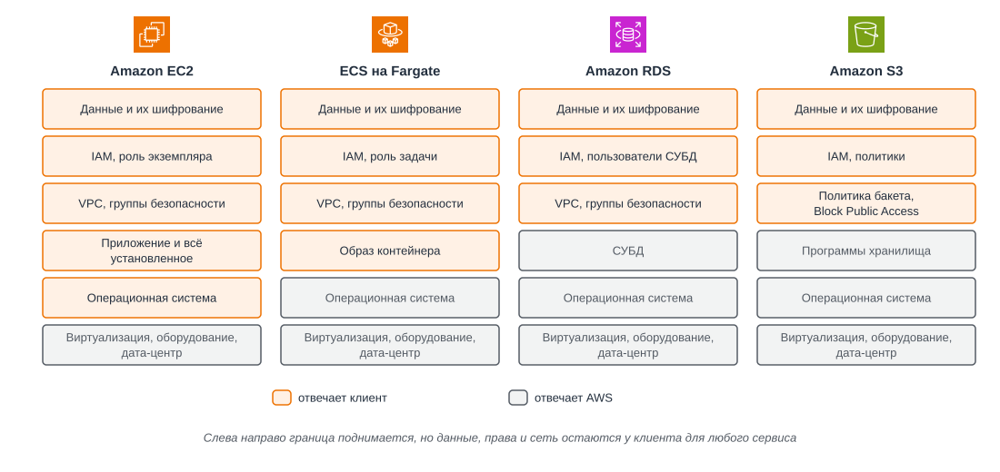
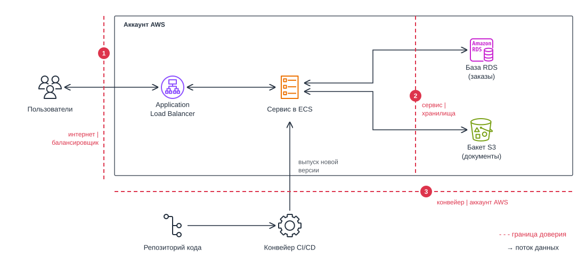
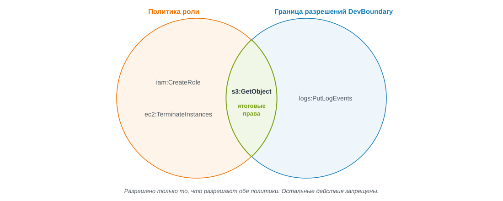
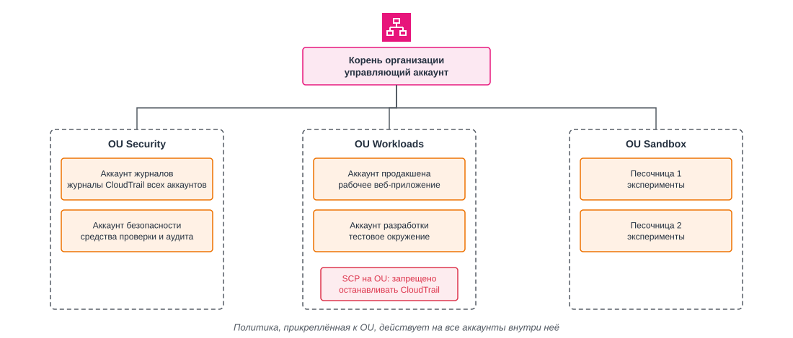
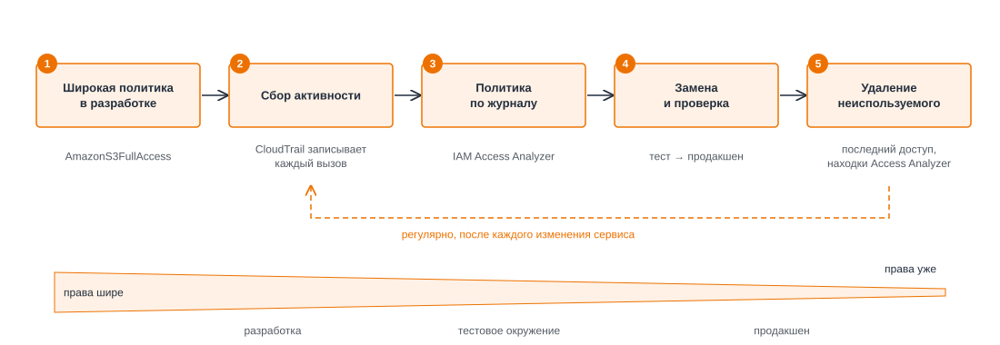
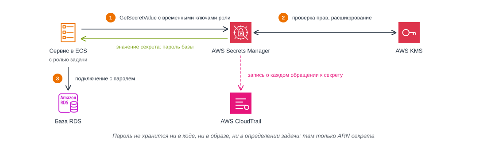
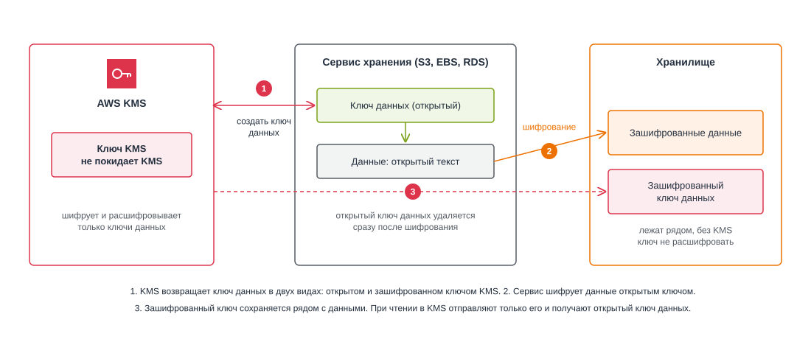
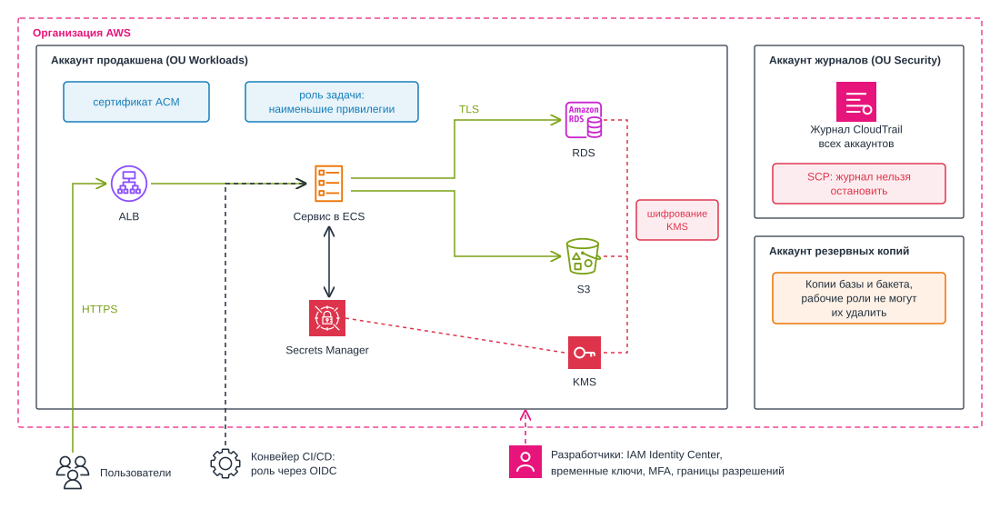

# Безопасность в облаке. IAM, AWS Organizations, AWS KMS, AWS Secrets Manager и AWS CloudTrail

<!-- Место для истории Эммы и Джона. -->

## Содержание

- [Безопасность в облаке. IAM, AWS Organizations, AWS KMS, AWS Secrets Manager и AWS CloudTrail](#безопасность-в-облаке-iam-aws-organizations-aws-kms-aws-secrets-manager-и-aws-cloudtrail)
  - [Содержание](#содержание)
  - [Вопросы для самопроверки](#вопросы-для-самопроверки)
  - [Результаты обучения](#результаты-обучения)
  - [Ретроспектива](#ретроспектива)
  - [Что значит "защищённая система"](#что-значит-защищённая-система)
    - [Информационная безопасность](#информационная-безопасность)
    - [Угроза, уязвимость и риск](#угроза-уязвимость-и-риск)
  - [Модель разделённой ответственности на практике](#модель-разделённой-ответственности-на-практике)
  - [Моделирование угроз](#моделирование-угроз)
    - [Четыре вопроса](#четыре-вопроса)
    - [Диаграмма потоков данных и границы доверия](#диаграмма-потоков-данных-и-границы-доверия)
    - [STRIDE](#stride)
  - [IAM: кто выполняет запрос и что ему разрешено](#iam-кто-выполняет-запрос-и-что-ему-разрешено)
    - [Аутентификация и авторизация](#аутентификация-и-авторизация)
    - [Кому какие учётные данные](#кому-какие-учётные-данные)
    - [Границы разрешений](#границы-разрешений)
  - [Доступ в масштабе организации](#доступ-в-масштабе-организации)
    - [Аккаунт как граница](#аккаунт-как-граница)
    - [AWS Organizations](#aws-organizations)
    - [Политики управления сервисами (SCP)](#политики-управления-сервисами-scp)
    - [IAM Identity Center](#iam-identity-center)
  - [Принцип наименьших привилегий и постепенное сужение прав](#принцип-наименьших-привилегий-и-постепенное-сужение-прав)
  - [Радиус поражения](#радиус-поражения)
  - [Управление секретами](#управление-секретами)
    - [Где утекают секреты](#где-утекают-секреты)
    - [Принципы работы с секретами](#принципы-работы-с-секретами)
    - [AWS Secrets Manager](#aws-secrets-manager)
  - [Шифрование данных](#шифрование-данных)
    - [Основные понятия](#основные-понятия)
    - [Данные при хранении и при передаче](#данные-при-хранении-и-при-передаче)
    - [Шифрование при передаче: TLS](#шифрование-при-передаче-tls)
    - [Шифрование при хранении: AWS KMS](#шифрование-при-хранении-aws-kms)
  - [Аудит доступа и анализ разрешений](#аудит-доступа-и-анализ-разрешений)
    - [AWS CloudTrail](#aws-cloudtrail)
    - [Анализ разрешений](#анализ-разрешений)
    - [AWS Config](#aws-config)
    - [Обнаружение угроз](#обнаружение-угроз)
  - [Реальные инциденты](#реальные-инциденты)
  - [Собираем решения вместе](#собираем-решения-вместе)
  - [Резюме](#резюме)

## Вопросы для самопроверки

1. Что означают конфиденциальность, целостность и доступность? Приведите пример нарушения каждого свойства в веб-приложении.
2. За что отвечает клиент, когда пользуется управляемым сервисом, например S3 или RDS?
3. На какие четыре вопроса отвечает моделирование угроз? Что такое граница доверия и почему угрозы ищут именно на ней?
4. Чем аутентификация отличается от авторизации? Почему людям и программам AWS рекомендует временные учётные данные?
5. Что делает граница разрешений и от какой проблемы она защищает? Чем SCP отличается от обычной политики IAM?
6. Как постепенно сузить права роли, если заранее неизвестно, какие действия ей понадобятся?
7. Что такое радиус поражения и какими средствами его уменьшают?
8. Почему пароль базы нельзя хранить в коде и прямо в конфигурации функции или задачи? Что даёт AWS Secrets Manager?
9. От чего защищает шифрование при хранении и при передаче, а от чего не защищает? Как работает конвертное шифрование?

## Результаты обучения

После изучения этой главы вы сможете:

- объяснить триаду конфиденциальности, целостности и доступности на примере облачного приложения,
- определить, за что отвечает клиент в модели разделённой ответственности для EC2, ECS на Fargate, RDS и S3,
- построить простую модель угроз: диаграмму потоков данных, границы доверия и угрозы по STRIDE,
- выбрать вид учётных данных и вид политики IAM для человека и для программы,
- объяснить, как AWS Organizations, SCP и IAM Identity Center помогают управлять доступом к нескольким аккаунтам,
- описать процесс постепенного сужения прав по журналу активности,
- предложить меры, которые уменьшают радиус поражения при утечке ключа,
- объяснить, где хранить секреты приложения и как приложение их получает,
- объяснить шифрование при хранении и при передаче, роль TLS и AWS KMS,
- найти в журнале AWS CloudTrail, кто и когда выполнил действие, и объяснить, как AWS Config находит неверные настройки ресурсов,
- разобрать реальный инцидент безопасности: что произошло, какое слабое место использовали и какая мера его закрывает.

## Ретроспектива

Меры безопасности появлялись в курсе по одной, вместе с сервисами:

- _Первая глава_. Модель разделённой ответственности: провайдер отвечает за безопасность самой инфраструктуры, клиент за то, что в ней разместил и как настроил. Граница зависит от модели обслуживания: IaaS, PaaS или SaaS.
- _Третья глава_. Root-пользователь и MFA, пользователь, группа, роль и политика IAM, неявный запрет всего, что не разрешено.
- _Четвёртая глава_. Machine identity: роль экземпляра, временные ключи от AWS STS, служба метаданных IMDS и атака на Capital One, в которой украли ключи роли с избыточными правами.
- _Пятая глава_. Приватные подсети и группы безопасности ограничивают, кто может подключиться к серверу по сети.
- _Шестая глава_. S3 шифрует объекты по умолчанию, политика бакета запрещает запросы без HTTPS, явный `Deny` сильнее любого `Allow`.
- _Девятая и двенадцатая главы_. Роль выполнения функции Lambda, роль задачи ECS и пароль базы, который задача получает из AWS Secrets Manager.

Каждая из этих мер закрывала одну конкретную проблему. Осталось собрать их в систему и ответить на общие вопросы:

- Как понять, от чего защищать конкретное приложение?
- Как управлять доступом десятков людей и программ к нескольким аккаунтам?
- Как ограничить ущерб, если ключ всё-таки украдут?
- Где хранить пароли и как шифровать данные?
- Как узнать, кто и что сделал в аккаунте?

## Что значит "защищённая система"

Фраза "приложение должно быть безопасным" ничего не говорит о том, что именно нужно сделать. Чтобы выбирать меры защиты, нужно сначала договориться, что значит "защищённая система".

### Информационная безопасность

**Информационная безопасность (information security)** - защита информации и информационных систем от несанкционированного доступа, использования, раскрытия, нарушения работы, изменения или уничтожения[^1]. Цель защиты определяют через три свойства, которые называют триадой CIA (confidentiality, integrity, availability)[^1]:

- **Конфиденциальность (confidentiality)** - информацию могут прочитать только те, кому это разрешено.
- **Целостность (integrity)** - информацию не может незаметно изменить или удалить тот, кому это не разрешено.
- **Доступность (availability)** - система и данные доступны тем, кому они нужны, тогда, когда они нужны.

Рассмотрим пример. Веб-приложение:

- хранит документы пользователей в S3,
- хранит заказы в базе данных RDS,
- работает в ECS.

Каждое свойство может нарушаться по-своему:

| Свойство           | Пример нарушения                                                        | Чем это плохо для пользователя                          |
| ------------------ | ----------------------------------------------------------------------- | ------------------------------------------------------- |
| Конфиденциальность | Бакет случайно сделали публичным, и чужие документы скачивает любой     | Личные данные попали к посторонним                      |
| Целостность        | Через уязвимость в приложении изменили сумму заказа в базе              | Пользователь платит не ту сумму, данным нельзя доверять |
| Доступность        | Кто-то с правами администратора удалил базу вместе с резервными копиями | Сервис не работает, заказы потеряны                     |

Безопасность не сводится к шифрованию и паролям. Удалённая база тоже инцидент безопасности, хотя ни один секрет при этом не утёк: пострадала доступность. Поэтому в эту главу входят и резервные копии, и разделение аккаунтов, а не только защита от чтения.

Три свойства триады отвечают на вопрос, _что_ нужно защитить. Вопрос, _как_ их могут нарушить, разобран в разделе ["STRIDE"](#stride): там каждая категория угроз связана со свойством, которое она нарушает.

### Угроза, уязвимость и риск

Три слова встречаются в каждом разговоре о безопасности, и их легко смешать:

- **Угроза (threat)** - обстоятельство или событие, которое может нанести вред системе или организации через несанкционированный доступ, раскрытие, изменение или уничтожение информации или отказ в обслуживании[^2]. Например, кто-то получит ключ доступа к аккаунту. _Угроза_ еще не является инцидентом, пока не реализуется через _уязвимость_.
- **Уязвимость (vulnerability)** - слабое место в системе или реализации, которым может воспользоваться источник угрозы[^3]. Например, ключ доступа лежит в коде в репозитории.
- **Риск (risk)** - мера того, насколько угроза опасна для организации. Обычно риск оценивают по двум величинам:
  - насколько большой ущерб будет,
  - насколько вероятно событие[^4].

  На некоторые угрозы компания может закрыть глаза, если риск от них невелик, а на другие нужно реагировать активно, снижая вероятность реализации угрозы или уменьшая потенциальный ущерб.

Угроза без уязвимости не реализуется: если ключа в репозитории нет, его оттуда не украдут. Поэтому работа над безопасностью сводится к поиску уязвимостей, через которые реализуются самые опасные угрозы, и к их устранению.

## Модель разделённой ответственности на практике

Прежде чем искать уязвимости, нужно понять, какие из них вообще находятся на стороне клиента, а за них отвечает AWS. Эту границу задаёт модель разделённой ответственности:

- AWS отвечает за _безопасность облака (security of the cloud)_,
- клиент за _безопасность в облаке (security in the cloud)_[^5].

Граница зависит от сервиса:

- Для EC2 клиент выполняет всю настройку безопасности сам и обновляет гостевую ОС и приложения[^5].
- Для S3 AWS обслуживает инфраструктуру, операционную систему и платформу, а клиент работает с данными и правами доступа[^5].

Сервисы, которые встречались в курсе, распределяют ответственность так:

| Что защищают                                 | EC2                                       | ECS на Fargate           | RDS                             | S3                                           |
| -------------------------------------------- | ----------------------------------------- | ------------------------ | ------------------------------- | -------------------------------------------- |
| Оборудование, дата-центр, виртуализация      | AWS                                       | AWS                      | AWS                             | AWS                                          |
| Операционная система сервера и её обновления | Клиент                                    | AWS                      | AWS                             | AWS                                          |
| Программы на сервере                         | Клиент: приложение и всё, что установлено | Клиент: образ контейнера | AWS: СУБД                       | AWS                                          |
| Сеть: VPC, группы безопасности               | Клиент                                    | Клиент                   | Клиент                          | Клиент: политика бакета, Block Public Access |
| Права доступа: IAM, пользователи базы        | Клиент                                    | Клиент: роль задачи      | Клиент: IAM и пользователи СУБД | Клиент                                       |
| Шифрование данных                            | Клиент                                    | Клиент                   | Клиент                          | Клиент выбирает вариант, по умолчанию SSE-S3 |
| Сами данные                                  | Клиент                                    | Клиент                   | Клиент                          | Клиент                                       |

Таблица составлена по описанию модели для ECS[^6] и разделу о безопасности RDS[^7].



_13.1. Граница ответственности для EC2, ECS на Fargate, RDS и S3_

На рисунке 13.1 видно, что граница поднимается от EC2 к S3, но четыре последние строки таблицы при этом не меняются. Часть мер AWS называет _общими (shared controls)_: они действуют и на уровне инфраструктуры, и на уровне клиента. Например,

- AWS обновляет свою инфраструктуру, а клиент - свою гостевую ОС,
- AWS обучает своих сотрудников, а клиент своих[^5].

> [!WARNING]
>
> Управляемый сервис не означает, что AWS защищает всё. На любом уровне абстракции данные, права доступа и настройки остаются на стороне клиента. Атака на Capital One прошла через инфраструктуру AWS, которая работала правильно: уязвимостями были настройка сервера и избыточные права роли, а это ответственность клиента.

## Моделирование угроз

Модель разделённой ответственности показывает, за что отвечает клиент. Но защититься от всего сразу нельзя: времени и денег всегда меньше, чем возможных атак. Нужен способ найти угрозы, которые важны именно для этой системы.

### Четыре вопроса

**Моделирование угроз (threat modelling)** - анализ описания системы, который выявляет проблемы её безопасности и конфиденциальности данных[^8]. Результат моделирования - список угроз и мер против них, расставленных по приоритету[^9].

Метод может быть любым, но любой метод отвечает на четыре вопроса[^8]:

1. _Над чем мы работаем?_ Описание системы: компоненты, данные, связи между ними.
2. _Что может пойти не так?_ Список угроз.
3. _Что мы будем с этим делать?_ Меры для каждой угрозы. AWS добавляет к нему ещё один вопрос: кто отвечает за меру, клиент или провайдер[^9].
4. _Достаточно ли хорошо мы справились?_ Проверка, что меры закрывают угрозы и что модель не устарела.

Начинать моделирование угроз AWS рекомендует как можно раньше, на этапе проектирования, и пересматривать модель при каждом изменении системы[^9]. Модель угроз - живой документ, а не отчёт, который пишут один раз перед выпуском.

### Диаграмма потоков данных и границы доверия

На первый вопрос чаще всего отвечают схемой.

_Диаграмма потоков данных (data flow diagram, DFD)_ показывает, как данные проходят через систему: внешние участники, процессы, хранилища и потоки между ними[^10] - это самая высокая абстракция, которая позволяет увидеть, как данные перемещаются. На этой же диаграмме отмечают **границы доверия (trust boundary)**: места, где меняется уровень доверия к данным или к тому, кто их отправил[^10].

Рассмотрим пример. Веб-приложение принимает запросы пользователей через Application Load Balancer, обрабатывает их в сервисе ECS, хранит заказы в RDS и документы в S3. Новую версию выпускает конвейер CI/CD. На диаграмме пользователи - внешние участники, сервис в ECS - процесс, база RDS и бакет S3 - хранилища.



_13.2. Диаграмма потоков данных веб-приложения и границы доверия_

На рисунке 13.2 три границы доверия:

- _Интернет и балансировщик_. Сюда приходит любой запрос от любого клиента, и ни одному из них нельзя верить заранее.
- _Сервис и хранилища_. Сервис обращается к базе и бакету от имени своей роли. Если сервис взломают, атакующий получит права этой роли.
- _Конвейер и аккаунт AWS_. Конвейер создаёт и меняет ресурсы. Тот, кто управляет конвейером, управляет и продакшеном.

Угрозы ищут прежде всего на этих границах, потому что именно там данные переходят от менее доверенной стороны к более доверенной.

### STRIDE

Второй вопрос, "что может пойти не так", проще разбирать по готовому списку категорий. Один из распространённых списков такого рода предложила Microsoft.

**STRIDE** - модель классификации угроз, которая делит их на шесть категорий - название составлено из первых букв английских названий категорий[^11]:

| Категория                                    | Что делает атакующий                                    | Какое свойство нарушено                              | Пример в веб-приложении                       | Мера против угрозы                                       |
| -------------------------------------------- | ------------------------------------------------------- | ---------------------------------------------------- | --------------------------------------------- | -------------------------------------------------------- |
| Spoofing, подмена                            | Выдаёт себя за другого, используя чужие учётные данные  | Аутентичность: участник тот, за кого себя выдаёт     | Входит в аккаунт AWS с украденным ключом      | Временные учётные данные, MFA                            |
| Tampering, искажение                         | Изменяет данные                                         | Целостность                                          | Меняет сумму заказа в базе                    | Права только на нужные действия, шифрование при передаче |
| Repudiation, отказ от действия               | Отрицает, что выполнил действие, и проверить это нельзя | Неотказуемость: своё действие нельзя отрицать        | Администратор удалил бакет, а журнала нет     | Журнал действий                                          |
| Information disclosure, раскрытие            | Читает данные, к которым нет доступа                    | Конфиденциальность                                   | Скачивает документы из открытого бакета       | Наименьшие привилегии, шифрование                        |
| Denial of service, отказ в обслуживании      | Делает систему недоступной                              | Доступность                                          | Удаляет базу или перегружает сервис запросами | Разделение аккаунтов, резервные копии, масштабирование   |
| Elevation of privilege, повышение привилегий | Получает больше прав, чем ему выдали                    | Разграничение прав: каждый делает только разрешённое | Разработчик создаёт себе роль администратора  | Границы разрешений, ограничения на уровне организации    |

STRIDE и триада CIA смотрят на одну и ту же защиту с двух сторон: 

- CIA называет свойства, которые нужно сохранить,
- а STRIDE - способы их нарушить.

Третий столбец таблицы показывает эту связь: каждая категория STRIDE нарушает одно свойство[^12]:

- _Три категории нарушают свойства CIA напрямую_. Искажение нарушает целостность, раскрытие - конфиденциальность, отказ в обслуживании - доступность.
- _Три категории нарушают дополнительные свойства_. Подмена нарушает аутентичность, отказ от действия - неотказуемость, повышение привилегий - разграничение прав.

Меры из последнего столбца и составляют остальную главу. Каждый следующий раздел отвечает на третий вопрос моделирования, "что мы будем с этим делать", для одной или двух угроз:

| Раздел главы                                                                                 | Угрозы STRIDE                              | Защищаемые свойства               |
| -------------------------------------------------------------------------------------------- | ------------------------------------------ | --------------------------------- |
| ["IAM"](#iam-кто-выполняет-запрос-и-что-ему-разрешено)                                       | Подмена, повышение привилегий              | Аутентичность, разграничение прав |
| ["Доступ в масштабе организации"](#доступ-в-масштабе-организации)                            | Повышение привилегий, отказ в обслуживании | Разграничение прав, доступность   |
| ["Принцип наименьших привилегий"](#принцип-наименьших-привилегий-и-постепенное-сужение-прав) | Раскрытие, искажение                       | Конфиденциальность, целостность   |
| ["Радиус поражения"](#радиус-поражения)                                                      | Отказ в обслуживании                       | Доступность                       |
| ["Управление секретами"](#управление-секретами)                                              | Подмена, раскрытие                         | Аутентичность, конфиденциальность |
| ["Шифрование данных"](#шифрование-данных)                                                    | Раскрытие, искажение                       | Конфиденциальность, целостность   |
| ["Аудит доступа и анализ разрешений"](#аудит-доступа-и-анализ-разрешений)                    | Отказ от действия                          | Неотказуемость                    |

В начале каждого из этих разделов стоит короткая врезка: от каких угроз из таблицы STRIDE защищает этот раздел и что эти угрозы нарушают, а в разделе ["Собираем решения вместе"](#собираем-решения-вместе) все меры сведены в одну таблицу. MFA и масштабирование встречались в третьей и восьмой главах, поэтому отдельных разделов у них нет.

> [!TIP]
> Для каждой стрелки, которая пересекает границу доверия на диаграмме, достаточно пройти по шести буквам STRIDE и спросить: "возможна ли здесь такая угроза?". Специальные инструменты для этого не нужны, хватит диаграммы и таблицы.

## IAM: кто выполняет запрос и что ему разрешено

> _Этот раздел показывает, как IAM защищает от двух угроз STRIDE: подмены и повышения привилегий. При подмене атакующий входит с чужими учётными данными и нарушает аутентичность. При повышении привилегий он получает больше прав, чем ему выдали, и нарушает разграничение прав._

Основу IAM дала третья глава: пользователи, группы, роли и политики. Здесь к ней добавляются три вещи:

- как AWS проверяет запрос,
- кому какие учётные данные выдавать,
- как ограничить права, которые выдают другие.

### Аутентификация и авторизация

Каждый запрос к AWS проходит две проверки:

- **Аутентификация (authentication)** - проверка того, кто отправил запрос. AWS проверяет подпись запроса, сделанную ключом доступа, либо пароль, либо временные учётные данные.
- **Авторизация (authorization)** - проверка того, разрешено ли этому участнику выполнить запрошенное действие с запрошенным ресурсом. AWS проверяет политики.

**Принципал (principal)** - тот, кто может отправить запрос к ресурсу AWS: root-пользователь, пользователь IAM или роль IAM[^13]. Группа принципалом не является: от её имени запрос отправить нельзя, она только передаёт права своим участникам[^13].

Если рассматривать STRIDE, то

- _Подмена в STRIDE_ - атака на аутентификацию: атакующий проходит первую проверку с чужими учётными данными.
- _Повышение привилегий в STRIDE_ - атака на авторизацию: атакующий проходит вторую проверку, потому что ему выдали больше прав, чем нужно.

### Кому какие учётные данные

Пользователи IAM и root-пользователь получают _постоянные учётные данные (long-term credentials)_: пароль и ключи доступа, которые действуют, пока их не удалят. Роли получают _временные учётные данные_ от STS[^13]. Из этой разницы следуют рекомендации AWS[^14]:

| Кто обращается к AWS                       | Как получить доступ                                                                                                                                        | Почему                                                                                  |
| ------------------------------------------ | ---------------------------------------------------------------------------------------------------------------------------------------------------------- | --------------------------------------------------------------------------------------- |
| Человек в организации                      | Вход через IAM Identity Center или внешнюю систему учётных записей, после которого человек принимает роль                                                  | Временные ключи, один вход для многих аккаунтов, MFA                                    |
| Программа внутри AWS: EC2, Lambda, ECS     | Роль, прикреплённая к ресурсу                                                                                                                              | AWS выдаёт и обновляет временные ключи сама, постоянных ключей нет                      |
| Программа вне AWS, например конвейер CI/CD | Роль, которую программа принимает по OIDC (OpenID Connect), стандарту подтверждения личности: например, GitHub подтверждает AWS, какой конвейер обращается | Временные ключи вместо ключа, сохранённого в настройках конвейера                       |
| Программа, которая не может принять роль   | Пользователь IAM с ключом доступа                                                                                                                          | Исключение, единственный случай, когда AWS называет пользователя IAM основным вариантом |

Вход через внешнюю систему учётных записей называется _федерацией (federation)_: личность человека и его пароль хранит внешний поставщик, например корпоративный каталог сотрудников, а AWS ему доверяет[^13]. IAM Identity Center описан в разделе ["IAM Identity Center"](#iam-identity-center).

> [!WARNING]
>
> Рекомендация для людей отличается от учебной практики третьей главы. Там пользователь IAM с паролем был нужен, чтобы увидеть устройство прав в одном учебном аккаунте. В организации людям не создают пользователей IAM с постоянными ключами: такой ключ живёт вечно и именно его чаще всего находят в репозиториях.

### Границы разрешений

Когда команд много, администратор не успевает сам создавать каждую роль. Но если разрешить разработчикам создавать роли самим, появляется новая угроза.

Рассмотрим пример. Команда разработчиков создаёт функции Lambda, и каждой функции нужна своя роль. Разработчик может создать роль с `AdministratorAccess` и передать её своей функции[^15]. Функция выполняет код, который написал разработчик, с правами этой роли. В результате разработчик получает права администратора, хотя ему их никто не выдавал.

**Повышение привилегий (privilege escalation)** - получение прав сверх выданных с помощью тех прав, которые у участника уже есть.

**Граница разрешений (permissions boundary)** - политика, которая задаёт потолок прав одного пользователя или одной роли[^16]. Сама граница ничего не разрешает. Действие выполняется, только если его разрешают обе политики: обычная политика роли и граница[^16].

Вернёмся к примеру. Администратор написал границу `DevBoundary`, в которой разрешены только чтение объектов S3 и запись журналов. Разработчикам разрешено создавать роли, но только с этой границей. Разработчик создаёт роль для своей функции и выдаёт ей широкие права: чтение объектов S3, создание ролей и удаление серверов. Вот что сможет роль:

| Действие                 | Разрешает политика роли? | Разрешает граница? | Итог      |
| ------------------------ | ------------------------ | ------------------ | --------- |
| `s3:GetObject`           | Да                       | Да                 | Разрешено |
| `iam:CreateRole`         | Да                       | Нет                | Запрещено |
| `ec2:TerminateInstances` | Да                       | Нет                | Запрещено |
| `logs:PutLogEvents`      | Нет                      | Да                 | Запрещено |

Первые три строки показывают главное: какие бы права разработчик ни выдал роли, она не выйдет за границу. Создать себе роль администратора или удалить серверы через функцию не получится. Последняя строка показывает, что граница сама прав не добавляет: запись журналов есть в границе, но роль её не получила, потому что политика роли этого действия не разрешает.



_13.3. Права как пересечение политики роли и границы разрешений_

На рисунке 13.3 итоговые права - только общая часть двух кругов. Чтобы разработчик не снял границу, ему запрещают изменять и удалять её саму[^16].

## Доступ в масштабе организации

> _Этот раздел показывает, как разделение систем по аккаунтам и ограничения организации защищают от двух угроз STRIDE: повышения привилегий и отказа в обслуживании. Если все системы живут в одном аккаунте, его администратор может выдать себе любые права или удалить всё сразу._

До сих пор все примеры курса жили в одном аккаунте. Политики IAM действуют внутри аккаунта, и одна ошибка в них, например `"Resource": "*"` в политике роли, открывает доступ сразу ко всем системам этого аккаунта.

### Аккаунт как граница

_Аккаунт AWS - граница изоляции_: по умолчанию ресурсы одного аккаунта недоступны из другого, поэтому ошибка или атака в одном аккаунте не затрагивает остальные[^17][^18]. AWS рекомендует разделять системы по аккаунтам[^17][^18]:

- _Продакшен отдельно от разработки_. Разработчик экспериментирует в своём аккаунте и не может случайно удалить рабочую базу.
- _Данные разной важности отдельно_. Аккаунт с персональными данными закрыт строже остальных.
- _Журналы и средства безопасности отдельно_. Тот, кто взломал рабочий аккаунт, не получает доступа к журналам, которые фиксируют его действия.
- _Эксперименты отдельно_. Песочница для проб, которую можно очистить целиком.

Отдельной платы за количество аккаунтов нет[^18].

### AWS Organizations

Когда аккаунтов десять, настраивать каждый вручную долго, а общее правило легко забыть в одном из них.

**AWS Organizations** - сервис AWS, который объединяет несколько аккаунтов AWS в организацию и позволяет централизованно управлять ими: создавать аккаунты, группировать их и применять к ним общие политики[^19].

| Характеристика      | AWS Organizations                                                                                 |
| ------------------- | ------------------------------------------------------------------------------------------------- |
| Категория           | Управление аккаунтами и доступом                                                                  |
| Что делает          | Объединяет аккаунты AWS в организацию с общей структурой, политиками и оплатой                    |
| Для чего нужен      | Оплачивать все аккаунты одним счётом и задавать для них общие ограничения                         |
| Где используют      | Компании с несколькими командами и окружениями, университеты, где у каждого студента свой аккаунт |
| Модель обслуживания | PaaS: AWS ведёт структуру организации, клиент задаёт аккаунты и политики                          |
| Область действия    | Глобальный сервис                                                                                 |
| Как оплачивается    | Бесплатно, оплачиваются только ресурсы в аккаунтах[^20]                                           |
| Как работать        | Консоль, CLI, SDK                                                                                 |
| Появился            | Февраль 2017 года[^21]                                                                            |
| Аналоги             | Google Cloud Resource Manager: организация, папки и проекты                                       |

Организация состоит из нескольких частей[^22]:

- **Управляющий аккаунт (management account)** - аккаунт, который создал организацию. Он приглашает и создаёт аккаунты и применяет политики.
- **Аккаунт-участник (member account)** - любой другой аккаунт организации. Аккаунт может состоять только в одной организации.
- **Организационная единица (organizational unit, OU)** - группа аккаунтов внутри организации. OU может содержать другие OU, и политика, прикреплённая к OU, действует на все аккаунты внутри неё.



_13.4. Организация из нескольких аккаунтов_

На рисунке 13.4 показана структура по образцу AWS. Сама AWS называет этот образец ориентиром, а не обязательным шаблоном[^23]:

- OU `Security` для журналов и средств безопасности,
- OU `Workloads` с аккаунтами продакшена и разработки,
- OU `Sandbox` для экспериментов.

### Политики управления сервисами (SCP)

Граница разрешений ограничивает роли, которые создают разработчики. Но администратор аккаунта может создать роль и без границы. Нужны ограничения, которые действуют на весь аккаунт и которые нельзя снять изнутри него.

**SCP (service control policy, политика управления сервисами)** - политика организации, которая задаёт потолок прав для всех пользователей и ролей в аккаунтах, к которым она прикреплена[^24]. Как и граница разрешений, SCP сама ничего не разрешает[^24]. Её ограничения действуют даже на root-пользователя аккаунта-участника[^24].

Рассмотрим пример. Журналы всех аккаунтов пишет AWS CloudTrail - сервис журнала действий, о котором подробнее в разделе ["AWS CloudTrail"](#aws-cloudtrail). Атакующий, захвативший аккаунт, первым делом попробует остановить журнал, чтобы скрыть свои действия. SCP на OU `Workloads`, упрощённая из примера AWS, запрещает это всем[^25]:

```json
{
  "Version": "2012-10-17",
  "Statement": [
    {
      "Effect": "Deny",
      "Action": ["cloudtrail:StopLogging", "cloudtrail:DeleteTrail"],
      "Resource": "*"
    }
  ]
}
```

Даже если политика роли разрешает `cloudtrail:StopLogging`, запрос будет отклонён: как и в шестой главе, явный `Deny` в любой политике сильнее любого `Allow`[^26]. Так же SCP запрещают работу вне разрешённых регионов или выход аккаунта из организации.

> [!WARNING]
>
> SCP не действует на управляющий аккаунт[^24]. Поэтому в нём не размещают рабочие ресурсы и не дают к нему доступ разработчикам: всё, что SCP запрещает в других аккаунтах, в управляющем аккаунте остаётся разрешённым.

### IAM Identity Center

Остался вопрос о людях. Если у разработчика пять аккаунтов, создавать ему пять пользователей IAM с пятью паролями неудобно и опасно.

**IAM Identity Center** - сервис AWS, через который люди входят один раз и получают доступ к нескольким аккаунтам организации и к приложениям[^27]. Пользователей можно создать в самом сервисе или подключить существующий каталог сотрудников организации[^27].

Права в нём задают через **набор разрешений (permission set)** - шаблон из политик, который назначают человеку или группе для конкретного аккаунта. В каждом аккаунте, где набор назначен, Identity Center создаёт роль IAM с этими политиками[^28]. Человек получает доступ в три шага:

1. Выбирает аккаунт и набор разрешений.
2. Принимает соответствующую роль.
3. Получает временные учётные данные.

Сессия по умолчанию длится один час, максимальная длительность - 12 часов[^28].

Рассмотрим пример. Группе разработчиков назначены два набора: `ReadOnly` в аккаунте продакшена и `Developer` в аккаунте разработки. Разработчик входит один раз и в каждом аккаунте получает только те права, которые ему положены там.

## Принцип наименьших привилегий и постепенное сужение прав

> _Этот раздел показывает, как наименьшие привилегии защищают от двух угроз STRIDE: раскрытия и искажения данных. Тот, кто захватит роль, прочитает и изменит всё, что ей разрешено, поэтому чем меньше у роли прав, тем меньше он сможет прочитать и изменить._

Принцип наименьших привилегий появился ещё в третьей главе как правило "_выдавать только нужные права_". На практике трудно другое: понять, какие права нужны, если сервис ещё только пишут.

**Принцип наименьших привилегий (least privilege)** - принцип безопасности, по которому система ограничивает права пользователей и процессов, действующих от их имени, минимумом, необходимым для выполнения их задач[^29]. AWS формулирует его конкретнее: выдавать только доступ к определённым действиям над определёнными ресурсами при определённых условиях[^30].

Если начинать с пустой политики, сервис падает на каждом новом вызове, и разработчик добавляет права по одному. Если начинать с `"Action": "*"`, всё работает сразу, и лишние права остаются навсегда. AWS предлагает средний путь: начинать с более широких прав там, где ошибка обходится дёшево, и сужать их по мере того, как становится понятно, что сервис действительно делает[^14][^31]:

1. _Начать с готовой политики AWS, только в аккаунте разработки и только на время_. Например, `AmazonS3FullAccess`, пока сервис ещё меняется. Готовые политики AWS (AWS managed policies) написаны для многих клиентов сразу и наименьших привилегий не дают[^32].
2. _Собрать фактическую активность_. Сервис работает в разработке и на тестовом окружении, а CloudTrail записывает его вызовы API. Операции с объектами S3 попадают в журнал, только если для бакета включена их запись[^31]; подробнее об этом в разделе ["AWS CloudTrail"](#aws-cloudtrail).
3. _Сгенерировать политику по журналу_. IAM Access Analyzer, сервис анализа прав в IAM, умеет составить политику из действий, которые роль действительно выполняла по журналу CloudTrail[^33].
4. _Заменить широкую политику сгенерированной и проверить_. На каждом следующем окружении, от тестового к продакшену, права более узкие, чем на предыдущем[^31].
5. _Регулярно удалять неиспользуемое_. Для каждого пользователя и роли IAM показывает _последний доступ (last accessed information)_: когда использовался каждый сервис. IAM Access Analyzer также находит роли, ключи и пароли, которыми давно не пользовались[^14][^33].



_13.5. Цикл постепенного сужения прав_

На рисунке 13.5 шаги со второго по пятый повторяются после каждого изменения сервиса, а права сужаются от разработки к продакшену.

Рассмотрим пример. Роли сервиса документов на время разработки выдали `AmazonS3FullAccess`. Запись операций с объектами для бакета включена. Через месяц работы на тестовом окружении журнал показывает только три вида вызовов:

| Действие        | Ресурс                            | Сколько раз за месяц |
| --------------- | --------------------------------- | -------------------- |
| `s3:PutObject`  | `arn:aws:s3:::app-docs/uploads/*` | 1 240                |
| `s3:GetObject`  | `arn:aws:s3:::app-docs/uploads/*` | 3 870                |
| `s3:ListBucket` | `arn:aws:s3:::app-docs`           | 410                  |

Политика `AmazonS3FullAccess` разрешает роли любые действия со всеми бакетами аккаунта, в том числе удаление. Новая политика содержит три действия и два ресурса из таблицы. Если сервис взломают, атакующий сможет читать и записывать документы в одном префиксе одного бакета, но не удалит ни один бакет аккаунта.

Кроме списка действий права сужают ещё двумя способами:

- конкретным ARN в `Resource` вместо `*`,
- условиями в `Condition`, например только запросы по HTTPS или только из определённой сети[^14].

Сужение прав нельзя откладывать на "потом". Фраза "временно дадим `*`, потом уберём" обычно означает, что `*` останется навсегда: сервис работает, и трогать его страшно. AWS называет постепенное накопление лишних прав из-за редких проверок типичной ошибкой[^30]. Сужение прав должно быть запланированным шагом выпуска, а не намерением.

## Радиус поражения

> _Этот раздел показывает, как ограничить ущерб от угрозы STRIDE "отказ в обслуживании" и сохранить доступность. Атакующий может удалить всё, до чего дотягиваются украденные права, и тогда система перестанет работать._

Даже при наименьших привилегиях учётные данные иногда утекают. Поэтому вторая половина защиты отвечает не на вопрос "как не пустить атакующего", а на вопрос "сколько он успеет испортить, если всё-таки попадёт внутрь".

**Радиус поражения (blast radius)** - часть системы, которую затрагивает одна ошибка, сбой или атака[^18]. Чем меньше радиус, тем меньше ущерб от одного инцидента. Близкая идея - _эшелонированная защита (defense in depth)_: несколько независимых мер защиты, расположенных слоями, так что ошибка в одной не открывает доступ ко всему[^34].

Радиус поражения ограничивают на нескольких уровнях, и каждый уровень - отдельный слой эшелонированной защиты:

| Уровень изоляции             | Что ограничивает                                      | Пример                                                                             |
| ---------------------------- | ----------------------------------------------------- | ---------------------------------------------------------------------------------- |
| Аккаунт                      | Ущерб от захвата аккаунта или ошибки в его настройках | Продакшен, разработка и журналы в разных аккаунтах организации                     |
| Роль                         | Ущерб от взлома одного сервиса                        | У сервиса документов своя роль, у сервиса заказов своя                             |
| Срок действия учётных данных | Время, в течение которого украденный ключ работает    | Временные ключи роли вместо постоянного ключа пользователя                         |
| Сеть                         | Кто может подключиться к ресурсу                      | База в приватной подсети, группа безопасности пускает только сервис                |
| Ограничения организации      | Действия, недоступные никому в аккаунте               | SCP запрещает останавливать журнал и удалять резервные копии                       |
| Резервные копии              | Возможность восстановиться после удаления             | Копии в отдельном аккаунте, к которому у рабочего аккаунта нет доступа на удаление |

Рассмотрим пример. В первом варианте все сервисы веб-приложения пользуются одним ключом доступа с правами администратора. Во втором у каждого сервиса своя роль с наименьшими привилегиями, а продакшен живёт в отдельном аккаунте. Атакующий нашёл уязвимость в сервисе документов:

- _В первом варианте_ он получает ключ, который действует, пока его не удалят, и разрешает всё: читать базу, удалять бакеты, создавать серверы для майнинга. Радиус поражения - весь аккаунт.
- _Во втором варианте_ он получает временные ключи роли, которые через несколько часов перестанут работать и разрешают только чтение и запись в один префикс одного бакета. Радиус поражения - документы одного сервиса.

> [!IMPORTANT]
>
> Резервная копия в том же аккаунте и под теми же правами не защищает от взлома аккаунта. Тот, кто получил права администратора, удалит и данные, и копии. Копии для восстановления после атаки хранят в отдельном аккаунте, а права на их удаление не выдают ни одной рабочей роли.

## Управление секретами

> _Этот раздел показывает, как правильное хранение секретов защищает от двух угроз STRIDE: подмены и раскрытия. Украденный пароль базы позволяет выдать себя за приложение и прочитать его данные._

Роли решают проблему ключей AWS, но у приложения есть и другие учётные данные:

- пароль базы данных,
- ключ API платёжной системы,
- токен сервиса отправки писем.

Их нужно где-то хранить, и именно они чаще всего попадают в чужие руки.

**Секрет (secret)** - учётные данные, которые программа использует для доступа к другой системе: пароли баз данных, ключи API, токены, ключи SSH, сертификаты[^35].

### Где утекают секреты

Секрет может утечь и без взлома хранилища, если его положили туда, где его видят слишком много людей и программ:

- _Код и репозиторий_. Строка `password = "..."` в исходном коде попадает в историю Git, в каждую копию репозитория на ноутбуках и в каждую ветку. Приватный репозиторий не спасает: в него добавляют людей, его клонируют, его могут сделать публичным.
- _Образ контейнера_. Секрет, скопированный в образ при сборке, получает каждый, кто может скачать образ из реестра.
- _Значение секрета в конфигурации_. Если записать пароль прямо в переменные окружения функции Lambda или в поле `environment` определения задачи ECS, его увидит каждый, кто может прочитать эту конфигурацию[^36]. В ECS такие значения могут попасть ещё и в журналы и в вывод `docker inspect`[^37].
- _Журналы_. Приложение, которое пишет в журнал весь запрос или всю конфигурацию при старте, записывает туда и пароли.

AWS называет хранение долгоживущих учётных данных в коде и конфигурационных файлах типичной ошибкой с высоким риском[^38].

### Принципы работы с секретами

Подход AWS к секретам описывают тремя словами: _убрать_, _заменить_, _менять_ (remove, replace, rotate)[^38]:

1. _Убрать_. Лучший секрет тот, которого нет. Если программе нужен доступ к AWS, ей выдают роль, а не ключ. Конвейер CI/CD получает доступ к AWS через OIDC и роль, а не через ключ доступа в настройках конвейера.
2. _Заменить_. Если долгоживущий секрет нужен, его заменяют на временные учётные данные, где это возможно, а остальное переносят в специальное хранилище секретов.
3. _Менять_. Секрет, который остаётся, регулярно заменяют новым. Тогда украденное значение работает недолго.

К этому OWASP (Open Worldwide Application Security Project), открытое сообщество специалистов по безопасности приложений, добавляет общие правила для любого хранилища[^35]:

- секреты хранят централизованно,
- доступ к каждому секрету выдают по принципу наименьших привилегий,
- каждое обращение к секрету записывают в журнал,
- люди по возможности вообще не видят значений.

### AWS Secrets Manager

**AWS Secrets Manager** - сервис AWS для хранения, выдачи и регулярной замены секретов: паролей баз данных, ключей API, токенов OAuth и других учётных данных[^39]. Приложение не хранит секрет у себя, а запрашивает его у сервиса во время работы[^39].

| Характеристика      | AWS Secrets Manager                                                                                     |
| ------------------- | ------------------------------------------------------------------------------------------------------- |
| Категория           | Безопасность, управление секретами                                                                      |
| Что делает          | Хранит секреты в зашифрованном виде, выдаёт их по запросу с проверкой прав IAM, меняет их по расписанию |
| Для чего нужен      | Убрать пароли и ключи из кода, образов и конфигурации                                                   |
| Где используют      | Пароли баз RDS, ключи внешних API, токены для приложений в EC2, Lambda и ECS                            |
| Модель обслуживания | PaaS: AWS хранит и шифрует секреты, клиент задаёт секреты и права доступа к ним                         |
| Область действия    | Регион                                                                                                  |
| Как оплачивается    | 0,40 USD за секрет в месяц и 0,05 USD за 10 000 запросов в `eu-central-1`[^40]                          |
| Как работать        | Консоль, CLI, SDK, параметр `secrets` в определении задачи ECS                                          |
| Появился            | Апрель 2018 года[^41]                                                                                   |
| Аналоги             | Google Cloud Secret Manager[^42], HashiCorp Vault                                                       |

Приложение получает секрет за три шага, как показано на рисунке 13.6:

1. Сервис в ECS обращается к Secrets Manager с временными ключами своей роли и вызывает `GetSecretValue`.
2. Secrets Manager проверяет, разрешено ли роли читать этот секрет, и расшифровывает значение ключом из AWS KMS, сервиса ключей шифрования.
3. Сервис получает пароль базы и подключается к RDS. Обращение записывается в журнал CloudTrail[^39].



_13.6. Как приложение получает секрет_

В ECS этот запрос можно не писать в коде: параметр `secrets` в определении задачи подставляет значение секрета в переменную окружения контейнера при запуске задачи[^37]. В определении задачи хранится только ARN секрета, а читает секрет сам ECS с правами роли выполнения задачи. Значит, опасна не переменная окружения как таковая: она только передаёт значение программе. Опасно записать само значение пароля в поле `environment`, где его прочитает любой, кто видит определение задачи. Значение подставляется только при запуске, поэтому после смены секрета задачу перезапускают[^37].

**Ротация (rotation)** - периодическая замена секрета новым значением одновременно в хранилище и в системе, которая этот секрет проверяет, например в базе данных[^43]. Для части секретов, например паролей RDS, AWS выполняет ротацию сама, а для остальных её выполняет функция Lambda[^43]. Приложение, которое каждый раз читает секрет из Secrets Manager, не нужно переделывать и заново выпускать после ротации[^39].

> [!NOTE]
> 
> Для обычных настроек, не секретов, подходит _Parameter Store_ - хранилище настроек в AWS Systems Manager. Параметр типа `SecureString` в нём шифруется, а стандартные параметры бесплатны[^44].

> [!TIP]
> 
> GitHub сам проверяет публичные репозитории на утёкшие секреты, а функция push protection по умолчанию не даёт отправить в публичный репозиторий коммит с распознанным ключом[^45][^46]. Это страховка, а не замена хранилищу секретов: она распознаёт не все форматы и не защищает от утечки через образ или журнал.

## Шифрование данных

> _Этот раздел показывает, как шифрование защищает от двух угроз STRIDE: раскрытия и искажения данных. Оно действует там, где права доступа бессильны: на диске и в сети._

Права доступа решают, кто может прочитать данные через API. Но данные существуют и вне API:

- на дисках в дата-центре,
- в резервных копиях,
- в пакетах, которые идут по сети.

От чтения в этих местах защищает шифрование.

### Основные понятия

**Шифрование (encryption)** - преобразование открытого текста в шифртекст с помощью криптографического алгоритма и ключа[^47]. _Открытый текст (plaintext)_ - данные, которые понятны без расшифрования. _Шифртекст (ciphertext)_ - данные в зашифрованном виде[^47]. Обратное преобразование называется расшифрованием.

**Ключ шифрования (cryptographic key)** - параметр, который задаёт работу криптографического алгоритма[^47]. Алгоритм шифрования открыт и известен всем, секретен только ключ. Поэтому защита зашифрованных данных - это прежде всего защита ключа.

Алгоритмы делятся на два вида по тому, сколько у них ключей[^47]:

| Признак          | Симметричное шифрование                                                               | Асимметричное шифрование                                                                    |
| ---------------- | ------------------------------------------------------------------------------------- | ------------------------------------------------------------------------------------------- |
| Ключи            | Один секретный ключ для шифрования и расшифрования                                    | Пара: открытый ключ и закрытый ключ                                                         |
| Скорость         | Быстрое, подходит для больших объёмов                                                 | Медленное, подходит для небольших данных                                                    |
| Где используется | Данные на дисках, объекты в S3, основной поток данных в защищённом сетевом соединении | Установка защищённого соединения, проверка подлинности сервера, цифровые подписи, ключи SSH |
| Пример алгоритма | AES (Advanced Encryption Standard)                                                    | RSA                                                                                         |

С асимметричной парой ключей студенты уже работали: ключ SSH для подключения к EC2 состоит из открытого ключа на сервере и закрытого ключа на ноутбуке.

_Управление ключами (key management)_ - работа с ключами на всём их жизненном цикле: создание, хранение, выдача, замена и уничтожение[^47].

### Данные при хранении и при передаче

В шестой главе для S3 различали два состояния данных. Это деление общее для любых данных:

- _Данные при хранении (data at rest)_. Данные лежат на носителе: диск EBS, объект в S3, база RDS, резервная копия.
- _Данные при передаче (data in transit)_. Данные идут по сети: от браузера к балансировщику, от сервиса к базе, от программы к API AWS.

Каждое состояние защищают от своих угроз:

| Состояние    | От чего защищает шифрование                                               | Чем шифруют в AWS                                                                                      |
| ------------ | ------------------------------------------------------------------------- | ------------------------------------------------------------------------------------------------------ |
| При хранении | Кто-то получил носитель, снимок диска или резервную копию в обход API     | Встроенное шифрование сервисов: S3 по умолчанию (SSE-S3), EBS и RDS с ключами AWS KMS                  |
| При передаче | Кто-то перехватывает или подменяет трафик в сети, которой нельзя доверять | Защищённое соединение: HTTPS на балансировщике и CloudFront, защищённое подключение к базе и к API AWS |

AWS рекомендует шифровать данные в обоих состояниях: при хранении - как дополнительный слой защиты от раскрытия данных[^48], при передаче - из-за того, что данные проходят через сети, которым нельзя доверять[^49].

> [!IMPORTANT]
>
> Шифрование при хранении не защищает от того, у кого есть права на чтение. S3 и RDS расшифровывают данные сами и отдают их любому запросу, который прошёл проверку IAM. Если атакующий украл ключи роли с правом `s3:GetObject`, он получит расшифрованные файлы. Шифрование защищает от чтения в обход сервиса, а от чтения через сервис защищают права доступа.

### Шифрование при передаче: TLS

Запрос от браузера к сайту проходит через чужие сети: Wi-Fi в кафе, оборудование провайдера, промежуточные узлы. Любой из них может прочитать или изменить незашифрованный трафик.

**TLS (Transport Layer Security)** - протокол, который шифрует соединение между двумя программами в сети и защищает его от прослушивания и подмены[^50]. HTTPS - это обычный HTTP поверх TLS[^51].

TLS даёт три гарантии[^50]:

- _Конфиденциальность_. Посторонний в сети видит только шифртекст.
- _Целостность_. Если сообщение изменят по пути, получатель это заметит.
- _Подлинность сервера_. Браузер убеждается, что говорит с настоящим сервером домена, а не с подделкой.

Подлинность сервер доказывает _сертификатом_ - электронным документом, который связывает имя домена с открытым ключом сервера. Браузер верит сертификату, потому что его подписал _центр сертификации (certificate authority)_ - организация, которой заранее доверяют браузер и операционная система.

В веб-приложении TLS нужен на каждом участке, который проходят данные:

- _Браузер и балансировщик или CloudFront_. Сертификат для своего домена бесплатно выдаёт и сам обновляет _AWS Certificate Manager (ACM)_, сервис сертификатов TLS[^52][^53]. Балансировщик перенаправляет запросы по HTTP на HTTPS.
- _Сервис и база данных_. Сервис подключается к RDS по защищённому соединению.
- _Сервис и API AWS_. API AWS принимают соединения только по TLS версии 1.2 и новее, а CLI и SDK включают TLS сами[^49][^54].

AWS называет открытый HTTP-трафик к публичным ресурсам типичной ошибкой[^49]. Поэтому политика бакета из шестой главы запрещает запросы к S3 без HTTPS.

### Шифрование при хранении: AWS KMS

Сервисы AWS шифруют данные сами, но кто-то должен:

- хранить ключи,
- выдавать их только нужным сервисам,
- записывать каждое использование ключа.

Эту работу выполняет AWS KMS.

**AWS KMS (Key Management Service)** - сервис AWS для создания ключей шифрования и управления ими[^55]. Ключи KMS хранятся в аппаратных модулях безопасности (HSM, hardware security module) с сертификацией по американскому стандарту FIPS 140-3 (Federal Information Processing Standard) уровня 3 и никогда не покидают KMS в открытом виде[^55]. Чтобы зашифровать или расшифровать данные ключом KMS, нужно обратиться к KMS по API[^56].

| Характеристика      | AWS KMS                                                                                                                                                                |
| ------------------- | ---------------------------------------------------------------------------------------------------------------------------------------------------------------------- |
| Категория           | Безопасность, управление ключами шифрования                                                                                                                            |
| Что делает          | Создаёт и хранит ключи шифрования, выполняет операции с ними по запросу, записывает каждое использование ключа                                                         |
| Для чего нужен      | Шифровать данные в S3, EBS, RDS, Secrets Manager и контролировать, кто может пользоваться ключом                                                                       |
| Где используют      | Почти все сервисы хранения AWS, шифрование данных в приложениях                                                                                                        |
| Модель обслуживания | PaaS: AWS хранит ключи в HSM, клиент решает, кто и для чего пользуется ключом                                                                                          |
| Область действия    | Регион                                                                                                                                                                 |
| Как оплачивается    | Ключ, созданный клиентом: 1 USD в месяц, запросы 0,03 USD за 10 000, первые 20 000 запросов в месяц бесплатно[^57]. Ключи, управляемые AWS: без ежемесячной платы[^58] |
| Как работать        | Чаще всего косвенно: сервис хранения обращается к KMS сам. Напрямую через консоль, CLI и SDK                                                                           |
| Появился            | Ноябрь 2014 года[^59]                                                                                                                                                  |
| Аналоги             | Google Cloud KMS[^60]                                                                                                                                                  |

Ключи KMS бывают двух основных видов[^58]:

- _Ключ, управляемый AWS (AWS managed key)_. Его создаёт сервис, например `aws/s3` или `aws/secretsmanager`. Ежемесячной платы нет, ротация выполняется автоматически раз в год, но изменить политику такого ключа нельзя.
- _Ключ, управляемый клиентом (customer managed key)_. Его создаёт клиент. Ключ платный, зато клиент сам задаёт его _политику ключа (key policy)_ - политику ресурса, которая решает, кто может пользоваться ключом, - и включает ротацию с нужным периодом[^58][^61].

Каждый вызов KMS записывается в журнал CloudTrail[^62]. Поэтому по журналу видно, какая роль и когда расшифровывала данные. Если ключ управляется клиентом, доступ к данным можно отозвать, просто запретив роли пользоваться ключом в его политике.

Шифровать гигабайты данных прямо в KMS неудобно: каждый байт пришлось бы отправлять по сети в сервис. Поэтому сервис хранения шифрует данные у себя отдельным _ключом данных (data key)_. Тогда возникает вопрос, где хранить сам ключ данных. Без него данные потом не расшифровать, но если положить его рядом с данными в открытом виде, тот, кто украдёт диск или копию, получит и данные, и ключ.

Поэтому ключ данных тоже шифруют, но уже ключом KMS. Зашифрованный ключ данных можно спокойно хранить рядом с данными: расшифровать его может только KMS и только для того, кому это разрешает политика ключа. Каждое такое обращение попадает в журнал CloudTrail.

**Конвертное шифрование (envelope encryption)** - способ, при котором данные шифруют ключом данных, а сам ключ данных шифруют другим ключом[^56]. В AWS это происходит так:

1. Сервис хранения просит KMS создать ключ данных. KMS возвращает две копии ключа:
   1. открытую,
   2. зашифрованную ключом KMS.
2. Сервис шифрует данные открытой копией ключа данных на своей стороне, быстро и без передачи данных в KMS, и сразу удаляет открытую копию.
3. Зашифрованную копию ключа данных сервис сохраняет рядом с зашифрованными данными[^56].
4. При чтении сервис отправляет в KMS только зашифрованный ключ данных, получает открытую копию и расшифровывает данные.



_13.7. Конвертное шифрование_

На рисунке 13.7 ключ KMS не покидает сервис, а по сети в него передаётся только небольшой ключ данных, но не сами данные. Поэтому так шифруют объекты S3 с SSE-KMS, тома EBS и базы RDS.

Ротация ключа KMS не требует перешифровать данные и менять код: KMS создаёт новый криптографический материал для новых операций, а старый сохраняет, чтобы расшифровать то, что было зашифровано раньше[^61].

## Аудит доступа и анализ разрешений

> _Этот раздел показывает, как журнал действий и аудит защищают от угрозы STRIDE "отказ от действия". Тот, кто удалил бакет, может сказать, что не делал этого, и без журнала его слова не проверить. Журнал сохраняет неотказуемость: каждое действие записано так, что отрицать его нельзя._

Журнал нужен не только против отказа от действия. Остальные меры главы тоже требуют проверки: не выдано ли больше прав, чем нужно, и не происходит ли что-то подозрительное.

**Аудит (audit)** - проверка того, кто, когда и какие действия выполнял в системе и соответствуют ли выданные права правилам. Для аудита нужен журнал, который нельзя незаметно изменить, и инструменты, которые сопоставляют права с тем, что действительно происходит.

### AWS CloudTrail

**AWS CloudTrail** - сервис AWS, который записывает действия пользователей, ролей и сервисов AWS в аккаунте как события[^63]. По событию можно узнать, кто или что выполнило действие, с какими ресурсами, когда и откуда[^63].

| Характеристика      | AWS CloudTrail                                                                                                                                                                      |
| ------------------- | ----------------------------------------------------------------------------------------------------------------------------------------------------------------------------------- |
| Категория           | Безопасность, аудит                                                                                                                                                                 |
| Что делает          | Записывает вызовы API в аккаунте: консоль, CLI, SDK и сами сервисы AWS                                                                                                              |
| Для чего нужен      | Расследовать инциденты, доказывать, кто выполнил действие, собирать данные для сужения прав                                                                                         |
| Где используют      | Любой аккаунт AWS: история событий включена с момента создания аккаунта                                                                                                             |
| Модель обслуживания | PaaS: AWS собирает и хранит события, клиент решает, куда их доставлять и кто их читает                                                                                              |
| Область действия    | Регион; журнал (trail) можно настроить на все регионы и все аккаунты организации                                                                                                    |
| Как оплачивается    | История событий за 90 дней бесплатно. Одна копия событий управления в бакет S3 без платы CloudTrail, оплачивается хранение в S3. События данных и дополнительные копии платные[^63] |
| Как работать        | Консоль, CLI, SDK                                                                                                                                                                   |
| Появился            | Ноябрь 2013 года[^64]                                                                                                                                                               |
| Аналоги             | Google Cloud Audit Logs[^65]                                                                                                                                                        |

Рассмотрим пример. Из бакета пропал файл, и нужно понять, кто его удалил. Для бакета заранее включена запись операций с объектами, поэтому в журнале есть событие удаления (сокращённо):

```json
{
  "eventTime": "2026-11-20T14:03:12Z",
  "eventSource": "s3.amazonaws.com",
  "eventName": "DeleteObject",
  "awsRegion": "eu-central-1",
  "sourceIPAddress": "203.0.113.25",
  "userIdentity": {
    "type": "AssumedRole",
    "arn": "arn:aws:sts::111122223333:assumed-role/docs-service-role/task-7f3a"
  },
  "requestParameters": {
    "bucketName": "app-docs",
    "key": "uploads/report.pdf"
  }
}
```

Главные поля отвечают на вопросы расследования[^66]:

| Поле              | Вопрос                 | Ответ в примере                                                           |
| ----------------- | ---------------------- | ------------------------------------------------------------------------- |
| `userIdentity`    | Кто выполнил действие? | Роль сервиса документов `docs-service-role`                               |
| `eventName`       | Что сделали?           | Удалили объект                                                            |
| `eventTime`       | Когда?                 | 20 ноября 2026 года в 14:03 по всемирному координированному времени (UTC) |
| `sourceIPAddress` | Откуда пришёл запрос?  | С адреса `203.0.113.25`                                                   |

Файл удалил не человек, а роль сервиса. Значит, искать нужно ошибку или уязвимость в сервисе документов, а заодно спросить, зачем этой роли право `s3:DeleteObject`.

События делятся на два вида[^67]:

- **События управления (management events)**. Операции с ресурсами: создать бакет, изменить политику, запустить экземпляр. Их CloudTrail записывает по умолчанию.
- **События данных (data events)**. Операции с данными внутри ресурса: прочитать или удалить объект S3, вызвать функцию Lambda. Их очень много, поэтому по умолчанию они не записываются и включаются отдельно и платно. Событие `DeleteObject` из примера попало в журнал только потому, что запись событий данных для бакета была включена заранее.

_История событий (event history)_ хранит события управления за последние 90 дней и доступна в каждом аккаунте без настройки[^63]. Для долгого хранения создают _trail_ - настройку, которая доставляет события в бакет S3[^63]. CloudTrail может добавлять к файлам журнала цифровые подписи, по которым видно, что файл изменили или удалили[^68].

Журнал нельзя хранить там, где его может удалить атакующий. Если бакет с журналом лежит в том же аккаунте и любая роль администратора может его очистить, первым действием после захвата аккаунта будет удаление следов. AWS называет доступ всех ко всем журналам типичной ошибкой[^69]. Журналы всех аккаунтов собирают в бакет отдельного аккаунта из OU `Security`, а SCP запрещает останавливать trail.

### Анализ разрешений

Журнал показывает, что произошло. Чтобы найти проблему до инцидента, права проверяют регулярно, для каждого вопроса есть свой инструмент:

| Вопрос                                                    | Инструмент                                                                                                                    |
| --------------------------------------------------------- | ----------------------------------------------------------------------------------------------------------------------------- |
| Какие ресурсы доступны из других аккаунтов или публично?  | IAM Access Analyzer, находки о внешнем доступе: бакеты, роли, ключи KMS, секреты[^33]                                         |
| Какие роли, ключи доступа и пароли давно не используются? | IAM Access Analyzer, находки о неиспользуемом доступе; последний доступ в IAM[^33]                                            |
| У каких пользователей нет MFA и как давно меняли ключи?   | _Отчёт об учётных данных (credential report)_ - список всех пользователей аккаунта с состоянием их паролей, ключей и MFA[^70] |
| Какую политику на самом деле использует роль?             | IAM Access Analyzer, генерация политики по журналу CloudTrail[^33]                                                            |

### AWS Config

CloudTrail показывает, кто и что сделал, а анализ разрешений - кому что разрешено. Но многие утечки начинаются с одной неудачной настройки ресурса: бакет открыли для чтения всем, том создали без шифрования. Нужен способ заметить такую настройку сразу, а не после инцидента.

**AWS Config** - сервис AWS, который записывает конфигурацию ресурсов аккаунта, связи между ними и их изменения во времени и проверяет эту конфигурацию по правилам[^71]. _Правило AWS Config (Config rule)_ описывает желаемую настройку ресурса[^72]. Config проверяет ресурсы при их создании, изменении и удалении, а ресурс, который нарушает правило, отмечает как _несоответствующий (noncompliant)_ и отправляет уведомление[^71]. Для частых проверок AWS даёт готовые _управляемые правила (managed rules)_[^72].

Рассмотрим пример. В аккаунте включены два управляемых правила:

| Правило                            | Что проверяет                                                  |
| ---------------------------------- | -------------------------------------------------------------- |
| `s3-bucket-public-read-prohibited` | Ни один бакет S3 не разрешает публичное чтение[^73]            |
| `encrypted-volumes`                | Подключённые к экземплярам тома EBS зашифрованы[^74]           |

Разработчик открыл бакет `app-docs` для чтения всем, чтобы проверить ссылку, и забыл вернуть настройку. Config записывает изменение, первое правило отмечает бакет как несоответствующий, и приходит уведомление. В истории конфигурации бакета видно, какой была настройка до изменения и когда она изменилась. На той же временной шкале ресурса показаны события CloudTrail, по которым можно найти, кто выполнил вызов[^75].

Config и CloudTrail дополняют друг друга:

- _CloudTrail_ отвечает, кто, когда и какой вызов API выполнил,
- _AWS Config_ отвечает, в каком состоянии ресурс сейчас, каким он был раньше и соответствует ли правилам.

### Обнаружение угроз

Проверки прав и настроек ищут слабые места до атаки. Если атака уже идёт, её нужно заметить по поведению. _Amazon GuardDuty_ - сервис обнаружения угроз, который постоянно анализирует три источника[^76]:

- события CloudTrail,
- журналы сетевого трафика VPC,
- запросы DNS.

По ним GuardDuty сообщает о подозрительной активности, например об использовании украденных ключей[^76]. _AWS Security Hub CSPM_ собирает находки разных сервисов безопасности в одном месте и проверяет аккаунт по набору рекомендаций[^77]. Большую часть этих проверок он выполняет через правила AWS Config, поэтому без включённого Config они не работают[^78].

## Реальные инциденты

Принципы главы легче запомнить на настоящих случаях. Во всех инцидентах ниже слабые места были в настройках и практиках самих компаний, а не в инфраструктуре провайдера.

| Инцидент                    | Что произошло                                                                                                                                                                                                                                                                                                                 | Слабое место                                                                                                                                                         | Какая мера закрывает                                                                                                                                                                                                |
| --------------------------- | ----------------------------------------------------------------------------------------------------------------------------------------------------------------------------------------------------------------------------------------------------------------------------------------------------------------------------- | -------------------------------------------------------------------------------------------------------------------------------------------------------------------- | ------------------------------------------------------------------------------------------------------------------------------------------------------------------------------------------------------------------- |
| Uber, 2016[^79]             | 1. Атакующие вошли в приватный репозиторий GitHub по паролям, утёкшим при других взломах.<br>2. В коде нашли ключ доступа AWS с полными правами на S3.<br>3. Скачали файлы, среди прочего около 25,6 миллиона имён и адресов электронной почты.<br>4. Компания заплатила атакующим 100 000 USD и сообщила об утечке через год | 1. Ключ AWS в коде.<br>2. Один ключ с полными правами на S3 для всех программ.<br>3. Нет MFA для входа в GitHub.<br>4. Персональные данные хранились в открытом виде | 1. Роли вместо ключей, хранилище секретов.<br>2. Отдельная роль на каждый сервис с наименьшими привилегиями.<br>3. MFA для всех людей.<br>4. Шифрование ключом KMS, которым может пользоваться только нужный сервис |
| Code Spaces, 2014[^80]      | 1. Посторонний получил доступ к консоли AWS компании и потребовал выкуп.<br>2. Он удалил снимки EBS, бакеты S3, образы AMI и часть экземпляров.<br>3. Резервные копии управлялись из той же консоли и были удалены.<br>4. Компания прекратила работу                                                                          | 1. Из одной консоли можно было удалить всё.<br>2. Резервные копии в том же аккаунте и под теми же правами                                                            | 1. Разделение аккаунтов и ограничения организации.<br>2. Резервные копии в отдельном аккаунте без права удаления у рабочих ролей                                                                                    |
| Toyota T-Connect, 2022[^81] | 1. Часть исходного кода сайта сервиса T-Connect с декабря 2017 по сентябрь 2022 года была открыта на GitHub.<br>2. В коде был ключ доступа к серверу данных.<br>3. Под угрозой оказались 296 019 адресов электронной почты и номеров клиентов                                                                                 | 1. Ключ доступа в исходном коде.<br>2. Код оказался в публичном репозитории.<br>3. Утечку обнаружили почти через пять лет                                            | 1. Хранилище секретов вместо ключа в коде.<br>2. Сканирование репозиториев на секреты.<br>3. Ротация секретов                                                                                                       |
| Capital One, 2019[^82][^83] | 1. Через уязвимость SSRF в межсетевом экране атакующая получила временные ключи роли экземпляра из IMDS.<br>2. Роль имела доступ к более чем 700 бакетам.<br>3. Скопированы данные около 106 миллионов клиентов                                                                                                               | 1. Неправильная настройка сервера.<br>2. IMDSv1 без токена.<br>3. Избыточные права роли                                                                              | 1. IMDSv2.<br>2. Наименьшие привилегии роли.<br>3. Проверка прав через IAM Access Analyzer                                                                                                                          |

В таблице повторяются три слабых места:

- _Постоянный ключ в коде_. Uber и Toyota потеряли данные из-за ключа, который нашли в репозитории. Временные учётные данные и хранилище секретов убирают такой ключ совсем.
- _Слишком широкие права_. В Uber и Capital One украденные учётные данные открывали намного больше, чем требовалось программе. Наименьшие привилегии не предотвращают кражу, но уменьшают радиус поражения.
- _Всё в одном месте_. Code Spaces хранила рабочие системы и резервные копии в одном аккаунте под одними правами. Если бы копии лежали в отдельном аккаунте, компания смогла бы восстановиться.

По оценке Федеральной торговой комиссии США (FTC), системные недостатки, приведшие к утечке данных Uber, можно было предотвратить или смягчить сравнительно недорогими мерами[^79].

## Собираем решения вместе

Вернёмся к веб-приложению с рисунка 13.2 и наложим на его диаграмму меры, разобранные в главе.



_13.8. Меры защиты веб-приложения_

На рисунке 13.8 и в таблице ниже каждая угроза STRIDE получила хотя бы одну меру:

| Угроза               | Мера                                                                                         | Сервис или механизм AWS                                           |
| -------------------- | -------------------------------------------------------------------------------------------- | ----------------------------------------------------------------- |
| Подмена              | Люди входят один раз и получают временные учётные данные, MFA обязательна                    | IAM Identity Center, наборы разрешений                            |
| Подмена              | Сервисы и конвейер не имеют постоянных ключей                                                | Роль задачи ECS, роль для конвейера через OIDC                    |
| Искажение            | Данные идут только по TLS, сервис может менять только свои данные                            | HTTPS на ALB с сертификатом ACM, TLS к RDS, политика роли         |
| Отказ от действия    | Все вызовы API записываются в журнал в отдельном аккаунте                                    | AWS CloudTrail, trail организации, SCP против остановки журнала   |
| Раскрытие            | Каждая роль может читать только свои данные, данные зашифрованы, пароль базы не лежит в коде | Политики с наименьшими привилегиями, AWS KMS, AWS Secrets Manager |
| Раскрытие            | Базу и сервис не видно из интернета, к базе подключается только сервис                       | Приватная подсеть, группа безопасности                            |
| Отказ в обслуживании | Удаление в одном аккаунте не затрагивает другие, копии хранятся отдельно                     | AWS Organizations, отдельный аккаунт для резервных копий          |
| Повышение привилегий | Разработчики создают роли только с границей, ограничения организации не обходятся            | Границы разрешений, SCP                                           |

Каждая строка таблицы - решение со своей ценой:

- _Отдельные аккаунты_. Их нужно настроить и поддерживать.
- _Ключи KMS, управляемые клиентом, и секреты в Secrets Manager_. Они стоят денег.
- _Узкие права_. Их нужно регулярно проверять.

Модель угроз помогает решить, где эта цена оправдана: для документов пользователей почти всегда, для тестовой песочницы часто достаточно отдельного аккаунта и бюджета.

## Резюме

- Безопасность защищает три свойства информации: конфиденциальность, целостность и доступность; удаление данных тоже инцидент безопасности.
- В модели разделённой ответственности данные, права доступа и настройки остаются на стороне клиента для любого сервиса, от EC2 до S3.
- Моделирование угроз отвечает на четыре вопроса; угрозы ищут на границах доверия по категориям STRIDE.
- Людям и программам выдают временные учётные данные; границы разрешений и SCP ограничивают права, а IAM Identity Center даёт людям доступ к аккаунтам организации.
- Наименьших привилегий достигают постепенно: широкие права в разработке, политика по журналу активности, регулярное удаление неиспользуемого.
- Радиус поражения уменьшают отдельные аккаунты, отдельные роли, короткоживущие ключи и резервные копии в отдельном аккаунте.
- Секреты не хранят в коде, образах и прямо в конфигурации функции или задачи; их убирают, заменяют ролями или хранят в Secrets Manager с ротацией.
- Шифрование при хранении (AWS KMS) и при передаче (TLS) защищает от чтения в обход сервиса; от чтения через сервис защищают права; действия фиксирует CloudTrail, а настройки ресурсов проверяет AWS Config.

[^1]: National Institute of Standards and Technology (n.d.). _Information security_. NIST Computer Security Resource Center Glossary. Available at: https://csrc.nist.gov/glossary/term/information_security

[^2]: National Institute of Standards and Technology (n.d.). _Threat_. NIST Computer Security Resource Center Glossary (source: FIPS 200). Available at: https://csrc.nist.gov/glossary/term/threat

[^3]: National Institute of Standards and Technology (n.d.). _Vulnerability_. NIST Computer Security Resource Center Glossary (source: FIPS 200). Available at: https://csrc.nist.gov/glossary/term/vulnerability

[^4]: National Institute of Standards and Technology (n.d.). _Risk_. NIST Computer Security Resource Center Glossary (source: CNSSI 4009-2022). Available at: https://csrc.nist.gov/glossary/term/risk

[^5]: Amazon Web Services (2026). _Shared Responsibility Model_. AWS Compliance. Available at: https://aws.amazon.com/compliance/shared-responsibility-model/

[^6]: Amazon Web Services (2026). _AWS shared responsibility model for Amazon ECS_. Amazon ECS Developer Guide. Available at: https://docs.aws.amazon.com/AmazonECS/latest/developerguide/security-shared-model.html

[^7]: Amazon Web Services (2026). _Security in Amazon RDS_. Amazon RDS User Guide. Available at: https://docs.aws.amazon.com/AmazonRDS/latest/UserGuide/UsingWithRDS.html

[^8]: Threat Modeling Manifesto Working Group (2020). _Threat Modeling Manifesto_. Available at: https://threatmodelingmanifesto.org/

[^9]: Amazon Web Services (2025). _SEC01-BP07 Identify threats and prioritize mitigations using a threat model_. AWS Well-Architected Framework, Security Pillar. Available at: https://docs.aws.amazon.com/wellarchitected/latest/security-pillar/sec_securely_operate_threat_model.html

[^10]: OWASP (n.d.). _Threat Modeling Process_. OWASP Community. Available at: https://owasp.org/www-community/Threat_Modeling_Process

[^11]: Microsoft (2026). _Threats - Microsoft Threat Modeling Tool_. Microsoft Learn. Available at: https://learn.microsoft.com/en-us/azure/security/develop/threat-modeling-tool-threats

[^12]: Hernan, S., Lambert, S., Ostwald, T. and Shostack, A. (2006). _Uncover Security Design Flaws Using The STRIDE Approach_. MSDN Magazine, November. Available at: https://learn.microsoft.com/en-us/archive/msdn-magazine/2006/november/uncover-security-design-flaws-using-the-stride-approach

[^13]: Amazon Web Services (2026). _Compare IAM identities and credentials_. AWS IAM User Guide. Available at: https://docs.aws.amazon.com/IAM/latest/UserGuide/introduction_identity-management.html

[^14]: Amazon Web Services (2026). _Security best practices in IAM_. AWS IAM User Guide. Available at: https://docs.aws.amazon.com/IAM/latest/UserGuide/best-practices.html

[^15]: Amazon Web Services (2026). _Grant a user permissions to pass a role to an AWS service_. AWS IAM User Guide. Available at: https://docs.aws.amazon.com/IAM/latest/UserGuide/id_roles_use_passrole.html

[^16]: Amazon Web Services (2026). _Permissions boundaries for IAM entities_. AWS IAM User Guide. Available at: https://docs.aws.amazon.com/IAM/latest/UserGuide/access_policies_boundaries.html

[^17]: Amazon Web Services (2025). _SEC01-BP01 Separate workloads using accounts_. AWS Well-Architected Framework, Security Pillar. Available at: https://docs.aws.amazon.com/wellarchitected/latest/security-pillar/sec_securely_operate_multi_accounts.html

[^18]: Amazon Web Services (2025). _Benefits of using multiple AWS accounts_. Organizing Your AWS Environment Using Multiple Accounts, AWS Whitepapers. Available at: https://docs.aws.amazon.com/whitepapers/latest/organizing-your-aws-environment/benefits-of-using-multiple-aws-accounts.html

[^19]: Amazon Web Services (2026). _What is AWS Organizations?_. AWS Organizations User Guide. Available at: https://docs.aws.amazon.com/organizations/latest/userguide/orgs_introduction.html

[^20]: Amazon Web Services (2026). _Billing and pricing for AWS Organizations_. AWS Organizations User Guide. Available at: https://docs.aws.amazon.com/organizations/latest/userguide/pricing.html

[^21]: Amazon Web Services (2017). _AWS Organizations - Policy-Based Management for Multiple AWS Accounts_. AWS News Blog, 27 February. Available at: https://aws.amazon.com/blogs/aws/aws-organizations-policy-based-management-for-multiple-aws-accounts/

[^22]: Amazon Web Services (2026). _Terminology and concepts for AWS Organizations_. AWS Organizations User Guide. Available at: https://docs.aws.amazon.com/organizations/latest/userguide/orgs_getting-started_concepts.html

[^23]: Amazon Web Services (2025). _Recommended OUs and accounts_. Organizing Your AWS Environment Using Multiple Accounts, AWS Whitepapers. Available at: https://docs.aws.amazon.com/whitepapers/latest/organizing-your-aws-environment/recommended-ous-and-accounts.html

[^24]: Amazon Web Services (2026). _Service control policies (SCPs)_. AWS Organizations User Guide. Available at: https://docs.aws.amazon.com/organizations/latest/userguide/orgs_manage_policies_scps.html

[^25]: Amazon Web Services (2026). _Deny-modifications-to-specific-CloudTrail-trails.json_. Service control policy examples, aws-samples, GitHub. Available at: https://github.com/aws-samples/service-control-policy-examples/blob/main/Deny-changes-to-security-services/Deny-modifications-to-specific-CloudTrail-trails.json

[^26]: Amazon Web Services (2026). _Policy evaluation logic_. AWS IAM User Guide. Available at: https://docs.aws.amazon.com/IAM/latest/UserGuide/reference_policies_evaluation-logic.html

[^27]: Amazon Web Services (2026). _What is IAM Identity Center?_. AWS IAM Identity Center User Guide. Available at: https://docs.aws.amazon.com/singlesignon/latest/userguide/what-is.html

[^28]: Amazon Web Services (2026). _Manage AWS accounts with permission sets_. AWS IAM Identity Center User Guide. Available at: https://docs.aws.amazon.com/singlesignon/latest/userguide/permissionsetsconcept.html

[^29]: National Institute of Standards and Technology (2022). _Least privilege_. NIST Computer Security Resource Center Glossary (source: CNSSI 4009-2022). Available at: https://csrc.nist.gov/glossary/term/least_privilege

[^30]: Amazon Web Services (2025). _SEC03-BP02 Grant least privilege access_. AWS Well-Architected Framework, Security Pillar. Available at: https://docs.aws.amazon.com/wellarchitected/latest/security-pillar/sec_permissions_least_privileges.html

[^31]: Amazon Web Services (2025). _SEC03-BP04 Reduce permissions continuously_. AWS Well-Architected Framework, Security Pillar. Available at: https://docs.aws.amazon.com/wellarchitected/latest/security-pillar/sec_permissions_continuous_reduction.html

[^32]: Amazon Web Services (2026). _Choose between managed policies and inline policies_. AWS IAM User Guide. Available at: https://docs.aws.amazon.com/IAM/latest/UserGuide/access_policies-choosing-managed-or-inline.html

[^33]: Amazon Web Services (2026). _Using AWS Identity and Access Management Access Analyzer_. AWS IAM User Guide. Available at: https://docs.aws.amazon.com/IAM/latest/UserGuide/what-is-access-analyzer.html

[^34]: National Institute of Standards and Technology (n.d.). _Defense in depth_. NIST Computer Security Resource Center Glossary (source: NISTIR 8183). Available at: https://csrc.nist.gov/glossary/term/defense_in_depth

[^35]: OWASP (2025). _Secrets Management Cheat Sheet_. OWASP Cheat Sheet Series. Available at: https://cheatsheetseries.owasp.org/cheatsheets/Secrets_Management_Cheat_Sheet.html

[^36]: Amazon Web Services (2026). _Working with Lambda environment variables_. AWS Lambda Developer Guide. Available at: https://docs.aws.amazon.com/lambda/latest/dg/configuration-envvars.html

[^37]: Amazon Web Services (2026). _Pass sensitive data to an Amazon ECS container_. Amazon ECS Developer Guide. Available at: https://docs.aws.amazon.com/AmazonECS/latest/developerguide/specifying-sensitive-data.html

[^38]: Amazon Web Services (2025). _SEC02-BP03 Store and use secrets securely_. AWS Well-Architected Framework, Security Pillar. Available at: https://docs.aws.amazon.com/wellarchitected/latest/security-pillar/sec_identities_secrets.html

[^39]: Amazon Web Services (2026). _What is AWS Secrets Manager?_. AWS Secrets Manager User Guide. Available at: https://docs.aws.amazon.com/secretsmanager/latest/userguide/intro.html

[^40]: Amazon Web Services (2026). _AWS Secrets Manager Pricing_. Available at: https://aws.amazon.com/secrets-manager/pricing/

[^41]: Amazon Web Services (2018). _AWS Secrets Manager: Store, Distribute, and Rotate Credentials Securely_. AWS News Blog, 4 April. Available at: https://aws.amazon.com/blogs/aws/aws-secrets-manager-store-distribute-and-rotate-credentials-securely/

[^42]: Google Cloud (2026). _Secret Manager overview_. Google Cloud Documentation. Available at: https://docs.cloud.google.com/secret-manager/docs/overview

[^43]: Amazon Web Services (2026). _Rotate AWS Secrets Manager secrets_. AWS Secrets Manager User Guide. Available at: https://docs.aws.amazon.com/secretsmanager/latest/userguide/rotating-secrets.html

[^44]: Amazon Web Services (2026). _AWS Systems Manager Parameter Store_. AWS Systems Manager User Guide. Available at: https://docs.aws.amazon.com/systems-manager/latest/userguide/systems-manager-parameter-store.html

[^45]: GitHub (2026). _About secret scanning_. GitHub Docs. Available at: https://docs.github.com/en/code-security/secret-scanning/introduction/about-secret-scanning

[^46]: GitHub (2026). _About push protection_. GitHub Docs. Available at: https://docs.github.com/en/code-security/secret-scanning/introduction/about-push-protection

[^47]: National Institute of Standards and Technology (2025). _Encryption_; _Plaintext_; _Ciphertext_; _Key_; _Symmetric-key cryptography_; _Asymmetric cryptography_; _Key management_. NIST Computer Security Resource Center Glossary. Available at: https://csrc.nist.gov/glossary/term/encryption

[^48]: Amazon Web Services (2025). _SEC08-BP02 Enforce encryption at rest_. AWS Well-Architected Framework, Security Pillar. Available at: https://docs.aws.amazon.com/wellarchitected/latest/security-pillar/sec_protect_data_rest_encrypt.html

[^49]: Amazon Web Services (2025). _SEC09-BP02 Enforce encryption in transit_. AWS Well-Architected Framework, Security Pillar. Available at: https://docs.aws.amazon.com/wellarchitected/latest/security-pillar/sec_protect_data_transit_encrypt.html

[^50]: Rescorla, E. (2018). _The Transport Layer Security (TLS) Protocol Version 1.3_. RFC 8446. IETF. Available at: https://www.rfc-editor.org/rfc/rfc8446.html

[^51]: Fielding, R., Nottingham, M. and Reschke, J. (2022). _HTTP Semantics_. RFC 9110, section 4.2.2. IETF. Available at: https://www.rfc-editor.org/rfc/rfc9110.html

[^52]: Amazon Web Services (2026). _What is AWS Certificate Manager?_. AWS Certificate Manager User Guide. Available at: https://docs.aws.amazon.com/acm/latest/userguide/acm-overview.html

[^53]: Amazon Web Services (2026). _AWS Certificate Manager Pricing_. Available at: https://aws.amazon.com/certificate-manager/pricing/

[^54]: Hopper, J., Salzedo, D. and Sherman, B. (2022, updated 2024). _TLS 1.2 to become the minimum TLS protocol level for all AWS API endpoints_. AWS Security Blog. Available at: https://aws.amazon.com/blogs/security/tls-1-2-required-for-aws-endpoints/

[^55]: Amazon Web Services (2026). _AWS Key Management Service_. AWS KMS Developer Guide. Available at: https://docs.aws.amazon.com/kms/latest/developerguide/overview.html

[^56]: Amazon Web Services (2026). _AWS KMS cryptography essentials_. AWS KMS Developer Guide. Available at: https://docs.aws.amazon.com/kms/latest/developerguide/kms-cryptography.html

[^57]: Amazon Web Services (2026). _AWS Key Management Service Pricing_. Available at: https://aws.amazon.com/kms/pricing/

[^58]: Amazon Web Services (2026). _AWS KMS keys_. AWS KMS Developer Guide. Available at: https://docs.aws.amazon.com/kms/latest/developerguide/concepts.html

[^59]: Amazon Web Services (2014). _New AWS Key Management Service (KMS)_. AWS News Blog, 12 November. Available at: https://aws.amazon.com/blogs/aws/new-key-management-service/

[^60]: Google Cloud (2026). _Cloud Key Management Service_. Google Cloud Documentation. Available at: https://docs.cloud.google.com/kms/docs/key-management-service

[^61]: Amazon Web Services (2026). _Rotate AWS KMS keys_. AWS KMS Developer Guide. Available at: https://docs.aws.amazon.com/kms/latest/developerguide/rotate-keys.html

[^62]: Amazon Web Services (2026). _Logging AWS KMS API calls with AWS CloudTrail_. AWS KMS Developer Guide. Available at: https://docs.aws.amazon.com/kms/latest/developerguide/logging-using-cloudtrail.html

[^63]: Amazon Web Services (2026). _What Is AWS CloudTrail?_. AWS CloudTrail User Guide. Available at: https://docs.aws.amazon.com/awscloudtrail/latest/userguide/cloudtrail-user-guide.html

[^64]: Amazon Web Services (2013). _AWS CloudTrail - Capture AWS API Activity_. AWS News Blog, 13 November. Available at: https://aws.amazon.com/blogs/aws/aws-cloudtrail-capture-aws-api-activity/

[^65]: Google Cloud (2026). _Cloud Audit Logs overview_. Google Cloud Documentation. Available at: https://docs.cloud.google.com/logging/docs/audit

[^66]: Amazon Web Services (2026). _CloudTrail record contents for management, data, and network activity events_. AWS CloudTrail User Guide. Available at: https://docs.aws.amazon.com/awscloudtrail/latest/userguide/cloudtrail-event-reference-record-contents.html

[^67]: Amazon Web Services (2026). _CloudTrail concepts_. AWS CloudTrail User Guide. Available at: https://docs.aws.amazon.com/awscloudtrail/latest/userguide/cloudtrail-concepts.html

[^68]: Amazon Web Services (2026). _Validating CloudTrail log file integrity_. AWS CloudTrail User Guide. Available at: https://docs.aws.amazon.com/awscloudtrail/latest/userguide/cloudtrail-log-file-validation-intro.html

[^69]: Amazon Web Services (2025). _SEC04-BP01 Configure service and application logging_. AWS Well-Architected Framework, Security Pillar. Available at: https://docs.aws.amazon.com/wellarchitected/latest/security-pillar/sec_detect_investigate_events_app_service_logging.html

[^70]: Amazon Web Services (2026). _Generate credential reports for your AWS account_. AWS IAM User Guide. Available at: https://docs.aws.amazon.com/IAM/latest/UserGuide/id_credentials_getting-report.html

[^71]: Amazon Web Services (2026). _What Is AWS Config?_. AWS Config Developer Guide. Available at: https://docs.aws.amazon.com/config/latest/developerguide/WhatIsConfig.html

[^72]: Amazon Web Services (2026). _Evaluating Resources with AWS Config Rules_. AWS Config Developer Guide. Available at: https://docs.aws.amazon.com/config/latest/developerguide/evaluate-config.html

[^73]: Amazon Web Services (2026). _s3-bucket-public-read-prohibited_. AWS Config Developer Guide. Available at: https://docs.aws.amazon.com/config/latest/developerguide/s3-bucket-public-read-prohibited.html

[^74]: Amazon Web Services (2026). _encrypted-volumes_. AWS Config Developer Guide. Available at: https://docs.aws.amazon.com/config/latest/developerguide/encrypted-volumes.html

[^75]: Amazon Web Services (2026). _Viewing resource details in the AWS Config console_. AWS Config Developer Guide. Available at: https://docs.aws.amazon.com/config/latest/developerguide/view-manage-resource-console.html

[^76]: Amazon Web Services (2026). _What is Amazon GuardDuty?_. Amazon GuardDuty User Guide. Available at: https://docs.aws.amazon.com/guardduty/latest/ug/what-is-guardduty.html

[^77]: Amazon Web Services (2026). _Introduction to AWS Security Hub CSPM_. AWS Security Hub User Guide. Available at: https://docs.aws.amazon.com/securityhub/latest/userguide/what-is-securityhub.html

[^78]: Amazon Web Services (2026). _Enabling and configuring AWS Config for Security Hub CSPM_. AWS Security Hub User Guide. Available at: https://docs.aws.amazon.com/securityhub/latest/userguide/securityhub-setup-prereqs.html

[^79]: Federal Trade Commission (2018). _In the Matter of Uber Technologies, Inc., Revised Complaint_. File No. 152 3054. Available at: https://search.ftc.gov/system/files/documents/cases/1523054_uber_technologies_revised_complaint_0.pdf

[^80]: Venezia, P. (2014). _Murder in the Amazon cloud_. InfoWorld, 23 June. Available at: https://www.infoworld.com/article/2608076/murder-in-the-amazon-cloud.html

[^81]: Toyota Motor Corporation (2022). _お客様のメールアドレス等の漏洩可能性に関するお詫びとお知らせについて_ (Notice of possible leakage of customer email addresses). Toyota Global Newsroom, 7 October. Available at: https://global.toyota/jp/newsroom/corporate/38095972.html

[^82]: U.S. Department of Justice (2019). _Seattle Tech Worker Arrested for Data Theft Involving Large Financial Services Company_. U.S. Attorney's Office, Western District of Washington. Available at: https://www.justice.gov/usao-wdwa/pr/seattle-tech-worker-arrested-data-theft-involving-large-financial-services-company

[^83]: Novaes Neto, N., Madnick, S., de Paula, A.M.G. and Malara Borges, N. (2020). _A Case Study of the Capital One Data Breach (Revised)_. Working Paper CISL# 2020-16. MIT Sloan School of Management. Available at: https://web.mit.edu/smadnick/www/wp/2020-16.pdf
