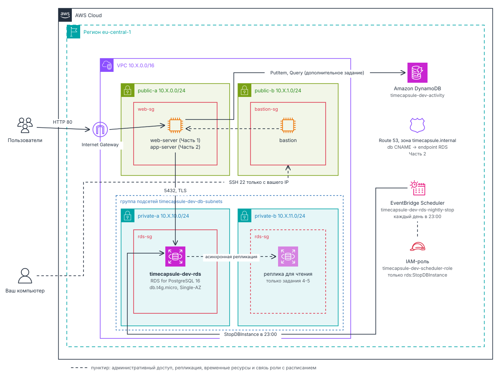

# Лабораторная работа №5. Облачные базы данных. Amazon RDS

## Цель работы

Научиться размещать базу данных в Amazon RDS с ограниченным сетевым доступом, работать с репликой для чтения и восстанавливать данные после ошибки. Перенести базу приложения с `db-server` в RDS и организовать её работу без лишних расходов.

## Как устроена работа

| Уровень     | Что нужно сделать               | Максимальная оценка |
| ----------- | ------------------------------- | ------------------- |
| Базовый     | Часть 1: задания 1-5            | 7                   |
| Продвинутый | Часть 1 и Часть 2: задания 1-12 | 10                  |

Часть 1 учебная. Вы создаёте отдельную базу, пробуете на ней возможности RDS и в конце удаляете её. Часть 2 продолжает ЛР3 и ЛР4: база вашего приложения переезжает с `db-server` в RDS и остаётся там до конца курса.

> [!IMPORTANT]
> База не должна быть доступна напрямую из интернета. В Части 1 подключайтесь к ней с `web-server` (или `app-server`, если `web-server` удалён), в Части 2 - с `app-server`. CloudShell не используйте.

## Что вы построите



_Рисунок 5.1. Базы данных, которые вы построите в этой работе_

- _База RDS for PostgreSQL_ в приватной подсети с ограниченным сетевым доступом. В Части 1 это учебная база `lab5-db`, в Части 2 - база приложения `timecapsule-dev-rds`.
- _Реплика для чтения и восстановленная копия_ учебной базы. Обе нужны только на время заданий.
- _Расписание_ (Часть 2), которое каждый вечер останавливает базу приложения.
- _Запись в Route 53_ (Часть 2), по которой приложение находит новую базу.

## Сколько это стоит

> [!NOTE]
>
> У RDS есть особенность, о которой нужно знать заранее. Остановить базу можно не больше чем на 7 дней. Потом AWS запускает её сам, и она работает и оплачивается круглосуточно, пока вы снова её не остановите.

- Учебная база из Части 1 живёт несколько часов, а потом вы её удаляете. Она стоит меньше доллара.
- База приложения из Части 2 остаётся до конца курса. Поэтому в задании 7 вы настроите расписание, которое останавливает её каждый вечер.

Оценка для базы приложения на три месяца, если она работает около 3 часов в день (регион `eu-central-1`, цены на октябрь 2026 года):

| Ресурс                   | Как оплачивается                              | За 3 месяца |
| ------------------------ | --------------------------------------------- | ----------: |
| Экземпляр `db.t4g.micro` | ≈ $0,019 в час, пока работает                 |        ≈ $5 |
| Хранилище 20 ГиБ `gp3`   | ≈ $2,6 в месяц _всегда_, даже у остановленной |        ≈ $8 |
| Резервные копии          | Бесплатно в пределах объёма хранилища         |          $0 |
| EventBridge Scheduler    | Бесплатно при таком числе запусков            |          $0 |
| Итого                    |                                               |    ≈ $13-14 |

> [!WARNING]
>
> Останавливайте базу после каждого занятия (`Actions` → `Stop temporarily`) и запускайте в начале следующего. Если забыть, один только экземпляр обойдётся примерно в $14 в месяц. Базу с репликой остановить нельзя, поэтому реплику удаляйте на том же занятии.

## Перед началом

Убедитесь, что:

- Выполнена базовая часть ЛР3: есть VPC с приватными подсетями `private-a` и `private-b`, `bastion` и `web-server` с клиентом `psql`.
- Если в ЛР3 вы удалили `web-server`, в Части 1 работайте с `app-server`.
- Для Части 2 выполнены продвинутые части ЛР3 и ЛР4.
- Все ресурсы создавайте в регионе `eu-central-1` под IAM-пользователем.

## Часть 1. Базовый уровень

Все ресурсы этой части учебные. Называйте их с префиксом `lab5-` и добавляйте им тег `Lab` со значением `lab5`. В конце части вы их удалите.

### Задание 1. Размещение и доступ к базе

База должна находиться в приватной подсети, а подключаться к ней должны только серверы приложения. Настройки сетевого доступа вы уже проходили в ЛР3, поэтому здесь важно самостоятельно выбрать нужные правила.

1. _Создайте группу подсетей_ `lab5-db-subnets`, включив в неё приватные подсети `private-a` и `private-b` из VPC, созданной в ЛР3. Эта группа определяет, в каких подсетях RDS может размещать экземпляры базы данных.
2. _Создайте Security Group для веб-сервера_ - экземпляра EC2, который будет подключаться к базе данных.
3. _Создайте отдельную Security Group для базы данных_ Amazon RDS. Разрешите входящие подключения по TCP-порту `5432` только от Security Group веб-сервера.

_Примечание_: если вы удалили подсети `private-a` и `private-b` в ЛР3, создайте их заново перед выполнением этого задания.

> Почему для ограничения доступа удобнее использовать Security Group источника, а не его IP-адрес? Зачем указывать две подсети, если учебная база будет работать в одной зоне?

### Задание 2. База RDS

Теперь создайте в созданной группе подсетей учебную базу `lab5-db`.

1. _Создайте базу_ `lab5-db` с такими параметрами:
   - PostgreSQL последней версии.
   - Шаблон `Sandbox`. Он не даёт выбрать дорогие варианты, например резервный экземпляр Multi-AZ: копию базы в другой зоне, которая подхватывает работу при отказе основной.
   - Класс `db.t4g.micro`, хранилище `gp3` на 20 ГиБ без автоматического увеличения.
   - Пользователь `dbadmin` и пароль, который вы задаёте сами. Запишите его: _посмотреть его потом нельзя_.
   - Группа подсетей `lab5-db-subnets`, зона `eu-central-1a`, без публичного доступа.
   - Security Group `lab5-rds-sg`, настроенная в задании 1.
   - База данных `lab5` внутри экземпляра.
   - Резервные копии хранятся 7 дней. На любой момент этих 7 дней базу можно восстановить.
   - Шифрование и защита от удаления (`deletion protection`) включены. Шифрование можно включить только при создании базы.
2. _Дождитесь_, пока база перейдёт в состояние `Available`.

> Как убедиться, что база принимает подключения только с нужного сервера? Почему для неё выбрана зона `eu-central-1a`? От чего защищает `deletion protection`, а от чего нет?

### Задание 3. Подключение к базе

Создайте виртуальную машину веб-сервера, с которой вы будете подключаться к базе данных. Назначьте ей Security Group веб-сервера, созданную в задании 1.

Когда база станет `Available`, подключитесь к ней с веб-сервера и создайте учебную таблицу.

1. _Подключитесь к базе_:

   ```bash
   psql -h <endpoint> -U dbadmin -d lab5
   ```

2. _Проверьте соединение_:

   ```sql
   SELECT version();
   \conninfo
   ```

3. _Создайте таблицу_:

   ```sql
   CREATE TABLE notes (
       id         SERIAL PRIMARY KEY,
       body       VARCHAR(100) NOT NULL,
       created_at TIMESTAMPTZ NOT NULL DEFAULT now()
   );
   INSERT INTO notes (body) VALUES ('first'), ('second'), ('third');
   SELECT * FROM notes;
   ```

4. _Узнайте IP-адрес базы_: разрешите имя endpoint на сервере приложения и на своём компьютере.

### Задание 4. Реплика для чтения

Реплика для чтения - это копия базы, которая получает все изменения основной базы и отвечает на запросы чтения. Создайте её во второй зоне.

1. _Создайте реплику_ `lab5-db-replica` для `lab5-db`:
   - класс `db.t4g.micro`, зона `eu-central-1b`,
   - без публичного доступа,
   - доступ как у основной базы.

   _Защита от удаления не нужна: реплика временная_.

2. _Дождитесь_, пока реплика перейдёт в состояние `Available`. Это занимает 10-15 минут.
3. _Подключитесь к реплике_ по её endpoint и выполните:

   ```sql
   SELECT pg_is_in_recovery();
   SELECT * FROM notes;
   INSERT INTO notes (body) VALUES ('from replica');
   ```

4. _Выполните `SELECT pg_is_in_recovery();` на основной базе_ и сравните результат с репликой.
5. _Добавьте на основной базе строку_ `fourth`.
6. _Прочитайте таблицу на реплике_.
7. _Посмотрите отставание реплики_: метрика `ReplicaLag` на вкладке `Monitoring`. Изменения доходят до реплики с небольшой задержкой, и метрика показывает её в секундах.

> Почему `INSERT` на реплике не выполнился? Чем реплика для чтения отличается от резервного экземпляра Multi-AZ?

### Задание 5. Восстановление после ошибки

Одна из самых частых аварий с базой - случайное удаление данных. Смоделируйте её и верните данные из резервных копий.

1. _Запомните время_: выполните на основной базе `SELECT now() AT TIME ZONE 'UTC';`.
2. _Удалите все строки_: через минуту выполните на основной базе `DELETE FROM notes;`.
3. _Посмотрите таблицу на реплике_.
4. _Удалите реплику_: она больше не понадобится.
5. _Проверьте, можно ли уже восстановить базу_. На вкладке `Maintenance & backups` найдите `Latest restore time`. Если оно раньше времени из шага 1, подождите несколько минут: RDS сохраняет журнал изменений базы примерно раз в пять минут.
6. _Восстановите базу на момент из шага 1_ (`Restore to point in time`). Учтите часовой пояс, указанный рядом с полем времени.
7. _Задайте параметры копии_: имя `lab5-db-restore`
   - одна зона, `db.t4g.micro`,
   - группа подсетей `lab5-db-subnets`,
   - без публичного доступа, доступ как у основной базы, без защиты от удаления.

8. _Дождитесь_, пока копия перейдёт в состояние `Available`.
9. _Удалите копию_ без финального снимка и без сохранения резервных копий.

> Почему реплика не спасла данные? Почему восстановление создаёт новую базу, а не откатывает старую?

### Завершение Части 1

Когда отчёт по Части 1 готов, удалите учебную базу. Если оставить её, через 7 дней AWS запустит её сам.

1. _Выключите защиту от удаления_ у `lab5-db`. Остановленную базу изменить нельзя, поэтому сначала запустите её.
2. _Удалите_ `lab5-db` без финального снимка и без сохранения резервных копий.
3. _Удалите_ группу подсетей `lab5-db-subnets` и Security Group `lab5-rds-sg` после удаления базы.
4. _Проверьте_, что не осталось ни реплики, ни копии.

## Часть 2. Продвинутый уровень

В ЛР3 база приложения TimeCapsule работала на отдельном сервере `db-server`, и обновлять её и делать резервные копии приходилось вам. Теперь база переезжает в RDS.

| Что                         | ЛР3                                                | ЛР5                                                      |
| --------------------------- | -------------------------------------------------- | -------------------------------------------------------- |
| Где работает база           | `db-server`, PostgreSQL на EC2                     | `timecapsule-dev-rds`, RDS for PostgreSQL                |
| Обновления СУБД и ОС        | Вы, через временный NAT Gateway                    | AWS, в окно обслуживания                                 |
| Резервные копии             | Нет                                                | Автоматические, восстановление на любой момент за 7 дней |
| Как приложение находит базу | `db.timecapsule.internal`, запись A на `db-server` | `db.timecapsule.internal`, запись CNAME на endpoint базы |

Ресурсы этой части остаются до конца курса, поэтому называйте их по соглашению из ЛР3. Тег `Lab` имеет значение `lab5`, расписаниям теги не нужны.

| Ресурс                           | Имя                                | Как он называется в заданиях |
| -------------------------------- | ---------------------------------- | ---------------------------- |
| Security Group базы              | `timecapsule-dev-rds-sg`           | группа доступа               |
| Группа подсетей базы данных      | `timecapsule-dev-db-subnets`       | группа подсетей              |
| Экземпляр RDS                    | `timecapsule-dev-rds`              | база                         |
| Политика IAM для расписания      | `timecapsule-dev-rds-stop`         | политика расписания          |
| Роль IAM для расписания          | `timecapsule-dev-scheduler-role`   | роль расписания              |
| Расписание EventBridge Scheduler | `timecapsule-dev-rds-nightly-stop` | расписание                   |

### Задание 6. База приложения

Создайте базу приложения так же, как учебную, но с именами из таблицы.

1. _Создайте группу подсетей_ из двух приватных подсетей в разных зонах доступности. _Вы создавали эти подсети в ЛР3._
2. _Создайте базу данных RDS_, используя группу подсетей из предыдущего шага. В параметре `Initial database name` не указывайте имя базы данных - `timecapsule` вы создадите сами в задании 8.

> Какие параметры базы приложения вы выбрали бы иначе для рабочей системы с реальными пользователями? Почему?

### Задание 7. Ночная остановка базы

Базу приложения легко забыть остановить, а остановленную базу через 7 дней AWS запустит сам. Поэтому пусть каждый вечер её останавливает расписание EventBridge Scheduler.

EventBridge Scheduler - сервис, который выполняет действие AWS по расписанию. Каждое расписание отвечает на три вопроса:

- _Когда_. Один раз в заданный момент (`One-time schedule`) или регулярно: через равные промежутки (`rate`) или по выражению `cron`, почти как в Linux.
- _Что сделать_. Цель (`Target`): запустить функцию, отправить сообщение или вызвать почти любое действие API AWS. Нам нужно действие `StopDBInstance` сервиса RDS.
- _От чьего имени_. Расписание вызывается не от вашего имени, а от имени роли. Поэтому роли нужно право на это действие, а брать её на себя должно быть разрешено самому Scheduler.

У расписания нет истории запусков. Сработало ли оно, видно по результату.

1. _Создайте политику_ `timecapsule-dev-rds-stop`, которая разрешает только `rds:StopDBInstance` для базы `timecapsule-dev-rds`.
2. _Создайте роль_ `timecapsule-dev-scheduler-role` с этой политикой. Брать роль на себя может только EventBridge Scheduler (`scheduler.amazonaws.com`).
3. _Откройте_ `Amazon EventBridge` → `Scheduler` → `Create schedule` и назовите расписание `timecapsule-dev-rds-nightly-stop`.
4. _Задайте время_. Выберите `Cron-based schedule`. Выражение состоит из полей "минуты, часы, день месяца, месяц, день недели, год": например, `0 23 * * ? *` означает каждый день в 23:00. Для проверки сначала укажите время через 5 минут от текущего.
5. _Задайте часовой пояс_ `Europe/Chisinau` и `Flexible time window`: `Off`, чтобы расписание срабатывало точно в срок.
6. _Выберите действие_: `Target`: `All APIs` → `Amazon RDS` → `StopDBInstance`, входные данные `{"DbInstanceIdentifier": "timecapsule-dev-rds"}`.
7. _Выберите роль_: `Permissions`: `Use existing role` → `timecapsule-dev-scheduler-role`.
8. _Создайте расписание_.
9. _Проверьте расписание_: в назначенное время база перейдёт в состояние `Stopped`, а в `Logs & events` появится событие.
10. _Перенесите остановку на вечер_: замените выражение на `0 23 * * ? *`.
11. _Запустите базу снова_: она нужна для следующих заданий.

С этого момента база останавливается каждый вечер, поэтому в начале каждого занятия запускайте её первой.

> Зачем расписанию своя роль, если вы и сами можете остановить базу? Почему роль может остановить только одну базу?

### Задание 8. Пользователь и база данных

В новом экземпляре пока есть только служебная база данных `postgres`. Приложение не должно работать под `dbadmin`, поэтому создайте для него пользователя и базу данных `timecapsule`.

1. _Подключитесь к экземпляру базы данных_ с вашего веб-сервера под `dbadmin`, указав базу данных `postgres`.
2. _Создайте пользователя и базу данных_. Пароль возьмите из `DB_PASSWORD` в `.env`, тогда `.env` менять не придётся.

   ```sql
   CREATE USER timecapsule;
   \password timecapsule
   GRANT timecapsule TO dbadmin;
   CREATE DATABASE timecapsule OWNER timecapsule;
   ```

   `\password` спрашивает пароль и не оставляет его в истории `psql`. `GRANT` нужен, потому что `dbadmin` в RDS не суперпользователь: сделать другого пользователя владельцем базы данных он может, только если сам входит в его роль.

> Почему приложению нужен отдельный пользователь, а не `dbadmin`?

### Задание 9. Перенос данных

Теперь перенесите данные с `db-server` в новую базу. Приложение пока работает со старой базой.

> [!WARNING]
>
> Не открывайте приложение с момента выгрузки до шага 5 задания 10. При каждом запросе оно открывает капсулы, время которых наступило, и записывает уведомления. Эти изменения в RDS не попадут.

1. _Выгрузите данные_ на `app-server`:

   ```bash
   pg_dump -h db.timecapsule.internal -U timecapsule -d timecapsule --no-owner --no-privileges -f timecapsule.sql
   ```

   `--no-owner` и `--no-privileges` убирают из выгрузки команды смены владельца и прав, поэтому владельцем всех таблиц станет `timecapsule`.

2. _Загрузите данные_ в RDS:

   ```bash
   psql -h <endpoint_базы> -U timecapsule -d timecapsule -f timecapsule.sql
   ```

3. _Сравните количество строк_ (`count(*)`) в таблицах `users` и `capsules` в обеих базах.
4. _Удалите результат выгрузки_ `timecapsule.sql`: в ней хранятся хеши паролей пользователей.

### Задание 10. Переключение приложения

Данные уже в RDS. Осталось направить приложение на новую базу и отключить `db-server`.

1. _Удалите запись A_ `db` в зоне `timecapsule.internal`.
2. _Сразу создайте запись CNAME_ `db` на endpoint базы. Если имя запросят в промежутке, ответ "_такого имени нет_" может кэшироваться до 15 минут..
3. _Включите шифрование соединения_. RDS for PostgreSQL 16 принимает только зашифрованные соединения.
   - PHP и `psql` включают шифрование сами.
   - Для Node.js добавьте в `.env` строку `PGSSLMODE=no-verify` и перезапустите приложение, как в ЛР3. Соединение будет зашифровано, но сертификат сервера проверяться не будет.
4. _Проверьте приложение_: откройте `/health`, создайте капсулу и найдите её в таблице `capsules` в RDS.
5. _Остановите `db-server`_ и убедитесь, что приложение работает без него. После этого _удалите сервер_.

> Почему не пришлось менять `DB_HOST`? Какие обязанности из ЛР3 перешли к AWS, а какие остались за вами?

### Задание 11. Обслуживание базы

Приложение работает с RDS. Проверьте, как оно переносит перезагрузку и остановку базы, и посмотрите, что расписание делает по ночам.

1. _Перезагрузите базу_ и во время перезагрузки открывайте `/health`.
2. _Посмотрите события базы_ на вкладке `Logs & events`. RDS сам записывает туда всё, что происходит с экземпляром: остановку, запуск, перезагрузку, резервное копирование. По этим событиям видно, когда база была недоступна и почему.
3. _Остановите базу_ и откройте приложение.
4. _Запустите базу_ и проверьте приложение снова.

> Что показывал `/health` во время перезагрузки? Изменился ли endpoint после остановки и запуска? Какую ошибку получает расписание, если база уже остановлена?

### Задание 12. Архитектура и решение

Отразите переход на RDS в схеме и в архитектурном решении.

1. _Обновите схему_ из ЛР4 по образцу рисунка 5.1.
2. _Запишите решение_ о том, где размещать базу приложения, в `docs/adr/0004-database-hosting.md` по шаблону ADR из ЛР2. Сравните PostgreSQL на EC2, RDS в одной зоне, RDS Multi-AZ и Amazon Aurora.
3. _В разделе "Последствия" укажите_:
   - Как часто делаются резервные копии и сколько данных можно потерять.
   - Сколько стоит база, как ограничены расходы и что происходит после 7 дней остановки.
   - Как приложение находит базу и что изменится при отказе зоны `eu-central-1a`.

## Завершение работы

1. Базовый уровень: проверьте, что ресурсов с префиксом `lab5-` не осталось.
2. Продвинутый уровень: остановите базу приложения. Остальные ресурсы Части 2 не удаляйте, они понадобятся в следующих работах.

> [!TIP]
> В начале занятия сначала запускайте базу, а потом серверы: база запускается дольше.

## Частые проблемы и их решения

| Симптом                                                               | Что проверить                                                                                                          |
| --------------------------------------------------------------------- | ---------------------------------------------------------------------------------------------------------------------- |
| `psql`: `database "lab5" does not exist`                              | Подключитесь к базе данных `postgres` и выполните `CREATE DATABASE lab5;`.                                             |
| `CREATE DATABASE ... OWNER`: `must be able to SET ROLE "timecapsule"` | Не выполнен `GRANT timecapsule TO dbadmin;`.                                                                           |
| `pg_dump`: `server version mismatch`                                  | База не из ветки 16. Понизить версию нельзя: выключите `deletion protection`, удалите базу и создайте её заново.       |
| `Stop temporarily` недоступно                                         | У базы есть реплика или база не в состоянии `Available`.                                                               |
| База не удаляется                                                     | Включена `deletion protection`. Выключите её через `Modify`. Остановленную базу изменить нельзя, сначала запустите её. |
| `Restore to point in time` не даёт выбрать время                      | Выбранное время позже `Latest restore time`. Подождите несколько минут.                                                |
| После переключения приложение несколько минут не находит базу         | Закэширован ответ "такого имени нет" из промежутка между удалением записи A и созданием CNAME. Подождите до 15 минут.  |
| Node.js: `no pg_hba.conf entry ... no encryption`                     | В `.env` нет `PGSSLMODE=no-verify` или приложение не перезапущено.                                                     |
| Расписание сработало, а база не остановилась                          | `DbInstanceIdentifier`, ARN базы в политике роли, кто может брать роль на себя, состояние базы `Available`.            |

## Контрольные вопросы

Контрольные вопросы указаны в заданиях. Ответьте на них письменно по ходу работы.

Для продвинутого уровня дополнительно подготовьте устные ответы:

1. Как проходит запрос от браузера до базы? Какие проверки проходит соединение на каждом шаге?
2. Чем репликация отличается от резервного копирования?
3. Как пережить отказ зоны `eu-central-1a` и сколько это будет стоить?
4. Как вы решили проблему автоматического запуска базы через 7 дней?

## Отчёт

Требования те же, что в ЛР2-ЛР4: `README.md` (максимум 10) или PDF (максимум 8). Для продвинутого уровня положите отчёт в `docs/lab5/README.md` репозитория приложения.

1. Шапка: ФИО, группа, специальность, уровень, для продвинутого уровня ссылка на репозиторий.
2. Базовый уровень:
   1. Задания 1-3: группа подсетей, как ограничен доступ к базе, `\conninfo`, `SELECT * FROM notes`, проверки доступа.
   2. Задания 4-5: ошибка `INSERT` на реплике, строка `fourth` на реплике, `ReplicaLag`, форма восстановления, строки после возврата.
3. Продвинутый уровень:
   1. Задания 6-7: вкладка `Connectivity & security` базы приложения, расписание и событие остановки.
   2. Задания 8-10: количество пользователей и капсул в обеих базах, `dig db.timecapsule.internal`, новая капсула в RDS, список серверов без `db-server`.
   3. Задание 11: `/health` во время перезагрузки, `StopDBInstance` в CloudTrail.
4. Архитектура (продвинутый уровень): схема и ссылка на ADR-0004.
5. Ответы на контрольные вопросы, по два-четыре предложения.

> [!WARNING]
> Не публикуйте пароли, `.env` и номер аккаунта.

## Представление работы

Представление лабораторной работы обязательно. Без представления максимальная оценка составляет 7 при выполнении всех условий.

_Если при защите студент не отвечает на вопросы преподавателя, итоговая оценка может быть ниже 7._
