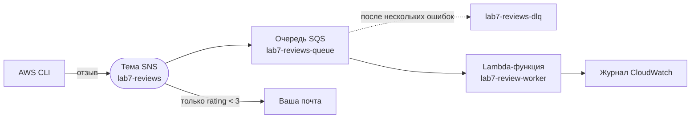
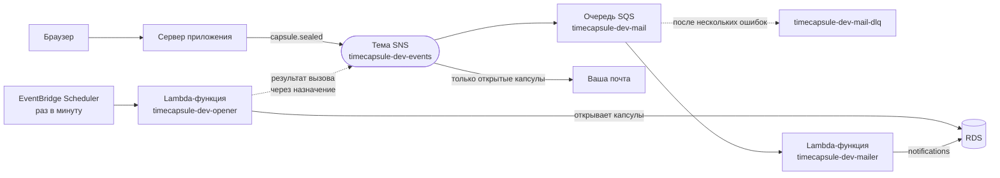

# Лабораторная работа №7. Бессерверные вычисления и события. AWS Lambda, Amazon SQS, Amazon SNS

## Цель работы

Научиться связывать части системы через тему Amazon SNS и очередь Amazon SQS и обрабатывать сообщения функциями AWS Lambda. Затем вынести из веб-запросов приложения медленную и фоновую работу: отправку писем и открытие капсул по времени.

## Как устроена работа

| Уровень     | Что нужно сделать               | Максимальная оценка |
| ----------- | ------------------------------- | ------------------- |
| Базовый     | Часть 1: задания 1-4            | 7                   |
| Продвинутый | Часть 1 и Часть 2: задания 1-10 | 10                  |

В Части 1 вы по шагам собираете небольшую систему отзывов. Отзыв проходит через тему и очередь, Lambda-функция его обрабатывает, а о плохих отзывах вы узнаёте по почте. В Части 2 такая же схема строится на приложении TimeCapsule: письма и открытие капсул переезжают из веб-сервера в функции Lambda.

В этой работе меньше готовых шагов, чем в прошлых. Параметры очередей и Lambda-функций, формат событий и способ защиты от повторов вы выбираете сами. Каждое такое решение нужно объяснить в отчёте: почему выбрано именно это значение и что случится, если выбрать другое.

> [!IMPORTANT]
> Все ресурсы создавайте в регионе `eu-central-1` под IAM-пользователем. Не кладите ключи доступа в код Lambda-функций, в `.env` и в репозиторий: серверы и Lambda-функции получают права через роли.

## Что вы построите

Обе части устроены одинаково: издатель отправляет событие в тему, очередь хранит его, пока до него не дойдёт Lambda-функция, а человек получает по почте только важные события.

| Элемент          | Часть 1: отзывы                          | Часть 2: TimeCapsule                                      |
| ---------------- | ---------------------------------------- | --------------------------------------------------------- |
| Издатель         | AWS CLI на вашем компьютере              | Сервер приложения и Lambda-функция открытия капсул        |
| Тема SNS         | `lab7-reviews`                           | `timecapsule-dev-events`                                  |
| Очередь и DLQ    | `lab7-reviews-queue`, `lab7-reviews-dlq` | `timecapsule-dev-mail`, `timecapsule-dev-mail-dlq`        |
| Обработчик       | `lab7-review-worker`, пишет в журнал     | `timecapsule-dev-mailer`, пишет в таблицу `notifications` |
| Почта с фильтром | Только плохие отзывы                     | Только открытые капсулы                                   |

## Сколько это стоит

При учебной нагрузке вся работа укладывается в бесплатный уровень или стоит центы.

| Ресурс                | Как оплачивается                                                                   |
| --------------------- | ---------------------------------------------------------------------------------- |
| AWS Lambda            | 1 млн вызовов и 400 000 ГБ-секунд в месяц бесплатно                                |
| Amazon SQS            | 1 млн запросов в месяц бесплатно, пустой запрос на получение тоже считается        |
| Amazon SNS            | Доли цента за учебные публикации, доставка в SQS и Lambda отдельно не оплачивается |
| EventBridge Scheduler | Бесплатно при таком числе запусков                                                 |
| CloudWatch Logs       | Центы за журналы Lambda-функций                                                    |

> [!WARNING]
> Пока к очереди подключена Lambda-функция, служба Lambda постоянно опрашивает очередь, даже пустую, и каждый опрос считается запросом к SQS. Забытый триггер расходует бесплатный лимит круглосуточно. Отключайте триггеры и расписание в конце занятия.

## Перед началом

Убедитесь, что:

- Вы выполнили Hands-on 9.1, 9.2, 10.1 и 10.2: умеете создавать Lambda-функцию, собирать zip-пакет с библиотеками, подключать очередь к Lambda-функции и подписывать очередь на тему.
- На вашем компьютере работает AWS CLI из ЛР2.
- Для Части 2 выполнены продвинутые части ЛР3-ЛР6: база приложения работает в RDS, вложения в S3, сессии в DynamoDB.

## Часть 1. Базовый уровень

Учебная задача: магазин принимает отзывы покупателей. Каждый отзыв нужно обработать, а о плохих отзывах (оценка 1 или 2) менеджер должен узнать сразу. В этой части обработка сводится к записи в журнал Lambda-функции, а отзывы вместо сайта магазина публикует AWS CLI.



_Рисунок 7.1. Система отзывов в Части 1_

Называйте ресурсы этой части с префиксом `lab7-` и добавляйте им тег `Lab` со значением `lab7`. Каждое задание дополняет одну и ту же систему: ничего не удаляйте до конца Части 1.

### Задание 1. Тема и очередь отзывов

1. _Создайте стандартную тему_ `lab7-reviews` и две стандартные очереди: `lab7-reviews-queue` для отзывов и `lab7-reviews-dlq` для отзывов, которые не удалось обработать.
2. _Настройте очередь отзывов_: таймаут видимости, срок хранения сообщений и политику повторной доставки (`Redrive policy`) с очередью `lab7-reviews-dlq`. Значения выберите сами, рекомендации AWS есть в документации Lambda[^1].
3. _Подпишите очередь на тему_. Решите, включать ли `Raw message delivery`.
4. _Опубликуйте отзыв_ с компьютера. Передайте оценку и в теле сообщения, и в атрибуте `rating`: атрибут понадобится в задании 4.

   ```bash
   aws sns publish --topic-arn <ARN темы> \
     --message '{"id": "r-1", "rating": 5, "text": "Fast delivery, good packaging"}' \
     --message-attributes '{"rating": {"DataType": "Number", "StringValue": "5"}}'
   ```

5. _Найдите отзыв в очереди_ через `Send and receive messages` → `Poll for messages`.

> Какие значения параметров вы выбрали и почему? Как выглядит тело сообщения в очереди с `Raw message delivery` и без него? Почему сообщение снова видно в очереди через некоторое время после того, как вы его получили?

### Задание 2. Обработчик отзывов

1. _Создайте Lambda-функцию_ `lab7-review-worker` на Node.js или Python. Для каждого отзыва Lambda-функция записывает в журнал строку вида `r-1: 5/5 Fast delivery, good p`: идентификатор, оценку и первые 20 символов текста. Пока считайте, что поле `text` есть в каждом отзыве.
2. _Подключите очередь_ `lab7-reviews-queue` к Lambda-функции. Размер пачки и таймаут Lambda-функции выберите сами и сверьте с таймаутом видимости из задания 1.
3. _Опубликуйте три отзыва_ подряд и найдите их в журнале Lambda-функции.

> Сколько вызовов Lambda-функции понадобилось для трёх отзывов и от чего это зависит?

### Задание 3. Отзыв, который не удалось обработать

Покупатель может поставить оценку без текста, а Lambda-функция из задания 2 к этому не готова.

1. _Опубликуйте отзыв без поля_ `text`, например `{"id": "r-4", "rating": 4}`, и убедитесь, что Lambda-функция завершается ошибкой.
2. _Проследите за отзывом_: посчитайте по журналу, сколько раз Lambda-функция его получала, и дождитесь, пока он окажется в `lab7-reviews-dlq`.
3. _Исправьте Lambda-функцию_, чтобы она обрабатывала отзывы без текста, и верните отзыв кнопкой `Start DLQ redrive`. В журнале должна появиться строка про `r-4`.

> Сколько раз обрабатывался отзыв с ошибкой и от какой настройки это зависит? Почему он попал в DLQ не сразу? Что произойдёт с остальными отзывами пачки, если ошибка случится на одном из десяти?

### Задание 4. Плохие отзывы на почту

Менеджеру не нужны все отзывы: на почту должны приходить только отзывы с оценкой 1 или 2. Очередь при этом по-прежнему получает все отзывы.

1. _Подпишите свою почту на тему_ и подтвердите подписку по ссылке из письма.
2. _Добавьте политику фильтрации_ по атрибуту `rating`. Решите сами, к какой подписке её добавить и как записать условие.
3. _Опубликуйте четыре отзыва_: три с оценками 1, 3 и 5 и один без атрибута `rating`.
4. _Заполните таблицу_: куда попал каждый отзыв.

| Отзыв        | Почта | Журнал `lab7-review-worker` |
| ------------ | ----- | --------------------------- |
| `rating = 1` |       |                             |
| `rating = 3` |       |                             |
| `rating = 5` |       |                             |
| без `rating` |       |                             |

> Почему отзыв без атрибута не пришёл на почту? Что пришлось бы менять в издателе, если бы он отправлял отзывы напрямую в каждую очередь, а появился новый получатель, например отдел аналитики?

### Завершение Части 1

1. _Удалите триггер_ Lambda-функции `lab7-review-worker`, затем саму Lambda-функцию и её группу журналов.
2. _Удалите_ очереди, тему и роль Lambda-функции.

## Часть 2. Продвинутый уровень

В TimeCapsule остались две задачи, которые веб-сервер делает не вовремя:

- _Письмо при запечатывании_. Функция отправки письма ждёт `MAIL_DELAY_SECONDS` секунд, как медленный почтовый сервер, и только потом записывает строку в таблицу `notifications`. Всё это время пользователь ждёт ответа на запрос `Seal capsule`.
- _Открытие капсул_. В начале каждого запроса приложение выполняет `UPDATE` для всех капсул, время которых наступило. Если на сайт никто не заходит, капсула не открывается. Когда серверов несколько, этот `UPDATE` выполняет каждый из них на каждом запросе.

Решение то же, что в Части 1 (рисунок 7.2): веб-сервер только публикует событие и сразу отвечает пользователю.



_Рисунок 7.2. Письма и открытие капсул в Части 2_

Называйте ресурсы по соглашению из ЛР3 и добавляйте им тег `Lab` со значением `lab7`.

| Ресурс                              | Имя                                                          |
| ----------------------------------- | ------------------------------------------------------------ |
| Тема SNS                            | `timecapsule-dev-events`                                     |
| Очередь писем и DLQ                 | `timecapsule-dev-mail`, `timecapsule-dev-mail-dlq`           |
| Lambda-функции                      | `timecapsule-dev-mailer`, `timecapsule-dev-opener`           |
| Роли Lambda-функций                 | `timecapsule-dev-mailer-role`, `timecapsule-dev-opener-role` |
| Security Group Lambda-функций       | `timecapsule-dev-lambda-sg`                                  |
| Политика IAM для публикации событий | `timecapsule-dev-app-events`                                 |
| Расписание EventBridge Scheduler    | `timecapsule-dev-open-capsules`                              |

Код каждой Lambda-функции храните в отдельном публичном репозитории в организации GitHub из ЛР2: `timecapsule-mailer` и `timecapsule-opener`.

> [!NOTE]
> 
> Zip-пакеты и установленные библиотеки в репозиторий не добавляйте: достаточно файла зависимостей (`package.json` или `requirements.txt`).

### Задание 5. Очередь писем и событие о запечатывании

Создайте следующие ресурсы:

1. Тему,
2. Очередь писем с DLQ,
3. Подписку очереди на тему, как в Части 1.

Опишите в `docs/events.md` формат события `capsule.sealed`.

> Что в событии нужно получателю, а что лучше не передавать?

### Задание 6. Lambda-функция писем

Lambda-функция `timecapsule-dev-mailer` делает то, что раньше делал веб-сервер: ждёт `MAIL_DELAY_SECONDS` и записывает строку в `notifications`.

Что может сбить с толку:

- _База доступна только из VPC_. В Hands-on Lambda-функции работали вне VPC. Подключите Lambda-функцию к приватным подсетям приложения с Security Group `timecapsule-dev-lambda-sg`[^2], а базу откройте для этой группы, как для веб-сервера в ЛР5.
- _Выход в интернет не нужен_. Сообщения из очереди забирает служба Lambda, а не код Lambda-функции[^3].
- _Шифрование_. RDS принимает только зашифрованные соединения. Для Node.js задайте `PGSSLMODE=no-verify` в переменных окружения Lambda-функции, для Python включите шифрование в параметрах драйвера.
- _Драйвер PostgreSQL_. Он не входит в среду выполнения Lambda: соберите его в zip-пакет, как `sharp` в Hands-on 9.2.
- _Одно сообщение может прийти дважды_. _SQS доставляет его хотя бы один раз_. Повтор не должен создавать второе уведомление.
- _Подключения к базе ограничены_. Каждый одновременный вызов Lambda-функции открывает своё подключение.

Проверьте Lambda-функцию без приложения: дважды отправьте в очередь одно и то же сообщение.

> Сколько уведомлений появилось после двух одинаковых сообщений и почему? Какой предел одновременных вызовов вы выбрали и из чего исходили?

### Задание 7. Публикация событий из приложения

- Замените отправку письма при запечатывании капсулы публикацией события `capsule.sealed`. 
- Права на публикацию выдайте роли `timecapsule-dev-app-role` политикой `timecapsule-dev-app-events`.

Если приложение работает в группе Auto Scaling, как в конце ЛР6, новая версия должна оказаться на всех её серверах.

Проверьте на вкладке `Network` в инструментах разработчика браузера, сколько длится запрос `Seal capsule` до и после изменения.

> Что увидит пользователь, если Lambda-функция писем сломана? Где в это время находится его письмо?

### Задание 8. Открытие капсул по расписанию

Lambda-функция `timecapsule-dev-opener` раз в минуту открывает капсулы, время которых наступило, и сообщает о них в тему. Открытие капсул из веб-запросов уберите. Подпишите свою почту на тему так, чтобы на неё приходили только события об открытии. Формат этих событий добавьте в `docs/events.md`.

Lambda-функции нужен доступ к базе, поэтому она тоже работает в VPC. Публикует в тему не код Lambda-функции, а служба Lambda через назначение.

**Назначение (destination)** - ресурс, в который служба Lambda отправляет запись о завершённом асинхронном вызове Lambda-функции. Запись о вызове (invocation record) - JSON, где поле `responsePayload` содержит то, что вернула Lambda-функция[^4]. EventBridge Scheduler вызывает Lambda-функцию асинхронно[^5]. Поэтому достаточно вернуть из Lambda-функции список открытых капсул и указать тему как назначение для успешных вызовов.

Что может сбить с толку:

- _У записи о вызове нет атрибутов сообщения_. Формат тоже отличается от `capsule.sealed`. Фильтр подписки можно применить к телу сообщения (`FilterPolicyScope` = `MessageBody`).
- _Запись отправляется после каждого успешного вызова_. Это происходит раз в минуту, даже если ни одна капсула не открылась.
- _База останавливается каждый вечер_. Её останавливает расписание из ЛР5, но Lambda-функция открытия продолжает запускаться.

Проверьте: создайте капсулу, которая откроется через 3-4 минуты, и не открывайте сайт. Когда время наступит, на почту должно прийти письмо от SNS, а в приложении появиться уведомление и открытая капсула.

> Что будет, если Lambda-функция открыла капсулы, но служба Lambda не смогла доставить запись в тему? Что пришлось бы добавить в сеть, если бы код Lambda-функции сам публиковал события в SNS, и сколько бы это стоило? Чем открытие капсул по расписанию хуже открытия при запросе?

### Задание 9. Сбой обработчика

Сломайте Lambda-функцию писем (например, укажите неверный пароль базы) и запечатайте две капсулы. Проследите за сообщениями по метрикам очереди, журналу Lambda-функции и DLQ. Затем исправьте Lambda-функцию и верните сообщения из DLQ. У каждой капсулы должно оказаться ровно одно уведомление.

> Через сколько попыток сообщения оказались в DLQ и от каких настроек это зависело? Что произошло бы с письмами при той же поломке в ЛР6?

### Задание 10. Архитектура и решение

Обновите схему архитектуры из ЛР6 по образцу рисунка 7.2. Запишите в `docs/adr/0006-background-jobs.md` по шаблону ADR из ЛР2 решение о том, где выполнять фоновую работу приложения. Сравните хотя бы три варианта:

- выполнение внутри веб-запроса, как раньше,
- задачу `cron` на сервере приложения,
- функции Lambda с SNS и SQS.

В разделе "Последствия" опишите, что происходит с письмами при сбое Lambda-функции и при остановке базы и как приложение защищено от повторных сообщений.

## Завершение работы

1. На базовом уровне проверьте, что ресурсов с префиксом `lab7-` не осталось.
2. На продвинутом уровне в конце каждого занятия отключите расписание и триггер Lambda-функции писем, остановите базу и серверы.
3. Это последняя работа курса. После защиты удалите все ресурсы с тегом `Project` = `timecapsule` через `Tag Editor` в `Resource Groups`, затем проверьте `Billing and Cost Management`.

## Частые проблемы и их решения

| Симптом                                                           | Что проверить                                                                                                                                               |
| ----------------------------------------------------------------- | ----------------------------------------------------------------------------------------------------------------------------------------------------------- |
| Письмо от SNS не приходит                                         | Подписка в состоянии `Pending confirmation`, письмо попало в спам или политика фильтрации отсекла сообщение.                                                |
| Сообщение опубликовано, но не попало в очередь                    | Политика доступа очереди не разрешает теме отправлять сообщения. Если подписывать очередь из консоли SQS, политику добавляет сама консоль.                  |
| Триггер не создаётся: ошибка про таймаут                          | Таймаут Lambda-функции больше таймаута видимости очереди.                                                                                                   |
| Настройка VPC не сохраняется: ошибка про `CreateNetworkInterface` | У роли Lambda-функции нет политики `AWSLambdaVPCAccessExecutionRole`.                                                                                       |
| Lambda-функция в состоянии `Pending`                              | Lambda создаёт сетевой интерфейс в VPC. Это занимает несколько минут.                                                                                       |
| Lambda-функция падает по таймауту при подключении к базе          | Security Group базы не принимает подключения от `timecapsule-dev-lambda-sg` или Lambda-функция подключена не к той VPC.                                     |
| Lambda-функция писем падает на сообщениях об открытии             | Lambda-функция ждёт формат `capsule.sealed`, а получила запись о вызове.                                                                                    |
| Lambda-функция открытия работает, но в тему ничего не публикуется | Lambda-функцию вызывали кнопкой `Test`, у роли нет `sns:Publish` или назначение задано для неудачных вызовов вместо успешных.                               |
| `Cannot find module` или `No module named`                        | Библиотека не попала в zip-пакет или лежит не в корне архива.                                                                                               |
| Python: `No module named 'psycopg2._psycopg'`                     | Пакет `psycopg2` установлен для Windows или macOS, а Lambda-функция выполняется на Linux. Проще всего взять драйвер `pg8000`, написанный целиком на Python. |
| Уведомления дублируются                                           | Lambda-функция писем не проверяет повторы. Другая причина: таймаут видимости меньше времени обработки, и сообщение получает второй вызов.                   |
| Приложение: `AuthorizationError` при публикации                   | Политика `timecapsule-dev-app-events` не прикреплена к роли или в ней указана другая тема.                                                                  |

## Контрольные вопросы

Ответьте письменно на вопросы из заданий. Для продвинутого уровня подготовьте также устные ответы:

1. Как проходит событие от нажатия `Seal capsule` до строки в таблице `notifications`? Где оно может задержаться и где потеряться?
2. Чем очередь SQS отличается от темы SNS и зачем в этой работе нужны обе?
3. Какую работу с SQS и SNS выполняет за Lambda-функции в VPC служба Lambda и почему Lambda-функциям не нужен выход в интернет?
4. Как изменилась архитектура приложения по сравнению с ЛР2? Какие обязанности перешли к AWS, а какие остались за вами?

## Отчёт

Требования те же, что и в ЛР2-ЛР6: `README.md` (максимум 10) или PDF (максимум 8). Для продвинутого уровня положите отчёт в `docs/lab7/README.md` репозитория приложения.

1. В шапке укажите ФИО, группу, специальность и уровень, а для продвинутого уровня ещё и ссылку на репозиторий.
2. Для базового уровня приложите заполненную таблицу из задания 4 и скриншоты параметров очереди, журнала Lambda-функции с повторными вызовами, отзыва в DLQ и письма о плохом отзыве. Объясните выбранные значения параметров.
3. Для продвинутого уровня приложите скриншоты запроса `Seal capsule` на вкладке `Network` до и после изменения, уведомлений в приложении и письма об открытой капсуле. Приложите также скриншоты расписания, назначения Lambda-функции открытия и метрик очереди и DLQ во время сбоя. Добавьте ссылки на репозитории `timecapsule-mailer` и `timecapsule-opener`, `docs/events.md`, схему и ADR-0006.
4. Ответьте на контрольные вопросы, по два-четыре предложения на каждый.

> [!WARNING]
> Не публикуйте пароли, `.env`, переменные окружения Lambda-функций со значениями и номер аккаунта.

## Представление работы

Представление лабораторной работы обязательно. Без представления максимальная оценка составляет 7 при выполнении всех условий.

На защите нужно запечатать капсулу и показать, по какому пути прошло событие. Затем нужно объяснить решения, которые вы приняли сами: какие параметры очереди выбраны, как приложение защищено от повторов и как события об открытии попадают в тему.

_Если при защите студент не отвечает на вопросы преподавателя, итоговая оценка может быть ниже 7._

[^1]: Amazon Web Services (2026). _Creating and configuring an Amazon SQS event source mapping_. AWS Lambda Developer Guide. Available at: https://docs.aws.amazon.com/lambda/latest/dg/services-sqs-configure.html

[^2]: Amazon Web Services (2026). _Giving Lambda functions access to resources in an Amazon VPC_. AWS Lambda Developer Guide. Available at: https://docs.aws.amazon.com/lambda/latest/dg/configuration-vpc.html

[^3]: Amazon Web Services (2026). _Tutorial: Using a Lambda function to access an Amazon RDS database_. Amazon RDS User Guide. Available at: https://docs.aws.amazon.com/AmazonRDS/latest/UserGuide/rds-lambda-tutorial.html

[^4]: Amazon Web Services (2026). _Capturing records of Lambda asynchronous invocations_. AWS Lambda Developer Guide. Available at: https://docs.aws.amazon.com/lambda/latest/dg/invocation-async-retain-records.html

[^5]: Amazon Web Services (2026). _Invoke a Lambda function on a schedule_. AWS Lambda Developer Guide. Available at: https://docs.aws.amazon.com/lambda/latest/dg/with-eventbridge-scheduler.html
