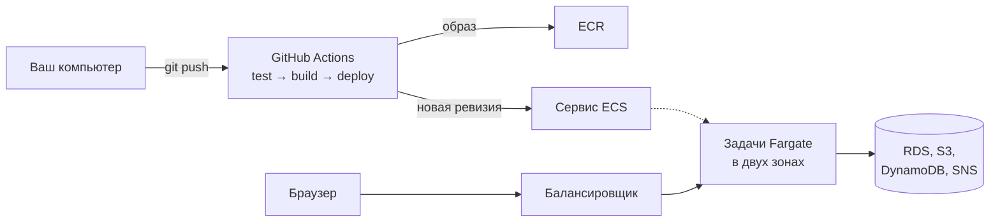

# Лабораторная работа №8. Контейнеры и CI/CD. Amazon ECR, Amazon ECS, AWS Fargate, GitHub Actions

## Цель работы

Перенести приложение TimeCapsule с серверов EC2 в контейнеры Amazon ECS на AWS Fargate и настроить конвейер CI/CD, который после каждого `git push` проверяет код, собирает образ и выпускает новую версию без остановки приложения.

## Как устроена работа

| Уровень     | Что нужно сделать | Максимальная оценка |
| ----------- | ----------------- | ------------------- |
| Продвинутый | Задания 1-5       | 10                  |

Это дополнительная работа, базовой части в ней нет. Она продолжает продвинутые части ЛР2-ЛР7: база в RDS, вложения в S3, сессии в DynamoDB и события в SNS остаются на месте. Меняется только то, где работает код и как он попадает к пользователям.

Готовых шагов в работе нет: как это делается в консоли, вы видели в Hands-on 12.1 и 12.2. Все параметры вы выбираете сами и объясняете выбор в отчёте.

> [!IMPORTANT]
> Ключей доступа AWS не должно быть ни в образе, ни в репозитории, ни в настройках GitHub. Задачи получают права через роль задачи, а конвейер через OIDC.

## Что вы построите

_Рисунок 8.1. TimeCapsule в ECS и конвейер выпуска_

Называйте ресурсы по принятому соглашению из предыдущих лабораторных работ.

## Сколько это стоит

Две задачи Fargate по 0,25 vCPU и 0,5 ГБ за балансировщиком стоят около 0,08 USD в час без учёта базы RDS[^1]. GitHub Actions для публичного репозитория бесплатен[^2].

> [!WARNING]
> Задачи и балансировщик оплачиваются, даже если запросов нет. В конце каждого занятия ставьте в сервисе `Desired tasks` равным `0` и удаляйте балансировщик.

## Перед началом

- Выполнены Hands-on 12.1 и 12.2.
- Выполнены продвинутые части ЛР3-ЛР7, и их ресурсы не удалены.
- На компьютере работает Docker.

## Задания

### Задание 1. Образ приложения

Напишите `Dockerfile` для своего варианта приложения, проверьте контейнер локально с базой PostgreSQL во втором контейнере и загрузите образ в приватный репозиторий ECR. Теги неизменяемые, тег образа - короткий хэш коммита.

В образе есть код и библиотеки, но нет `.env` и загруженных файлов. Настройки приложение читает из переменных окружения, журналы пишет в стандартный вывод.

Что может сбить с толку:

- _PHP-FPM не принимает HTTP_. Возьмите образ с Apache (`php:8.4-apache`) или запустите nginx и PHP-FPM двумя контейнерами в одной задаче: они видят друг друга по адресу `127.0.0.1`[^3].
- _Mac на Apple Silicon собирает образ для `arm64`_. Соберите образ с `--platform linux/amd64`.

> Что в образе меняется от версии к версии, а что задаётся при запуске? Почему тег `latest` не подходит для выпуска версий?

### Задание 2. Приложение в ECS

Запустите приложение сервисом ECS с двумя задачами в двух зонах за балансировщиком с проверкой `/health`. Пароль базы передайте через `secrets` из Parameter Store или Secrets Manager. Включите circuit breaker с откатом. Группу Auto Scaling из ЛР6 удалите.

Проверьте: войдите в приложение, создайте капсулу с вложением, затем остановите одну задачу вручную. Вход и данные должны сохраниться.

Что может сбить с толку:

- _Две роли_. Роль выполнения задачи нужна службе ECS: скачать образ, писать журналы и прочитать пароль[^4]. Роль задачи нужна коду приложения для S3, DynamoDB и SNS. Роль сервера из прошлых работ не подойдёт: её может принимать только EC2.
- _Тип цели `IP`_. Задачи Fargate регистрируются в целевой группе по IP-адресу, поэтому целевая группа из ЛР6 не подойдёт.

> Почему задачу можно заменить в любой момент без потери данных? Где теперь создаются таблицы при выпуске новой версии и почему там?

### Задание 3. Конвейер CI/CD

Добавьте в репозиторий приложения конвейер GitHub Actions. На каждый `push` и pull request он запускает тесты. После `push` в `main` он ещё собирает образ, загружает его в ECR и выпускает новую ревизию в ECS. Конвейер получает права через роль с минимальными правами, которую может принять только ветка `main` вашего репозитория.

Тесты выберите сами, но сломанный код они должны останавливать. Тег образа выведите в подвале страницы рядом с `Served by`. Выпустите новую версию и обновляйте страницу во время выпуска.

> Почему конвейеру не нужны ключи доступа AWS? Что видел пользователь во время выпуска?

### Задание 4. Сломанный выпуск

Отправьте два сломанных коммита: один не проходит тест, другой проходит тесты, но не проходит проверку `/health` в AWS. Проследите за каждым по журналу конвейера и событиям сервиса, затем отмените правки.

> Что видел пользователь в каждом случае? Каким статусом завершился конвейер во втором случае и как понять, что версия не выпущена[^5]?

### Задание 5. Архитектура и решение

Обновите схему архитектуры из ЛР7. Запишите в `docs/adr/0007-compute-platform.md` по шаблону ADR из ЛР2 решение о том, на чём работает приложение. Сравните хотя бы три варианта: группу Auto Scaling с образом AMI, ECS на Fargate и ECS на экземплярах EC2. В разделе "Последствия" укажите стоимость в месяц и то, как выпускается и откатывается версия.

## Завершение работы

1. В конце каждого занятия поставьте `Desired tasks` равным `0`, удалите балансировщик, остановите базу и `bastion`.
2. После защиты удалите все ресурсы с тегом `Project` = `timecapsule` через `Tag Editor`, репозиторий ECR с образами и роль конвейера. Затем проверьте `Billing and Cost Management`.

## Частые проблемы и их решения

| Симптом                                                   | Что проверить                                                                               |
| --------------------------------------------------------- | ------------------------------------------------------------------------------------------- |
| `CannotPullContainerError`                                | У задачи в публичной подсети нет публичного адреса[^3] или у роли выполнения нет прав на ECR. |
| Задача не стартует из-за секрета                          | Роль выполнения не может прочитать параметр или секрет.                                     |
| `AccessDenied` от S3, DynamoDB или SNS                    | В определении задачи не указана роль задачи.                                                |
| `Not authorized to perform sts:AssumeRoleWithWebIdentity` | Условие на `sub` не совпадает с репозиторием или в конвейере нет `id-token: write`.         |
| Конвейер падает на `iam:PassRole`                         | Политика конвейера не разрешает передавать роли задачи.                                     |

## Контрольные вопросы

Ответьте письменно на вопросы из заданий и подготовьте устные ответы:

1. Как изменение кода проходит путь от `git push` до задачи, которая обслуживает запрос? Где этот путь может остановиться?
2. Какую работу из ЛР2 и ЛР6 теперь выполняют ECS и конвейер, а что осталось за вами?

## Отчёт

Требования те же, что и в ЛР2-ЛР7. Положите отчёт в `docs/lab8/README.md` репозитория приложения.

1. В шапке укажите ФИО, группу, специальность и ссылку на репозиторий.
2. Приложите скриншоты образов в ECR, сервиса с двумя задачами, приложения с версией в подвале, успешного и остановленного запусков конвейера и событий сервиса с откатом.
3. Добавьте ссылки на `Dockerfile`, файл конвейера, схему и ADR-0007.
4. Ответьте на контрольные вопросы, по два-четыре предложения на каждый.

> [!WARNING]
> Не публикуйте пароли, `.env` и номер аккаунта.

## Представление работы

Представление лабораторной работы обязательно. Без представления максимальная оценка составляет 7 при выполнении всех условий.

На защите нужно отправить коммит и показать, как новая версия проходит конвейер и появляется в подвале страницы.

_Если при защите студент не отвечает на вопросы преподавателя, итоговая оценка может быть ниже 7._

[^1]: Amazon Web Services (2026). _AWS Fargate Pricing_. Available at: https://aws.amazon.com/fargate/pricing/

[^2]: GitHub (2026). _GitHub Actions billing_. GitHub Docs. Available at: https://docs.github.com/en/billing/concepts/product-billing/github-actions

[^3]: Amazon Web Services (2026). _Amazon ECS task networking options for Fargate_. Amazon ECS Developer Guide. Available at: https://docs.aws.amazon.com/AmazonECS/latest/developerguide/fargate-task-networking.html

[^4]: Amazon Web Services (2026). _Amazon ECS task execution IAM role_. Amazon ECS Developer Guide. Available at: https://docs.aws.amazon.com/AmazonECS/latest/developerguide/task_execution_IAM_role.html

[^5]: aws-actions (2023). _Issue #494_. GitHub, aws-actions/amazon-ecs-deploy-task-definition. Available at: https://github.com/aws-actions/amazon-ecs-deploy-task-definition/issues/494
